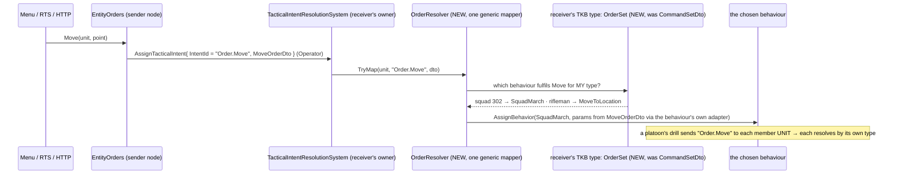
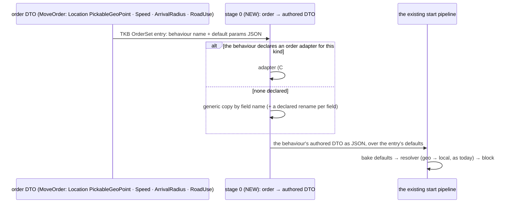

<!--STATUS
state: LIVE
updated: 2026-10-12
current-answer: §0 the four user rulings (R-273 (behaviors), R-274 (behaviors), R-275 (behaviors)) · §2 A — how the receiver decides: sub-questions A1–A6 (§2.2), A7 order → params (§2.3a), each with a lean (awaiting the user) · §3 B, C and the Health capability: ruled, details designed when built
stale-below: nothing
known-rot: none
known-conflict: docs/DESIGN_Entity_Control.md §3.1 and §10 map an order to a soldier behaviour IN THE SENDER (EntityOrders → MoveToLocation / CombatPosture / Idle); R-273 (behaviors) overrules that. docs/UX/UX_Feature_Entity_Commanding.md §2.4 lets a TKB CommandEntry name a behaviour that the MENU reads; A3 here narrows the menu to order kinds
related-designs:
  - docs/designs/tactical-intent/DESIGN.md — OWNS the receiver-side resolution (TacticalIntentResolutionSystem + mapper registry); its stated goal "senders fully agnostic of the recipient's unit type" is what R-273 (behaviors) re-affirms
  - docs/DESIGN_Entity_Control.md — OWNS EntityOrders, the one order service for HTTP, menu and RTS (R-270); A1 changes what it publishes
  - docs/UX/Architect_Question_29_Entity_Commanding.md — §H (an order to a formation is an order to its commander) and §I (the command set comes from the TKB) — ruled 2026-08-13, not built
  - docs/UX/UX_Feature_Entity_Commanding.md — OWNS the menu design and CommandSetDto (§2.4), NOT-BUILT; A2/A3 re-aim it
  - docs/designs/group-maneuvers/DESIGN_Squad_Tactics.md — OWNS the squad runner and drills (§3.1 "order = AssignBehavior to the commander") and the unit commander (§7, R-272 (behaviors))
  - docs/DESIGN_Entity_Interactions.md — OWNS embarkation (§7); B and C extend it
  - docs/blueprints/Architect_Question_83_Doctrine_And_Order_Origin.md — OWNS the origin gate (R-188), the SOP slot (R-189); its "an order as a GOAL" idea (deferred) is A2's rejected alternative
  - docs/blueprints/DESIGN_Parameter_Model.md — OWNS the behaviour start pipeline and the resolver (§P.2, R-152/R-154) that A7 puts one stage in front of
  - docs/DESIGN_Operations_Behaviour_Catalogue.md — OWNS the injury states (D1 / R-263) C depends on, and the echelon gap (T6)
-->

# Architect Question 90 — orders to a unit, carrying by vehicle type, carrying a person

## 0. The user's rulings *(2026-10-12)*

| # | 🔒 user, verbatim | ruling |
|---|---|---|
| **A** | *"the unit entity receiving the RTS order needs to decide on its own how to fulfill the command (what behavior it should start), nothing else should know (the UI level the least)"* | ✅ **R-273 (behaviors)**: the receiver picks the behaviour. The sender names only WHAT is ordered. §2 asks HOW |
| **B** | *"carrying capacity and seats (driver, gunner, passenger) belong to the vehicle type" — yes* | ✅ **R-274 (behaviors)**, first half |
| **C** | *"a soldier carrying or dragging a wounded comrade is the same embark mechanism with a 'human carrier' profile" — yes* | ✅ **R-274 (behaviors)**, second half |
| **D** | *"every ECS node participating in a live exercise capable of owning live entities should be equal regarding the capabilities, so i guess yes, every usual host"* | ✅ **R-275 (behaviors)**: `HealthApplicationSystem` joins the cross-role set; the principle generalises the I-2 *"no per-host initialisations"* |
| — | *"no building, we are still discussing features and designs"* | nothing here is dispatched |

## 1. INVENTORY *(graph CLI — the MCP server failed to connect this session; index refreshed 2026-10-12 — plus grep and one corpus sweep over `docs/` and `.dev/`)*

| query | total | result |
|---|---|---|
| `search_graph` `.*IntentMapper.*` / `.*TacticalIntent.*` (Class) | 2 / 15 | `TacticalIntentMapperRegistry` · `TacticalIntentResolutionSystem` · `AssignTacticalIntentEvent` · the DDS pair `TacticalIntentEgress/IngressTranslator` + `TacticalIntentRequest` · `CommanderNodes.IssueTacticalIntent*` |
| `search_graph` `.*Mapper$` (Class), order mappers only | 4 | `DefendAreaMapper` (switches on TKB type: APC → ConvoyEscort, infantry → CombatPosture) · `HullDownAttackMapper` (tanks only) · `ForceManeuverMapper` / `ClearForceManeuverMapper` (squad; never registered, AQ29 L67) |
| `search_graph` `.*EntityOrders.*` | 1 | `Hrot/Engine/Hrot.Common/Orders/EntityOrders.cs` |
| grep: a soldier behaviour named outside the AI layer | 3 sites | `EntityOrders.cs:98,113,117` (Move → `MoveToLocation`, Attack → `CombatPosture`, Hold → `Idle`) · `NedSimHostMissionSender.cs:49` (a mission task's `BehaviorId`) |
| grep: callers of `EntityOrders.Move/Attack/Hold/Behavior` | 3 front-ends | `MenuOrders` (Move Here · Engage · Stop) · `RtsCommands.cs:66,85` · `DebugApiService.Orders.cs:70-94` (also `Behavior(name)`) |
| grep: tests pinning a behaviour name on an order | 8 files | `MenuOrdersTests` (`:95` "MoveToLocation") · `RtsCommandToolTests` · `DebugApiOrdersTests` · `ABehaviourAdvertisesItsRealParametersTests` · 4 mission-control files |
| `search_graph` / grep `CommandSetDto` | 0 | the TKB command set (AQ29 §I) was designed, never built |

## 2. A — how the receiving unit decides

### 2.0 Claims *(both columns)*

| claim | code — how it IS | design — how it was MEANT |
|---|---|---|
| the receiver's node already resolves every intent: mapper by intent id, else intent id = behaviour name | ✅ `TacticalIntentResolutionSystem.cs:110-140`, gated on owning `BehaviorState` | ✅ tactical-intent DESIGN §2.1; goal: *"Keeps senders … fully agnostic of the recipient's unit type"* (:32) |
| the menu and the RTS tool speak ORDER KINDS (Move, Attack, Stop), not behaviours | ✅ `MenuOrders.cs:47-52`, `RtsCommands.cs:66,85` | ✅ Entity Control §3.1: *"three front-ends, one publish"* |
| ⛔ the order SERVICE picks the soldier behaviour, on the SENDING node | ✅ `EntityOrders.cs:98,113,117` | ⛔ contradicts the tactical-intent goal; Entity Control §10 wrote it in (*"`EntityOrders.Attack` → `CombatPosture`"*) |
| ⇒ an order to a squad starts a soldier behaviour on a body-less commander; the members get nothing | ✅ HANDOFF_Embark_I2d §3A (measured) | ✅ R-272 (behaviors): the commander has no body |
| a per-type command set in the TKB was ruled and never built | ✅ grep `CommandSetDto` = 0 | ✅ AQ29 §I (ruled 2026-08-13); UX Entity Commanding §2.4 |
| an order to a formation = an order to its commander entity, by its own TKB type | — | ✅ AQ29 §H |
| an existing mapper already decides by the receiver's type — but in central code | ✅ `DefendAreaMapper.cs` `switch (tkbType)` | ✅ hill-attack DESIGN §3.3 (the tank-only mapper) |
| a drill orders its soldiers by BEHAVIOUR name (`AdvanceTo` / `CombatPosture`, origin Superior) | ✅ `SquadManeuverRunner` Issue | ✅ Squad Tactics §3.1, Overview §9 |
| a mission task carries a behaviour id authored in the scenario | ✅ `MissionAdapterSystem.cs:108-111` → the same intent path | ⛔ searched: no design ties mission tasks to orders |

### 2.1 The lean, as one picture

*What the picture shows that prose hid: the sender's last fact is the order kind. The behaviour name first appears on the
receiver's node, read from the receiver's own type, so adding a unit type touches neither the UI nor the order service.*

### 2.2 Sub-questions

| # | question | ⭐ lean | blast radius | what would change the lean |
|---|---|---|---|---|
| **A1** | what does the sender publish? | an **order kind** as the intent id: `Order.Move`, `Order.Attack`, `Order.Hold` (later `Order.Defend`, …), each with an order DTO (Move: lat/lon, speed, arrival radius, road use; Attack: target; Hold: none). `EntityOrders` stops naming behaviours | `EntityOrders` (3 methods); the 4 order-test files re-pin the kind; the DDS intent topic is unchanged (the id is a string) | — |
| **A2** | where does the receiver's choice live? | ⭐ in the receiver's **TKB type**: AQ29 §I's command set, re-aimed as an `OrderSet` — order kind → behaviour name (+ default params). ONE generic `OrderResolver` mapper per order kind reads it on the owner node. The **behaviour** converts the order DTO into its own params (an adapter declared next to its params DTO). The type picks; the behaviour converts | new TKB descriptor + catalog entries for the types that take orders; one mapper; one adapter per fulfilling behaviour (≈ 6: MoveToLocation, CombatPosture, Idle, SquadMarch, SquadHold, the squad attack drill) | if you want the choice to depend on the situation (e.g. a squad under fire answers Move with a bound rather than a march), the `OrderSet` entry should name a **decision** (a utility decision, like `SquadContactResponse`) instead of a behaviour — the same table, one more level |
| **A3** | what does the menu show? | **only the order kinds the unit's type declares** (read from the same `OrderSet`), never a behaviour name; a `UnitEntity` gets no Possess | `MenuOrders`, the context-menu projector; AQ29 §I's "command = behaviour" menu becomes "command = order kind" | — |
| **A4** | down the echelons | a drill orders a member that is itself a **unit** by order kind (it then decides on its own, recursively); it keeps directing its own **soldiers** by behaviour, because a drill step (bound to here, suppress from there) is finer than any operator order and *is* the squad deciding how to fulfil its order | `SquadManeuverRunner.Issue` gains a branch on the member being a `UnitEntity`; platoon drills are later work | if you want soldiers to receive orders too, the order vocabulary must grow to drill-step kinds (Bound, Suppress, Hold-and-cover); every soldier type then needs an `OrderSet` |
| **A5** | stop and release | `Order.Hold` resolves per type (squad → `SquadHold`). Releasing a unit (Clear) ends its drill, and **a drill that ends, for any reason, clears the Superior orders it gave its members**, so each member's own SOP picks next | `SquadManeuverRunner` end/abort path; fixes `SquadMarchBehavior.cs:233` (release recalls nobody) | if you want members to HOLD where they are rather than return to their SOP, the runner issues `Order.Hold` instead of a clear |
| **A6** | the two paths that name a behaviour on purpose | keep `EntityOrders.Behavior(name)` for the **debug API / MCP only** (a test tool that scripts a unit), never on the menu or RTS. A mission task may name an **order kind** as well as a behaviour (both arrive as the same intent string, so it costs nothing) | none for the debug API; mission authoring gains an option | if you want no path at all to name a behaviour from outside, the debug route is removed and tests author behaviours through mission tasks |

### 2.3 Terms and the parameter hand-over *(added 2026-10-12, answering the user's follow-up)*

- **A drill:** a group behaviour that runs on a unit's commander entity through `SquadManeuverRunner`. Its body is a play
  (`ISquadPlay`): a phase table saying which members do what and when the phase changes. Each tick the runner sends each live
  member what it should do now (today a soldier behaviour, origin Superior). The built drills are `SquadMarch`,
  `BoundingOverwatch`, `SuppressAndManeuver`, `SquadHold`, `BreakContact` and `ReactToContact`. A drill is an ordinary
  registered behaviour, so an `OrderSet` entry can name one.
- **A platoon (A4):**
  1. The platoon's commander receives `Order.Move`. Its type's `OrderSet` names a platoon drill (e.g. `PlatoonMarch`), which starts on the platoon commander.
  2. That drill decides each squad's part (lead squad to the point, the others following at an interval) and sends each squad commander `Order.Move(its point)`. It never names `SquadMarch`.
  3. Each squad commander resolves that order through its own type and starts `SquadMarch`, which directs its soldiers.

  Not built: there is no platoon-of-squads type (`BdcTkbCatalog.cs:230-235`), and the tank platoon's members are vehicles,
  ordered by behaviour (`HillAttackCommanderNodes.cs:161-164,484-487`).
- **Parameters (A2):** the order does NOT carry the behaviour's params DTO, because that would force the sender to know which
  behaviour runs. Each order kind has its own small DTO. The behaviour's params are built on the receiver in two layers:
  1. the TKB `OrderSet` entry's default params (e.g. the squad's march shape, Wedge);
  2. overlaid with what the fulfilling behaviour's **adapter** takes from the order (`MoveOrder.Target` → `SquadMarch.Objective`).

  The adapter is code next to the behaviour's params DTO, because it converts lat/lon with the node's geographic transform.
  Precedent: `DefendAreaMapper.PostureAt` already turns `DefendAreaIntentDto` into `CombatPosture`'s params.

### 2.3a A7 — who converts the order's DTO into the behaviour's params *(added 2026-10-12, the user's follow-up; supersedes §2.3's "adapter is code" line)*

| claim | code — how it IS | design — how it was MEANT |
|---|---|---|
| a behaviour already has ONE optional conversion step at start (the resolver): the intent's JSON → its authored DTO → the resolver writes the block; with no resolver, a copy **by field name** | ✅ `BehaviorDefinition.ResolveStage` (CE-443, built) | ✅ Parameter Model §P.2; R-152 (one per behaviour, its job is conversion) |
| a resolver may be hand-written C# (`[BehaviorResolver]`) or a **blueprint resolver asset** that names its behaviour | ✅ `T40Resolver.bp.json` (`ResolverSubject`) | ✅ R-149 (a region names its resolver), R-154 (looked up by behaviour name), CE-428 |
| blueprints have typed To JSON / From JSON nodes for any `[BehaviorContract]` DTO | ✅ CE-472 built | ✅ DESIGN_Typed_Intent_And_Json_Nodes §3 |
| the world-location TYPE is `PickableGeoPoint` (lat/lon) — the type alone makes a member map-pickable | ✅ `Behavior/Params/PickableGeoPoint.cs` | ✅ DESIGN_Map_Picking_Unification (supersedes `[MapPickableWorldLocation]`) |
| ⛔ but no production behaviour DTO uses it: places are lat/lon doubles (`MoveToLocation`) or a local `Vector3 Objective` (`SquadMarch`, `AdvanceTo`, `CombatPosture.Advance`) | ✅ grep — only a test fixture uses `PickableGeoPoint` | ⛔ searched: no design says why |

*What the picture shows that prose hid: the order adds ONE stage in front of a pipeline that already converts. The existing
pipeline is untouched, and the behaviour's authored DTO stays the one description of what it accepts, for the editor form, the
mission task, the debug API and now the order.*

| A7 | ⭐ lean |
|---|---|
| **generic case** (no code) | copy by field name and type. ⭐ It works for most orders once behaviour DTOs use the vocabulary types: `PickableGeoPoint` for a place, `EntityRef` for a target, floats for speed and radius. The lat/lon → local conversion then stays in the behaviour's own resolver, whose designed job it already is. A field whose name differs is declared on the behaviour's DTO (`[FromOrder("Move", "Location")] Objective`, or the same property on a blueprint parameter) |
| **computed case** | an **order adapter**, one per behaviour per order kind, declared BY THE BEHAVIOUR, like its resolver: hand-written C#, or a **blueprint adapter asset** naming its behaviour and order kind (looked up by behaviour name, R-154). In a blueprint: From JSON the order DTO, compute, To JSON the authored DTO |
| **the TKB entry** | names only order kind → behaviour + optional default params. ⛔ Not the adapter: it belongs to the behaviour, or every unit type that uses `SquadMarch` for Move would repeat it |
| **validation** | at TKB load: an entry whose behaviour cannot be filled from the order (no adapter, and a required field matches nothing) is a load error, not a silent run with defaults |

Rejected:
- **The order carries the behaviour's DTO:** the sender must then know the behaviour (R-273).
- **The behaviour's resolver takes the order directly:** the resolver would need one input type per order kind (against R-152's one source), and the authored DTO would stop describing what the behaviour accepts.
- **The TKB entry names the adapter:** it repeats per unit type.
- **Copy by name only:** it fails where the meaning differs (an area's radius vs. a posture's arrival radius).

⛔ Not measured:
- whether a blueprint asset can RETURN a whole DTO today (a resolver writes through `ref block`; an adapter needs an output). This may need a new dispatch kind beside `Library`.
- how many behaviour DTOs would move to `PickableGeoPoint`.

### 2.4 Every place a behaviour is named from outside the unit today, and what A1/A6 do to it *(grep `new AssignTacticalIntentEvent` / `new AssignBehaviorEvent`, production only)*

| site | who names the behaviour | lean |
|---|---|---|
| `EntityOrders.Move/Attack/Hold` (`EntityOrders.cs:98,113,117`) ← the menu, the RTS tool, HTTP `move` / `attack` / `hold` | the order service | ⛔ **loses it**: publishes `Order.*` (A1) |
| `SimHostVisualization.cs:442` → `NedSimHostMissionSender.cs:49` (a click in the SimHost debug window sends a `MoveToLocation` mission over DDS) | a UI | ⛔ **loses it**: becomes `Order.Move` |
| HTTP `kind:"behavior"` → `EntityOrders.Behavior(name)` (`DebugApiService.Orders.cs:80-87`); the MCP tools use it | a test tool | ✅ keeps it (A6) |
| the editor's AI section, Task row (`EntityAiDetailsView.ApplyTask`, `:163-166`), in Edit and while running | the author / operator in the inspector | ✅ keeps it, as the AI-debugging inspector (A6; the user may rule otherwise) |
| scenario mission tasks (`MissionAdapterSystem.cs:108-111`) and a scenario entity's authored behaviour / SOP (`InitialBrainMaterializationSystem.cs:42`) | the scenario author | ✅ keeps it; a task may also name an `Order.*` (A6) |
| the blueprint Send Intent node (`Nodes.cs:1385`, intent id = a `[BehaviorContract]` id) | a blueprint author | ✅ keeps it; it also offers the order kinds |
| commanders ordering members: `SquadManeuverRunner.cs:402` (soldiers), `HillAttackCommanderNodes.cs:161,484` (tanks), `CommanderNodes.cs:80` (stub, `"DefendArea"`) | the unit's own drill | ✅ keeps it for soldier and vehicle members; ⭐ a **unit** member gets `Order.*` (A4) |
| the unit's own sources: TKB `DefaultBehavior` / `DefaultSop`, `SopActions.React`, a possession resume, a brain restart | the unit itself | ✅ unchanged: this IS the unit deciding |

**Rejected (one line each):**
- **One C# mapper per order kind switching on the TKB type** (the `DefendAreaMapper` shape): it puts every unit type's choice in central code, so a new type edits shared code. That is the coupling R-273 (behaviors) forbids.
- **The unit's SOP slot (R-189) decodes the order**: the order would compete with reactions under the origin gate, and every type would need an authored SOP just to accept a Move. AQ83 already deferred "an order as a goal".
- **The order service asks the receiver's type** (the TKB is readable on every node): the sender still holds the mapping, which is the UI-level knowledge the ruling excludes.

## 3. B, C and the Health capability — ruled; designed when built

| # | ruling | already measured *(HANDOFF_Embark_I2d §3)* | left to its design (Entity Interactions §7) |
|---|---|---|---|
| **B** | the vehicle **type** declares capacity and seats with roles (driver, gunner, passenger); only a declaring type gets a `PassengerBuffer`; crew are seated passengers with a role | capacity is a fixed 8 on every carrier (`InteractionComponents.cs:16`); every brained entity, soldiers included, gets an empty `PassengerBuffer` (`BehaviorTkbTranslator.cs:161-162`); `OpenPassengerCabin` is the per-type precedent | the seat model, who drives when the driver seat is empty, per-seat exposure (rejected until seats exist, §7.2) |
| **C** | carrying or dragging a person is **embark with a carrier profile** declared by the carrier's type: capacity 1, exposed, does not die with the carrier, a speed penalty, an attach offset; a drag is another profile | no wounded state exists (`Health {Current, Max}`); Treat / Drag / Carry are catalogue entries only | depends on the R-263 injury states being built first; composes with B (a profile is what a type declares) |
| **D** | `HealthApplicationSystem` joins the cross-role infrastructure (`CoreInfrastructureCapabilities`), declared on every host plan that can own live entities, like `Interactions` | registered only in `CgfLogicPack.cs:198,230`; it gates itself on owning `Health`, so running everywhere costs nothing where nothing is owned | ⛔ not measured: whether anything on CGF depends on its position in the phase (`HsmDamageBridgeSystem` reads its result), and whether `DamageAssessedEvent` reaches a non-CGF owner (`EntityHitDamageIngressTranslator`'s hosts) |
