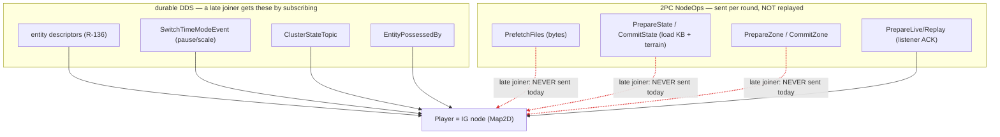
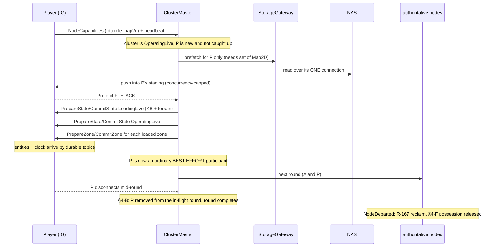
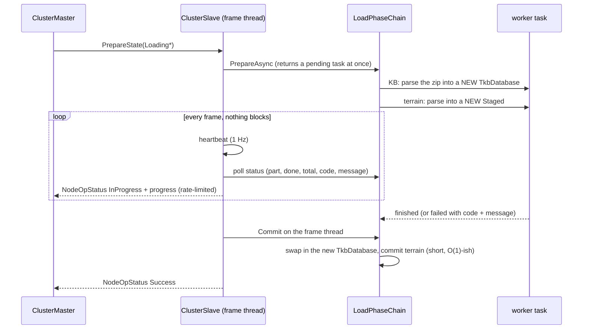
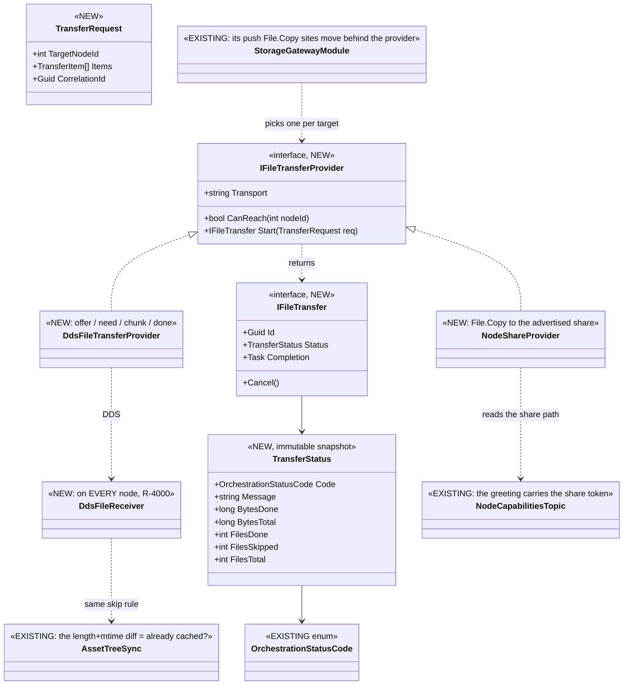
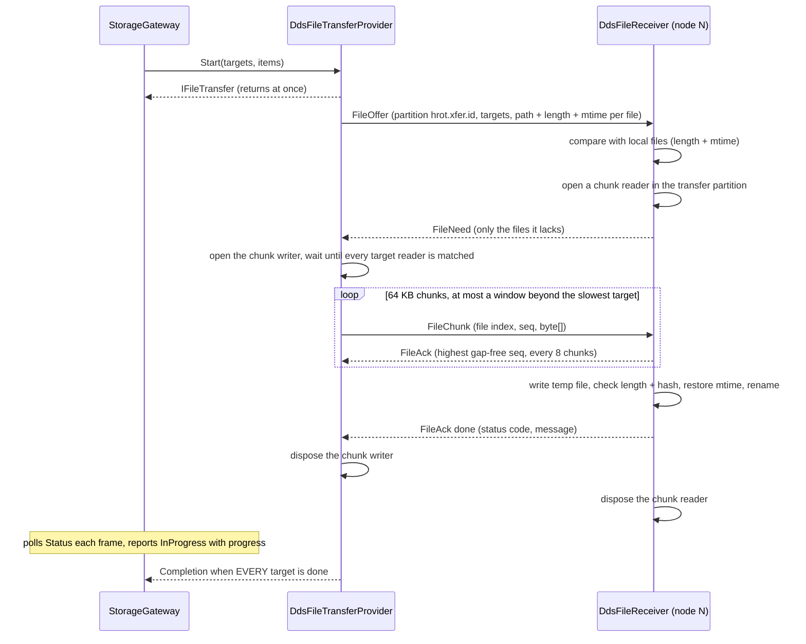
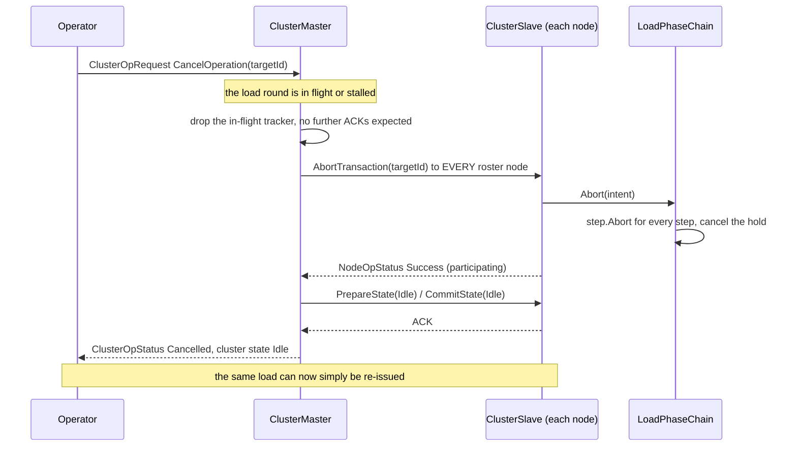
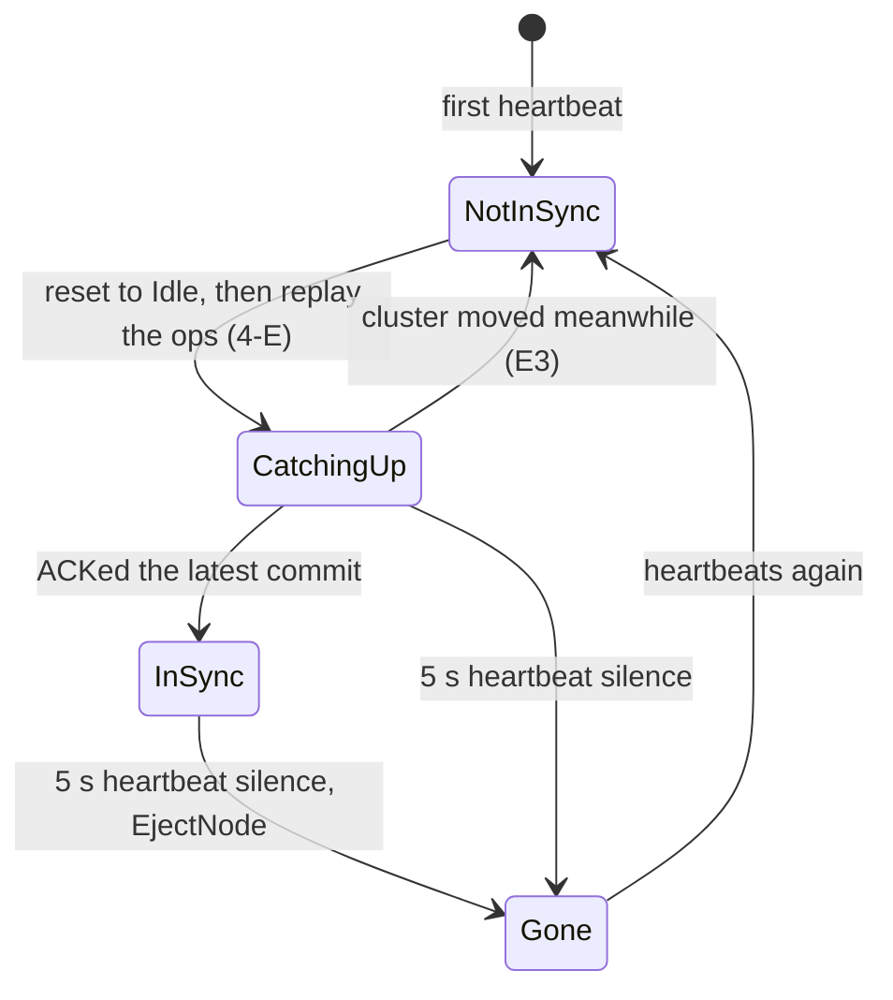
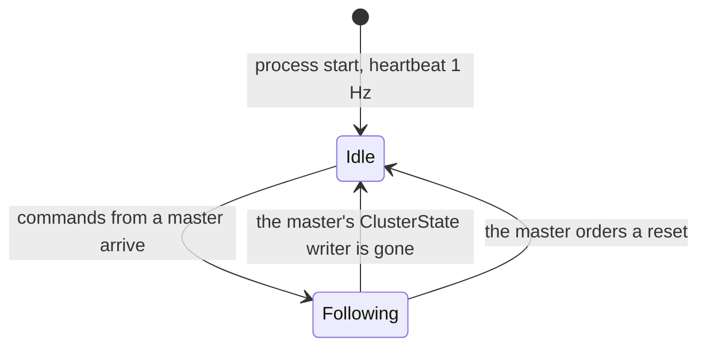

<!--STATUS
state: LIVE
updated: 2026-10-15 (⭐ §4-I NEW, OPEN — rejoin, outages and stale nodes: the master trusts only what it witnessed;
  does not affect the dispatched batch) ·
  2026-10-15 (REVIEW AMENDMENTS, before any run started: §4-A′ the authority predicate must FAIL SAFE ·
  §4-D′ two name-match sites + the departure channel · §4-E′ the committed zone set is ANNOUNCED durably ·
  §4-G′ no source-scan rail · ⭐ §4-H NEW — operator cancel returns the cluster to Idle, R-4004) ·
  2026-10-15 (APPROVED; amended by R-4001 heartbeat-only time limits — §4-B, §4-B2 — and R-4002 the file-transfer provider — §4-E2)
build-state: DESIGN — ✅ APPROVED 2026-10-15 (user: "accepted.") with two amendments (§0 rows I, J). Not dispatched; §4-B2
  and §4-E2 carry the measurements the amendments asked for. ⭐ DISPATCHED 2026-10-15: the backend half (P1–P7) as
  batches/HANDOFF_Coordinator_Player_Nodes.md (a session on `coordinator`; re-dispatched with R-4003 folded in), §4-F as batches/HANDOFF_Coordinator_To_Behaviors_Possession_Release.md.
current-answer: "THE PROPOSAL IN ONE PAGE" (directly below the rulings) is the answer; §4 carries each decision
  with its options, lean, blast radius and what would change the lean. §2 is the picture; §3 is what already works.
  ⭐⭐ The PRIME sections carry a ′ and were added by the 2026-10-15 review — §4-A′, §4-D′, §4-E′, §4-G′ each
  AMEND the section above them and WIN over it; ⭐ §4-H (operator cancel → Idle, R-4004) is new and has no
  earlier version. ⛔ Do not quote §4-A, §4-D or §4-E without reading the prime section that follows it.
stale-below: nothing
known-rot: ⚠ TWO claims this document made that the review measured FALSE, both corrected in place:
  ① §4-B2's consequences row said a stall is "cancelled by an operator with the existing
  ClusterOpType.CancelOperation" — cancel is ARCHIVE-ONLY and reaches no load (ClusterMaster.cs:1627-1640);
  §4-H is the fix. ② §4-A's blast-radius text called the editor authoritative — it declares NodeRole.None to
  the roster (EditorSubsystem.cs:1153) while composing all four simulation roles; §4-A′ and R-4005 correct it.
known-conflict: §4-G vs NodeRolePersistenceRails / DESIGN_Node_Roles_And_Policies §7.1 (IG must not hold
  ReferenceArchiveHandler, CE-275 ③) — RESOLVED by R-4003: that premise is superseded, IG records. Also: ⚠ docs/designs/mgmt-1/DESIGN.md §12.5 says the gateway pushes INTO each node's
  C:\FDP_Temp; the as-built gateway copies into {FDP_STAGING_ROOT}/nodes/node-N on the ORCHESTRATOR's own disk
  (AssetPrefetchProcessManager.cs:272-287), which reaches a node only when that tree is shared. §4-E2 takes the design's side.
  ⚠ mgmt-1/DESIGN.md §5 ("late-joiner support": the node reads OrchestratorContextTopic and runs its own join) and
  §4.2 (a node compares the epoch and self-heals) design a NODE-DRIVEN join; §4-E and §4-I here choose MASTER-DRIVEN.
  §4-I keeps the epoch as telemetry only (I4). Unreconciled in mgmt-1 until §4-I is approved.
related-designs:
  - docs/DESIGN_Node_Roles_And_Policies.md — §3.3 / R-4000 is the rule this question obeys (one code path on every node;
    a behaviour that must differ comes from the ROLE). It owns the role table that §4-A reads.
  - docs/DESIGN_Cluster_Load_Phase.md — owns the per-role load chain a Player runs when it catches up (§4-E); this
    question adds nothing to that chain.
  - docs/DESIGN_Entity_State_Sourcing.md — owns why a late joiner sees every live entity (R-136: the TKB + durable
    descriptors). §3 relies on it and does not restate it.
  - docs/designs/mgmt-1/DESIGN.md — §12.5/§12.6 own the Storage Gateway (ONE outbound NAS connection, push to each
    node) that §4-E2 reuses for the late joiner; §8.10 owns how an unowned node sees a replay.
  - docs/blueprints/DESIGN_Time_Architecture.md — owns the master/slave clock and its step-barrier slave roster
    that §4-D re-derives from roles.
  - docs/DESIGN_Entity_Control.md — owns possession; §4-F adds the release when the possessing node leaves.
  - docs/DESIGN_Unified_Cluster_Handler_Registration.md — owns WHICH handlers each host registers (CE-279);
    §4-G closes its IG/Editor archive-handler gap.
  - docs/DESIGN_Ownership_Groups_And_Grants.md — owns NodeDeparted and the partial-owner reclaim (R-167) that
    already clears a departed node's entities; §4-F reuses the same event.
  - docs/DESIGN_Asset_Management.md — owns the per-node needs set (§4), the (length, mtime) diff and the transport
    PARTITION that decide WHAT moves; §4-E2 here owns only HOW the bytes travel (the provider) and reuses that diff as
    its "already cached?" check.
  - docs/DESIGN_Artifact_Staging.md — owns the NAS layout and the staged TKB/terrain artifacts the provider carries.
-->

# Architect Question 91 — **the Player node: a disposable IG node in a unified, robust cluster**

## 0. The user's rulings and framing *(2026-10-15)*

| # | 🔒 user, verbatim | consequence here |
|---|---|---|
| **A** | *"turn the system into a multiplayer game which is having its backend components like simhost and cgf running in the background as server nodes, and it allows any number of client nodes"* | the goal |
| **B** | *"IG node (not role) should be the node type used as game clients"* · *"lets call in Player instead of Client"* | a Player is an **IG node** |
| **C** | *"the client node is disposable, disconnectable at any time and the system needs to run without breaking if that happens. But stuff like clock pause should be communicated."* | §4-B/C/D/F |
| **D** | *"I would rather make 2pc more robust against volatile player nodes than inventing new concepts, unless the new concept brings dramatic simplification"* · *"If there are established 2pc commands we should not invent extra events"* | the catch-up reuses existing ops (§4-E); no new events |
| **E** | *"So if we want to disable it, we need to do it via roles so the code stays unified."* | ✅ **R-4000** |
| **F** | *"I do not see why it should not have the handler, do you? Then the explicit Player role would not be needed at all"* | §4-A (no Player role), §4-G |
| **G** | *"No interest management now."* | out of scope (§5) |
| **H** | *"the nas might be limited on cal licences, push on demand might be more suitable"* | §4-E2 (the gateway push, one NAS connection) |
| — | *"accepted."* | ✅ §4 approved as written, amended by I and J |
| **I** | *"time limits should be based on heartbeat and the heartbeat must keep working during long loading operations so timeouts can never break a valid long load or other operation."* | ✅ **R-4001** — §4-B amended, §4-B2 |
| **J** | *"remote player should expose its file share path for shared data; could be part of the initial greeting message"* · *"alternatively we could invent simple dds based file transfer - a reliable volatile message with big byte blob and relative file name and also message for first checking if the file is not cached already locally"* · *"limited for files that are not GBs in size"* · *"in any way i would like to hide the transfer type behind a provider interface that support non-blocking operation and reports when finished and support progress reporting and error code/message status. measure what is needed."* | ✅ **R-4002** — §4-E2 |
| **K** | *"Ignore real network measurement, use smaller chunks that should work and make sure the transfer waits until they arrive in full. transfer to only the node who needs (late join) but feel free to bundle nodes that might be waiting at the initialization time so single transfer serves them all at once. After transfer done we can close the writers and readers so no memory wasted."* · *"load preparation can be run in background thread only if it is safe not touching global data"* | §4-B2 rewritten, §4-E2 protocol (measured) |

## ⭐ THE PROPOSAL IN ONE PAGE

| area | proposal | basis |
|---|---|---|
| **what a Player is** | ⭐ an ordinary **IG node** (`NodeRole.Map2D`). ⛔ No new node type, no `NodeRole.Player`, no new events | R-4000, user F |
| **recording / replay** | ⭐ **no exception — IG records like every ECS host** (R-4003): the same `EcsRecordReplayController` and archive handler. ⛔ *(was: "IG takes part as a listener, records nothing" — SUPERSEDED `2026-10-15`, a pre-unification premise)* | §4-G |
| **who may fail or hang a round** | ⭐ **derived from the ROLE:** a node holding any SIMULATION role (`Brain`, `MuscleGround`, `Perception`, `NavigationSolver`) is *authoritative*; a node with none (IG's `Map2D`, an observer) is *best-effort* — its error is recorded, never fatal | §4-A, §4-C |
| **a node that leaves mid-round** | ⭐ removed from every in-flight round (today the round waits forever) — a bug fix for EVERY node | §4-B |
| **a node that stops answering** | ⭐ **the heartbeat is the ONLY time limit** (R-4001): no per-round ACK timer; the heartbeat must keep beating through any valid long operation, so the load prepare moves off the frame thread | §4-B, §4-B2 |
| **the clock** | ⭐ the step barrier waits only for authoritative nodes; pause / resume / scale already reach everyone through the durable `SwitchTimeModeEvent` | §4-D |
| **late join** | ⭐ the orchestrator replays the EXISTING ops to the one new node — `PrefetchFiles` (gateway push) → the state steps → each loaded zone — then it is an ordinary participant | §4-E |
| **disconnect** | ⭐ nothing special: §4-B removes it from rounds, the partial-owner reclaim (R-167) clears its entities, possession is released (§4-F) | §4-F |
| **unification gaps** | ⭐ IG and the Editor register the archive handler like everyone else | §4-G |
| **how bytes reach a node** | ⭐ one `IFileTransferProvider` (non-blocking, completion, progress, status code + message); three transports: today's shared-tree copy, a node-advertised share, and ⭐ **DDS** (measured on one host: 256 MB intact in 2.4 s in 64 KB chunks; 4 MB chunks once made `Write` throw) — the default for a Player | §4-E2 |

---

## 1. INVENTORY

⭐ Graph via the `codebase-memory-mcp` CLI on `home-user-HROT` (229 833 nodes, indexed `2026-10-15` at `f6a4ec00c`),
every hit opened; grep / `scripts/find.sh` for call sites. ⚠ `check_index_coverage` is not reachable through the CLI, so
no total below is a proof of completeness — each was corroborated by grep.

| query | total | what it settled |
|---|---|---|
| `search_graph ".*(Roster\|ClusterMaster\|ClusterSlave\|Participant).*"` Class | 28 (production: `ClusterMaster`, `ClusterSlave`, `NodeRoster`, `ClusterMasterPlanner`, `PreviewParticipants`, 2 readiness participants) | ONE roster, ONE master; membership is heartbeat-driven |
| `search_graph ".*(TwoPhase\|Transaction\|Commit\|FanOut\|Coordinator\|ProcessManager\|Saga).*"` Class | 52 (orchestrator: `DistributedTransaction`, `GenericTransactionTracker`, 10 process managers) | the 2PC tracker is `GenericTransactionTracker`; `DistributedTransaction.AllowPartialSuccess` has 0 readers |
| `search_graph ".*RecordReplayController.*"` Class | 3 — `EcsRecordReplayController` (SimHost), `CgfRecordReplayController`, `ListenerRecordReplayController` (IG, ExCon) | a listener controller already exists |
| `search_graph ".*SyncController.*"` Class | 2 — `MasterSyncController`, `SlaveSyncController` | the step barrier lives in the master |
| `search_graph ".*Possess.*"` Class | 11 — `PossessionSystem` is the only releaser | §4-F |
| `search_graph ".*Registrar.*"` Class | `SerializeLocalRegistrar`, `TerrainAssetRegistrar` (+ unrelated) | §4-G's home |
| `find.sh "late.?join\|rejoin\|catch.?up"` over the orchestrator | 0 production handlers | ⛔ no late-join path exists |
| `find.sh NodeDeparted` | publisher `ClusterCapabilityIngestSystem.cs:115`, consumer `PartialOwnerReclaimSystem` | §4-F reuses it |
| `grep "_roster.ActiveNodes"` in `ClusterMaster.cs` | 18 reads, nearly all building a fan-out list | every round goes to every present node |
| the DDS topic list (all `[DdsTopic]`) | no zone topic | a zone reaches a node ONLY through its 2PC round |

---

## 2. THE PICTURE

### 2.1 What a Player receives, and through what



*What the picture shows that prose hid: everything durable already reaches a late Player; everything that reaches it
only through a 2PC round (red, dashed) is lost to it. ⇒ the whole late-join problem is the three red edges, and §4-E
closes them by re-sending those exact ops — no new channel.*

### 2.2 Late join and disconnect, as proposed



*What the picture shows: the catch-up is the SAME op sequence the cluster already ran, addressed to one node; and a
disconnect is handled by three mechanisms that exist or are one predicate away — nothing Player-specific.*

---

## 3. WHAT ALREADY WORKS — measured, no change needed

| need | how it is already met | evidence |
|---|---|---|
| see every live entity on join | durable descriptors + the TKB | ✅ `DESIGN_Entity_State_Sourcing.md` §1; `SimDescriptors.cs` holds 18 `TransientLocal` topics (the state) and 6 `Volatile` (events/commands, correctly not replayed — R-136 §1.1) |
| learn pause / scale | `SwitchTimeModeEvent` is `Reliable + TransientLocal` | ✅ `TimeMessages.cs:133` |
| sync the clock | `TimeSyncRequest` / `TimeSyncResponse` | ✅ `TimeMessages.cs:202,220` |
| see who possesses what | `EntityPossessedBy` is durable | ✅ `SimDescriptors.cs:213` |
| ⛔ ~~take part in recording / replay without recording~~ | ⛔ SUPERSEDED `2026-10-15` (R-4003): IG records like every ECS host — §4-G | IG still composes the listener controller today (`IgNodeBootstrapper.cs:374`); P5a replaces it |
| watch a replay | owning nodes restore, their egress floods DDS | ✅ `mgmt-1/DESIGN.md` §8.10 *"an IG whose only copy of entity state comes from the network"* |
| abstain from an op it has no business in | a node with no handler answers *Success, not participating* | ✅ `ClusterSlave.cs:473-482` |
| clear a departed node's entities | `NodeDeparted` → `PartialOwnerReclaimSystem` (R-167) | ✅ `ClusterCapabilityIngestSystem.cs:115` |
| one NAS connection for every transfer | the Storage Gateway | ✅ design `mgmt-1` §12.5/§12.6 · ⚠ as-built see §4-E2 |
| a scenario save on IG | IG registers the ONE gated `HrotScenarioSaveHandler`; it owns nothing savable | ✅ `IgNodeBootstrapper.cs:455`; `DESIGN_Node_Roles_And_Policies.md` §7.1 |

---

## 4. THE DECISIONS — each with a lean

### 4-A ⭐ Who may fail or hang a round?

| option | |
|---|---|
| ⭐ **A1 — derive it from the ROLE: a node holding any simulation role is authoritative; a node holding none is best-effort** | ⭐ **LEAN.** No config, no new role; follows R-4000. IG (`Map2D`, `IgNodeBootstrapper.cs:362`) and ExCon are best-effort; SimHost (`MuscleGround\|Perception\|NavigationSolver`), CGF (`Brain`), Stride mode 2 and the editor are authoritative. The orchestrator already holds every node's role mask (`ClusterMaster.cs:551`, `NodeRoster.NodesWithRole`) |
| A2 — reuse `ClusterConfiguration.Mandatory` | ⛔ it is keyed by subsystem NAME and **never set in production** (`ClusterConfiguration.cs:53` is its only assignment, empty). A default of `SimHost, CGF` would also arm the boot latch for both ⇒ a Stride-mode-2 cluster (no node named `SimHost`) would never leave boot. Keep `Mandatory` for what it does today (boot latch, `Degraded`) |
| A3 — a new `NodeRole.Player` | ⛔ user F: not needed once nothing is switched off. It would only earn its place if a map-station IG and a Player IG had to behave differently |

**Blast radius:** a map-station IG also becomes best-effort — its failure to load terrain no longer fails the round.
⚠ **What would change the lean:** if a map station must still be able to veto. Then the distinction is genuinely a
role and A3 returns. ⚠ The role → policy map is APPLICATION code (Hrot, the orchestrator), never FDP (R-4000).

#### ⛔⛔⛔ 4-A′ — **THE PREDICATE MUST FAIL SAFE** *(amendment `2026-10-15`, review of the dispatch)*

🔴 **A1 as first written is unsafe in two measured ways, and both fail SILENTLY** — the round reports success while an
authoritative node's error was swallowed.

| # | the hole | measured |
|---|---|---|
| **①** | ⭐⭐ **the role mask reads `None` until the capability advert lands** | `ClusterMaster.cs:539-541`, in its own words: *"Unknown-so-far ⇒ empty set / **None until the capabilities advert lands**."* The roster entry is created by the HEARTBEAT; the mask is derived from the durable `NodeCapabilities` descriptor, which arrives separately ⇒ **a real SimHost or CGF is best-effort for its whole join window** |
| **②** | ⭐⭐⭐ **a cluster with NO authoritative node has nobody left to veto** | the editor is a one-node cluster containing itself (`§3.4` of `DESIGN_Node_Roles_And_Policies`), and `ForOneNodeCluster()` leaves `Mandatory` empty (`ClusterConfiguration.cs:51-53`) ⇒ **no load could ever fail its round in the primary authoring host** |

⇒ ⭐⭐⭐ **The predicate is three clauses, not one.** A node is **best-effort** iff:

```
① its capability advert HAS been seen   (⛔ not merely "its mask is None")
② AND its mask holds no simulation role (Brain | MuscleGround | Perception | NavigationSolver)
③ AND the roster holds at least ONE authoritative node
```

⛔ **Otherwise it is AUTHORITATIVE.** Unknown ⇒ authoritative; alone ⇒ authoritative. ⭐ **The rail must be
anti-vacuous**: a classification in which *every* node comes out best-effort must fail the test, or clause ③ is
untestable and the editor case returns unnoticed.

⚠ **Clause ② is only sound once `R-4005` lands** — the editor declares `NodeRole.None` to the roster today while
composing all four simulation roles, so without the one-line fix (`EditorSubsystem.cs:1153` →
`EditorCapabilities.DefaultRole`) clause ③ is the *only* thing protecting the editor. ⇒ **build `R-4005` first; it is
a prerequisite of this item, not a companion to it.** 📄 [`DESIGN_Node_Roles_And_Policies.md`](../DESIGN_Node_Roles_And_Policies.md) §3.4.

### 4-B ⭐ A node leaves, or stops answering, during a round

📐 Today: `EjectNode` returns early for a non-mandatory node (`ClusterMaster.cs:700`); `GenericTransactionTracker.Expected`
is fixed at fan-out with no timeout (`:1828`) ⇒ **the round waits forever.** This is a defect for EVERY non-mandatory
node, not only Players.

| option | |
|---|---|
| ✅ **B1 — on ejection, drop the node from every in-flight tracker** (`Expected--`, remove from `Targets`, complete the round if it was the last ACK) | ✅ **APPROVED.** A bug fix for every node; can be built on its own |
| ⛔ ~~a bounded ACK wait for best-effort nodes~~ | ⛔ **SUPERSEDED `2026-10-15` by R-4001** (user I): the heartbeat is the only time limit. A node is out of a round when its heartbeat stops (`DetectAndEjectTimedOutNodes`, 5 s default), never because a round took long |
| B2 — a timeout on every round | ⛔ an authoritative node that is slow (a large terrain) would fail a legitimate load — the case R-4001 forbids |

### 4-B2 ⭐ The heartbeat must keep beating through a long operation *(R-4001)*

📐 **Measured `2026-10-15` — today it does NOT, during the load:**

| fact | evidence |
|---|---|
| the heartbeat is written by `ClusterSlave.Tick`, on the FRAME thread, at 1 Hz | `ClusterSlave.cs:206-219` |
| the orchestrator ejects after 5 s of silence (never overridden in production) | `ClusterConfiguration.cs:20` |
| `ClusterSlave` calls `PrepareAsync` on the frame thread | `ClusterSlave.cs:429` |
| `LoadPhaseChain.PrepareAsync` awaits its steps with **no prior yield** | `LoadPhaseChain.cs:180-181` — ⚠ its comment says *"off the main thread"*; that is not what the code does |
| the knowledge-base and terrain steps do ALL their work synchronously and return `Task.CompletedTask` | `KnowledgeBaseLoadStep.PrepareAsync` (TKB zip `Clear` + parse + register) · `TerrainLoadStep.cs:43-53` |
| ⇒ **the whole loading prepare runs inline on the frame thread** — the heartbeat stops for as long as the TKB and terrain take to read | ⛔ a load longer than 5 s ejects the node that is doing it |

> 🔒 **User, `2026-10-15`:** *"load preparation can be run in background thread only if it is safe not touching global
> data etc. i guess safer would be to still coordinate from main thread, make the loading operations non-blocking (maybe
> ticked or asynchronous) but still with clear progress/status report so the coordination in main thread know what is
> going on and the system is not blocked."* ⇒ ⛔ the earlier lean *"run the whole prepare off the frame thread"* is
> SUPERSEDED by the rule below.

#### ⭐ The rule — **the frame thread COORDINATES; only work that touches nothing shared leaves it**



*What the picture shows: the frame thread never waits — it polls. The ONLY work handed to a worker builds a brand-new
object nobody else can see yet; every write into shared state (the TKB database, the world, the road graph) happens in
`Commit`, on the frame thread. That is what makes the background part safe by construction rather than by care.*

📐 **What already exists, measured:**

| piece | state |
|---|---|
| the frame thread polls a not-yet-finished prepare every frame and commits it when done | ✅ BUILT — `ClusterSlave.cs:259-300` (`_pendingPrepare`) |
| a step split into a pure `Prepare` that builds a private object and a frame-thread `Commit` | ✅ terrain already is — `TerrainResidency.Prepare` returns a `Staged` and touches only its own last-loaded fields; the world is written in `Commit` |
| the knowledge-base step | 🔴 NOT safe to move — its `Prepare` `Clear()`s and refills the LIVE `TkbDatabase` (`KnowledgeBaseLoadStep.PrepareAsync`). ⇒ ⭐ parse into a NEW database in `Prepare`, swap the reference in `Commit` |
| the scenario-entities step | ✅ already ticked on the frame thread across frames (genesis through the ECS request queue, readiness checked per frame) — ⛔ it stays there |
| the steps actually yielding | 🔴 no — both pure steps run synchronously, so today the "async" prepare finishes inline. ⇒ the chain starts the pure work as a task and returns |
| progress to the orchestrator | 🔴 a node's `NodeOpStatus` is counted as its ACK whatever its code (`ClusterMaster.cs:1809-1829` — `Received++` for every status). ⇒ ⭐ an `InProgress` status must be read as PROGRESS, not an ACK — one change in the master's ACK intake; the existing message and code carry it |

| ⭐ consequences | |
|---|---|
| ⭐ `Commit` stays short | it runs on the frame thread; a long `Commit` would stop the heartbeat, which is exactly what R-4001 forbids |
| ⭐ a step that cannot be split stays on the frame thread **ticked**, reporting progress per tick | the scenario-entities shape |
| ⚠ **what R-4001 deliberately leaves open** | a node alive and ticking whose step never finishes holds its round forever. ⭐ **Report it, don't time it**: the progress shows a stall; an operator cancels. ⛔⛔ **CORRECTED `2026-10-15`** — this row read *"an operator cancels with the EXISTING `ClusterOpType.CancelOperation`. ⛔ Not measured: whether `CancelOperation` reaches a load prepare today."* 📐 **Measured: it does NOT.** Cancel is archive-only and the one cleanly cancellable transition state is `PARKED`, before anything is sent (`ClusterMaster.cs:1627-1640`); `LoadPhaseChain` never claims `AbortTransaction`. ⇒ **the escape R-4001 relies on did not exist — ⭐ `§4-H` builds it** (a routing fix: the abort seam is already complete) |

### 4-C ⭐ A best-effort node returns an ERROR

📐 Today one error fails the whole round (`ClusterMaster.cs:1833-1847`).

| option | |
|---|---|
| ⭐ **C1 — a best-effort node's error is recorded in the round's per-node responses but does not fail the round** | ⭐ **LEAN.** `DistributedTransaction.AllowPartialSuccess` was declared for exactly this and is read nowhere — wire it, keyed by §4-A |
| C2 — keep the veto | ⛔ one Player with a broken disk stops every load (user C) |

### 4-D ⭐ The clock

📐 Pause / step / resume / scale are **not** 2PC ops (`ClusterMaster.cs:409-443` turns them into local intents on the
master clock). A step waits for an ACK from every slave in the roster, with no timeout
(`MasterSyncController.cs:566-580`); the roster is picked by NAME — `"SimHost" or "IG" or "CGF"` (`ClusterMaster.cs:1897`).

| option | |
|---|---|
| ⭐ **D1 — the step roster is the authoritative nodes (§4-A), and a departed node is removed from `_pendingAcks`** | ⭐ **LEAN.** A Player's step ACK protects nothing; a dead Player would freeze stepping. Pause / scale still reach it through the durable `SwitchTimeModeEvent`. `DESIGN_Time_Architecture.md` already allows a roster that excludes a node |
| D2 — keep Players in the roster, only prune on departure | ⚠ a slow-but-alive Player would gate every step |

#### ⭐⭐ 4-D′ — **TWO sites, and the departure needs a CHANNEL** *(amendment `2026-10-15`)*

| # | | measured |
|---|---|---|
| **①** | ⛔ **the name match is in TWO production places, not one** | `ClusterMaster.cs:1898` (`PublishClusterPause`) **and `ReplaySeekProcessManager.cs:56`** — both build a `SlaveNodeSetUpdatedEvent` slave set from `SubsystemName is "SimHost" or "IG" or "CGF"`. ⇒ fixing only the first leaves a Player gating every **replay seek**, and `ClusterMasterSeekTests` T9a/T9b assert `ClusterMaster` does NOT publish on seek, so no existing rail would catch it. ⚠ Three further hits are doc-comments restating the rule (`SlaveTimeTranslatorRegistration.cs:28`, `CgfSubsystem.cs:1089`, `TimeControlIntegrationTests.cs:412`) — update them with it |
| **②** | ⛔⛔ **nothing removes a departed node from the step roster, because nothing tells the controller** | `_expectedSlaves` changes ONLY on `SlaveNodeSetUpdatedEvent` (`MasterSyncController.cs:158-159`, `:394-396`), and `Step()` re-arms `_pendingAcks` from it every time (`:360`). 🔴 And the event is published **only on pause and on seek** — never on a roster change — although its own header says *"Published by ClusterMaster **when the participating slave node set changes**"* (`TimeLocalEvents.cs:30-32`) |

⇒ ⭐⭐ **The channel: `ClusterMaster.EjectNode` publishes `NodeDeparted` on the ORCHESTRATION bus**, and
`MasterSyncController` drops that node from `_expectedSlaves` and `_pendingAcks`, completing the step if it held the
last ACK.

| ⚠ why a second publish of `NodeDeparted` is correct here, and is NOT a blanket rule | |
|---|---|
| 🔒 **User, `2026-10-15`:** *"orchestration events belong to orchestration bus, ECS entity related ones belong to ECS repo bus."* ⇒ ⛔ **do NOT mirror every event onto every bus.** ⭐ The rule is **publish where there is a CONSUMER, nowhere else** | 📐 `NodeDeparted` has two genuine consumers in two places: `PartialOwnerReclaimSystem` (ECS — entity ownership, `R-167`) on `repo.Bus`, and the step-barrier roster (orchestration) on the orchestration bus. ⭐ Two buses because two consumers — ⛔ not because copying is cheap |
| ⭐ **the two buses are different OBJECTS, not layers** | `EntityRepository` constructs its own (`EntityRepository.cs:163`); `HrotNodeBuilder` constructs a separate one for orchestration (`:140`). ⛔ The orchestrator has **no `EntityRepository` and no NED module at all**, so the world-bus copy can never reach it |
| ⭐ **one conclusion per process, delivered where its consumers live** | the NED ingest already dedupes at the producer (`_departed.Add(nodeId)`, `ClusterCapabilityIngestSystem.cs:109`); the master's copy comes from its own heartbeat timeout. ⛔ These are not two sources of truth — each process publishes what IT concluded |
| ⭐ **also fix the contract** | publish `SlaveNodeSetUpdatedEvent` on a roster change too, so the event means what its header says |

### 4-E ⭐ Late join — the catch-up

| option | |
|---|---|
| ⭐ **E — the orchestrator replays the EXISTING ops to the one new node, then it is an ordinary participant** | ⭐ **LEAN.** `ClusterMasterPlanner` already computes the path from `Idle` to the current state; `FanOutNodeOp` already takes an explicit target list. ⭐ No new events (user D) |
| a follower that drives its own state from `ClusterStateTopic` | ⛔ a second way to drive a node's state, and it still gets no bytes and no zones |
| never let a late node in | ⛔ not a game |

Three things E needs that do not exist:

| | the gap | lean |
|---|---|---|
| **E1** | ⛔ **the master does not remember which zones are loaded** — no field holds them in `ClusterMaster` | keep the committed zone set on the master (cleared at the world boundary) so the catch-up can re-send `PrepareZone`/`CommitZone` |
| **E2** | ⚠ **the push reaches only a shared staging tree** — the gateway copies to `{FDP_STAGING_ROOT}/nodes/node-N` on the orchestrator's disk (`AssetPrefetchProcessManager.cs:272-287`) | ✅ **§4-E2 below** (R-4002): one transfer provider, the share or DDS behind it |
| **E3** | a cluster transition while a node is catching up | the catch-up restarts from the new state; the node joins rounds only once its heartbeat reports the cluster's state |

⚠ The catch-up relies on a node accepting a state commit from any starting state. Measured at the node layer: `ClusterSlave`
checks nothing (`ClusterSlave.cs:411-421`). ⛔ **Not measured: each Hrot load handler** — must be checked before E is built.

#### ⭐⭐⭐ 4-E′ — **THE COMMITTED ZONE SET IS ANNOUNCED DURABLY, NOT ONLY REPLAYED** *(amendment `2026-10-15`)*

> 🔒 **User, `2026-10-15`:** *"someone should be responsible for publishing existing already commited and thus currently
> active zones to anyone, not just late joiner. There is nothing to acknowledge; if late joiner needs to load the zone it
> could still happen via 2pc, but late joiner needs to know there are zones to load in the first place."*

⛔⛔ **E1 as first written is half the fix.** Remembering the set on the master lets the master replay zone rounds at one
node; it still leaves **every** node unable to answer *"is there a zone I am missing?"* — and leaves the set invisible to
anything but the catch-up path.

⭐⭐ **The separation that makes this safe — two different FACTS, one producer each:**

| the fact | owner | channel | acknowledged? |
|---|---|---|---|
| ⭐ **which zones the CLUSTER has committed** | the master — **one** producer | ⭐ **NEW: published durably, beside cluster state** | ⛔ **no — there is nothing to acknowledge.** It is an announcement |
| ⭐ **whether THIS node has that zone resident** | the node, per zone | ✅ the existing `PrepareZone`/`CommitZone` round | ✅ yes, per node, as today |

⇒ ⛔ **This is NOT two producers for one slot (`R-132`)** — an earlier draft of this review rejected it on exactly that
ground and was **wrong**: it conflated *"what the cluster has"* with *"what this node holds."* ⭐ They are different
subjects, each with a single producer, and the 2PC round keeps its acknowledgement.

| ⭐ what it buys beyond the late joiner | |
|---|---|
| ⭐⭐ **any node can reconcile** | *"am I missing a zone?"* becomes answerable on the node, not only by the master replaying ops at it |
| ⭐ **the shape already exists** | the master already publishes cluster state this way (`ClusterMaster.cs:1712-1720`); this is the same move for the zone set |
| ⭐ **it does not weaken the round** | a durable announcement cannot assert residency — only the acknowledged round can. ⛔ Announcing residency would be the `R-133` silent-no-op; announcing INTENT is not |
| ⭐ **cleared at the world boundary** | as E1 already says |

⭐ **Durability is settled, not open.** 🔒 **User, `2026-10-15`: *"master is not restartable, if it dies, the world ends."***
⇒ the master is the sole writer for the lifetime of the cluster, so `Reliable + TransientLocal` is sufficient and
**no rebuild-from-nodes step is needed.** ⚠ An earlier draft of this section raised master restart as an open question —
⛔ it is not one; do not re-open it.

### 4-E2 ⭐ How the bytes reach a node — **one provider, the transport behind it** *(R-4002)*

#### The classes



*What the picture shows that prose hid: everything above the provider line already exists — the gateway, the status
codes, the greeting message and the "is it already here?" rule. ⭐ The new code is the interface, two transports and one
node-side receiver; nothing in the cluster protocol changes.*

| ⭐ the rules | |
|---|---|
| ⭐⭐ **non-blocking** | `Start` returns at once; the gateway reads `Status` each frame (a snapshot, safe across threads — no callbacks onto pool threads) and awaits `Completion` |
| ⭐⭐ **progress + status** | `TransferStatus` carries bytes/files done, skipped and total, and a code + message from the EXISTING `OrchestrationStatusCode` (`Success`, `InProgress`, `Failure`, `Cancelled`, `AssetNotFound`). ⭐ It feeds the existing `ClusterOpStatus(InProgress, …)` the operator already sees |
| ⭐⭐ **already cached? — the EXISTING rule** | the receiver compares each offered `(relative path, length, mtime)` with its own file — the skip `DESIGN_Asset_Management.md` §1 ② / §8 already applies (`FileManifestEntry` carries `Length` + `LastWriteUtc`). ⛔ No second freshness rule |
| ⭐ **which transport** | per target node: the share if its greeting advertises one, otherwise DDS. ⭐ Today's co-located nodes keep working by advertising their staging folder as the share — so there are TWO transports, not three |
| ⭐ **the greeting** | the share path rides `NodeCapabilitiesTopic` as one token (`hrot.transfer.share=<path>`). ⚠ The existing tokens are plain names (`fdp.role.*`, `hrot.asset.needs.*`); a `key=value` token is a new FORM on an existing message |
| ⭐⭐ **only the nodes that need it** (user K) | every transfer gets its own DDS **partition** (`hrot.xfer.<id>`); the binding takes a partition per writer and per reader (`DdsWriter(participant, topic, qos, partition)`), and only readers in that partition match the writer ⇒ a node not in the transfer receives **nothing** (measured: 0 bytes) |
| ⭐⭐ **bundle nodes waiting at initialisation** (user K) | several targets join ONE transfer (one partition): one writer, one send, every target receives it. ⭐ A late joiner gets its own transfer |
| ⭐⭐ **wait until it has fully arrived** (user K) | no reliance on `Write` returning: each receiver ACKs its highest gap-free chunk every 8 chunks; the sender keeps at most a window of chunks beyond the SLOWEST receiver; the transfer is done only when EVERY target has checked length + hash and ACKed done. ⭐ The sender waits until every target's reader is matched (`writer.CurrentStatus.CurrentCount`) — no sleep, no timer (R-4001) |
| ⭐ **close after** (user K) | the chunk writer and the targets' chunk readers are disposed when the transfer ends ⇒ its partition and its history are gone. Only the small control topics (offer / need / ack) stay open |
| ⭐ **64 KB chunks** | measured 0 `Write` timeouts in every 64 KB run; a `Timeout` that does happen is back-pressure — wait and resend the same chunk |
| ⛔ **not for GBs** (user J) | the DDS provider refuses a file above a configured cap with a status code, so a GB asset fails loudly and goes to the share |
| ⭐ **unified** (R-4000) | every node runs `DdsFileReceiver`; whether a node also has a share is DEPLOYMENT config, not role |

#### The DDS protocol



*What the picture shows: the "already cached" check costs one round trip before any bytes move, and every chunk and
reply is Reliable + Volatile — a command, not state (R-136 §1.1), so nothing is replayed to a late joiner by DDS itself.*

#### 📐 Measured `2026-10-15` — CycloneDDS.NET 0.3.2, two processes, one host (loopback), default Cyclone config

A `[DdsManaged] byte[]` field is already used on the wire (`GizmoMap.Network/Topics/DebugPrimitivesBatch.cs:16`). The
experiment used a Reliable + Volatile + KeepAll topic `{ key TransferId, Seq, SeqCount, RelativePath, byte[] Data }`;
every run compared SHA-256 at both ends.

| payload | chunk | samples | received in | intact |
|---|---|---|---|---|
| 8 MB | 64 KB | 128 | 36 ms | ✅ |
| 8 MB | 1 MB | 8 | 21 ms | ✅ |
| 32 MB | ONE sample | 1 | 24 ms (the write took 278 ms) | ✅ |
| 64 MB | 1 MB | 64 | 566 ms | ✅ |
| 128 MB | 4 MB | 32 | 2.06 s | ✅ |
| 256 MB | 4 MB | 64 | run 1: 3.36 s ✅ · 🔴 **run 2: the sender's `Write` THREW `DdsException: Timeout` (ReturnCode -10) after 38 of 64 chunks** | 🔴 |
| 256 MB | 64 KB | 4 096 | 2.40 s (~107 MB/s) | ✅ |
| a 10 ms Reliable ping on the same domain — baseline, no transfer | | 585 | p50 0.75 ms · p99 1.57 ms · max 4.61 ms | — |
| the same ping **during** 256 MB in 64 KB chunks | | 875 | p50 0.78 ms · p99 2.77 ms · max 11.16 ms | — |
| the same ping **during** 256 MB in 4 MB chunks (the failing run) | | 864 | p50 0.79 ms · p99 3.34 ms · max 7.05 ms | — |

**The protocol probe** *(per-transfer partition, 3 targets + 1 bystander in another partition, ACK window of 32 × 64 KB,
writer and readers disposed at the end)*:

| run | 256 MB to 3 targets | every target intact (SHA-256) | `Write` timeouts | bystander received |
|---|---|---|---|---|
| 1 | 3.22 s (79 MB/s) | ✅ ✅ ✅ | 0 | **0 bytes** |
| 2 | 3.15 s (81 MB/s) | ✅ ✅ ✅ | 0 | **0 bytes** |
| 3 | 3.38 s (76 MB/s) | ✅ ✅ ✅ | 0 | **0 bytes** |
| 16 KB chunks, window 128 | 6.03 s (42 MB/s) | ✅ ✅ ✅ | 0 | **0 bytes** |
| one late joiner, 64 MB | 0.50 s (127 MB/s) | ✅ | 0 | — |

Every target's reader was matched 5–6 ms after the writer was created. ⇒ ⭐ one send served three nodes at the speed of
one, and the partition kept the data off every node that was not in the transfer. ⭐ 64 KB is the chunk to use: 16 KB
also works but halves the throughput (per-sample overhead).

⇒ ⭐ On one host the binding moves files of our size intact and fast, and a bulk transfer moves a small reliable topic's
p99 from ~1.6 ms to ~3 ms and its worst case from ~5 ms to ~11 ms — real, small, and far from *"pollutes the real-time
data plane"* (`mgmt-1` §12.6).
🔴 ⇒ ⭐⭐ **But a big chunk can make `Write` throw.** A Reliable writer whose readers fall behind blocks up to its
`max_blocking_time` and then the binding throws `Timeout` — measured once in two identical 4 MB-chunk runs, never with
64 KB chunks. ⇒ the provider: **small chunks (64 KB), a bounded number in flight, and a `Timeout` from `Write` treated as
BACK-PRESSURE (wait and resend), never as a failed transfer** — which is also what R-4001 requires: a slow transfer is a
valid long operation, not an error.

| ⛔ what this does NOT yet prove — measure before building | |
|---|---|
| ~~**M1**~~ | ⛔ **DROPPED** by the user (K): *"Ignore real network measurement"* |
| ~~**M2**~~ | ✅ **MEASURED** — a per-transfer partition delivers only to the targets (bystander: 0 bytes in 3 runs) |
| **M3** | ⛔ the real sizes: no TKB zip or terrain artifact is in the repo (largest scenario JSON: 23 KB). User J says not GBs; a terrain grid of 2 km at 2 m is ~4 MB of heights |
| **M4** | ⚠ the sender's memory and back-pressure: KeepAll holds every unacknowledged chunk. ⭐ A cap on chunks in flight bounds the memory AND keeps `Write` from blocking into its `Timeout` |

#### What is needed — the build list

| # | item | new / existing |
|---|---|---|
| N1 | `IFileTransferProvider`, `IFileTransfer`, `TransferRequest`, `TransferStatus` (in `Fdp.Toolkits/Orchestration` — no Hrot semantics) | NEW |
| N2 | `DdsFileTransferProvider` + `DdsFileReceiver` + four topics — three small control topics that stay open (`FileOffer`, `FileNeed`, `FileAck`) and one per-transfer, partitioned chunk topic (`FileChunk`) | NEW, on the existing `byte[]` precedent; the probe in `experiments/dds-file-transfer/Xfer.cs` is its skeleton |
| N3 | `NodeShareProvider` = today's `File.Copy`, aimed at the advertised share | MOVED, not new |
| N4 | the push `File.Copy` sites in `StorageGatewayModule` and `AssetTreeSync.cs:126` go through the provider | ⚠ the 11 `File.Copy` sites in the orchestrator mix PUSH (NAS → node) and PULL (node → NAS: save, archive, checkpoint, diagnostics) — classify them first; PULL is out of scope for Players |
| N5 | the `hrot.transfer.share=<path>` token in each node's greeting | existing message, new token |
| N6 | progress into `ClusterOpStatus` | existing message |

### 4-F ⭐ The possessing node leaves

📐 `PossessionSystem` releases on `ReleasePossessionEvent` or the unit's death only (`Possession.cs:177-183`). A Player
that crashes while possessing leaves the unit possessed forever, its task paused (R-203).

| option | |
|---|---|
| ⭐ **F1 — `PossessionSystem` also releases every unit whose `StationNodeId` is the node in a `NodeDeparted`** | ⭐ **LEAN.** The event already exists and is raised on every node (`ClusterCapabilityIngestSystem.cs:115`) |
| ⛔ ~~F2 — a control-frame staleness timeout~~ | ⛔ **SUPERSEDED by R-4001** — a time limit not based on the heartbeat |

### 4-G ⭐ The unification gaps R-4000 exposes

📐 IG and the Editor pass `archiveHandler: null` to `SerializeLocalRegistrar` (`IgNodeBootstrapper.cs:455-459`;
`EditorSubsystem.cs:1559-1563`). The handler is safe without a recording: no local `.fdp` ⇒ it returns no manifest
(`ReferenceArchiveHandler.cs:75-78`) and the master skips an empty payload (`StorageConsensusAggregator.cs:35`).

| option | |
|---|---|
| ⭐ **G1 — `SerializeLocalRegistrar` builds the archive handler itself** (it needs only the temp root and node id), so no ECS host can omit it | ⭐ **LEAN.** Removes the choice that produced the gap |
| G2 — IG and the Editor pass one | ⚠ fixes today, leaves the optional parameter that let it happen |

⚠⚠ **A DESIGN RECORD THIS SECTION FIRST MISSED** *(found `2026-10-15` while writing the dispatch)*: IG's missing archive
handler was deliberate. `NodeRolePersistenceRails.IgCompositionRoot_RegistersNoCheckpointSaveHandler`
(`Hrot.SimHost.Tests/NodeRolePersistenceRails.cs:67-100`, CE-275 ③, `2026-09-14`) forbids `ReferenceArchiveHandler` on IG,
reasoning *"IG carries no ECS frame data … so it must not record"* (`DESIGN_Node_Roles_And_Policies.md` §7.1).

✅ **RULED `2026-10-15` — R-4003, the premise itself is SUPERSEDED.** 🔒 User: *"that premise is old and not valid anymore,
it must be a pre-unification one … IG can create its own entities if it wants to. So it might need to run its own recording.
I prefer the unification over optimization at this stage, still the disabling would be controlled by the role or by some
optimization settings later."* ⇒ ⭐ G widens: IG runs the same `EcsRecordReplayController` as every ECS host (today it runs
`ListenerRecordReplayController`, `IgNodeBootstrapper.cs:374`), holds the archive handler, and the CE-275 rail is replaced
by the positive invariant. ⚠ The controller lives in `Hrot.SimHost`, which IG does not reference ⇒ it moves down (CE-279 A2).
⚠ Replay must then tolerate a node with no or a partial recording (a late or departed Player) — P2 makes its failure
non-fatal. ⛔ *(SUPERSEDED: "The PREMISE still holds; the MECHANISM is what R-4000 retires … the rail is REWRITTEN to
R-4000's form" — the first version of this paragraph, which kept the premise.)*

#### ⛔⛔ 4-G′ — **THE REPLACEMENT RAIL MAY NOT BE A SOURCE SCAN** *(amendment `2026-10-15`)*

📐 The rail `P5c` replaces is a **source-text scan**: `CompositionRootSource.ReadRepoSource(IgRoot)` reads IG's `.cs`
file off disk, `StripComments` regex-strips it, and the assertion is `code.Contains("ReferenceArchiveHandler")`
(`CompositionRootSource.cs:37-49`). The sibling family does the same (`EveryEcsHostComposesTheLoadPhaseChainRails:64`).

🔴 **G1 and that style are incompatible, and the failure is silent in BOTH directions.** G1 has
`SerializeLocalRegistrar` build the handler itself ⇒ IG's composition root **never names it**. So a negative rail stays
**green forever** and a positive rail written the same way is **red forever** — neither measures anything.

⇒ ⭐⭐⭐ **The new rail asserts the CONSTRUCTED OBJECT** — every ECS host's composed slave holds the recording controller
and the archive handler. ⭐ Acceptable cheaper form: assert on `SerializeLocalRegistrar`'s own source **plus** that **no
host passes `archiveHandler: null`** (G1 should remove the parameter, which makes that checkable by compilation).

| ⚠ the honest limits of the existing family — why not to extend it | |
|---|---|
| ⛔ **it has already produced a false green, twice** | its own header records `CE-156`: a rail asserted `Contains("TkbTranslatorSet.Base")` and passed on a **comment** saying the call had MOVED — *"two hosts were green for the wrong reason."* `StripComments` exists only because of that |
| ⚠ **the comment strip is admittedly crude** | regex, *"not a C# parser… does not understand string literals"* |
| ⚠ **it needs a source checkout to run at all** | `ReadRepoSource` walks up for a `docs/` folder and **throws** if there is none ⇒ these rails cannot run from a packaged test drop. ⭐ Deliberate (*"an absent file must be a loud RED, never a vacuous pass"*) — ⛔ but it is a reason not to add more of them |
| ⛔ **scope** | retiring the family is NOT this batch. ⭐ **Not adding to it is.** |

---

## 4-H ⭐⭐⭐ A STUCK OR FAILED LOAD — **the operator cancels and the cluster returns to `Idle`** *(`R-4004`, `2026-10-15`)*

> 🔒 **User, verbatim:** *"if cluster loading fails, operator cancels, cluster goes to the initial default state when the whole procedure can be repeated."*

⭐⭐ **Why this section exists.** `R-4001` forbids every timer and names the operator cancel as the escape from a
stuck-but-alive operation. 🔴 **That escape does not exist today**, so the rule had a hole its own §4-B2 depended on.

### 4-H.1 📐 What is actually there — **the abort seam is COMPLETE and never triggered**

| piece | state |
|---|---|
| `ILoadPartProvider.Abort(context)` — *"Frees whatever `PrepareAsync` built and never published"* | ✅ **declared** (`LoadPhaseContracts.cs:114-115`) |
| `LoadPhaseChain.Abort(intent, repo)` — aborts **every** step, cancels the hold (`_holdTcs`), clears the exercise id | ✅ **fully implemented** (`LoadPhaseChain.cs:206-215`) |
| `IClusterStateHandler.Abort` — implemented by `ReferenceEditLoadHandler:138`, `ReferencePrefetchHandler:66`; adapted at `HrotHandlerAdapter.cs:62` | ✅ exists |
| `TerrainResidency.AbortStaged(staged)` — the per-step primitive for a failed background prepare | ✅ exists (`:320`) |
| the master already fans out `NodeOpType.AbortTransaction` on cancel, on a failed round, and on a mandatory-node loss | ✅ three sites (`ClusterMaster.cs:1660`, `:1843`, `:716`) |
| 🔴 **`ClusterSlave` never calls `Abort` — not once** | ⛔ measured: zero occurrences of `Abort` in `ClusterSlave.cs` |
| 🔴 **`LoadPhaseChain.CanHandle` does not claim `AbortTransaction`** | ⛔ it claims only `PrepareLive`, `PrepareEdit`, `PrepareState` (`:127-147`) |

⇒ ⛔⛔ **The abort fan-out reaches every node, finds no handler, and auto-ACKs `Success, not participating`
(`ClusterSlave.cs:473-482`) while nothing rolls back** — precisely the *"capability reported present that silently
no-ops"* `R-133` calls worse than an absent one. ⭐⭐ **`TerrainAssetHandler` already found and fixed this for its own
ops** (`:92-103` — *"no handler in the tree claimed `NodeOpType.AbortTransaction` … the master's abort fan-out reached
every node, found no handler, and auto-ACKed `Success` while nothing rolled back"*) and is **the pattern to copy**.

⇒ ⭐⭐⭐ **This is a ROUTING fix, not a build.** The mechanism exists end to end; only its trigger is missing.

### 4-H.2 ⭐ The sequence



*What the picture shows that the prose hid: cancel is TWO rounds, not one — the abort frees what was staged, and a
separate state round puts the cluster in `Idle`. ⭐ A cancel that sent only the abort would leave every node's reported
state in `Loading*` with nothing loading, which is the half-cancelled condition this section exists to prevent.*

### 4-H.3 ⭐ The decisions

| # | decision | why |
|---|---|---|
| **H1** | ⭐⭐⭐ **`LoadPhaseChain` claims `NodeOpType.AbortTransaction` and routes it to its existing `Abort`** | ⛔ do not write a new abort path — `TerrainAssetHandler` is the precedent and `LoadPhaseChain.Abort` is already correct |
| **H2** | ⭐⭐ **After the abort ACKs, the master drives the cluster to `ClusterState.Idle`** — the initial default state | 🔒 the user's ruling. ⭐ It is also the state every load already starts from: `R-210` has every load caller go through `ScenarioLoadSequence` (*Idle first, then the load*), so *"repeat the procedure"* needs no new path |
| **H3** | ⭐ **Cancel is available in every `Loading*` state, not only `PARKED`** | 📐 today only a parked transition cancels cleanly (`ClusterMaster.cs:1627-1640`); that window exists before anything is sent, and it is not the case `R-4001` needs |
| **H4** | ⭐ **Still NO timer** (`R-4001`) | ⛔ the master never cancels on its own. A stall is reported as progress; a human decides |
| **H5** | ⚠ **The in-flight file transfer is CANCELLED, not abandoned** | 📐 today the gateway's prefetch *"registers no cancellation source, so the bytes finish landing"* (`ClusterMaster.cs:1631-1634`) — harmless then, because nothing loaded them. ⭐ With `§4-E2`'s provider, `IFileTransfer.Cancel()` exists ⇒ **use it**, and dispose the writer and readers as the normal end does |
| **H6** | ⭐ **A node that was mid-`Prepare` on a worker** | the chain's `Abort` cancels the hold; the worker's result is **discarded, never committed** — which is exactly why `§4-B2` requires the worker to build a PRIVATE object and write nothing shared before `Commit` |

### 4-H.4 ⚠ What is NOT decided here

- ⛔ **Cancelling a `Replay` or an archive Export/Import** — those have their own `_activeCancellations` path and are unchanged.
- ⛔ **What a node does if its abort itself fails.** ⭐ Report the code + message; a node that cannot reach `Idle` is a node whose heartbeat is the next thing to watch (`R-4001`).

---

## 4-I ⭐⭐ REJOIN, OUTAGES AND STALE NODES — **the master trusts only what it witnessed** *(`2026-10-15`, OPEN — leans await the user)*

⚠ **Does not affect the dispatched batch** (scope frozen at `fe1095d68`). It sharpens P7's catch-up *trigger*; the
batch builds P7 as written, and this section is the next handoff if approved.

### 4-I.1 📐 What is there today

| fact | evidence |
|---|---|
| ⭐ **joining is not a request — a heartbeat appearing IS the join.** The master `Upsert`s any heartbeat into the roster; nothing reacts to a node being new | `ClusterMaster.cs:536-555` |
| ⭐ **a node waits in `Idle` forever on its own** — `ClusterSlave` starts at state `0` (`Idle`) and heartbeats at 1 Hz whether or not a master exists; nothing on the node times out | `ClusterSlave.cs:61,206-219`; `ClusterState.cs:10` |
| ⭐ **"present at start" vs "late" is only TIMING** — a round's targets are the roster snapshot at fan-out, and the commit goes to the same list ⇒ a node whose first heartbeat lands after that snapshot gets nothing from that round | `ClusterMaster.cs:1226,1279` |
| ⭐ **an ejected node that heartbeats again is silently re-admitted** — no record that it was ejected, no catch-up, its claimed state is taken at face value | `ClusterMaster.cs:690-700` (non-mandatory ⇒ only `_roster.Remove`) + `:553` |
| ⭐ **two different clocks decide "gone"**: the master ejects after **5 s** of heartbeat silence; every ECS node raises `NodeDeparted` on DDS liveliness loss, **~10 s** | `ClusterConfiguration.cs:20`; `ClusterCapabilityIngestSystem.cs` (*"lease expiry: NotAliveDisposed after ~10 s, measured"*) |
| ⭐ **a node sees the master leave, and does nothing with it** — the orchestrator runs a `ClusterSlave` and heartbeats like any node, so its departure IS observed; no code treats it as the end of the world | `OrchestratorSubsystem.cs:154`; `ClusterCapabilityIngestSystem.Departed` publishes only `NodeDeparted` |
| ⛔ **the epoch was DESIGNED and never built** — `ClusterStateTopic.TransactionEpoch` is declared and **written nowhere**; the egress writes only `CurrentState` + `ExerciseId` | `OrchestrationMessages.cs:100`; `ClusterOpMasterTranslator.cs:89-93` · design: `mgmt-1/DESIGN.md` §4.2 *"incremented on every successful commit. A node that 'missed' a commit detects this…"* |
| ⛔ **`ExerciseId` cannot tell two clusters apart** — it is caller-supplied per load, `Guid.Empty` when the caller gives none | `ClusterMaster.cs:1095-1101` |
| ⭐ **a stale world IS cleared if the node is a target of the next load** — the load carries `IsWorldBoundary` and the slave accepts a commit from any state | `ClusterMaster.cs:1275`; `ClusterSlave.cs:411-421` |

### 4-I.2 ⭐ The proposal — two views of one rule



*The master's view of ONE node. What the picture shows that prose hid: there is no edge from `Gone` back to `InSync`.
A new node, a restarted node, a node from a dead cluster and a node back from an outage all enter at the same state,
so the master never has to tell them apart.*



*The node's view. The node needs no epoch of its own: it drops to `Idle` when the world it belonged to ends, and
otherwise does what the master says.*

| # | decision | lean |
|---|---|---|
| **I1** | ⭐⭐ **the master keeps an `InSync` set**: a node enters it only by ACKing the commit the master is currently at, and leaves it on ejection | ⭐ **LEAN.** The master is not restartable (`§4-E′`), so its memory IS the truth. Replaces "is the node's claimed state equal to the cluster's?" — a check that a node back from an outage passes while having missed a reload, and that a node from a dead cluster passes while holding another scenario |
| **I2** | ⭐⭐ **the catch-up trigger is "in the roster and not `InSync`"**, and its FIRST step is a reset to `Idle` with the world boundary set | ⭐ **LEAN.** One path for every case. ⚠ Cost: a 6 s network blip makes a Player reload. The asset diff (`DESIGN_Asset_Management.md` §4) means no bytes move twice; only the load chain reruns |
| **I3** | ⭐⭐ **a node drops to `Idle` on its own when the master's `ClusterState` writer goes not-alive** (the same reset as `§4-H`) | ⭐ **LEAN.** 🔒 *"master is not restartable, if it dies, the world ends."* ⭐ Keyed on the TOPIC's writer, ⛔ never on a subsystem name (`§4-D′`). On the editor the master is in-process and never departs ⇒ no special case (`R-4005`) |
| **I4** | ⚠ **write `TransactionEpoch`** (mgmt-1 §4.2) | ⭐ **LEAN: yes, but as telemetry.** Increment it on every committed transition and zone commit so the panel and the logs can show who is behind. ⛔ It does NOT decide membership — I1 does, and a node-side epoch comparison would be a second way to drive a node's state (rejected in `§4-E`) |

| outage length | today | with I1–I3 |
|---|---|---|
| **< 5 s** | nothing happens; Reliable commands are retransmitted | the same |
| **5–10 s** | master ejects; node keeps its world; on return it is silently re-admitted, and if a round ran meanwhile it never sees it | ⭐ master ejects; on return the node is `NotInSync` ⇒ reset + catch-up |
| **> 10 s** | both sides also raise `NodeDeparted`: ownership reclaim (`R-167`), possession released (`§4-F`), then as above | ⭐ the node also drops to `Idle` itself (I3) ⇒ it comes back clean |
| **master dies, node lives** | the node keeps showing a dead world in `OperatingLive`; a new master re-admits it at face value | ⭐ the node drops to `Idle` (I3); a new cluster sees an ordinary `Idle` late joiner |

### 4-I.3 ⚠ What is NOT decided here

- ⛔ **A > 10 s partition of an AUTHORITATIVE node is split-brain for OWNERSHIP**: both sides run the `R-167` reclaim.
  A Player owns nothing (`R-161`, Map2D claims nothing), so it is not exposed; a SimHost or CGF is. ⭐ Needs its own
  question — ⛔ not folded in here.
- ⚠ **Not measured:** whether a node's replicas of a departed owner's entities are destroyed when that writer's
  descriptors go not-alive, i.e. whether I3's reset is what clears them or something already does.

---

## 5. OUT OF SCOPE

- ⛔ **Interest management** — every node receives every entity (no partition or content filter exists). User G: not now.
  ⚠ It is the ceiling on "any number of Players"; a measured ceiling is worth having before it is needed.
- ⛔ **Players authoring persistable entities** — R-140 and the save gate already cover it (§3, last row).

## 6. CLAIM TABLE

| the proposal rests on | code — how it IS | design — how it was MEANT to be |
|---|---|---|
| a Player needs no recording/replay exception | ✅ every other ECS host runs `EcsRecordReplayController` (4 sites); IG's listener controller is replaced (P5a) | ✅ R-4003; `mgmt-1` §8.10 |
| roles reach the orchestrator | ✅ `ClusterMaster.cs:551`, `NodeRoster.cs:15-21` | ✅ AQ-70 §Q70-C |
| a departed node hangs a round today | ✅ `ClusterMaster.cs:700`, `:1828` | ⛔ searched `docs/` + `.dev/` for a design of partial success: none beyond the declared field |
| time control is not 2PC | ✅ `ClusterMaster.cs:409-443` | ✅ `DESIGN_Time_Architecture.md` |
| `Mandatory` is never configured | ✅ `ClusterConfiguration.cs:53` only | ⛔ searched: no design of its production value |
| a node accepts a commit from any state | ✅ node layer `ClusterSlave.cs:411-421` | ⛔ **each Hrot handler NOT measured** — must be before E |
| the gateway is meant to push to the node | ⚠ as-built copies to a shared tree | ✅ `mgmt-1` §12.5 |
| `NodeDeparted` fires on every node when one leaves | ✅ `ClusterCapabilityIngestSystem.cs:115` | ✅ R-167 |
| the load prepare blocks the heartbeat today | ✅ `ClusterSlave.cs:208,429`; `LoadPhaseChain.cs:180-181`; both steps return `Task.CompletedTask` after synchronous work | ✅ R-4001 says it must not |
| DDS can carry our files | ✅ measured (§4-E2), one host only | ⚠ `mgmt-1` §12.6 rejected DDS for "gigabytes"; R-4002 limits it to non-GB files |
| a real network behaves like loopback | ⛔ **not measured (M1)** | — |
| ⭐ **the role mask reads `None` until the capability advert lands** | ✅ `ClusterMaster.cs:539-541` (its own comment says so) | ✅ `R-4005`; `§4-A′` ① |
| ⭐ **the editor declares TWO different roles for itself** | ✅ `EditorCapabilities.cs:60-62` (all four) vs `EditorSubsystem.cs:1153` (`None`) | ✅ user `2026-09-07`, quoted in `EditorCapabilities.cs`; `R-4005` |
| ⭐ **the editor is in its own one-node roster** | ✅ `HrotNodeBuilder:232` builds its slave · `EditorSubsystem.cs:1699` ticks it via `OrchestrationLogicPack:68` · `:1170` + `:2185-2197` put slave and master on ONE bus | ✅ `DESIGN_Node_Roles_And_Policies` §3.4 |
| ⭐ **`_role` affects only what a node ADVERTISES** | ✅ two consumers, `HrotNodeBuilder:232-233`; `ClusterSlave` does nothing else with it (`:83-84`, `:125-128`) | ✅ `R-172` (ownership groups are per role, reached via `EditorCapabilities.DefaultRole`) |
| ⭐⭐ **the abort seam is complete and never triggered** | ✅ `LoadPhaseContracts.cs:114-115` · `LoadPhaseChain.cs:206-215` · `ClusterSlave.cs` has **zero** `Abort` · `CanHandle:127-147` omits `AbortTransaction` | ✅ `R-4004`; `TerrainAssetHandler.cs:92-103` is the precedent |
| ⭐ **cancel today is archive-only and reaches no load** | ✅ `ClusterMaster.cs:1627-1640` | ⛔ **`R-4001` ASSUMED it did** — corrected by `§4-H` |
| ⭐ **the name match has TWO production sites** | ✅ `ClusterMaster.cs:1898` + `ReplaySeekProcessManager.cs:56` | ✅ `§4-D′` ① |
| ⭐ **`SlaveNodeSetUpdatedEvent` is under-published against its own contract** | ✅ header `TimeLocalEvents.cs:30-32` says *"when the slave node set changes"*; published only on pause (`ClusterMaster.cs:1901`) and seek (`ReplaySeekProcessManager.cs:59`) | ✅ `§4-D′` ② |
| ⭐ **the world bus and the orchestration bus are different OBJECTS** | ✅ `EntityRepository.cs:163` vs `HrotNodeBuilder.cs:140`; `OrchestratorSubsystem` holds neither a repository nor a NED module | ✅ user `2026-10-15` (*"orchestration events belong to orchestration bus…"*) |
| ⭐ **no zone is published anywhere durable** | ✅ zero `[DdsTopic]` matching zone; `ClusterMaster` holds no committed-zone field | ✅ `§4-E′`; `R-146` (a zone is a geographic window) |
| ⭐ **the master is not restartable** | ⛔ not a code fact | ✅ 🔒 user `2026-10-15`: *"master is not restartable, if it dies, the world ends"* ⇒ `TransientLocal` suffices for `§4-E′` |

## 7. REJECTED, one line each

- **A Player node type or `NodeRole.Player`** — nothing needs switching off (§3), and the authority split derives from existing roles (§4-A).
- **Leaving Players out of the 2PC** — they would lose the bytes, the zones and their load/unload; both gains come from 2PC defects §4-B/C fix.
- **A follower state machine / new join events** — a second mechanism for what the existing ops already do.
- **Each Player mounting the NAS** — one licence and connection per Player; the gateway exists to avoid it.
- **Streaming files over DDS (`UploadChunk`)** — `mgmt-1` §12.6 rejects bulk bytes on the real-time bus.
- **Reusing `Mandatory` as the veto switch** — name-keyed, unset in production, and it would arm the boot latch.
