<!--STATUS
state: LIVE
updated: 2026-10-15 (⭐ §4-P NEW — C9 build design: one replay anchor from the prepare round, entry runs a seek round, covered ⇔ inside the span, a node with no recording listens; measured live — spans differ, entry leaves the clock past the end, the entry seek never runs) ·
  2026-10-15 (K4 APPROVED as R-4017 — every §4-I..§4-L decision is now taken) ·
  2026-10-15 (K5′ APPROVED as R-4015 — a catch-up runs KB + terrain only, never the scenario; R-4016 a process is identified by computer name + process id, no random ids — L1 amended) ·
  2026-10-15 (J1, J2, J4, J5 APPROVED as R-4013 — J5 with the wall-clock exemption; K6, K7 APPROVED as R-4014; K1+K2 superseded by L1 + I5; K4, K5 re-explained, open) ·
  2026-10-15 (§4-L: L3‴ APPROVED as R-4012 — every §4-L lean is now decided) ·
  2026-10-15 (§4-L: L5 ②+③ APPROVED as R-4011 — Ecs on every ECS host, no controller on ExCon) ·
  2026-10-15 (§4-L: L1 APPROVED as R-4009 · L3″ superseded by L3‴ — replay your own recording where it covers the moment, listen elsewhere; a seek before the first frame silently restores frame 0 (PlaybackController.cs:274-275) · L5 ① APPROVED as R-4010) ·
  2026-10-15 (§4-L: L2′ APPROVED as R-4007 · L3′ accepted then SUSPENDED — it is Plan B (chunk-blit restore + keyframe clear), replaced by L3″ · L5 one controller (CgfRecordReplayController is dead) · L6 APPROVED as R-4008) ·
  2026-10-15 (§4-L: L2′ adopts the EXISTING freeze gate IsWorldStateFrozen, events drained; L3′ replay clarified from the replay design — Plan A, a Player records/restores only what it owns; L4 APPROVED + §4-L.4 what an observer may do) ·
  2026-10-15 (⭐ §4-L NEW, OPEN — L1 the master assigns node ids, L2 gated entity ingress (supersedes K3), L3 replay join, L4 "observer" instead of "best-effort"; §4-K updated with the LIVE multi-process measurements) ·
  2026-10-15 (⭐ §4-K NEW, OPEN — the join concept reviewed from every angle: K1 every Player shares node id 300, K3 a catch-up wipes the world the joiner just received, K4/K5 fences, K6 one gate principle; J3′ superseded by K6) ·
  2026-10-15 (§4-J: J3 SUPERSEDED by J3′ — the master publishes its InSync set in mgmt-1's never-written RequiredNodeIdsJson; J4 widened; J5 detailed) ·
  2026-10-15 (⭐ §4-I APPROVED as R-4006 · ⭐ §4-J NEW, OPEN — servicing a late joiner beside a running session; finds the reliable-init barrier and operator rounds gate the running game on a joiner) ·
  2026-10-15 (§4-I: I3 SUPERSEDED by I5 — a cluster SESSION ID, none exists today) ·
  2026-10-15 (⭐ §4-I NEW, OPEN — rejoin, outages and stale nodes: the master trusts only what it witnessed;
  does not affect the dispatched batch) ·
  2026-10-15 (REVIEW AMENDMENTS, before any run started: §4-A′ the authority predicate must FAIL SAFE ·
  §4-D′ two name-match sites + the departure channel · §4-E′ the committed zone set is ANNOUNCED durably ·
  §4-G′ no source-scan rail · ⭐ §4-H NEW — operator cancel returns the cluster to Idle, R-4004) ·
  2026-10-15 (APPROVED; amended by R-4001 heartbeat-only time limits — §4-B, §4-B2 — and R-4002 the file-transfer provider — §4-E2)
build-state: DESIGN — ✅ APPROVED 2026-10-15 (user: "accepted.") with two amendments (§0 rows I, J). Not dispatched; §4-B2
  and §4-E2 carry the measurements the amendments asked for. ⭐ DISPATCHED 2026-10-15: the backend half (P1–P7) as
  batches/HANDOFF_Coordinator_Player_Nodes.md (a session on `coordinator`; re-dispatched with R-4003 folded in), §4-F as batches/HANDOFF_Coordinator_To_Behaviors_Possession_Release.md.
current-answer: "THE PROPOSAL IN ONE PAGE" (directly below the rulings) is the answer; §4 carries each decision
  with its options, lean, blast radius and what would change the lean. §2 is the picture; §3 is what already works.
  ⭐⭐ The PRIME sections carry a ′ and were added by the 2026-10-15 review — §4-A′, §4-D′, §4-E′, §4-G′ each
  AMEND the section above them and WIN over it; ⭐ §4-H (operator cancel → Idle, R-4004) is new and has no
  earlier version. ⛔ Do not quote §4-A, §4-D or §4-E without reading the prime section that follows it.
stale-below: nothing
known-rot: ⛔ R-4018 (2026-10-15): the TKB FILE reaches a node by the JOIN SYNC (designs/tkb-1/DESIGN.md §0a), never by
  the catch-up. Every "LoadingLive (KB + terrain)" below still holds for the LOAD — the knowledge-base step loads the file the
  join sync left — but no TKB is transferred in the catch-up.
  ALSO: ⚠ TWO claims this document made that the review measured FALSE, both corrected in place:
  ① §4-B2's consequences row said a stall is "cancelled by an operator with the existing
  ClusterOpType.CancelOperation" — cancel is ARCHIVE-ONLY and reaches no load (ClusterMaster.cs:1627-1640);
  §4-H is the fix. ② §4-A's blast-radius text called the editor authoritative — it declares NodeRole.None to
  the roster (EditorSubsystem.cs:1153) while composing all four simulation roles; §4-A′ and R-4005 correct it.
known-conflict: §4-G vs NodeRolePersistenceRails / DESIGN_Node_Roles_And_Policies §7.1 (IG must not hold
  ReferenceArchiveHandler, CE-275 ③) — RESOLVED by R-4003: that premise is superseded, IG records. Also: ⚠ docs/designs/mgmt-1/DESIGN.md §12.5 says the gateway pushes INTO each node's
  C:\FDP_Temp; the as-built gateway copies into {FDP_STAGING_ROOT}/nodes/node-N on the ORCHESTRATOR's own disk
  (AssetPrefetchProcessManager.cs:272-287), which reaches a node only when that tree is shared. §4-E2 takes the design's side.
  ⚠ mgmt-1/DESIGN.md §5 ("late-joiner support": the node reads OrchestratorContextTopic and runs its own join) and
  §4.2 (a node compares the epoch and self-heals) design a NODE-DRIVEN join; §4-E and §4-I here choose MASTER-DRIVEN.
  §4-I keeps the epoch as telemetry only (I4). Unreconciled in mgmt-1 until §4-I is approved.
related-designs:
  - docs/DESIGN_Node_Roles_And_Policies.md — §3.3 / R-4000 is the rule this question obeys (one code path on every node;
    a behaviour that must differ comes from the ROLE). It owns the role table that §4-A reads.
  - docs/DESIGN_Cluster_Load_Phase.md — owns the per-role load chain a Player runs when it catches up (§4-E); this
    question adds nothing to that chain.
  - docs/DESIGN_Entity_State_Sourcing.md — owns why a late joiner sees every live entity (R-136: the TKB + durable
    descriptors). §3 relies on it and does not restate it.
  - docs/designs/mgmt-1/DESIGN.md — §12.5/§12.6 own the Storage Gateway (ONE outbound NAS connection, push to each
    node) that §4-E2 reuses for the late joiner; §8.10 owns how an unowned node sees a replay.
  - docs/blueprints/DESIGN_Time_Architecture.md — owns the master/slave clock and its step-barrier slave roster
    that §4-D re-derives from roles.
  - docs/DESIGN_Entity_Control.md — owns possession; §4-F adds the release when the possessing node leaves.
  - docs/DESIGN_Unified_Cluster_Handler_Registration.md — owns WHICH handlers each host registers (CE-279);
    §4-G closes its IG/Editor archive-handler gap.
  - docs/DESIGN_Ownership_Groups_And_Grants.md — owns NodeDeparted and the partial-owner reclaim (R-167) that
    already clears a departed node's entities; §4-F reuses the same event.
  - docs/DESIGN_Asset_Management.md — owns the per-node needs set (§4), the (length, mtime) diff and the transport
    PARTITION that decide WHAT moves; §4-E2 here owns only HOW the bytes travel (the provider) and reuses that diff as
    its "already cached?" check.
  - docs/DESIGN_Artifact_Staging.md — owns the NAS layout and the staged TKB/terrain artifacts the provider carries.
  - docs/designs/replay-and-modules/DESIGN.md — owns what runs during replay (Plan A record-everything, §2.1a the unstopped ingress, CE-259ap the freeze gate) that §4-L L2′/L3′ build on.
  - docs/DESIGN_Cluster_Membership_Use_Cases.md — owns the USE CASES this question must satisfy, each with its live HTTP test recipe and its measured status.
  - docs/DESIGN_Cross_Node_Construction_Barrier.md — owns the reliable-init wait-set and the late-joiner READ path (§2a, A7 unbuilt) that §4-J J3 narrows and relies on.
-->

# Architect Question 91 — **the Player node: a disposable IG node in a unified, robust cluster**

## 0. The user's rulings and framing *(2026-10-15)*

| # | 🔒 user, verbatim | consequence here |
|---|---|---|
| **A** | *"turn the system into a multiplayer game which is having its backend components like simhost and cgf running in the background as server nodes, and it allows any number of client nodes"* | the goal |
| **B** | *"IG node (not role) should be the node type used as game clients"* · *"lets call in Player instead of Client"* | a Player is an **IG node** |
| **C** | *"the client node is disposable, disconnectable at any time and the system needs to run without breaking if that happens. But stuff like clock pause should be communicated."* | §4-B/C/D/F |
| **D** | *"I would rather make 2pc more robust against volatile player nodes than inventing new concepts, unless the new concept brings dramatic simplification"* · *"If there are established 2pc commands we should not invent extra events"* | the catch-up reuses existing ops (§4-E); no new events |
| **E** | *"So if we want to disable it, we need to do it via roles so the code stays unified."* | ✅ **R-4000** |
| **F** | *"I do not see why it should not have the handler, do you? Then the explicit Player role would not be needed at all"* | §4-A (no Player role), §4-G |
| **G** | *"No interest management now."* | out of scope (§5) |
| **H** | *"the nas might be limited on cal licences, push on demand might be more suitable"* | §4-E2 (the gateway push, one NAS connection) |
| — | *"accepted."* | ✅ §4 approved as written, amended by I and J |
| **I** | *"time limits should be based on heartbeat and the heartbeat must keep working during long loading operations so timeouts can never break a valid long load or other operation."* | ✅ **R-4001** — §4-B amended, §4-B2 |
| **J** | *"remote player should expose its file share path for shared data; could be part of the initial greeting message"* · *"alternatively we could invent simple dds based file transfer - a reliable volatile message with big byte blob and relative file name and also message for first checking if the file is not cached already locally"* · *"limited for files that are not GBs in size"* · *"in any way i would like to hide the transfer type behind a provider interface that support non-blocking operation and reports when finished and support progress reporting and error code/message status. measure what is needed."* | ✅ **R-4002** — §4-E2 |
| **K** | *"Ignore real network measurement, use smaller chunks that should work and make sure the transfer waits until they arrive in full. transfer to only the node who needs (late join) but feel free to bundle nodes that might be waiting at the initialization time so single transfer serves them all at once. After transfer done we can close the writers and readers so no memory wasted."* · *"load preparation can be run in background thread only if it is safe not touching global data"* | §4-B2 rewritten, §4-E2 protocol (measured) |

## ⭐ THE PROPOSAL IN ONE PAGE

| area | proposal | basis |
|---|---|---|
| **what a Player is** | ⭐ an ordinary **IG node** (`NodeRole.Map2D`). ⛔ No new node type, no `NodeRole.Player`, no new events | R-4000, user F |
| **recording / replay** | ⭐ **no exception — IG records like every ECS host** (R-4003): the same `EcsRecordReplayController` and archive handler. ⛔ *(was: "IG takes part as a listener, records nothing" — SUPERSEDED `2026-10-15`, a pre-unification premise)* | §4-G |
| **who may fail or hang a round** | ⭐ **derived from the ROLE:** a node holding any SIMULATION role (`Brain`, `MuscleGround`, `Perception`, `NavigationSolver`) is *authoritative*; a node with none (IG's `Map2D`, an observer) is *best-effort* — its error is recorded, never fatal | §4-A, §4-C |
| **a node that leaves mid-round** | ⭐ removed from every in-flight round (today the round waits forever) — a bug fix for EVERY node | §4-B |
| **a node that stops answering** | ⭐ **the heartbeat is the ONLY time limit** (R-4001): no per-round ACK timer; the heartbeat must keep beating through any valid long operation, so the load prepare moves off the frame thread | §4-B, §4-B2 |
| **the clock** | ⭐ the step barrier waits only for authoritative nodes; pause / resume / scale already reach everyone through the durable `SwitchTimeModeEvent` | §4-D |
| **late join** | ⭐ the orchestrator replays the EXISTING ops to the one new node — `PrefetchFiles` (gateway push) → the state steps → each loaded zone — then it is an ordinary participant | §4-E |
| **disconnect** | ⭐ nothing special: §4-B removes it from rounds, the partial-owner reclaim (R-167) clears its entities, possession is released (§4-F) | §4-F |
| **unification gaps** | ⭐ IG and the Editor register the archive handler like everyone else | §4-G |
| **how bytes reach a node** | ⭐ one `IFileTransferProvider` (non-blocking, completion, progress, status code + message); three transports: today's shared-tree copy, a node-advertised share, and ⭐ **DDS** (measured on one host: 256 MB intact in 2.4 s in 64 KB chunks; 4 MB chunks once made `Write` throw) — the default for a Player | §4-E2 |

---

## 1. INVENTORY

⭐ Graph via the `codebase-memory-mcp` CLI on `home-user-HROT` (229 833 nodes, indexed `2026-10-15` at `f6a4ec00c`),
every hit opened; grep / `scripts/find.sh` for call sites. ⚠ `check_index_coverage` is not reachable through the CLI, so
no total below is a proof of completeness — each was corroborated by grep.

| query | total | what it settled |
|---|---|---|
| `search_graph ".*(Roster\|ClusterMaster\|ClusterSlave\|Participant).*"` Class | 28 (production: `ClusterMaster`, `ClusterSlave`, `NodeRoster`, `ClusterMasterPlanner`, `PreviewParticipants`, 2 readiness participants) | ONE roster, ONE master; membership is heartbeat-driven |
| `search_graph ".*(TwoPhase\|Transaction\|Commit\|FanOut\|Coordinator\|ProcessManager\|Saga).*"` Class | 52 (orchestrator: `DistributedTransaction`, `GenericTransactionTracker`, 10 process managers) | the 2PC tracker is `GenericTransactionTracker`; `DistributedTransaction.AllowPartialSuccess` has 0 readers |
| `search_graph ".*RecordReplayController.*"` Class | 3 — `EcsRecordReplayController` (SimHost), `CgfRecordReplayController`, `ListenerRecordReplayController` (IG, ExCon) | a listener controller already exists |
| `search_graph ".*SyncController.*"` Class | 2 — `MasterSyncController`, `SlaveSyncController` | the step barrier lives in the master |
| `search_graph ".*Possess.*"` Class | 11 — `PossessionSystem` is the only releaser | §4-F |
| `search_graph ".*Registrar.*"` Class | `SerializeLocalRegistrar`, `TerrainAssetRegistrar` (+ unrelated) | §4-G's home |
| `find.sh "late.?join\|rejoin\|catch.?up"` over the orchestrator | 0 production handlers | ⛔ no late-join path exists |
| `find.sh NodeDeparted` | publisher `ClusterCapabilityIngestSystem.cs:115`, consumer `PartialOwnerReclaimSystem` | §4-F reuses it |
| `grep "_roster.ActiveNodes"` in `ClusterMaster.cs` | 18 reads, nearly all building a fan-out list | every round goes to every present node |
| the DDS topic list (all `[DdsTopic]`) | no zone topic | a zone reaches a node ONLY through its 2PC round |

---

## 2. THE PICTURE

### 2.1 What a Player receives, and through what

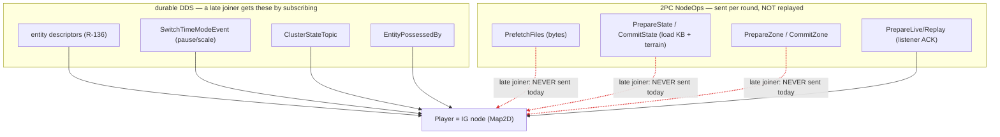

*What the picture shows that prose hid: everything durable already reaches a late Player; everything that reaches it
only through a 2PC round (red, dashed) is lost to it. ⇒ the whole late-join problem is the three red edges, and §4-E
closes them by re-sending those exact ops — no new channel.*

### 2.2 Late join and disconnect, as proposed

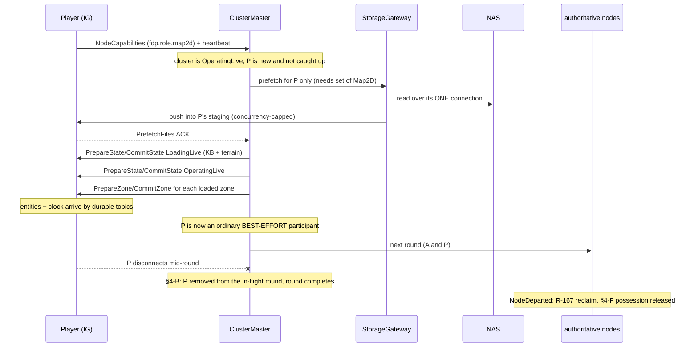

*What the picture shows: the catch-up is the SAME op sequence the cluster already ran, addressed to one node; and a
disconnect is handled by three mechanisms that exist or are one predicate away — nothing Player-specific.*

---

## 3. WHAT ALREADY WORKS — measured, no change needed

| need | how it is already met | evidence |
|---|---|---|
| see every live entity on join | durable descriptors + the TKB | ✅ `DESIGN_Entity_State_Sourcing.md` §1; `SimDescriptors.cs` holds 18 `TransientLocal` topics (the state) and 6 `Volatile` (events/commands, correctly not replayed — R-136 §1.1) |
| learn pause / scale | `SwitchTimeModeEvent` is `Reliable + TransientLocal` | ✅ `TimeMessages.cs:133` |
| sync the clock | `TimeSyncRequest` / `TimeSyncResponse` | ✅ `TimeMessages.cs:202,220` |
| see who possesses what | `EntityPossessedBy` is durable | ✅ `SimDescriptors.cs:213` |
| ⛔ ~~take part in recording / replay without recording~~ | ⛔ SUPERSEDED `2026-10-15` (R-4003): IG records like every ECS host — §4-G | IG still composes the listener controller today (`IgNodeBootstrapper.cs:374`); P5a replaces it |
| watch a replay | owning nodes restore, their egress floods DDS | ✅ `mgmt-1/DESIGN.md` §8.10 *"an IG whose only copy of entity state comes from the network"* |
| abstain from an op it has no business in | a node with no handler answers *Success, not participating* | ✅ `ClusterSlave.cs:473-482` |
| clear a departed node's entities | `NodeDeparted` → `PartialOwnerReclaimSystem` (R-167) | ✅ `ClusterCapabilityIngestSystem.cs:115` |
| one NAS connection for every transfer | the Storage Gateway | ✅ design `mgmt-1` §12.5/§12.6 · ⚠ as-built see §4-E2 |
| a scenario save on IG | IG registers the ONE gated `HrotScenarioSaveHandler`; it owns nothing savable | ✅ `IgNodeBootstrapper.cs:455`; `DESIGN_Node_Roles_And_Policies.md` §7.1 |

---

## 4. THE DECISIONS — each with a lean

### 4-A ⭐ Who may fail or hang a round?

| option | |
|---|---|
| ⭐ **A1 — derive it from the ROLE: a node holding any simulation role is authoritative; a node holding none is best-effort** | ⭐ **LEAN.** No config, no new role; follows R-4000. IG (`Map2D`, `IgNodeBootstrapper.cs:362`) and ExCon are best-effort; SimHost (`MuscleGround\|Perception\|NavigationSolver`), CGF (`Brain`), Stride mode 2 and the editor are authoritative. The orchestrator already holds every node's role mask (`ClusterMaster.cs:551`, `NodeRoster.NodesWithRole`) |
| A2 — reuse `ClusterConfiguration.Mandatory` | ⛔ it is keyed by subsystem NAME and **never set in production** (`ClusterConfiguration.cs:53` is its only assignment, empty). A default of `SimHost, CGF` would also arm the boot latch for both ⇒ a Stride-mode-2 cluster (no node named `SimHost`) would never leave boot. Keep `Mandatory` for what it does today (boot latch, `Degraded`) |
| A3 — a new `NodeRole.Player` | ⛔ user F: not needed once nothing is switched off. It would only earn its place if a map-station IG and a Player IG had to behave differently |

**Blast radius:** a map-station IG also becomes best-effort — its failure to load terrain no longer fails the round.
⚠ **What would change the lean:** if a map station must still be able to veto. Then the distinction is genuinely a
role and A3 returns. ⚠ The role → policy map is APPLICATION code (Hrot, the orchestrator), never FDP (R-4000).

#### ⛔⛔⛔ 4-A′ — **THE PREDICATE MUST FAIL SAFE** *(amendment `2026-10-15`, review of the dispatch)*

🔴 **A1 as first written is unsafe in two measured ways, and both fail SILENTLY** — the round reports success while an
authoritative node's error was swallowed.

| # | the hole | measured |
|---|---|---|
| **①** | ⭐⭐ **the role mask reads `None` until the capability advert lands** | `ClusterMaster.cs:539-541`, in its own words: *"Unknown-so-far ⇒ empty set / **None until the capabilities advert lands**."* The roster entry is created by the HEARTBEAT; the mask is derived from the durable `NodeCapabilities` descriptor, which arrives separately ⇒ **a real SimHost or CGF is best-effort for its whole join window** |
| **②** | ⭐⭐⭐ **a cluster with NO authoritative node has nobody left to veto** | the editor is a one-node cluster containing itself (`§3.4` of `DESIGN_Node_Roles_And_Policies`), and `ForOneNodeCluster()` leaves `Mandatory` empty (`ClusterConfiguration.cs:51-53`) ⇒ **no load could ever fail its round in the primary authoring host** |

⇒ ⭐⭐⭐ **The predicate is three clauses, not one.** A node is **best-effort** iff:

```
① its capability advert HAS been seen   (⛔ not merely "its mask is None")
② AND its mask holds no simulation role (Brain | MuscleGround | Perception | NavigationSolver)
③ AND the roster holds at least ONE authoritative node
```

⛔ **Otherwise it is AUTHORITATIVE.** Unknown ⇒ authoritative; alone ⇒ authoritative. ⭐ **The rail must be
anti-vacuous**: a classification in which *every* node comes out best-effort must fail the test, or clause ③ is
untestable and the editor case returns unnoticed.

✅ **BUILT `2026-10-15`** — `ClusterMaster.IsObserver(nodeId)`, the three clauses exactly as above; C1 lives in the ACK intake
(an observer's error is logged and recorded, never sets `HasFailure`, never aborts an `AbortOnFirstFailure` round). Rails:
`ClusterMasterZoneRoundTests.P2_*` (4) — ⭐ the ANTI-VACUITY rail was red-proofed by deleting clause ③ (it fails, the rest
pass). ⚠ **Deviation:** `DistributedTransaction.AllowPartialSuccess` stays UNREAD — the observer rule is unconditional
(R-4014), so a per-transaction switch would be a second way to say it; it is a candidate for deletion, not wiring.

⚠ **Clause ② is only sound once `R-4005` lands** — the editor declares `NodeRole.None` to the roster today while
composing all four simulation roles, so without the one-line fix (`EditorSubsystem.cs:1153` →
`EditorCapabilities.DefaultRole`) clause ③ is the *only* thing protecting the editor. ⇒ **build `R-4005` first; it is
a prerequisite of this item, not a companion to it.** 📄 [`DESIGN_Node_Roles_And_Policies.md`](../DESIGN_Node_Roles_And_Policies.md) §3.4.

### 4-B ⭐ A node leaves, or stops answering, during a round

📐 Today: `EjectNode` returns early for a non-mandatory node (`ClusterMaster.cs:700`); `GenericTransactionTracker.Expected`
is fixed at fan-out with no timeout (`:1828`) ⇒ **the round waits forever.** This is a defect for EVERY non-mandatory
node, not only Players.

| option | |
|---|---|
| ✅ **B1 — on ejection, drop the node from every in-flight tracker** (`Expected--`, remove from `Targets`, complete the round if it was the last ACK) | ✅ **APPROVED.** A bug fix for every node; can be built on its own. ✅ **BUILT `2026-10-15`** — as designed, with one refinement the measurement forced: a round can owe MORE than one ACK per node (a transition has one prepare step per state, under one transaction id), so `FanOutNodeOp` records the ACKs each node owes per round (every op but `CommitState`, which the slave applies without an ACK — `ClusterSlave.cs:411-422`), an ACK pays one off, and `EjectNode` → `DropFromInFlightRounds` subtracts what the node still owed; one `CompleteRound` serves both paths. Rails: `ClusterMasterBootstrapTests.P1_*` (3), red-proofed |
| ⛔ ~~a bounded ACK wait for best-effort nodes~~ | ⛔ **SUPERSEDED `2026-10-15` by R-4001** (user I): the heartbeat is the only time limit. A node is out of a round when its heartbeat stops (`DetectAndEjectTimedOutNodes`, 5 s default), never because a round took long |
| B2 — a timeout on every round | ⛔ an authoritative node that is slow (a large terrain) would fail a legitimate load — the case R-4001 forbids |

### 4-B2 ⭐ The heartbeat must keep beating through a long operation *(R-4001)*

📐 **Measured `2026-10-15` — today it does NOT, during the load:**

| fact | evidence |
|---|---|
| the heartbeat is written by `ClusterSlave.Tick`, on the FRAME thread, at 1 Hz | `ClusterSlave.cs:206-219` |
| the orchestrator ejects after 5 s of silence (never overridden in production) | `ClusterConfiguration.cs:20` |
| `ClusterSlave` calls `PrepareAsync` on the frame thread | `ClusterSlave.cs:429` |
| `LoadPhaseChain.PrepareAsync` awaits its steps with **no prior yield** | `LoadPhaseChain.cs:180-181` — ⚠ its comment says *"off the main thread"*; that is not what the code does |
| the knowledge-base and terrain steps do ALL their work synchronously and return `Task.CompletedTask` | `KnowledgeBaseLoadStep.PrepareAsync` (TKB zip `Clear` + parse + register) · `TerrainLoadStep.cs:43-53` |
| ⇒ **the whole loading prepare runs inline on the frame thread** — the heartbeat stops for as long as the TKB and terrain take to read | ⛔ a load longer than 5 s ejects the node that is doing it |

> 🔒 **User, `2026-10-15`:** *"load preparation can be run in background thread only if it is safe not touching global
> data etc. i guess safer would be to still coordinate from main thread, make the loading operations non-blocking (maybe
> ticked or asynchronous) but still with clear progress/status report so the coordination in main thread know what is
> going on and the system is not blocked."* ⇒ ⛔ the earlier lean *"run the whole prepare off the frame thread"* is
> SUPERSEDED by the rule below.

#### ⭐ The rule — **the frame thread COORDINATES; only work that touches nothing shared leaves it**

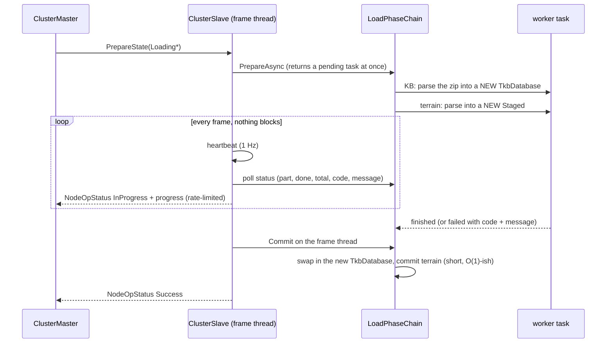

*What the picture shows: the frame thread never waits — it polls. The ONLY work handed to a worker builds a brand-new
object nobody else can see yet; every write into shared state (the TKB database, the world, the road graph) happens in
`Commit`, on the frame thread. That is what makes the background part safe by construction rather than by care.*

📐 **What already exists, measured:**

| piece | state |
|---|---|
| the frame thread polls a not-yet-finished prepare every frame and commits it when done | ✅ BUILT — `ClusterSlave.cs:259-300` (`_pendingPrepare`) |
| a step split into a pure `Prepare` that builds a private object and a frame-thread `Commit` | ✅ terrain already is — `TerrainResidency.Prepare` returns a `Staged` and touches only its own last-loaded fields; the world is written in `Commit` |
| the knowledge-base step | ⛔⛔ **SUPERSEDED `2026-10-15` by `R-4018`** — the TKB is loaded ONCE per process (one TKB per deployment, synced when the node joins; a no-op on every later load), so it stays on the frame thread and is NOT moved off it. 🔒 User: *"TKB is static … It doesn't need any background thread."* ⛔ Was: *"NOT safe to move — parse into a NEW database in `Prepare`, swap in `Commit`"* |
| the scenario-entities step | ✅ already ticked on the frame thread across frames (genesis through the ECS request queue, readiness checked per frame) — ⛔ it stays there |
| the steps actually yielding | 🔴 no — both pure steps run synchronously, so today the "async" prepare finishes inline. ⇒ the chain starts the pure work as a task and returns |
| progress to the orchestrator | 🔴 a node's `NodeOpStatus` is counted as its ACK whatever its code (`ClusterMaster.cs:1809-1829` — `Received++` for every status). ⇒ ⭐ an `InProgress` status must be read as PROGRESS, not an ACK — one change in the master's ACK intake; the existing message and code carry it |

| ⭐ consequences | |
|---|---|
| ⭐ `Commit` stays short | it runs on the frame thread; a long `Commit` would stop the heartbeat, which is exactly what R-4001 forbids |
| ⭐ a step that cannot be split stays on the frame thread **ticked**, reporting progress per tick | the scenario-entities shape |
| ⚠ **what R-4001 deliberately leaves open** | a node alive and ticking whose step never finishes holds its round forever. ⭐ **Report it, don't time it**: the progress shows a stall; an operator cancels. ⛔⛔ **CORRECTED `2026-10-15`** — this row read *"an operator cancels with the EXISTING `ClusterOpType.CancelOperation`. ⛔ Not measured: whether `CancelOperation` reaches a load prepare today."* 📐 **Measured: it does NOT.** Cancel is archive-only and the one cleanly cancellable transition state is `PARKED`, before anything is sent (`ClusterMaster.cs:1627-1640`); `LoadPhaseChain` never claims `AbortTransaction`. ⇒ **the escape R-4001 relies on did not exist — ⭐ `§4-H` builds it** (a routing fix: the abort seam is already complete) |

#### ✅ P4 AS BUILT `2026-10-15`

| piece | as built |
|---|---|
| the step contract | `ILoadPartProvider.PreparesOffFrameThread` (default `false`) — a step whose prepare builds only a private object says so |
| the chain | `LoadPhaseChain.PrepareAsync` prepares the frame-thread steps inline, in order, then runs the off-thread ones on a worker in order ⇒ it returns an incomplete task and `ClusterSlave` polls it every frame (the existing `_pendingPrepare`) |
| which steps | terrain only (`TerrainResidency.Prepare` builds a private `Staged`). ⛔ The knowledge-base step stays inline (`R-4018`: loaded once). The scenario step stays inline (it allocates ids) |
| progress, not an ACK | the slave publishes ONE `InProgress` status when it defers a prepare; the master's round intake and the prefetch tracker read `InProgress` / `Pending` as progress — no `Received++`, no paid ACK |
| rails | `LoadPhaseChainTests.P4_AnOffThreadStep_LeavesThePrepareIncomplete_AndRunsOffTheCallingThread` · `ClusterSlaveTests.P4_ADeferredPrepare_ReportsInProgressOnce_ThenItsAnswer` · `ClusterMasterZoneRoundTests.P4_An_InProgress_report_is_not_the_nodes_answer` (red-proved: without the master's skip the round commits on progress alone) |
| ⭐⭐ **follow-up: the world-boundary clear moved to the START of the prepare** | 🔴 P4 regression, found by `TimeControlIntegrationTests.Stop_PausesTheClock…CE3068` (8/8 at P3, red 3 of 12 after): with the prepare spanning frames, a faster node's committed entities replicated in before this node's Commit, and the Commit-time `CE-2101` clear destroyed them (`Entity is not alive` in SimHost's blueprint application). Fixed in `LoadPhaseChain.PrepareAsync`; rail `TheWorldBoundary_KeepsAnEntityThatArrivesDuringTheLoadWindow_CE2101_P4`. 📄 [`DESIGN_Cluster_Load_Phase.md`](../DESIGN_Cluster_Load_Phase.md) §8 |

### 4-C ⭐ A best-effort node returns an ERROR

📐 Today one error fails the whole round (`ClusterMaster.cs:1833-1847`).

| option | |
|---|---|
| ⭐ **C1 — a best-effort node's error is recorded in the round's per-node responses but does not fail the round** | ⭐ **LEAN.** `DistributedTransaction.AllowPartialSuccess` was declared for exactly this and is read nowhere — wire it, keyed by §4-A |
| C2 — keep the veto | ⛔ one Player with a broken disk stops every load (user C) |

### 4-D ⭐ The clock

📐 Pause / step / resume / scale are **not** 2PC ops (`ClusterMaster.cs:409-443` turns them into local intents on the
master clock). A step waits for an ACK from every slave in the roster, with no timeout
(`MasterSyncController.cs:566-580`); the roster is picked by NAME — `"SimHost" or "IG" or "CGF"` (`ClusterMaster.cs:1897`).

| option | |
|---|---|
| ⭐ **D1 — the step roster is the authoritative nodes (§4-A), and a departed node is removed from `_pendingAcks`** | ⭐ **LEAN.** A Player's step ACK protects nothing; a dead Player would freeze stepping. Pause / scale still reach it through the durable `SwitchTimeModeEvent`. `DESIGN_Time_Architecture.md` already allows a roster that excludes a node |
| D2 — keep Players in the roster, only prune on departure | ⚠ a slow-but-alive Player would gate every step |

#### ⭐⭐ 4-D′ — **TWO sites, and the departure needs a CHANNEL** *(amendment `2026-10-15`)*

| # | | measured |
|---|---|---|
| **①** | ⛔ **the name match is in TWO production places, not one** | `ClusterMaster.cs:1898` (`PublishClusterPause`) **and `ReplaySeekProcessManager.cs:56`** — both build a `SlaveNodeSetUpdatedEvent` slave set from `SubsystemName is "SimHost" or "IG" or "CGF"`. ⇒ fixing only the first leaves a Player gating every **replay seek**, and `ClusterMasterSeekTests` T9a/T9b assert `ClusterMaster` does NOT publish on seek, so no existing rail would catch it. ⚠ Three further hits are doc-comments restating the rule (`SlaveTimeTranslatorRegistration.cs:28`, `CgfSubsystem.cs:1089`, `TimeControlIntegrationTests.cs:412`) — update them with it |
| **②** | ⛔⛔ **nothing removes a departed node from the step roster, because nothing tells the controller** | `_expectedSlaves` changes ONLY on `SlaveNodeSetUpdatedEvent` (`MasterSyncController.cs:158-159`, `:394-396`), and `Step()` re-arms `_pendingAcks` from it every time (`:360`). 🔴 And the event is published **only on pause and on seek** — never on a roster change — although its own header says *"Published by ClusterMaster **when the participating slave node set changes**"* (`TimeLocalEvents.cs:30-32`) |

⇒ ⭐⭐ **The channel: `ClusterMaster.EjectNode` publishes `NodeDeparted` on the ORCHESTRATION bus**, and
`MasterSyncController` drops that node from `_expectedSlaves` and `_pendingAcks`, completing the step if it held the
last ACK.

| ⚠ why a second publish of `NodeDeparted` is correct here, and is NOT a blanket rule | |
|---|---|
| 🔒 **User, `2026-10-15`:** *"orchestration events belong to orchestration bus, ECS entity related ones belong to ECS repo bus."* ⇒ ⛔ **do NOT mirror every event onto every bus.** ⭐ The rule is **publish where there is a CONSUMER, nowhere else** | 📐 `NodeDeparted` has two genuine consumers in two places: `PartialOwnerReclaimSystem` (ECS — entity ownership, `R-167`) on `repo.Bus`, and the step-barrier roster (orchestration) on the orchestration bus. ⭐ Two buses because two consumers — ⛔ not because copying is cheap |
| ⭐ **the two buses are different OBJECTS, not layers** | `EntityRepository` constructs its own (`EntityRepository.cs:163`); `HrotNodeBuilder` constructs a separate one for orchestration (`:140`). ⛔ The orchestrator has **no `EntityRepository` and no NED module at all**, so the world-bus copy can never reach it |
| ⭐ **one conclusion per process, delivered where its consumers live** | the NED ingest already dedupes at the producer (`_departed.Add(nodeId)`, `ClusterCapabilityIngestSystem.cs:109`); the master's copy comes from its own heartbeat timeout. ⛔ These are not two sources of truth — each process publishes what IT concluded |
| ⭐ **also fix the contract** | publish `SlaveNodeSetUpdatedEvent` on a roster change too, so the event means what its header says |

✅ **BUILT `2026-10-15` (P3) — with TWO deviations, argued here:**

| as built | why it differs from the text above |
|---|---|
| ⭐ **the departure reaches the clock as `SlaveNodeSetUpdatedEvent`, republished whenever the step roster CHANGES** (`ClusterMaster.PublishStepRosterIfChanged`, every tick), and `MasterSyncController` now APPLIES the set when it arrives — replacing `_expectedSlaves` and dropping the pending ACKs of nodes no longer in it | ⛔ **no second `NodeDeparted` on the orchestration bus.** Once the event is published on every roster change it IS the channel — one event, one existing consumer. 🔒 *"publish where there is a consumer, nowhere else"* ⇒ a second event carrying the same fact would be the clutter the user ruled out |
| ⭐ **the step roster is `StepRoster()`: advert landed ∧ holds a simulation role ∧ not the master's own node** — not `IsObserver`'s negation | 🔴 measured hazard: `IsObserver`'s clause ③ makes EVERY node authoritative in an all-observer cluster, which would put ExCon and the orchestrator in the barrier — neither ever ACKs a frame ⇒ stepping would hang. An empty roster is safe. ⛔ Never the master's own node: since P2a the editor holds simulation roles, and it runs the MASTER clock — it would wait for itself |

Both name-match sites now call it (`ClusterMaster.PublishClusterPause`; `ReplaySeekProcessManager` takes `master.StepRoster`
and lost its private heartbeat-name replica). Rails: `ClusterMasterSeekTests.P3_*` (3), `MasterSyncControllerTests.P3_*` (1).

### 4-E ⭐ Late join — the catch-up

| option | |
|---|---|
| ⭐ **E — the orchestrator replays the EXISTING ops to the one new node, then it is an ordinary participant** | ⭐ **LEAN.** `ClusterMasterPlanner` already computes the path from `Idle` to the current state; `FanOutNodeOp` already takes an explicit target list. ⭐ No new events (user D) |
| a follower that drives its own state from `ClusterStateTopic` | ⛔ a second way to drive a node's state, and it still gets no bytes and no zones |
| never let a late node in | ⛔ not a game |

Three things E needs that do not exist:

| | the gap | lean |
|---|---|---|
| **E1** | ⛔ **the master does not remember which zones are loaded** — no field holds them in `ClusterMaster` | keep the committed zone set on the master (cleared at the world boundary) so the catch-up can re-send `PrepareZone`/`CommitZone` |
| **E2** | ⚠ **the push reaches only a shared staging tree** — the gateway copies to `{FDP_STAGING_ROOT}/nodes/node-N` on the orchestrator's disk (`AssetPrefetchProcessManager.cs:272-287`) | ✅ **§4-E2 below** (R-4002): one transfer provider, the share or DDS behind it |
| **E3** | a cluster transition while a node is catching up | the catch-up restarts from the new state; the node joins rounds only once its heartbeat reports the cluster's state |

⚠ The catch-up relies on a node accepting a state commit from any starting state. Measured at the node layer: `ClusterSlave`
checks nothing (`ClusterSlave.cs:411-421`). ⛔ **Not measured: each Hrot load handler** — must be checked before E is built.

#### ⭐⭐⭐ 4-E′ — **THE COMMITTED ZONE SET IS ANNOUNCED DURABLY, NOT ONLY REPLAYED** *(amendment `2026-10-15`)*

> 🔒 **User, `2026-10-15`:** *"someone should be responsible for publishing existing already commited and thus currently
> active zones to anyone, not just late joiner. There is nothing to acknowledge; if late joiner needs to load the zone it
> could still happen via 2pc, but late joiner needs to know there are zones to load in the first place."*

⛔⛔ **E1 as first written is half the fix.** Remembering the set on the master lets the master replay zone rounds at one
node; it still leaves **every** node unable to answer *"is there a zone I am missing?"* — and leaves the set invisible to
anything but the catch-up path.

⭐⭐ **The separation that makes this safe — two different FACTS, one producer each:**

| the fact | owner | channel | acknowledged? |
|---|---|---|---|
| ⭐ **which zones the CLUSTER has committed** | the master — **one** producer | ⭐ **NEW: published durably, beside cluster state** | ⛔ **no — there is nothing to acknowledge.** It is an announcement |
| ⭐ **whether THIS node has that zone resident** | the node, per zone | ✅ the existing `PrepareZone`/`CommitZone` round | ✅ yes, per node, as today |

⇒ ⛔ **This is NOT two producers for one slot (`R-132`)** — an earlier draft of this review rejected it on exactly that
ground and was **wrong**: it conflated *"what the cluster has"* with *"what this node holds."* ⭐ They are different
subjects, each with a single producer, and the 2PC round keeps its acknowledgement.

| ⭐ what it buys beyond the late joiner | |
|---|---|
| ⭐⭐ **any node can reconcile** | *"am I missing a zone?"* becomes answerable on the node, not only by the master replaying ops at it |
| ⭐ **the shape already exists** | the master already publishes cluster state this way (`ClusterMaster.cs:1712-1720`); this is the same move for the zone set |
| ⭐ **it does not weaken the round** | a durable announcement cannot assert residency — only the acknowledged round can. ⛔ Announcing residency would be the `R-133` silent-no-op; announcing INTENT is not |
| ⭐ **cleared at the world boundary** | as E1 already says |

⭐ **Durability is settled, not open.** 🔒 **User, `2026-10-15`: *"master is not restartable, if it dies, the world ends."***
⇒ the master is the sole writer for the lifetime of the cluster, so `Reliable + TransientLocal` is sufficient and
**no rebuild-from-nodes step is needed.** ⚠ An earlier draft of this section raised master restart as an open question —
⛔ it is not one; do not re-open it.

### 4-E2 ⭐ How the bytes reach a node — **one provider, the transport behind it** *(R-4002)*

#### The classes

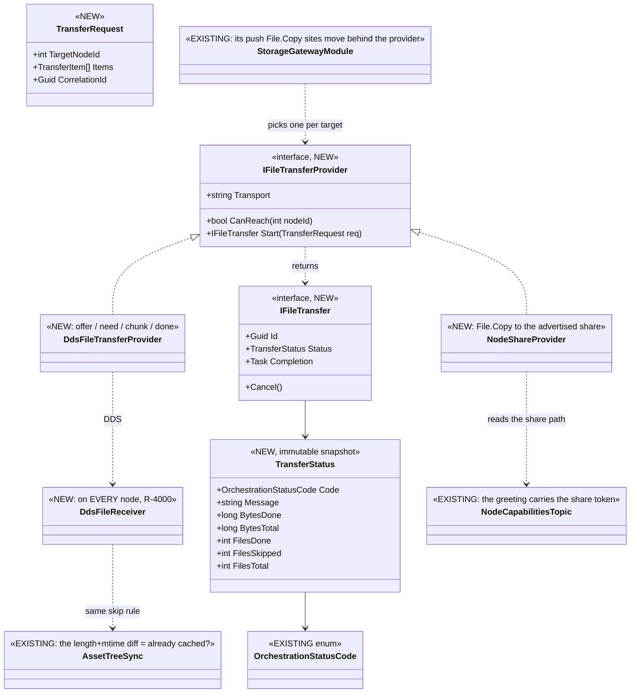

*What the picture shows that prose hid: everything above the provider line already exists — the gateway, the status
codes, the greeting message and the "is it already here?" rule. ⭐ The new code is the interface, two transports and one
node-side receiver; nothing in the cluster protocol changes.*

| ⭐ the rules | |
|---|---|
| ⭐⭐ **non-blocking** | `Start` returns at once; the gateway reads `Status` each frame (a snapshot, safe across threads — no callbacks onto pool threads) and awaits `Completion` |
| ⭐⭐ **progress + status** | `TransferStatus` carries bytes/files done, skipped and total, and a code + message from the EXISTING `OrchestrationStatusCode` (`Success`, `InProgress`, `Failure`, `Cancelled`, `AssetNotFound`). ⭐ It feeds the existing `ClusterOpStatus(InProgress, …)` the operator already sees |
| ⭐⭐ **already cached? — the EXISTING rule** | the receiver compares each offered `(relative path, length, mtime)` with its own file — the skip `DESIGN_Asset_Management.md` §1 ② / §8 already applies (`FileManifestEntry` carries `Length` + `LastWriteUtc`). ⛔ No second freshness rule |
| ⭐ **which transport** | per target node: the share if its greeting advertises one, otherwise DDS. ⭐ Today's co-located nodes keep working by advertising their staging folder as the share — so there are TWO transports, not three |
| ⭐ **the greeting** | the share path rides `NodeCapabilitiesTopic` as one token (`hrot.transfer.share=<path>`). ⚠ The existing tokens are plain names (`fdp.role.*`, `hrot.asset.needs.*`); a `key=value` token is a new FORM on an existing message |
| ⭐⭐ **only the nodes that need it** (user K) | every transfer gets its own DDS **partition** (`hrot.xfer.<id>`); the binding takes a partition per writer and per reader (`DdsWriter(participant, topic, qos, partition)`), and only readers in that partition match the writer ⇒ a node not in the transfer receives **nothing** (measured: 0 bytes) |
| ⭐⭐ **bundle nodes waiting at initialisation** (user K) | several targets join ONE transfer (one partition): one writer, one send, every target receives it. ⭐ A late joiner gets its own transfer |
| ⭐⭐ **wait until it has fully arrived** (user K) | no reliance on `Write` returning: each receiver ACKs its highest gap-free chunk every 8 chunks; the sender keeps at most a window of chunks beyond the SLOWEST receiver; the transfer is done only when EVERY target has checked length + hash and ACKed done. ⭐ The sender waits until every target's reader is matched (`writer.CurrentStatus.CurrentCount`) — no sleep, no timer (R-4001) |
| ⭐ **close after** (user K) | the chunk writer and the targets' chunk readers are disposed when the transfer ends ⇒ its partition and its history are gone. Only the small control topics (offer / need / ack) stay open |
| ⭐ **64 KB chunks** | measured 0 `Write` timeouts in every 64 KB run; a `Timeout` that does happen is back-pressure — wait and resend the same chunk |
| ⛔ **not for GBs** (user J) | the DDS provider refuses a file above a configured cap with a status code, so a GB asset fails loudly and goes to the share |
| ⭐ **unified** (R-4000) | every node runs `DdsFileReceiver`; whether a node also has a share is DEPLOYMENT config, not role |

#### The DDS protocol

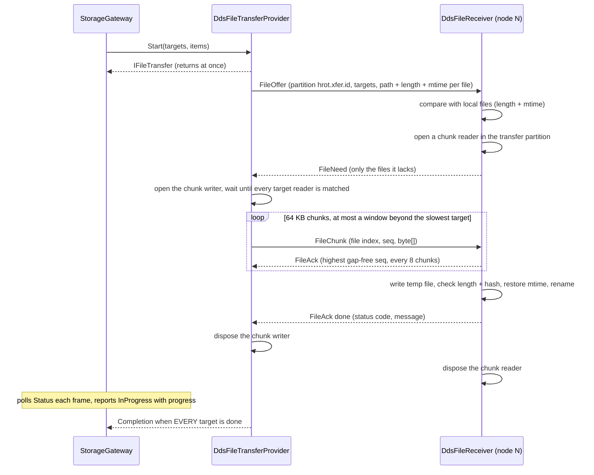

*What the picture shows: the "already cached" check costs one round trip before any bytes move, and every chunk and
reply is Reliable + Volatile — a command, not state (R-136 §1.1), so nothing is replayed to a late joiner by DDS itself.*

#### 📐 Measured `2026-10-15` — CycloneDDS.NET 0.3.2, two processes, one host (loopback), default Cyclone config

A `[DdsManaged] byte[]` field is already used on the wire (`GizmoMap.Network/Topics/DebugPrimitivesBatch.cs:16`). The
experiment used a Reliable + Volatile + KeepAll topic `{ key TransferId, Seq, SeqCount, RelativePath, byte[] Data }`;
every run compared SHA-256 at both ends.

| payload | chunk | samples | received in | intact |
|---|---|---|---|---|
| 8 MB | 64 KB | 128 | 36 ms | ✅ |
| 8 MB | 1 MB | 8 | 21 ms | ✅ |
| 32 MB | ONE sample | 1 | 24 ms (the write took 278 ms) | ✅ |
| 64 MB | 1 MB | 64 | 566 ms | ✅ |
| 128 MB | 4 MB | 32 | 2.06 s | ✅ |
| 256 MB | 4 MB | 64 | run 1: 3.36 s ✅ · 🔴 **run 2: the sender's `Write` THREW `DdsException: Timeout` (ReturnCode -10) after 38 of 64 chunks** | 🔴 |
| 256 MB | 64 KB | 4 096 | 2.40 s (~107 MB/s) | ✅ |
| a 10 ms Reliable ping on the same domain — baseline, no transfer | | 585 | p50 0.75 ms · p99 1.57 ms · max 4.61 ms | — |
| the same ping **during** 256 MB in 64 KB chunks | | 875 | p50 0.78 ms · p99 2.77 ms · max 11.16 ms | — |
| the same ping **during** 256 MB in 4 MB chunks (the failing run) | | 864 | p50 0.79 ms · p99 3.34 ms · max 7.05 ms | — |

**The protocol probe** *(per-transfer partition, 3 targets + 1 bystander in another partition, ACK window of 32 × 64 KB,
writer and readers disposed at the end)*:

| run | 256 MB to 3 targets | every target intact (SHA-256) | `Write` timeouts | bystander received |
|---|---|---|---|---|
| 1 | 3.22 s (79 MB/s) | ✅ ✅ ✅ | 0 | **0 bytes** |
| 2 | 3.15 s (81 MB/s) | ✅ ✅ ✅ | 0 | **0 bytes** |
| 3 | 3.38 s (76 MB/s) | ✅ ✅ ✅ | 0 | **0 bytes** |
| 16 KB chunks, window 128 | 6.03 s (42 MB/s) | ✅ ✅ ✅ | 0 | **0 bytes** |
| one late joiner, 64 MB | 0.50 s (127 MB/s) | ✅ | 0 | — |

Every target's reader was matched 5–6 ms after the writer was created. ⇒ ⭐ one send served three nodes at the speed of
one, and the partition kept the data off every node that was not in the transfer. ⭐ 64 KB is the chunk to use: 16 KB
also works but halves the throughput (per-sample overhead).

⇒ ⭐ On one host the binding moves files of our size intact and fast, and a bulk transfer moves a small reliable topic's
p99 from ~1.6 ms to ~3 ms and its worst case from ~5 ms to ~11 ms — real, small, and far from *"pollutes the real-time
data plane"* (`mgmt-1` §12.6).
🔴 ⇒ ⭐⭐ **But a big chunk can make `Write` throw.** A Reliable writer whose readers fall behind blocks up to its
`max_blocking_time` and then the binding throws `Timeout` — measured once in two identical 4 MB-chunk runs, never with
64 KB chunks. ⇒ the provider: **small chunks (64 KB), a bounded number in flight, and a `Timeout` from `Write` treated as
BACK-PRESSURE (wait and resend), never as a failed transfer** — which is also what R-4001 requires: a slow transfer is a
valid long operation, not an error.

| ⛔ what this does NOT yet prove — measure before building | |
|---|---|
| ~~**M1**~~ | ⛔ **DROPPED** by the user (K): *"Ignore real network measurement"* |
| ~~**M2**~~ | ✅ **MEASURED** — a per-transfer partition delivers only to the targets (bystander: 0 bytes in 3 runs) |
| **M3** | ⛔ the real sizes: no TKB zip or terrain artifact is in the repo (largest scenario JSON: 23 KB). User J says not GBs; a terrain grid of 2 km at 2 m is ~4 MB of heights |
| **M4** | ⚠ the sender's memory and back-pressure: KeepAll holds every unacknowledged chunk. ⭐ A cap on chunks in flight bounds the memory AND keeps `Write` from blocking into its `Timeout` |

#### What is needed — the build list

| # | item | new / existing |
|---|---|---|
| N1 | `IFileTransferProvider`, `IFileTransfer`, `TransferRequest`, `TransferStatus` (in `Fdp.Toolkits/Orchestration` — no Hrot semantics) | NEW |
| N2 | `DdsFileTransferProvider` + `DdsFileReceiver` + four topics — three small control topics that stay open (`FileOffer`, `FileNeed`, `FileAck`) and one per-transfer, partitioned chunk topic (`FileChunk`) | NEW, on the existing `byte[]` precedent; the probe in `experiments/dds-file-transfer/Xfer.cs` is its skeleton |
| N3 | `NodeShareProvider` = today's `File.Copy`, aimed at the advertised share | MOVED, not new |
| N4 | the push `File.Copy` sites in `StorageGatewayModule` and `AssetTreeSync.cs:126` go through the provider | ⚠ the 11 `File.Copy` sites in the orchestrator mix PUSH (NAS → node) and PULL (node → NAS: save, archive, checkpoint, diagnostics) — classify them first; PULL is out of scope for Players |
| N5 | the `hrot.transfer.share=<path>` token in each node's greeting | existing message, new token |
| N6 | progress into `ClusterOpStatus` | existing message |

#### ⏳ P6 part 1 AS BUILT `2026-10-15` — the seam and the share transport (N1, N3, N4 push sites); ⏳ N2, N5, N6 next

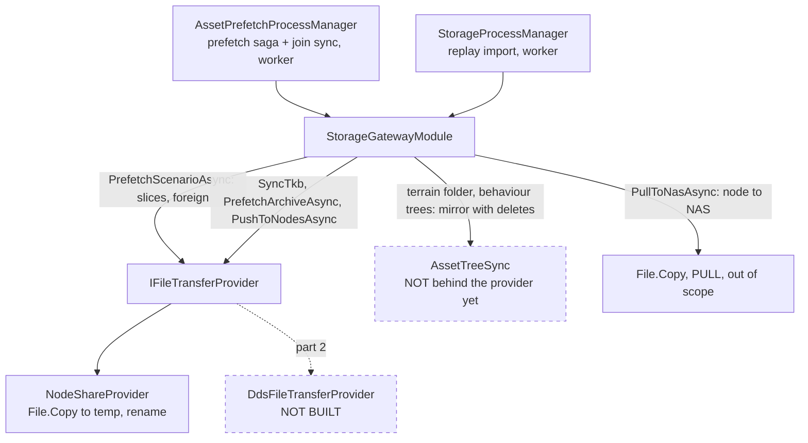

*What the picture shows that prose hid: every caller of the provider is already on a worker (the saga, the join sync, the
replay import), so awaiting a transfer never touches the frame thread; and two push paths — the terrain folder and the
behaviour trees — still go round the provider, because a MIRROR deletes files and the provider only delivers them.*

| piece | as built | deviation from the class diagram above, and why |
|---|---|---|
| N1 | `Fdp.Toolkit.Orchestration.Transfer`: `IFileTransferProvider { Transport, CanReach(TransferTarget), Start }`, `IFileTransfer { Id, Status, Completion, Cancel }`, `TransferRequest(Targets, Items, CorrelationId)`, `TransferTarget(NodeId, Root)`, `TransferItem(SourcePath, RelativePath)`, `TransferStatus` | ⚠ `TransferRequest` carries a LIST of targets, not one `TargetNodeId` — the bundling rule (user K) needs one request to serve several nodes. ⚠ `TransferStatus` grew `FilesFailed` and `FailedNodeIds`: the TKB sync writes its `StagedTkb` record only on the nodes that received the file, and a status naming no node could not say which |
| N3 | `NodeShareProvider`: copies on a worker (8 in parallel), each file to a temporary name then renamed; skips a file the target holds with the same length and mtime (the one freshness rule); a missing source or an unwritable target is a `Failure` naming the node; `Completion` never faults | the temp-and-rename is new — today's copies wrote in place |
| N4 | `StorageGatewayModule(IFileTransferProvider? provider = null)` (null = the share). Through it: `PrefetchScenarioAsync` (one request per slice, every target bundled; foreign slices to their origin node), `SyncTkb` (one request to every target, the `IsAlreadyCurrent` skip now the provider's), `PrefetchArchiveAsync` (each node its own recording + `.meta.json`), `PushToNodesAsync` | ⚠ the push-site classification the handoff asked for: **PUSH** — `StorageGatewayModule` slices, foreign, TKB, archive, `PushToNodesAsync`, and `AssetTreeSync.cs:126` (terrain + behaviour trees, ⏳ part 2: a mirror deletes); **PULL** — `PullToNasAsync`, `StorageProcessManager.cs:261` (the save's foreign slices); **neither** — `ClusterDiagnosticsPanel.cs:401` (the operator's save-a-local-copy dialog) |
| rails | `NodeShareProviderTests` (new suite: bundled delivery keeping the mtime, skip, a failing node named, a missing source, cancel leaves no partial, no share ⇒ unreachable) · `StorageGatewayTests` + `ClusterMasterPrefetchTests` unchanged and green through the share | — |
| ⏳ not yet | N2 (DDS provider + receiver on every node), N5 (the share token — only load-bearing once a node can be reached WITHOUT a share, so it ships with N2), N6 (progress into `ClusterOpStatus`), `AssetTreeSync` behind the provider. ✅ P8's H5 (the cancel stops the copy) shipped with this part | — |

#### ⭐⭐ P6 part 2 BUILD DESIGN — the DDS transport and the route per node *(design `2026-10-15`, coordinator; `build-state: BUILT`)*

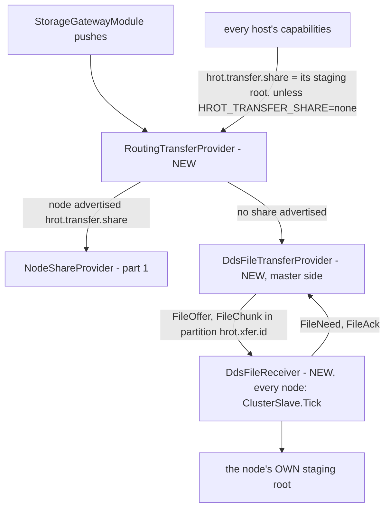

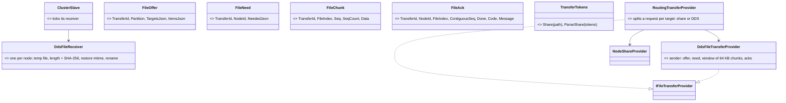

*What the pictures show that prose hid:* nothing above the provider line changes — the gateway already hands requests to ONE
provider; the route is decided per target from the greeting; and the receiver needs no orchestration message of its own: it
reacts to offers naming it, and writes into the root it already knows (its own staging root).

| ⭐ decision | lean · why · rejected |
|---|---|
| **route per target by the share token** (N5) | ⭐ every host advertises `hrot.transfer.share=<its staging root>` unless `HROT_TRANSFER_SHARE=none` (a remote Player). The master copies into an advertised share as today; any other target goes over DDS. ⛔ Rejected: a role-based rule (R-4000: deployment, not role) |
| **items carry paths relative to the node's staging root** | ⭐ the master's view of a node root is `GetNodeStagingRoot(local, nodeId)`; the gateway's absolute destinations are under it, so the route converts once (`Path.GetRelativePath`). The receiver joins the same relative path to ITS root |
| **the protocol is the measured one** (§4-E2 table): per-transfer partition, 64 KB chunks, a window beyond the slowest target, ACK every 8 chunks, done only when every target verified length + SHA-256, a `Write` timeout = back-pressure | ⭐ the probe (`experiments/dds-file-transfer/Xfer.cs`) is the skeleton |
| **"already cached?" = the one freshness rule** (length + last-write time), checked by the receiver before it asks | ⭐ the receiver answers `FileNeed` with only what it lacks |
| **the receiver runs in `ClusterSlave.Tick`** | ⭐ every node has one (ECS hosts and ExCon alike — R-4000); the receiver is optional there, so a slave without a participant has none |
| ⚠ **files above a cap are refused** with a code (user J: not GBs) | default 512 MB |
| ⚠ **not in this part** | the transfer cap (C8), progress into `ClusterOpStatus` (N6), `AssetTreeSync` behind the provider |

##### ✅ P6 part 2 AS BUILT `2026-10-15`

| piece | as built |
|---|---|
| wire | `FileOffer {TransferId (key), Partition, TargetsJson, ItemsJson}`, `FileNeed {TransferId, NodeId (keys), NeededJson}`, `FileChunk {TransferId (key), FileIndex, Seq, SeqCount, byte[] Data}`, `FileAck {TransferId, NodeId, FileIndex (keys), ContiguousSeq, Done, Code, Message}` — Reliable + Volatile + KeepAll. ⚠ `FileChunk` is keyed by the transfer only (the probe's shape: one instance, KeepAll holds every chunk). An offer with an EMPTY partition = the sender cancelled |
| sender | `Hrot.Network.NED.Transfer.DdsFileTransferProvider` — one shared offer writer and need/ack readers, drained into a per-transfer inbox so transfers may run at once; SHA-256 per file in the offer; a missing or oversized (> 512 MB) source fails the WHOLE transfer with every target named |
| receiver | `DdsFileReceiver`, built and ticked by `NedSlaveOrchestrationTranslator` ⇒ on every networked node; it joins a transfer's partition only when the offer names it, writes `<dest>.xfer-part`, checks length + SHA-256, restores the mtime, renames, then disposes the partition reader |
| route | `Fdp.Toolkit.Orchestration.Transfer.RoutingTransferProvider` (share if the node advertised one, else DDS; DDS targets with the same relative items are bundled into one transfer); built by `OrchestratorCore` from `OrchestratorCoreOptions.DdsTransfer` = `INetworkFactory.CreateFileTransferProvider()` (null on the offline editor ⇒ share only). The TKB join sync now uses the gateway's provider too |
| N5 | every networked node advertises `hrot.transfer.share=<its staging root>` (added by `NodeOpSlaveTranslator` to whatever the host advertises) unless `HROT_TRANSFER_SHARE=none`. ⚠ The advertised PATH decides only share-vs-DDS today; destinations still use the master's view of the node root (`GetNodeStagingRoot(ResolveStagingRoot(), id)`) — right for co-located nodes |
| 🔴 found LIVE, fixed | ⭐ **DDS only to a node that advertises a receiver** (`hrot.transfer.dds`, added by every `NedSlaveOrchestrationTranslator`). 📐 The orchestrator's OWN node (300) publishes no capabilities at all; with the first rule (*"no share ⇒ DDS"*) it was routed to DDS, never answered, and the scenario load stayed PARKED for good. ⇒ a node advertising neither a share nor a receiver gets the share — today's copy. Rail `RoutingTransferProviderTests.A_node_with_no_share_and_no_dds_receiver_goes_to_the_share_never_waits_on_dds` |
| rails | `DdsFileTransferTests` (real DDS: 3 targets + a bystander, multi-chunk + partial last chunk, mtime kept, re-send skipped, missing source names every target) · `RoutingTransferProviderTests` (route per target, relative paths, share-only without DDS, token) |

### 4-F ⭐ The possessing node leaves

📐 `PossessionSystem` releases on `ReleasePossessionEvent` or the unit's death only (`Possession.cs:177-183`). A Player
that crashes while possessing leaves the unit possessed forever, its task paused (R-203).

| option | |
|---|---|
| ⭐ **F1 — `PossessionSystem` also releases every unit whose `StationNodeId` is the node in a `NodeDeparted`** | ⭐ **LEAN.** The event already exists and is raised on every node (`ClusterCapabilityIngestSystem.cs:115`) |
| ⛔ ~~F2 — a control-frame staleness timeout~~ | ⛔ **SUPERSEDED by R-4001** — a time limit not based on the heartbeat |

### 4-G ⭐ The unification gaps R-4000 exposes

📐 IG and the Editor pass `archiveHandler: null` to `SerializeLocalRegistrar` (`IgNodeBootstrapper.cs:455-459`;
`EditorSubsystem.cs:1559-1563`). The handler is safe without a recording: no local `.fdp` ⇒ it returns no manifest
(`ReferenceArchiveHandler.cs:75-78`) and the master skips an empty payload (`StorageConsensusAggregator.cs:35`).

| option | |
|---|---|
| ⭐ **G1 — `SerializeLocalRegistrar` builds the archive handler itself** (it needs only the temp root and node id), so no ECS host can omit it | ⭐ **LEAN.** Removes the choice that produced the gap |
| G2 — IG and the Editor pass one | ⚠ fixes today, leaves the optional parameter that let it happen |

⚠⚠ **A DESIGN RECORD THIS SECTION FIRST MISSED** *(found `2026-10-15` while writing the dispatch)*: IG's missing archive
handler was deliberate. `NodeRolePersistenceRails.IgCompositionRoot_RegistersNoCheckpointSaveHandler`
(`Hrot.SimHost.Tests/NodeRolePersistenceRails.cs:67-100`, CE-275 ③, `2026-09-14`) forbids `ReferenceArchiveHandler` on IG,
reasoning *"IG carries no ECS frame data … so it must not record"* (`DESIGN_Node_Roles_And_Policies.md` §7.1).

✅ **RULED `2026-10-15` — R-4003, the premise itself is SUPERSEDED.** 🔒 User: *"that premise is old and not valid anymore,
it must be a pre-unification one … IG can create its own entities if it wants to. So it might need to run its own recording.
I prefer the unification over optimization at this stage, still the disabling would be controlled by the role or by some
optimization settings later."* ⇒ ⭐ G widens: IG runs the same `EcsRecordReplayController` as every ECS host (today it runs
`ListenerRecordReplayController`, `IgNodeBootstrapper.cs:374`), holds the archive handler, and the CE-275 rail is replaced
by the positive invariant. ⚠ The controller lives in `Hrot.SimHost`, which IG does not reference ⇒ it moves down (CE-279 A2).
⚠ Replay must then tolerate a node with no or a partial recording (a late or departed Player) — P2 makes its failure
non-fatal. ⛔ *(SUPERSEDED: "The PREMISE still holds; the MECHANISM is what R-4000 retires … the rail is REWRITTEN to
R-4000's form" — the first version of this paragraph, which kept the premise.)*

#### ⛔⛔ 4-G′ — **THE REPLACEMENT RAIL MAY NOT BE A SOURCE SCAN** *(amendment `2026-10-15`)*

📐 The rail `P5c` replaces is a **source-text scan**: `CompositionRootSource.ReadRepoSource(IgRoot)` reads IG's `.cs`
file off disk, `StripComments` regex-strips it, and the assertion is `code.Contains("ReferenceArchiveHandler")`
(`CompositionRootSource.cs:37-49`). The sibling family does the same (`EveryEcsHostComposesTheLoadPhaseChainRails:64`).

🔴 **G1 and that style are incompatible, and the failure is silent in BOTH directions.** G1 has
`SerializeLocalRegistrar` build the handler itself ⇒ IG's composition root **never names it**. So a negative rail stays
**green forever** and a positive rail written the same way is **red forever** — neither measures anything.

⇒ ⭐⭐⭐ **The new rail asserts the CONSTRUCTED OBJECT** — every ECS host's composed slave holds the recording controller
and the archive handler. ⭐ Acceptable cheaper form: assert on `SerializeLocalRegistrar`'s own source **plus** that **no
host passes `archiveHandler: null`** (G1 should remove the parameter, which makes that checkable by compilation).

| ⚠ the honest limits of the existing family — why not to extend it | |
|---|---|
| ⛔ **it has already produced a false green, twice** | its own header records `CE-156`: a rail asserted `Contains("TkbTranslatorSet.Base")` and passed on a **comment** saying the call had MOVED — *"two hosts were green for the wrong reason."* `StripComments` exists only because of that |
| ⚠ **the comment strip is admittedly crude** | regex, *"not a C# parser… does not understand string literals"* |
| ⚠ **it needs a source checkout to run at all** | `ReadRepoSource` walks up for a `docs/` folder and **throws** if there is none ⇒ these rails cannot run from a packaged test drop. ⭐ Deliberate (*"an absent file must be a loud RED, never a vacuous pass"*) — ⛔ but it is a reason not to add more of them |
| ⛔ **scope** | retiring the family is NOT this batch. ⭐ **Not adding to it is.** |

#### ✅ P5 AS BUILT `2026-10-15`

| item | as built |
|---|---|
| **P5a** | `EcsRecordReplayController` moved from `Hrot.SimHost` to `Hrot.Network.Orchestration` (beside the listener; IG reaches it through `Hrot.Common` and `Hrot.Network.NED`; no new project reference). ⚠ Its namespace is still `Hrot.SimHost.Modules.Orchestration` so no caller changed in the move — a Roslyn rename is left for later. ⭐ One composition, `EcsRecordReplayController.ForNode(kernel, nodeId, world, transportAfterSeek, lifecycle)` — the seek's lifecycle reset + the lifecycle module's replay gate — replaces the hand-written copies on CGF and SimHost and is what IG now uses. IG's load chain is given the controller, so IG starts recording when its world is whole, like every host. SimHost composes it for EVERY role (`R-4000`; it was Brain/MuscleGround only). ExCon keeps the listener: no world |
| **P5b** | `SerializeLocalRegistrar.Register(slave, scenarioSave, recordingRoot, nodeId)` BUILDS the archive handler — the nullable parameter is gone, so no host can register none (IG and the Editor used to pass `null`) |
| **P5c / P5c′** | `NodeRolePersistenceRails`: `ReferenceArchiveHandler` removed from IG's forbidden list (the orchestrator's own context writer stays); its non-vacuity rail re-anchored on `OrchestratorCore`. ⭐ The positive invariant is asserted on the CONSTRUCTED node — `Hrot.IG.Tests/IgRecordsAndArchivesTests` (IG holds the ECS controller; its slave holds the archive handler) — plus the registrar's own constructed-slave rail (`ReferenceArchiveHandlerTests`). ⛔ No source-scan rail was added (§4-G′) |
| ⚠ not done | the Editor and Stride already held the ECS controller and still construct it directly — routing them through `ForNode` (they would then also gate their lifecycle module during replay) is a follow-up, not done here; the namespace rename |

---

## 4-H ⭐⭐⭐ A STUCK OR FAILED LOAD — **the operator cancels and the cluster returns to `Idle`** *(`R-4004`, `2026-10-15`)*

> 🔒 **User, verbatim:** *"if cluster loading fails, operator cancels, cluster goes to the initial default state when the whole procedure can be repeated."*

⭐⭐ **Why this section exists.** `R-4001` forbids every timer and names the operator cancel as the escape from a
stuck-but-alive operation. 🔴 **That escape does not exist today**, so the rule had a hole its own §4-B2 depended on.

### 4-H.1 📐 What is actually there — **the abort seam is COMPLETE and never triggered**

| piece | state |
|---|---|
| `ILoadPartProvider.Abort(context)` — *"Frees whatever `PrepareAsync` built and never published"* | ✅ **declared** (`LoadPhaseContracts.cs:114-115`) |
| `LoadPhaseChain.Abort(intent, repo)` — aborts **every** step, cancels the hold (`_holdTcs`), clears the exercise id | ✅ **fully implemented** (`LoadPhaseChain.cs:206-215`) |
| `IClusterStateHandler.Abort` — implemented by `ReferenceEditLoadHandler:138`, `ReferencePrefetchHandler:66`; adapted at `HrotHandlerAdapter.cs:62` | ✅ exists |
| `TerrainResidency.AbortStaged(staged)` — the per-step primitive for a failed background prepare | ✅ exists (`:320`) |
| the master already fans out `NodeOpType.AbortTransaction` on cancel, on a failed round, and on a mandatory-node loss | ✅ three sites (`ClusterMaster.cs:1660`, `:1843`, `:716`) |
| 🔴 **`ClusterSlave` never calls `Abort` — not once** | ⛔ measured: zero occurrences of `Abort` in `ClusterSlave.cs` |
| 🔴 **`LoadPhaseChain.CanHandle` does not claim `AbortTransaction`** | ⛔ it claims only `PrepareLive`, `PrepareEdit`, `PrepareState` (`:127-147`) |

⇒ ⛔⛔ **The abort fan-out reaches every node, finds no handler, and auto-ACKs `Success, not participating`
(`ClusterSlave.cs:473-482`) while nothing rolls back** — precisely the *"capability reported present that silently
no-ops"* `R-133` calls worse than an absent one. ⭐⭐ **`TerrainAssetHandler` already found and fixed this for its own
ops** (`:92-103` — *"no handler in the tree claimed `NodeOpType.AbortTransaction` … the master's abort fan-out reached
every node, found no handler, and auto-ACKed `Success` while nothing rolled back"*) and is **the pattern to copy**.

⇒ ⭐⭐⭐ **This is a ROUTING fix, not a build.** The mechanism exists end to end; only its trigger is missing.

### 4-H.2 ⭐ The sequence

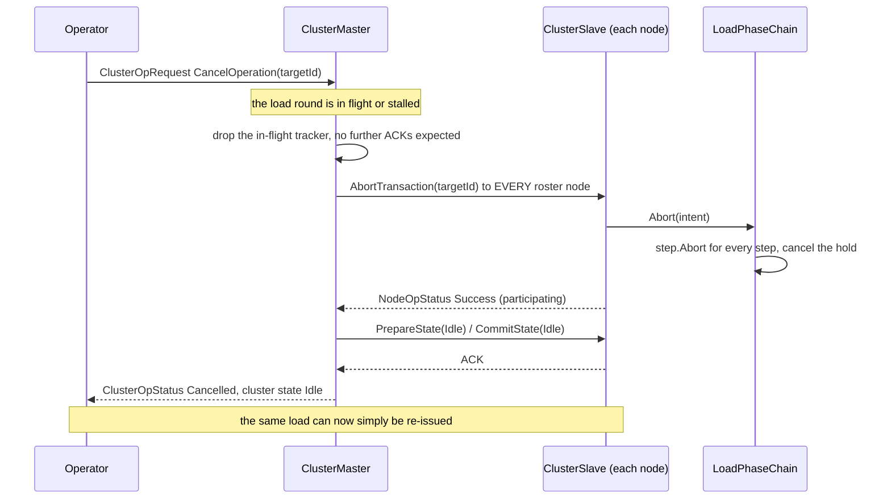

*What the picture shows that the prose hid: cancel is TWO rounds, not one — the abort frees what was staged, and a
separate state round puts the cluster in `Idle`. ⭐ A cancel that sent only the abort would leave every node's reported
state in `Loading*` with nothing loading, which is the half-cancelled condition this section exists to prevent.*

### 4-H.3 ⭐ The decisions

| # | decision | why |
|---|---|---|
| **H1** | ⭐⭐⭐ **`LoadPhaseChain` claims `NodeOpType.AbortTransaction` and routes it to its existing `Abort`** | ⛔ do not write a new abort path — `TerrainAssetHandler` is the precedent and `LoadPhaseChain.Abort` is already correct |
| **H2** | ⭐⭐ **After the abort ACKs, the master drives the cluster to `ClusterState.Idle`** — the initial default state | 🔒 the user's ruling. ⭐ It is also the state every load already starts from: `R-210` has every load caller go through `ScenarioLoadSequence` (*Idle first, then the load*), so *"repeat the procedure"* needs no new path |
| **H3** | ⭐ **Cancel is available in every `Loading*` state, not only `PARKED`** | 📐 today only a parked transition cancels cleanly (`ClusterMaster.cs:1627-1640`); that window exists before anything is sent, and it is not the case `R-4001` needs |
| **H4** | ⭐ **Still NO timer** (`R-4001`) | ⛔ the master never cancels on its own. A stall is reported as progress; a human decides |
| **H5** | ⚠ **The in-flight file transfer is CANCELLED, not abandoned** | 📐 today the gateway's prefetch *"registers no cancellation source, so the bytes finish landing"* (`ClusterMaster.cs:1631-1634`) — harmless then, because nothing loaded them. ⭐ With `§4-E2`'s provider, `IFileTransfer.Cancel()` exists ⇒ **use it**, and dispose the writer and readers as the normal end does |
| **H6** | ⭐ **A node that was mid-`Prepare` on a worker** | the chain's `Abort` cancels the hold; the worker's result is **discarded, never committed** — which is exactly why `§4-B2` requires the worker to build a PRIVATE object and write nothing shared before `Commit` |

### 4-H.3a ⭐⭐ AMENDMENT `2026-10-15` (build) — **the abort must REACH a stuck node**, and the "no `ClusterSlave` change" lean fails

📐 **Measured while building P8:**

| fact | evidence |
|---|---|
| while a prepare is pending, `ClusterSlave` QUEUES every new intent and dispatches none until it completes | `ClusterSlave.cs` `Tick`: `_pendingPrepare` ⇒ `_pendingIntents.Enqueue`; the drain `return`s while the task is incomplete |
| ⇒ an `AbortTransaction` for a load whose prepare never finishes waits behind that prepare **forever** | — the exact stall `R-4001` hands to the operator |
| the slave gives an op to the FIRST claimant only; `TerrainAssetHandler` claims EVERY `AbortTransaction` | `ClusterSlave.cs` `DispatchIntent`; `TerrainAssetHandler.CanHandle` |
| ⇒ whichever of the terrain handler and the load chain registers first eats the other's abort | registration order differs per host |
| an abort for a round a handler does not hold is a no-op there | `TerrainAssetHandler.RollBack` returns on an unknown transaction |

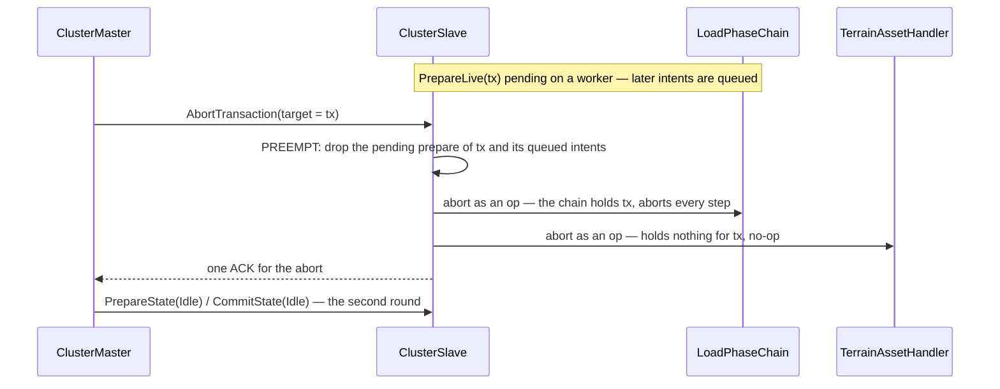

*What the picture shows that the prose hid: the abort is the one op that must NOT wait in the queue it is meant to
clear, and it is the one op that belongs to EVERY handler holding a part of the transaction.*

| # | decision | why |
|---|---|---|
| **H7** | ⭐⭐ **`AbortTransaction` is delivered to EVERY handler that claims it, never first-match only** | an abort names a TRANSACTION; each handler rolls back its own part and no-ops otherwise. ⭐ Exclusivity (`DESIGN_Cluster_Load_Phase.md` §5.1) is about who BUILDS a load — it never applied to who rolls one back |
| **H8** | ⭐⭐ **an abort naming the transaction of a PENDING prepare preempts it**: the pending prepare and that transaction's queued intents are dropped, the worker's result is discarded (H6), then the abort is dispatched | ⛔ without it the cancel cannot reach the node it exists for. ⚠ The worker keeps running to its end — it builds only private objects (§4-B2), so dropping its result is safe |
| **H9** | ⭐ **the chain claims an abort only for the load it holds** (by transaction id) and aborts from the context it stored at prepare | the abort op carries no load payload, so the steps' context must come from the prepare |
| ⛔ | ⛔ **SUPERSEDES** the handoff's lean *"route it as an ordinary handler op — needs no `ClusterSlave` change"* | measured above: an ordinary op is queued behind the stuck prepare |

#### ✅ P8 AS BUILT `2026-10-15` — H1–H9 (H5 with P6 part 1)

| piece | as built |
|---|---|
| master (H2, H3) | `ClusterMaster.TryCancelInFlightTransition` — a cancel naming a transition that is fanned out and not complete drops its tracker, fans out `AbortTransaction(target = its transaction)` to every roster node, answers the request `Cancelled`, then runs a `TransitionStep(Idle)` through `ExecuteTransitionTrajectory`; the cluster reports `Idle` when every node has answered. A parked transition still cancels as before; a completed one is not undone |
| slave (H7, H8) | `ClusterSlave.DispatchAbort` gives an abort to EVERY claiming handler and sends one answer; `PreemptPendingPrepare` drops a stuck prepare of the named transaction and its queued intents, answering that op `Cancelled` |
| chain (H1, H9) | `LoadPhaseChain` claims only the abort of the load it holds (transaction id from its `Loading*` prepare, cleared when the hold resolves), aborts every step with the context stored at prepare, cancels the hold |
| ✅ H5 *(built with P6 part 1)* | cancelling a PARKED load stops its staging copy: the master publishes `PrefetchCancelRequestedEvent`, the saga cancels the copy's token, the gateway's transfer is cancelled (`IFileTransfer.Cancel`, partial files removed) and the saga reports nothing more — the master already answered `Cancelled`. The whole prefetch now runs on a worker (the NAS scan included). Rail `ClusterMasterPrefetchTests.P8_H5_Cancelling_a_parked_load_stops_its_staging_copy`. ⚠ The terrain and behaviour-tree mirrors (`AssetTreeSync`) are not behind the provider: a cancel stops the chain before them, not inside one |
| rails | `ClusterMasterPrefetchTests.P8_*` (cancel in flight ⇒ abort + Idle round ⇒ `Idle`, and the same load is admitted again; a completed transition is not undone) · `ClusterSlaveTests.P8_AnAbort_PreemptsTheStuckPrepareOfItsTransaction_AndReachesEveryClaimant` · `LoadPhaseChainTests.P8_AnAbortOfTheLoadInFlight_AbortsEveryStep_AndOnlyThatLoadsAbortIsClaimed` |

### 4-H.4 ⚠ What is NOT decided here

- ⛔ **Cancelling a `Replay` or an archive Export/Import** — those have their own `_activeCancellations` path and are unchanged.
- ⛔ **What a node does if its abort itself fails.** ⭐ Report the code + message; a node that cannot reach `Idle` is a node whose heartbeat is the next thing to watch (`R-4001`).

---

## 4-I ⭐⭐ REJOIN, OUTAGES AND STALE NODES — **the master trusts only what it witnessed** *(`2026-10-15`, ✅ APPROVED — `R-4006`)*

> 🔒 **User, `2026-10-15`:** *"I-x accepted."* — I1, I2, I4, I5, I6 as leaned (I3 was already superseded by I5).

⚠ **Does not affect the dispatched batch** (scope frozen at `fe1095d68`). It sharpens P7's catch-up *trigger*; the
batch builds P7 as written, and this section is the NEXT handoff.

### 4-I.1 📐 What is there today

| fact | evidence |
|---|---|
| ⭐ **joining is not a request — a heartbeat appearing IS the join.** The master `Upsert`s any heartbeat into the roster; nothing reacts to a node being new | `ClusterMaster.cs:536-555` |
| ⭐ **a node waits in `Idle` forever on its own** — `ClusterSlave` starts at state `0` (`Idle`) and heartbeats at 1 Hz whether or not a master exists; nothing on the node times out | `ClusterSlave.cs:61,206-219`; `ClusterState.cs:10` |
| ⭐ **"present at start" vs "late" is only TIMING** — a round's targets are the roster snapshot at fan-out, and the commit goes to the same list ⇒ a node whose first heartbeat lands after that snapshot gets nothing from that round | `ClusterMaster.cs:1226,1279` |
| ⭐ **an ejected node that heartbeats again is silently re-admitted** — no record that it was ejected, no catch-up, its claimed state is taken at face value | `ClusterMaster.cs:690-700` (non-mandatory ⇒ only `_roster.Remove`) + `:553` |
| ⭐ **two different clocks decide "gone"**: the master ejects after **5 s** of heartbeat silence; every ECS node raises `NodeDeparted` on DDS liveliness loss, **~10 s** | `ClusterConfiguration.cs:20`; `ClusterCapabilityIngestSystem.cs` (*"lease expiry: NotAliveDisposed after ~10 s, measured"*) |
| ⭐ **a node sees the master leave, and does nothing with it** — the orchestrator runs a `ClusterSlave` and heartbeats like any node, so its departure IS observed; no code treats it as the end of the world | `OrchestratorSubsystem.cs:154`; `ClusterCapabilityIngestSystem.Departed` publishes only `NodeDeparted` |
| ⛔ **the epoch was DESIGNED and never built** — `ClusterStateTopic.TransactionEpoch` is declared and **written nowhere**; the egress writes only `CurrentState` + `ExerciseId` | `OrchestrationMessages.cs:100`; `ClusterOpMasterTranslator.cs:89-93` · design: `mgmt-1/DESIGN.md` §4.2 *"incremented on every successful commit. A node that 'missed' a commit detects this…"* |
| ⛔ **`ExerciseId` cannot tell two clusters apart** — it is caller-supplied per load, `Guid.Empty` when the caller gives none | `ClusterMaster.cs:1095-1101` |
| ⛔⛔ **NO session / incarnation id exists anywhere** — and a node's id is a configured number, so a restarted node comes back under the SAME id | `grep -i "incarnation\|sessionid\|clusterid\|bootid"` over production `Hrot/` + `FDP/`: 0 hits; `HrotNodeBuilder.cs:163,232` (`_config.NodeId`), IG from its configured instance id (`IgApplication.cs:717`) |
| ⭐ `ClusterStateTopic` is **keyless** (one instance), durable, written only by the master | `OrchestrationMessages.cs:92-101` |
| ⭐ **a stale world IS cleared if the node is a target of the next load** — the load carries `IsWorldBoundary` and the slave accepts a commit from any state | `ClusterMaster.cs:1275`; `ClusterSlave.cs:411-421` |

### 4-I.2 ⭐ The proposal — two views of one rule

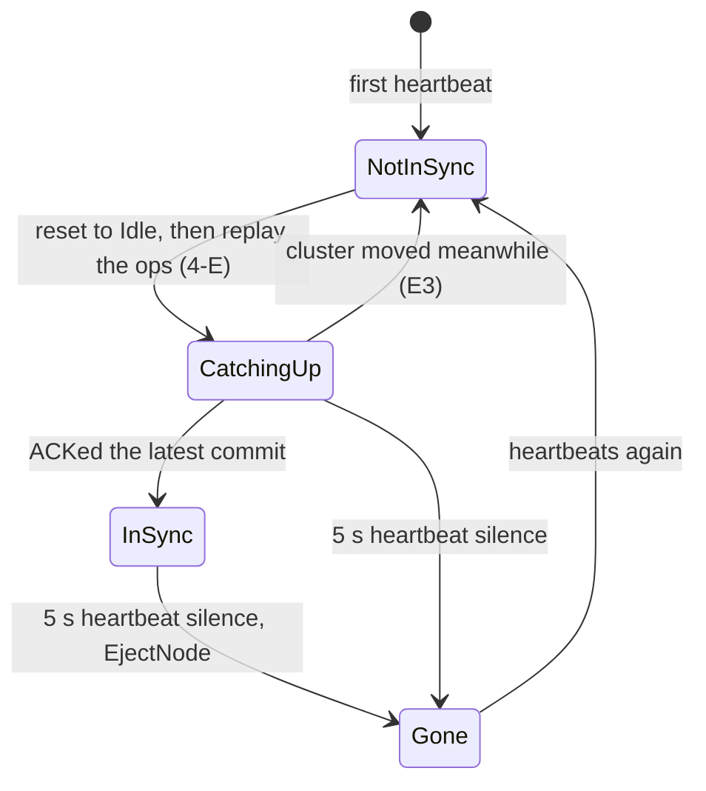

*The master's view of ONE node. What the picture shows that prose hid: there is no edge from `Gone` back to `InSync`.
A new node, a restarted node, a node from a dead cluster and a node back from an outage all enter at the same state,
so the master never has to tell them apart.*


*The node's view. The node needs no epoch of its own: it drops to `Idle` when the world it belonged to ends, and
otherwise does what the master says.*

| # | decision | lean |
|---|---|---|
| **I1** | ⭐⭐ **the master keeps an `InSync` set**: a node enters it only by ACKing the commit the master is currently at, and leaves it on ejection | ⭐ **LEAN.** The master is not restartable (`§4-E′`), so its memory IS the truth. Replaces "is the node's claimed state equal to the cluster's?" — a check that a node back from an outage passes while having missed a reload, and that a node from a dead cluster passes while holding another scenario |
| **I2** | ⭐⭐ **the catch-up trigger is "in the roster and not `InSync`"**, and its FIRST step is a reset to `Idle` with the world boundary set | ⭐ **LEAN.** One path for every case. ⚠ Cost: a 6 s network blip makes a Player reload. The asset diff (`DESIGN_Asset_Management.md` §4) means no bytes move twice; only the load chain reruns |
| ~~**I3**~~ | ⛔ **SUPERSEDED by I5** (same day, before approval): *"a node drops to `Idle` when the master's `ClusterState` writer goes not-alive."* ⛔ **Timing-dependent**: the topic is keyless, so if a new master's writer appears before the old one's lease expires (~10 s), the instance never goes not-alive (DDS instance semantics — not measured here) and the stale node is never told | — |
| **I5** | ⭐⭐⭐ **A CLUSTER SESSION ID.** The master mints a GUID at process start and publishes it on `ClusterStateTopic` (one new field). Every node remembers the session it is following; **a different session id, or the master's writer gone, ⇒ the world it belonged to ended ⇒ drop to `Idle`** (the `§4-H` reset). The node also reports the session it follows in its heartbeat | ⭐ **LEAN.** Deterministic, no race: a stale node learns it is stale the moment it receives the new master's durable sample. 🔒 *"master is not restartable"* ⇒ one master = one session, so the id needs no persistence. ⭐ Not a network fact (`R-4005`): the editor's in-process master mints one too, and nothing ever differs. ⚠ A wire change — two fields — allowed where the design needs it (`R-169`) |
| **I6** | ⚠ **stale DURABLE DATA leaking into a new session** — a surviving SimHost/CGF from a dead cluster re-delivers its `TransientLocal` entity descriptors to the new cluster's nodes before its I5 reset runs | ⭐ **LEAN: the I5 reset disposes them** (one frame of ghosts). ⛔ Rejected for now: a DDS **partition per session** on every data topic — airtight, but every writer and reader is re-created on each session change. ⚠ Revisit if one frame of ghosts is ever observed to matter. ⚠ **Not measured:** that the reset's world clear disposes the node's own published instances |
| **I4** | ⚠ **write `TransactionEpoch`** (mgmt-1 §4.2) | ⭐ **LEAN: yes, but as telemetry.** Increment it on every committed transition and zone commit so the panel and the logs can show who is behind. ⛔ It does NOT decide membership — I1 does, and a node-side epoch comparison would be a second way to drive a node's state (rejected in `§4-E`) |

| outage length | today | with I1–I3 |
|---|---|---|
| **< 5 s** | nothing happens; Reliable commands are retransmitted | the same |
| **5–10 s** | master ejects; node keeps its world; on return it is silently re-admitted, and if a round ran meanwhile it never sees it | ⭐ master ejects; on return the node is `NotInSync` ⇒ reset + catch-up |
| **> 10 s** | both sides also raise `NodeDeparted`: ownership reclaim (`R-167`), possession released (`§4-F`), then as above | ⭐ as 5–10 s; the session id is unchanged, so the node keeps its world until the master resets it |
| **master dies, node lives** | the node keeps showing a dead world in `OperatingLive`; a new master re-admits it at face value | ⭐ the new master's session id differs ⇒ the node drops to `Idle` (I5); the new cluster sees an ordinary `Idle` late joiner |

#### ✅ C2 + C4 AS BUILT `2026-10-15` (I5, I4, and I6 with `CE-4000` F2)

| piece | as built |
|---|---|
| wire | `ClusterStateTopic.SessionId` (Guid) and `NodeHeartbeat.SessionId` — new fields (every node is rebuilt together; no mixed-version peers). `TransactionEpoch` is now WRITTEN |
| master | `ClusterMaster.SessionId` minted at construction, on every `ClusterStateTransitionedEvent` / `ClusterStateUpdateEvent`; `TransactionEpoch` incremented by every round that completes successfully (telemetry only); each node's followed session lands in `NodeHealthProfile.SessionId` |
| every node | `NodeOpSlaveTranslator` reads `ClusterStateTopic` (built by `NedSlaveOrchestrationTranslator`, so IG/CGF/SimHost — before, only ExCon's observer read it) → `ClusterStateUpdateEvent{SessionId}`; a not-alive instance → `ClusterStateUpdateEvent{MasterGone}` |
| slave | `ClusterSlave.FollowingSessionId`: the first session seen is adopted; a DIFFERENT one, or `MasterGone`, drops the node to `Idle` — its stuck prepare is aborted and its queued intents dropped — and the heartbeat reports the session followed |
| ✅ **I6** *(with `CE-4000` F2, `R-4019`)* | a node that drops to `Idle` (new session, master gone) EMPTIES its world and deletes on the wire what it owned — the same `ClusterSlave` → `IIdleResetHandler.OnEnteredIdle` hook as a committed transition to `Idle`. 📄 [`DESIGN_Cluster_Load_Phase.md`](../DESIGN_Cluster_Load_Phase.md) §8.2 |
| rails | `ClusterSlaveTests.C2_ANodeFollowsOneSession_AndANewSessionOrAGoneMasterDropsItToIdle` · `NodeOpSlaveTranslatorTests.ClusterState_ReachesTheNodeWithItsSession_AndTheWriterGoingAwayIsMasterGone` (real DDS) · `ClusterMasterZoneRoundTests.C2_C4_The_cluster_state_carries_the_session_and_a_completed_round_moves_the_epoch` |

### 4-I.3 ⚠ What is NOT decided here

- ⛔ **A > 10 s partition of an AUTHORITATIVE node is split-brain for OWNERSHIP**: both sides run the `R-167` reclaim.
  A Player owns nothing (`R-161`, Map2D claims nothing), so it is not exposed; a SimHost or CGF is. ⭐ Needs its own
  question — ⛔ not folded in here.
- ⚠ **Not measured:** whether a node's replicas of a departed owner's entities are destroyed when that writer's
  descriptors go not-alive, i.e. whether I3's reset is what clears them or something already does.

---

## 4-J ⭐⭐ SERVICING A LATE JOINER BESIDE A RUNNING SESSION — **the joiner may never gate the running game** *(`2026-10-15`, OPEN — leans await the user)*

⚠ **Does not affect the dispatched batch.** It sets the rules P7's catch-up must obey; three of them are new findings.

### 4-J.1 ⭐ The sequence

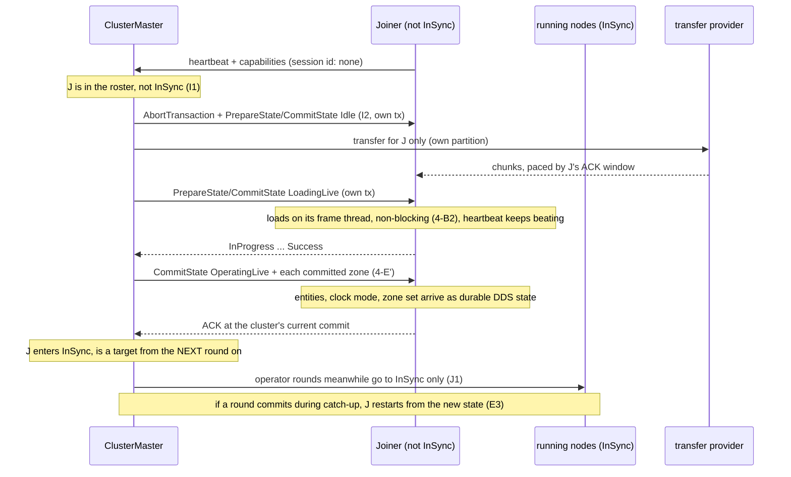

*What the picture shows that prose hid: every arrow to the joiner is a SEPARATE transaction addressed to it alone, and
no arrow runs from the joiner to a running node. The only shared resources are the network and the DDS writers'
history, which is why those are the two unmeasured rows below.*

### 4-J.2 📐 What isolates it today, and what does not

| channel | isolated? | evidence |
|---|---|---|
| ⭐ addressing: a catch-up op reaches the joiner only | ✅ `FanOutNodeOp` takes an explicit target list; each round has its own `GenericTransactionTracker` keyed by tx id ⇒ concurrent rounds are already representable | `ClusterMaster.cs:55-67,1731` |
| ⭐ the master's ONE busy slot is the PARKED transition | ⚠ a second transition is **rejected** while one is parked waiting for files | `ClusterMaster.cs:1072-1082` |
| ⭐ operator rounds target the ROSTER | 🔴 **a catching-up node is a target of every operator round** and its ACK is awaited — the joiner gates the running game | `ClusterMaster.cs:1226,1279` (`_roster.ActiveNodes.Keys`) |
| ⭐ files | ✅ per-transfer partition, only the targets receive; the gateway works off the master's thread | §4-E2 (measured: bystander 0 bytes) |
| ⭐ the step barrier | 🔴 today a Player is in it by NAME (`"IG"`) ⇒ a loading Player would gate every step | §4-D′ — fixed by P3 (roster = authoritative nodes) |
| ⭐⭐ **the reliable-init barrier** | 🔴🔴 **the running game waits for the joiner.** Every NED node advertises `fdp.reliable-init` (`NedNetworkFactory.cs:113`), and a creator's wait-set is *every present peer that advertises it* (`ClusterCacheExpectedPeersProvider.cs:33-37`). A joiner is present from its first heartbeat. ⇒ a spawn in the running game waits **~1 s** if the joiner is silent (phase-1 probe, `NetworkGatewaySystem.cs:60`), and is **ABORTED after 300 frames** if the joiner answered *Constructing* but never *Active* (`DeferredConstructionParticipant.cs:52`; abort, never force-ack — CE-289) | measured |
| ⭐ the "unsupported" mark | 🔴 a peer that misses one phase-1 probe is marked `!fdp.reliable-init` **forever** — never cleared, not on departure, not when it returns, and node ids are reused after a restart | `SimpleClusterStateCache.cs:25,75-81` (only `Add`, no `Remove`) |
| ⭐ the joiner's own load | ✅ once §4-B2 lands it costs only the joiner; before it, a long load also blocks the joiner's replies, which is what triggers the two rows above | §4-B2 |
| ⚠ durable entity state delivered to the new reader | ⛔ **not measured** — DDS serves `TransientLocal` history from each WRITER, so the running nodes' DDS stacks do the work; whether a slow reader can back-pressure a Reliable writer is untested here | — |
| ⚠ the transfer's bandwidth against game traffic | ⛔ **not measured** — the ACK window paces the transfer to the RECEIVER, not to the link | §4-E2 |

### 4-J.3 ⭐ The decisions

| # | decision | lean |
|---|---|---|
| **J1** ✅ **APPROVED (R-4013)** | ⭐⭐ **an operator round targets the `InSync` set, never the roster** | ⭐ **LEAN.** Follows from I1: a node not in sync is not a participant. A round that commits during a catch-up restarts the catch-up from the new state (E3) |
| **J2** ✅ **APPROVED (R-4013)** | ⭐⭐ **the catch-up never uses the parked slot** — it is its own per-node saga with its own trackers | ⭐ **LEAN.** Otherwise a joiner's download makes the operator's next load "busy" |
| ~~**J3**~~ | ⛔ **SUPERSEDED by J3′** (same day, before approval). It read *"the wait-set holds only peers in the creator's session and state … both already reaching every node's cluster cache."* ⛔ **Measured false:** the cache keeps id, role, capabilities, CPU, RAM, last-seen — **no state** (`IClusterStateCache.cs:73-87`); the heartbeat's state reaches the ingest and is dropped. And a state-equality test races: the heartbeat is 1 Hz BestEffort, and nodes commit a transition a few frames apart | — |
| **J3′** | ⭐⭐⭐ **the master PUBLISHES its `InSync` set; a creator's wait-set = peers advertising `fdp.reliable-init` ∩ that set.** The field already exists for exactly this and is never written: `OrchestratorContextTopic.RequiredNodeIdsJson` (`OrchestrationMessages.cs:239`) — mgmt-1 §5 *"JSON int[] — which NodeIds are expected"* (`mgmt-1/DESIGN.md:327`). Reliable + TransientLocal, one producer | ⭐ **LEAN.** One authority (the master, I1) instead of every node inferring it from heartbeats; no 1 Hz staleness, no commit-skew race. A joiner is waited for from the moment the master publishes it in sync (milliseconds after its last ACK). ⚠ Entities spawned between its last ACK and that publish reach it only through the durable read path — `DESIGN_Cross_Node_Construction_Barrier.md` §2a, **A7 not built** (§3a.7). ⭐ On the editor the wait-set is empty already (one node, local excluded) — no special case (`R-4005`) |
| **J4** ✅ **APPROVED (R-4013)** | ⭐ **the "unsupported" mark is cleared whenever the node ENTERS the `InSync` set** (and on departure) | ⭐ **LEAN.** Departure alone is not enough: a node reset by I2 never departs, yet may miss a probe while reloading. The mark still does its real job — an external host that advertises `fdp.reliable-init` and never delivers is re-marked on its first missed probe |
| ~~**J3′**~~ | ⛔ **SUPERSEDED by K6** (same day): the wait-set must also exclude BEST-EFFORT nodes, not only nodes out of sync | — |
| **J5** ✅ **APPROVED (R-4013), with the R-143 wall-clock exemption** — 🔒 *"J5 needs wall clock time of course."* | ⚠ **a bandwidth cap on the transfer provider: a TOKEN BUCKET in the sender's chunk loop** — before writing a 64 KB chunk the sender takes 64 KB of tokens; tokens refill at the cap (bytes/s); one bucket for ALL transfers, because every NAS byte leaves the one gateway ⇒ a cluster-wide cap. Effective rate = min(the cap, the ACK window's pace). It lives in the sender task, off every frame thread (§4-E2 `Start` returns at once) ⇒ waiting for tokens blocks nobody | ⚠ **LEAN: a setting, off by default, until measured** (one 64 MB transfer during a running `--mode all` session, watching entity update latency). ⚠ **Needs a user ruling: it paces on the WALL clock** — `R-143` allows sim time only, and its one exemption (`R-244`) says *"not a licence … anywhere else"*. Pacing network I/O decides nothing the simulation computes. ⭐ One send to a bundled partition goes on the wire ONCE — 🔒 user, `2026-10-15`: *"when one send serves several bundled joiners, in our default setting cyclone DDS puts it on the wire once."* ⇒ the cap counts wire bytes. ⛔ Rejected: a DDS-level limit — DDS has no throughput QoS (`TRANSPORT_PRIORITY` → DSCP only helps if the switches honour it; not verified for Cyclone) |

---

## 4-K ⭐⭐⭐ THE JOIN CONCEPT REVIEWED FROM EVERY ANGLE — **gaps found by measurement** *(`2026-10-15`, OPEN)*

> 🔒 **User, `2026-10-15`:** *"every new question seems to change your lean. Could you review the player join concept from
> different perspectives, trying to find further gaps?"* ⇒ every row below was measured before any lean was written.

### 4-K.1 ⭐ The order a joiner must follow — the picture that exposes K3

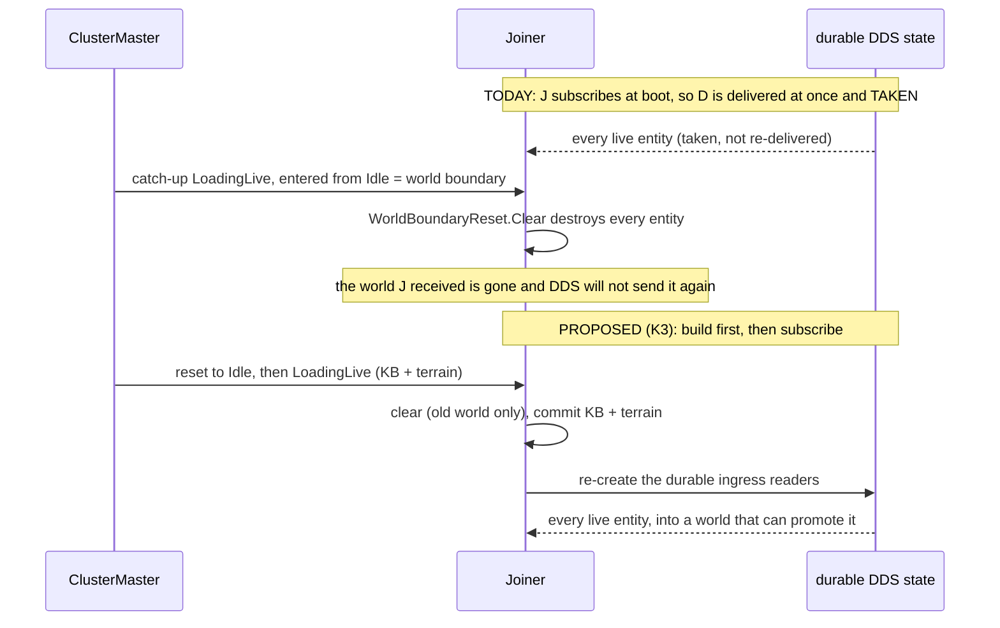

*What the picture shows that prose hid: the joiner's world arrives BEFORE the step that wipes it. Every piece is correct on
its own (`Take` is right, the boundary clear is right); only the order on a node that subscribed early is wrong.*

### 4-K.2 📐 The gaps

| # | angle | the gap | evidence |
|---|---|---|---|
| **K1** | ⭐⭐ **identity** | **every Player launched alike has the same node id**: the runner gives IG `base + 100` (`-n/--node-id`, default 0 ⇒ **100**, `Program.cs:719-733`); embedded with no override it is the constant **300** (`IgApplication.cs:654`). Nothing anywhere detects two processes under one id. 📐 **Measured live `2026-10-15`**: two IG processes both at id 101 ⇒ the master's fan-out counted `nodes=5` for six processes and **both** executed the load to `OperatingLive`. Two Players ⇒ one roster entry, both execute every command, one leaving releases the other's possession and ownership, and `InSync` (I1) is shared | `Program.cs:719-733`, `IgApplication.cs:654`; no duplicate-id detection in production `Hrot/` or `FDP/`; live run below |
| **K2** | ⭐⭐ **fast restart** | **I1 has a hole**: a node leaves `InSync` only when ejected after 5 s of silence. A process that restarts faster than that is never ejected, so the empty new process is believed in sync and never caught up | `ClusterMaster.cs:660-679` (ejection only on timeout). 📐 **Measured live**: one IG restart was ejected, the next (process composed 2.6 s after the kill) was **never ejected** — timing decides |
| **K3** | 🔴🔴 **world delivery** | **a catch-up wipes the world the joiner just received.** Readers are created when the node is composed (`EntityStatesIngressPack.cs:52`), so the durable entity state arrives at once and is `Take`n (`EntityMasterIngressTranslator.cs:104`). The catch-up's load is entered from `Idle` ⇒ a world boundary (`ClusterMaster.cs:1406-1408`) ⇒ `WorldBoundaryReset.Clear` destroys every entity and clears the entity map (`LoadPhaseChain.cs:198`). Ingress then only resets its bookkeeping (`:101`); nothing re-subscribes (no such code exists). ⇒ entities that do not re-publish (anything static) **never come back** | measured, every link. ⚠ **Live run `2026-10-15`: TODAY a late Player gets the whole replicated world WITHOUT any catch-up** (8/8 networked entities, promoted) — only because every host boots with the DEVELOPMENT TKB (`HrotEnvironment.CreateTkb()`, *"the real system loads TKB from files"*). ⇒ the wipe happens only once P7 sends a world-boundary load, and with a file TKB nothing would promote before the load |
| **K4** | 🔴 **master side effects** | **a catch-up built on the operator's transition path would damage the running game**: it jumps the CLUSTER clock to 0, paused (`GlobalContextProcessManager.cs:44-49`), and resets the network-id authority in a running world (`ClusterMaster.cs:1406-1426`, duplicate ids — HN-037) | measured |
| **K5** | 🔴 **genesis** | **a late-joining or restarted Brain node would duplicate the scenario**: `ScenarioEntities` runs on `Brain` (`RoleLoadRequirements.cs`), and a catch-up replays the load. ⭐ A Player (Map2D) runs only KB + terrain, so it is safe — but I2 applies to every node (R-4000) | measured |
| **K6** ✅ **APPROVED (R-4014)** — 🔒 user: *"K6: sounds OK"* | ⭐⭐ **the gates are inconsistent** | §4-A says a best-effort node may not fail or hang a round; §4-D keeps it out of the step barrier; but the reliable-init wait-set still waits for every present Player. ⭐ **Measured: no production peer has a real init condition** — the only deferring participant is `SimulatedInitReadinessParticipant`, off by default (*"the barrier completes as soon as each peer ghosts + reports"*) ⇒ a Player in the wait-set protects nothing and can only delay or abort spawns | `SimulatedInitReadinessParticipant.cs:40-43`; `NedReplicationModule.cs:338` |
| **K7** ✅ **APPROVED (R-4014)** — 🔒 user: *"K7: OK"* | ⭐ **failure** | **a Player whose catch-up fails is retried forever** — I2's trigger is "in the roster and not `InSync`", and a failed node stays exactly that | follows from I2's own wording |
| **K8** | ⭐ **possession** | after a fast restart (< 10 s, no `NodeDeparted`) the durable possession record still names the node id, so the new process "possesses" an entity it knows nothing about | `§4-F`; owned by `DESIGN_Entity_Control.md` (behaviors lane) |

⭐ **Two worries that measured FINE:**
- **the joiner's clock** — no node-side load step touches time; a slave derives sim time from the durable `SwitchTimeModeEvent` snapshot plus its wall offset (`SlaveSyncController`), so a joiner lands on the cluster's time
- **"half-built" entities without A7** — a replica is promoted only once every mandatory TKB component has arrived (`GhostPromotionSystem`, built). A7 (*hold until the owner is `Active`*) matters only when a peer has a real init condition, and none does (K6) ⇒ **A7 is not on a Player's path**

### 4-K.3 ⭐ The leans

| # | lean |
|---|---|
| ~~**K1+K2**~~ | ⛔ **SUPERSEDED by L1 (R-4009) + I5 (R-4006)** — nothing extra is needed: a restarted process has a new process id and must ASK for its id (L1, R-4016), so the master sees a new process at the grant and gives it a new id (ids are never reused in a session); a forced id is refused while the old process is still alive. The old id leaves on its heartbeat timeout like any departure — which also clears K8. 🔒 user: *"i hope we agreed on master allocating the ids if no fixed one given and using session guids"*. Was: ⚠ **AMENDED by L1** (ids assigned by the master unless forced). Unchanged below: ⭐⭐ **every node process mints an INSTANCE id (GUID) at start and carries it in its heartbeat** (beside I5's session field). `InSync` is keyed by (node id, instance). A new instance under a known id is a **departure plus an arrival** — handled by the existing `NodeDeparted` path everywhere it is detected (which also fixes K8 without new code). Two instances alive under one id at once ⇒ the master refuses the newer one and says so on the panel. ⚠ **Node ids stay configuration** (the launcher assigns them) — the instance id DETECTS a collision, it does not prevent one |
| ~~**K3**~~ | ⛔ **SUPERSEDED by L2** (the user's gated-ingress idea; re-creating readers would also re-deliver the stale instances `CE-4000` measured). Was: *"build first, then subscribe: a node re-creates its durable ingress readers when it commits a load, so the durable state is delivered into a world that has its KB and terrain. ⭐ One rule on every node (R-4000) — at a normal cluster start it delivers nothing old. ⚠ Must be measured before it is built: that a previous run's entities are DISPOSED on the wire at unload."* 📐 **Measured: they are NOT** — `CE-4000` |
| **K4** ✅ **APPROVED `2026-10-15` (R-4017)** — 🔒 user: *"K4 approved"* | ⭐⭐ **fence: the catch-up is built from node ops (`FanOutNodeOp`) only** — never by publishing a `TransitionStateIntent` or entering `ProcessTransitionStateIntent` |
| ~~**K5**~~ | ⛔ **SUPERSEDED by K5′** — it had the scenario step read the file and skip genesis on a catch-up | — |
| **K5′** ✅ **APPROVED `2026-10-15` (R-4015)** — 🔒 user: *"late joiner never reads a scenario as he is late, so he missed the loading"* · *"K5 approved"* | ⭐⭐ **a late joiner never reads the scenario: a catch-up runs the UNIVERSAL load parts only — knowledge base and terrain — on every node, whatever its role, and never creates scenario entities.** The world already exists and arrives by replication. ⭐ For a Player nothing changes (Map2D runs exactly those two parts, `RoleLoadRequirements.cs`); the rule matters for a restarted Brain, which would otherwise re-run genesis and duplicate every unit. ⚠ What else a restarted Brain must recover (its AI state, its ownership back from the reclaim) is a separate question |
| **K6** | ⭐⭐⭐ **ONE principle for every gate: a best-effort node never gates, a node not in sync never participates.** The reliable-init wait-set = advertises `fdp.reliable-init` ∩ `InSync` ∩ authoritative (§4-A′). Same predicate as the 2PC rounds (P2) and the step barrier (P3). Supersedes J3′ |
| **K7** | ⭐ **one catch-up attempt per instance and per cluster commit.** A failure is shown on the panel with its code and message; the operator retries the node, or a restart (a new instance, K1) retries it |

⚠ **Not examined:** a joiner arriving during a REPLAY (the catch-up path into `OperatingReplay`); what a late joiner's
partial recording means for an archive export (R-4003); DDS discovery cost with many Players.
⭐ *(Replay is answered in §4-L3; DDS discovery is out of scope — 🔒 user: "ignore dds discovery costs, our number are
still small (up to 50 stations)".)*

---

## 4-L ⭐⭐ IDS, INGRESS, REPLAY AND THE WORD "BEST-EFFORT" *(`2026-10-15`, OPEN — leans await the user)*

> 🔒 **User, `2026-10-15`:** *"can't we let the orchestrator assign node id to player dynamically if they don't force a
> fixed one?"* · *"entity data network translators are theoretically dynamically creatable … or simply their reception
> path always active but gated, so we might postpone their activation until the join is on proper phase."* · *"how does
> replay late join differ from live?"* · *"what is best-effort node?"*

📄 The use cases and how to test each one live: [`../DESIGN_Cluster_Membership_Use_Cases.md`](../DESIGN_Cluster_Membership_Use_Cases.md).

### 4-L.1 ⭐ The two decisions as one picture

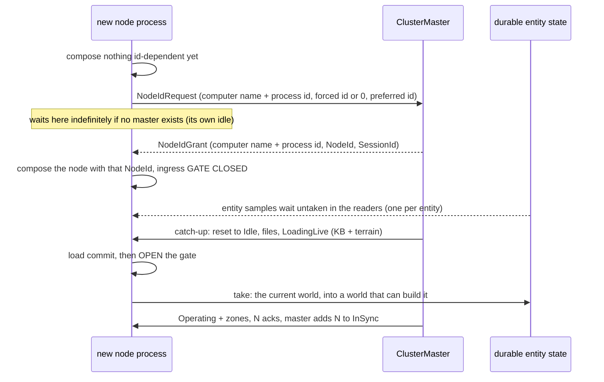

*What the picture shows that prose hid: the id must exist BEFORE the node is composed, because composition bakes it in;
and the gate closes the window between "the readers exist" and "the world can be built" without re-creating any reader.*

### 4-L.2 📐 What decides these leans, measured

| fact | evidence |
|---|---|
| ⭐ the node id is baked in at COMPOSITION — the slave, the network factory, the ELM and the translators all take it at build time | `HrotNodeBuilder.cs:163,232,238-239,251` |
| ⭐ entity state topics are `Reliable + TransientLocal + KeepLast 1` ⇒ a reader that does not `Take` holds exactly the latest sample per entity, and a dispose arrives as that instance's state | `GenericDescriptors.cs:96` (`EntityMaster`) |
| ⭐ entity ingress has **two drivers**: `CycloneNetworkIngressSystem` on every non-IG node, and the pure-IG `EntityStatesIngressPack` path | `NedReplicationModule.cs:418-438` |
| 🔴 a previous run's entities stay ALIVE on the wire after a world boundary — the creator (CGF) never disposes them | 📐 live `2026-10-15`: after loading `test-move` over `hill-attack`, a fresh late joiner received ids **1000–1007** where the world held **1000**; `ddsmonitor` showed `EntityMaster` 1001–1007 `Alive` from the CGF process (SimHost disposed its own 1300/1301) — `CE-4000` |
| ⭐ a crash DOES clean the wire: after a CGF kill every survivor dropped its entities (~11 s, DDS lease) and a later joiner received none | 📐 live `2026-10-15` |
| ⭐ recording keeps EVERY entity, replicas included | `EcsRecordReplayController.cs:127` (`EntityFilter = null`) |
| ⭐ replay on a node that owns nothing: ghosts come from the owners' egress flood; a seek purges and re-floods | `mgmt-1/DESIGN.md` §8.10 |
| ⚠ the replay ghost-bypass flag is written and never read | `GhostCreationSystem.cs:15-38` (`CE-259ap`) |
| ⛔ no debug HTTP route reads the master's roster or drives a CLUSTER replay (`/replay/load` replays one local `.fdp`) | `DebugApiHost.cs:964-968`; `/cluster/diagnostics/status` needs an ExCon `ClusterUiCache` and lists no nodes — `CE-4002` |

### 4-L.3 ⭐ The leans

| # | decision | lean |
|---|---|---|
| **L1** ✅ **APPROVED `2026-10-15` (R-4009)** — 🔒 user: *"L1 (master-assigned node ids) approved."* | ⭐⭐ **the master assigns a node id unless the node forces one.** Before composing anything id-dependent, the process sends `NodeIdRequest {ComputerName, ProcessId, ForcedId (0 = none), PreferredId}` and waits; the master answers `NodeIdGrant {ComputerName, ProcessId, NodeId, SessionId}` (Reliable, TransientLocal, keyed by the computer name + process id). ⚠ **AMENDED (R-4016): no random id minted by the node** — the process is told apart by facts it already has, which the DDS binding also publishes as `SenderIdentity` (🔒 user: *"yes, computer name + process id"*). Dynamic ids come from their own range; **an id is never reused within a session** (a possession or ownership record may still name it). A forced id already held by a live instance is **refused** and shown. `PreferredId` = the id the process held before — so a node meeting a NEW session (I5) keeps its id when it is free and never has to re-compose | ⭐ **LEAN.** Players are disposable and launched by people who should not have to plan ids; a duplicate becomes impossible rather than detected. ⚠ **Blast radius: a two-phase boot** — the wait for a grant moves in front of node composition. ⭐ It is also the natural home of the node's own idle: a process with no grant shows *"waiting for a cluster"*. On the editor (one process, no network, `R-4005`) the same request travels the in-process orchestration bus to its own master — a forced id, granted at once. ⚠ Not measured: whether any consumer packs a node id into fewer than 32 bits |
| ~~**L2**~~ | ⛔ **SUPERSEDED by L2′** (same day): it proposed *"one shared gate object"* — 📐 that gate **already exists** and was not found until the replay design was searched | — |
| **L2′** ✅ **APPROVED `2026-10-15` (R-4007)** — 🔒 user: *"Lean (L2′): accepted. WorldEvents must be drained as you suggest."* | ⭐⭐⭐ **adopt the EXISTING world-state freeze gate on every node: `CycloneNetworkIngressSystem.IsWorldStateFrozen`** — a `Func<bool>` asked once per frame; while true, every `TranslatorClass.WorldState` translator is simply **not polled** (its samples stay in DDS, latest per entity) and every `ControlPlane` translator keeps polling (`CycloneNetworkIngressSystem.cs:46-66`; `IDescriptorTranslator.cs:40`). ⭐ It reaches **both** ingress paths — the pure-IG pack also registers a `CycloneNetworkIngressSystem` (`EntityStatesIngressPack.cs:73`). 📐 Today it has ONE writer: CGF's debugger halt, wired by a sweep over `SystemScheduler.GetAllSystems()` (`CgfSubsystem.cs:3372-3390`) | ⭐ **LEAN.** ⛔ Neither installing translators at runtime nor a global variable: **one node-level predicate, wired by the same sweep, moved into shared composition** (R-174, R-254) and fed by every reason to freeze — ① *not yet joined* (closed until the load commits, closed again at a reset to `Idle`), ② *the debugger halt* (as today), ③ *replaying locally* (L3′). 🔴 **One refinement, measured:** ~20 world-state topics are **events** — `Volatile + KeepAll` (`WeaponFire`, `MunitionDetonation`, `EntityHitDamage`, `CreateEntityRequest`, …) — and a skipped KeepAll reader QUEUES them, so a joiner would get a burst of stale shots when the gate opens. ⇒ ⭐ while frozen for reason ① those translators are drained and the samples discarded; the debugger halt keeps today's hold. ⚠ Needs a way to tell the two apart — the lean is a third category, `TranslatorClass.WorldEvent`. ⛔ **Prerequisite: `CE-4000`** |
| ~~**L3**~~ | ⛔ **SUPERSEDED by L3′** — it assumed a Player's replay world must come from the network, without the replay design | — |
| ~~**L3′**~~ ⛔ **ACCEPTED, THEN SUSPENDED the same day — it is Plan B, which the user had already rejected; see L3″** (🔒 user: *"accepted for player 'role' (if the player is not brain and not muscle)"*) | ⭐⭐ **replay, clarified — and the Player's rule** | 📄 **The design** (`docs/designs/replay-and-modules/DESIGN.md`): **Plan A** — *"every Brain/Muscle node records its full ECS state — both owned components and unowned ghost components"* (§2.3), so each restores the WHOLE world locally and seeks without the network; **the network matters in replay only to feed nodes that do not record** — the Export phase keeps running to *"broadcast historical state to IG nodes"* (§2.1, §2.2). ⭐ So yes: **Brain and Muscle replay from their own recordings and need replication very little.** 📐 **As built:** recording keeps every entity (`EcsRecordReplayController.cs:127`); IG runs the no-op `ListenerRecordReplayController` (`IgNodeBootstrapper.cs:374`, R-4003 / P5a will change that); and 🔴 **live ingress is NOT stopped during replay on any node** (§2.1a: the groups toggled hold no ingress system) — the design's own fix is to adopt the same freeze gate (`CE-259ap`). ⭐ **LEAN for a Player: it records and restores ONLY WHAT IT OWNS, and takes everything else from the owners' flood — exactly as it does live.** ① A Player's recording is partial **by nature** (it joins late, leaves, restarts), so Plan A's "restore the whole world locally" cannot hold for it; ② the flood already exists for exactly this audience; ③ live and replay then share ONE join path. ⇒ one controller (R-4003 — 📐 three exist today: `EcsRecordReplayController`, `CgfRecordReplayController`, `ListenerRecordReplayController`), with a ROLE-chosen recording filter (R-4003 allows *"controlled by the role"*): authoritative nodes record everything and freeze world-state ingress while replaying (reason ③); an observer records what it owns and keeps ingress open. ⚠ **Not measured live** (no route drives a cluster replay — `CE-4002`) |
| ~~**L3″**~~ | ⛔ **SUPERSEDED by L3‴** (same day, the user's question *"can't the node start replaying what it did record itself when the time comes?"*): the "complete recording" test is unnecessary. Was: ⭐⭐⭐ **EVERY ECS node records everything (Plan A) with ONE controller; in a replay a node restores locally IF it holds a COMPLETE recording of the replayed exercise — otherwise it is a listener: it restores nothing, keeps world-state ingress open, and takes the world from the owners' flood.** The only parameter is a FACT about the node's recording, never its role | ⭐ **LEAN — replaces L3′.** 🔴 **Why L3′ cannot work, measured:** a Player that restores an owned-only recording while holding network ghosts is exactly **Plan B**, rejected in the original design talk because playback restores by **raw chunk blit** and a **keyframe clears the world** — 📐 still true: `PlaybackSystem.cs:52-55` (`frameType == 1 ⇒ repo.Clear()`), `NativeChunkTable.cs:416,436` (`Unsafe.CopyBlock`) ⇒ every seek or keyframe would wipe the ghosts it got from the network. 🔒 The user, then: *"Ok so this feature makes plan b unusable. Good, so lt's keep just the plan a."* (`.dev/_DONE/replay-and-modules/design-talk.md:270`). ⭐ L3″ is the unification the user asked for: a Player present for the whole exercise replays exactly like Brain and Muscle; a late, departed or restarted one listens. ⚠ **Known limit:** in a replay, entities whose recorded owner is a LISTENER are restored on the nodes that recorded them but flooded by nobody (egress is authority-gated) ⇒ other listeners do not see them. ⚠ **Not measured:** whether a recording's metadata already says when it started, which is what "complete" needs |
| **L3‴** ✅ **APPROVED `2026-10-15` (R-4012)** — 🔒 user: *"L3‴ approved"* | ⭐⭐⭐ **every ECS node records everything (Plan A); in a replay, each node RESTORES ITS OWN RECORDING FOR THE MOMENTS IT COVERS AND LISTENS OUTSIDE THEM.** Per seek and per step the node asks itself one question — *"is this moment inside my recording's span?"* — and answers from its own frame index; no orchestration, no role. Inside: restore locally, world-state ingress frozen (R-4007 reason ③). Outside: drop what it restored, ingress open, the world from the owners' flood. ⭐ Brain and Muscle are simply nodes whose span is normally the whole exercise | ⭐ **LEAN — the user's idea; supersedes L3″.** 📐 **What makes it possible, measured:** every frame of a recording is indexed with its wall-clock ticks (`PlaybackController.cs:137`, `FrameMetadata.WallClockTicks`), so a node knows its span `[first frame, last frame]` from its own file — no metadata change. ⭐ **And the R-4007 gate makes the switch cheap:** while frozen, the readers keep the latest sample per entity, so switching to *listen* takes the current flooded world at once; switching to *restore* lands on a keyframe that clears and rebuilds the whole world (Plan A records everything). 🔴 **The one code change it needs, measured:** a seek BEFORE the first frame silently restores frame 0 — `if (closestFrame == -1) closestFrame = 0;` (`PlaybackController.cs:274-275`) ⇒ a late joiner would show its FIRST recorded world for earlier moments. ⇒ the seek must say *"not covered"* instead. ⚠ **Not measured:** that a recording always starts with a keyframe; that a seek makes the owners re-flood everything (the replay design §2.1 names a *"forced-dirty workaround"*, §3.10). ⚠ **Known limits, both inherited from live:** a node's recording of a period when it was cut off holds the stale world it showed then; and entities whose recorded owner is listening at that moment are flooded by nobody |
| **L5** ✅ **APPROVED `2026-10-15`** — ① delete `CgfRecordReplayController` (R-4010; 🔒 *"L5 deletion of unused code accepted"*) · ② + ③ `Ecs` on every ECS host, no controller on ExCon (R-4011; 🔒 *"Ecs as the one controller on every ECS host; no controller on ExCon - approved (just that part)"*). ⚠ The "to verify" below still gates removing ExCon's Listener | ⭐⭐ **one record/replay controller.** 📐 Three exist: `EcsRecordReplayController` — the real recorder/replayer, built by SimHost (`NodeBootstrapper.cs:272`, only for `Brain\|MuscleGround`) and CGF (`CgfApplication.cs:163`); `CgfRecordReplayController` — a no-op *"Phase 3 skeleton … will … mirror the EcsRecordReplayController path"* (its own header) with **zero construction sites**: CGF uses `Ecs` directly, so its road-map is done and it is **dead**; `ListenerRecordReplayController` — a no-op on IG (`IgNodeBootstrapper.cs:374`) and ExCon (`ExConSubsystem.cs:357`) whose stated jobs are to ACK the replay rounds and track `IsReplayActive` | ⭐ **LEAN.** ① **delete `CgfRecordReplayController`** — genuinely dead, and the design record says what replaced it; ② **every ECS host runs `Ecs`** (moved down to a shared assembly — already §4-G / P5a), with no role gate — under L3″ it needs **no parameter at all**; ③ **ExCon has no ECS world, so it records nothing and needs NO controller**: the rounds it does not handle are auto-ACKed `Success, not participating` (`ClusterSlave.cs:473-482`). ⚠ **To verify before deleting the Listener:** whether anything on ExCon reads its `IsReplayActive` (the live-from-replay branch gate in `ReferenceReplayLoadHandler`); if so, it reads the cluster state instead |
| **L6** | ✅ **APPROVED `2026-10-15` (R-4008)** — **an entity lives as long as its primary owner, on every node alike; a Player may create entities like any node.** 🔒 user: *"entities (or their portions) die with their owner (creator if ownership not transferred) so it seems nothing actually changes if we allow player node create entities no matter if anything depend on them or not"* | ⭐ Withdraws my §4-L.4 "open choice". 📐 Already designed and measured: an **IG-created tank** survived a SimHost crash with its parts returned to IG (`DESIGN_Ownership_Groups_And_Grants.md` E8); the primary owner is the `EntityMaster` writer (R-177) and can be handed over explicitly (`DESIGN_Entity_Ownership_Transfer.md`); a creator's crash removes its entities everywhere (measured `2026-10-15`, UC-14) |
| **L4** | ⭐ **rename "best-effort node" to "OBSERVER node"** — ✅ 🔒 **user, `2026-10-15`: "renaming to Observer node is fine"** | ⭐ "Best-effort" is also a DDS reliability setting, used in this same design. The meaning and limits are §4-L.4 |


#### ✅ L5 + L4 AS BUILT `2026-10-15` (C10, C11)

| item | as built |
|---|---|
| **C10 / L5 ①** | `CgfRecordReplayController` deleted (zero construction sites; R-4010) |
| **C10 / L5 ②** | `EcsRecordReplayController` on every ECS host with no role gate — done under P5 (`EcsRecordReplayController.ForNode`; SimHost's Brain/MuscleGround gate removed) |
| **C10 / L5 ③** | ⭐ the "to verify" is settled: ExCon's `IsReplayActive` was read ONLY by its two stub load handlers. ExCon now holds no controller and registers neither handler; its live/replay rounds are answered by `ClusterSlave`'s no-handler path (Success, not participating). `ListenerRecordReplayController` then had no user and is deleted — one record/replay controller. Rail: `ExConHandlerRegistrationTests.AfterInit_NoHandlerClaimsALiveOrReplayLoadRound` (flipped) |
| **C11 / L4** | nothing left to rename in code: P2 already named the predicate `IsObserver` and its rails `P2_…observer…`; the remaining "best-effort" words in the tree are unrelated (DDS reliability, cleanup comments) |

### 4-L.4 ⭐⭐ What an OBSERVER may and may not do *(answers "do Player nodes stay completely passive?")*

⭐ **Not passive.** An observer is defined by what NOTHING ELSE DEPENDS ON, not by what it does. It holds no simulation
role (§4-A′), so the cluster never waits for it — but it acts, through the same request paths every node uses.

| | an observer… | basis |
|---|---|---|
| ✅ | **receives and renders** the whole replicated world | — |
| ✅ | **orders, possesses and drives** units — as interaction REQUESTS to the unit's owner; possession never moves ownership to it | `DESIGN_Entity_Control.md` M-6 (*"moving the unit's ownership to the station"* rejected), §8c |
| ✅ | **asks for entities to be created** — by default the request is serviced by the designated default processor (the Brain), which owns the result ⇒ **the entity outlives the Player** | `EntityCreationRouting.cs:57-65` (`OwnerAppInstanceId == 0` ⇒ the default processor); IG's spawn sends 0 (`IgApplication.cs:3765`) |
| ✅ | **may create and own entities of its own** — but they live and die with it (a departing creator's entities vanish everywhere, measured `2026-10-15`), so nothing the cluster needs may be one of them | 🔒 R-4003 *"IG can create its own entities if it wants to"* |
| ✅ | **records everything, like every ECS node**; in a replay restores its own recording where it covers the moment, listens elsewhere (L3‴) | R-4003, L3‴ |
| ⛔ | **holds no role claim** — no component of anyone else's entity is ever granted to it | R-160, R-161 (*"the Map2D role claims nothing"*) |
| ⛔ | **cannot fail or hold a load round** — its errors are recorded, the round completes | §4-C C1 |
| ⛔ | **is not in the step barrier**, and **spawns never wait for it** | §4-D D1, §4-K K6 |
| ⛔ | **acts only once in sync** — a node not yet caught up creates and orders nothing (its world is not there yet; L2′ keeps its ingress closed) | §4-I I1, L2′ |

⛔ ~~*"Lean on the one open choice: … self-owned entities are for things that may disappear with it."*~~ **WITHDRAWN — L6 / R-4008:** an
entity lives as long as its primary owner on EVERY node; nothing about that is specific to an observer.

---

## 4-M ⭐⭐⭐ BUILD DESIGN — `C3` + `C5` + `C7` SHIP TOGETHER *(design `2026-10-15`, coordinator; `build-state: BUILT` — see the as-built table at the end)*

⭐ Builds the approved I1, I2, J1, J2, K4, K5′, K6, K7 and L2′ (`R-4006`, `R-4007`, `R-4013`–`R-4015`, `R-4017`) on top of
`CE-4000` F2 (`R-4019`: Idle is empty everywhere).

⛔⛔ **Why one change and not three.** C5 alone closes a joiner's world ingress while it is in `Idle` — and without C7 nothing
moves a late joiner out of `Idle`, so a Player joining a running exercise would see NOTHING until the next load (today it
sees the world, minus terrain). C3 alone keeps it out of rounds until the next `Idle`. Only together are they an improvement.

### INVENTORY — measured `2026-10-15` (`query_graph` IMPLEMENTS + grep; `check_index_coverage` NOT run — CLI only)

| what | count | where |
|---|---|---|
| production `IDescriptorTranslator`/`INetworkTranslator` implementations | 101 (query `total` 119 incl. tests) | `query_graph` IMPLEMENTS |
| …that read a `Volatile + KeepAll` (event) topic with real ingress | 8 | `DeferredTakeOwnership`, `EntityHitDamage`, `MissionControlRequest`, `MunitionDetonation`, `SST_OwnershipUpdate`, `WeaponFire`, `WeaponFireRequest`, + `CreateEntityRequest`/`UpdateEntityDescriptorRequest` (owner-side command ingress in `Spawn…`/`UpdateEntityCommandEgressTranslator`) |
| translators declaring `ControlPlane` today | 3 | the time translators. ⭐ Orchestration is NOT an `INetworkTranslator` (`NodeOpSlaveTranslator : IOrchestrationTranslator`) ⇒ a frozen node still receives its load commands |
| production generic `CycloneTranslator<T>` / `MultiInstanceCycloneTranslator<T>` instantiations | 0 | tests only |
| master sites that target `_roster.ActiveNodes` | 17 | `ClusterMaster.cs` — transitions (`:1246`), zone rounds (`:934`), terrain build (`:870`), checkpoint (`:783`), save/export (`:1539`, `:1570`), seek (`:1625`), episodes (`:1486`), cancel (`:1660`, `:1723`), op requests (`:495`), broadcast (`:1827`), diagnostics (`:1013`), prefetch saga (`:1193`, `:1478`) |
| ingress-gate writers today | 1 | CGF's debugger sweep (`CgfSubsystem.cs:3360`) |

### The master's view of one node (I1 + I2, unchanged) — and where each piece lives

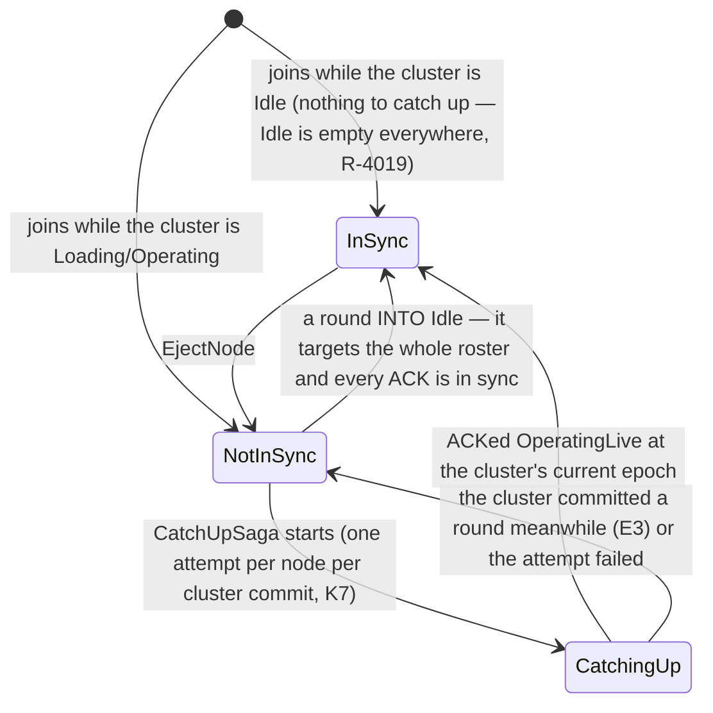

*What the picture shows that prose hid:* `Idle` is the universal re-sync point — a round INTO `Idle` is the one round that
targets the whole roster, because entering `Idle` asks nothing of a node's world (F2 empties it anyway).

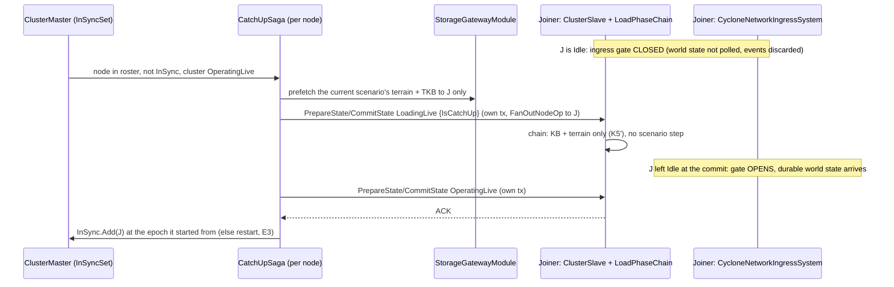

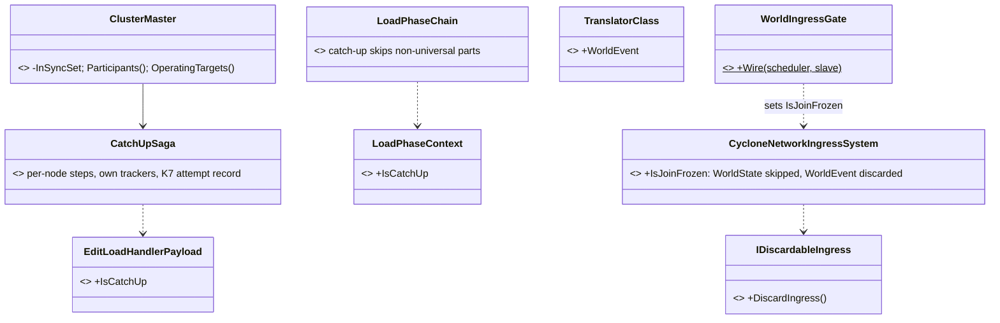

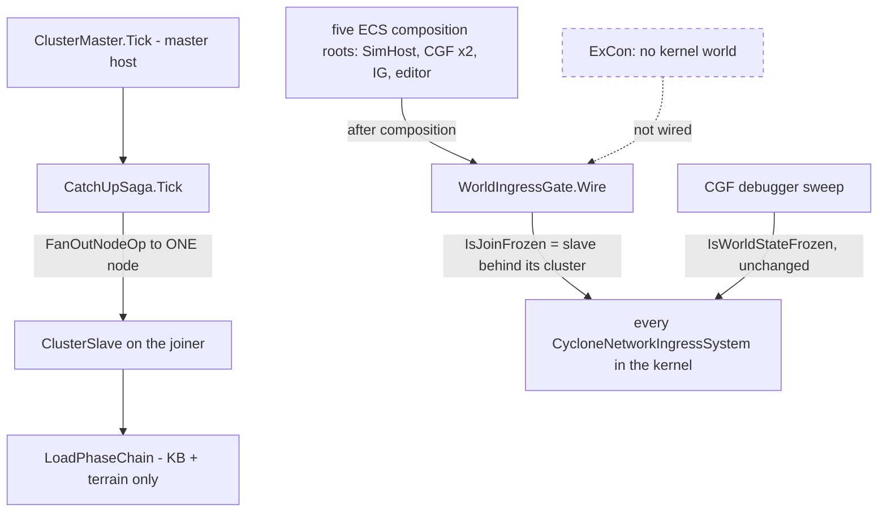

*What the module picture shows:* the gate is wired by the SAME sweep shape CGF already uses, once, after composition, on every
host with a world; the debugger's predicate stays separate because it HOLDS events instead of discarding them.

| ⭐ decision | lean · why · rejected |
|---|---|
| **the join freeze predicate = "the node is BEHIND its cluster": it follows a master's session, it is in `Idle`, and the cluster it follows is not `Idle`** (`ClusterSlave.IsJoinFrozen`) | ⭐ the joiner's exact situation — closed until it commits a load, closed again if reset to `Idle` while the cluster runs (R-4007). ⛔ Rejected first draft *"frozen whenever the node is `Idle`"*: 📐 measured — dozens of integration suites (`AllSubsystemsSpawnMovingVehicleTests`, `DebugApiBatch*`, …) spawn and replicate with the cluster at rest in `Idle` or with no master at all; a cluster at rest has nothing to protect (Idle is empty, R-4019). ⛔ Rejected: a separate flag — two truths for one fact |
| **events while join-frozen are DISCARDED; ownership topics are HELD** | ⭐ `WeaponFire`, `MunitionDetonation`, `EntityHitDamage`, `WeaponFireRequest`, `MissionControlRequest`, `CreateEntityRequest`, `UpdateEntityDescriptorRequest` → `WorldEvent` + `DiscardIngress`. `SST_OwnershipUpdate`, `DeferredTakeOwnership` stay `WorldState` (held, applied in order when the gate opens) — a dropped hand-over would leave the joiner with the wrong owner |
| **a `WorldEvent` translator MUST implement `IDiscardableIngress`** | ⭐ a rail asserts it over every production `WorldEvent` translator — ⛔ no silent default (a no-op discard would let the KeepAll queue burst later) |
| **operator rounds target `InSync`; a round INTO `Idle` targets the roster** | ⭐ J1 + the re-sync point above. One helper, `Participants(targetState)`, replaces the roster read at every OPERATOR round site in the inventory; control/diagnostic sites keep the roster |
| **the catch-up is node ops only** (K4, R-4017) and **never reads the scenario** (K5′, R-4015) | ⭐ `IsCatchUp` on the load payload; the chain runs the universal parts (KB, terrain) whatever the node's role |
| **one attempt per node per cluster commit** (K7) | ⭐ a failure is logged and shown; the next cluster commit or a new process (new id, R-4016) tries again |
| ⚠ **not in this change** | the committed ZONE set (§4-E′), the reliable-init wait-set (C6, uses the published `InSync`), replay catch-up (C9) |

#### ✅ AS BUILT `2026-10-15` — and where it deviates from the tables above

| piece | as built |
|---|---|
| C5 seam | `TranslatorClass.WorldEvent` + `IDiscardableIngress` (`Fdp.Core`); `CycloneNetworkIngressSystem.IsJoinFrozen` + `WireJoinGate(systems, predicate)`; the debugger's `IsWorldStateFrozen` now HOLDS events too (they were world state before) |
| C5 predicate | `ClusterSlave.IsJoinFrozen` — following a master ∧ local `Idle` ∧ the cluster's last announced state not `Idle` (the `ClusterStateUpdateEvent` the C2 session code already reads) |
| C5 wiring | `SharedApplicationBootstrapper` step `join-gate` after `kernel-initialize` (IG, SimHost, Stride), `CgfSubsystem` beside its debugger sweep, `CgfApplication` after its lazy `Kernel.Initialize()`. ⚠ The editor is not wired: it is an offline node with no network ingress |
| C5 event set | ⚠ **five**, not seven: `EntityHitDamage`, `MunitionDetonation`, `WeaponFire`, `WeaponFireRequest`, `MissionControlRequest`. `Spawn…`/`UpdateEntityCommandEgressTranslator` were listed by the inventory but only SEND (their `PollIngress` drains the local bus), so they stay world state |
| C3 | `ClusterMaster.InSync.cs` (partial): `_inSync`, `Participants()`; a node joining while the cluster is at rest is in sync; `EjectNode` forgets it; a trajectory through `Idle` targets the roster and `CompleteRound` makes its targets the in-sync set (`GenericTransactionTracker.ResyncsOnSuccess`); operator rounds — checkpoint (×2), save, export, seek, zone load, terrain build, episodes — target `Participants()` |
| C7 | `TickCatchUps` after `ConsumeNodeOpStatuses`: a roster node not in sync while the cluster is `OperatingLive`/`OperatingEdit` and no transition is open gets, alone, a prefetch through the ORDINARY saga (`ExecutePrefetchIntent` with one target, when the cluster's scenario is known), then `PrepareState`/`CommitState Idle`, `PrepareLive`/`PrepareEdit` `{IsCatchUp, TerrainName, no ScenarioId, NOT a world boundary — see the live run}` + commit, the operating state + commit; in sync after three answers if the cluster epoch did not move (else E3: again); one attempt per epoch (K7) |
| C7 node side | `EditLoadHandlerPayload.IsCatchUp` → `NodeTransitionPayloadDto.IsCatchUp` (wire, additive) → `LoadPhaseContext.IsCatchUp`; `LoadPhaseChain.StepsFor` drops the scenario step |
| 🔴 found LIVE, fixed | a node whose first heartbeat lands while a load is PARKED (waiting for its files) is admitted in sync — the parked load has not chosen its targets yet (they are read when it resumes). 📐 Before: SimHost was left out of the load and caught up afterwards; had it been the Brain, the load would have run with no scenario creator. Rail `ClusterMasterCatchUpTests.A_node_joining_while_a_load_is_parked_is_in_sync_and_takes_part` |
| 🔴 found while building | `_inflightTransitionTx` is never cleared — it keeps the LAST transition for history and cancel. "A transition is open" is therefore `TransitionInFlight` (its tracker still pending). 📐 Caught by `A_node_joining_a_running_cluster_is_caught_up_alone_then_is_in_sync` (red before) |
| rails | `TheFrozenWorldStillHearsItsResumeTests.R4007_*` (2) · `ClusterSlaveTests.R4007_ANodeIsJoinFrozen_OnlyWhileItIsBehindTheClusterItFollows` · `EveryWorldEventTranslatorCanDiscardTests` · `ClusterMasterCatchUpTests` (4, new suite) · `LoadPhaseChainTests.C7_ACatchUpLoad_RunsTheUniversalPartsOnly_NeverTheScenario` |
| 📐 **LIVE RUN `2026-10-15`** (orchestrator + CGF + SimHost on domain 13, `scripts/cluster-node.sh`) | ✅ **UC-2:** a Player started into running `hill-attack` was caught up in 2.5 s (`C7: catching up node 100` → `in sync`) and held exactly the replicated world, 1000–1007, like CGF and SimHost. ✅ **UC-13:** reloading `test-move` left every node, the Player included, with only 1000. 🔴 **A SECOND Player joining after the reload got 1001–1004, 1006, 1007 and NOT 1000.** `ddsmonitor`: `EntityMaster` was right (1000 alive, the rest disposed), but seven other TransientLocal topics still carried the dead run ⇒ `CE-4007`, fixed for the wipe (DESIGN_Cluster_Load_Phase §8.2). And 1000 was lost to a DISCOVERY WINDOW: the joiner took it in before it heard the master's session (gate not yet closed), then the catch-up's world-boundary clear destroyed it and DDS never re-delivers a taken sample ⇒ ⭐ the catch-up load is NOT a world boundary any more (a joiner in Idle holds only the current world; a stale one is wiped by the Idle step) |
| ✅ **re-run `2026-10-15`, same script, after both fixes** | Player 100 into `hill-attack`: 1000–1007; reload `test-move`: CGF, SimHost and Player 100 hold only 1000; ⭐ **Player 101 started AFTER the reload: exactly `[1000]`** (caught up in 2.1 s). ⚠ The confirming `ddsmonitor` capture failed on the tool's stale-port trap (runbook §5a), so the wire was not re-captured after the fix — the late joiner's world is the evidence |

## 4-N ⭐⭐ BUILD DESIGN — `C6`: SPAWNS WAIT ONLY FOR IN-SYNC, AUTHORITATIVE PEERS *(design `2026-10-15`, coordinator; `build-state: BUILT`)*

⭐ Builds K6 (`R-4014`) and J4 (`R-4013`): the reliable-init wait-set = present peers that advertise `fdp.reliable-init`
∩ the master's `InSync` set ∩ authoritative; the "unsupported" mark is cleared when a node ENTERS `InSync` and when it leaves.

📐 **Measured today:** the wait-set is *present ∩ advertises* (`ClusterCacheExpectedPeersProvider.cs:30-38`); the mark is
added (`NedNetworkFactory.cs:112` → `SimpleClusterStateCache.RecordUnsupported`) and never removed; nothing publishes `InSync`;
`OrchestratorContextTopic.RequiredNodeIdsJson` exists for exactly this and is never written, and no node reads that topic.

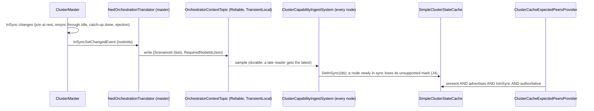

```mermaid
classDiagram
  class ClusterMaster { <<existing, grows>> publishes InSyncSetChangedEvent on change }
  class InSyncSetChangedEvent { <<NEW, Fdp.Toolkit.Orchestration>> +NodeIds }
  class NedOrchestrationTranslator { <<existing, grows>> writes RequiredNodeIdsJson, keeps the last ScenarioId }
  class ClusterCapabilityIngestSystem { <<existing, grows>> optional OrchestratorContextTopic reader }
  class SimpleClusterStateCache { <<existing, grows>> SetInSync / IsInSync; RemoveNode clears marks }
  class ClusterCacheExpectedPeersProvider { <<existing, changed>> + in sync + authoritative }
  ClusterMaster ..> InSyncSetChangedEvent
  NedOrchestrationTranslator ..> InSyncSetChangedEvent
  ClusterCapabilityIngestSystem --> SimpleClusterStateCache
  ClusterCacheExpectedPeersProvider --> SimpleClusterStateCache
```

```mermaid
graph TD
  MH[master host: ClusterMaster.Tick] --> NOT[NedOrchestrationTranslator.Tick - master side only]
  NOT --> TOPIC[(OrchestratorContextTopic)]
  TOPIC --> ING[ClusterCapabilityIngestSystem - every NED node, built by NedNetworkFactory]
  ING --> CACHE[SharedClusterCache]
  CACHE --> PROV[expected-peers provider - the creator's reliable-init barrier]
  NOMASTER[a node with no master] -.->|no sample: InSync unknown = no filter| CACHE
  style NOMASTER stroke-dasharray: 5 5
```

*What the pictures show that prose hid:* the master already has a durable one-producer channel to every node that nobody
reads; C6 is one writer field, one reader, two cache methods and one filter line. A node that has never seen the master's
set filters NOTHING by it — so the unit and integration harnesses that run without a master are unchanged.

| ⭐ decision | lean · why · rejected |
|---|---|
| channel = the existing `RequiredNodeIdsJson` (J3′) | ⭐ named for this purpose in mgmt-1 §5 and never written. ⛔ Rejected: a field on `ClusterStateTopic` — it is written only on a state change, and `InSync` changes without one (a catch-up finishing) |
| "authoritative" in the cache = holds a simulation role (Brain, MuscleGround, Perception, NavigationSolver) | ⭐ the cache only holds nodes whose capabilities it read, so the advert-seen half of §4-A′ is true by construction |
| `InSync` unknown (no sample yet) ⇒ no filter | ⭐ fail-safe toward waiting (today's behaviour), never toward skipping a peer |
| J4: a node newly in sync and a departed node lose every unsupported mark | ⭐ a reset node never departs, yet may have missed a probe while reloading |

#### ✅ AS BUILT `2026-10-15`

| piece | as built |
|---|---|
| master | `ClusterMaster.PublishInSyncIfChanged` (each tick, beside the catch-up) publishes `InSyncSetChangedEvent` (`Fdp.Toolkit.Orchestration`, id 9064) when the sorted set differs from the last one published |
| writer | `NedOrchestrationTranslator` keeps the last `ScenarioId` AND the last set and writes BOTH on either change (the topic is keyless) |
| every node | `NedReplicationModule` gives `ClusterCapabilityIngestSystem` an `OrchestratorContextTopic` reader; a non-empty `RequiredNodeIdsJson` → `SimpleClusterStateCache.SetInSync` |
| cache | `IClusterStateCache.IsInSync` (default `true`); `SimpleClusterStateCache.SetInSync` clears the marks of nodes ENTERING the set, `RemoveNode` clears the departed node's marks (J4) |
| provider | `ClusterCacheExpectedPeersProvider`: present ∧ advertises ∧ `IsInSync` ∧ holds a simulation role. ⚠ **behaviour change, approved by K6:** a Player (Map2D only) is no longer waited for — `ClusterCacheExpectedPeersProviderTests` previously expected a `map2d` peer in the set and was updated |
| rails | `ClusterCacheExpectedPeersProviderTests.C6_OnlyInSyncAuthoritativePeers_AreWaitedFor`, `.J4_EnteringInSyncOrDeparting_ClearsTheUnsupportedMark` |

## 4-O ⭐⭐ BUILD DESIGN — `C1`: THE MASTER ASSIGNS NODE IDS *(design `2026-10-15`, coordinator; `build-state: BUILT`)*

⭐ Builds L1 (`R-4009`) as amended by `R-4016`: a process with no configured id ASKS the master, identified by its computer
name + process id; the master grants an id from a dynamic range, never reused within its session; a forced id already held by
a live process is refused.

### INVENTORY — measured `2026-10-15` (grep; the id is a constructor argument everywhere)

| where the id is baked in | file |
|---|---|
| the runner computes `base + subsystem offset` and builds the participant (sender tracking `AppInstanceId`) and the network factory with it | `Program.cs:215-228` (`ResolveAppNodeId`, `:719`) |
| `-n/--node-id`, **default 0** — "not given" and "0" are indistinguishable today | `RunnerConfiguration.cs:35` |
| the node composition (`HrotNodeBuilder`, `LocalNodeId`) and the IG's own override | `HrotNodeBuilder.cs:163`, `IgApplication.cs:296` |
| 📐 the collision this removes: two IGs launched alike both get 100 and both obey (`CE-4001`) | §4-K K1 |

```mermaid
sequenceDiagram
  participant R as runner (no -n given, one subsystem, not the orchestrator)
  participant B as NodeIdBroker (temporary participant)
  participant T as NedOrchestrationTranslator (master)
  participant M as ClusterMaster.NodeIds
  R->>B: Request(computer name, process id, forced 0, preferred 0)
  B->>T: NodeIdRequest (Reliable, TransientLocal, key = computer + pid)
  Note over B: waits, logging waiting for a cluster every few seconds (no timer decides anything)
  T->>M: NodeIdRequestEvent
  M->>M: a free forced id is granted, a held one refused, else the next dynamic id (never reused)
  M->>T: NodeIdGrantEvent
  T->>B: NodeIdGrant (key = computer + pid, NodeId, SessionId, Refused, Reason)
  B-->>R: the granted id (or exit with the refusal's reason)
  R->>R: compose the node with that id (participant, factory, builder) as today
```

```mermaid
classDiagram
  class NodeIdRequest { <<NEW topic, hrot-orchestration>> +ComputerName key +ProcessId key +ForcedId +PreferredId }
  class NodeIdGrant { <<NEW topic>> +ComputerName key +ProcessId key +NodeId +SessionId +Refused +Reason }
  class NodeIdAllocator { <<NEW, Hrot.Orchestrator>> +Grant(request, liveRoster) }
  class ClusterMaster { <<existing, grows>> owns NodeIdAllocator, session-scoped }
  class NedOrchestrationTranslator { <<existing, grows>> request reader, grant writer }
  class NodeIdBroker { <<NEW, Hrot.Network.NED>> +AwaitGrant(participant, ...)$ }
  class Program { <<existing, grows>> asks only when -n is absent }
  ClusterMaster --> NodeIdAllocator
  NedOrchestrationTranslator ..> NodeIdRequest
  NedOrchestrationTranslator ..> NodeIdGrant
  NodeIdBroker ..> NodeIdRequest
  NodeIdBroker ..> NodeIdGrant
  Program ..> NodeIdBroker
```

```mermaid
graph TD
  P[runner Program.Main, before composing] -->|-n absent, single subsystem, not orchestrator| BR[NodeIdBroker - own short-lived participant]
  P -->|-n given, or --mode all, or orchestrator| OLD[today's base + offset - a FORCED id]
  BR --> TOPIC[(NodeIdRequest / NodeIdGrant)]
  TOPIC --> NOT[NedOrchestrationTranslator on the master host]
  NOT --> CM[ClusterMaster.Tick - NodeIdAllocator]
  ED[editor: offline, in-process master] -.->|not wired: its id is configured| OLD
  style ED stroke-dasharray: 5 5
```

*What the pictures show that prose hid:* the grant must complete BEFORE the participant the node runs on is created (sender
tracking bakes the id in), so the broker uses its own short-lived participant; and nothing changes for any launch that names its
id — only an id-less launch takes the new path.

| ⭐ decision | lean · why · rejected |
|---|---|
| **"forced" = `-n` given on the command line**; absent ⇒ ask | ⭐ every script and test that names an id keeps today's behaviour exactly. `-n` becomes `int?` (absent ≠ 0). ⛔ Rejected: a new `--auto-id` flag — the approved default is "ask unless forced", and Players should need no flag |
| ask only for a SINGLE-subsystem, non-orchestrator launch | ⭐ the orchestrator IS the master; `--mode all` hosts its own master in-process with configured ids |
| dynamic range starts at 10000, monotonically increasing per master session | ⭐ clear of every configured range (`base + 1..700`); never reused within a session (a possession or ownership record may name it) |
| a forced request for an id held by a LIVE roster node of a DIFFERENT process is refused | ⭐ R-4009: refused loudly — the runner exits with the reason |
| ⚠ `PreferredId` is carried but the runner does not persist one yet | the field exists for the I5 "keep my id in a new session" case; a node meeting a new session today drops to Idle with its id |
| ⚠ no master ⇒ the process waits indefinitely, logging | 🔒 the design's "its own idle". ⛔ No timeout (R-4001) |

#### ✅ AS BUILT `2026-10-15`

| piece | as built |
|---|---|
| wire | `NodeIdRequest {ComputerHash, ProcessId (keys), ComputerName, ForcedId, PreferredId}`, `NodeIdGrant {ComputerHash, ProcessId (keys), NodeId, SessionId, Refused, Reason}` — Reliable + TransientLocal; ⚠ keyed by a 64-bit FNV-1a hash of the upper-cased computer name (`NodeIdKeys.ComputerHash`) because no topic in this binding has a string key yet — the name rides as data |
| master | `NodeIdAllocator` (pure: the caller says which ids are live) owned by `ClusterMaster`, `ProcessNodeIdRequests` right after the heartbeat ingest; bus events `NodeIdRequestEvent`/`NodeIdGrantEvent` (9065/9066); `NedOrchestrationTranslator` bridges both |
| node | `NodeIdBroker.AwaitGrant` on its own short-lived participant, before composition; logs every 5 s while no master answers |
| runner | `-n` defaults to −1 (absent); a single-subsystem launch that is not the orchestrator, `all` or the editor asks, and the grant replaces BOTH `subNodeId` and the `NodeIdResolver` (no subsystem offset); a refusal exits with the reason; every other absent case uses base 0 as before. `scripts/cluster-node.sh start <mode> <port> auto` launches without `-n` |
| rails | `NodeIdAllocatorTests` (5, new suite) |

## 4-P ⭐⭐⭐ BUILD DESIGN — `C9`: REPLAY BY SPAN *(design `2026-10-15`, coordinator; `build-state: READY-TO-BUILD`)*

⭐ Builds L3‴ (`R-4012`): each node restores its own recording where it covers the moment and listens elsewhere. 📐 Measuring it
showed that R-4012 cannot hold until the replay has **one timeline**: today every node measures replay time from its OWN first
frame, so a late Player's recording is played against the wrong moment.

### INVENTORY — measured `2026-10-15` (graph + grep + a live multi-process run)

| claim the design rests on | code — how it IS | design — how it was MEANT |
|---|---|---|
| a seek is RELATIVE on the wire; each node adds its OWN recording start | ✅ `ReferenceReplayLoadHandler.cs:205-208` | ✅ `DESIGN_Time_Architecture.md` §12 (CE-497) — written for nodes that all started together |
| the play loop measures the playhead from the node's OWN first frame | ✅ `PlaybackTickSystem.cs:72-75` | ✅ §12 diagram `targetTicks = recordingStart + TotalTime` |
| every frame is stamped with the cluster-synced wall clock | ✅ `RecorderTickSystem.cs:51-54`, `SlaveSyncController.cs:452` | ✅ §12 |
| 📐 **the spans differ**: live run, Player joined ~14 s late — CGF 27.2 s, SimHost 27.7 s, Player **13.0 s** | ✅ measured (`PrepareReplay complete … Duration=`) | — |
| 📐 **entering replay does not move the clock**: sim time read 31 s right after entry, past every recording's end ⇒ every node shows its LAST frame | ✅ measured | ⛔ searched `docs/designs/replay-time`, `DESIGN_Time_Architecture` §12 — no rule for the clock at entry |
| 📐 **the entry seek never runs as a round**: the planner's `ReplaySeek` step is fanned out with a throw-away transaction in the same burst as the transition (`ClusterMaster.cs:1319-1321`) — no node logged a seek, and no clock snap follows (the snap waits for a completed seek round, `ReplaySeekProcessManager.cs:55`) | ✅ measured | ✅ `replay-time/DESIGN.md` Phase 3 — "seek bypasses 2PC" was defect ①, fixed for operator seeks only |
| every step's payload is built before any node answers (one fan-out burst) ⇒ a transition payload cannot carry what `PrepareReplay` returns | ✅ `ClusterMaster.cs:1262-1322` | — |
| a seek before the first frame restores frame 0 | ✅ `PlaybackController.cs:274-275` | ✅ R-4012 names it |
| a recording starts with a keyframe | ✅ `RecorderTickSystem.cs:37-38` (the first `Execute` issues one) | — |
| a keyframe clears the world (`SoftClear`) and singletons survive | ✅ `PlaybackSystem.cs:52-55`, `EntityRepository.cs:423-438` | — |
| a node with no recording of the exercise fails `PrepareReplay` (the metadata open throws) | ✅ `PlaybackController.cs:39-44` | ⛔ R-4012 says such a node LISTENS |
| ingress has a join gate (state skipped, events discarded) wired by sweeping the scheduler | ✅ `CycloneNetworkIngressSystem.cs:64-118` | ✅ R-4007 (reason ③ is replay) |
| `ClusterStateTopic.StateStartWallTicks` exists and is never written | ✅ grep — no assignment | — |
| 📐 found on the way: a Player crashed entering replay (`CmdAssignSubordinate` unregistered) | ✅ fixed — `CE-4008` | — |

```mermaid
classDiagram
  class ReplayPrepareResult {
    +long MaxNetworkId
    +float DurationSeconds
    +long FirstFrameWallTicks  NEW
    +long LastFrameWallTicks   NEW
  }
  class ReplayConsensusAggregator {
    +Aggregate() anchor = min first, end = max last
  }
  class ClusterMaster {
    -long _replayAnchorWallTicks  NEW
    -long _entrySeekRelTicks  NEW
    +on replay entered: publish SeekReplayIntent  NEW
    +ProcessSeekReplayIntent() payload carries the anchor
  }
  class ReplaySeekPayload {
    +long TargetWallTicks
    +long AnchorWallTicks  NEW
  }
  class ReferenceReplayLoadHandler {
    +NodeReplaySeek: abs = anchor + rel
  }
  class EcsRecordReplayController {
    +bool IsRestoringReplay  NEW
    +PrepareReplayAsync() missing file = listener, wires the ingress gate  NEW
  }
  class ReplayModule {
    +long AnchorWallTicks  NEW
    +bool HasRecording  NEW
    +ReplaySpanState State  NEW
  }
  class PlaybackTickSystem {
    +Execute() covered ? restore : listen  CHANGED
  }
  class PlaybackController {
    +bool Covers(long ticks)  NEW
    +SeekToWallClockTicks()
  }
  class CycloneNetworkIngressSystem {
    +Func~bool~ IsJoinFrozen
    +Func~bool~ IsReplayRestoring  NEW
  }
  class IReplayRestoreGated {
    <<interface>>
    +Func~bool~ IsReplayRestoring  NEW
  }
  ReplayConsensusAggregator ..> ReplayPrepareResult
  ClusterMaster --> ReplaySeekPayload : sends
  ReferenceReplayLoadHandler --> EcsRecordReplayController
  EcsRecordReplayController *-- ReplayModule
  ReplayModule *-- PlaybackTickSystem
  PlaybackTickSystem --> PlaybackController
  CycloneNetworkIngressSystem ..|> IReplayRestoreGated
  EcsRecordReplayController ..> IReplayRestoreGated : wires at PrepareReplay
```
*What the picture shows that prose hid:* the anchor is computed where every span is visible (the master's aggregate of the
prepare round) and travels DOWN on the seek; every other piece already exists and only gains a field.

```mermaid
sequenceDiagram
  participant Op as operator
  participant M as ClusterMaster
  participant RS as ReplaySeekProcessManager
  participant N1 as node present all along
  participant N2 as late Player
  Op->>M: TransitionStateIntent(OperatingReplay, hint)
  M->>N1: PrepareReplay, CommitState
  M->>N2: PrepareReplay, CommitState
  N1-->>M: first 0s, last 27s
  N2-->>M: first 14s, last 27s
  Note over M: anchor = min first, end = max last
  M->>RS: SeekReplayIntent(hint or 0) on replay entered
  RS->>M: pause, then the seek round
  M->>N1: NodeReplaySeek(rel, anchor)
  M->>N2: NodeReplaySeek(rel, anchor)
  Note over N1: covered - restore, ingress frozen
  Note over N2: not covered - clear, listen
  N1-->>M: landed rel
  N2-->>M: not covered
  M->>RS: seek completed with landed rel
  RS->>RS: SnapTo(rel) - every clock at the same playhead
  Note over N2: playhead crosses 14s - seek own file, restore, freeze
```
*What the picture shows that prose hid:* the entry seek must be a ROUND after the transition completes, because only then are
the spans known; and the clock snap that makes every node agree comes from that round, not from the transition.

```mermaid
graph TD
  K[ModuleHostKernel each frame] --> IN[CycloneNetworkIngressSystem - Input phase]
  K --> PB[PlaybackTickSystem - PostSimulation]
  CS[ClusterSlave] -->|NodeReplaySeek| H[ReferenceReplayLoadHandler]
  H --> C[EcsRecordReplayController]
  C -->|installs at PrepareReplay| RM[ReplayModule]
  RM -->|registers| PB
  C -.->|wires once per PrepareReplay| IN
  OC[OrchestratorCore] --> CM[ClusterMaster]
  OC --> RSPM[ReplaySeekProcessManager]
  OC --> RPM[ReplayProcessManager]
  CM -.->|publishes on replay entered| RSPM
```
*What the picture shows that prose hid:* the playhead is read by `PlaybackTickSystem` on every ECS host every frame — the span
check lives THERE, so a node changes between restoring and listening without any message. The ingress gate is wired by the
controller itself, so the ECS hosts that build the controller without `ForNode` (`CgfApplication`) get it too.

| ⭐ decision | lean · why · rejected (one line each) |
|---|---|
| **P1 one anchor = the earliest first frame across the cluster**, computed by the master from the prepare round and sent on every seek | ⭐ computed from the frame stamps themselves (same clock domain), works on recordings made before this change. ⛔ Rejected: each node's own start (today) — misaligns a late node by its join delay. ⛔ Rejected: stamp the cluster's `OperatingLive` start into each recording — `StateStartWallTicks` is never written, the master's clock domain differs in stepping mode (`SteppingTimeController.cs:60` stamps synthetic ticks), and old recordings would not have it |
| **P2 entering a replay always runs a SEEK ROUND** (to the hint, else 0) after the transition completes; the planner's untracked seek is no longer fanned out | ⭐ the only path that both delivers the anchor and snaps the clock. ⚠ Behaviour change: a replay is entered PAUSED at its start (the seek path pauses) instead of running from the live clock's time — which today is past the end |
| **P3 covered ⇔ first ≤ t ≤ last + 2 s**, and `t = long.MaxValue` ("the end") is covered by any node with frames | ⭐ the grace absorbs nodes whose last frames differ by a frame or two at the exercise end. ⛔ Rejected: "only before the first frame is outside" — leaves a departed node showing its last frame forever |
| **P4 outside ⇒ `SoftClear` + the seek's after-hook (map rebuild, lifecycle reset), ingress open**; inside ⇒ seek own file, ingress gated like a join | ⭐ the same world operation a keyframe already performs, so the after-seek contract is unchanged. ⛔ Rejected: `WorldBoundaryReset.Clear` — it advances `WorldEpoch`, which now writes deletes on the wire (CE-4000 F2) and would delete the entity for every listener |
| **P5 no recording ⇒ a listener** (`HasRecording = false`), not a failed prepare | ⭐ R-4012 — a node that was absent replays nothing and listens. ⚠ Today such a node fails the whole replay transition |
| **P6 the ingress gate for restoring is the join gate's semantics** (state skipped, events discarded) | ⭐ R-4007 reason ③ — the node builds everything itself (Plan A) |
| **P7 end of replay = `DurationSeconds` on the playhead** (`ReplayProcessManager`), re-armed by every completed seek | ⭐ with P2 the playhead starts at 0, so "now + duration" (today) would fire at the wrong time and never re-arm after a seek back |

| ⚠ known limits — not in C9 | |
|---|---|
| a node that turns into a listener during PLAY receives only entities that change after that moment (the owners re-flood everything only on a seek, `ReplayModule.cs:106,133`) | follow-up |
| entities whose recorded owner is listening at that moment are flooded by nobody (egress is authority-gated) | inherited from live, R-4012 |
| a node that JOINS while the cluster is in `OperatingReplay` stays frozen and out of sync (the catch-up saga handles `OperatingLive` only) | follow-up |

| acceptance — rails | |
|---|---|
| `PlaybackController.Covers` before / inside / after+grace / MaxValue | unit |
| a seek outside the span restores nothing and reports not covered; inside restores | `ReferenceHandlerTests` (the feature's suite) |
| the aggregator returns min first / max last / duration from them | `ReplayConsensusAggregator` tests |
| the master sends the anchor on every seek, and entering replay publishes one seek | `ClusterMasterSeekTests` |
| live: a late Player's replay shows the same entity positions as CGF at the same playhead, and listens before its first frame | multi-process run |

## 5. OUT OF SCOPE

- ⛔ **Interest management** — every node receives every entity (no partition or content filter exists). User G: not now.
  ⚠ It is the ceiling on "any number of Players"; a measured ceiling is worth having before it is needed.
- ⛔ **Players authoring persistable entities** — R-140 and the save gate already cover it (§3, last row).

## 6. CLAIM TABLE

| the proposal rests on | code — how it IS | design — how it was MEANT to be |
|---|---|---|
| a Player needs no recording/replay exception | ✅ every other ECS host runs `EcsRecordReplayController` (4 sites); IG's listener controller is replaced (P5a) | ✅ R-4003; `mgmt-1` §8.10 |
| roles reach the orchestrator | ✅ `ClusterMaster.cs:551`, `NodeRoster.cs:15-21` | ✅ AQ-70 §Q70-C |
| a departed node hangs a round today | ✅ `ClusterMaster.cs:700`, `:1828` | ⛔ searched `docs/` + `.dev/` for a design of partial success: none beyond the declared field |
| time control is not 2PC | ✅ `ClusterMaster.cs:409-443` | ✅ `DESIGN_Time_Architecture.md` |
| `Mandatory` is never configured | ✅ `ClusterConfiguration.cs:53` only | ⛔ searched: no design of its production value |
| a node accepts a commit from any state | ✅ node layer `ClusterSlave.cs:411-421` | ⛔ **each Hrot handler NOT measured** — must be before E |
| the gateway is meant to push to the node | ⚠ as-built copies to a shared tree | ✅ `mgmt-1` §12.5 |
| `NodeDeparted` fires on every node when one leaves | ✅ `ClusterCapabilityIngestSystem.cs:115` | ✅ R-167 |
| the load prepare blocks the heartbeat today | ✅ `ClusterSlave.cs:208,429`; `LoadPhaseChain.cs:180-181`; both steps return `Task.CompletedTask` after synchronous work | ✅ R-4001 says it must not |
| DDS can carry our files | ✅ measured (§4-E2), one host only | ⚠ `mgmt-1` §12.6 rejected DDS for "gigabytes"; R-4002 limits it to non-GB files |
| a real network behaves like loopback | ⛔ **not measured (M1)** | — |
| ⭐ **the role mask reads `None` until the capability advert lands** | ✅ `ClusterMaster.cs:539-541` (its own comment says so) | ✅ `R-4005`; `§4-A′` ① |
| ⭐ **the editor declares TWO different roles for itself** | ✅ `EditorCapabilities.cs:60-62` (all four) vs `EditorSubsystem.cs:1153` (`None`) | ✅ user `2026-09-07`, quoted in `EditorCapabilities.cs`; `R-4005` |
| ⭐ **the editor is in its own one-node roster** | ✅ `HrotNodeBuilder:232` builds its slave · `EditorSubsystem.cs:1699` ticks it via `OrchestrationLogicPack:68` · `:1170` + `:2185-2197` put slave and master on ONE bus | ✅ `DESIGN_Node_Roles_And_Policies` §3.4 |
| ⭐ **`_role` affects only what a node ADVERTISES** | ✅ two consumers, `HrotNodeBuilder:232-233`; `ClusterSlave` does nothing else with it (`:83-84`, `:125-128`) | ✅ `R-172` (ownership groups are per role, reached via `EditorCapabilities.DefaultRole`) |
| ⭐⭐ **the abort seam is complete and never triggered** | ✅ `LoadPhaseContracts.cs:114-115` · `LoadPhaseChain.cs:206-215` · `ClusterSlave.cs` has **zero** `Abort` · `CanHandle:127-147` omits `AbortTransaction` | ✅ `R-4004`; `TerrainAssetHandler.cs:92-103` is the precedent |
| ⭐ **cancel today is archive-only and reaches no load** | ✅ `ClusterMaster.cs:1627-1640` | ⛔ **`R-4001` ASSUMED it did** — corrected by `§4-H` |
| ⭐ **the name match has TWO production sites** | ✅ `ClusterMaster.cs:1898` + `ReplaySeekProcessManager.cs:56` | ✅ `§4-D′` ① |
| ⭐ **`SlaveNodeSetUpdatedEvent` is under-published against its own contract** | ✅ header `TimeLocalEvents.cs:30-32` says *"when the slave node set changes"*; published only on pause (`ClusterMaster.cs:1901`) and seek (`ReplaySeekProcessManager.cs:59`) | ✅ `§4-D′` ② |
| ⭐ **the world bus and the orchestration bus are different OBJECTS** | ✅ `EntityRepository.cs:163` vs `HrotNodeBuilder.cs:140`; `OrchestratorSubsystem` holds neither a repository nor a NED module | ✅ user `2026-10-15` (*"orchestration events belong to orchestration bus…"*) |
| ⭐ **no zone is published anywhere durable** | ✅ zero `[DdsTopic]` matching zone; `ClusterMaster` holds no committed-zone field | ✅ `§4-E′`; `R-146` (a zone is a geographic window) |
| ⭐ **the master is not restartable** | ⛔ not a code fact | ✅ 🔒 user `2026-10-15`: *"master is not restartable, if it dies, the world ends"* ⇒ `TransientLocal` suffices for `§4-E′` |

## 7. REJECTED, one line each

- **A Player node type or `NodeRole.Player`** — nothing needs switching off (§3), and the authority split derives from existing roles (§4-A).
- **Leaving Players out of the 2PC** — they would lose the bytes, the zones and their load/unload; both gains come from 2PC defects §4-B/C fix.
- **A follower state machine / new join events** — a second mechanism for what the existing ops already do.
- **Each Player mounting the NAS** — one licence and connection per Player; the gateway exists to avoid it.
- **Streaming files over DDS (`UploadChunk`)** — `mgmt-1` §12.6 rejects bulk bytes on the real-time bus.
- **Reusing `Mandatory` as the veto switch** — name-keyed, unset in production, and it would arm the boot latch.
