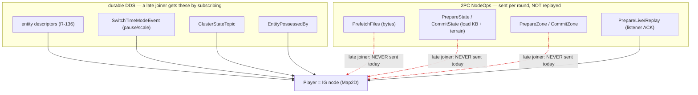
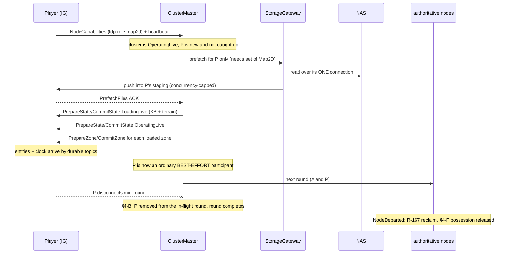
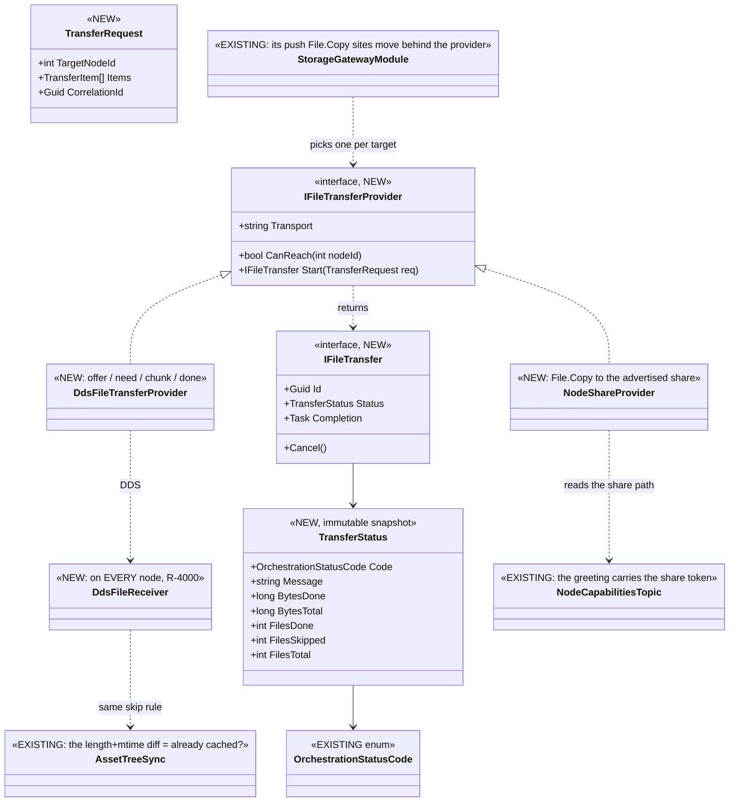
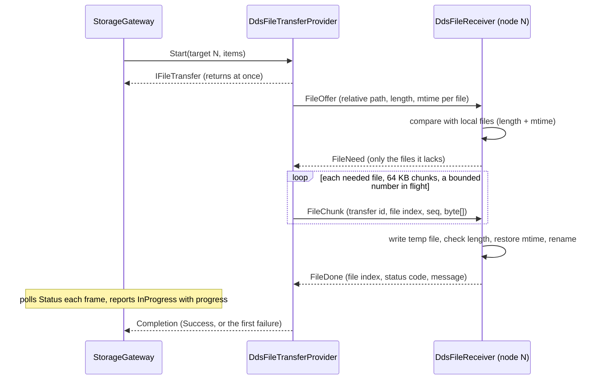

<!--STATUS
state: LIVE
updated: 2026-10-15 (APPROVED; amended by R-4001 heartbeat-only time limits — §4-B, §4-B2 — and R-4002 the file-transfer provider — §4-E2)
build-state: DESIGN — ✅ APPROVED 2026-10-15 (user: "accepted.") with two amendments (§0 rows I, J). Not dispatched; §4-B2
  and §4-E2 carry the measurements the amendments asked for.
current-answer: "THE PROPOSAL IN ONE PAGE" (directly below the rulings) is the answer; §4 carries each decision
  with its options, lean, blast radius and what would change the lean. §2 is the picture; §3 is what already works.
stale-below: nothing
known-rot: none
known-conflict: none reconciled away. ⚠ docs/designs/mgmt-1/DESIGN.md §12.5 says the gateway pushes INTO each node's
  C:\FDP_Temp; the as-built gateway copies into {FDP_STAGING_ROOT}/nodes/node-N on the ORCHESTRATOR's own disk
  (AssetPrefetchProcessManager.cs:272-287), which reaches a node only when that tree is shared. §4-E2 takes the design's side.
related-designs:
  - docs/DESIGN_Node_Roles_And_Policies.md — §3.3 / R-4000 is the rule this question obeys (one code path on every node;
    a behaviour that must differ comes from the ROLE). It owns the role table that §4-A reads.
  - docs/DESIGN_Cluster_Load_Phase.md — owns the per-role load chain a Player runs when it catches up (§4-E); this
    question adds nothing to that chain.
  - docs/DESIGN_Entity_State_Sourcing.md — owns why a late joiner sees every live entity (R-136: the TKB + durable
    descriptors). §3 relies on it and does not restate it.
  - docs/designs/mgmt-1/DESIGN.md — §12.5/§12.6 own the Storage Gateway (ONE outbound NAS connection, push to each
    node) that §4-E2 reuses for the late joiner; §8.10 owns how an unowned node sees a replay.
  - docs/blueprints/DESIGN_Time_Architecture.md — owns the master/slave clock and its step-barrier slave roster
    that §4-D re-derives from roles.
  - docs/DESIGN_Entity_Control.md — owns possession; §4-F adds the release when the possessing node leaves.
  - docs/DESIGN_Unified_Cluster_Handler_Registration.md — owns WHICH handlers each host registers (CE-279);
    §4-G closes its IG/Editor archive-handler gap.
  - docs/DESIGN_Ownership_Groups_And_Grants.md — owns NodeDeparted and the partial-owner reclaim (R-167) that
    already clears a departed node's entities; §4-F reuses the same event.
  - docs/DESIGN_Asset_Management.md — owns the per-node needs set (§4), the (length, mtime) diff and the transport
    PARTITION that decide WHAT moves; §4-E2 here owns only HOW the bytes travel (the provider) and reuses that diff as
    its "already cached?" check.
  - docs/DESIGN_Artifact_Staging.md — owns the NAS layout and the staged TKB/terrain artifacts the provider carries.
-->

# Architect Question 91 — **the Player node: a disposable IG node in a unified, robust cluster**

## 0. The user's rulings and framing *(2026-10-15)*

| # | 🔒 user, verbatim | consequence here |
|---|---|---|
| **A** | *"turn the system into a multiplayer game which is having its backend components like simhost and cgf running in the background as server nodes, and it allows any number of client nodes"* | the goal |
| **B** | *"IG node (not role) should be the node type used as game clients"* · *"lets call in Player instead of Client"* | a Player is an **IG node** |
| **C** | *"the client node is disposable, disconnectable at any time and the system needs to run without breaking if that happens. But stuff like clock pause should be communicated."* | §4-B/C/D/F |
| **D** | *"I would rather make 2pc more robust against volatile player nodes than inventing new concepts, unless the new concept brings dramatic simplification"* · *"If there are established 2pc commands we should not invent extra events"* | the catch-up reuses existing ops (§4-E); no new events |
| **E** | *"So if we want to disable it, we need to do it via roles so the code stays unified."* | ✅ **R-4000** |
| **F** | *"I do not see why it should not have the handler, do you? Then the explicit Player role would not be needed at all"* | §4-A (no Player role), §4-G |
| **G** | *"No interest management now."* | out of scope (§5) |
| **H** | *"the nas might be limited on cal licences, push on demand might be more suitable"* | §4-E2 (the gateway push, one NAS connection) |
| — | *"accepted."* | ✅ §4 approved as written, amended by I and J |
| **I** | *"time limits should be based on heartbeat and the heartbeat must keep working during long loading operations so timeouts can never break a valid long load or other operation."* | ✅ **R-4001** — §4-B amended, §4-B2 |
| **J** | *"remote player should expose its file share path for shared data; could be part of the initial greeting message"* · *"alternatively we could invent simple dds based file transfer - a reliable volatile message with big byte blob and relative file name and also message for first checking if the file is not cached already locally"* · *"limited for files that are not GBs in size"* · *"in any way i would like to hide the transfer type behind a provider interface that support non-blocking operation and reports when finished and support progress reporting and error code/message status. measure what is needed."* | ✅ **R-4002** — §4-E2 |

## ⭐ THE PROPOSAL IN ONE PAGE

| area | proposal | basis |
|---|---|---|
| **what a Player is** | ⭐ an ordinary **IG node** (`NodeRole.Map2D`). ⛔ No new node type, no `NodeRole.Player`, no new events | R-4000, user F |
| **recording / replay** | ⭐ **no exception.** IG already takes part as a listener (`ListenerRecordReplayController` ACKs, records nothing) and sees a replay over the network | §3 |
| **who may fail or hang a round** | ⭐ **derived from the ROLE:** a node holding any SIMULATION role (`Brain`, `MuscleGround`, `Perception`, `NavigationSolver`) is *authoritative*; a node with none (IG's `Map2D`, an observer) is *best-effort* — its error is recorded, never fatal | §4-A, §4-C |
| **a node that leaves mid-round** | ⭐ removed from every in-flight round (today the round waits forever) — a bug fix for EVERY node | §4-B |
| **a node that stops answering** | ⭐ **the heartbeat is the ONLY time limit** (R-4001): no per-round ACK timer; the heartbeat must keep beating through any valid long operation, so the load prepare moves off the frame thread | §4-B, §4-B2 |
| **the clock** | ⭐ the step barrier waits only for authoritative nodes; pause / resume / scale already reach everyone through the durable `SwitchTimeModeEvent` | §4-D |
| **late join** | ⭐ the orchestrator replays the EXISTING ops to the one new node — `PrefetchFiles` (gateway push) → the state steps → each loaded zone — then it is an ordinary participant | §4-E |
| **disconnect** | ⭐ nothing special: §4-B removes it from rounds, the partial-owner reclaim (R-167) clears its entities, possession is released (§4-F) | §4-F |
| **unification gaps** | ⭐ IG and the Editor register the archive handler like everyone else | §4-G |
| **how bytes reach a node** | ⭐ one `IFileTransferProvider` (non-blocking, completion, progress, status code + message); three transports: today's shared-tree copy, a node-advertised share, and ⭐ **DDS** (measured on one host: 256 MB intact in 2.4 s in 64 KB chunks; 4 MB chunks once made `Write` throw) — the default for a Player | §4-E2 |

---

## 1. INVENTORY

⭐ Graph via the `codebase-memory-mcp` CLI on `home-user-HROT` (229 833 nodes, indexed `2026-10-15` at `f6a4ec00c`),
every hit opened; grep / `scripts/find.sh` for call sites. ⚠ `check_index_coverage` is not reachable through the CLI, so
no total below is a proof of completeness — each was corroborated by grep.

| query | total | what it settled |
|---|---|---|
| `search_graph ".*(Roster\|ClusterMaster\|ClusterSlave\|Participant).*"` Class | 28 (production: `ClusterMaster`, `ClusterSlave`, `NodeRoster`, `ClusterMasterPlanner`, `PreviewParticipants`, 2 readiness participants) | ONE roster, ONE master; membership is heartbeat-driven |
| `search_graph ".*(TwoPhase\|Transaction\|Commit\|FanOut\|Coordinator\|ProcessManager\|Saga).*"` Class | 52 (orchestrator: `DistributedTransaction`, `GenericTransactionTracker`, 10 process managers) | the 2PC tracker is `GenericTransactionTracker`; `DistributedTransaction.AllowPartialSuccess` has 0 readers |
| `search_graph ".*RecordReplayController.*"` Class | 3 — `EcsRecordReplayController` (SimHost), `CgfRecordReplayController`, `ListenerRecordReplayController` (IG, ExCon) | a listener controller already exists |
| `search_graph ".*SyncController.*"` Class | 2 — `MasterSyncController`, `SlaveSyncController` | the step barrier lives in the master |
| `search_graph ".*Possess.*"` Class | 11 — `PossessionSystem` is the only releaser | §4-F |
| `search_graph ".*Registrar.*"` Class | `SerializeLocalRegistrar`, `TerrainAssetRegistrar` (+ unrelated) | §4-G's home |
| `find.sh "late.?join\|rejoin\|catch.?up"` over the orchestrator | 0 production handlers | ⛔ no late-join path exists |
| `find.sh NodeDeparted` | publisher `ClusterCapabilityIngestSystem.cs:115`, consumer `PartialOwnerReclaimSystem` | §4-F reuses it |
| `grep "_roster.ActiveNodes"` in `ClusterMaster.cs` | 18 reads, nearly all building a fan-out list | every round goes to every present node |
| the DDS topic list (all `[DdsTopic]`) | no zone topic | a zone reaches a node ONLY through its 2PC round |

---

## 2. THE PICTURE

### 2.1 What a Player receives, and through what

*What the picture shows that prose hid: everything durable already reaches a late Player; everything that reaches it
only through a 2PC round (red, dashed) is lost to it. ⇒ the whole late-join problem is the three red edges, and §4-E
closes them by re-sending those exact ops — no new channel.*

### 2.2 Late join and disconnect, as proposed

*What the picture shows: the catch-up is the SAME op sequence the cluster already ran, addressed to one node; and a
disconnect is handled by three mechanisms that exist or are one predicate away — nothing Player-specific.*

---

## 3. WHAT ALREADY WORKS — measured, no change needed

| need | how it is already met | evidence |
|---|---|---|
| see every live entity on join | durable descriptors + the TKB | ✅ `DESIGN_Entity_State_Sourcing.md` §1; `SimDescriptors.cs` holds 18 `TransientLocal` topics (the state) and 6 `Volatile` (events/commands, correctly not replayed — R-136 §1.1) |
| learn pause / scale | `SwitchTimeModeEvent` is `Reliable + TransientLocal` | ✅ `TimeMessages.cs:133` |
| sync the clock | `TimeSyncRequest` / `TimeSyncResponse` | ✅ `TimeMessages.cs:202,220` |
| see who possesses what | `EntityPossessedBy` is durable | ✅ `SimDescriptors.cs:213` |
| take part in recording / replay without recording | `ListenerRecordReplayController` ACKs every phase | ✅ `ListenerRecordReplayController.cs`; IG registers it at `IgNodeBootstrapper.cs:412,423` |
| watch a replay | owning nodes restore, their egress floods DDS | ✅ `mgmt-1/DESIGN.md` §8.10 *"an IG whose only copy of entity state comes from the network"* |
| abstain from an op it has no business in | a node with no handler answers *Success, not participating* | ✅ `ClusterSlave.cs:473-482` |
| clear a departed node's entities | `NodeDeparted` → `PartialOwnerReclaimSystem` (R-167) | ✅ `ClusterCapabilityIngestSystem.cs:115` |
| one NAS connection for every transfer | the Storage Gateway | ✅ design `mgmt-1` §12.5/§12.6 · ⚠ as-built see §4-E2 |
| a scenario save on IG | IG registers the ONE gated `HrotScenarioSaveHandler`; it owns nothing savable | ✅ `IgNodeBootstrapper.cs:455`; `DESIGN_Node_Roles_And_Policies.md` §7.1 |

---

## 4. THE DECISIONS — each with a lean

### 4-A ⭐ Who may fail or hang a round?

| option | |
|---|---|
| ⭐ **A1 — derive it from the ROLE: a node holding any simulation role is authoritative; a node holding none is best-effort** | ⭐ **LEAN.** No config, no new role; follows R-4000. IG (`Map2D`, `IgNodeBootstrapper.cs:362`) and ExCon are best-effort; SimHost (`MuscleGround\|Perception\|NavigationSolver`), CGF (`Brain`), Stride mode 2 and the editor are authoritative. The orchestrator already holds every node's role mask (`ClusterMaster.cs:551`, `NodeRoster.NodesWithRole`) |
| A2 — reuse `ClusterConfiguration.Mandatory` | ⛔ it is keyed by subsystem NAME and **never set in production** (`ClusterConfiguration.cs:53` is its only assignment, empty). A default of `SimHost, CGF` would also arm the boot latch for both ⇒ a Stride-mode-2 cluster (no node named `SimHost`) would never leave boot. Keep `Mandatory` for what it does today (boot latch, `Degraded`) |
| A3 — a new `NodeRole.Player` | ⛔ user F: not needed once nothing is switched off. It would only earn its place if a map-station IG and a Player IG had to behave differently |

**Blast radius:** a map-station IG also becomes best-effort — its failure to load terrain no longer fails the round.
⚠ **What would change the lean:** if a map station must still be able to veto. Then the distinction is genuinely a
role and A3 returns. ⚠ The role → policy map is APPLICATION code (Hrot, the orchestrator), never FDP (R-4000).

### 4-B ⭐ A node leaves, or stops answering, during a round

📐 Today: `EjectNode` returns early for a non-mandatory node (`ClusterMaster.cs:700`); `GenericTransactionTracker.Expected`
is fixed at fan-out with no timeout (`:1828`) ⇒ **the round waits forever.** This is a defect for EVERY non-mandatory
node, not only Players.

| option | |
|---|---|
| ✅ **B1 — on ejection, drop the node from every in-flight tracker** (`Expected--`, remove from `Targets`, complete the round if it was the last ACK) | ✅ **APPROVED.** A bug fix for every node; can be built on its own |
| ⛔ ~~a bounded ACK wait for best-effort nodes~~ | ⛔ **SUPERSEDED `2026-10-15` by R-4001** (user I): the heartbeat is the only time limit. A node is out of a round when its heartbeat stops (`DetectAndEjectTimedOutNodes`, 5 s default), never because a round took long |
| B2 — a timeout on every round | ⛔ an authoritative node that is slow (a large terrain) would fail a legitimate load — the case R-4001 forbids |

### 4-B2 ⭐ The heartbeat must keep beating through a long operation *(R-4001)*

📐 **Measured `2026-10-15` — today it does NOT, during the load:**

| fact | evidence |
|---|---|
| the heartbeat is written by `ClusterSlave.Tick`, on the FRAME thread, at 1 Hz | `ClusterSlave.cs:206-219` |
| the orchestrator ejects after 5 s of silence (never overridden in production) | `ClusterConfiguration.cs:20` |
| `ClusterSlave` calls `PrepareAsync` on the frame thread | `ClusterSlave.cs:429` |
| `LoadPhaseChain.PrepareAsync` awaits its steps with **no prior yield** | `LoadPhaseChain.cs:180-181` — ⚠ its comment says *"off the main thread"*; that is not what the code does |
| the knowledge-base and terrain steps do ALL their work synchronously and return `Task.CompletedTask` | `KnowledgeBaseLoadStep.PrepareAsync` (TKB zip `Clear` + parse + register) · `TerrainLoadStep.cs:43-53` |
| ⇒ **the whole loading prepare runs inline on the frame thread** — the heartbeat stops for as long as the TKB and terrain take to read | ⛔ a load longer than 5 s ejects the node that is doing it |

| option | |
|---|---|
| ⭐ **H1 — run the loading prepare truly off the frame thread** (one `await Task.Run(...)` / `Task.Yield` at the start of the chain's loading branch) **and make the knowledge-base step STAGE like terrain already does** — parse into a fresh `TkbDatabase` in `Prepare`, swap it in at `Commit` on the frame thread | ⭐ **LEAN.** The heartbeat stays on the frame loop, so it still proves the node is ALIVE AND TICKING — a frozen frame loop is still caught. ⚠ The KB step cannot simply move: it `Clear()`s and refills the LIVE database that world systems read, so off-thread it would race them; staging is the shape `TerrainResidency` (`Prepare` → `Staged` → `Commit`) already uses |
| H2 — move the heartbeat to its own thread | ⛔ it would beat while the frame loop is deadlocked, so a hung node would look alive forever and — with no other time limit — hang every round it is in |
| ⭐ **the rule that falls out, for every handler** | `PrepareAsync` does its long work off the frame thread; `Commit` stays short (it runs on the frame thread and blocks the heartbeat). A long `Commit` is a defect |

⚠ **What R-4001 deliberately leaves open:** a node that is alive and ticking but whose operation never finishes (a stuck
read) holds its round forever, because no timer may break it. ⭐ **Lean: report it, don't time it** — the transfer
provider's progress (§4-E2) and the existing `ClusterOpType.CancelOperation` give an operator a visible stall and a
manual cancel. ⛔ Not measured: whether `CancelOperation` reaches a load prepare today.

### 4-C ⭐ A best-effort node returns an ERROR

📐 Today one error fails the whole round (`ClusterMaster.cs:1833-1847`).

| option | |
|---|---|
| ⭐ **C1 — a best-effort node's error is recorded in the round's per-node responses but does not fail the round** | ⭐ **LEAN.** `DistributedTransaction.AllowPartialSuccess` was declared for exactly this and is read nowhere — wire it, keyed by §4-A |
| C2 — keep the veto | ⛔ one Player with a broken disk stops every load (user C) |

### 4-D ⭐ The clock

📐 Pause / step / resume / scale are **not** 2PC ops (`ClusterMaster.cs:409-443` turns them into local intents on the
master clock). A step waits for an ACK from every slave in the roster, with no timeout
(`MasterSyncController.cs:566-580`); the roster is picked by NAME — `"SimHost" or "IG" or "CGF"` (`ClusterMaster.cs:1897`).

| option | |
|---|---|
| ⭐ **D1 — the step roster is the authoritative nodes (§4-A), and a departed node is removed from `_pendingAcks`** | ⭐ **LEAN.** A Player's step ACK protects nothing; a dead Player would freeze stepping. Pause / scale still reach it through the durable `SwitchTimeModeEvent`. `DESIGN_Time_Architecture.md` already allows a roster that excludes a node |
| D2 — keep Players in the roster, only prune on departure | ⚠ a slow-but-alive Player would gate every step |

### 4-E ⭐ Late join — the catch-up

| option | |
|---|---|
| ⭐ **E — the orchestrator replays the EXISTING ops to the one new node, then it is an ordinary participant** | ⭐ **LEAN.** `ClusterMasterPlanner` already computes the path from `Idle` to the current state; `FanOutNodeOp` already takes an explicit target list. ⭐ No new events (user D) |
| a follower that drives its own state from `ClusterStateTopic` | ⛔ a second way to drive a node's state, and it still gets no bytes and no zones |
| never let a late node in | ⛔ not a game |

Three things E needs that do not exist:

| | the gap | lean |
|---|---|---|
| **E1** | ⛔ **the master does not remember which zones are loaded** — no field holds them in `ClusterMaster` | keep the committed zone set on the master (cleared at the world boundary) so the catch-up can re-send `PrepareZone`/`CommitZone` |
| **E2** | ⚠ **the push reaches only a shared staging tree** — the gateway copies to `{FDP_STAGING_ROOT}/nodes/node-N` on the orchestrator's disk (`AssetPrefetchProcessManager.cs:272-287`) | ✅ **§4-E2 below** (R-4002): one transfer provider, the share or DDS behind it |
| **E3** | a cluster transition while a node is catching up | the catch-up restarts from the new state; the node joins rounds only once its heartbeat reports the cluster's state |

⚠ The catch-up relies on a node accepting a state commit from any starting state. Measured at the node layer: `ClusterSlave`
checks nothing (`ClusterSlave.cs:411-421`). ⛔ **Not measured: each Hrot load handler** — must be checked before E is built.

### 4-E2 ⭐ How the bytes reach a node — **one provider, the transport behind it** *(R-4002)*

#### The classes

*What the picture shows that prose hid: everything above the provider line already exists — the gateway, the status
codes, the greeting message and the "is it already here?" rule. ⭐ The new code is the interface, two transports and one
node-side receiver; nothing in the cluster protocol changes.*

| ⭐ the rules | |
|---|---|
| ⭐⭐ **non-blocking** | `Start` returns at once; the gateway reads `Status` each frame (a snapshot, safe across threads — no callbacks onto pool threads) and awaits `Completion` |
| ⭐⭐ **progress + status** | `TransferStatus` carries bytes/files done, skipped and total, and a code + message from the EXISTING `OrchestrationStatusCode` (`Success`, `InProgress`, `Failure`, `Cancelled`, `AssetNotFound`). ⭐ It feeds the existing `ClusterOpStatus(InProgress, …)` the operator already sees |
| ⭐⭐ **already cached? — the EXISTING rule** | the receiver compares each offered `(relative path, length, mtime)` with its own file — the skip `DESIGN_Asset_Management.md` §1 ② / §8 already applies (`FileManifestEntry` carries `Length` + `LastWriteUtc`). ⛔ No second freshness rule |
| ⭐ **which transport** | per target node: the share if its greeting advertises one, otherwise DDS. ⭐ Today's co-located nodes keep working by advertising their staging folder as the share — so there are TWO transports, not three |
| ⭐ **the greeting** | the share path rides `NodeCapabilitiesTopic` as one token (`hrot.transfer.share=<path>`). ⚠ The existing tokens are plain names (`fdp.role.*`, `hrot.asset.needs.*`); a `key=value` token is a new FORM on an existing message |
| ⛔ **not for GBs** (user J) | the DDS provider refuses a file above a configured cap with a status code, so a GB asset fails loudly and goes to the share |
| ⭐ **unified** (R-4000) | every node runs `DdsFileReceiver`; whether a node also has a share is DEPLOYMENT config, not role |

#### The DDS protocol

*What the picture shows: the "already cached" check costs one round trip before any bytes move, and every chunk and
reply is Reliable + Volatile — a command, not state (R-136 §1.1), so nothing is replayed to a late joiner by DDS itself.*

#### 📐 Measured `2026-10-15` — CycloneDDS.NET 0.3.2, two processes, one host (loopback), default Cyclone config

A `[DdsManaged] byte[]` field is already used on the wire (`GizmoMap.Network/Topics/DebugPrimitivesBatch.cs:16`). The
experiment used a Reliable + Volatile + KeepAll topic `{ key TransferId, Seq, SeqCount, RelativePath, byte[] Data }`;
every run compared SHA-256 at both ends.

| payload | chunk | samples | received in | intact |
|---|---|---|---|---|
| 8 MB | 64 KB | 128 | 36 ms | ✅ |
| 8 MB | 1 MB | 8 | 21 ms | ✅ |
| 32 MB | ONE sample | 1 | 24 ms (the write took 278 ms) | ✅ |
| 64 MB | 1 MB | 64 | 566 ms | ✅ |
| 128 MB | 4 MB | 32 | 2.06 s | ✅ |
| 256 MB | 4 MB | 64 | run 1: 3.36 s ✅ · 🔴 **run 2: the sender's `Write` THREW `DdsException: Timeout` (ReturnCode -10) after 38 of 64 chunks** | 🔴 |
| 256 MB | 64 KB | 4 096 | 2.40 s (~107 MB/s) | ✅ |
| a 10 ms Reliable ping on the same domain — baseline, no transfer | | 585 | p50 0.75 ms · p99 1.57 ms · max 4.61 ms | — |
| the same ping **during** 256 MB in 64 KB chunks | | 875 | p50 0.78 ms · p99 2.77 ms · max 11.16 ms | — |
| the same ping **during** 256 MB in 4 MB chunks (the failing run) | | 864 | p50 0.79 ms · p99 3.34 ms · max 7.05 ms | — |

⇒ ⭐ On one host the binding moves files of our size intact and fast, and a bulk transfer moves a small reliable topic's
p99 from ~1.6 ms to ~3 ms and its worst case from ~5 ms to ~11 ms — real, small, and far from *"pollutes the real-time
data plane"* (`mgmt-1` §12.6).
🔴 ⇒ ⭐⭐ **But a big chunk can make `Write` throw.** A Reliable writer whose readers fall behind blocks up to its
`max_blocking_time` and then the binding throws `Timeout` — measured once in two identical 4 MB-chunk runs, never with
64 KB chunks. ⇒ the provider: **small chunks (64 KB), a bounded number in flight, and a `Timeout` from `Write` treated as
BACK-PRESSURE (wait and resend), never as a failed transfer** — which is also what R-4001 requires: a slow transfer is a
valid long operation, not an error.

| ⛔ what this does NOT yet prove — measure before building | |
|---|---|
| **M1** | ⛔ a real network between two hosts (and a Windows host): loopback has no packet loss and no NIC limit. ⭐ This is the measurement that can still change the lean |
| **M2** | ⛔ several receivers: a Volatile topic delivers to EVERY matching reader. ⭐ Lean: `DdsFileReceiver` creates its chunk reader only while an offer addressed to it is open, so already-joined Players do not receive a newcomer's files |
| **M3** | ⛔ the real sizes: no TKB zip or terrain artifact is in the repo (largest scenario JSON: 23 KB). User J says not GBs; a terrain grid of 2 km at 2 m is ~4 MB of heights |
| **M4** | ⚠ the sender's memory and back-pressure: KeepAll holds every unacknowledged chunk. ⭐ A cap on chunks in flight bounds the memory AND keeps `Write` from blocking into its `Timeout` |

#### What is needed — the build list

| # | item | new / existing |
|---|---|---|
| N1 | `IFileTransferProvider`, `IFileTransfer`, `TransferRequest`, `TransferStatus` (in `Fdp.Toolkits/Orchestration` — no Hrot semantics) | NEW |
| N2 | `DdsFileTransferProvider` + `DdsFileReceiver` + four topics (`FileOffer`, `FileNeed`, `FileChunk`, `FileDone`) | NEW, on the existing `byte[]` precedent |
| N3 | `NodeShareProvider` = today's `File.Copy`, aimed at the advertised share | MOVED, not new |
| N4 | the push `File.Copy` sites in `StorageGatewayModule` and `AssetTreeSync.cs:126` go through the provider | ⚠ the 11 `File.Copy` sites in the orchestrator mix PUSH (NAS → node) and PULL (node → NAS: save, archive, checkpoint, diagnostics) — classify them first; PULL is out of scope for Players |
| N5 | the `hrot.transfer.share=<path>` token in each node's greeting | existing message, new token |
| N6 | progress into `ClusterOpStatus` | existing message |

### 4-F ⭐ The possessing node leaves

📐 `PossessionSystem` releases on `ReleasePossessionEvent` or the unit's death only (`Possession.cs:177-183`). A Player
that crashes while possessing leaves the unit possessed forever, its task paused (R-203).

| option | |
|---|---|
| ⭐ **F1 — `PossessionSystem` also releases every unit whose `StationNodeId` is the node in a `NodeDeparted`** | ⭐ **LEAN.** The event already exists and is raised on every node (`ClusterCapabilityIngestSystem.cs:115`) |
| ⛔ ~~F2 — a control-frame staleness timeout~~ | ⛔ **SUPERSEDED by R-4001** — a time limit not based on the heartbeat |

### 4-G ⭐ The unification gaps R-4000 exposes

📐 IG and the Editor pass `archiveHandler: null` to `SerializeLocalRegistrar` (`IgNodeBootstrapper.cs:455-459`;
`EditorSubsystem.cs:1559-1563`). The handler is safe without a recording: no local `.fdp` ⇒ it returns no manifest
(`ReferenceArchiveHandler.cs:75-78`) and the master skips an empty payload (`StorageConsensusAggregator.cs:35`).

| option | |
|---|---|
| ⭐ **G1 — `SerializeLocalRegistrar` builds the archive handler itself** (it needs only the temp root and node id), so no ECS host can omit it | ⭐ **LEAN.** Removes the choice that produced the gap |
| G2 — IG and the Editor pass one | ⚠ fixes today, leaves the optional parameter that let it happen |

---

## 5. OUT OF SCOPE

- ⛔ **Interest management** — every node receives every entity (no partition or content filter exists). User G: not now.
  ⚠ It is the ceiling on "any number of Players"; a measured ceiling is worth having before it is needed.
- ⛔ **Players authoring persistable entities** — R-140 and the save gate already cover it (§3, last row).

## 6. CLAIM TABLE

| the proposal rests on | code — how it IS | design — how it was MEANT to be |
|---|---|---|
| a Player needs no recording/replay exception | ✅ `ListenerRecordReplayController`, `IgNodeBootstrapper.cs:412,423` | ✅ `mgmt-1` §8.10 |
| roles reach the orchestrator | ✅ `ClusterMaster.cs:551`, `NodeRoster.cs:15-21` | ✅ AQ-70 §Q70-C |
| a departed node hangs a round today | ✅ `ClusterMaster.cs:700`, `:1828` | ⛔ searched `docs/` + `.dev/` for a design of partial success: none beyond the declared field |
| time control is not 2PC | ✅ `ClusterMaster.cs:409-443` | ✅ `DESIGN_Time_Architecture.md` |
| `Mandatory` is never configured | ✅ `ClusterConfiguration.cs:53` only | ⛔ searched: no design of its production value |
| a node accepts a commit from any state | ✅ node layer `ClusterSlave.cs:411-421` | ⛔ **each Hrot handler NOT measured** — must be before E |
| the gateway is meant to push to the node | ⚠ as-built copies to a shared tree | ✅ `mgmt-1` §12.5 |
| `NodeDeparted` fires on every node when one leaves | ✅ `ClusterCapabilityIngestSystem.cs:115` | ✅ R-167 |
| the load prepare blocks the heartbeat today | ✅ `ClusterSlave.cs:208,429`; `LoadPhaseChain.cs:180-181`; both steps return `Task.CompletedTask` after synchronous work | ✅ R-4001 says it must not |
| DDS can carry our files | ✅ measured (§4-E2), one host only | ⚠ `mgmt-1` §12.6 rejected DDS for "gigabytes"; R-4002 limits it to non-GB files |
| a real network behaves like loopback | ⛔ **not measured (M1)** | — |

## 7. REJECTED, one line each

- **A Player node type or `NodeRole.Player`** — nothing needs switching off (§3), and the authority split derives from existing roles (§4-A).
- **Leaving Players out of the 2PC** — they would lose the bytes, the zones and their load/unload; both gains come from 2PC defects §4-B/C fix.
- **A follower state machine / new join events** — a second mechanism for what the existing ops already do.
- **Each Player mounting the NAS** — one licence and connection per Player; the gateway exists to avoid it.
- **Streaming files over DDS (`UploadChunk`)** — `mgmt-1` §12.6 rejects bulk bytes on the real-time bus.
- **Reusing `Mandatory` as the veto switch** — name-keyed, unset in production, and it would arm the boot latch.
