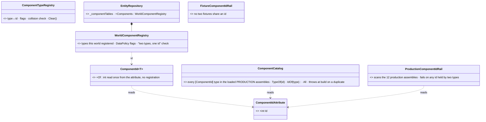
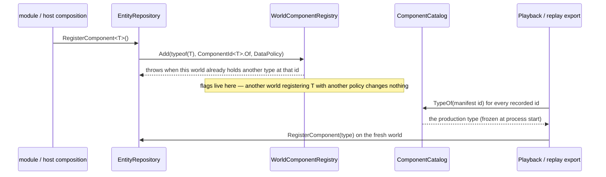
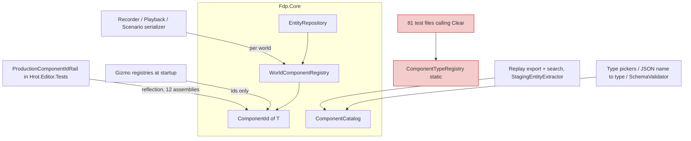

<!--STATUS
state: LIVE
updated: 2026-10-15
build-state: DESIGN — waiting for the user's answer per sub-question (§4). Nothing is built.
current-answer: §4 (sub-questions A–H, each with a lean) over §3 (the three diagrams). §1 is the measured INVENTORY, §2 the claim table.
stale-below: nothing.
known-rot: none.
known-conflict: docs/projects/FDP/Core/Fdp.Core.md §"Component System" describes ComponentIdAttribute as "byte, range [0, 255]"
  (the attribute is int, [0, 511] — ComponentIdAttribute.cs) and the registry as "the" static registry; this question proposes
  replacing that. FDP/Engine/Fdp.Core/GlobalComponentIds.cs's block table still says "200–255 Reserved — examples and future use",
  which production has long since filled (220 AnimationChannel, 221 LookAtChannel …) — the source of CE-3180's fixture clashes.
related-designs:
  - docs/designs/RUNNER/DESIGN-RUNNER.md — §11 "ECS Component ID Safety" (Phase R0) owns WHY ids are fixed numbers on an
    attribute (one id per type across binaries merged into one process, and in recordings). This question keeps that and asks
    only whether the TABLE behind it must be process-static.
  - docs/blueprints/Architect_Question_52_Gizmo_Family_Composition.md — owns the gizmo registries that validate against
    ComponentTypeRegistry (§3 class diagram); §4-E here changes what they validate against.
  - docs/TESTING_Harness_And_Goldens.md — §7.5 owns test-world disposal (CE-3183); §4-G here removes the registry Clear()
    that tests pair with world setup.
  - docs/blueprints/Blueprint_Issues_Tracker.md — CE-3180 (fixture ids collide with production ids) is the row this answers;
    CE-3204/3205/3206 are the findings filed while measuring it.
-->

# Architect Question 92 — **one component table per WORLD, a frozen catalogue for the process, and a rail for duplicate ids**

🔒 **User, `2026-10-15`, verbatim:** *"do we need the static registry, why not making it ecs repo specific?"* · *"the static
registry used to catch duplicate number for different types; how could find that situation with dynamic component registry?"*
· on writing this question: *"yes"*.

**The question.** `ComponentTypeRegistry` (`FDP/Engine/Fdp.Core/ComponentType.cs:71`) is a process-wide static table:
type ↔ id, the per-component data-policy flags, and the "two types, one id" check. Since Phase R0 every id is a fixed number
on `[ComponentId]`, so the table adds nothing to determinism. What it adds today is **shared mutable state between worlds**:
test order decides reds (CE-3180, CE-3165), one world's registration writes flags every other world reads, and the duplicate
check fires only for two types that happen to meet in one process.

## 1. INVENTORY — measured `2026-10-15`

| query | total | what came back |
|---|---|---|
| `search_graph(name_pattern=".*(ComponentTypeRegistry\|ComponentType\|ComponentId\|ComponentIds\|TypeCatalog\|ComponentRegistry).*", label="Class")` | **55** (37 production) | the registry + `ComponentType<T>` / `ManagedComponentType<T>`; **9** id-constant classes (`GlobalComponentIds`, `HrotComponentIds`, `NavigationContractsComponentIds`, `BehaviorApplicationComponentIds`, `PerceptionApplicationComponentIds`, `UtilityApplicationComponentIds`, `GeographicComponentIds`, `ReplayComponentIds`, `ScenarioComponentIds`); **17** per-role `*ComponentRegistry` lists (what a host REGISTERS — `SimHostComponentRegistry`, `CgfComponentRegistry`, …: they call `RegisterComponent` on a world, they are not id tables); editor type pickers (`ReflectionComponentTypeProvider`, `ComponentTypeScan`) |
| same pattern, `label="Interface"` | **1** | `IComponentTypeProvider` (Blueprints editor) |
| `grep "ComponentTypeRegistry\."` over FDP/Hrot/Stride, minus tests/benchmarks/obj/bin | **140** → **127 calls** (13 are comments/strings) | classified per call site by a read-only sweep — table below. Stride: none |
| `grep "(Managed)?ComponentType<…>.ID"` production | **67** | 29 with a world in scope (QueryBuilder, EcsPatchContext, EntityRepository); 38 static tables with none (`HrotOwnershipGroups`, `HrotRoleComponentSets`, `NedOwnershipGroupBinding`, `EntityCommandBuffer`, table ctors, `BlueprintTierSpec`) |
| reflection scan of the 12 production assemblies that declare `[ComponentId]` (`dotnet fsi`, `Hrot.Editor.Tests` bin) | **236 types, 235 ids, 1 duplicate** | 🔴 **212** = `INavmeshProvider` (Fdp.Toolkits) **and** `DotRecastNavmeshProvider` (Fdp.Toolkits.Navigation.Recast) — CE-3206. Scan: **2.4 s** cold |
| test output folders holding all 12 of those assemblies | **4** | `Hrot.Editor.Tests`, `Hrot.Blueprints.Tests`, `Hrot.ReplayBrowser.Tests`, `Hrot.ClusterRunner.Integration.Tests` |
| test fixtures (CE-3180 row census, `2026-10-11/13`) | 236 literal fixture ids, 173 distinct | 42 equal a production id (textually), 34 shared between fixtures |
| `EventTypeRegistry` (`EventType.cs:35`) | 1 | the SAME static shape for events (`ClearForTesting` ×6) — §4-H |

**The 127 calls, by whether the caller holds a world:**

| class | count | what |
|---|---|---|
| world in scope | 76 | recorder, playback, scenario serializer, replay search/export, debug API, data breakpoints, module host, `EntityRepository` itself |
| … of which fill a FRESH world from "every known type" | 10 | `RecordingExportService:799/819/821`, `RecordingSearchService:615/631/639`, `RepositoryPriming:68`, `StagingEntityExtractor:98/100` |
| one hop (`InspectorJsonUtils:44` via `adapter.Repo`) | 1 | |
| no world, but every caller has one ⇒ pass it down | 23 | 15 are translators' `GetConsumedComponentsMask()` (an interface method with no parameter) |
| no world, but the delegate built receives one | 6 | `PredicateCompiler` ×5, `DataBreakpointManager:1264` |
| **no world at all** | **17** | gizmo mask builders at startup (7) · recorder schema manifest + `SchemaValidator` (3) · `FdpAutoSerializer.Build` (2) · type pickers / JSON name→type (4) · `TkbTemplate.AddMandatoryComponent` (1) |
| pure reflection / the accessors | 4 | |

## 2. Claim table — what the leans rest on

| claim | code — how it IS | design — how it was MEANT |
|---|---|---|
| ids are fixed by attribute; the table adds nothing to determinism | ✅ `ComponentType.cs:121` reads `[ComponentId]`; no counter left | ✅ RUNNER §11.2 |
| the duplicate check fires only for two types registered in ONE process | ✅ it lives in `GetOrRegisterManaged`, at first registration (`ComponentType.cs:128-131`) | ⛔ searched `docs/`+`.dev/`: nothing states the check must see the whole code |
| one world's registration writes flags every world reads | ✅ `EntityRepository.cs:671-674, 696-699, 742-745` | ⛔ none; `GizmoReflectionRegistrar.cs:152-159` documents the co-tenant hazard it works around under `--mode all` |
| `ComponentType<T>.ID` registers process-wide as a side effect | ✅ `ComponentType.cs:12` → `GetOrRegister` (lock + flags defaulted true) | ⛔ its doc comment calls it a constant |
| a world already knows its own types | ✅ `EntityRepository._componentTables` is `Dictionary<Type, IComponentTable>` (`EntityRepository.cs:25`) | — |
| some callers genuinely have no world | ✅ 17 sites, §1 | — |
| a production duplicate exists today | ✅ 212, §1 (scan) | ✅ `DotRecastNavmeshProvider`'s own doc says register it AS `INavmeshProvider`; no production code registers the concrete type (grep) |
| test assemblies can be told apart from production when scanning | ⛔ **assumed** (by name `*.Tests` / referencing xunit) — §4-E needs it; checked at slice S3 | ⛔ searched, none found |

## 3. The design — diagrams first

### 3.1 Classes — today (grey) and proposed

*What the picture shows that prose hid: the three jobs the static does today land in three places with three LIFETIMES — the id
(compile time, `ComponentId<T>`), the list of known types (process, frozen, `ComponentCatalog`), the registrations and flags
(one world, `WorldComponentRegistry`). Only the last one is mutable, and it is no longer shared.*

### 3.2 Sequences — a world registers, and a fresh world is filled from a recording

*What the picture shows that prose hid: the only reader of "every known type" is code that FILLS a world (or lists types to a
person); everything that READS a world asks that world.*

### 3.3 Modules — who owns what, who calls it

*What the picture shows that prose hid: after S6 nothing calls the red boxes — the 81 test files' `Clear()` has no target, which
is the point: there is nothing process-wide left to clear.*

## 4. Sub-questions, each with a lean

| # | question | ⭐ lean | blast radius | what would change the lean |
|---|---|---|---|---|
| **A** | Catch "two types, one id" across the WHOLE code, independent of any run? | ⭐ **Yes, first and on its own (S1):** `ProductionComponentIdRail` in `Hrot.Editor.Tests` (its output holds all 12 production assemblies), reflection over an explicit list, fails naming both types + assemblies; a listed assembly missing from the folder fails too. Extend, don't duplicate: `ComponentIdAttributeTests.GlobalComponentIds_NoToolkitBlockDuplicates` checks only `GlobalComponentIds` constants — it misses the other 8 id classes, the 15 literal ids, and two types reusing one constant (exactly 212) | one test file + the 212 fix | a production assembly the editor does not load — then host the rail where the runner composes everything |
| **B** | The 212 duplicate (CE-3206)? | ⭐ **Remove `[ComponentId]` from `DotRecastNavmeshProvider`** — its own doc registers it AS `INavmeshProvider`, and all 3 production registrations use `<INavmeshProvider>`. Registering the concrete type would then fail loud ("missing attribute") instead of colliding by order | 1 line | a caller that needs the concrete type as its own component |
| **C** | Make `ComponentType<T>.ID` a pure attribute read (no registration side effect)? | ⭐ **Yes — prerequisite for everything below.** 67 production uses keep their source; 38 of them are static tables with no world and only need the number | Fdp.Core, invisible to callers | — |
| **D** | Per-world registry for registrations + DataPolicy flags + the collision check? | ⭐ **Yes.** `EntityRepository` already keys its tables by type; the flags become the world's (recorder/snapshot read `repo`); the `GizmoReflectionRegistrar` co-tenant workaround and the `ModuleHostKernel:320` "registered globally" skip (CE-3205) both disappear | 76 + 23 + 6 call sites reroute to the world they already hold | a reader of flags with no world — §1 found none outside the 17 below |
| **E** | What serves the 17 sites with no world and the 10 that fill a fresh world? | ⭐ **A frozen `ComponentCatalog`**: built once from the loaded PRODUCTION assemblies (test assemblies excluded), type↔id only — no flags, no `Clear`, cannot change after build; throws at build on a duplicate, so production gets the rail's check at startup too | 27 sites | if test-assembly exclusion proves unreliable (§2 ⛔ row): build it from an explicit assembly list |
| **F** | The recorder's schema manifest and `SchemaValidator` (no world today)? | ⭐ **Manifest from the world being recorded** (the recorder sees it every `CaptureFrame`); the validator checks a recording against the catalogue — "can this binary decode it" is a process question | 3 sites | — |
| **G** | Tests and CE-3180? | ⭐ **`Clear()` is deprecated, then removed assembly by assembly** (81 files); a fixture then collides only with a type registered in the SAME world — the same test, every run. ⇒ CE-3180's renumbering is NOT needed; the per-assembly fixture rail (CE-2045) stays | all lanes' tests, mechanical | — |
| **H** | `EventTypeRegistry` has the same static shape — in scope? | ⭐ **No — a follow-up row.** Events are not per-world in the same way (the bus is), and only 6 `ClearForTesting` callers suffer; do it after D proves the shape | — | an event-id red in a suite |

### ⛔ Rejected — one line each

- **Keep the static, renumber fixtures (CE-3180's earlier lean)** — fixes tests only; the flag sharing between worlds and the order-dependent duplicate check stay.
- **Dynamic test ids from a pool (with or without leases)** — turns a static fact into run-time behaviour; waits, timeouts, a new flake class.
- **A compile-time analyzer for duplicates** — a project sees only its references; two sibling assemblies stay invisible.
- **Per-world registry with NO catalogue** — 17 sites have no world; pickers and `SchemaValidator` would have to invent one.

### Design docs checked

- `docs/designs/RUNNER/DESIGN-RUNNER.md` §11 — **applies**: owns why ids are fixed; silent on whether the table must be static (it inherited it from the counter era).
- `docs/projects/FDP/Core/Fdp.Core.md` "Component System" — **describes, does not rule**; partly rotted (byte / 0–255).
- `Architect_Question_52_Gizmo_Family_Composition.md` — **applies to E**: the gizmo registries validate against the registry at startup (no world) ⇒ they move to `ComponentId<T>` / the catalogue.
- `docs/TESTING_Harness_And_Goldens.md` §7.5 (CE-3183) — **adjacent**: worlds are now disposed and collectable; it does not cover the registry, which is the other process-wide residue of a test.
- `GlobalComponentIds.cs` block table — **stale** ("200–255 reserved for examples"), fixed in S1.

## 5. Slices — each keeps every suite green

| slice | what | depends on |
|---|---|---|
| **S1** | §4-A rail + §4-B (212) + fix the block table | nothing — can land before the rest is decided |
| **S2** | §4-C pure `ComponentId<T>`; the registry keeps working beside it | S1 |
| **S3** | §4-E `ComponentCatalog`; reroute the 17 + 10 sites | S2 |
| **S4** | §4-D `WorldComponentRegistry`; reroute the 76 + 23 + 6; delete the gizmo workaround; CE-3205 closes | S3 |
| **S5** | §4-G tests: deprecate `Clear()`, remove per assembly (one commit each, named as cross-lane) | S4 |
| **S6** | delete `ComponentTypeRegistry` | S5 |
