<!--STATUS
state: LIVE
updated: 2026-10-17
build-state: BUILDING — slice 1 (SUMO embedded in the networkless editor, R-4047) BUILT 2026-10-17: §3.0 is its as-built;
  slice 2 (the networked pack + the traffic node, §12) BUILT 2026-10-17: §12.1 is its as-built; the rest of §6 is DESIGN. Cars: decisions RULED (§0, R-4020…R-4031). Pedestrians (§8): P1–P8 ACCEPTED (R-4032); civilians
  moved to docs/DESIGN_Civilians_And_Crowd_Control.md (R-4033).
current-answer: §15.7 (slice 5a/5b AS BUILT — pedestrians, panic, conversion) · §14.6 (slice 4) · §13.7 (slice 3) · §12.1 (slice 2 AS BUILT — the networked pack, who serves, the deviations table) · §12 (the dedicated node built alongside — R-4053; N1–N3 approved R-4054; any number of traffic nodes R-4055, N4–N8 / T1–T3 / S1–S3 approved R-4056) · §3.0 (slice 1 AS BUILT — classes, modules, the deviations table) · §11 (how SumoSharp enters HROT — vendored sources, an optional build switch, the first slice and when it runs; R-4046/R-4047) · §9 (how SUMO and HROT entities treat each other — the summary) · §10 (SUMO embedded in any host, the networkless editor included — R-4044, leans EM-1…EM-5) · §0 (the approved decisions) over §3 (the diagrams); §4 the sub-decisions; §5 the known limits; §8 pedestrians and panic.
stale-below: nothing. ⚠ The first chat draft (2026-10-16) published SUMO cars through NED as Lightweight entities and
  carried traffic lights as door-like entities — both SUPERSEDED the same day by R-4020; recorded in §7 HISTORY only.
known-rot: §3.0's red "not composed in slice 1" box is slice 1's state — SimHost, CGF and IG compose the mirror since slice 2 (§12.1);
  §12 S2's `TrafficAssignment` component was not built — the role-group grant is the assignment (§12.1). §3.1–§3.4 are the networked TARGET, not the code — as built (§3.0): no `TrafficNodeModule`/`SimulationRunner` (a
  `TrafficPack` over SumoSharp's `LiveCitySim`), `TrafficDemand` has no `DemandFile`/`Density`/`Pedestrians` (it has `TargetCars`),
  the net is `terrain.json` `sumoNet`, not `RoadNetworks`; §10 EM-4's `NedPublishable()` and "18 translators" are, as built,
  `DefaultRoutePublishable()` at 29 NED query sites.
known-conflict: none. ⚠ Relation to §2.1e ① of DESIGN_Terrain_Zones_And_Assets.md (the scenario names only a terrain) —
  CONSISTENT: the SUMO net is a terrain asset (R-4021); only the traffic DEMAND is a scenario entity.
related-designs:
  - docs/DESIGN_Uniform_Gizmo_Membership.md §8.5b/§8.7 — OWNS which hosts draw and PUBLISH the map gizmos; the road layer rides that seam (§12.4)
  - docs/DESIGN_Subsystem_Composition_Unification.md §4.1ae — OWNS how every host composes a capability (one shared walk) and the per-node terrain content the pack's net loader joins
  - docs/DESIGN_Terrain_Zones_And_Assets.md — owns WHAT a terrain asset is (§2.1a: the road net is an external asset,
    "like sumo road net"; §2.1e: terrain.json, roadNetworks[]). This question adds a second road-net FORMAT to that slot.
  - docs/DESIGN_Terrain_World.md — owns what a terrain CONTAINS and the one-file-every-query-derived rule; §7.3 W12 the
    terrain FOLDER and TerrainCatalog that distribute the .net.xml to every node (R-4021).
  - docs/DESIGN_Cluster_Load_Phase.md — owns WHEN terrain loads and the role→load-part contract (terrain is universal);
    the traffic node's SUMO load runs inside that step.
  - docs/DESIGN_Geo_Origin.md — owns the terrain's geo origin (R-229); §4 E1 here maps the SUMO net's UTM frame onto it.
  - docs/designs/navig-2/Navigation_Design_v2_0.md — §5.2a owns the road GRAPH our own units route on (R-230/R-231).
    ⛔ R-4026: it stays SEPARATE from and independent of the SUMO net — no derivation either way.
  - docs/DESIGN_Entity_Control.md — M-6 rejected moving a unit's ownership to a controlling station; R-4023 (the
    handover by a follow mode) follows that precedent. M-1's KinematicsMode.Manual is the shape KinematicsMode.Traffic copies.
  - docs/DESIGN_Entity_Ownership_Transfer.md — TransferEntityOwnershipRequest: the REJECTED handover alternative (§0 D7).
  - docs/DESIGN_Dead_Reckoning.md — owns NED's dead reckoning; SUMO cars use SumoSharp's lane-based dead reckoning
    instead (R-4020), so the R6 caveat there (no DR of Active replicas on Brain/Muscle) does not reach them.
  - docs/DESIGN_Node_Roles_And_Policies.md — owns the roles; R-4022 adds a Traffic role (R-138: a convention, not a
    protocol restriction — a non-muscle node may own a pose).
  - docs/DESIGN_Map_3D_Mode.md — owns the 3-D map mode and its ground draping (§6f), which the traffic road layer draws through.
  - docs/blueprints/Architect_Question_91_Player_Nodes.md — R-4012 (replay by span) and R-4007 (ingress frozen while
    restoring), which the mirror module obeys (§4 E5).
  - External: github.com/pjanec/SumoSharp — docs/SUMOSHARP-API.md, docs/PACKAGES.md, docs/SUMOSHARP-DEADRECKONING.md,
    docs/EXTERNAL-AGENTS-VIZ.md, docs/PEDESTRIANS.md, demos/City3D (CityLib).
  - docs/DESIGN_Civilians_And_Crowd_Control.md — ⭐ OWNS the civilians a panicked SUMO pedestrian becomes (one family, panic as a
    MODE — supersedes §8 P5's single type), the Neutral targeting gate (§8 P6 ⇒ its CIV-0) and the riot/non-lethal work.
  - docs/DESIGN_Operations_Behaviour_Catalogue.md — owns the civilian behaviours (CIV-2 panic flight, CIV-7 shelter; ruling D3 civilians as HSM crowd agents) that §8 P5 hands panicked pedestrians to.
  - docs/blueprints/PLAN_Sumo_Slice1_Embedded_Editor.md — the BUILD PLAN of slice 1 (R-4047: embedded in the editor first); it cites this design's sections and draws nothing of its own.
  - docs/DESIGN_Ownership_Groups_And_Grants.md — owns ownership and the send gate (HasAuthority); §10 EM-4 adds the general replication route beside it (R-4045).
  - docs/DESIGN_Terrain_Height.md — §8 (lean): the ambient ground as the HEIGHT fallback outside our terrain (aircraft, rounds, off-road units); owns the ground query.
-->

# Architect Question 93 — **a SUMO traffic node: SumoSharp's own wire, local mirrors everywhere, roads from the terrain**

🔒 **User, `2026-10-16`, verbatim:**
- *"integrate the ground traffic simulation … into the engine as a new type of node, which is running the traffic simulation and publishing the entities on the network so that the other nodes can see them"* · *"The sumo car entities would have no brain. They will be fully controlled by the sumo node."* · *"would be just adopted by all the other nodes as unowned, completely unowned."*
- *"the sumo sharp repository also handles pedestrians. It would be nice to use them as well."*
- *"The vehicles and entities from our own engine should be exposed back to the Sumo simulation."*
- *"take our vehicle and hand it over to the Sumo node so Sumo can control its navigation over its own road graph and be able to take the ownership back to our simulator."*
- *"whether it makes sense to integrate the Sumo engine into our muscle node completely"*
- *"It is essential that every node that receives the cards from the sumo node does dead reckoning, because the sumo cards are sent only on a significant change."* · *"The sumo node must use the optimized dead reckoning that the sumo sharp project is using, because this is reducing network traffic tremendously."*
- *"Your idea of referencing the sumo road network from the terrain is correct. Sumo scenario parameters being part of our scenario as an entity is also accepted. The rendering of the roads and traffic lights should be inspired by the one from the CityLib."*
- *"because we need to use the optimized DDS network scheme for sumo sharp cars, we do not need to solve the issue with sending thousands of cars using our DDS scheme."*
- *"A local entities ok, B ok, C ok, D1 and D7 ok."*
- *"we can store the sumo road network as part of the terrain and synchronize this the same way as the terrain."*
- *"Lets discuss pedestrians. I need them and also their panic mode if there is some incident like military/terrorist shootout."* · *"Panicking ones coukd.become.our entities and never returned to sumo"*
- *"ok, approved for building. I would also like to treat the sumo sharp as a separate subproject, but not as part of this project. This project should have just a script that fetches and clones the sumo sharp repository and compiles the NuGet out of it and places it in the NuGets folder. […] If the sumo sharp is not available compilable from whatever reason, we should be able to avoid compiling it into hrot, Meaning it should be an optional component that can be turned off. Pls check how that can be done."* (⛔ the fetch-and-pack half SUPERSEDED by the next three)
- *"And the first thing to build later is the embedded sumo sharp module inside the editor, . But of course, being ready for creating a new networked node with traffic role. Also, the sumo sharp module is not necessary if the scenario or the terrain doesn't contain sumo sharp network  or scenario settings."*
- *"Well, maybe there is one more alternatively, depending on how big the SumoSharp project is. We could treat it in a similar manner like B-trees or HSM, And simply copy its sources, the parts that matter, into the extdeps folder of the HROT"*
- *"Sumo Sharp itself works quite well, so by vendoring it into the external dependencies folder I meant taking just the sources that are already proven working, so we do not need to develop Sumo Sharp on there and run their tests, just make the sources that hrot needs  available as part of Hrot repository, so we can very easily switch to previous version using Git and so on."*
- *"V7 and V8 approved.  By the way, what would it take to use these outer areas, at least for hate queries? […]"* (answered in `DESIGN_Terrain_Height.md` §8)
- *"Good! The sumo network visualization in the viewer now uses some approximation of the terrain that sits in between the roads, so the scene doesn't look empty and has a feeling of some solid terrain, not just roads flying in the air. This can be used as well in our 3D map, but I am not sure if this is fine with the areas where our terrain is built and is overlapping with the roadmap. In such areas, this 'ambient terrain surface' feature will need to be turned off, most likely."*
- *"When rendering the sources, there is no need to have an off switch anymore because the sources are always available. What about the rendering part of the road network that is now living in the … citylib, Is that something that can be generalized a little bit? So it's not usable just as part of Godot?"*
- *"EM-1 to EM-5 approved. The converted civilian should be created by usual request to a brain node, which is as now sent as local FDP bus event, so there is no change if the CGF is running on different node or inside the editor. The ignoring of publishing sumo entities over the network should not be something sumo specific. This concept needs to be generalized, meaning that some entities, even if owned, will use different network publishing mechanism, different from the usual NED one. Regarding the threading, the Sumo uses quite optimized multi-threaded techniques, so please check how this could be made working inside the editor as well. So only the stepping from the editor will be done from the main thread, but inside the Sumo this could be done in whatever optimized way."*
- *"This concise summary is worth writing to the design as is i guess. Sumo node might keep a full copy of hrot entities in its ecs as this is a natural conswquence of code unification and reuse and the cost is basically just memory on the sumo node. Pls lets think about how to make the sumo integratable to the networkless editor in similar way as any other parts are. This is mandatory, sumo should not be just a separate networked node, i want it to be embeddable."*
- *"Z1 and Z2 approved, write them into the designs"* (Z1: zones are the engine-wide fidelity area; Z2: a SUMO entity is a replica inside a zone or within R of an HROT entity)
- *"Please explain point H1. H2 and H3 accepted. Why the vicinity condition 300 meters from our entities should apply just to pedestrians? I think it should apply both to sumo cars and pedestrians the same way, no matter if they are in the area of our terrain. Simply, if they are close to our entities, they will by seen by EQS queries, raycasts, and reachable by hits and damage."*
- *"G2 to G6 leans accepted. The Sumo road network can span large areas that are not covered by our terrain, and this is fine because Sumo in thosr area is working just as a background traffic"*
- *"G1 What do you mean by that shooter's node calculates the damage? It is calculated by the muscle node, isn't it? Why any special traffic hit message? We have an usual hit message. Why sumo entities don't have network ID? They should have one because they are just the normal entities, just calculated by different node and communicate it with a special set of DDS messages for optimal data reckoning."*
- *"§8.6 lean accepted, drop promotion zones, at lest for now. Will our fire and detonation and entities be able to interact with sumo entities, in a way that if they are hit they will take damage, will be removed from sumo and become our entity with brain, like the panic mode? We need sumo entities to show up in eqs/raycast queries etc"*
- *"We can extend sumosharp as needed, it is my project. If ckeaned up, i could publish on nuget.org. E2b ok."*
- *"E1 ok. E2 no,.keep height from sumo, as roads are rendeded from sumo net. E3 no, keep them separate and independent, sumo ones are complex, ours are simple. E4 ok.E5 ok. To ensure unique network ids, sumo could use our allocator. E5 ok. E7 packages ok, just need to be compiled and stored as part of hrot repo (lfs?) as they are not on nuget.org. E9 ok. E10 ok."*

## 0. The approved decisions

| id | decision | ruling |
|---|---|---|
| **D-wire** | ⭐⭐ SUMO cars (and traffic lights) travel ONLY on SumoSharp's own DDS topics (`sumo/vehicles`, `sumo/lifecycle`, `sumo/tl`), published with its DR-error policy (`DrErrorPublishPolicy`: 0.3 m along / 0.2 m lateral / 3 s heartbeat). **Every receiving node dead-reckons with SumoSharp's `DrExtrapolation` curve** — the one the publisher's policy also uses. ⛔ Never through NED: no SUMO car is a networked HROT entity, so "unowned" needs no ownership mode at all | **R-4020** |
| **D3** | ⭐⭐ The SUMO net (`.net.xml`) is a **terrain asset**, named by `terrain.json` `roadNetworks[]` and synchronised with the terrain folder. ⛔ `sumo/geometry` is not needed. The traffic **demand** (density, flows/routes, seed, pedestrians on/off) is a **scenario entity** | **R-4021** |
| **D1 + A + B + C** | ⭐⭐ A **separate traffic node** (an ECS host with a new `Traffic` role) runs SumoSharp, whose engine keeps its own data as the truth. **A** — every receiving node keeps one ECS entity per car (pose + collider; never published on NED, never saved) — ⭐ **a NORMAL replica** with a network id, owned by the traffic node, **only while within R of one of our entities** (R-4041, §8.8 H1) (R-4038; the earlier "local-only, no network id" reading is SUPERSEDED) so the map, line of sight, avoidance and picking see traffic. **B** — the dead-reckoning clock is the **cluster sim time** (`GlobalTime`), and the traffic node steps SUMO on that same clock. **C** — the lanes dead reckoning needs come from the receiver's own parse of the terrain's net file, checked against the publisher by a **net hash** | **R-4022** |
| **D7** | ⭐⭐ Handing one of our vehicles to SUMO is a **follow mode, not an ownership move**: SimHost keeps ownership; SUMO drives a shadow car named `hrot:<networkId>`; SimHost's new `KinematicsMode.Traffic` follows its dead-reckoned pose; leaving the mode takes it back. ⛔ Rejected: `TransferEntityOwnershipRequest` of the kinematic group — Entity Control M-6 already rejected an ownership move for control; on a traffic-node crash the keys return to the creator (CGF, no kinematics) and the vehicle freezes; on hand-back SimHost resumes from stale `VehicleState`/`NavState` | **R-4023** |
| **D4** | ⭐ Roads and traffic lights are drawn by one new map layer **styled on SumoSharp's CityLib** (lane ribbons, lane markings, crosswalks, signal heads), drawn through the shared gizmo seam so all five map hosts get it | **R-4024** |
| **E1 + E2** | ⭐ SUMO coordinates map onto ours UTM → WGS84 → local ENU through the terrain origin (E1). **Heights come from SUMO** — the roads are rendered from the SUMO net, so the cars ride the same lane z (E2; our lean "our ground is the height" was REJECTED) | **R-4025** |
| **E3** | ⛔ Our own road graph (CarKinem `RoadNetworkBlob`, `roads.json`) stays **separate and independent** of the SUMO net — SUMO's is complex, ours is simple; no derivation either way | **R-4026** |
| **E4 + E5 + E9 + E10** | our entities reach SUMO as lane obstacles + crowd discs (E4); each node records its local cars, the traffic node does not step SUMO in replay (E5); received samples are stamped with SUMO sim time (E9); the traffic node is an optional cluster member (E10) | **R-4027** |
| **E7** | SumoSharp is consumed as its two NuGet packages, **compiled from a pinned SumoSharp commit and stored in the HROT repo** (they are not on nuget.org) | **R-4028** |
| **E2b** | a flat (2-D) net — no z — drapes BOTH roads and cars onto our ground; a net with z is used as-is | **R-4030** |
| **SumoSharp** | ⭐ SumoSharp is the user's own project and **may be extended as the integration needs** (§8 S1–S5, E9, E11); once cleaned up it may be published on nuget.org, which would replace E7's in-repo packages | **R-4031** |
| **E11** | every SUMO car gets a cluster-unique **network id from our allocator** (`DdsIdAllocator`), carried on SumoSharp's lifecycle record, so a car is the same id on every node | **R-4029** |

## 1. INVENTORY *(2026-10-16 — codebase-memory `search_graph` (MCP + CLI), grep, three read-only sweeps; `check_index_coverage` NOT run)*

| query | total | result |
|---|---|---|
| HROT `search_graph name_pattern=".*(Road\|Traffic\|Sumo).*" label=Class` | **38** | the CarKinem road graph (`RoadNetworkBlob`/`Builder`/`Holder`/`Json`/`Loader`, `RoadGraphNavigator`, `RoadGraphRouter`, `RoadHeights`), `RoadNetworkGizmo`, `RoadNetworkMigrationModule`; ⛔ **no SUMO or traffic production class** — `TrafficBrainSystem` is in `FDP/Examples` only, `TrafficLightExample` is an FHSM sample |
| HROT `search_graph ".*(Unowned\|Ownerless\|NoOwner\|ForeignEntity\|External(Entity\|Sim)).*"` | **12** | tests only — ⛔ no ownerless-entity type exists; `EntityMaster` has no owner field (`GenericDescriptors.cs:120-122`) |
| HROT `search_graph ".*(LocalOnly\|NotReplicated\|NoEgress\|LocalEntity).*"` + grep of egress queries | 17 | ⭐ egress is gated on `NetworkIdentity` AND on authority: `GeoSpatialEgressTranslator.cs:121-123,136`, `EntityMasterEgressTranslator.cs:62-63,76` (`HasAuthority`, `AuthorityExtensions.cs:16-45`) ⇒ a replica owned by another node is never published (R-4038 ⇒ mirrors are such replicas). ⛔ SUPERSEDED reading: an entity created **without** `NetworkIdentity` is local-only by construction (R-4022 A) |
| sumosharp `search_graph ".*(External\|Agent\|Injector\|Obstacle).*" label=Class file=src/**` | **13** | `ExternalObstacle` (lane-relative, `Sim.Core/ExternalObstacle.cs:54`), `ObstacleStore`, `ObstacleHandle` (32+16, a distinct id space), `OrcaSolver.Agent`, `ShapedVoSolver.ShapedAgent` |
| sumosharp grep — receive side | — | `DdsSubscriber : IReplicationSource` (`Sim.Replication.Dds/DdsSubscriber.cs:22`) · `DrClock.Pump` / `Resolve` / **`ResolveAt(history, sampleT, lanes)`** (`Sim.Viewer.Motion/DrClock.cs:145,295,317`) · `DrExtrapolation.Arc` (`Sim.Replication/DrExtrapolation.cs`) · `NetworkLaneSource` (`Sim.Core`) |
| sumosharp grep — publish side | — | `ReplicationPublisher.PublishStep(snap, sink)` (`Sim.Host/ReplicationPublisher.cs:62`), `DdsReplicationSink`, topic names `DdsTopicNames.cs:51-70` |
| sumosharp grep — engine | — | `Engine.LoadNetwork`/`LoadScenario` (`Engine.cs:1562,1303`), `SpawnVehicle(…departPos, departSpeed, departLane)` (`:2877`), `Despawn` (`:2963`), `AddMovingObstacle`/`UpdateObstacle` (`:1235-1262`), `CrowdSource : ICrowdFootprintSource` (`:783`), `SimulationRunner` (manual `Tick()`), `NetworkParser.Parse` (`Sim.Ingest/NetworkParser.cs:17`), `LaneProjection.Project` (`Sim.Ingest/LaneProjection.cs:19`) |
| CityLib | — | `demos/City3D/CityLib`: `RoadMeshBuilder`, `LaneMarkingBuilder`, `CrosswalkBuilder`, `TrafficLightPlacer` — engine-agnostic net8.0, Godot axes, NOT packaged |
| DDS binding | — | both repos pin **`CycloneDDS.NET` 0.3.2** (HROT 25 csproj refs; `SumoSharp.Dds` csproj :36) ⇒ one native runtime in the process |

## 2. Claim table — what the decisions rest on

| claim | code — how it IS | design — how it was MEANT |
|---|---|---|
| a non-muscle node may own a pose | ✅ `CarKinematicsSystem.cs:80` gates physics on `WithOwned<SimTransform>`, not on role | ✅ R-138 — "SimHost owns SimTransform" is an outcome, not a rule |
| a replica owned by ANOTHER node is never published — even with a `NetworkIdentity` | ✅ every egress translator checks `HasAuthority` (`GeoSpatialEgressTranslator.cs:136`, `EntityMasterEgressTranslator.cs:76`, `EntityInfoEgressTranslator.cs:116`) | ⛔ searched `docs/`, no design names it — ⚠ it is a property of the queries; a rail must pin it (§6 slice 3) |
| the SUMO net can ride the terrain | ✅ `TerrainDefinition.RoadNetworks` (`TerrainDefinition.cs`), `TerrainCatalog` + `AssetTreeSync` mirror the folder (`StorageGatewayModule.cs:446-476`) | ✅ Terrain_Zones §2.1a/§2.1e, Terrain_World §7.3 W12 |
| receivers can dead-reckon on cluster time without a wall-clock fit | ✅ `DrClock.ResolveAt(history, sampleT, lanes)` takes the time explicitly; ⚠ `DdsSubscriber` stamps samples with the DDS **SourceTimestamp** (wall clock) | ⛔ SumoSharp's DEADRECKONING doc §8 paces from wall-clock arrival by design ⇒ §4 E9 |
| SUMO keeps a car's insertion safe | ✅ `SpawnVehicle` queues until a gap (`VehicleLifecycle.cs:122-128`) | ✅ TUTORIAL-VEHICLES |
| only the FIRST terrain road network loads today | ✅ `TerrainResidency.cs:214-232` | ⚠ Terrain_World §2 lists `roadNetworks[]` as a list ⇒ §5 |

## 3. Diagrams

> ⭐ **§3.0 is the AS-BUILT of slice 1 (SUMO embedded in the networkless editor, R-4047) — where it and §3.1–§3.4 disagree, §3.0
> is the code.** §3.1–§3.4 stay the TARGET for the dedicated networked traffic node (later slices); the rows they no longer
> describe are listed in the STATUS block's `known-rot`.

### 3.0 As built — slice 1, the embedded editor *(2026-10-17, `PLAN_Sumo_Slice1_Embedded_Editor.md`)*

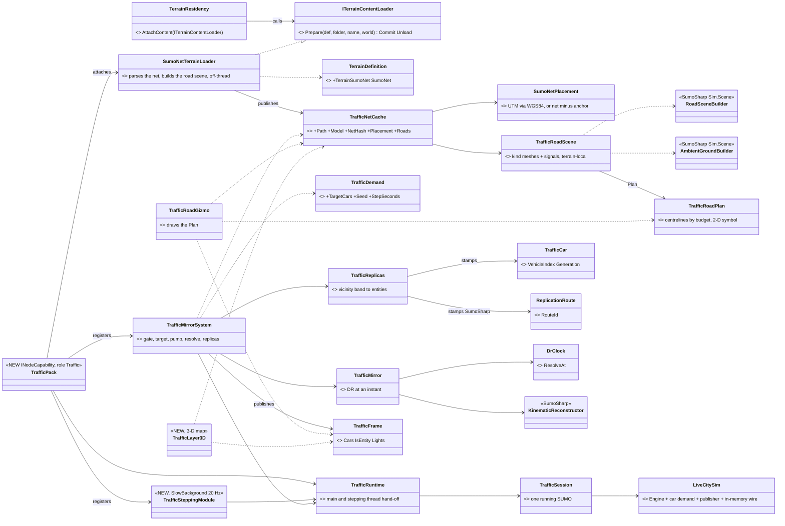

*What the picture shows that prose hid:* the map layers never touch the pack — they read two WORLD singletons
(`TrafficNetCache`, built at terrain load, and `TrafficFrame`, written each frame), so any map host whose world carries them
draws traffic; and the SUMO side is one SumoSharp class (`LiveCitySim`, its proven live-city host) behind one HROT class
(`TrafficSession`) — no new trip generator, no new publisher (the seam law).

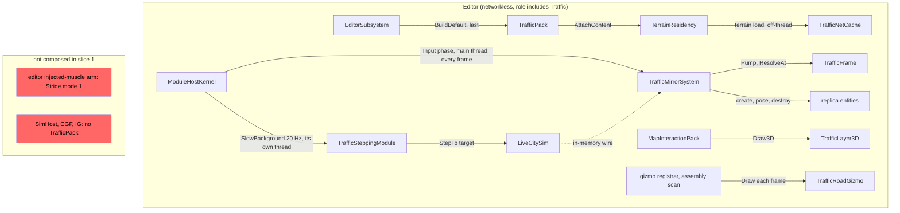

*What the picture shows that prose hid:* two clocks are NOT involved — the stepping thread only chases a target the main thread
sets from `GlobalTime`, so pause holds SUMO and the main thread never waits for it (EM-5); and the red boxes: the editor's
INJECTED arm (Stride mode 1) and every networked host compose no `TrafficPack` yet, so they show no traffic (the 2-D gizmo is
loaded everywhere `Hrot.Traffic` is, but draws nothing without a `TrafficNetCache`, which only the pack's loader publishes).

| as built | why it differs from the target below |
|---|---|
| the net is `terrain.json` **`sumoNet { file, anchor }`**, beside `roadNetworks[]` | ⚠ R-4021 says "a terrain asset"; `roadNetworks[]` is the CarKinem road graph, which R-4026 keeps separate — a key of its own says so, and carries E1b's anchor |
| `ITerrainContentLoader` on `TerrainResidency` | the terrain step learns about a content kind without knowing SUMO (Prepare off-thread, Commit on the main thread, Unload) |
| the stepper is `LiveCitySim` in `RouteGraph` mode, pedestrians off | its closed-loop demand IS "random routable trips at a density"; RouteGraph = the whole net, no demo crop (R-4040) |
| the replica's TKB type is a new **"SUMO car" (8851)**, not the civilian car (1002) | 1002 carries `VehicleParametersDto` (car kinematics would fight the mirror) and a brain profile; 8851 is the type only, DIS 1.1.0.81, like the parked car |
| `TrafficDemand { TargetCars, Seed, StepSeconds }` | the target's `DemandFile` / `Pedestrians` wait for their slices; `TargetCars` is `LiveCitySim`'s own density knob |
| replicas are anchored by HROT **bodies** (`SimTransform` + `PhysicsCollider`, default route) | a map graphic or an area must not pull cars in; a replica must not anchor another |
| the NED query helper is **`DefaultRoutePublishable()`** in `Fdp.Toolkits`, adopted by **29** NED query sites | EM-4 named it `NedPublishable()` and counted 18 translators; the helper is route-generic, not NED-specific, and the 29 are every query in a NED file that gates on `HasAuthority` (a source rail keeps it so) |
| a clock that jumps BACK restarts SUMO | SUMO cannot run backwards; fresh background traffic is the honest answer (no replay of SUMO in slice 1) |

### 3.1 Classes *(the TARGET — the dedicated networked traffic node; slice 1's as-built is §3.0)*


*What the picture shows that prose hid:* every NEW box sits on an existing seam — the terrain step parses the net once
(`TrafficNetCache`) and three consumers read it (the SUMO engine, the mirror's dead reckoning, the road layer); the only
networked HROT data the traffic node READS are replicas it already receives (the demand entity, our vehicles, their intents);
and nothing the traffic node WRITES goes through NED.

### 3.2 Sequence — one live step

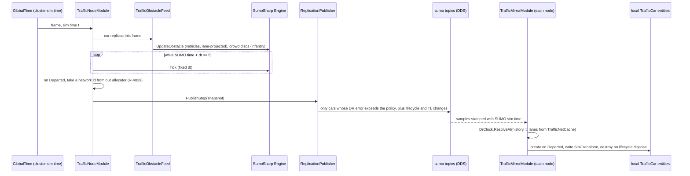

*What the picture shows that prose hid:* SUMO advances only to the cluster's sim time, so pause and speed-up need no
SumoSharp change on the publisher; and the receiver resolves poses at the SAME `t`, so a paused cluster freezes traffic on
every node.

### 3.3 Sequence — handing our vehicle to SUMO and back (R-4023)

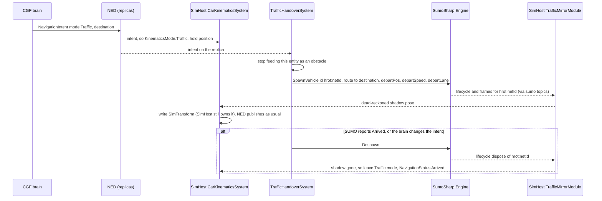

*What the picture shows that prose hid:* ownership never moves — the only new edge into SimHost is a pose it FOLLOWS, the
same shape as M-1's manual drive; and the shadow car's id carries our entity id, so the renderers' traffic layer skips
`hrot:*` cars and the vehicle is never drawn twice.

### 3.4 Modules — who registers it, who calls it each frame

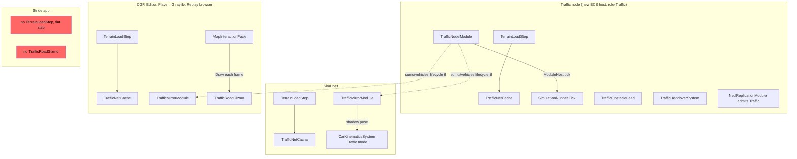

*What the picture shows that prose hid:* the red boxes — **Stride runs no terrain step** (`StrideHrotGame.cs:1006-1009`, a
flat slab) and no map gizmo pack, so Stride shows no roads and no traffic until Stride gets terrain (AQ81 T8). The other
edge the picture forces: `TrafficMirrorModule` is ticked by each host's ModuleHost, so a host that does not compose it sees
no traffic — the composition list in §6 slice 3 is the place that decides it.

## 4. Open sub-decisions — each with a lean *(not yet ruled)*

| id | question | ⭐ lean | rejected — one line each | blast radius |
|---|---|---|---|---|
| **E1** | coordinates | ✅ **RULED (R-4025)** — at terrain load, convert the net's `<location>` (`netOffset` + `projParameter`) **UTM → WGS84 → local ENU** through the terrain origin (R-229), fit once as a 2-D rigid transform in `TrafficNetCache.ToLocal`; `+proj=utm` only, others refused with a load error | identity: wrong for any georeferenced net · a projection library: a large dependency for one projection | new UTM converter (~100 lines); SumoSharp's parser must read `<location>` (it ignores it today) |
| **E1b** | a net that is NOT georeferenced (`projParameter="!"`, plain local metres — e.g. SumoSharp's demo city) | ✅ **RULED (R-4052, D5)** — `terrain.json` gives an **anchor** for such a net: where the net's (0, 0) sits in the terrain's local metres (plus an optional rotation); the georeferenced path (E1) is unchanged | refusing non-georeferenced nets: SumoSharp's own demo city is one | `TrafficNetCache.ToLocal` |
| **E2** | car and road height | ✅ **RULED (R-4025)** — **SUMO's z**: roads are drawn at the lane z and cars ride `PosZ`. ⛔ The lean (our `IWorldQuery.SurfaceZ`) was REJECTED: the roads come from the SUMO net, so the cars must match them | — | mirror module; ⚠ consequence in §5 |
| **E2b** | ✅ **RULED (R-4030)** — a **flat (2-D) net** has no z (`Lane.ShapeZ` null ⇒ `PosZ` 0) | ⭐ when the net carries no z, BOTH roads and cars **drape onto our ground** — the 3-D map's existing rule (Z = 0 is "drape", `GizmoRenderer3D` M18/P4) for the roads, `IWorldQuery.GroundHeightAt` for the cars; a net WITH z is used as-is (R-4025) | cars and roads at z 0: everything sinks into or floats above any non-flat terrain | mirror module + road layer |
| **E3** | our units on SUMO roads | ⛔ **RULED NO (R-4026)** — the two road systems stay separate and independent | derive `RoadNetworkBlob` from the net (our lean) — rejected: SUMO's model is complex, ours is simple | none |
| **E4** | how our entities reach SUMO | ✅ **RULED (R-4027)** — vehicles → `AddMovingObstacle` after `LaneProjection.Project` (≤ 3 m from a lane, else ignored); infantry and every off-lane unit → crowd discs (`ICrowdFootprintSource`), which cars and pedestrians both react to | discs only: cars would not queue behind a convoy · obstacles only: off-lane infantry crossing a road invisible | traffic node only |
| **E5** | replay | ✅ **RULED (R-4027)** — each node's recorder records its local `TrafficCar` entities (R-4012 Plan A); in replay the mirror module is gated like ingress (`IReplayRestoreGated`) and the traffic node does not step SUMO. Known limit: a node OUTSIDE its recording span shows no cars (mirrors are not flooded) | SumoSharp's `.simrec` replayed onto the topics: a second recording mechanism, and its seek re-reads from the start | mirror module; recording size to measure |
| **E6** | pedestrians | phase 2, same pattern: SumoSharp's 4 pedestrian topics, local mirror entities for **promoted** pedestrians only (full collision avoidance, the ones cars see), realism zone around our units; ambient pedestrians drawn from their route-seed-time function, no entities | all pedestrians as entities: 20 000 entities per node for background walkers · now, in slice 1: pedestrians are SumoSharp's real-time bottleneck (7–15 steps/s on 4–8 cores) | phase 2 |
| **E7** | how SumoSharp enters the build | ⛔ **SUPERSEDED by §11 (R-4046): vendored sources, not packages.** Prior ruling (R-4028) — the packages `SumoSharp` + `SumoSharp.Dds`, **built from a pinned SumoSharp commit and committed into HROT's existing local feed `nugets/`** (`nuget.config` already declares `LocalFeed = ./nugets`); a script `scripts/update-sumosharp.sh` packs them with a version that names the commit (⚠ SumoSharp's own pack defaults to `0.1.0` every time, which a stale NuGet cache silently reuses); licence `EPL-2.0 OR GPL-2.0-or-later` | a git submodule / project reference: 5 000 files and a second build system · a CI feed: SumoSharp is not published anywhere | build only; `.gitignore` gains `!nugets/SumoSharp*.nupkg` (it ignores `*.nupkg` today) |
| **E7b** | ⚠ OPEN — Git LFS for the `.nupkg` files? *(moot if SumoSharp is published on nuget.org, R-4031)* | ⭐ **plain git, no LFS.** HROT uses no LFS today (no `.gitattributes`, `git lfs ls-files` empty); cloud sessions clone with LFS smudging skipped, so an LFS package would arrive as a pointer stub and every cloud build would fail restore. The packages are small managed assemblies (the native DDS runtime comes from `CycloneDDS.NET` on nuget.org, which HROT already uses) — ⚠ size not measured yet; if one exceeds ~10 MB, revisit | LFS: breaks restore in every session that skips LFS, and adds a tool to every clone | `.gitignore`, `nugets/` |
| **E8** | `sumo/geometry` | OFF (R-4021); the publisher still exposes the net hash (on `sumo/status`) for C's check | keep it on as a fallback: two sources for the same lanes | publisher config |
| **E9** | the receiver's time stamps | ✅ **RULED (R-4027)** — stamp each sample with the frame's own **SUMO sim time** (= cluster sim time, §3.2), not the DDS SourceTimestamp — a small SumoSharp option on `DdsSubscriber` | keep wall-clock stamps and fit a rate: breaks on pause, speed-up and replay | one SumoSharp change |
| **E10** | traffic-node id and lifetime | ✅ **RULED (R-4027)** — an ordinary cluster member (master-assigned id, R-4009), **optional** in `ClusterConfiguration` — if it dies, traffic simply stops (lifecycle disposes reach every mirror; a mirror whose feed falls silent for N s clears its cars) | mandatory: a crashed traffic node would fail the exercise | orchestrator config |
| **E11** | unique ids for SUMO cars | ✅ **RULED (R-4029)** — the traffic node takes one network id per car from **our allocator** (`DdsIdAllocator`, chunks of 100, `DdsIdAllocator.cs:31-33`) and the id rides SumoSharp's lifecycle record (its `Name`, or a new numeric field if a flow-spawned car cannot be named — a small SumoSharp change); ⭐ **amended by R-4038:** the mirror is a normal replica — `NetworkIdentity` = that id, `NetworkAuthority.PrimaryOwnerId` = the traffic node, registered in the entity map; NED egress never publishes it because this node has no authority over it (`HasAuthority`, `GeoSpatialEgressTranslator.cs:136`). ⛔ SUPERSEDED: "never in `NetworkIdentity` — egress publishes every entity that has one" (it publishes only what it owns). Shadow cars (R-4023) carry the handed vehicle's own id | SumoSharp's `VehicleHandle` as the id: a separate 32+16 space whose slots are recycled, and different on every node's mirror | traffic node + mirror; ⭐ every reader that resolves a network id through the entity map now finds the mirror (hits, targeting, orders) |

## 5. Known limits *(measured unless marked)*

- Traffic lights carry ONE state per approach lane (`Engine.cs:2613-2637`): a separate left-turn arrow is lost.
- No brake lights or turn signals in SumoSharp (searched `src`, none); `Acceleration` and the lane-change phase byte are the only inputs.
- `CivilianCar` (TKB 1002) has no `Health`: a hit does nothing (`CombatTkbTranslator.cs:49-53`). Destroying a SUMO car is a later question (it would need `Despawn` on the traffic node).
- `TerrainResidency` loads only the FIRST entry of `roadNetworks[]` (`:214-232`).
- ⚠ R-4025's consequence: with SUMO's z, roads and cars sit where the NET says, which can differ from our height grid where the net's z was not built from it — a road may hover over, or sink into, our terrain mesh. A terrain must ship a net whose z matches its height grid (or a flat net, E2b).
- *(Inference, not run)* `RoadNetworkGizmo` emits Z = 0 (drape) and so would draw a bridge road on the ground below it; the new layer must use the lane z on bridges.
- The vehicle-type id is always 0 on the wire (`ReplicationPublisher.cs:84-88`): car / bus / truck models need the type carried — lifecycle carries the SUMO id and dims only.

## 6. Slice plan *(re-cut by R-4047 — embedded first; slice 1 BUILT 2026-10-17)*

| slice | content | state |
|---|---|---|
| **1** | SUMO embedded in the networkless editor: vendored SumoSharp, the net on the terrain, `TrafficDemand`, `TrafficPack` (stepping off-thread on `GlobalTime`, the in-memory wire, the mirror, vicinity replicas), `ReplicationRoute`, the road layer (2-D + 3-D), `demo-city` | ✅ BUILT — §3.0; `PLAN_Sumo_Slice1_Embedded_Editor.md` |
| 2 | the dedicated traffic node (`NodeRole.Traffic` as a host, ClusterRunner `--mode traffic`) publishing through SumoSharp's DDS binding; `TrafficPack`'s mirror on every map host over `DdsSubscriber` (E9 stamps, hash check) | ✅ BUILT + live acceptance 15/15 — §12.1/§12.2, §12.3, §12.5 |
| 3 | E4 obstacle feed (our vehicles and infantry into SUMO) | ✅ BUILT + live — §13.7 (SumoSharp H12) |
| 4 | R-4023 handover (`KinematicsMode.Traffic`) | ✅ BUILT + live — §14.6 (SumoSharp H13) |
| 5 | pedestrians (§8, S1–S5) and conversions to civilians (§8.7 G1/G4, needs CIV-1) | ✅ 5a/5b BUILT §15.7 (SumoSharp H14) · 5c (hits) next |
| 6 | zone-based replicas (Z2, `FidelityZones`) | |

## 8. Pedestrians and panic *(DESIGN 2026-10-16 — S1–S5 approved to build in SumoSharp (R-4031); P1–P8 ACCEPTED (R-4032); §8.6 re-examines P1)*

### 8.1 INVENTORY *(two read-only sweeps, 2026-10-16; code graph CLI + grep)*

| side | measured | where |
|---|---|---|
| SumoSharp peds | `PedestrianWorld` (`AddWalker`, `Remove`, `SetForcedHighPower`, interest sources, `SetExternalObstacles`); two LOD tiers — low-power `PathArcMotion` (pure function of route, start, speed, time) and high-power `OrcaCrowd` (no walls) | `src/Sim.Pedestrians/PedestrianWorld.cs:49-123`, `Lod/PedLodManager.cs:216-219,787-815` |
| SumoSharp ped wire | `sumo/ped-crowd` (high-power, 18 B/ped, DR-gated 0.1 m / 0.5 m/s / 3 s), `sumo/ped-patharc` + `sumo/ped-activity` (legs, transient-local), `sumo/ped-lifecycle`; receiver `PedRemoteReconstructor.TryGetRenderPose` | `DdsTopicNames.cs:27-30`, `FrameCodec.cs:216-261`, `PedPublishScheduler.cs:70-72`, `PedRemoteReconstructor.cs:103-149` |
| ⛔ SumoSharp gaps | no ped Despawn is ever published (`PedReplicationPublisher.cs:220-226`); LiveCity cannot remove one ped (`PedDemand` has no remove; `RemovePed` under it throws next step, `PedDemand.cs:918`); one interest source only (`LiveCitySim.cs:340-343`); host discs never reach peds (`LiveCitySim.cs:1317` passes `NoEntities`); no velocity/heading/destination readable (`PedLodManager.cs:53-126` private); no panic event anywhere | — |
| SumoSharp panic | `Incident(X, Y, StartTime, Radius)` — one per director, no kind, no decay (`Sim.Evac/Incident.cs:7`); `EvacDirector` (cars → foot; `FearField` vehicles only, contagion 25 m; overwrites `engine.CrowdSource`, `:108`); `EvacDistrictDirector` (peds only, private `PedestrianWorld`, not replicable); ⛔ neither is wired into `LiveCitySim` | `src/Sim.Evac/*` |
| HROT civilians | `CivilianPedestrian` 1001 / `CivilianChild` 1003 — `BrainTier = 0`, no `Health` (no `CombatPlatformDefDto`), no stance animation, 30 m vision + 100 m hearing | `UrbanCombatTkbCatalog.cs:141-164`, `CombatTkbTranslator.cs:49-58`, `BehaviorTkbTranslator.cs:69-71` |
| HROT civilian AI | ⛔ none in production — `WanderCivil`/`PanicFlee` are ids only (`BehaviorIds.cs:28-31`); the catalogue's CIV-2 panic flight and CIV-7 shelter are design only; ruling D3: civilians are crowd agents with a light HSM | `DESIGN_Operations_Behaviour_Catalogue.md:149-158,309` |
| HROT incidents | NED `WeaponFire` (origin, velocity, `FiredAt`) and `MunitionDetonation` (hit point, munition) — Reliable; ingress translators reusable | `FireInteractionMessages.cs:68-177`, `MunitionDetonationIngressTranslator.cs:91-114` |
| HROT creation | any node creates (R-138); a request addressed to another node makes THAT node the creator (`CreateEntityRequest`, `CreateEntityRequestSystem.cs:172`); the brain group is granted only when `BrainTier != 0` (`HrotOwnershipGroups.cs:138-148`) | `DESIGN_Entity_Creation_Unification.md` §3.1, `DESIGN_Node_Roles_And_Policies.md` §4 |
| ⛔ HROT targeting | vision drops only same-side units (`VisionBroadphase.cs:79`); a Neutral contact gets danger 0.3 (`ThreatDanger.cs:18,30`); no Neutral filter in ground-AI threat ranking or posture (searched `ThreatRankingDecision`, `StandardInputs`, `PostureNodes`, `ThreatEvaluationSystem`); the only collateral check is air attack (`HiddenTargetThrow.cs:106-121`) | — |

### 8.2 Sequence — a shot panics a pedestrian, who becomes our civilian for good

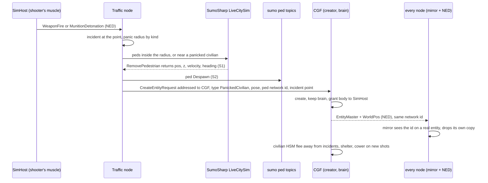

*What the picture shows that prose hid:* the traffic node only DETECTS and REMOVES; it never owns the civilian, so a
traffic-node crash (it is optional, R-4027) cannot delete people mid-incident (R-4008); and one network id spans the
handover, which is what lets every receiver swap its mirror for the real entity without a jump.

### 8.3 Decisions *(ACCEPTED 2026-10-16, R-4032 — P5 and P6 are now owned by DESIGN_Civilians_And_Crowd_Control.md: P5's type is superseded by its CV-1 family, P6 is its slice CIV-0)*

| id | question | ⭐ lean | rejected — one line each |
|---|---|---|---|
| **P1** | normal pedestrians | SumoSharp's LiveCity runs them on the traffic node and its 4 ped topics carry them; receivers reconstruct with `PedRemoteReconstructor` on cluster sim time; **only promoted (high-power) peds get local mirror entities**, promoted inside interest zones the traffic node attaches to each of our units (S3); ambient peds are drawn without entities | every ped an entity: up to 20 000 entities on every node for walkers nobody touches |
| **P2** | what triggers panic | the traffic node reads NED `WeaponFire` + `MunitionDetonation`; each becomes an incident; peds inside a per-kind panic radius panic, and peds near an already-panicked civilian too (contagion); radii on the `TrafficDemand` scenario entity (e.g. shot 50 m, explosion 150 m, contagion 15 m) | SumoSharp's `FearField` / `EvacDistrictDirector`: vehicles only / a private, unreplicable ped world · the acoustic audible range: a gunshot is heard for hundreds of metres and would panic the whole city |
| **P3** | the handover | one-way: removed from SumoSharp with its state, Despawn sent, our entity created at that pose **with the ped's network id** (R-4029); never returned | keeping the ped in SumoSharp with a panic flag: our AI could not drive it, and SumoSharp has no panic behaviour inside LiveCity |
| **P4** | who creates it | **CGF**, by a creation request addressed to it — CGF keeps the brain, SimHost gets the body (the creator-keeps-brain path proven live, Node_Roles §4.1) | the traffic node as creator: an entity dies with its primary owner (R-4008) and the traffic node is optional (R-4027) — a crash would delete every fleeing civilian |
| **P5** | the entity type | a new TKB type **PanickedCivilian** (adult + child variants): `BrainTier ≠ 0`, `Health` (it can be wounded), the mannequin stance animation (crouch, cower), **hearing only, no vision** (perception tops out near 500 units, `DESIGN_Sensors_And_Doctrine.md:1771`); behaviour = a civilian HSM (CIV-2 flee away from incidents, CIV-7 shelter, cower on new shots) — behaviors-lane work; deleted once far from every unit and incident for a while | reusing 1001: no brain tier, no health, no stances · vision on every civilian: perception budget |
| **P6** | ⚠ safety gate | **before any handover is enabled, ground-AI targeting gets a Neutral filter** — today a Neutral contact ranks with danger 0.3 and nothing filters it, so soldiers could engage fleeing civilians | shipping the handover first |
| **P7** | load cap | at most N handed-over civilians at a time (N on the scenario entity, perception load measured); above it, panicked peds stay in SumoSharp and flee to safe zones by its own re-routing (`EvacDistrictDirector`'s `AddWalker` to a safe zone + `SetForcedHighPower`, moved into LiveCity) | no cap: an explosion in a crowd hands hundreds of brains to CGF in one frame |
| **P8** | cars (later slice) | panicked cars stay in SUMO with the flee parameters and a reroute to an exit (`EvacDirector`'s car half, moved into LiveCity); a blocked panicked car is abandoned — its driver becomes our civilian (P3), the car stays as a stopped SUMO vehicle | `EvacDirector` as-is: it overwrites the engine's `CrowdSource` and is not wired into LiveCity |

### 8.4 SumoSharp extensions *(approved to build — R-4031)*

| id | change | why |
|---|---|---|
| **S1** | `LiveCitySim` removes one ped by id safely (through `PedDemand`) and returns its pos, z, velocity, heading | today `RemovePed` under `PedDemand` throws on the next step and the velocity is private |
| **S2** | the publisher sends `PedLifecycleKind.Despawn` on removal and arrival (and disposes the ped's durable legs) | today no Despawn is ever published, so receivers extrapolate removed peds forever |
| **S3** | several interest sources in `LiveCitySim`, attachable to arbitrary moving points | LiveCity registers exactly one today; multi-zone peds are unbuilt |
| **S4** | `LiveCitySim` takes host-fed world discs for peds (our units as obstacles) | it passes `NoEntities` today |
| **S5** | ped samples stamped with sim time (as E9), `startTime` in float64 | wall-clock stamps break pause and replay; float32 start times drift over long exercises |

### 8.5 Known limits

- Low-power peds report z = 0 on a 3-D net (SumoSharp's open bug, `TUTORIAL-PEDESTRIANS.md`) — under R-4025 they would walk under raised sidewalks.
- High-power ORCA peds have no walls (`PedLodManager.cs:216-218`) — they follow waypoints only.
- No panic state on the wire — a panicked ped that stays in SumoSharp (P7) shows only as a new leg and a promotion.

### 8.6 ✅ P1 re-examined — **promotion zones DROPPED, at least for now** *(R-4037, 2026-10-17; the lean below was accepted. ⚠ Its "and with them the pedestrian mirror entities" is SUPERSEDED by §8.7 G2: pedestrians near our units ARE mirrored, by an HROT-side radius, with no SumoSharp promotion)*

📐 **Measured:** cars see EVERY pedestrian on a crosswalk, promoted or not — crossing occupancy covers everyone
(`TUTORIAL-LIVE-CITY.md`, "The coupling: one seam"); only a low-power pedestrian standing in the road ELSEWHERE is unseen,
and low-power pedestrians keep to sidewalks and crosswalks. Panic detection reads positions, which low-power pedestrians
have (`PositionOf`), and the handover reads velocity from the path (`PathArcMotion`).

⭐ **Lean: drop the HROT-attached promotion zones, and with them the pedestrian mirror entities.** A pedestrian becomes our
entity only when it panics (§8.2) — which is exactly when shooting starts near it. ⇒ **S3 and S4 are deferred** (S1, S2,
S5 stay). ⚠ The accepted cost: a pedestrian may walk through one of our vehicles parked on a sidewalk, and dense crowds do
not dodge each other outside SumoSharp's own default promotion.
⛔ Rejected — keep the zones: ORCA cost and two SumoSharp changes for avoidance that only matters where no shooting is
happening yet.

### 8.7 SUMO entities in the combat world — **hits, blasts, EQS, raycasts** *(DESIGN 2026-10-17; G1 ruled by R-4038, G2–G6 ACCEPTED R-4039)*

📐 **Measured — what happens TODAY to a shot at a mirror (R-4022 A):**

| step | code | result for a mirror |
|---|---|---|
| the bullet finds it | `SpatialHashSystem` takes every `SimTransform + PhysicsCollider` (`SpatialHashSystem.cs:84-87`), no ownership filter; `RaycastSolverSystem` returns the entity (`:287`) | ✅ hit |
| the damage leaves the shooter's node | `DamageAssessedEgressTranslator` drops a hit whose entity has no network id in the entity map (`DamageAssessedEgressTranslator.cs:67`) | ⛔ **silently dropped** — a mirror has no `NetworkIdentity` (by design, R-4029) |
| a blast | `AreaEffectSystem` damages only entities with `Health` (`AreaEffectSystem.cs:103`) | ⛔ ignored — a mirror has no `Health` |
| a soldier sees it | `VisionBroadphase` indexes only entities with `EntityInfo` (`VisionBroadphase.cs:184-186`) | ⚠ only if the mirror carries `EntityInfo` (Neutral) |
| a pedestrian | §8.6 dropped the mirrors with the zones | ⛔ not in any query |

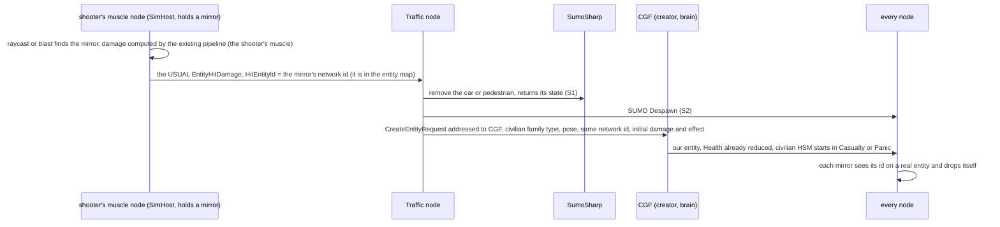

*What the picture shows that prose hid:* the damage is computed ONCE, by the existing pipeline on the shooter's muscle node, and
leaves it as the usual hit message — the traffic node, as the entity's owner, only converts; and the conversion is the SAME request as panic (§8.2), so a hit is just a panic whose
civilian is born wounded.

| id | question | ⭐ lean | rejected — one line each |
|---|---|---|---|
| **G1** | how a hit reaches SUMO | ⭐ **the usual hit message, nothing new** (R-4038): the shooter's muscle node computes the damage as always and `DamageAssessedEgressTranslator` sends `EntityHitDamage` — it finds the mirror's network id in the entity map (`:67`); blasts likewise, because the mirror carries `Health` from its civilian-family type (G3) so `AreaEffectSystem` (`:103`) reaches it; the **traffic node, the entity's owner, ingests `EntityHitDamage`** for SUMO ids and converts | ⛔ SUPERSEDED first draft: a special `TrafficHit` message — it existed only because mirrors had no network id · the traffic node recomputing damage: a second damage implementation |
| **G2** | pedestrians in EQS and raycasts | ⭐ widened by R-4041 to cars too (§8.8 H1) — each node mirrors the pedestrians **within R of any of our units** (e.g. 300 m), from `PedRemoteReconstructor`'s poses — HROT-side, no SumoSharp promotion (R-4037 holds); cars stay all mirrored (R-4022) | all 20 000 pedestrians as entities on every node: entity and recording cost · none: bullets pass through pedestrians |
| **G3** | what a mirror carries | a normal replica of its civilian-family TKB type (so `Health`, `PhysicsCollider`, body zones come from the TKB translators like any replica) + `NetworkIdentity`, `NetworkAuthority` (owner = traffic node), **`EntityInfo` (Neutral)**, `TrafficCar {Kind}` — so vision, EQS, the collider hash, LOS, near misses and blasts all see it like any neutral; ⚠ rails: a mirror is never egressed, and NED dead reckoning never writes it (no `WorldPos` ever arrives for its id) | no `EntityInfo`: soldiers would not perceive traffic |
| **G4** | what a hit car becomes | the car leaves SUMO and becomes **our civilian car entity** (stopped, damaged); its driver (and passengers, from the car's seats) become civilians in Panic or Casualty | keeping a damaged car in SUMO: SUMO has no damage, it would drive on |
| **G5** | hits during the conversion | the traffic node accumulates every `EntityHitDamage` for an id until CGF's entity appears, then forwards the sum as one damage | first hit only: a burst would lose all but one round |
| **G6** | near misses and suppression | a round passing a mirrored pedestrian counts like a heard shot for panic (P2) — no new path | a NearMiss message per mirror: panic already covers it |

### 8.8 The SUMO net may reach beyond our terrain — **background traffic there** *(R-4040, 2026-10-17; H1 REPLACED by the user's one vicinity rule, R-4041; H2–H3 ACCEPTED, R-4041)*

🔒 Ruled: the net can span areas our terrain does not cover; there SUMO is **background traffic** only. Nothing in our
simulation interacts with it there (no units, no ground, no buildings).

| id | consequence | ⭐ lean | rejected — one line each |
|---|---|---|---|
| **H1** | which cars and pedestrians become entities (replicas, R-4038) | ⭐⭐ **AMENDED by Z2 (R-4043, 2026-10-17): a SUMO car or pedestrian is a real replica on a node if it is INSIDE A ZONE (a fidelity area, `DESIGN_Terrain_Zones_And_Assets.md` §11) OR within R of any HROT entity; otherwise it is only drawn.** Inside a zone covers the observer case (an observed area is a zone, so its traffic is seen by long-range sensors with no HROT entity near); the vicinity covers units operating outside any zone. With no zone defined only the vicinity applies (Z1-b). The R-4041 text below stands for the vicinity half. ✅ **RULED (R-4041) — ONE vicinity rule for cars AND pedestrians, wherever they are:** a SUMO car or pedestrian is a replica on a node while it is within R of any of our entities; otherwise it is only drawn from the receiving buffer. The terrain's extent plays no part (outside it there are no units, so nothing is near). Details (leans): R is one scenario parameter on the traffic demand entity, default 300 m; a hysteresis band (enter at R, leave at R + 50 m) so a car on the edge does not flicker in and out; each node decides from the same inputs, so every node holds the same replicas up to the band. ⛔ SUPERSEDED draft: "only inside the terrain's extent, plus pedestrians within R" — two rules where one does. ⭐ **Sensor range is independent of R** (user, 2026-10-17: *"Just the sensors of the observer need to see farther than 300 meters from him."*): R decides which traffic EXISTS as entities; any sensor of any range (a forward observer's optics, a drone) sees every replica in its range. "Our entities" means every HROT entity of any side, so the units an observer watches create the vicinity there. ⚠ Known limit: an area holding traffic and no HROT entity at all shows no traffic to sensors (only on the map); a later option is to let an observer's watched point count as a vicinity source | every car on the net as an entity (R-4022 A as first written): thousands of entities nobody can reach |
| **H2** | height outside the terrain | SUMO's lane z (R-4025); a flat net (E2b drape) outside the terrain uses the terrain origin's altitude — there is no ground to drape on | `GroundHeightAt` outside the grid: undefined there |
| **H3** | drawing | the road layer and the traffic draw everywhere the net reaches; the terrain only where it exists | clipping the roads to the terrain: the background city disappears from the map |

## 9. How SUMO entities and HROT entities treat each other *(the summary, 2026-10-17 — every row cites its ruling)*

### 9.1 SUMO entities, on every other node
- **Normal entities owned by the traffic node** (R-4038), network ids from our allocator (R-4029). Only their **motion**
  travels — on SumoSharp's own topics with its error-gated publishing (R-4020); NED never carries them.
- **Every node dead-reckons them** with SumoSharp's lane curve, on cluster sim time (R-4020, R-4022, R-4027).
- **A real replica only where it matters** (R-4043): inside a zone, or within R (300 m) of any HROT entity of any side.
  There it is a neutral civilian-family entity with health and a collider: sensors, EQS, raycasts, line of sight, the
  bullet test and blasts see it like any neutral, and our vehicles avoid it. Elsewhere it is **drawn only** — background
  traffic, also beyond the terrain (R-4040).
- **Roads and lights** are drawn on every map host from the net that rides the terrain (R-4021, R-4024), everywhere the
  net reaches; heights from SUMO (R-4025, R-4041).
- **Replay:** each node records its replicas; SUMO is not stepped (R-4027).

### 9.2 HROT entities, on the traffic node
The traffic node is an ordinary ECS cluster member (role `Traffic`, R-4022) and keeps **full copies of every HROT
entity** like any node — the natural consequence of reusing the same composition, the cost is memory (user, 2026-10-17).
It runs no brain and no physics on them, and feeds them to SUMO every step:
- vehicles → lane-projected moving obstacles (cars brake, queue, swerve); soldiers and off-lane units → crowd discs
  (R-4027). ⚠ SUMO pedestrians do not avoid our units (S4 deferred with the zones, R-4037);
- `WeaponFire` / `MunitionDetonation` → panic incidents (R-4032);
- a vehicle handed to SUMO → its intent drives a shadow car `hrot:<id>` (R-4023);
- hits on SUMO entities arrive as the usual `EntityHitDamage`, since it owns them (R-4038).

### 9.3 How the two interact

| event | what happens |
|---|---|
| our soldier shoots a SUMO car or pedestrian | the shooter's muscle node computes the damage and sends the normal hit; the traffic node removes it from SUMO; CGF creates our civilian **with the same id, already wounded**; a car becomes our stopped, damaged car and its occupants civilians; hits during the switch are summed (R-4039) |
| shooting or an explosion nearby | pedestrians in the panic radius (by kind) or near a panicked civilian leave SUMO for good as civilians in Panic → an openable building → deleted after a while (R-4032, R-4035); panicking cars later (P8) |
| our vehicle drives near traffic | SUMO cars react to it as an obstacle; our vehicle avoids SUMO replicas near it |
| our vehicle is handed to SUMO | SimHost keeps owning it and **follows** the shadow car (`KinematicsMode.Traffic`); leaving the mode takes it back — ownership never moves (R-4023) |
| targeting | soldiers never target neutrals (CIV-0); a converted civilian is a target only after a visible hostile act (R-3013, R-4034) |
| the traffic node goes down | it is optional (R-4027): traffic stops; converted civilians survive (CGF created them) |

## 10. SUMO embedded in ANY host — **the networkless editor included** *(R-4044, mandatory; EM-1…EM-5 APPROVED 2026-10-17 with three refinements, R-4045 — EM-3, EM-4 and EM-5 below are the as-ruled text)*

🔒 R-4044: SUMO is not only a separate networked node — it must be **embeddable** like every other part, so the
networkless editor runs it too. ⭐ The same rule already governs every role: *"every mechanism keyed on a role must work
over the internal bus with no network present"* (R-4005); the editor is a one-node cluster declaring the union of its
roles (`EditorCapabilities.cs:60-62`, Node_Roles §4).

📐 **Measured — the two seams that make it cheap already exist:**
- **SumoSharp's transport is already pluggable:** `IReplicationSink` / `IReplicationSource` with an in-process binding,
  `InMemoryReplicationBus` (`Sim.Replication/InMemoryReplication.cs`, *"proving the contract … is transport-neutral"*), and
  the DDS binding (`DdsReplicationSink` / `DdsSubscriber`) behind the same interfaces.
- **Our id allocation is already pluggable:** `INetworkIdAllocator` — `DdsIdAllocator` on a cluster, `SequentialIdAllocator`
  / `BlockIdManager` without a network.

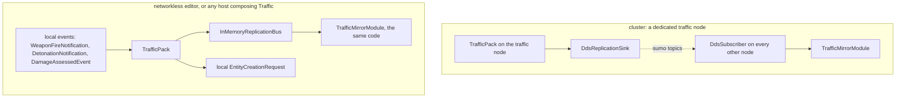

*What the picture shows that prose hid:* the traffic code is ONE pack and the mirror is ONE module in both pictures —
only the box between them changes (DDS or in-memory), exactly as our own events reach a system either from the local bus
or through NED ingress; and in the embedded picture every input is a LOCAL event, so nothing in the pack may read a DDS
topic directly.

| id | question | ⭐ lean | rejected — one line each |
|---|---|---|---|
| **EM-1** | how SUMO enters a host | a **`TrafficPack`** (the `Traffic` role) composed like any other pack — into a dedicated traffic node, into CGF, or into the editor, which then declares Traffic in its role union (R-4005) | a separate process only: not embeddable (R-4044) · a special editor-only SUMO path: two implementations |
| **EM-2** | the transport | the pack publishes through SumoSharp's `IReplicationSink`; a host with a network participant uses the DDS binding, and the host's OWN mirror always reads the in-process `InMemoryReplicationBus` — so the publishing host never round-trips through DDS to see its own traffic | the pack reading SUMO's arrays directly into the mirror: a second mirror path |
| **EM-3** | every interaction is a LOCAL event | ✅ **RULED (R-4045):** the pack consumes only bus events — incidents from `WeaponFireNotification` / `DetonationNotification`, hits from `DamageAssessedEvent` on an entity it owns (NED ingress produces the same events from remote ones); ⭐ **a conversion is the USUAL creation request to a brain node, authored locally exactly as today:** a local `EntityCreationRequest` addressed to the brain, which the D1 forwarder (`ForwardingEntityCreationRequestSource.cs:25-29` — *"a request this node should service is passed through; one addressed elsewhere is sent over the wire"*; `DESIGN_Entity_Creation_Unification.md` §3.4b) passes through when the brain is local (the editor) and sends to CGF otherwise — **no SUMO-specific path, no change** between the two; ids through `INetworkIdAllocator` | reading the NED topics in the pack: dead without a network · a SUMO-specific creation message |
| **EM-4** | the hosting node's own SUMO entities | ✅ the host runs the SAME mirror and the SAME rule as every other node (R-4043) — results never depend on WHERE SUMO runs. ⭐⭐ **And the "do not publish on NED" part is GENERAL, not SUMO's (R-4045):** an entity may be **owned and still replicated by a DIFFERENT publishing mechanism** than NED. ⇒ a general per-entity **replication route** — lean: a component `ReplicationRoute { byte RouteId }` (absent = NED), stamped by whoever creates the entity on every node; the NED send gate becomes *"owned AND routed to NED"*. ⭐ **Free for normal entities (measured):** the routing is a QUERY exclusion, not a per-entity test — each NED egress query already starts `.With<NetworkIdentity>()`, and gains `.Without<ReplicationRoute>()` through ONE shared builder helper (e.g. `NedPublishable()`), so the rule lives in one place; `EntityQuery` tests the exclude mask in the SAME hot step as the include mask, on the component bitmask it already has in hand (`EntityQuery.cs:140-141`, `HasAny(compMask, _excludeMask)`) ⇒ no extra memory read, no component to stamp, nothing to configure: **no `ReplicationRoute` = NED, the default**. Applied to the **18** NED egress translators that call `HasAuthority` today; a runtime rail creates an OWNED entity carrying a route plus every published component, runs every NED egress translator, and asserts zero samples. Per-descriptor routes (an entity whose pose goes elsewhere but whose `EntityInfo` stays on NED) are a later extension if a user appears. SUMO is its first user (route = SumoSharp); ⚠ ownership, the entity map, hits, saving and lifecycle stay the ordinary ones — only the PUBLISHING differs. ⚠ Not `HasAuthority` itself: it is also the save gate and other systems' ownership test, which must keep answering "owned" | a SUMO marker checked in egress: a one-off for a general need · folding it into `HasAuthority`: changes the meaning of "owned" for every system |
| **EM-5** | the clock and threading | ✅ **RULED (R-4045):** the host only TRIGGERS the step, on its own clock (`GlobalTime`, R-4022 B); inside, SumoSharp steps in whatever optimised way it has. ⭐ Lean for HOW, measured: the pack's stepping module runs under the ModuleHost's **asynchronous policy** (`ExecutionPolicy.SlowBackground(hz)` — *"Main thread doesn't wait. Module can span multiple frames"*, `ExecutionPolicy.cs:81-87`, data strategy SoD: the module reads our entities from a snapshot for the obstacle feed, EM-3); inside its tick SumoSharp runs its parallel step (`Parallel.For` over regions, `MaxParallelism` capped so it leaves cores to the host) and publishes into the `InMemoryReplicationBus`, **which is already safe across threads** — a `ConcurrentQueue` the producer fills from a sim thread and the consumer drains with `Pump()` (`InMemoryReplication.cs:46-61`; SumoSharp's own `LIVE-CITY-THREADED-TICK-DESIGN.md` §8.2, built for exactly this); the mirror pumps on the main thread. The same arrangement on a dedicated traffic node and in the editor. ⚠ Measure: SUMO's thread use alongside the editor's own background modules (pick `MaxParallelism`) | the main thread calling `Step()` and waiting: a 5 000-car + 20 000-pedestrian step measured 114 ms (`LIVE-CITY-THREADED-TICK-DESIGN.md`) — an editor frame stall · SumoSharp's own `SimulationRunner.Start` thread: a second clock (R-4022 B) |

## 11. How SumoSharp enters HROT — **vendored sources, an optional switch, embedded first** *(R-4046, R-4047, 2026-10-17; leans V1–V6)*

📐 **Measured:** the parts HROT needs are nine source projects — `Sim.Core` 27 839 lines, `Sim.Pedestrians` 13 413,
`Sim.Ingest` 4 816, `Sim.LiveCity` 3 582, `Sim.Replication` 2 718, `Sim.Evac` 2 118, `Sim.Replication.Dds` 1 263,
`Sim.Viewer.Motion` 1 252, `Sim.Host` 226 (≈ 57 000 lines, `src/` 5.9 MB) plus one shared file
(`src/Shared/NetstandardPolyfills.cs`, linked by `Sim.Core.csproj:25`). That is the scale of what `FDP/ExtDeps` already
holds (NodeEdit 31 345 lines, FastHSM 17 335) as source-included projects (`docs/00-SOLUTION-OVERVIEW.md` §6).
SumoSharp's tests (3 MB) and its parity goldens (`scenarios/`, 98 MB) stay upstream. Both repos pin `CycloneDDS.NET` 0.3.2.

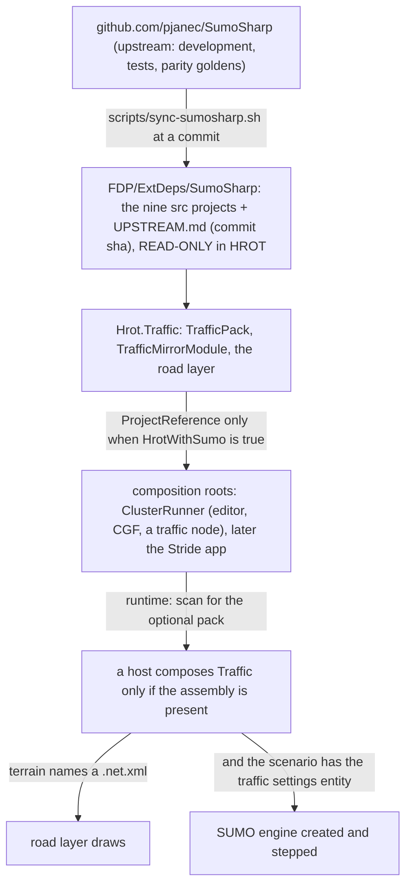

*What the picture shows that prose hid:* two gates — the SOURCE is pinned (git history is the version switch) and the
DATA decides whether anything runs. ⛔ The picture's "ProjectReference only when HrotWithSumo is true" and "scan for the
optional pack" edges are SUPERSEDED by R-4048 (no build switch): the traffic code is referenced normally.

| id | question | ⭐ lean | rejected — one line each |
|---|---|---|---|
| **V1** | where the sources live | ✅ **RULED (R-4046)** — `FDP/ExtDeps/SumoSharp/` holds the nine projects as source-included projects, like FastHSM and NodeEdit; `UPSTREAM.md` records the upstream commit; switching to a previous version is a git checkout of HROT | the fetch-and-pack script + local NuGet (the first request): a restore that must create its own input, a second repo to build on every machine, and no git-level history in HROT · a git submodule: a second checkout to manage in every session |
| **V2** | how the copy is refreshed | `scripts/sync-sumosharp.sh <ref>` clones/fetches upstream into a scratch dir OUTSIDE the HROT tree, copies the nine `src/` projects + the shared file, rewrites `UPSTREAM.md`, and with `--check` only reports whether upstream has a newer commit than `UPSTREAM.md` (`git ls-remote`, no clone). ⚠ The scratch clone must sit outside the HROT tree: an MSBuild project inside it would import HROT's `Directory.Build.*` (measured in a prototype here — the hook re-entered itself) | syncing by hand: the recorded commit drifts from the files |
| **V3** | who may change the vendored code | **nobody in HROT** (R-4046: proven sources, no SumoSharp development here). A change HROT needs (§8.4 S1/S2/S5, E1's `<location>`, E9 sim-time stamps, E11 car naming) is made **upstream**, then synced; a rail fails if `FDP/ExtDeps/SumoSharp` differs from upstream at the recorded commit (checked by the sync script's `--verify`) | editing the copy: two diverging SumoSharps |
| **V4** | the optional switch | ⛔ **DROPPED (R-4048):** with the sources vendored they are always there and always compile, so there is NO build switch — `Hrot.Traffic` and the vendored projects are ordinary projects in `HROT.sln`, referenced normally. ⛔ SUPERSEDED: the `HrotWithSumo` property, the conditional references in the composition roots, the assembly scan and `HROT.NoSumo.slnf`. What stays optional is RUNTIME only (V5) | — |
| **V5** | when it runs | ✅ **RULED (R-4047)** — the pack is idle unless the data asks for it: the **road layer draws** when the terrain names a SUMO net; the **SUMO engine is created and stepped** only when the scenario also has the traffic settings entity (R-4021); with neither, the pack costs nothing per frame. (⛔ the "switch OFF" case is gone with V4) | failing the load: a scenario would be unusable on a build without SUMO |
| **V6** | the first slice | ✅ **RULED (R-4047)** — **SUMO embedded in the networkless editor first** (EM-1…EM-5), built so a dedicated traffic node is only a composition step later: the same `TrafficPack`, the in-memory bus, every input a local event | a dedicated traffic node first: the networked path before the embedded one the user wants to see |

### 11.1 V7 — the road and traffic-light geometry, **generalised out of the Godot demo** *(✅ APPROVED 2026-10-17, R-4049)*

📐 **Measured:** CityLib (`demos/City3D/CityLib`, ~4 600 lines, not packaged, not in `Traffic.sln`) already holds no
Godot type (`CityLib.csproj` header: *"Plain net8.0 classlib; NO Godot type anywhere"*), and its geometry builders —
`RoadMeshBuilder` (lane ribbons), `LaneMarkingBuilder` (dashes), `CrosswalkBuilder` (zebra stripes),
`TrafficLightPlacer` (a signal head at each controlled lane's stop line) and `TerrainField` (ground from lane z), ~1 460
lines with their frame — are pure math. ⛔ What ties them to Godot is ONE thing: every vertex goes through
`CoordinateTransform.SumoToGodot` = `(x, z, −y)` (Y-up, north = −Z), so `RibbonMesh.Vertices` comes out *"already in GODOT
space"* (`RoadMeshBuilder.cs:19`). ⚠ And no builder triangulates the junction polygons (`Junction.Shape`); intersections
are drawn only as internal-lane ribbons.

⭐ **Lean (an upstream change, R-4031 / V3):**
- move the builders out of the demo into a packable SumoSharp library (e.g. **`Sim.Scene`**) that emits geometry in
  SUMO's OWN frame — x east, y north, z up, metres, relative to a caller-given origin — plus a **kind per triangle**
  (asphalt, junction, lane marking, crosswalk) and the signal-head list; the Godot viewer applies its axis swap at upload,
  in one place, as it does today;
- add the missing **junction-polygon triangulation**, so intersections are surfaces, not overlapping ribbons;
- vendor it with the other nine projects (V1).

⭐ **In HROT:** our frame is ENU with Z up — **the same axes as SUMO** — so the only mapping is E1's 2-D rigid transform +
origin; no axis swap. The map consumes it behind an interface, as R-250 requires of every engine capability the map relies
on, in the same shape the terrain already uses: *"the map sees triangles and a kind, never how the terrain is modelled"*
(`TerrainLayer3D.cs:15`, R-250/R-252). ⇒ a **road layer that is the terrain layer's sibling** — the mesh built once per
net and rebuilt only when the net changes (`TerrainLayer3D` keys on `ITerrainRenderGeometry.Identity`), coloured by kind;
~~the 2-D map draws the same triangles flat~~ *(⛔ SUPERSEDED as built, 2026-10-17 — ~51.8k triangles a frame starved the map's
gizmo buffer; R-4058: the 2-D map draws a SYMBOL — lane centrelines and light dots — and never in 3-D, §12.4)*; signal heads are a few hundred small draws per frame coloured from `sumo/tl`.
The Stride host and a future production engine take the same triangles.

| rejected | the one fact |
|---|---|
| copying CityLib's code into HROT | a second copy of the same geometry rules (V3: the vendored code is read-only) |
| keeping the Godot axes and swapping back in HROT | two swaps that cancel, on every vertex, for every host |
| drawing roads as per-frame gizmo triangles | tens of thousands of static triangles re-sent every frame; the terrain already proved the build-once mesh path |

### 11.2 V8 — the **ambient terrain surface** between the roads, and where it must give way to ours *(✅ APPROVED 2026-10-17, R-4049; ⚠ V8-a's "render only" is re-opened by `DESIGN_Terrain_Height.md` §8 — the same lattice as the HEIGHT fallback outside the terrain, a lean)*

📐 **Measured (upstream commit `65a9d80`):** the viewer's ground is `CityLib.TerrainField` — a corner lattice (40 m cells,
capped at 512 corners per axis so a 350 km net stays bounded) whose heights are **measured at lane vertices** (`Lane.ShapeZ`)
and **flood-filled + smoothed** in between (two Jacobi passes on filled corners, measured corners pinned); a flat net bakes
to one height. On top: a draped reference grid (`GroundGridBuilder`) and tinted district polygons (`ZoneGroundBuilder`).
⚠ If the viewer has moved on since `65a9d80`, this section describes that commit.

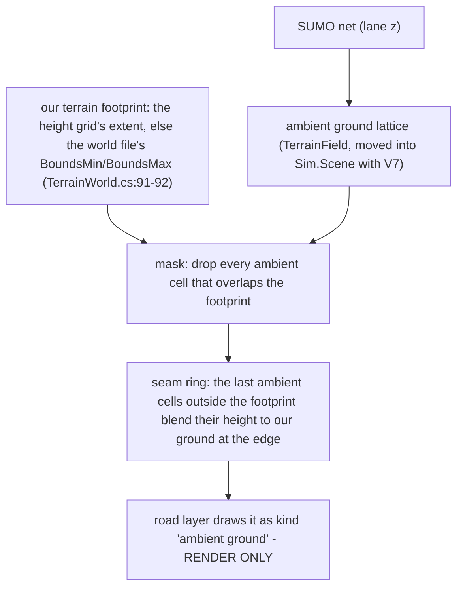

*What the picture shows that prose hid:* our terrain always wins where it exists, and the ambient ground is cut at CELL
granularity by the footprint the terrain already declares — no new terrain data; and the ambient ground feeds ONLY the
road layer, never the world query, so nothing simulates on it.

| | ⭐ lean | rejected — one line each |
|---|---|---|
| **V8-a** what it is | the ambient ground is RENDER-ONLY geometry produced with the roads (V7), kind *ambient ground*; it never enters `IWorldQuery`, physics, line of sight or the navmesh (R-252: our engine interfaces may not depend on a stand-in surface) — fine because nothing of ours operates outside our terrain (R-4040) | making it a second terrain: two grounds that disagree under every unit |
| **V8-b** where it is drawn | everywhere the net reaches EXCEPT our terrain's footprint — the height grid's extent when the terrain has one, else the world file's bounds; cells overlapping the footprint are dropped (automatic, no setting) | drawing it everywhere: it z-fights or floats against our terrain · a hand-drawn mask per terrain: data nobody will maintain |
| **V8-c** the seam | the outermost ring of ambient cells blends its height to our ground at the footprint edge (`GroundHeightAt` there), so the border is a slope, not a step or a gap | a hard cut: a visible cliff wherever lane z and our grid disagree |
| **V8-d** a user toggle | a map display option to hide it (like other map layers), default on | — |

⚠ Known limit, unchanged: INSIDE our terrain the roads still sit at SUMO's z (R-4025) — where the net's z was not built
from our height grid, a road can hover over or sink into our ground. The ambient ground does not fix that; a net whose z
matches the terrain does.

### 11.3 The demo — **`demo-city`, built FROM SumoSharp's demo city so the two match by construction** *(R-4052, 2026-10-17)*

🔒 **User, `2026-10-17`:** *"D1 to D5 approved, go ahead with demo-city. No procedural buildings (maybe later, The ones currently implemented are not very useful. They are too dense and too unrealistic.)"*

📐 SumoSharp's `scenarios/_ped/demo_city/box`: a 4.75 × 4.75 km flat, non-georeferenced net (`projParameter="!"`) with 499
junctions, 51 traffic-light junctions and sidewalks with crossings; 31 data buildings with heights (`buildings.json`; 17 in
downtown, `zone_downtown` = 1600–3100 in both axes), districts, POIs and demand. Our shipped terrains are 300–600 m with at most
two streets — none matches any net.

| id | ✅ ruled |
|---|---|
| **D1** | the demo net is COPIED unchanged into the new terrain folder `Recipes/Terrain/demo-city/` (the SumoSharp original is a locked fixture there) |
| **D2** | our terrain is an ~800 × 800 m downtown box inside it, carrying the data buildings that fall inside (as solid prisms with their heights), on flat ground; the rest of the city is background traffic over the ambient ground (R-4040, V8) |
| **D3** | a generator script turns a SUMO net + its `buildings.json` into an HROT terrain folder (`terrain.json` with the net and its anchor, the world GeoJSON with bounds and buildings) |
| **D4** | the demo scenario on `demo-city`: the traffic settings entity + a few soldiers at a downtown junction — enough for every slice-1 acceptance check |
| **D5** | E1b: a non-georeferenced net is placed by an anchor in `terrain.json` |
| ⛔ | **no procedural buildings** — the viewer's current ones are *"too dense and too unrealistic"* (user); maybe later |

## 12. The dedicated traffic node, built ALONGSIDE the editor *(R-4053; N1–N3 APPROVED R-4054; any number of traffic nodes R-4055; N4–N8, T1–T3, S1–S3 APPROVED 2026-10-17, R-4056)*

> 🔒 **User, `2026-10-17`:** *"I am afraid that if we start building inside the editor without the network,
> it will be very easy to miss some critical component design rules, and it will be then more difficult to implement the same stuff as a separate node."* ·
> *"if the stuff works in separate network node, it will probably work well also in the editor."*

⭐ **Measured: the worry is real — slice 1 (§3.0) already holds THREE choices that are right in one process and wrong on a cluster:**
a car's network id is allocated when a node makes its replica (two nodes ⇒ two ids for one car ⇒ a hit addressed by id misses);
SUMO's clock is mapped to the HROT clock by a per-node origin (two nodes ⇒ two origins); and the traffic entity never leaves the
node that loaded the scenario (it has no NED descriptor). ⭐ Each is fixed ONCE, in the shared pack, so the editor runs the network's
rules too.

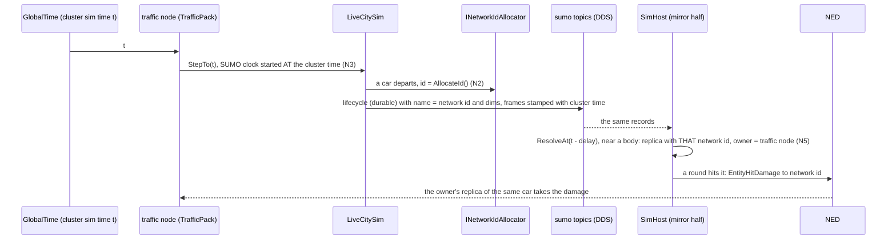

*What the picture shows that prose hid:* every node must agree on two numbers it never negotiates — the car's network id and the
time a sample means — so both are decided ONCE on the traffic node and carried on SumoSharp's own wire; a node only ever reads them.

| id | question | ⭐ lean | rejected — one line each |
|---|---|---|---|
| **N1** ✅ | the host | a new `--mode traffic` ECS host: `TrafficSubsystem` + `TrafficNodeBootstrapper` (a `SharedApplicationBootstrapper`, like IG's), role `Traffic`, composing NED ingress (it needs our entities and the demand) and `TrafficPack` | SimHost with `--role Traffic`: `--role` is slated for removal (R-S11) and SimHost composes the muscle tier |
| **N2** ✅ | a car's network id | allocated when SUMO SPAWNS the car, on the traffic node (R-4029), and used AS the SUMO vehicle id (H4) — so the durable lifecycle record carries it to every node. ⭐ SumoSharp change **H5**: `LiveCitySim` takes a vehicle-id provider | allocate when a node makes its replica (slice 1 as built): one car, one id per node |
| **N3** ✅ | the clock on the wire | SUMO's clock STARTS at the cluster time the session starts, so every frame on the wire is stamped in cluster time and a receiver resolves at `GlobalTime − delay` with no origin of its own. ⭐ SumoSharp change **H6**: `LiveCityConfig.StartTime` (the engine's `Begin`) | a per-node origin (slice 1 as built): each node a different SUMO time |
| **N4** | the demand reaching the traffic node | `TrafficDemand` replicates on NED like `ScenarioClock` (a descriptor + egress/ingress translators), owned by the node that loaded the scenario | the traffic node loading the scenario itself: a second scenario-load path |
| **N5** | the owner of a replica on another node | ⭐ REVISED by the user's question: **the SENDER of the car's samples** — the node whose writer published them, read per sample exactly as NED ingress already does (`loan.GetSender(i).AppInstanceId`, with the publication-handle retry of CE-517, `EntityMasterIngressTranslator.cs:117-128,243`). The car's creator is its sender is its owner, so nothing looks a traffic node up. ⭐ SumoSharp change **H8**: `DdsSubscriber` records each sample's sender (CycloneDDS.NET sender tracking on the node's participant) and keys a car's history by (sender, handle), because two traffic nodes' engines number their cars independently (R-4055) | the roster lookup (first draft): assumes one traffic node and asks a question the sample already answers |
| **N6** | which hosts mirror | the MIRROR half (`TrafficNetCache` loader + mirror over `DdsSubscriber` + replicas + the road layer) on every map and sim host — SimHost, CGF, IG, Player; the traffic node and the editor compose BOTH halves | only map hosts: SimHost's sensors and rounds would not see cars |
| **N7** | the traffic node's own view | its mirror reads the in-memory wire while `LiveCitySim`'s existing record tee publishes the same steps to DDS (EM-2) | reading its own DDS: a round trip to see itself |
| **N8** | the editor | unchanged composition (both halves, in-memory) — and since N2/N3 live in the shared pack, it obeys the network's rules without a network | a separate editor path: the thing R-4053 exists to prevent |

⭐ **Added after the user's review (`2026-10-17`) — the car TYPES, the settings, and where they live:**

> 🔒 **User:** *"There must be a variety of cars, and each car has its own unique TKB ID because it is having its own 3D model. Maybe
> just the color is the property of the car, runtime changeable"* · *"Sumo node could likely use exactly the same 3D map as all the
> other nodes"* · *"Theoretically, there could be multiple traffic nodes in the system So nothing should rely on having just a single one."*

| id | question | ⭐ lean | rejected — one line each |
|---|---|---|---|
| **T1** | which HROT type a SUMO car is | ⭐ **the TKB maps it**: an ordinary car template (its own model, its own TKB id — the same catalogue HROT's own civilian cars use) carries a `TrafficVehicleDto { VClass, Weight }`; the traffic node turns those templates into SUMO vehicle types (length and width FROM the template, so SUMO's footprint is our model's) and spawns from their weighted mix; the HROT TKB type rides the car's durable lifecycle record (SumoSharp **H7**: an external type field) and every node's replica takes it. ⭐ Safe because a replica is made directly, never TKB-spawned: no template translator runs, so a car type's kinematics never fights the mirror (`TrafficReplicas.Create`). The single "SUMO car" type (8851) stays only as the fallback for an unmapped SUMO type | one TKB type for every car (slice 1): no variety · a mapping table in the scenario or the terrain: a second source for what the TKB already says (R-4018, one TKB synced everywhere) |
| **T2** | a car's colour | ⭐ **already the rule in HROT**: `EntityAppearance` when the car has one (runtime-changeable, `EntityBodyLayer3D.cs:1283`), else the per-car paint seeded by the network id (`:127`, `:1088`) — the SAME on every node for free, because N2 makes the id the same. A runtime colour change is the owner's (the traffic node's), carried on the car's durable lifecycle record (H7), since a SUMO car is never on NED | colour in the TKB: every car of a model would look alike · colour over NED: the car is not on NED (EM-4) |
| **T3** | the traffic node's display and bootstrap | ⭐ **the same host code as every ECS node**: a `SharedApplicationBootstrapper` plan whose roles decide what is composed; with a window it attaches `MapInteractionPack` like every map host; and it draws its cars from the SAME source a receiver does — its own mirror's `TrafficFrame` and replicas (N7: only the wire differs, in-memory instead of DDS) | a traffic-node-only renderer: a second display path |
| **S1** | what the settings ARE | one positionless scenario entity (TKB "Traffic", 8850) carrying `TrafficDemand { TargetCars, Seed, StepSeconds }` — authored and saved like the World Environment's clock; the car mix comes from the TKB (T1), pedestrians join in their slice | settings in `terrain.json`: the net is the terrain's, the demand is the scenario's (R-4021) |
| **S2** | who OWNS the settings | ⭐ **the scenario's Brain, exactly like the World Environment** (owned by the node that loaded the scenario, replicated on its own descriptor, `ScenarioClock.cs:12-14`) — because an entity lives as long as its owner (R-4008): a traffic node that crashes must not take the scenario's traffic settings with it, and the save path stays the ordinary one (owner + non-transient, `DESIGN_Distributed_Scenario_Persistence.md` §1a). ⭐ WHICH traffic node serves it is a separate, transient assignment the owner writes (`TrafficAssignment { int NodeId }`, NoScenario): it picks a node whose roles include `Traffic` from the peer view every node already keeps (`IClusterStateCache` `NodeCapability.Role`), and re-assigns when that node goes. Several settings entities spread over several traffic nodes (R-4055) | the traffic node owning it (the question asked): a traffic-node crash deletes scenario data, and a traffic node becomes a scenario-persisting role · every traffic node running every demand: duplicate traffic |
| **S3** | how it reaches the traffic node, and updates | it replicates on its own descriptor (`dtTrafficDemand`, like `dtScenarioClock`) during the load phase, whose all-peers ACK (`ReliableInitType.AllPeers`) means every node holds it before the run starts; SUMO starts on the ASSIGNED node when it holds the settings AND the terrain's net, and steps only while cluster time runs. An edit is the ordinary attribute request to the OWNER, which applies and re-replicates; the serving node reacts — `TargetCars` live (`LiveCitySim.SetCarDensity`), `Seed`/`StepSeconds` by restarting SUMO (a new session key, as built) | the traffic node reading the scenario file itself: a second load path, and a late joiner never reads the scenario (R-4015) |

### 12.1 As built — slice 2, the networked pack *(2026-10-17)*

```mermaid
classDiagram
  direction LR
  class TrafficPack { <<INodeCapability>> +Serving() +Mirroring() PopulateSystems() }
  class TerrainContentRegistry { <<NEW, per node: HrotNodeContext.TerrainContent>> Add(key, factory) }
  class TrafficRuntime { +Request(key, types) +TopUpIds(targetCars) +SetTarget(key, t) SteppingTick() }
  class TrafficIdReservoir { <<NEW>> TopUp on the main thread, Take on the stepping thread }
  class INetworkIdAllocator { <<existing>> AllocateId(), main thread only }
  class TrafficSession { StartTime = cluster time, VehicleIdProvider, VehicleTypes }
  class LiveCitySim { <<SumoSharp>> StartTime H6, VehicleIdProvider H5, VehicleTypes H9 }
  class DdsReplicationSink { <<SumoSharp H8>> keyed by Source = node id }
  class DdsMultiSourceSubscriber { <<SumoSharp H8>> Sources, SenderAppInstanceOf(src) }
  class TrafficMirrorSystem { <<Input phase>> serve if it holds dtTrafficDemand, mirror every source }
  class TrafficMirror { one per (owner, source) }
  class TrafficReplicas { keyed by (owner, handle) }
  class TrafficVehicleCatalog { From(TKB) templates with TrafficVehicleDto }
  class NetworkEntityMap { <<existing>> Register(netId, e) }
  class RoleGroupOwnershipStrategy { <<existing>> grants the Traffic group to the least-loaded Traffic node }
  TrafficPack --> TerrainContentRegistry : adds the SUMO-net loader to its node's
  TrafficPack --> TrafficRuntime : serving only
  TrafficPack --> TrafficMirrorSystem : input list
  TrafficRuntime --> TrafficIdReservoir
  TrafficIdReservoir ..> INetworkIdAllocator : main thread
  TrafficRuntime --> TrafficSession
  TrafficSession --> LiveCitySim
  LiveCitySim --> DdsReplicationSink : record tee
  TrafficMirrorSystem --> TrafficRuntime : TopUpIds, SetTarget
  TrafficMirrorSystem ..> TrafficVehicleCatalog
  TrafficMirrorSystem --> DdsMultiSourceSubscriber
  TrafficMirrorSystem --> TrafficMirror
  TrafficMirrorSystem --> TrafficReplicas
  TrafficReplicas --> NetworkEntityMap
  RoleGroupOwnershipStrategy ..> TrafficMirrorSystem : decides who serves
```

*What the picture shows that prose hid:* nothing on the wire is negotiated by the receiver — the car's id comes out of the cluster
allocator on the serving node's MAIN thread (the reservoir is the only path to it; SUMO spawns on the stepping thread), the frame
time is cluster time, the owner is the DDS sender; and "who serves" is not a new component at all, it is the existing role-group grant.

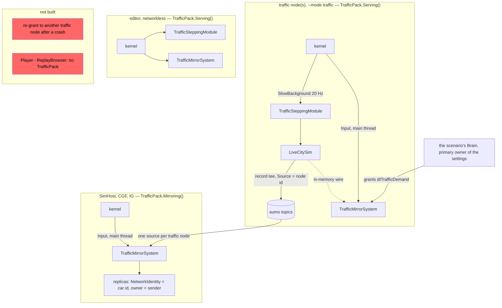

*What the picture shows that prose hid:* every host composes the pack the same way — the shared capability walk
(`NodeCapabilityWalk`, CE-4013) runs every hook on every host; and the red boxes — a crashed traffic
node's grant falls back to the Brain, which only mirrors, so its traffic stops until a traffic node is granted again by hand.

| as built | why it differs from §12's text |
|---|---|
| **S2 has no `TrafficAssignment` component**: the settings entity is in its own ownership group (`HrotOwnershipGroups.cs:125-145`), which `RoleGroupOwnershipStrategy` grants to the least-loaded `Traffic` node; a node serves the settings whose `dtTrafficDemand` authority it holds | the grant already IS a transient, per-entity "who serves" written by the owner (the seam law); the Brain stays the primary owner, so a crash returns the settings to it (S7) instead of deleting them |
| no re-grant after a traffic-node crash | the grant falls back to the primary owner, which composes only the mirror — one instance of the open `CE-3007` (a reclaim to a creator that lacks the role leaves nobody running that part); not SUMO's to fix alone |
| a cluster with NO traffic node has no traffic | the Brain holds the settings and mirrors only; the editor is its own traffic node (both halves) |
| the pack composes in **`PopulateSystems`** (its mirror is an input-phase system, its stepper a module it registers there) | ⛔ SUPERSEDED reason: it was put there because CGF and IG never called `Register`; since `CE-4013` every host runs every hook through one shared walk ([`DESIGN_Subsystem_Composition_Unification.md`](../DESIGN_Subsystem_Composition_Unification.md) §4.1ae) |
| the SUMO-net loader goes into the **node's** `HrotNodeContext.TerrainContent`, which the node's residency attaches at `Prepare` | ⛔ SUPERSEDED: a process-wide static registry (it made every node of a `--mode all` process load the net); since `CE-4013` the five hosts build their residency through one factory over the node's registry |
| ids come through **`TrafficIdReservoir`**, topped up by the mirror system each frame to `TargetCars + 64` | `DdsIdAllocator.AllocateId` is not thread-safe and SUMO spawns on the stepping thread; a rail runs SUMO on a second thread and asserts every allocation was on the main thread |
| the wire key is **`Source` = the node id** (H8), the owner is `SenderAppInstanceOf(source)`, falling back to the source | two traffic nodes number their cars independently (R-4055); a node skips its own source and reads its steps in memory (N7) |
| a SUMO car with no TKB type gets **8851**; colour `0` means "no colour" (the id-seeded paint), else `EntityAppearance` | T1/T2 as ruled; the fallback keeps an unmapped SUMO type visible |

### 12.2 N1 as built — the `--mode traffic` host *(2026-10-17)*

- `Hrot/Subsystems/Hrot.TrafficNode/` — `TrafficSubsystem` (`--mode traffic`, node id base + 800, NOT in `all`: the editor serves
  traffic embedded) over `TrafficNodeBootstrapper : SharedApplicationBootstrapper`, role `Traffic`. Its plan is the shared head
  (`CoreInfrastructureCapabilities.LiveSimulationPlan`, i.e. `HealthApplication` — the node will own car replicas that take damage)
  plus `TrafficPack.Serving()`, walked by the base (CE-4013); orchestration is `NodeBootstrapper.BuildOrchestration` (load chain for `Traffic`: KnowledgeBase →
  Terrain), entity creation + ghost promotion is `EntityCreationPack`, components are `HrotSharedComponentRegistry` only.
- ⚠ **Found, fixed:** `NedReplicationModule`'s ctor refused any role without MuscleGround/Map2D/Brain, so a Traffic node had no
  replication — and so no `EntityTrafficDemandIngressTranslator`. It now accepts `Traffic` (no physics ⇒ drives from the network).
- ✅ **Found, then FIXED in `HrotNodeBuilder` (CE-4013): two traffic nodes on one domain shared an id-allocator client id.** `HrotNodeBuilder` names
  the allocator `SubsystemName + "Allocator"`, and `DdsIdAllocator` keeps every response whose `ClientId` matches — so both nodes
  enqueue both chunks and would give two cars one network id, breaking N2 under R-4055. The fix belongs in `HrotNodeBuilder`
  (client id carries the node id); the same collision existed for any two nodes of one subsystem name (two SimHosts, two Players).

### 12.3 Found running the five-process cluster *(2026-10-17 — orchestrator · CGF · SimHost · IG · traffic, load from the IG port)*

| ⭐ found | fixed | rail |
|---|---|---|
| ✅ IG's load intent reaches the orchestrator and fans out to all five nodes (the CE-164 IG-port path works). The demo is a RECIPE ⇒ its NAS name is `Recipes/demo-city`, not `demo-city` | — | — |
| ⛔ every node's `PrepareLive` threw: `terrain.json` names `demo-city.net.xml`, but the `Recipes/Terrain` content glob shipped only `json`/`geojson`/`asc` (editor and unit suites read the source tree) | `Hrot.AI.Behaviors.csproj` ships `*.net.xml` | `ShippedTerrainFilesAreDeployedTests` (ClusterRunner.Tests — the build output a node reads) |
| ⛔ every ECS node then CRASHED in `TrafficMirrorSystem`: `DdsWireFrame` had no `GetDescriptorOps`. The vendored SumoSharp `Directory.Build.targets` (R-4046) gave the single-target `Sim.Replication.Dds` a `TargetFrameworks` ⇒ NuGet restored it as multi-target and imported the CycloneDDS codegen switch under a condition a normal build never meets | the override applies only where the project multi-targets | `TrafficDdsTopicsAreGeneratedTests` (red on the old build: 9 topics) |
| ⚠ OPEN: with every node failing `PrepareLive`, the orchestrator logged only the two OBSERVERS' failures (IG, traffic — P2 lets those pass), logged no abort for CGF's/SimHost's, and `/status` reported `OperatingLive` while every node stayed `Idle` | — | re-measure on a clean run |
| ⚠ OPEN: `[ModuleHost][TIMEOUT] Module 'TrafficStepping' timed out after 100ms` on the traffic node | — | re-measure on a clean run |
| ⛔ the traffic node then CRASHED in replication: `EntityInfoIngressTranslator` wrote `EntityInfo`, which only role registries registered | `HrotSharedComponentRegistry` carries the six types the shared pack writes (`CE-4013` D19) | `SharedRegistryCoversTheSharedPackTests` |
| ⛔ the headless traffic node could not be READ over HTTP — no window claims a perspective, so it stayed "Default" | a process with ONE provider answers through it | `AHeadlessSingleProviderNodeIsReadableTests` |
| ⛔⛔ **`CE-4016`: NO CARS — found, fixed.** Clean run: every node `OperatingLive`, the net loads on every node with ONE hash, CGF grants `dtTrafficDemand` to node 800 (200 cars) — but the traffic node held the grant with **no `TrafficDemand`**, so SUMO never started. 📐 ⛔ NOT "the creator stops sending": in the F7 window the creator's `HasAuthority` falls back to the primary owner and it DOES send once (`AuthorityExtensions.cs:49-66`, `OutgoingGrantsPending.cs:11-13`). The GRANTEE was the problem: a Muscle ghost cannot promote before `SimTransform` arrives, but nothing held the settings ghost — it promoted on `EntityMaster`, `DeferredTakeoverSystem` recorded 160→800 that frame, and the late sample was dropped as the node's own (`EntityTrafficDemandTranslators.cs:136`) | `TrafficDemand` is `[PerInstanceValue]` and the "Traffic" template PRODUCES it (`TrafficDemandTkbTranslator`, in `TkbTranslatorSet.Base()`) ⇒ the promotion gate waits for the value, as for `ObstacleShape` | `TheTrafficSettingsGhostWaitsForItsValuesTests` |
| ✅ **CARS FLOW**: after CE-4016 the traffic node serves 200 cars; car 1218 carries ONE network id, TKB type 1050 and owner 800 on IG, SimHost and CGF (N2 / N5 / T1) | — | — |
| ⛔ `CE-4017`: the replica's POSE disagreed across nodes by 40–150 m, one node at a time freezing a car and then jumping. 📐 The SumoSharp Vehicles stream is SPARSE and every step writes one instance; best-effort KEEP_LAST(1) + `StepTo`'s catch-up bursts (≤40 steps) ⇒ a reader kept only a burst's last frame (5 back-to-back: 4 lost), and `DrClock`'s 3 s cap froze the cars that lost their update | SumoSharp **H10** (`ecb43d1`): KEEP_LAST(64) on the vehicle stream; re-vendored. Live after: median spread 0.76–1.8 m, outliers only along-track (read skew) | `ABurstOfTrafficFramesReachesEveryReaderTests` + upstream `H10_…` · ⚠ 0.3 m not measurable with sequential reads; a sample lost on the wire still freezes a steady car until its next fire |


### 12.4 Found running the slice 1 acceptance *(2026-10-17 — the editor, headless under Xvfb, demo-city, its debug API)*

| ⭐ found | fixed | rail |
|---|---|---|
| ✅ load · 9 car replicas near our bodies, moving · pause drift 0.0000 m · no replica beyond 350 m of every body · LOS soldier→car resolves the car · deleting the traffic entity leaves zero replicas | — | — |
| ⛔⛔ **the map drew NOTHING.** 📐 `TrafficRoadGizmo` emitted the 3-D meshes flat — ambient ground 27.5k, asphalt 15.6k, crosswalks 6.7k, junctions 2.0k triangles ≈ **51.8k a frame** — into the map's **4096**-primitive gizmo buffer (`/panels/_gizmo`: 48 512 dropped a frame), ground first ⇒ roads, lights, cars and every entity gizmo after it were dropped | ⭐ first fix (⛔ SUPERSEDED below by R-4058): a 2-D plan of lane strips at world width, the junction mesh and merged ground rows, 3 731 primitives; the map buffer default raised to **16384** (`MapInteractionContext.DefaultBufferCapacity`; IG's equal 4096 override removed) | `TheRoadLayerFitsTheMapBufferTests` · `CE-4019` |
| ✅ **live after the fix: 11/11** — the map buffer holds 3 966 primitives with **0 dropped**, the screenshot shows the lanes, sidewalks and junctions around our terrain; after deleting the traffic entity the roads stay and the lights and cars go | — | `accept_slice1.py` check ①b (`/panels/_gizmo` dropped == 0) |
| ⭐⭐ **R-4058 — the 2-D road net is a SYMBOL, never drawn in 3-D.** 🔒 User, 2026-10-17: *"We do not neef full triangle road net in 2d, symbolic is more than enough (lane centerlines, traffic light as single colored dot)."* · *"Note that 4k buffer is still small for large road net and some simplifacion might be necessary - maybe even like  like not rendering larger road net in 2d map at all."* · *"for sure no 2d road net gizmo should be shown in 3d map where the triangle road net iz expected."* 📐 And it WAS drawn in 3-D: the 3-D pass accepts `Map2D \| Viewport3D` (`DebugGizmoLayer.cs:116`, DESIGN_Map_3D_Mode §7) | ⭐ `TrafficRoadPlan` is now centrelines only: every vehicle-lane segment (demo-city 648) + one screen-pixel dot per light head (372); a net over `Budget` = 2048 falls back to ONE centreline per edge, and over that draws no road net in 2-D at all (lights off too) — no sidewalks, junction fills, crosswalks, markings or ground. ⭐ A new `PipelineTarget.FlatOnly` (= 8, outside `All`): the 3-D triage always culls it; the whole road layer (centrelines, dots, non-entity car boxes) carries it, so the 3-D map shows only its meshes and `TrafficLayer3D`'s cars | `TheRoadLayerFitsTheMapBufferTests` (lanes, budget, edges → none fallback, every primitive `FlatOnly`) · `Map3DGizmoTests.FlatOnly_IsCulledBy3D_AndPlainMap2D_IsNot` · ✅ live: the editor's map shows lane centrelines and red/green light dots, 1 287 primitives, 0 dropped |
| ⚠ the map buffer is also PUBLISHED over DDS every frame by CGF, SimHost and IG (`DebugPrimitivesBatchPublisherSystem`, 64 B a primitive). ⭐ The publisher sends the primitives drawn, not the capacity — so the plan CUTS the road share of that traffic (it was capped at 4096 ≈ 256 KB a frame, the symbolic layer is ~1 000 ≈ 64 KB). ⛔ Not gated here: 🔒 the publish capability stays, gating is optional (`DESIGN_Uniform_Gizmo_Membership.md` §8.5b / §8.7) | — | — |


### 12.5 Found running the slice 2 acceptance *(2026-10-17 — five processes, `accept_slice2.py`, demo-city from the IG port)*

| ⭐ found | fixed | rail |
|---|---|---|
| ✅ run 1, 11/13: every node `OperatingLive` · 14 car replicas on CGF, SimHost and IG, the SAME 14, each owned by the traffic node (800) on every node · cars move · pause from IG holds every mirror still (0.0000 m) · no map buffer drops (CGF/SimHost/IG ~4.1k, 0 dropped) · SimHost LOS soldier→car resolves the car · after the traffic node is killed every node stays up and no car moves | — | — |
| ⛔ `CE-4020` — SUMO CRAWLED: the traffic node's log is one `TrafficStepping timed out after 100ms` / circuit-open-10 s cycle. `SlowBackground(20)` gives 100 ms; the session build parses the net (2.5 s) and a catch-up runs ≤ 40 steps ⇒ every such tick timed out, the circuit opened, the next catch-up was 40 steps again. ⛔ An abandoned tick also overlaps the next (`SteppingTick` is not re-entrant) | the stepping module's budget is `MaxTickMs` = 30 s | `TrafficRuntimeTests.CE4020_…` |
| ⛔ run 1 ③ pose spread median 2.81 m / p90 4.69 m (CE-4017 measured 0.76–1.8 m) — read with SUMO crawling | ⏳ re-measured after CE-4020 | ③ |
| ⛔ `CE-4021` — E10 NOT BUILT: after the traffic node died, CGF/SimHost/IG kept 21/20/19 frozen replicas for good — the mirror's subscriber had no source timeout | a source silent for 5 s is removed, on `SilenceClock` (wall time that runs only while the cluster clock advances — a paused cluster keeps its cars) | `ASilentTrafficNodeLosesItsCarsTests` |
| ✅✅ **run 5: 15/15** (`scripts/sumo-accept-slice2.py`, fresh five-process cluster): every node `OperatingLive` · the same 12–13 replicas on CGF, SimHost and IG within 0 s of the wait, each owned by the traffic node (800) everywhere · cars move · pose spread median **0.98 m** (p90 2.9 m) · pause from **CGF** holds every mirror at 0.0000 m · no map buffer drops (~1 400) · SimHost LOS resolves a car · the traffic node killed ⇒ every node stays up, no car moves, every replica cleared in 12.5 s · 0 stepping timeouts. ⚠ Found on the way, the script's own: ⛔ run 1's "0.0000 m" pause was SUMO crawling (CE-4020), not the pause — IG and the orchestrator REFUSE `/sim/pause` (`NOT_SUPPORTED_HERE: no 'time.drive'`), only the time-driving node (CGF) pauses the cluster, and the script had ignored the refusal; a car leaving the vicinity between two reads read as "no owner" | the script pauses through CGF and asserts the pause was accepted; skips a car that left mid-check | `scripts/sumo-accept-slice2.py` |
| ⛔ run 2 (the first build of CE-4021): IG showed NO car for 100+ s while CGF had 20. 📐 It measured silence on cluster time, and IG's slave clock corrects in JUMPS on a loaded box (`SlaveSyncController` discards sync results with RTT > 200 ms) — every jump > 5 s read as silence and dropped the source. ⭐ Also: SUMO's first cars reach the mirrors ~32 s after the load (the grant, then the session build) — the acceptance now waits for them | `SilenceClock` | `TheSilenceClock_HoldsWhilePaused_AndIgnoresAClockJump` |

## 13. Slice 3 — our bodies into SUMO (E4, R-4027) *(2026-10-17 — build-state: BUILT, ✅ live; §13.7 is the as-built)*

### 13.1 INVENTORY *(code graph CLI `search_graph` + grep, 2026-10-17)*

| query | total | what it found |
|---|---|---|
| HROT `name_pattern=".*Traffic.*"`, Class | 46 | the slice 1–2 types (§3.0, §12.1); ⛔ **nothing feeds our bodies to SUMO** |
| HROT `".*Footprint.*"`, Class | 6 | ⭐ `EntityFootprint` (FDP.Toolkits — the ONE body size rule: `VehicleParams` Length/Width, else 5 × 2.5 m) · `VehicleFootprint` (EQS) · `ZoneFootprint` |
| HROT `".*Crowd.*"`, Class | 27 | civilians `CrowdSystem`, DotRecast crowd, SumoSharp's `OrcaCrowd`/`DdsPedCrowdFrame` — ⛔ none is a SUMO footprint source of OUR units |
| HROT `".*Lane.*(Index\|Grid\|Spatial).*\|.*Nearest.*Lane.*"` | 17 | scenario fields only — ⛔ no lane spatial index on the HROT side |
| sumosharp `".*(Nearest\|Locate\|Snap).*Lane.*\|.*Lane.*(Index\|Grid\|Spatial).*"` | 40 | ⭐ `SumoRouteGraphNav.NearestLane` (`Sim.Pedestrians`, a uniform grid over PEDESTRIAN lane segments, ONE nearest) — ⛔ not vehicle lanes, not "every lane a footprint overlaps" |
| SumoSharp obstacle / crowd API *(read)* | — | ⭐ `Engine.AddMovingObstacle(laneHandle, frontPos, length, speed, maxDecel, …, latPos, width)` / `UpdateObstacle` / `RemoveObstacle` (`Engine.cs:1235-1262`, dead-reckoned each step) · ⭐ `Engine.CrowdSource` + `CompositeFootprintSource` + `WorldDiscQuery.InsertNearest` · ⭐ `CrowdLongitudinalConstraint` brakes a car for any disc ahead that overlaps its footprint, gated ONLY on `CrowdSource != null` (`Engine.cs:11549`) · ⛔ `LiveCitySim` keeps `_engine` private and sets `CrowdSource` once (`LiveCitySim.cs:619`, null when peds are off — ours are) |
| body class | — | ⭐ `Locomotions.Of(view, e)` (FDP.Toolkits `Motion/Locomotion.cs`) — the one classifier: Pedestrian / Wheeled / Tracked / Amphibious / air classes |

### 13.2 Decisions *(E4 is ruled — R-4027; these are the HOW, each with a lean)*

| id | question | ⭐ lean | rejected — one line each |
|---|---|---|---|
| **F1** | where body → lane projection lives | ⭐ **upstream, in SumoSharp** (SumoSharp **H12**): `LaneSpatialIndex` (Sim.Ingest — a grid over lane segments returning EVERY lane within a radius) + `LiveCitySim.SetExternalBodies(ReadOnlySpan<ExternalBody>)`, which owns the obstacle handles and the disc source. HROT only gathers bodies and converts coordinates | HROT-side projection: duplicates `LaneProjection` + a grid SumoSharp's own ped nav already half-has, and needs `_engine` anyway |
| **F2** | which bodies | ⭐ every entity with `SimTransform` that is not a SUMO car (`TrafficCar`) and whose `Locomotions.Of` is a GROUND class; air and unknown skipped | every `PhysicsCollider`: buildings and props are terrain, not movers |
| **F3** | vehicle vs person | ⭐ Wheeled / Tracked / Amphibious ⇒ a **vehicle**: a moving obstacle on **every vehicle lane its footprint overlaps** (`|lat| < lane.Width/2 + body.Width/2`), speed = its velocity along the lane (≥ 0), length/width from `EntityFootprint`; no lane within 3 m ⇒ a disc. Pedestrian ⇒ a **disc** (radius 0.4 m) | nearest lane only: a vehicle across the road blocks one direction only · discs for vehicles: a 6 m truck as one disc (R-4027) |
| **F4** | threads | ⭐ the main thread snapshots the bodies once a frame into an immutable array → `TrafficRuntime.SetBodies` (one `Volatile.Write`); the stepping thread applies the latest inside `StepTo`'s lock, before stepping | a lock shared with the main thread: the stepping tick can take seconds (CE-4020) |
| **F5** | coordinates | ⭐ `SumoNetPlacement.ToNet` — the exact inverse of `ToLocal` (anchor, or UTM ↔ WGS84 ↔ local) | — |
| **F6** | pedestrians reacting to our units | ⏸ slice 5 — SUMO's pedestrians are off until then (`PedPopulationCap = 0`); the same discs feed them when they come | — |

### 13.3 Classes

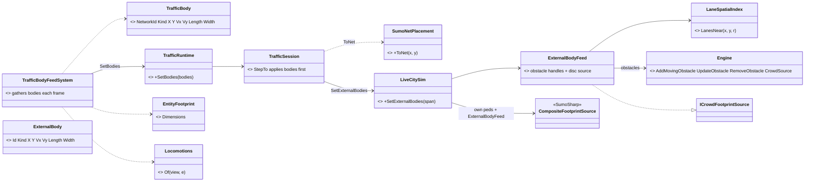

*What the picture shows that prose hid:* HROT gains ONE system and two small methods; every lane decision sits next to the engine
that consumes it, so the 3 m rule and "every overlapped lane" are tested where SUMO's own car-following is.

### 13.4 Sequence — one frame

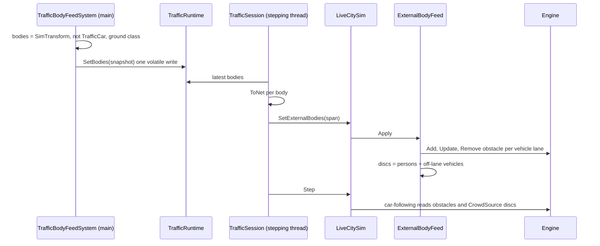

### 13.5 Modules — who registers it, who calls it each frame

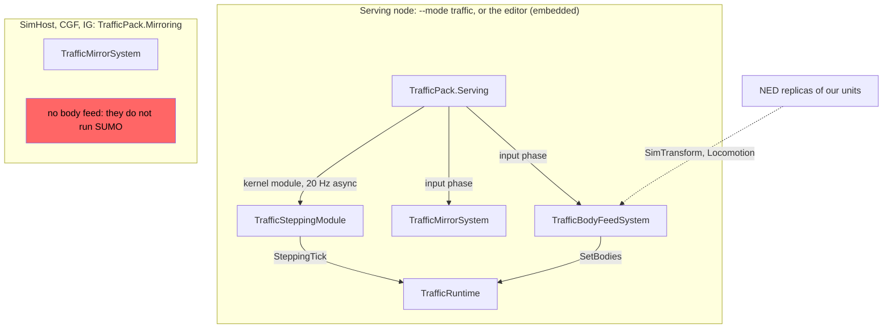

*What the picture shows:* on the dedicated traffic node our units are **NED replicas** (R-4057 — replication on every networked
node), so the feed reads the same `SimTransform` there as the embedded editor reads locally; a mirroring host composes no feed
(red) because it runs no SUMO.

### 13.7 As built *(SumoSharp H12 = `f91c0f4`, vendored; HROT `TrafficBodyFeedSystem` → `TrafficRuntime.SetBodies` → `TrafficSession.ApplyBodies` → `LiveCitySim.SetExternalBodies`)*

| decision | as built | ⛔ deviation from §13.2, and why |
|---|---|---|
| F1 | `Sim.Ingest.LaneSpatialIndex` (`LanesNear(x, y, r, out)`, every lane within r, ascending handle, 10 m min cell) + `Sim.Core.Bridge.ExternalBodyFeed : ICrowdFootprintSource` (owns the obstacle handles and the discs) + `LiveCitySim.SetExternalBodies(span)` / `.ExternalBodies` | the feed sits in `Sim.Core.Bridge`, not `Sim.LiveCity` — it needs only the engine, and takes the engine's own loaded net so lane handles always match · the index is a new class: `SumoRouteGraphNav`'s grid is private, over pedestrian route nodes, and `Sim.Ingest` cannot reference `Sim.Pedestrians` |
| F3 | a vehicle overlaps a lane when `\|lat\| < lane.Width/2 + W/2` and its overshoot past the lane ends `< L/2`; per overlapped vehicle lane one obstacle: front = `offset + L/2` (clamped), speed = `max(0, v·laneDir)`, `latPos`, **`latSpeed`**, width W, maxDecel 7.5. No overlap ⇒ a CHAIN of radius-W/2 discs along its velocity (or the nearest lane's direction when standing); a person = one disc, max(L,W)/2 | ⛔ **the 3 m rule is dropped**: it changed no outcome — a vehicle overlapping no lane is a disc at 0.5 m or 50 m off the road · `latSpeed` is passed too · the record has no heading, so a footprint is taken as aligned with the lane it is tested against |
| CrowdSource | `Engine.CrowdSource` = own source + the feed only while the feed holds a disc; otherwise exactly what the constructor set (null on HROT's peds-off sim) | — |
| F6 | ⭐ pulled forward: `PedLodManager.Step` gets every body as discs (it was handed an empty list) — inert for HROT until pedestrians run (slice 5) | — |
| F4 | the snapshot is applied at most once per `StepTo`, before its first step, and only when the main thread wrote a new array | — |

⚠ **Limits (upstream's own report):** a car checks obstacles on its CURRENT lane only — a body just past a junction is seen when the car enters that lane (it may brake hard); discs are seen earlier. A body whose kind or size changes is removed and re-added.

✅ **Live 2026-10-17** (editor, demo-city, `accept_slice3.py` 6/6): a `BoxTruck` (1053) spawned 80 m ahead of moving SUMO car 1050, in its lane — the car stopped **8.5 m** behind it and stayed still; the map buffer held 1 287 primitives, 0 dropped.

Rails: upstream `HrotExternalBodyTests` (7, two of them inverse-proven by detaching the feed) · HROT `SumoCarsBrakeForOurBodiesTests` (demo-city: cars stop behind our parked trucks; same seed without them they drive on) · `TrafficBodyFeedTests` · `F5_ToNet_InvertsToLocal_AnchoredAndUtm`.

### 13.6 Acceptance

| | check |
|---|---|
| unit (upstream) | a car brakes and queues behind an external vehicle body on its lane, and passes once it is removed; a car stops for an external person disc in its path; a vehicle across two lanes blocks both |
| unit (HROT) | the feed classifies a rifleman as a person, a truck as a vehicle, an aircraft and a SUMO replica as nothing; `ToNet ∘ ToLocal` is the identity |
| live | demo-city: a SUMO car brakes behind our vehicle parked on its lane (its speed drops to ~0 behind it) |


## 14. Slice 4 — handing our vehicle to SUMO and back (R-4023) *(2026-10-17 — build-state: BUILT, ✅ live; §3.3 is its sequence; §14.6 the as-built)*

### 14.1 INVENTORY *(code graph CLI + grep, 2026-10-17)*

| what | measured |
|---|---|
| the follow-mode precedent | ⭐ `KinematicsMode.Manual` = 8 (`CarKinem/Core/NavigationEnums.cs:26`) entered from `NavigationMode.Manual` = 6 by `NavigationIntentBridgeSystem` (`:206-211`, applied once per `IntentId`); `CarKinematicsSystem` branches on it (`:170`) — the shape R-4023 copies (D7) |
| where the intent lives | ⭐ `NavigationIntent` (dtNavigationIntent = 52) is received only through `KinematicTranslatorPack` (SimHost's role pack) — ⛔ the traffic node does not register or receive it today |
| SUMO spawn | ⭐ `Engine.SpawnVehicle(type, fromEdge, toEdge, vehicleId, departPos, departSpeed, departLane)` routes with SUMO's own router (`Engine.cs:2944`) — ⛔ `LiveCitySim` does not expose it |
| SUMO's command topic | `sumo/commands` = `DdsViewerCommand` (pause, speed, inject obstacle) — ⛔ a viewer channel, not a vehicle hand-over |
| the result | `NavigationStatus.Result` — `Arrived` / `FailedBlocked` / `FailedUnreachable` (`Navigation/NavigationComponents.cs:57-80`) |

### 14.2 Decisions *(the shape is ruled — R-4023; these are the HOW, each with a lean)*

| id | question | ⭐ lean | rejected — one line each |
|---|---|---|---|
| **G1** | the trigger | ⭐ `NavigationMode.Traffic` = 7 with `FinalDestination` (the brain's intent, as for every other move) → the bridge sets `KinematicsMode.Traffic` = 9 | a component the operator toggles: a second command path beside the intent |
| **G2** | who spawns the shadow car | ⭐ the SERVING node: `TrafficHandoverSystem` reads the body replica's intent — so the traffic node composes `NavigationIntent` INGRESS (registration + the one translator, read-only) | SimHost asks over `sumo/commands`: a second command channel, and SimHost would need to know which traffic node serves |
| **G3** | the shadow | ⭐ id `hrot:<networkId>`, its type the body's TKB type when the catalogue maps it (T1), departing from the body's nearest vehicle lane (`LaneSpatialIndex`, H12) at the body's speed, routed by SUMO to the vehicle lane nearest `FinalDestination` — upstream **H13**: `LiveCitySim.SpawnExternalVehicle(id, vType, fromEdge, toEdge, departPos, departLane, departSpeed)` + `DespawnExternalVehicle(id)` | our route handed to SUMO: our road graph is separate from SUMO's (R-4026) |
| **G4** | following | ⭐ `TrafficShadowFollowSystem` (Hrot.Traffic) on the node with the body's KINEMATIC authority: the shadow's pose from `TrafficFrame` (cluster time, every node already resolves it) → `SimTransform` + `SimVelocity`; `CarKinematicsSystem`'s `Traffic` branch holds (it integrates nothing). No shadow yet ⇒ the body holds still | `CarKinematicsSystem` reading the frame: FDP.Toolkits cannot see `Hrot.Traffic` |
| **G5** | ending it | ⭐ the shadow is gone after it was seen ⇒ `KinematicsMode.None`; `NavigationStatus.Arrived` when within the intent's `ArrivalRadius` of the destination, else `FailedBlocked` (the traffic node died, CE-4021). A new intent leaves the mode; the serving node then despawns the shadow (its body's intent is no longer `Traffic`) | always Arrived: a crash would read as success |
| **G6** | never twice | ⭐ an `hrot:` car never becomes a replica (`TrafficReplicas`) and is never drawn by the road layer (the body IS the entity); the body feed (§13) skips a body in `Traffic` mode — its shadow would brake behind itself | — |

### 14.3 Classes

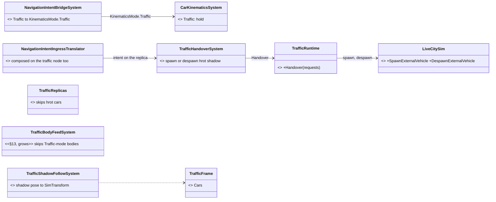

*What the picture shows that prose hid:* the only new edge INTO SimHost is the pose it follows, read from the frame every node
already resolves — no new network path between SimHost and the traffic node.

### 14.4 Modules

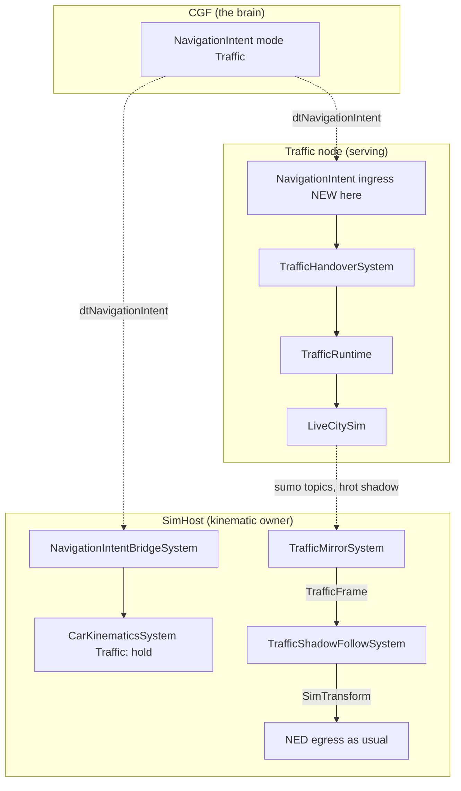

*What the picture shows:* two receivers of the SAME intent — the kinematic owner (to hold and follow) and the serving node (to
spawn); ownership never moves.

### 14.6 As built so far *(2026-10-17)*

| decision | state |
|---|---|
| G1 | ✅ `NavigationMode.Traffic` = 7 → the bridge sets `KinematicsMode.Traffic` = 9 with `FinalDestination`, `ArrivalRadius`, `TargetSpeed`; `CarKinematicsSystem` returns early for it |
| G4 | ✅ `TrafficShadowFollowSystem` (Simulation phase, composed by `TrafficPack` on every node, acting only on bodies whose `SimTransform` it owns — the `CarKinematicsSystem` filter): shadow pose → `SimTransform`, velocity from successive poses → `SimVelocity` + `VehicleState.Speed`. ⭐ **Deviation:** the result is never written here — no shadow yet ⇒ `NavState.IsBlocked` (the executor's deliberate hold, not "stuck"); gone within `max(ArrivalRadius, 15 m)` of the destination ⇒ `HasArrived` ⇒ `NavigationExecutionSystem` writes `Arrived`; gone elsewhere ⇒ mode `None`, the executor's normal blocked / replan path. So §14.2 G5's "`FailedBlocked`" comes from the executor, not from a second writer |
| G6 | ✅ `TrafficReplicas.IsShadow` — no replica for an `hrot:` car, and `TrafficFrame.IsEntity` covers it so neither map layer draws it; the body feed skips a body whose intent or kinematics are `Traffic` |
| G2 | ✅ the wire carries it: `ENavigationMode.NAV_TRAFFIC` = 7 both ways (`EveryMode_RoundTripsTheWire` covers it). ✅ A node with role `Traffic` and no Muscle builds ONE read-only translator, `NavigationIntentIngressTranslator` (`NedReplicationModule._trafficTranslators`), and `TrafficPack.Serving` registers `NavigationIntent` — the R-3015 role gate kept everything else out |
| G3 | ✅ SumoSharp **H13** (`f252ddc`, vendored): `LiveCitySim.SpawnExternalVehicle(id, x, y, heading, speed, destX, destY, vType?)` (x, y = FRONT bumper; heading = atan2, 0 east) — start lane ≤ 10 m within 90° of the heading, route by SUMO's router, arrival at the destination's lane offset (a new `arrivalPos`, ≤ one step short); `DespawnExternalVehicle`; `ExternalVehicleArrived`. HROT: `TrafficHandoverSystem` (serving node, Input phase) → `TrafficRuntime.SetHandovers` → `TrafficSession.ApplyHandovers` (spawn per new intent id; an unmapped TKB type falls back to SUMO's default car; a refusal retried every 2 s SUMO time; a withdrawn intent despawns; an ARRIVED shadow is not respawned while its intent stands) |
| G1 trigger | ✅ the operator's way in: a MOVE order with `roadUse: "InTraffic"` (`RoadUse.InTraffic` = 5, in the intent's road-use flag bits) — `MoveToExecutor` asks `NavigationMode.Traffic` instead of a path; the order completes on `Arrived` like any move. Rail `MoveToExecutor_InTraffic_AsksTrafficMode_OtherRoadUsesPlan` |
| G5 slack | ⭐ `ArrivalSlackMetres` = 25 m, measured: a shadow that arrived is last seen ~14 m short (H13 ends it ≤ one step before the point, the mirror resolves one step behind the clock) — the first 15 m was too tight |

Rails: `AHandedOverVehicleFollowsItsShadowTests` (hold, follow + speed, arrived near / not far, a body this node does not move is untouched, a shadow is no replica) · `AVehicleHandedToSumoArrivesTests` (demo-city: the shadow drives a route a SUMO car drove and vanishes at the destination; revoking it takes it back) · upstream `HrotExternalVehicleTests` (4).

✅ **Live 2026-10-17** (editor, demo-city, `scripts/sumo-accept-slice4.py`): a `BoxTruck` spawned on a lane, ordered `move` with `roadUse: InTraffic` 416 m away (straight line) — SUMO drove it on ITS roads (north, a wait at a junction, west, 500 m south, east, ~600 m in 82 s), it stopped **11 m** from the destination, `KinematicsMode` went back to `None`, the order `succeeded`, and its `PrimaryOwnerId` never changed. ⚠ The script's first cut took a 6 s standstill (a red light) for the end — it now waits for the order to finish.

### 14.5 Acceptance

| | check |
|---|---|
| unit | the bridge maps `Traffic` → `KinematicsMode.Traffic` and `CarKinematicsSystem` leaves the pose alone; the follow system writes the shadow's pose; a vanished shadow ends the mode with `Arrived` near the goal and `FailedBlocked` away from it; an `hrot:` car makes no replica |
| live | demo-city: a vehicle handed over arrives at its destination on SUMO roads, is taken back (`KinematicsMode.None`, `Arrived`), and its `PrimaryOwnerId` never changes |


## 15. Slice 5 — pedestrians, and converting them to our civilians (§8, R-4031/R-4032/R-4037/R-4038/R-4039) *(2026-10-17 — build-state: BUILT for 5a/5b, §15.7; 5c DESIGN)*

### 15.1 INVENTORY *(code graph CLI + grep, 2026-10-17)*

| what | measured |
|---|---|
| SumoSharp ped wire | `DdsPedReplicationSource`, `PedRemoteReconstructor` (`TryGetRenderPose`), `DdsPedLifecycle`, `PedLifecycleRecord`, `PedFreeKinematicRecord`, `PedDemand` (sumosharp graph, 14 classes) — ⛔ no multi-source ped subscriber, ⛔ peds are not named by the host, ⛔ no Despawn published, ⛔ no safe single-ped removal (§8.4 S1/S2/S5 — **H14**, dispatched upstream) |
| HROT session | `TrafficSession` builds `LiveCitySim` with `PedPopulationCap = 0` and calls `SetPedDensity(0, 0)` — ⛔ pedestrians are OFF; `TrafficDemand` carries `TargetCars`, `Seed`, `StepSeconds` only |
| replicas | `TrafficReplicas` (vicinity 300 m + 50 m, R-4041) makes car replicas only; `TrafficCar` has no kind |
| civilians | ✅ `CivilianTkbCatalog` 1101–1104 (adult m/f, child, elderly, `DefaultBehaviorHash = CivilianHsm`, backend B-2) · ✅ CIV-1 Routine/Alarmed/Casualty, CIV-2 panic/shelter/cower live (behaviors) · ✅ **P6 met**: CIV-0 the safety gate (ground AI skips a Neutral target, `CE-2233`, `DESIGN_Civilians_And_Crowd_Control.md` §5b) |
| creation | ✅ `EntityCreationRequest.PreAllocatedNetworkId` + `OwnerAppInstanceId` — a request addressed to CGF can keep the pedestrian's network id (R-4029) |
| hits | `DamageAssessedEgressTranslator` drops a hit whose entity has no network id (`:67`) — ✅ SUMO replicas DO carry one now (R-4038), so `EntityHitDamage` already leaves the shooter's node for a car replica |

### 15.2 Decisions *(the WHAT is ruled; these are the HOW, each with a lean)*

| id | question | ⭐ lean | rejected — one line each |
|---|---|---|---|
| **K1** | turning pedestrians on | `TrafficDemand` gains `TargetPedestrians` (default 0 = off, every existing scenario unchanged) and `dtTrafficDemand` carries it; demo-city's recipe asks for some | always on: 20 000 walkers nobody asked for |
| **K2** | ped ids | the serving node names every ped from the cluster allocator (H14 `PedIdProvider`), as cars (N2) — a ped's name IS its network id | SumoSharp's own ids: a second id space (R-4029) |
| **K3** | ped replicas (§8.7 G2/G3) | the SAME vicinity rule and the SAME `TrafficReplicas`: a ped within 300 m of an HROT body is an entity of civilian type **1101** (Neutral `EntityInfo`, `Health`, collider), owned by the traffic node; `TrafficCar` gains `Kind` (car · pedestrian) | a second replica class: two copies of the vicinity / pose / destroy code |
| **K4** | panic (P2) | on the SERVING node: a NED `WeaponFireNotification` or `DetonationNotification` is an incident; peds within the radius (shot 50 m, blast 150 m — fields on `TrafficDemand`) are converted; contagion deferred | every node detects: N copies of one decision |
| **K5** | conversion (P3/P4, §8.2) | `RemovePedestrian` (H14 S1) → one `EntityCreationRequest` addressed to the BRAIN node (CGF), `PreAllocatedNetworkId` = the ped's id, type 1101–1104 by the ped's kind, pose and velocity from S1, its civilian HSM entering **panic** — measured: no entry state is needed, `CivilianBehavior` goes Alarmed ⇒ Panic once `CivilianState.Fear` passes `PanicAt` (0.6), so the request carries `CivilianState { Fear = 1 }` as an initial component; owner `0` = the default processor (CGF in a cluster, the editor alone) (`EntityCreationRouting.DefaultEntityCreationRequestProcessor`) — no addressing logic; the Despawn (S2) drops every mirror, and the id reappears as our entity · ✅ the incidents reach the traffic node: `WeaponFireNotification` / `DetonationNotification` ride the shared pack on EVERY node (CE-1148, `SharedTranslatorPack.cs:120-123`) | the traffic node as creator: it is optional (R-4027), a crash would delete the people (R-4008) |
| **K6** | cap (P7) | at most `MaxConverted` (default 30) a session; above it a ped stays in SUMO (its SUMO flee is §8 P7's second half — deferred) | no cap: one blast hands hundreds of brains to CGF in a frame |
| **K7** | hits (§8.7 G1/G4/G5) | the traffic node ingests `EntityHitDamage` for its SUMO ids: a pedestrian converts as K5, born with the damage; a car stops in SUMO-less form (our civilian car, its driver a civilian) — **5c, after 5b** | — |

### 15.3 Classes

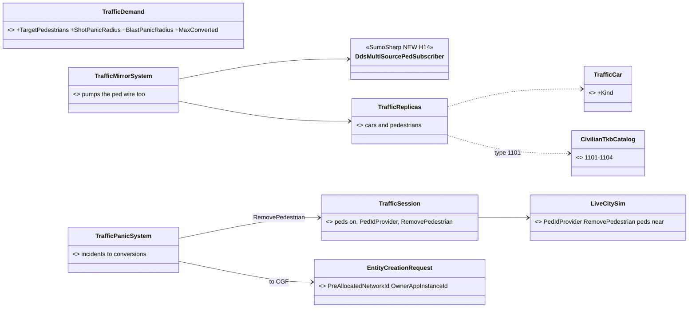

### 15.4 Sequence — a shot converts a pedestrian *(§8.2, as built here)*

```mermaid
sequenceDiagram
  participant SH as SimHost (shooter)
  participant TN as Traffic node
  participant LC as LiveCitySim
  participant CGF as CGF (brain)
  participant N as every node
  SH->>TN: WeaponFireNotification (NED)
  TN->>TN: TrafficPanicSystem: peds within 50 m, under the cap
  TN->>LC: RemovePedestrian(name) returns pose and velocity
  LC-->>N: ped Despawn (S2), mirrors drop the replica
  TN->>CGF: EntityCreationRequest type 1101, PreAllocatedNetworkId = name, panic
  CGF-->>N: our civilian, the same network id
```

### 15.5 Modules

```mermaid
graph TD
  subgraph Serving["Traffic node or editor"]
    TP[TrafficPack.Serving] -->|input| TPS[TrafficPanicSystem]
    TPS -->|RemovePedestrian| RT[TrafficRuntime / TrafficSession]
    TPS -->|EntityCreationRequest| EC[EntityCreationPack]
  end
  subgraph Every["Every map / sim host"]
    TMS[TrafficMirrorSystem] -->|ped poses| TR[TrafficReplicas]
  end
  CGF[CGF creates and keeps the brain]
  EC -.->|addressed to the Brain node| CGF
```

### 15.6 Build order

| step | content | waits for |
|---|---|---|
| **5a** | K1–K3: pedestrians walk, named by our allocator, and are replicas near our units on every node | ✅ BUILT (§15.7) on SumoSharp H14 `13f70db` |
| **5b** | K4–K6: a shot or blast converts nearby pedestrians into CGF civilians in panic, same network id | ✅ BUILT (§15.7) |
| **5c** | K7: hits on SUMO cars and pedestrians | ✅ pedestrians BUILT (§15.7) · ⏳ cars wait for SumoSharp H15 (remove a car by name), dispatched |

### 15.7 AS BUILT — 5a and 5b *(2026-10-17, CE-4024)*

```mermaid
sequenceDiagram
  participant SH as Shooter's node
  participant M as Traffic node, main thread
  participant S as Traffic node, stepping thread
  participant LC as LiveCitySim (H14)
  participant B as Brain node (CGF, or the editor alone)
  participant N as Every node's mirror
  SH->>M: WeaponFireNotification (Origin) or DetonationNotification (Hit), NED
  M->>M: TrafficPanicSystem: one incident per 5 m per frame, radius from TrafficDemand
  M->>S: TrafficRuntime.ReportIncident (queue)
  S->>LC: PedestriansWithin, then RemovePedestrian while under ConversionCap
  LC-->>N: ped Despawn on the wire at once (even paused)
  S->>M: TrafficConversion queue (name, state, fright point)
  M->>M: TrafficReplicas.Release(id), its own replica goes first
  M->>B: EntityCreationRequest: owner 0, PreAllocatedNetworkId = name, type by id, transient, attributes Heading Fear FrightFrom
  B->>B: CreateEntityRequestSystem applies the attributes: CivilianState born with Fear 1 and FrightFrom
  B-->>N: our civilian, the same network id, his CivilianHsm goes Alarmed then Panic
```
*What the picture shows that prose hid: the removal is on the STEPPING thread (H14 S1 runs between steps), so the main thread only
queues incidents and drains conversions; and the fright reaches the brain as ATTRIBUTES, because the request wire has no slot for a
brain-local component.*

```mermaid
classDiagram
  direction LR
  class TrafficSession { <<grown>> peds on from TargetPedestrians, PedIdProvider = allocator, DDS ped tee, +Pedestrians, +Convert(), +Converted }
  class TrafficRuntime { <<grown>> +ReportIncident() +TakeConversions() }
  class TrafficPanicSystem { <<NEW>> incidents to requests }
  class TrafficPedMirror { <<NEW>> one sender's peds, yaw from motion }
  class TrafficPedPose { <<NEW record>> Owner NetworkId Name X Y Z YawRad }
  class TrafficReplicas { <<grown>> +Pedestrians +IsPedReplica() +Release() }
  class TrafficFrame { <<grown>> +Pedestrians +IsPedEntity }
  class TrafficCar { <<grown>> +Kind car or pedestrian }
  class CivilianFrightAttributeInstaller { <<NEW, FDP>> Fear FrightFrom.X/Y/Z, BrainLocal }
  class AttributeVocabulary { <<existing, grows 4 rows>> }
  TrafficPanicSystem --> TrafficRuntime
  TrafficPanicSystem --> TrafficReplicas : Release
  TrafficRuntime --> TrafficSession : Convert
  TrafficMirrorSystem --> TrafficPedMirror
  TrafficPedMirror ..> TrafficPedPose
  TrafficReplicas ..> TrafficCar
  TrafficFrame ..> TrafficPedPose
  AttributeVocabulary ..> CivilianFrightAttributeInstaller
```

| deviation from §15.2 | why (measured) |
|---|---|
| ⚠ **K5's fear rides as ATTRIBUTES, not an initial `CivilianState`** — `Fear`, `FrightFrom.X/Y/Z` (`AttributeIds` 30–33) in `AttributeVocabulary`, marked `BrainLocal` | the wire request carries only the anchor transform and a few descriptors (`CreateEntityRequestDescriptorBuilder.Build`); `CivilianState` is brain-local, so in a cluster it would have vanished on the way to CGF. `CreateEntityRequestSystem` applies `InitialAttributesJson` and `ListPatchContext` creates the missing component. The coverage rail asks no translator to cover a `BrainLocal` component |
| ⚠ **K3: pedestrian poses are a SEPARATE list** (`TrafficPedPose`, `TrafficFrame.Pedestrians`); the replica book and the vicinity rule are the same class | the car consumers (`TrafficLayer3D`, the follow system, the 2-D layer) read `Cars` as cars; one list would have handed every one of them pedestrians. `TrafficCar.Kind` marks a pedestrian ENTITY |
| ⚠ **K5's type is by id** (`TrafficPanicSystem.TypeOf`: 4 men, 4 women, 1 child, 1 elderly in 10); the replica is `1101` | SumoSharp's pedestrians carry no age or sex |
| ⭐ **the request is transient, `InitType.None`**; the traffic node's own replica goes first (`Release`), the rest on the Despawn | a person SUMO walked is never the scenario's; `NetworkEntityMap.Register` throws on a live id |
| ⭐ **incidents of one frame closer than 5 m merge** (`MergeMetres`) | a burst of fire is one fright, not one stepping-thread pass per round |
| ⭐ **demo-city asks for 160 pedestrians** (SumoSharp's own default population) | K1 |
| ⭐ **K7 for a pedestrian (5c): a `DamageAssessedEvent` on his replica gives him up (never capped), and the hit is HELD (`HoldSeconds` 10) until our civilian exists under his id, then re-published to him as this node's own hit** | the existing damage path then carries it (`DamageAssessedEgressTranslator` → the brain's `HealthApplicationSystem`, authority-gated); no "born damaged" field on the request, and none needed |
| ⚠ **the editor applied NO request attributes at all** — fixed: `EditorSubsystem` passes `JsonAttributeCompiler` to its creation pack, as every networked host's factory does (rail `TheEditorAppliesRequestAttributesTests`) | 📌 measured live: the first run converted three pedestrians, all calm (`Fear` 0, Gather). The SILENT-DEFAULT shape — a debug-API spawn's `attributesJson` was dropped there too. Folded into [Q59 §15](Architect_Question_59_Attribute_Vocabulary_Single_Source.md) |

| known gap | |
|---|---|
| the 3-D map draws no NON-entity pedestrian (only replicas, as civilians) | `TrafficLayer3D` draws cars; the 2-D map draws a dot per pedestrian |
| the civilian is born at rest (the removal's velocity is not carried) | no creation attribute for a velocity |
| above the cap a frightened pedestrian stays in SUMO, calm (§8 P7's second half — its SUMO flee) | deferred |

Rails: `PedestriansPanicIntoCiviliansTests` (5: walkers named by our allocator and civilian replicas near a body; a shot gives them up
as terrified-civilian requests keeping their ids, and they leave the wire; the cap; a released replica is not remade; the attributes),
`TheFourRoutingTablesAgreeTests` (+4 vocabulary cases, a creation request's fright bears a mind in panic), `TheDescriptorMapIsWiredTests`
(brain-local components exempt), the hit rail (K7: a hit pedestrian is given up and his hit reaches the civilian he becomes). Traffic 54/54.

**Live (editor, `scripts/sumo-accept-slice5.py`): 11/11** — 15 pedestrian replicas near two riflemen; their shoot-out gave up three
pedestrians (under the cap of 30), each back as OUR civilian with the same network id, no `TrafficCar`, frightened (`Fear` 0.60 and
falling from 1, `Mode` Cower, `FrightFrom` = where the round left).


## 7. ⛔ HISTORY

### §6 slice plan as first drafted *(SUPERSEDED 2026-10-17 by R-4047 — it built the dedicated node first)*


| slice | content | acceptance |
|---|---|---|
| 1 | traffic node host + role (`NodeRole.Traffic`, `NedReplicationModule` admits it, ClusterRunner `--mode traffic`); `TrafficNetCache` from `terrain.json`; `TrafficDemand` scenario entity; SUMO stepped on `GlobalTime`; publisher on `sumo/*` | `ddsmonitor` shows `sumo/vehicles` samples only on DR error; pause stops them |
| 2 | `TrafficMirrorModule` on every map host (E9 stamps, hash check) + `TrafficRoadGizmo` (CityLib-styled) | a car on IG matches the traffic node's own pose within the policy's 0.3 m |
| 3 | local entities carry `SimTransform` + `PhysicsCollider` (R-4022 A); rail: a mirror entity is never egressed; SimHost avoidance and LOS see cars | our vehicle stops behind a SUMO car; a rail fails if a `TrafficCar` entity gains `NetworkIdentity` |
| 4 | E4 obstacle feed | a SUMO car brakes for our convoy on its lane |
| 5 | R-4023 handover (`KinematicsMode.Traffic`) | a vehicle handed over arrives at its destination on SUMO roads and is taken back; ownership never changes |
| 6 | E6 pedestrians | promoted pedestrians near our units react to them; ambient ones are drawn without entities |


- 2026-10-16, first chat draft — SUMO cars as NED entities with `EntityMasterFlags.Lightweight` (owned by the traffic node,
  type `CivilianCar`), traffic lights as door-like terrain-object entities, the network cost of thousands of per-entity
  samples as the main unknown. ⛔ SUPERSEDED by R-4020: SumoSharp's own wire carries cars and lights, NED carries none.
