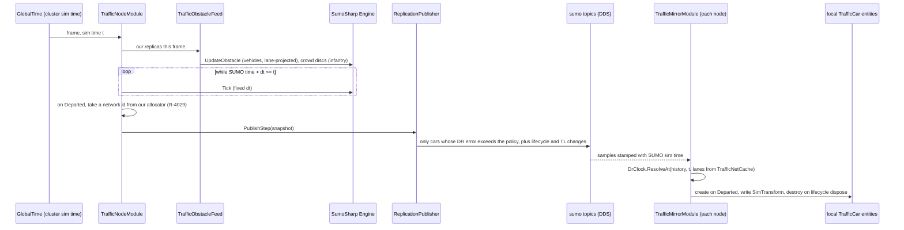
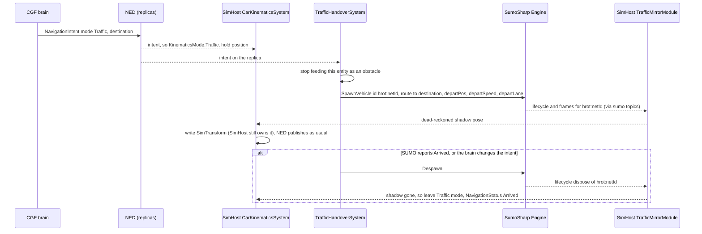
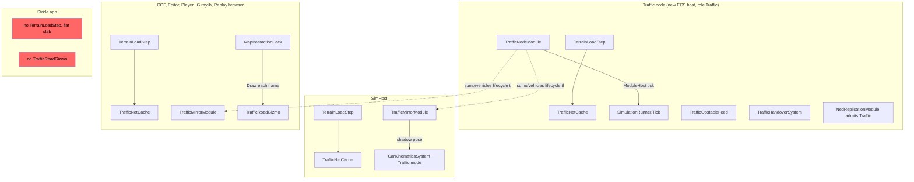
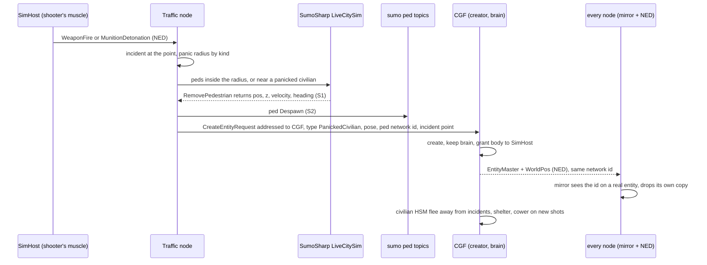
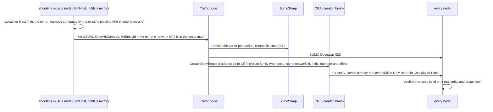

<!--STATUS
state: LIVE
updated: 2026-10-16
build-state: DESIGN — cars: all decisions RULED 2026-10-16 (§0, R-4020…R-4031) except E7b (no LFS, lean). Pedestrians and
  panic (§8): P1–P8 ACCEPTED (R-4032); §8.6 promotion zones DROPPED for now (R-4037); §8.7 SUMO entities in the combat world (leans). The civilians themselves
  (P5, P6) moved to docs/DESIGN_Civilians_And_Crowd_Control.md, a separate programme built first (R-4033). Nothing is dispatched; §6 is the slice plan.
current-answer: §0 (the approved decisions) over §3 (the diagrams); §4 the sub-decisions; §5 the known limits; §8 pedestrians and panic.
stale-below: nothing. ⚠ The first chat draft (2026-10-16) published SUMO cars through NED as Lightweight entities and
  carried traffic lights as door-like entities — both SUPERSEDED the same day by R-4020; recorded in §7 HISTORY only.
known-rot: none.
known-conflict: none. ⚠ Relation to §2.1e ① of DESIGN_Terrain_Zones_And_Assets.md (the scenario names only a terrain) —
  CONSISTENT: the SUMO net is a terrain asset (R-4021); only the traffic DEMAND is a scenario entity.
related-designs:
  - docs/DESIGN_Terrain_Zones_And_Assets.md — owns WHAT a terrain asset is (§2.1a: the road net is an external asset,
    "like sumo road net"; §2.1e: terrain.json, roadNetworks[]). This question adds a second road-net FORMAT to that slot.
  - docs/DESIGN_Terrain_World.md — owns what a terrain CONTAINS and the one-file-every-query-derived rule; §7.3 W12 the
    terrain FOLDER and TerrainCatalog that distribute the .net.xml to every node (R-4021).
  - docs/DESIGN_Cluster_Load_Phase.md — owns WHEN terrain loads and the role→load-part contract (terrain is universal);
    the traffic node's SUMO load runs inside that step.
  - docs/DESIGN_Geo_Origin.md — owns the terrain's geo origin (R-229); §4 E1 here maps the SUMO net's UTM frame onto it.
  - docs/designs/navig-2/Navigation_Design_v2_0.md — §5.2a owns the road GRAPH our own units route on (R-230/R-231).
    ⛔ R-4026: it stays SEPARATE from and independent of the SUMO net — no derivation either way.
  - docs/DESIGN_Entity_Control.md — M-6 rejected moving a unit's ownership to a controlling station; R-4023 (the
    handover by a follow mode) follows that precedent. M-1's KinematicsMode.Manual is the shape KinematicsMode.Traffic copies.
  - docs/DESIGN_Entity_Ownership_Transfer.md — TransferEntityOwnershipRequest: the REJECTED handover alternative (§0 D7).
  - docs/DESIGN_Dead_Reckoning.md — owns NED's dead reckoning; SUMO cars use SumoSharp's lane-based dead reckoning
    instead (R-4020), so the R6 caveat there (no DR of Active replicas on Brain/Muscle) does not reach them.
  - docs/DESIGN_Node_Roles_And_Policies.md — owns the roles; R-4022 adds a Traffic role (R-138: a convention, not a
    protocol restriction — a non-muscle node may own a pose).
  - docs/DESIGN_Map_3D_Mode.md — owns the 3-D map mode and its ground draping (§6f), which the traffic road layer draws through.
  - docs/blueprints/Architect_Question_91_Player_Nodes.md — R-4012 (replay by span) and R-4007 (ingress frozen while
    restoring), which the mirror module obeys (§4 E5).
  - External: github.com/pjanec/SumoSharp — docs/SUMOSHARP-API.md, docs/PACKAGES.md, docs/SUMOSHARP-DEADRECKONING.md,
    docs/EXTERNAL-AGENTS-VIZ.md, docs/PEDESTRIANS.md, demos/City3D (CityLib).
  - docs/DESIGN_Civilians_And_Crowd_Control.md — ⭐ OWNS the civilians a panicked SUMO pedestrian becomes (one family, panic as a
    MODE — supersedes §8 P5's single type), the Neutral targeting gate (§8 P6 ⇒ its CIV-0) and the riot/non-lethal work.
  - docs/DESIGN_Operations_Behaviour_Catalogue.md — owns the civilian behaviours (CIV-2 panic flight, CIV-7 shelter; ruling D3 civilians as HSM crowd agents) that §8 P5 hands panicked pedestrians to.
-->

# Architect Question 93 — **a SUMO traffic node: SumoSharp's own wire, local mirrors everywhere, roads from the terrain**

🔒 **User, `2026-10-16`, verbatim:**
- *"integrate the ground traffic simulation … into the engine as a new type of node, which is running the traffic simulation and publishing the entities on the network so that the other nodes can see them"* · *"The sumo car entities would have no brain. They will be fully controlled by the sumo node."* · *"would be just adopted by all the other nodes as unowned, completely unowned."*
- *"the sumo sharp repository also handles pedestrians. It would be nice to use them as well."*
- *"The vehicles and entities from our own engine should be exposed back to the Sumo simulation."*
- *"take our vehicle and hand it over to the Sumo node so Sumo can control its navigation over its own road graph and be able to take the ownership back to our simulator."*
- *"whether it makes sense to integrate the Sumo engine into our muscle node completely"*
- *"It is essential that every node that receives the cards from the sumo node does dead reckoning, because the sumo cards are sent only on a significant change."* · *"The sumo node must use the optimized dead reckoning that the sumo sharp project is using, because this is reducing network traffic tremendously."*
- *"Your idea of referencing the sumo road network from the terrain is correct. Sumo scenario parameters being part of our scenario as an entity is also accepted. The rendering of the roads and traffic lights should be inspired by the one from the CityLib."*
- *"because we need to use the optimized DDS network scheme for sumo sharp cars, we do not need to solve the issue with sending thousands of cars using our DDS scheme."*
- *"A local entities ok, B ok, C ok, D1 and D7 ok."*
- *"we can store the sumo road network as part of the terrain and synchronize this the same way as the terrain."*
- *"Lets discuss pedestrians. I need them and also their panic mode if there is some incident like military/terrorist shootout."* · *"Panicking ones coukd.become.our entities and never returned to sumo"*
- *"G2 to G6 leans accepted. The Sumo road network can span large areas that are not covered by our terrain, and this is fine because Sumo in thosr area is working just as a background traffic"*
- *"G1 What do you mean by that shooter's node calculates the damage? It is calculated by the muscle node, isn't it? Why any special traffic hit message? We have an usual hit message. Why sumo entities don't have network ID? They should have one because they are just the normal entities, just calculated by different node and communicate it with a special set of DDS messages for optimal data reckoning."*
- *"§8.6 lean accepted, drop promotion zones, at lest for now. Will our fire and detonation and entities be able to interact with sumo entities, in a way that if they are hit they will take damage, will be removed from sumo and become our entity with brain, like the panic mode? We need sumo entities to show up in eqs/raycast queries etc"*
- *"We can extend sumosharp as needed, it is my project. If ckeaned up, i could publish on nuget.org. E2b ok."*
- *"E1 ok. E2 no,.keep height from sumo, as roads are rendeded from sumo net. E3 no, keep them separate and independent, sumo ones are complex, ours are simple. E4 ok.E5 ok. To ensure unique network ids, sumo could use our allocator. E5 ok. E7 packages ok, just need to be compiled and stored as part of hrot repo (lfs?) as they are not on nuget.org. E9 ok. E10 ok."*

## 0. The approved decisions

| id | decision | ruling |
|---|---|---|
| **D-wire** | ⭐⭐ SUMO cars (and traffic lights) travel ONLY on SumoSharp's own DDS topics (`sumo/vehicles`, `sumo/lifecycle`, `sumo/tl`), published with its DR-error policy (`DrErrorPublishPolicy`: 0.3 m along / 0.2 m lateral / 3 s heartbeat). **Every receiving node dead-reckons with SumoSharp's `DrExtrapolation` curve** — the one the publisher's policy also uses. ⛔ Never through NED: no SUMO car is a networked HROT entity, so "unowned" needs no ownership mode at all | **R-4020** |
| **D3** | ⭐⭐ The SUMO net (`.net.xml`) is a **terrain asset**, named by `terrain.json` `roadNetworks[]` and synchronised with the terrain folder. ⛔ `sumo/geometry` is not needed. The traffic **demand** (density, flows/routes, seed, pedestrians on/off) is a **scenario entity** | **R-4021** |
| **D1 + A + B + C** | ⭐⭐ A **separate traffic node** (an ECS host with a new `Traffic` role) runs SumoSharp, whose engine keeps its own data as the truth. **A** — every receiving node keeps one ECS entity per car (pose + collider; never published on NED, never saved) — ⭐ **a NORMAL replica** with a network id, owned by the traffic node (R-4038; the earlier "local-only, no network id" reading is SUPERSEDED) so the map, line of sight, avoidance and picking see traffic. **B** — the dead-reckoning clock is the **cluster sim time** (`GlobalTime`), and the traffic node steps SUMO on that same clock. **C** — the lanes dead reckoning needs come from the receiver's own parse of the terrain's net file, checked against the publisher by a **net hash** | **R-4022** |
| **D7** | ⭐⭐ Handing one of our vehicles to SUMO is a **follow mode, not an ownership move**: SimHost keeps ownership; SUMO drives a shadow car named `hrot:<networkId>`; SimHost's new `KinematicsMode.Traffic` follows its dead-reckoned pose; leaving the mode takes it back. ⛔ Rejected: `TransferEntityOwnershipRequest` of the kinematic group — Entity Control M-6 already rejected an ownership move for control; on a traffic-node crash the keys return to the creator (CGF, no kinematics) and the vehicle freezes; on hand-back SimHost resumes from stale `VehicleState`/`NavState` | **R-4023** |
| **D4** | ⭐ Roads and traffic lights are drawn by one new map layer **styled on SumoSharp's CityLib** (lane ribbons, lane markings, crosswalks, signal heads), drawn through the shared gizmo seam so all five map hosts get it | **R-4024** |
| **E1 + E2** | ⭐ SUMO coordinates map onto ours UTM → WGS84 → local ENU through the terrain origin (E1). **Heights come from SUMO** — the roads are rendered from the SUMO net, so the cars ride the same lane z (E2; our lean "our ground is the height" was REJECTED) | **R-4025** |
| **E3** | ⛔ Our own road graph (CarKinem `RoadNetworkBlob`, `roads.json`) stays **separate and independent** of the SUMO net — SUMO's is complex, ours is simple; no derivation either way | **R-4026** |
| **E4 + E5 + E9 + E10** | our entities reach SUMO as lane obstacles + crowd discs (E4); each node records its local cars, the traffic node does not step SUMO in replay (E5); received samples are stamped with SUMO sim time (E9); the traffic node is an optional cluster member (E10) | **R-4027** |
| **E7** | SumoSharp is consumed as its two NuGet packages, **compiled from a pinned SumoSharp commit and stored in the HROT repo** (they are not on nuget.org) | **R-4028** |
| **E2b** | a flat (2-D) net — no z — drapes BOTH roads and cars onto our ground; a net with z is used as-is | **R-4030** |
| **SumoSharp** | ⭐ SumoSharp is the user's own project and **may be extended as the integration needs** (§8 S1–S5, E9, E11); once cleaned up it may be published on nuget.org, which would replace E7's in-repo packages | **R-4031** |
| **E11** | every SUMO car gets a cluster-unique **network id from our allocator** (`DdsIdAllocator`), carried on SumoSharp's lifecycle record, so a car is the same id on every node | **R-4029** |

## 1. INVENTORY *(2026-10-16 — codebase-memory `search_graph` (MCP + CLI), grep, three read-only sweeps; `check_index_coverage` NOT run)*

| query | total | result |
|---|---|---|
| HROT `search_graph name_pattern=".*(Road\|Traffic\|Sumo).*" label=Class` | **38** | the CarKinem road graph (`RoadNetworkBlob`/`Builder`/`Holder`/`Json`/`Loader`, `RoadGraphNavigator`, `RoadGraphRouter`, `RoadHeights`), `RoadNetworkGizmo`, `RoadNetworkMigrationModule`; ⛔ **no SUMO or traffic production class** — `TrafficBrainSystem` is in `FDP/Examples` only, `TrafficLightExample` is an FHSM sample |
| HROT `search_graph ".*(Unowned\|Ownerless\|NoOwner\|ForeignEntity\|External(Entity\|Sim)).*"` | **12** | tests only — ⛔ no ownerless-entity type exists; `EntityMaster` has no owner field (`GenericDescriptors.cs:120-122`) |
| HROT `search_graph ".*(LocalOnly\|NotReplicated\|NoEgress\|LocalEntity).*"` + grep of egress queries | 17 | ⭐ egress is gated on `NetworkIdentity` AND on authority: `GeoSpatialEgressTranslator.cs:121-123,136`, `EntityMasterEgressTranslator.cs:62-63,76` (`HasAuthority`, `AuthorityExtensions.cs:16-45`) ⇒ a replica owned by another node is never published (R-4038 ⇒ mirrors are such replicas). ⛔ SUPERSEDED reading: an entity created **without** `NetworkIdentity` is local-only by construction (R-4022 A) |
| sumosharp `search_graph ".*(External\|Agent\|Injector\|Obstacle).*" label=Class file=src/**` | **13** | `ExternalObstacle` (lane-relative, `Sim.Core/ExternalObstacle.cs:54`), `ObstacleStore`, `ObstacleHandle` (32+16, a distinct id space), `OrcaSolver.Agent`, `ShapedVoSolver.ShapedAgent` |
| sumosharp grep — receive side | — | `DdsSubscriber : IReplicationSource` (`Sim.Replication.Dds/DdsSubscriber.cs:22`) · `DrClock.Pump` / `Resolve` / **`ResolveAt(history, sampleT, lanes)`** (`Sim.Viewer.Motion/DrClock.cs:145,295,317`) · `DrExtrapolation.Arc` (`Sim.Replication/DrExtrapolation.cs`) · `NetworkLaneSource` (`Sim.Core`) |
| sumosharp grep — publish side | — | `ReplicationPublisher.PublishStep(snap, sink)` (`Sim.Host/ReplicationPublisher.cs:62`), `DdsReplicationSink`, topic names `DdsTopicNames.cs:51-70` |
| sumosharp grep — engine | — | `Engine.LoadNetwork`/`LoadScenario` (`Engine.cs:1562,1303`), `SpawnVehicle(…departPos, departSpeed, departLane)` (`:2877`), `Despawn` (`:2963`), `AddMovingObstacle`/`UpdateObstacle` (`:1235-1262`), `CrowdSource : ICrowdFootprintSource` (`:783`), `SimulationRunner` (manual `Tick()`), `NetworkParser.Parse` (`Sim.Ingest/NetworkParser.cs:17`), `LaneProjection.Project` (`Sim.Ingest/LaneProjection.cs:19`) |
| CityLib | — | `demos/City3D/CityLib`: `RoadMeshBuilder`, `LaneMarkingBuilder`, `CrosswalkBuilder`, `TrafficLightPlacer` — engine-agnostic net8.0, Godot axes, NOT packaged |
| DDS binding | — | both repos pin **`CycloneDDS.NET` 0.3.2** (HROT 25 csproj refs; `SumoSharp.Dds` csproj :36) ⇒ one native runtime in the process |

## 2. Claim table — what the decisions rest on

| claim | code — how it IS | design — how it was MEANT |
|---|---|---|
| a non-muscle node may own a pose | ✅ `CarKinematicsSystem.cs:80` gates physics on `WithOwned<SimTransform>`, not on role | ✅ R-138 — "SimHost owns SimTransform" is an outcome, not a rule |
| a replica owned by ANOTHER node is never published — even with a `NetworkIdentity` | ✅ every egress translator checks `HasAuthority` (`GeoSpatialEgressTranslator.cs:136`, `EntityMasterEgressTranslator.cs:76`, `EntityInfoEgressTranslator.cs:116`) | ⛔ searched `docs/`, no design names it — ⚠ it is a property of the queries; a rail must pin it (§6 slice 3) |
| the SUMO net can ride the terrain | ✅ `TerrainDefinition.RoadNetworks` (`TerrainDefinition.cs`), `TerrainCatalog` + `AssetTreeSync` mirror the folder (`StorageGatewayModule.cs:446-476`) | ✅ Terrain_Zones §2.1a/§2.1e, Terrain_World §7.3 W12 |
| receivers can dead-reckon on cluster time without a wall-clock fit | ✅ `DrClock.ResolveAt(history, sampleT, lanes)` takes the time explicitly; ⚠ `DdsSubscriber` stamps samples with the DDS **SourceTimestamp** (wall clock) | ⛔ SumoSharp's DEADRECKONING doc §8 paces from wall-clock arrival by design ⇒ §4 E9 |
| SUMO keeps a car's insertion safe | ✅ `SpawnVehicle` queues until a gap (`VehicleLifecycle.cs:122-128`) | ✅ TUTORIAL-VEHICLES |
| only the FIRST terrain road network loads today | ✅ `TerrainResidency.cs:214-232` | ⚠ Terrain_World §2 lists `roadNetworks[]` as a list ⇒ §5 |

## 3. Diagrams

### 3.1 Classes

*What the picture shows that prose hid:* every NEW box sits on an existing seam — the terrain step parses the net once
(`TrafficNetCache`) and three consumers read it (the SUMO engine, the mirror's dead reckoning, the road layer); the only
networked HROT data the traffic node READS are replicas it already receives (the demand entity, our vehicles, their intents);
and nothing the traffic node WRITES goes through NED.

### 3.2 Sequence — one live step

*What the picture shows that prose hid:* SUMO advances only to the cluster's sim time, so pause and speed-up need no
SumoSharp change on the publisher; and the receiver resolves poses at the SAME `t`, so a paused cluster freezes traffic on
every node.

### 3.3 Sequence — handing our vehicle to SUMO and back (R-4023)

*What the picture shows that prose hid:* ownership never moves — the only new edge into SimHost is a pose it FOLLOWS, the
same shape as M-1's manual drive; and the shadow car's id carries our entity id, so the renderers' traffic layer skips
`hrot:*` cars and the vehicle is never drawn twice.

### 3.4 Modules — who registers it, who calls it each frame

*What the picture shows that prose hid:* the red boxes — **Stride runs no terrain step** (`StrideHrotGame.cs:1006-1009`, a
flat slab) and no map gizmo pack, so Stride shows no roads and no traffic until Stride gets terrain (AQ81 T8). The other
edge the picture forces: `TrafficMirrorModule` is ticked by each host's ModuleHost, so a host that does not compose it sees
no traffic — the composition list in §6 slice 3 is the place that decides it.

## 4. Open sub-decisions — each with a lean *(not yet ruled)*

| id | question | ⭐ lean | rejected — one line each | blast radius |
|---|---|---|---|---|
| **E1** | coordinates | ✅ **RULED (R-4025)** — at terrain load, convert the net's `<location>` (`netOffset` + `projParameter`) **UTM → WGS84 → local ENU** through the terrain origin (R-229), fit once as a 2-D rigid transform in `TrafficNetCache.ToLocal`; `+proj=utm` only, others refused with a load error | identity: wrong for any georeferenced net · a projection library: a large dependency for one projection | new UTM converter (~100 lines); SumoSharp's parser must read `<location>` (it ignores it today) |
| **E2** | car and road height | ✅ **RULED (R-4025)** — **SUMO's z**: roads are drawn at the lane z and cars ride `PosZ`. ⛔ The lean (our `IWorldQuery.SurfaceZ`) was REJECTED: the roads come from the SUMO net, so the cars must match them | — | mirror module; ⚠ consequence in §5 |
| **E2b** | ✅ **RULED (R-4030)** — a **flat (2-D) net** has no z (`Lane.ShapeZ` null ⇒ `PosZ` 0) | ⭐ when the net carries no z, BOTH roads and cars **drape onto our ground** — the 3-D map's existing rule (Z = 0 is "drape", `GizmoRenderer3D` M18/P4) for the roads, `IWorldQuery.GroundHeightAt` for the cars; a net WITH z is used as-is (R-4025) | cars and roads at z 0: everything sinks into or floats above any non-flat terrain | mirror module + road layer |
| **E3** | our units on SUMO roads | ⛔ **RULED NO (R-4026)** — the two road systems stay separate and independent | derive `RoadNetworkBlob` from the net (our lean) — rejected: SUMO's model is complex, ours is simple | none |
| **E4** | how our entities reach SUMO | ✅ **RULED (R-4027)** — vehicles → `AddMovingObstacle` after `LaneProjection.Project` (≤ 3 m from a lane, else ignored); infantry and every off-lane unit → crowd discs (`ICrowdFootprintSource`), which cars and pedestrians both react to | discs only: cars would not queue behind a convoy · obstacles only: off-lane infantry crossing a road invisible | traffic node only |
| **E5** | replay | ✅ **RULED (R-4027)** — each node's recorder records its local `TrafficCar` entities (R-4012 Plan A); in replay the mirror module is gated like ingress (`IReplayRestoreGated`) and the traffic node does not step SUMO. Known limit: a node OUTSIDE its recording span shows no cars (mirrors are not flooded) | SumoSharp's `.simrec` replayed onto the topics: a second recording mechanism, and its seek re-reads from the start | mirror module; recording size to measure |
| **E6** | pedestrians | phase 2, same pattern: SumoSharp's 4 pedestrian topics, local mirror entities for **promoted** pedestrians only (full collision avoidance, the ones cars see), realism zone around our units; ambient pedestrians drawn from their route-seed-time function, no entities | all pedestrians as entities: 20 000 entities per node for background walkers · now, in slice 1: pedestrians are SumoSharp's real-time bottleneck (7–15 steps/s on 4–8 cores) | phase 2 |
| **E7** | how SumoSharp enters the build | ✅ **RULED (R-4028)** — the packages `SumoSharp` + `SumoSharp.Dds`, **built from a pinned SumoSharp commit and committed into HROT's existing local feed `nugets/`** (`nuget.config` already declares `LocalFeed = ./nugets`); a script `scripts/update-sumosharp.sh` packs them with a version that names the commit (⚠ SumoSharp's own pack defaults to `0.1.0` every time, which a stale NuGet cache silently reuses); licence `EPL-2.0 OR GPL-2.0-or-later` | a git submodule / project reference: 5 000 files and a second build system · a CI feed: SumoSharp is not published anywhere | build only; `.gitignore` gains `!nugets/SumoSharp*.nupkg` (it ignores `*.nupkg` today) |
| **E7b** | ⚠ OPEN — Git LFS for the `.nupkg` files? *(moot if SumoSharp is published on nuget.org, R-4031)* | ⭐ **plain git, no LFS.** HROT uses no LFS today (no `.gitattributes`, `git lfs ls-files` empty); cloud sessions clone with LFS smudging skipped, so an LFS package would arrive as a pointer stub and every cloud build would fail restore. The packages are small managed assemblies (the native DDS runtime comes from `CycloneDDS.NET` on nuget.org, which HROT already uses) — ⚠ size not measured yet; if one exceeds ~10 MB, revisit | LFS: breaks restore in every session that skips LFS, and adds a tool to every clone | `.gitignore`, `nugets/` |
| **E8** | `sumo/geometry` | OFF (R-4021); the publisher still exposes the net hash (on `sumo/status`) for C's check | keep it on as a fallback: two sources for the same lanes | publisher config |
| **E9** | the receiver's time stamps | ✅ **RULED (R-4027)** — stamp each sample with the frame's own **SUMO sim time** (= cluster sim time, §3.2), not the DDS SourceTimestamp — a small SumoSharp option on `DdsSubscriber` | keep wall-clock stamps and fit a rate: breaks on pause, speed-up and replay | one SumoSharp change |
| **E10** | traffic-node id and lifetime | ✅ **RULED (R-4027)** — an ordinary cluster member (master-assigned id, R-4009), **optional** in `ClusterConfiguration` — if it dies, traffic simply stops (lifecycle disposes reach every mirror; a mirror whose feed falls silent for N s clears its cars) | mandatory: a crashed traffic node would fail the exercise | orchestrator config |
| **E11** | unique ids for SUMO cars | ✅ **RULED (R-4029)** — the traffic node takes one network id per car from **our allocator** (`DdsIdAllocator`, chunks of 100, `DdsIdAllocator.cs:31-33`) and the id rides SumoSharp's lifecycle record (its `Name`, or a new numeric field if a flow-spawned car cannot be named — a small SumoSharp change); ⭐ **amended by R-4038:** the mirror is a normal replica — `NetworkIdentity` = that id, `NetworkAuthority.PrimaryOwnerId` = the traffic node, registered in the entity map; NED egress never publishes it because this node has no authority over it (`HasAuthority`, `GeoSpatialEgressTranslator.cs:136`). ⛔ SUPERSEDED: "never in `NetworkIdentity` — egress publishes every entity that has one" (it publishes only what it owns). Shadow cars (R-4023) carry the handed vehicle's own id | SumoSharp's `VehicleHandle` as the id: a separate 32+16 space whose slots are recycled, and different on every node's mirror | traffic node + mirror; ⭐ every reader that resolves a network id through the entity map now finds the mirror (hits, targeting, orders) |

## 5. Known limits *(measured unless marked)*

- Traffic lights carry ONE state per approach lane (`Engine.cs:2613-2637`): a separate left-turn arrow is lost.
- No brake lights or turn signals in SumoSharp (searched `src`, none); `Acceleration` and the lane-change phase byte are the only inputs.
- `CivilianCar` (TKB 1002) has no `Health`: a hit does nothing (`CombatTkbTranslator.cs:49-53`). Destroying a SUMO car is a later question (it would need `Despawn` on the traffic node).
- `TerrainResidency` loads only the FIRST entry of `roadNetworks[]` (`:214-232`).
- ⚠ R-4025's consequence: with SUMO's z, roads and cars sit where the NET says, which can differ from our height grid where the net's z was not built from it — a road may hover over, or sink into, our terrain mesh. A terrain must ship a net whose z matches its height grid (or a flat net, E2b).
- *(Inference, not run)* `RoadNetworkGizmo` emits Z = 0 (drape) and so would draw a bridge road on the ground below it; the new layer must use the lane z on bridges.
- The vehicle-type id is always 0 on the wire (`ReplicationPublisher.cs:84-88`): car / bus / truck models need the type carried — lifecycle carries the SUMO id and dims only.

## 6. Slice plan *(not dispatched)*

| slice | content | acceptance |
|---|---|---|
| 1 | traffic node host + role (`NodeRole.Traffic`, `NedReplicationModule` admits it, ClusterRunner `--mode traffic`); `TrafficNetCache` from `terrain.json`; `TrafficDemand` scenario entity; SUMO stepped on `GlobalTime`; publisher on `sumo/*` | `ddsmonitor` shows `sumo/vehicles` samples only on DR error; pause stops them |
| 2 | `TrafficMirrorModule` on every map host (E9 stamps, hash check) + `TrafficRoadGizmo` (CityLib-styled) | a car on IG matches the traffic node's own pose within the policy's 0.3 m |
| 3 | local entities carry `SimTransform` + `PhysicsCollider` (R-4022 A); rail: a mirror entity is never egressed; SimHost avoidance and LOS see cars | our vehicle stops behind a SUMO car; a rail fails if a `TrafficCar` entity gains `NetworkIdentity` |
| 4 | E4 obstacle feed | a SUMO car brakes for our convoy on its lane |
| 5 | R-4023 handover (`KinematicsMode.Traffic`) | a vehicle handed over arrives at its destination on SUMO roads and is taken back; ownership never changes |
| 6 | E6 pedestrians | promoted pedestrians near our units react to them; ambient ones are drawn without entities |

## 8. Pedestrians and panic *(DESIGN 2026-10-16 — S1–S5 approved to build in SumoSharp (R-4031); P1–P8 ACCEPTED (R-4032); §8.6 re-examines P1)*

### 8.1 INVENTORY *(two read-only sweeps, 2026-10-16; code graph CLI + grep)*

| side | measured | where |
|---|---|---|
| SumoSharp peds | `PedestrianWorld` (`AddWalker`, `Remove`, `SetForcedHighPower`, interest sources, `SetExternalObstacles`); two LOD tiers — low-power `PathArcMotion` (pure function of route, start, speed, time) and high-power `OrcaCrowd` (no walls) | `src/Sim.Pedestrians/PedestrianWorld.cs:49-123`, `Lod/PedLodManager.cs:216-219,787-815` |
| SumoSharp ped wire | `sumo/ped-crowd` (high-power, 18 B/ped, DR-gated 0.1 m / 0.5 m/s / 3 s), `sumo/ped-patharc` + `sumo/ped-activity` (legs, transient-local), `sumo/ped-lifecycle`; receiver `PedRemoteReconstructor.TryGetRenderPose` | `DdsTopicNames.cs:27-30`, `FrameCodec.cs:216-261`, `PedPublishScheduler.cs:70-72`, `PedRemoteReconstructor.cs:103-149` |
| ⛔ SumoSharp gaps | no ped Despawn is ever published (`PedReplicationPublisher.cs:220-226`); LiveCity cannot remove one ped (`PedDemand` has no remove; `RemovePed` under it throws next step, `PedDemand.cs:918`); one interest source only (`LiveCitySim.cs:340-343`); host discs never reach peds (`LiveCitySim.cs:1317` passes `NoEntities`); no velocity/heading/destination readable (`PedLodManager.cs:53-126` private); no panic event anywhere | — |
| SumoSharp panic | `Incident(X, Y, StartTime, Radius)` — one per director, no kind, no decay (`Sim.Evac/Incident.cs:7`); `EvacDirector` (cars → foot; `FearField` vehicles only, contagion 25 m; overwrites `engine.CrowdSource`, `:108`); `EvacDistrictDirector` (peds only, private `PedestrianWorld`, not replicable); ⛔ neither is wired into `LiveCitySim` | `src/Sim.Evac/*` |
| HROT civilians | `CivilianPedestrian` 1001 / `CivilianChild` 1003 — `BrainTier = 0`, no `Health` (no `CombatPlatformDefDto`), no stance animation, 30 m vision + 100 m hearing | `UrbanCombatTkbCatalog.cs:141-164`, `CombatTkbTranslator.cs:49-58`, `BehaviorTkbTranslator.cs:69-71` |
| HROT civilian AI | ⛔ none in production — `WanderCivil`/`PanicFlee` are ids only (`BehaviorIds.cs:28-31`); the catalogue's CIV-2 panic flight and CIV-7 shelter are design only; ruling D3: civilians are crowd agents with a light HSM | `DESIGN_Operations_Behaviour_Catalogue.md:149-158,309` |
| HROT incidents | NED `WeaponFire` (origin, velocity, `FiredAt`) and `MunitionDetonation` (hit point, munition) — Reliable; ingress translators reusable | `FireInteractionMessages.cs:68-177`, `MunitionDetonationIngressTranslator.cs:91-114` |
| HROT creation | any node creates (R-138); a request addressed to another node makes THAT node the creator (`CreateEntityRequest`, `CreateEntityRequestSystem.cs:172`); the brain group is granted only when `BrainTier != 0` (`HrotOwnershipGroups.cs:138-148`) | `DESIGN_Entity_Creation_Unification.md` §3.1, `DESIGN_Node_Roles_And_Policies.md` §4 |
| ⛔ HROT targeting | vision drops only same-side units (`VisionBroadphase.cs:79`); a Neutral contact gets danger 0.3 (`ThreatDanger.cs:18,30`); no Neutral filter in ground-AI threat ranking or posture (searched `ThreatRankingDecision`, `StandardInputs`, `PostureNodes`, `ThreatEvaluationSystem`); the only collateral check is air attack (`HiddenTargetThrow.cs:106-121`) | — |

### 8.2 Sequence — a shot panics a pedestrian, who becomes our civilian for good

*What the picture shows that prose hid:* the traffic node only DETECTS and REMOVES; it never owns the civilian, so a
traffic-node crash (it is optional, R-4027) cannot delete people mid-incident (R-4008); and one network id spans the
handover, which is what lets every receiver swap its mirror for the real entity without a jump.

### 8.3 Decisions *(ACCEPTED 2026-10-16, R-4032 — P5 and P6 are now owned by DESIGN_Civilians_And_Crowd_Control.md: P5's type is superseded by its CV-1 family, P6 is its slice CIV-0)*

| id | question | ⭐ lean | rejected — one line each |
|---|---|---|---|
| **P1** | normal pedestrians | SumoSharp's LiveCity runs them on the traffic node and its 4 ped topics carry them; receivers reconstruct with `PedRemoteReconstructor` on cluster sim time; **only promoted (high-power) peds get local mirror entities**, promoted inside interest zones the traffic node attaches to each of our units (S3); ambient peds are drawn without entities | every ped an entity: up to 20 000 entities on every node for walkers nobody touches |
| **P2** | what triggers panic | the traffic node reads NED `WeaponFire` + `MunitionDetonation`; each becomes an incident; peds inside a per-kind panic radius panic, and peds near an already-panicked civilian too (contagion); radii on the `TrafficDemand` scenario entity (e.g. shot 50 m, explosion 150 m, contagion 15 m) | SumoSharp's `FearField` / `EvacDistrictDirector`: vehicles only / a private, unreplicable ped world · the acoustic audible range: a gunshot is heard for hundreds of metres and would panic the whole city |
| **P3** | the handover | one-way: removed from SumoSharp with its state, Despawn sent, our entity created at that pose **with the ped's network id** (R-4029); never returned | keeping the ped in SumoSharp with a panic flag: our AI could not drive it, and SumoSharp has no panic behaviour inside LiveCity |
| **P4** | who creates it | **CGF**, by a creation request addressed to it — CGF keeps the brain, SimHost gets the body (the creator-keeps-brain path proven live, Node_Roles §4.1) | the traffic node as creator: an entity dies with its primary owner (R-4008) and the traffic node is optional (R-4027) — a crash would delete every fleeing civilian |
| **P5** | the entity type | a new TKB type **PanickedCivilian** (adult + child variants): `BrainTier ≠ 0`, `Health` (it can be wounded), the mannequin stance animation (crouch, cower), **hearing only, no vision** (perception tops out near 500 units, `DESIGN_Sensors_And_Doctrine.md:1771`); behaviour = a civilian HSM (CIV-2 flee away from incidents, CIV-7 shelter, cower on new shots) — behaviors-lane work; deleted once far from every unit and incident for a while | reusing 1001: no brain tier, no health, no stances · vision on every civilian: perception budget |
| **P6** | ⚠ safety gate | **before any handover is enabled, ground-AI targeting gets a Neutral filter** — today a Neutral contact ranks with danger 0.3 and nothing filters it, so soldiers could engage fleeing civilians | shipping the handover first |
| **P7** | load cap | at most N handed-over civilians at a time (N on the scenario entity, perception load measured); above it, panicked peds stay in SumoSharp and flee to safe zones by its own re-routing (`EvacDistrictDirector`'s `AddWalker` to a safe zone + `SetForcedHighPower`, moved into LiveCity) | no cap: an explosion in a crowd hands hundreds of brains to CGF in one frame |
| **P8** | cars (later slice) | panicked cars stay in SUMO with the flee parameters and a reroute to an exit (`EvacDirector`'s car half, moved into LiveCity); a blocked panicked car is abandoned — its driver becomes our civilian (P3), the car stays as a stopped SUMO vehicle | `EvacDirector` as-is: it overwrites the engine's `CrowdSource` and is not wired into LiveCity |

### 8.4 SumoSharp extensions *(approved to build — R-4031)*

| id | change | why |
|---|---|---|
| **S1** | `LiveCitySim` removes one ped by id safely (through `PedDemand`) and returns its pos, z, velocity, heading | today `RemovePed` under `PedDemand` throws on the next step and the velocity is private |
| **S2** | the publisher sends `PedLifecycleKind.Despawn` on removal and arrival (and disposes the ped's durable legs) | today no Despawn is ever published, so receivers extrapolate removed peds forever |
| **S3** | several interest sources in `LiveCitySim`, attachable to arbitrary moving points | LiveCity registers exactly one today; multi-zone peds are unbuilt |
| **S4** | `LiveCitySim` takes host-fed world discs for peds (our units as obstacles) | it passes `NoEntities` today |
| **S5** | ped samples stamped with sim time (as E9), `startTime` in float64 | wall-clock stamps break pause and replay; float32 start times drift over long exercises |

### 8.5 Known limits

- Low-power peds report z = 0 on a 3-D net (SumoSharp's open bug, `TUTORIAL-PEDESTRIANS.md`) — under R-4025 they would walk under raised sidewalks.
- High-power ORCA peds have no walls (`PedLodManager.cs:216-218`) — they follow waypoints only.
- No panic state on the wire — a panicked ped that stays in SumoSharp (P7) shows only as a new leg and a promotion.

### 8.6 ✅ P1 re-examined — **promotion zones DROPPED, at least for now** *(R-4037, 2026-10-17; the lean below was accepted. ⚠ Its "and with them the pedestrian mirror entities" is SUPERSEDED by §8.7 G2: pedestrians near our units ARE mirrored, by an HROT-side radius, with no SumoSharp promotion)*

📐 **Measured:** cars see EVERY pedestrian on a crosswalk, promoted or not — crossing occupancy covers everyone
(`TUTORIAL-LIVE-CITY.md`, "The coupling: one seam"); only a low-power pedestrian standing in the road ELSEWHERE is unseen,
and low-power pedestrians keep to sidewalks and crosswalks. Panic detection reads positions, which low-power pedestrians
have (`PositionOf`), and the handover reads velocity from the path (`PathArcMotion`).

⭐ **Lean: drop the HROT-attached promotion zones, and with them the pedestrian mirror entities.** A pedestrian becomes our
entity only when it panics (§8.2) — which is exactly when shooting starts near it. ⇒ **S3 and S4 are deferred** (S1, S2,
S5 stay). ⚠ The accepted cost: a pedestrian may walk through one of our vehicles parked on a sidewalk, and dense crowds do
not dodge each other outside SumoSharp's own default promotion.
⛔ Rejected — keep the zones: ORCA cost and two SumoSharp changes for avoidance that only matters where no shooting is
happening yet.

### 8.7 SUMO entities in the combat world — **hits, blasts, EQS, raycasts** *(DESIGN 2026-10-17; G1 ruled by R-4038, G2–G6 ACCEPTED R-4039)*

📐 **Measured — what happens TODAY to a shot at a mirror (R-4022 A):**

| step | code | result for a mirror |
|---|---|---|
| the bullet finds it | `SpatialHashSystem` takes every `SimTransform + PhysicsCollider` (`SpatialHashSystem.cs:84-87`), no ownership filter; `RaycastSolverSystem` returns the entity (`:287`) | ✅ hit |
| the damage leaves the shooter's node | `DamageAssessedEgressTranslator` drops a hit whose entity has no network id in the entity map (`DamageAssessedEgressTranslator.cs:67`) | ⛔ **silently dropped** — a mirror has no `NetworkIdentity` (by design, R-4029) |
| a blast | `AreaEffectSystem` damages only entities with `Health` (`AreaEffectSystem.cs:103`) | ⛔ ignored — a mirror has no `Health` |
| a soldier sees it | `VisionBroadphase` indexes only entities with `EntityInfo` (`VisionBroadphase.cs:184-186`) | ⚠ only if the mirror carries `EntityInfo` (Neutral) |
| a pedestrian | §8.6 dropped the mirrors with the zones | ⛔ not in any query |

*What the picture shows that prose hid:* the damage is computed ONCE, by the existing pipeline on the shooter's muscle node, and
leaves it as the usual hit message — the traffic node, as the entity's owner, only converts; and the conversion is the SAME request as panic (§8.2), so a hit is just a panic whose
civilian is born wounded.

| id | question | ⭐ lean | rejected — one line each |
|---|---|---|---|
| **G1** | how a hit reaches SUMO | ⭐ **the usual hit message, nothing new** (R-4038): the shooter's muscle node computes the damage as always and `DamageAssessedEgressTranslator` sends `EntityHitDamage` — it finds the mirror's network id in the entity map (`:67`); blasts likewise, because the mirror carries `Health` from its civilian-family type (G3) so `AreaEffectSystem` (`:103`) reaches it; the **traffic node, the entity's owner, ingests `EntityHitDamage`** for SUMO ids and converts | ⛔ SUPERSEDED first draft: a special `TrafficHit` message — it existed only because mirrors had no network id · the traffic node recomputing damage: a second damage implementation |
| **G2** | pedestrians in EQS and raycasts | each node mirrors the pedestrians **within R of any of our units** (e.g. 300 m), from `PedRemoteReconstructor`'s poses — HROT-side, no SumoSharp promotion (R-4037 holds); cars stay all mirrored (R-4022) | all 20 000 pedestrians as entities on every node: entity and recording cost · none: bullets pass through pedestrians |
| **G3** | what a mirror carries | a normal replica of its civilian-family TKB type (so `Health`, `PhysicsCollider`, body zones come from the TKB translators like any replica) + `NetworkIdentity`, `NetworkAuthority` (owner = traffic node), **`EntityInfo` (Neutral)**, `TrafficCar {Kind}` — so vision, EQS, the collider hash, LOS, near misses and blasts all see it like any neutral; ⚠ rails: a mirror is never egressed, and NED dead reckoning never writes it (no `WorldPos` ever arrives for its id) | no `EntityInfo`: soldiers would not perceive traffic |
| **G4** | what a hit car becomes | the car leaves SUMO and becomes **our civilian car entity** (stopped, damaged); its driver (and passengers, from the car's seats) become civilians in Panic or Casualty | keeping a damaged car in SUMO: SUMO has no damage, it would drive on |
| **G5** | hits during the conversion | the traffic node accumulates every `EntityHitDamage` for an id until CGF's entity appears, then forwards the sum as one damage | first hit only: a burst would lose all but one round |
| **G6** | near misses and suppression | a round passing a mirrored pedestrian counts like a heard shot for panic (P2) — no new path | a NearMiss message per mirror: panic already covers it |

### 8.8 The SUMO net may reach beyond our terrain — **background traffic there** *(R-4040, 2026-10-17; consequences H1–H3 are leans)*

🔒 Ruled: the net can span areas our terrain does not cover; there SUMO is **background traffic** only. Nothing in our
simulation interacts with it there (no units, no ground, no buildings).

| id | consequence | ⭐ lean | rejected — one line each |
|---|---|---|---|
| **H1** | which cars and pedestrians become entities (replicas, R-4038) | only those **inside the terrain's extent** — and, for pedestrians, within R of our units (G2); outside, they are drawn from the receiving buffer with no entity. ⚠ This narrows R-4022 A ("every car") for large nets, where all-cars-everywhere could mean many thousands of entities on every node for traffic nobody can reach | every car on the whole net as an entity: entity, perception-index and recording cost for traffic outside the playable area |
| **H2** | height outside the terrain | SUMO's lane z (R-4025); a flat net (E2b drape) outside the terrain uses the terrain origin's altitude — there is no ground to drape on | `GroundHeightAt` outside the grid: undefined there |
| **H3** | drawing | the road layer and the traffic draw everywhere the net reaches; the terrain only where it exists | clipping the roads to the terrain: the background city disappears from the map |

## 7. ⛔ HISTORY

- 2026-10-16, first chat draft — SUMO cars as NED entities with `EntityMasterFlags.Lightweight` (owned by the traffic node,
  type `CivilianCar`), traffic lights as door-like terrain-object entities, the network cost of thousands of per-entity
  samples as the main unknown. ⛔ SUPERSEDED by R-4020: SumoSharp's own wire carries cars and lights, NED carries none.
