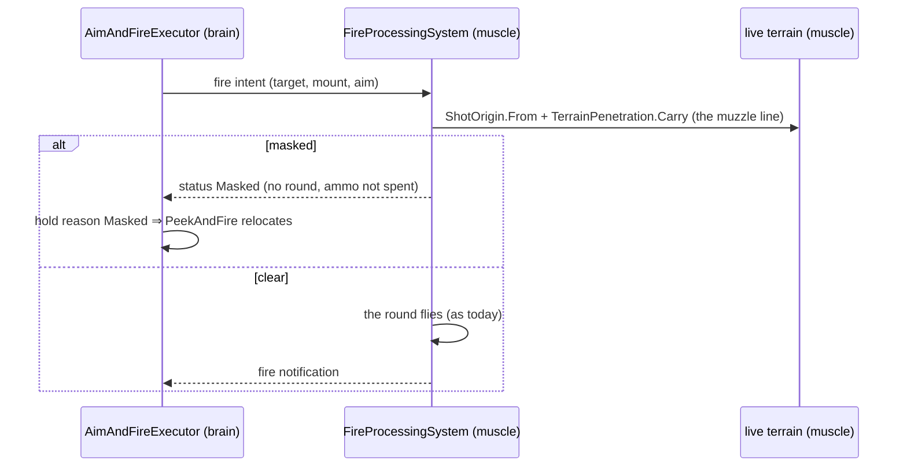
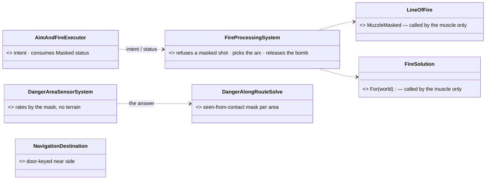

<!--STATUS
state: LIVE — ANSWERED 2026-10-19 (R-3018): A–F approved as leaned, A refined by the user (§0a).
updated: 2026-10-19
build-state: DESIGN — §2 E (the cloud drift and the fog judge take a replicated height, `CE-3258`) BUILT 2026-10-19 as the one zero-blast-radius site; A–D, F wait for the user.
current-answer: §0 the one-page decision · §2 the sub-questions with leans · §1 the claim table.
stale-below: nothing.
known-rot: none.
known-conflict: R-2037's premise ("only the muscle knows smoke, doors") is NOT literally true in the cluster today — doors and clouds are CGF-owned (§1 rows 1–2). The ruling is not contested; F asks what follows.
related-designs:
  - docs/designs/group-maneuvers/DESIGN_Defend_And_Attack_Position.md — §13b OWNS R-2037 and the inventory this question settles for backend's sites (CE-2287)
  - docs/DESIGN_World_Survey_Sensor.md — the muscle-side answer channel (standing, ~1 s): fits B; does NOT fit a per-shot gate (A)
  - docs/DESIGN_World_Query_Seam.md — IWorldQuery: R-2037 decides WHO may call it; its known-rot already records the brain-side callers
  - docs/designs/weapons/DESIGN_Weapon_Systems.md — owns the fire chain (WeaponTask, FireProcessingSystem): A would move a gate into it
  - docs/designs/group-maneuvers/DESIGN_Building_Clearing.md — CB-19 / CB-22 consume door approach and the fire gate
-->

# Architect Question 94 — backend's brain-side geometry reads (`CE-2287`, R-2037)

[`CE-2287`](Blueprint_Issues_Tracker.md) (backend's code that reads world geometry on the brain) is a sweep of ten sites. R-2037
(🔒 *"the line of sight must always be a sensor or raycast query which goes to the muscle and returns back as a result … the final
decisions, of course, can stay on brain"*) is ruled. The question is the HOME of each site — and three of them sit in the FIRE CHAIN,
which is why this is an architect question and not a batch.

## 0a. ✅ ANSWERED `2026-10-19` (R-3018)

🔒 User: *"Approved. Move fire check to muscle. Anyway brain should be sending just fire requeat and can update ammo based on fire notification (and we would need to add  refused flag to the notification)."*

⇒ A–F approved as leaned, with A REFINED: the brain sends only the fire REQUEST; the muscle runs every check and either fires or REFUSES; the fire notification gains a REFUSED flag (with the reason — masked, too close, out of range); the brain's ammo count follows the notifications (a fired round spends, a refused one does not) — so §2 A's "a refused shot must give the round back" falls away: the brain never spends before the muscle has fired.

## 0. The decision, in under a page

**Decision (recommended):** move each read to where the world already is, by site kind — ① the **fire gates** (muzzle masked,
indirect-fire arc, bomb release) move INTO the muscle's fire pipeline, which already flies the round through the live terrain and
answers back through a status; ② the **danger-area contact sight** rides the danger-area sensor that ALREADY solves on the muscle;
③ **heights** take a replicated height (the entity's own Z) or are resolved once on the muscle; ④ the dormant raycast node stays.
The decisions (relocate, hold, cross, which charge to order) stay on the brain.

**Rejected:**
- *one WorldSurvey answer for everything* — it is a standing ~1 s answer; a per-shot gate cannot wait for it or use a stale one (§1 row 6).
- *keep the brain gates and call them "advisory"* — R-2037 forbids it outright, and destruction is the case the brain cannot see at all.
- *a "brain node" flag that skips the checks* — none exists (§1 row 5), and the editor fuses brain and muscle in one world, so a flag
  would silently switch the gate off there.

**Design docs checked:**
- **Defend and Attack §13b** — applies: the ruling and the inventory. It does not settle the homes; it lists them as "each moves onto an answer from the muscle".
- **World Survey** — applies to B only: it is a standing sensor, and has no point-to-point or arc shape.
- **World Query Seam** — applies: it already marks "the brain never touches it" as false. It is silent on the homes.
- **Weapon Systems** — applies to A: `WeaponTask` is the existing brain-to-muscle fire channel with a status back. It has no masked status today.

## 1. Claim table — what the leans rest on

| # | claim | code — how it IS | design — how it was MEANT |
|---|---|---|---|
| 1 | doors are CGF-owned (created at scenario load, brain only) | ✅ `NedOwnershipGroupBinding.cs:98-100` (no group ⇒ creator); `ScenarioLoadStep.cs:180-187` | ⛔ searched `docs/` — R-2037 assumes the muscle owns them; no design says so |
| 2 | clouds are CGF-owned (owner 0 ⇒ the default processor) | ✅ `AreaEffectClouds.cs:169`; `CgfSubsystem.cs:892` | ✅ `DESIGN_Civilians_And_Crowd_Control.md:913` "a CGF-owned area entity" |
| 3 | the fire gate `MuzzleMasked` runs on the brain only | ✅ `CgfLogicPack.cs:167` (AimAndFire in the Brain executor set); no muscle pack registers a weapon executor (`CombatModule.cs:37-45`) | ✅ §13b's inventory row |
| 4 | the muscle flies every round through the live terrain but REFUSES nothing | ✅ `FireProcessingSystem` honours any intent; `BallisticsSystem.cs:184`, `HitResolutionSystem.cs:125-128` carry it | ⛔ searched Weapon Systems — no "the muscle may refuse" rule |
| 5 | there is no "this node is the brain" flag at run time | ✅ `HrotNodeContext.cs:42-169` has no role; the role is known only at composition (`HrotNodeBuilder.cs:74-83`) | ⛔ searched, none found |
| 6 | WorldSurvey is standing, ~1 s refresh, 3 s staleness; no point-to-point or arc shape | ✅ `WorldSurveySolve.cs:~68-90`; World Survey §5 | ✅ World Survey §5 (DA-25 as amended, R-2038) |
| 7 | the danger-area sensor ALREADY solves on the muscle (finds the areas), only the contact-sight rating is on the brain | ✅ `DangerAlongRouteSolve.cs:40` via `EqsSolverSystem.cs:392`; `DangerAreaSensorSystem.cs:106,160,184` | ✅ `DESIGN_Utility_AI_Demo_Scenarios.md:939,954` (the hold releases the moment the rifleman sees the hostile reach cover) |

⚠ Built from one read-only sweep (every hit traced to its pack registration) plus my own spot-checks of rows 2–3. codebase-memory's
`check_index_coverage` is not available through the CLI, so the inventory is a sweep, not proof of completeness.

## INVENTORY — the queries run *(2026-10-19)*

| query | total | |
|---|---|---|
| grep `WorldQuery.Of\|TerrainWorld\|SightBlocked\|SegmentBlocked\|GroundHeightAt\|ResolveLevel\|WeatherField.(At\|WindAt)` over `Fdp.Toolkits`, then each hit traced to the pack that registers its system | 10 sites (a–j below) | the CE-2287 list, re-measured; ⭐ one more found: `GasFootprints.cs:58` (muscle-side, but it predicts the drift the cloud system makes — routed with E) |
| codebase-memory `search_graph name_pattern=.*(Brain\|NodeRole\|IsBrain).*` | — | no run-time role flag (claim 5) |

## 2. Sub-questions — each with a recommended answer

### A. The fire gates: muzzle masked (b), indirect-fire arc / charge (d), bomb release (c)

**⭐ Lean: the CHECK moves into the muscle's `FireProcessingSystem`, the DECISION stays on the brain.** The brain sends the intent as
today. The muscle, which already has the eye, the barrel and the live terrain for the round, refuses a masked shot instead of flying it.
It chooses the lowest clearing charge and arc for an indirect-fire point, and releases a bomb when the cue says so. It reports back
through a status (`Masked`, `TooClose`, `OutOfRange`, `Released`) on the existing fire-notification road. The brain keeps the
consequence: `PeekAndFire` relocates on `Masked` exactly as now. Its reason source changes, not its behaviour.
- **Blast radius:** the fire chain. Ammo is spent on the brain at fire time (`AimAndFireExecutor.cs:299-301`), so a refused shot must
  give it back, or spending moves to the muscle with the round. The executors' `Masked` hold becomes one frame late (the status
  round trip). Every rail that asserts a brain-side `Masked` moves to the muscle.
- **What would change it:** if you accept a one-shot delay before a masked man relocates (he fires once into the wall first), the gate
  could stay and simply become a status. That is cheaper, but it reproduces the `ua-rpg-window` self-kill once.
- ⛔ **Not WorldSurvey:** a per-shot gate cannot use a ~1 s standing answer (claim 6).

### B. The danger-area contact sight (a)

**⭐ Lean: the remembered contacts' positions go INTO the danger-along-route sensor's config, and its muscle solve returns, per area,
"seen from a contact" (a bitmask). The brain multiplies the area's danger by it; that stays its own decision.** The sensor already solves
on the muscle (claim 7); this adds a column to its answer.
- **Blast radius:** the CE-3138 hold rail (`EqsDistributedTests ~583`) and the utility demo's timing. The release now waits up to one
  sensor refresh (~0.1–1 s), not the same tick. A re-pointed contact list bumps the epoch.
- **What would change it:** if the same-tick release is load-bearing for a demo, the brain keeps a last-answer cache and releases on
  "contact no longer in a seen area".

### C. Which side of a door to walk to (e, `DoorNodes.ApproachPoint`)

**⭐ Lean: a door-keyed navigation destination resolved on the muscle** (`NavigationDestination.Of`, which already turns an `OnSurface`
intent into a 3-D point there). The brain says "the near side of door N from where I stand", and the muscle picks the point.
- **Blast radius:** `MoveToDoor` and `DoorLocksmithBehavior` only.
- **What would change it:** none foreseen. The door geometry is authored and static, so this site is R-2037 by principle, not by
  stale data.

### D. A spawned entity's ground level (f, `NetworkSpawningSystem` `ResolveLevel`)

**⭐ Lean: the level stays in the spawn command and is resolved ONCE on the node that owns the position (the muscle), as
`VehicleCommandSystem.cs:61` already does for vehicles.** CGF stops resolving it.
- **Blast radius:** every owner-0 spawn with a non-absolute height. A person is born at Z = level-unresolved for one frame on the
  brain's replica.
- **What would change it:** if a brain-side reader needs the true Z in the birth frame, which no site measured so far does.

### E. Ground height for cloud drift (g) and the fog judge (h) — ✅ BUILT as leaned (`CE-3258`)

**Taken: the entity's own Z is the ground** (`WeatherField.WindAt` / `At` take an explicit ground; the cloud lies where it burst, and
a judged man stands on his surface). There are no terrain reads on the brain for these two, and `GasFootprints` uses the same rule, so
its predicted drift is the drift.
- ⭐ **Found by its rail, and fixed in the same item:** under a scenario wind (a level above the ground, a log profile to zero AT the
  ground), a cloud's BASE is height 0. So a cloud lying on the ground NEVER drifted; only the tests' single-level steady wind moved it.
  It now drifts on the wind at its MIDDLE (`AreaEffectClouds.DriftWind`). Civilians §7.3b's drift row carries the as-built.
- **Blast radius:** a man on a roof or upstairs is judged with the visibility at his own floor, not at the roof height above the
  terrain. ⚠ Fog thickens near the ground, so an upstairs man is judged in thicker fog than before.
- **What would change it:** if you want height above the TERRAIN there, it becomes a PointSurvey answer.

### F. The premise: doors and clouds are CGF-owned (§1 rows 1–2)

**⭐ Lean: no ownership move now.** R-2037 still holds as architecture: destruction exists nowhere but the muscle, and a Stride or
production muscle will own world state the FDP brain never mirrors. But the reason the brain's answer is wrong TODAY is narrower than
the ruling says: it is destruction, not doors or smoke.
- **What would change it:** if you want the premise literally true, moving clouds to the muscle (an ownership-group grant at
  `NedOwnershipGroupBinding.cs:122-123`) is a small, separate item, and it would make the cloud's drift a muscle job.

### Site j — `Action_QueryRaycast` (dormant)

**⭐ Lean: leave it** (unreferenced is not unintentional). Re-point it at WorldSurvey when a behaviour wants it. No deletion.

## 3. Sequence — A as leaned

*What the pictures show that prose hid:* every geometry call (`LineOfFire`, `FireSolution`, the contact sight) gets exactly one caller,
on the muscle. The brain's side shrinks to reading statuses and answers, which is R-2037's shape.
