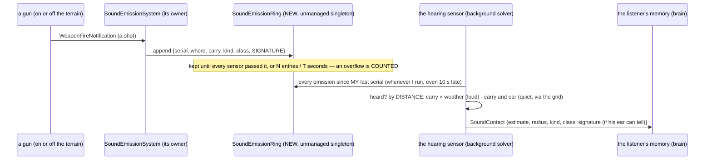

<!--STATUS
state: LIVE — ANSWERED 2026-10-20: A–E and B3 approved as leaned (§5)
updated: 2026-10-20
build-state: BUILT by backend (S1, S3–S6: NOTE_Backend_To_Behaviors_Sound_Signatures_Built.md) · behaviors E1 BUILT (§6) · E2, E3 open
current-answer: §5 the answers; §6 behaviors' as-built (E1); §3 the leans they approve (B3 added after the approval)
stale-below: nothing
known-rot: none
known-conflict: CE-3280 (backend, asked of the user 2026-10-20) proposes ONE new `Artillery` class — §3 A supersedes it if A is approved
related-designs:
  - docs/DESIGN_Thermal_And_Acoustic_Sensing.md — OWNS hearing: §6 B (the emission buffer), §6 D (anonymous contacts, R-207's coarse class), §8.2 (CE-3276 loud sounds)
  - docs/designs/group-maneuvers/DESIGN_Command_Chain_Example.md — §8d HQ-1 (CE-2309): the staff's "a heard launch is a SPOT" rule, the first consumer
  - docs/designs/group-maneuvers/DESIGN_Urban_Battle_Demo.md — §6 L7, the rung that measured the problem
  - docs/designs/indirect-fire/DESIGN_Indirect_Fire.md — the guns that stand off the terrain (indirect-fire-range: 2–5 km out)
  - docs/DESIGN_Terrain_World.md — §4.4 the grids fitted to the terrain (CE-3018, `SpatialGridFit`)
  - docs/DESIGN_World_Query_Seam.md — WQ-E OWNS sound through walls and round corners (`Trace(Sound)`, per-wall dB); B3's band scales its losses
  - docs/designs/audio/DESIGN_FPS_Audio.md — the viewer's sound sets (`SoundSetDto`, AU-5), a different consumer of "what a weapon sounds like"
-->

# Architect Question 95 — a sound signature per weapon, hearing by distance, and hearing that never misses a short sound

> 🔒 **User, 2026-10-20:** *"Basically each gun type could have its own sound signature, not just artillery, is there any reason why having
> mortar same as big howitzer? Bigger terrain is also something we need anyway for performance tests. Short loud sounds might need different
> hear sensor machinery (hearing module might need to buffer sound related events — it is not acceptable to miss those)."*
>
> 🔒 **User, 2026-10-20:** *"Artillery is commonly placed outside the high-resolution terrain. We do not want to have large terrain just because
> we place artillery 20 kilometers far away. The hearing should not be limited by inner (high resolution) terrain size, but by the distance."*

**Asked by:** behaviors. **Decides:** the user. **Builds:** backend (perception, sensors, wire, TKB data) · behaviors (the readers) · ui /
coordinator (terrain bounds).

## 1. INVENTORY *(measured 2026-10-20 — codebase-memory `search_graph`, fresh index; grep for call sites)*

| query | total | what it found |
|---|---|---|
| `search_graph(name_pattern=".*(Acoustic\|Sound\|Hearing\|Audio).*", label=Class)` | **28** | hearing: `AcousticEmitter` · `AcousticPerception` · `AcousticSensorGenerator` · `LoudSoundCache` · `SoundEmissionSystem` · `SoundContactEvent` · `AcousticSignatureDto` · `AcousticSensorDto` · wire: `AudioTargetDetected` + its egress / ingress translators · viewer audio: `SoundDto` · `SoundSetDto` · `SoundTkbCatalog` · `SoundSources` · `SoundMixer` · `SoundSynthesizer` · `AudioLayer` · `AudioOutput` · `SoundEvents` · `HearingGizmo` (+ 6 test classes) |
| `search_graph(name_pattern=".*(SpatialGridFit\|TerrainGridCoverage\|GridGeometry\|SpatialHashSystem\|EqsModule).*", label=Class)` | **7** | `SpatialGridFit` · `GridGeometry` · `TerrainGridCoverage` · `SpatialHashSystem` · `EqsModule` (+ 2 test classes) |
| grep `SoundSourceClass\.\|\.SourceClass\b` (production) | **19 files** | readers of the coarse class: perception (`ThreatEvaluationSystem`, `SensorMemoryStage`, `ThreatDanger`, `AirContacts`, `AcousticPerception`), `SquadPerceptionMergeSystem`, `StaffSystems` (CE-2309), `VehicleFightFromCoverNodes`, `CivilianFearSystem`, the TKB catalogs, the debug API, the editor's `HearingGizmo`, viewer `SoundSources` |
| ⛔ no `SoundEmissionBuffer` | 0 | §6 B's buffer was never built (the as-built note under §7 of the sensing design, CE-3062) |

⚠ `check_index_coverage` was not run (the CLI lacks it); the inventory is the two graph queries above plus grep, nothing more.

## 2. How it is — the claims the leans rest on

| claim | code (how it IS) | design (how it was MEANT) |
|---|---|---|
| a heard contact carries a coarse class, 8 values | ✅ `SoundSourceClass` (`SignaturesDto.cs:84`); 3 bits of the answer's flags (`AcousticPerception.cs:36`) | ✅ Sensing §6 D, R-207 *"a coarse source class"* |
| mortar = howitzer = HMG = ZU-23 | ✅ all `HeavyWeapon` (`NedTkbCatalog.cs:351–353`, CE-3273) | ⛔ searched Sensing §4/§6/§8, Indirect Fire, CE-3273's row: **no reason recorded** — it was the coarsest bucket that existed |
| a loud sound is heard by DISTANCE, not by terrain | ✅ the loud list is a query over every emitter, no grid (`LoudSoundCache.For`, `AcousticPerception.cs:~205`); a loud sound is heard within its carry × weather (`Sound`, `:158`) | ✅ §8.2 CE-3276 / R-3023 |
| ⭐ the source may stand off the terrain | ✅ `SoundEmissionSystem` stamps every emitter on its owner, wherever it stands; ⭐ backend measured an off-terrain launch heard and delivered (9 `AudioTargetDetected` sent, 9 received — their note) | ✅ `indirect-fire-range` declares its guns *"2–5 km west, outside the bounds"*; `ua-indirect-fire` passes |
| quiet sounds are found through the grid | ✅ the broadphase within the ear range (`AcousticSensorGenerator.Generate`) | ✅ §8.2 (unchanged for quiet classes) |
| ⚠ a short sound can be LOST | ✅ the shot lives 0.5 s on its emitter (`SoundEmissionSystem.SoundLingerSeconds`); the solver runs on a background snapshot (`EqsModule`) and is SKIPPED for 10 s after repeated timeouts (backend's CE-3279) | ⚠ §6 B designed a serial-numbered buffer with a per-sensor cursor; ⛔ the as-built dropped it (a managed list read by the background solver would race) and kept a 0.5 s window — the loss case was not re-examined |
| ⚠ how far a gun is heard is data, and short | ✅ mortars 1.5–2.5 km, 105 mm 4 km, M109 5 km (CE-3273) | ⛔ no design states the carry of a 155 mm — real guns are heard 10–20 km and more |
| demo-city's playable size is its buildings | ✅ bounds = buildings + surfaces + relief, or an explicit `hrot.bounds` (`TerrainWorldParser.cs:256–265`); the 4.75 km road net does not count | ⛔ none ties the bounds to the road net |

## 3. The sub-questions — each with the lean

*What the picture shows that prose hid:* nothing in the path names the terrain. The source's position is a number in the ring, and the
only test is distance. A sensor that runs late reads by serial, not by time, so a late run loses nothing.

### A — a signature per weapon type?
**⭐ Lean: yes.** A heard sound carries a **signature** next to the coarse class. The signature is the emitter's TKB type: the weapon system
for a shot, the munition for a burst. Its carry and its class come from that type's acoustic data (they are already per type, CE-3273).
- **Readers:** coarse decisions read the CLASS, as today (take cover, a shot came from there). Specific ones read the SIGNATURE: an 81 mm
  mortar starts counter-battery fire, a ZU-23 keeps aircraft away, a howitzer is far artillery.
- **The listener's ear decides how much he learns:** below Regular he gets the class only, a Regular gets the weapon family (mortar ·
  gun · heavy MG · AA gun · launcher), a Veteran gets the type. This is the same idea as sight, where identification depends on the observer.
- ⇒ CE-2309's ≥ 1 km rule is **retired**: "a mortar fired" becomes what was heard, not a guess from distance.
- ⇒ **CE-3280's `Artillery` class is superseded:** it would fix one pair, and the next pair (ZU-23 vs HMG) would collide again.

| rejected | why |
|---|---|
| more coarse classes (CE-3280) | each new pair collides again; 3 bits run out |
| the shooter's id | omniscient hearing — §6 D |
| the viewer's sound sets (`SoundSetDto`) as the signature | they are size buckets for playback ("shot far large"), not identities; they can keep keying off the type |

**Reuse vs build:** the per-type acoustic data, the class and the anonymity rule are all reused. New: a signature field on the sound
answer, on `SoundContactEvent` and on the wire (`AudioTargetDetected`), plus the ear's identification level. ⚠ The signature does not fit
the answer's 16 flag bits. **Backend chooses the carrier** (a field, not a packing trick).
**Blast radius:** the 19 files of §1 keep compiling (the class stays); the readers that want more opt in.

### B — hearing limited by distance, never by the high-resolution terrain
**⭐ Lean: make it a stated rule, and keep the code (it already holds for loud sounds).** The rule: a loud sound is heard by every listener
within its carry × weather, wherever its source stands, on the terrain or 20 km off it. A quiet sound stays short-range: within its carry
and the ear range, found through the grid, which costs nothing because quiet sounds never carry beyond the terrain anyway.
- **B1, the data:** each signature's carry is its real one. A 155 mm can carry 15–20 km; the estimate's radius grows with distance
  (15 % ⇒ ~3 km at 20 km), which is honest.
- **B2, the rest of an off-terrain entity:** it can fire (precedent), be heard (this rule), and be found by the counter-battery work later.
  It cannot be seen or collide off the grids. ⭐ Lean: that stays — off-terrain units are guns that do not move — and is said in
  Terrain World §4.4. A unit that must be SEEN far away (an aircraft at 6 km) is a separate question, not this one.
- ⭐ `scripts/utility-demo-check.py` already reflects this: it warns about off-grid entities instead of refusing the scenario (corrected
  2026-10-20; it had been made to refuse earlier that day).

| rejected | why |
|---|---|
| a terrain big enough to hold the guns | 🔒 user: *"We do not want to have large terrain just because we place artillery 20 kilometers far away."* |
| hearing through a grid widened for loud sounds | a grid per sense; the loud list already does it with no grid |

### B3 — a sound's band: bass ignores the terrain, a faint high sound does not *(the user's addition, 2026-10-20)*
> 🔒 **User, 2026-10-20:** *"The loud explosion sounds full of bass fequencies are easy to hear no matter of the outdoor terrain. Maybe the
> sound propagation can have 2 branches, as faint ot jihher frequency sounds will be very dependent on the terrain? Tkb parameter of thr sound
> signature maybe?"*

| claim | code (how it IS) | design (how it was MEANT) |
|---|---|---|
| hearing ignores every obstacle today | ✅ distance and weather only (`AcousticSensorGenerator.Generate` / `Hear`, `AcousticPerception.cs:103–175`) | ✅ Sensing *"owns hearing today (distance only)"*; ⛔ the Engine Guide's *"with terrain occlusion"* is known-rot there |
| the obstacle model is designed, not built | ✅ walls carry `SoundAttenuationDb` (`TerrainMaterials.cs:18`), read by nothing | ✅ World Query Seam WQ-E: carry = the distance where the sound falls to the threshold; a straight `Trace(Sound)` subtracts each crossed wall's dB (Q3), then room/portal paths round corners (Q4) — approved R-253, unbuilt |

**⭐ Lean: one propagation model with a per-signature TKB parameter, `Band` (`Low` · `Mid` · `High`), not two code paths.** WQ-E's trace
works out the obstacle loss in dB (walls, a ridge between source and ear); the band scales it: `Low` ×0.2 (a blast, a gun's report: bass
bends round hills and passes walls), `Mid` ×0.6 (a rifle, an engine), `High` ×1.0 (footsteps, voices, a bolt worked). The three
factors are one data table, tunable.
- ⇒ the user's two branches are its two ends: a `Low` sound is nearly blind to the terrain; a faint `High` one is stopped by a wall.
- ⇒ ⭐ B still holds: beyond the high-resolution terrain there is nothing to trace, so an off-terrain gun is heard by distance alone.
- ⇒ the loud/quiet split of §8.2 (who is heard past the ear range) stays: it is about LOUDNESS; the band is about OBSTACLES. Two axes.
- **When:** the `Band` field ships with A (each signature authored once); the loss that reads it comes with WQ-E Q3. Until then every band
  hears as today.

| rejected | why |
|---|---|
| two propagation branches in code (loud ignores terrain, quiet traces it) | loudness and frequency are different axes: a loud whistle is high, a distant gun low; one model, one trace |
| a full spectrum per signature | three bands carry the difference the AI acts on; a spectrum is the viewer's audio (FPS Audio), not perception |

### C — never miss a short sound
**⭐ Lean: build §6 B's buffer after all, as a lossless ring:**
- an **unmanaged** singleton, so the background solver's snapshot copies it, which removes the race that killed the managed list;
- every emission gets a **serial**;
- each hearing sensor keeps the **last serial it consumed** and reads everything after it, whenever it runs;
- an entry stays until every live sensor has passed it, bounded by N entries and T seconds, with an **overflow counter**, so a loss is
  visible and never silent.

The 0.5 s linger on the emitter goes; the viewer's audio keeps its own path.
- **Interplay:** CE-3279 (the solver timing out) must still be fixed, since perception goes dark for those windows. But with the ring, a
  sensor that comes back late still hears what it missed, which time-based lingering cannot do.
- **Sizing (backend to measure):** shots per second on demo-city × the worst skip (10 s) sets N.

| rejected | why |
|---|---|
| a longer linger (5 s, 15 s) | it loses later instead; and it is per emitter, so a gun firing twice inside it is heard once |
| a per-frame hearing pass outside the solver | a second hearing pipeline beside the sensor (AQ82 ruling I, Sensing §6 A) |
| an event per listener ("you heard X") pushed at fire time | N listeners × M shots per frame, on the main loop; the ring is one write per shot |

### D — a bigger terrain for performance tests
**⭐ Lean: separate it from hearing, and make demo-city the performance terrain by declaring `hrot.bounds` over its 4.75 km road net**,
instead of building a new map.
- The parser already supports it.
- The grids' cell counts are fixed, so their cells grow: a coarser broadphase and coarser avoidance. **That is the measurement the
  performance tests want.** If it is too coarse, the cell counts become terrain data.
- **Owners:** ui / coordinator for the terrain files (`demo-city-quarters.py`, `terrain-from-sumo.py`); backend for the grid sizing.

| rejected | why |
|---|---|
| a new big terrain | it redoes demo-city's road and traffic work (Urban Battle §4a's own argument) |

### E — behaviors' half
- **E1.** After A, the staff reads the SIGNATURE (`StaffSystems.IsLaunch`), and the vehicle fight-from-cover nodes and the squad merge read
  the class or the signature as each needs. The 1 km rule and its comment go.
- **E2.** ⚠ Unresolved and mine: backend's off-terrain run delivered 9 heard contacts to the brain, yet no SPOT came. `IsLaunch` wants a
  Shot of `HeavyWeapon` at ≥ 1 km (`StaffSystems.cs:194`); which test failed is not measured. I measure it after C, since A may make it moot.
- **E3.** L7 `uc-request-chain` gets its guns 2–3 km off the terrain; it then tests the real thing, at a range where the class rule cannot pass by luck.

## 4. Sequencing *(if approved)*

| # | what | lane |
|---|---|---|
| 1 | C — the lossless ring (it fixes the losses whatever A decides) + CE-3279 | backend |
| 2 | A — the signature on the answer, the event and the wire; the ear's identification level | backend |
| 3 | B1 — the carries per signature (data) | backend |
| 4 | E1, E2, E3 — the readers, the measurement, L7 off the terrain | behaviors |
| 5 | D — demo-city's bounds; the performance tests | ui / coordinator + backend |
| 6 | B3 — the `Band` field ships with A (2); its loss reads with World Query Seam WQ-E Q3 | backend |

## 5. Answers

> 🔒 **User, 2026-10-20:** *"Approved."* (then B3, quoted in §3) · *"B3 in Q95 approved."*

| | answer |
|---|---|
| A | ✅ approved as leaned — a signature per weapon type; the class stays; the ear's proficiency sets what is identified; CE-3280's `Artillery` class superseded; CE-2309's 1 km rule retired (E1) |
| B | ✅ approved — hearing bounded by distance, never by the high-resolution terrain; B1 real carries per signature; B2 off-terrain units heard, not seen |
| B3 | ✅ approved (🔒 user, 2026-10-20: *"B3 in Q95 approved."*) — one model, a TKB `Band` per signature scaling WQ-E's obstacle loss; the field ships with A (handoff S6), the loss with WQ-E Q3 |
| C | ✅ approved — the lossless unmanaged ring with a per-sensor serial cursor and an overflow counter; CE-3279 still fixed |
| D | ✅ approved — demo-city's `hrot.bounds` over the road net for performance tests |
| E | ✅ approved — behaviors: E1 readers, E2 the measurement, E3 L7 off the terrain |

## 6. As built — behaviors' half *(2026-10-20)*

| item | as built | why |
|---|---|---|
| **E1** the staff | `StaffComposerSystem.IsLaunch` (`StaffSystems.cs`): a launch is a SHOT whose TOLD family is `Mortar` or `Gun`, at any range; `LaunchHeardMetres` and its comment are gone. [Command Chain §8d](../designs/group-maneuvers/DESIGN_Command_Chain_Example.md) HQ-1 marks its first rule superseded | A: "a mortar fired" becomes what was heard. An ear below Regular tells no family, so it reports no launch; the default with nothing authored is Regular (`ProficiencyOf`), so an ordinary listener still does |
| E1 the vehicle node | `VehicleFightFromCoverNodes.LaunchHeard` keeps the CLASS (`HeavyWeapon`) | a coarse decision ("a heavy weapon from the threat's bearing cuts the exposure") — A's rule for class readers; `TargetMemory` has no family slot, and adding one moves a component layout for no reader |
| E1 the squad merge | `SquadPerceptionMergeSystem` keeps copying the class | the same: it carries what memory holds |
| E2, E3 | ⏳ open | the off-terrain measurement and L7's guns 2–3 km off |

**Rail:** `SquadManeuverTests.CE2309_ALaunchToldByTheEar_IsSpottedAsIndirectFire_OnceAtAnyRange_NotAnHmgOrAnUntoldShot` (rewritten from the
1 km rail): a told mortar 390 m off is SPOTted once; a told HMG 1.2 km off, an untold heavy shot, rifles and a mortar's burst are not.
Red-proved: the family test swapped back to the class ⇒ red.

