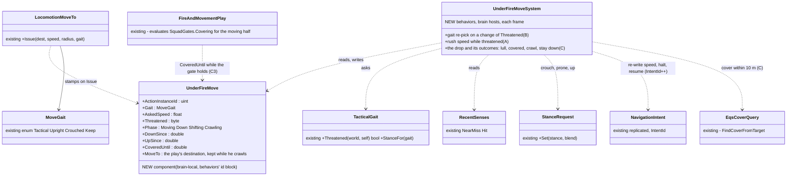
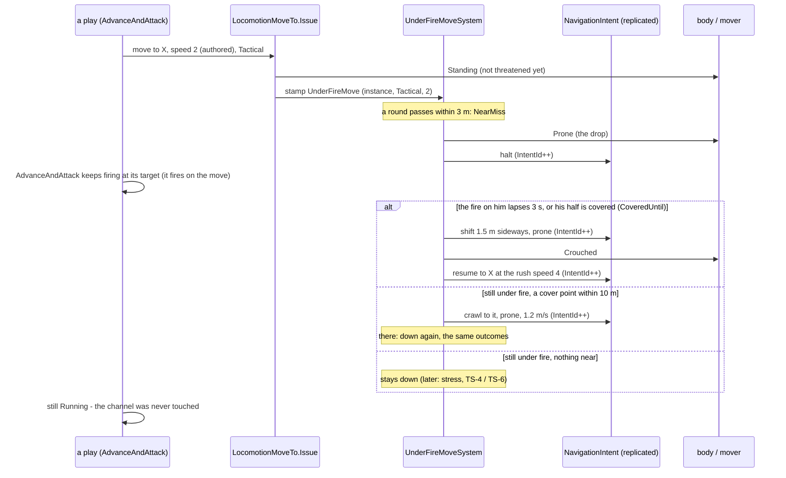
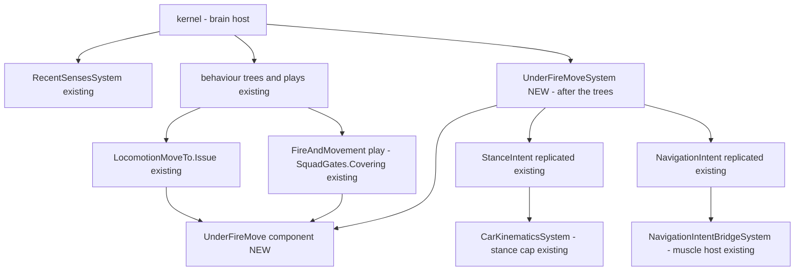

<!--STATUS
state: LIVE — APPROVED 2026-10-20 (R-2061): A–F as leaned, C revised + C3; BUILT the same day (§6)
updated: 2026-10-20 (C revised: the drop has outcomes, not a fixed time)
build-state: BUILT (§6 as built; §2a–§2c drawn before the build — §6 names where it deviated)
current-answer: §5 the answer · §6 as built · §3 the leans it approved
stale-below: §3 C's first form ("prone 2–4 s, then up") is SUPERSEDED by the revised C below — kept only in §⛔ HISTORY
known-rot: none
known-conflict: none
related-designs:
  - docs/blueprints/Architect_Question_97_Default_Reflexes_Soldiers_And_Civilians.md — the man who is IDLE (or on a task with no reaction): default SOPs for lone soldiers and civilians
  - docs/blueprints/Architect_Question_88_Soldier_Speed_And_Retreat_Under_Fire.md — OWNS the sprint (6 m/s), the stance speed caps (crouched 0.5, prone 0.2) and the Tactical gait (R-265); this question re-times WHEN that gait is chosen and adds what happens under fire mid-move
  - docs/DESIGN_Temperament_And_Stress.md — OWNS stress (TS-4) and the break (TS-6: surrender / flee / go to ground, R-2034, not built); the reflex here is the short per-move drop that stress later lengthens or turns into the break
  - docs/designs/group-maneuvers/DESIGN_Squad_Tactics.md — §7.6 OWNS fire and movement ("I'm up, he sees me, I'm down", rush 3–5 s, Speed 4) and its "set … or prone" gate that has no prone order yet
  - docs/DESIGN_Peek_And_Fire.md — OWNS a man AT cover (D12 "under fire = stay down", RelocateSpeed 4.5); the cover move (D below) is its GoToHide
  - docs/DESIGN_Decision_Layer.md — §3.3f OWNS HoldProne (the wounded man with no cover), a posture, not a reflex
  - docs/designs/group-maneuvers/DESIGN_Defend_And_Attack_Position.md — DA-A proficiency tiers, which may shape the drop (F)
  - docs/designs/navig-2/Navigation_Design_v2_0.md — §11 the stance speed ratios AQ88 reused
-->

# Architect Question 96 — how a soldier moves under fire: run, crouch, drop, rise *(CE-2319, CE-2320)*

> 🔒 **User, live, 2026-10-20 (CE-2319):** *"The soldiers instructed to advance … walk slowly and in fully standing posture even if under
> heavy fire, i would expect them to at least run and take combat posture … and to lay down for a while (suppressed) - i.e. some kind of
> self preservation reflexes."*
>
> 🔒 **User, live, 2026-10-20 (CE-2320):** *"I also saw soldier trying to take cover on open field walking slowly and fully standing until
> killed by the attacker. I would expect him to take a lower profile run and maybe some slight zig-zagging to avoid being killed."*

**Asked by:** behaviors. **Decides:** the user. **Builds:** behaviors (all of it; one small read in the mover, §3 C2).
Rows: [`CE-2319`](Blueprint_Issues_Tracker.md), [`CE-2320`](Blueprint_Issues_Tracker.md).

## 1. INVENTORY *(measured 2026-10-20 — codebase-memory `search_graph`, grep for call sites)*

| query | total | what it found |
|---|---|---|
| `search_graph(name_pattern=".*(TacticalGait\|MoveGait\|StanceRequest\|StanceSpeed\|GoProne\|HoldProne\|Suppressed\|NearMiss\|RecentSenses\|GoToGround\|Pinned\|Stress).*")` | 157 (mostly unrelated "pinned") | the movement pieces: `MoveGait` (16 in-edges) · `TacticalGait` · `StanceRequest` · `RecentSenses` + `RecentSensesSystem` · `NearMissEvent` → `NearMissSensingSystem` · `PostureNodes.HoldProne` / `GoProneSeconds` · `DESIGN_Temperament_And_Stress.md` (no code: no `Stress` type exists) |
| grep `LocomotionMoveTo.Issue(` in `Hrot.AI.Behaviors` | **41 calls, 16 files** | gaits passed: 10 `Upright` (civilians), 4 `Crouched`, 3 `Keep`, the rest default `Tactical` |
| grep `StanceId.Prone` in Brains | 6 | a civilian falling (`CivilianBehavior:341`), PeekAndFire's hide / suppressed frame post (`:446`, `:759`), `HoldProne` (`PostureNodes:381`), `WindowDuel` — ⛔ none for a man on the move |
| ⛔ zig-zag / weave / serpentine | 0 | searched `docs/` and `.dev/` (subagent sweep): no design record for infantry; "evasive" exists only for aircraft |

⚠ `check_index_coverage` was not run; the inventory is the graph query above plus grep.

## 2. How it is — the claims the leans rest on

| claim | code (how it IS) | design (how it was MEANT) |
|---|---|---|
| the gait is chosen ONCE, when a move is issued | ✅ `LocomotionMoveTo.Issue` calls `TacticalGait.StanceFor` before writing the channel (`LocomotionMoveTo.cs:93-94`); `AdvanceAndAttack` re-issues only on failure or a moved target (`PostureNodes.cs:289-301`) | ⚠ AQ88 §4 B *"run in slightly crouched pose whenever they feel threatened"*; §5 put it at issue — AQ88's own `known-rot` names this gap |
| "threatened" already exists and is cheap | ✅ `TacticalGait.Threatened`: a remembered contact in the fight, a heard one, or a hit / near miss within 10 s (`LocomotionMoveTo.cs:38-53`) | ✅ AQ88 §5 / R-265 |
| an authored order speed overrides the rush | ✅ `PlatoonAttack.OrderFor` passes the plan's `Speed` into every play (`PlatoonAttackBehavior.cs:415-456`); `FireAndMovement` defaults 4 only when unset (`FireAndMovementBehavior.cs:205`); `pc-defend-house` authors `Speed 2` (behaviors' own scenario) | ✅ Squad Tactics §7.6: a rush is 3–5 s over 10–15 m ⇒ 3–5 m/s · ⛔ no design says what an order's speed means under fire |
| a crouched run is capped at 3 m/s | ✅ `StanceSpeed.Factor` Crouched 0.5 × sprint 6 (`CarKinematicsSystem.cs:150-160`, `VehicleClass.cs:121`) | ✅ AQ88 A/B, R-265 |
| the mover reads the speed only when the intent CHANGES | ✅ `MoveToExecutor.OnEnter` copies `Speed` into `NavigationIntent` once (`:56`); `NavigationIntentBridgeSystem` applies an intent only on a new `IntentId` (`:152-190`) ⇒ a mid-move speed or halt is a re-written intent (one re-plan) | — |
| near misses and hits reach the brain | ✅ `NearMissSensingSystem` → `SensorChange.NearMiss` → `RecentSenses` (`NearMissSensingSystem.cs:24`); within 3 m of a round from another side | ✅ Sensing §6 G, R-206 |
| nothing makes a MOVING man go to ground | ✅ the 6 prone writers above are all static postures | ⚠ Squad Tactics §7.6's "set … or prone" gate has no prone order (CE-2158's own note); TS-6's go-to-ground is the stress BREAK, not a reflex, and is unbuilt |
| a move for cover is not a threat move | ✅ `PeekAndFire.GoToHide` / `GoToFrame` issue the default gait at `RelocateSpeed` 4.5 (`PeekAndFireNodes.cs:398-407`) and `MoveToHide` never re-checks (`:457-476`); the library `TakeCover` asks 2.5 m/s (`TakeCover.btree.json:47`) | ⛔ none — Peek and Fire §8 sets the speed, not the gait |
| a moving TARGET is already harder to hit | ⚠ partly: rounds fly (time of flight) and small arms aim at the target's present middle with no lead (`AimPoint.Middle`); the moving penalty is the SHOOTER's (`HitModel.MovingFactor`) | ⛔ no design on target motion |

## 2a. Classes *(the leans; existing boxes marked)*

*What the picture shows that prose hid: the 41 callers do not change — the move is stamped where it is ISSUED (the one writer, CE-2092)
and one system keeps it honest afterwards, so every play, the library's and the squad's, gets the reflex at once, and the channel the
plays watch is never touched (they see Running throughout).*

## 2b. Sequence — a soldier advancing when the first rounds arrive

## 2c. Modules — who calls it each frame

*What the picture shows that prose hid: the system runs where the brain runs and writes only the two components the brain already
replicates to the muscle — so a split brain/muscle cluster needs no new wire.*

## 3. The sub-questions — each with the lean

### A — the speed under fire

An order's `Speed` (2 in `pc-defend-house`) today holds for the whole move, fire or not.

⭐ **Lean: an order's speed is the pace OUT of contact; while the mover is threatened (`TacticalGait.Threatened`), a Tactical or Crouched
move goes at least the RUSH speed, 4 m/s** (Squad Tactics §7.6) — which the crouched cap makes 3 m/s. Upright (civilian) and Keep moves
are untouched. And fix our own scenario (`pc-defend-house` authors `Speed 2`).
**Blast radius:** every soldier's move under fire gets faster; no play changes. **What would change it:** wanting a deliberately slow
advance under fire (a "creep" order) — then a play sets a gait that opts out.
Rejected: **each play picks its own speed under fire** — 16 files would each grow the same test, and a new play would forget it.

### A2 — the crouched run's cap

⭐ **Lean: keep R-265's 0.5 (3 m/s).** It is approved and twice a walk; the drop (C) does more for survival than another metre a second.
**What would change it:** live runs where 3 m/s still reads as a jog — then 0.6–0.7, one constant.

### B — when the gait is chosen

⭐ **Lean: re-pick it whenever `Threatened` changes during a move, not only at issue** — one system over the stamped move (§2a), so a man
who set off unthreatened drops into the crouched run the moment rounds arrive, and straightens when the threat is gone for 10 s.
**Blast radius:** every Tactical move; the 41 callers are untouched. **What would change it:** none known — this is AQ88 §4 B as written.
Rejected: **re-issue from every node each frame** — 41 sites, and each re-issue restarts the path.

### C — the drop, and what he does while he is down *(revised 2026-10-20)*

🔒 *User, 2026-10-20: "When he drops under fire and the fire still continues and no cover close enough, what would real soldier do if
part of a squad (under squad command) and when alone?"* — the answer (general infantry practice — the react-to-contact drill and the
individual movement techniques; ⛔ not in the corpus, as Squad Tactics §7.6 marks its own rush rule): he does not get up again after a fixed
time. He stays down and fires back; in a squad he rises when his half is COVERED, alone when the fire on him LAPSES; he never rises where
he dropped; with no cover he crawls to whatever is near.

⭐ **Lean: a near miss or hit while he is in the open (not within 3 m of where the move ends) ⇒ prone, the move halted. Then, re-checked
each frame:**

| while he is down | he does | built from (existing) |
|---|---|---|
| the fire on him LAPSES — no near miss or hit for 3 s | **shift**: crawls 1.5 m sideways (never rises where he dropped), then crouches and rushes on at the rush speed | `RecentSenses` NearMiss / Hit times |
| in a squad and his half is **COVERED** (C3) | the same shift-and-rush, even with rounds still coming — that is what covering fire is for | `SquadGates.Covering` (`SquadGates.cs:61`, 2 s window) |
| still under fire, a cover point within 10 m | **crawls** to it (prone, 1.2 m/s — `StanceSpeed` 0.2 × 6), then down there, the same outcomes | the EQS cover query (⚠ which form a system may ask synchronously: measure at build) |
| still under fire, nothing near | **stays down**; returns fire where his play already fires on the move (`AdvanceAndAttack` keeps ticking its `Fire` while the move is halted — `PostureNodes.cs:283`) | — |
| down a long time | nothing more now; the stress model later turns it into the break (TS-6: flee / freeze / surrender) | F |

Not again until he has been up ≥ 3 s (one rush). The plays never see it: the channel stays Running throughout.
**Blast radius:** every soldier moving under fire; a squad's bound takes longer (Squad Tactics' "set" gate waits for him — as it should).
**What would change it:** a play that must not stop (a man carrying a casualty — CE-2152's carrier is exempt, as is a vehicle).
Rejected: **a fixed 2–4 s drop** (this question's first form) — under steady fire he would stand up into it every 3 s; **rise only on a
lapse, even in a squad** — safer per man, but a squad under steady fire would never move, which is why covering fire exists; **the system
fires his weapon itself** — a second writer to the weapon channel beside the play's; **a reaction in the gate that pre-empts the play** —
the play loses its state for a drop and must resume; **wait for the stress model** — TS-6 is the BREAK, not this reflex, and is unbuilt.

### C3 — how a man knows his half is covered

⭐ **Lean: the play that already evaluates the gate tells its movers** — while `FireAndMovement` (and `CasualtyCare`'s carry) holds
`Covering` for the moving half, it stamps `UnderFireMove.CoveredUntil = now + 2 s` on each mover. The system reads only that one field,
so it never needs the squad. A man alone, or in a play with no base of fire, simply has no `CoveredUntil` and rises on a lapse.
⚠ To measure at build: that a squad's commander and its members' brains run on the same node (the stamp is a brain-local write).
**What would change it:** a split where they do not — then the stamp rides the member order the runner already sends.

### C2 — how he stops while down

⭐ **Lean: the system re-writes the move's `NavigationIntent` to halt (Mode None) and back to the same PathToPoint when he rises — two
intent writes, one re-plan; both through the component the brain already replicates.** ⚠ To measure at build: what `NavigationStatus`
the muscle reports for a halted intent, so `MoveToExecutor` keeps Running (it does today for any result but Arrived / Failed).
The shift and the crawl are the same mechanism with another point: the intent is re-written to the side step or the cover point (prone),
then back to the play's destination when he rises — the play's own order is never lost (`UnderFireMove.MoveTo`).
Rejected: **prone alone** — the prone cap is a 1.2 m/s crawl, not lying still; **strip `CanMove`** — the capability is the Health owner's
(injury writes it), a second writer could stand a casualty up.

### D — the move FOR cover (CE-2320)

⭐ **Lean: a move to a hide or a cover point is a threat move by definition — `MoveGait.Crouched` and at least the rush speed**:
PeekAndFire's `GoToHide` / `GoToFrame`, the EQS `TakeCover` / `FallBack` moves; the library `TakeCover` asset's 2.5 m/s goes to the rush
speed. With B and C it is crouched from the first step and drops when shot at.
**Blast radius:** 4 node sites + 1 asset (+ its generator goldens). **What would change it:** a covert move into cover — a gait that
opts out, as A.

### E — zig-zag

⭐ **Lean: not now.** No design record; the drop and the crouched rush answer the user's "lower profile"; rounds already fly (time of
flight) at a target's present middle with no lead, so a crossing run is missed more than a standing man; and a weave fights the path
follower (a man weaving off the path round a corner). **What would change it:** live runs where a straight crouched rush with drops
still dies in the open at a rate the user finds wrong — then a 1–2 m lateral offset every 2–3 s, in the open only, as one more step of
the same system.

### F — who shapes the drop later

⭐ **Lean: the stress model (TS-4) scales it when built** — more stress, a longer lapse needed before he rises (and a covered rise
refused when he is breaking); TS-6's break replaces it (he stays down, flees or surrenders). Until then the fixed 3 s lapse. Proficiency (DA-A) is left out now: an untrained man staying down longer is TS's job, not a second knob.
**What would change it:** wanting the tiers to differ before the stress model lands.

## 4. Sequencing *(if approved)*

| step | what | rails |
|---|---|---|
| 1 | `UnderFireMove` (component id from behaviors' 418–433) + the stamp in `Issue` + `UnderFireMoveSystem` B and A | a move set off unthreatened crouches and speeds up when a near miss lands; straightens 10 s after; an Upright move never changes; the channel's instance never changes |
| 2 | C + C2 — the drop, the halt, the lapse, the shift | near miss in the open ⇒ prone and halted; a near miss every 2 s keeps him down; 3 s without one ⇒ he shifts 1.5 m sideways, then rises crouched at the rush speed toward the play's point; none within 3 m of the end; none again within 3 s of rising; the play stays Running |
| 2b | C3 — covered | his half covered (`CoveredUntil`) ⇒ he shifts and rises under fire; alone ⇒ he waits for the lapse |
| 2c | C — the crawl to cover | still under fire, a cover point within 10 m ⇒ he crawls to it prone, then the same outcomes there; nothing near ⇒ he stays down and his play keeps firing |
| 3 | D — the cover moves, the `TakeCover` asset (goldens) | GoToHide is crouched at ≥ 4 m/s from the first step |
| 4 | `pc-defend-house` without `Speed 2`; a live run | the user's scene: the assault rushes crouched and drops under fire |

## 5. Answers

🔒 **User, 2026-10-20 (after C was revised):** *"Pls implement also demo scenario for it"* — read as approval of A–F as leaned (C revised,
C3 added), and a demo scenario — ✅ **APPROVED** (R-2061). Built the same day: §6.

## 6. As built *(2026-10-20, behaviors)*

⚠ **Known gap, measured `2026-10-21` (`CE-2343`, not yet decided):** `Rise` re-paces to the ORIGINAL destination — when that destination is
itself exposed (a post on a berm's enemy face, `CE-2342`), the man crawls to the safe face and then walks straight back out. See
[Defend and Attack Position §8f.2](../designs/group-maneuvers/DESIGN_Defend_And_Attack_Position.md).

As §2a–§2c, with these differences (each measured during the build):

| deviation | why |
|---|---|
| ① `UnderFireMove` lives in FDP Toolkits (`Behavior/Components`, id **418** — the first of behaviors' block, free on every lane), not in behaviors | the move's EXECUTOR (FDP) must read `HoldIntentId`; a behaviors-only type it cannot see |
| ② the reflex's intents are marked by **`HoldIntentId`**, and `MoveToExecutor.Execute` ignores the result of that intent (cross-lane, FDP Navigation) | ⛔ the move's `Flags` byte is full (bits 0–4 used, 5–7 the road use) — no bit for "a reflex intent". 📐 Without the mark, a side step or crawl that ARRIVES reads as the play's move arriving |
| ③ `MoveToExecutor.WriteIntent` / `Halt` — the intent write factored out of `OnEnter` (one writer, reused by the reflex) | the bridge applies an intent only on a new `IntentId` (`NavigationIntentBridgeSystem.cs:152-190`), so every re-pace, halt, step and resume is a re-written intent; ⛔ never a second copy of OnEnter's field list |
| ④ A is applied twice: at issue (a man already threatened sets off at the rush speed) and mid-move by the system | a move issued under fire should not start at the order's walk and be corrected a frame later |
| ⑤ the system's re-pace also rewrites the channel's `MoveToParams.Speed` (not its instance) | so the move's params keep saying what it now does; no play reads them |
| ⑥ D covers EVERY EQS tactics move (TakeCover, FallBack, Flank, FiringPosition, CloseToThrow — one shared step, `EqsTacticsNodes.cs:256`) and PeekAndFire's two hide moves; the `TakeCover` asset's 2.5 m/s is left in the data (the code floors it) | they share one step, and each is made against a threat; no asset (and no generator golden) changed |
| ⑦ C3 is stamped by `FireAndMovement` only (its rush phases, while the other half's `Covering` holds) | `CasualtyCare`'s carry is exempt from the drop anyway (`CarryLoad`); BoundingOverwatch has no covering gate yet |
| ⑧ the crawl asks the terrain's `ICoverProvider` (synchronous radius query) for the nearest point within 10 m whose cover faces his nearest remembered threat | the EQS query is asynchronous; the provider answers in the same frame |
| ⑨ the system runs in `CgfLogicPack` AFTER the action dispatchers | a move issued this frame must already have its intent when the reflex halts it |

Rails (`TacticsTreesTests`): `AQ96_AThreatMidMove_CrouchesHim_AndRushes_TheSameMove` · `AQ96_ANearMissInTheOpen_DropsHim_HeStaysDownUnderFire_ThenShiftsAndRises`
· `AQ96_CoveredByHisHalf_HeRisesUnderFire_AloneHeStaysDown` · `AQ96_NoDropWhenArriving_AndAnUprightRunIsNotKept`.
Demos: `uf-alone-under-fire` (one man, nobody covers him) and `uf-squad-under-fire` (the fire-and-movement cast) — the first scenarios that
carry `header.description` (what they show and how to judge them; the round-trip is backend's, [handoff](batches/HANDOFF_Behaviors_To_Backend_Scenario_Description.md)).
`python3 scripts/utility-demo-check.py --launch uf-alone-under-fire` (and `uf-squad-under-fire`); the live results are below.

| live, 2026-10-20 | measured |
|---|---|
| ✅ `uf-alone-under-fire` PASS | first round at 2.8 s; never upright under fire; one drop, stopped; pinned by two immortal riflemen (a near miss or hit about every second) he stayed down — measured for 50 s on a probe run; when the check emptied their rifles (15.1 s) he rose 4.5 s later (the 3 s lapse + the side step) and rushed on |
| ✅ `uf-squad-under-fire` PASS | 19 drops across the six, every rise after a side step, **17 of 19 rises with rounds still coming** (his half covered — C3), never upright under fire, every mover at ≥ 3 m/s, and the bounds went on (Cover → Rush → Cover → Rush) |
| ⚠ found by the live runs, not by the rails | ① the hostiles of the fire-and-movement cast carry NO order, so they never fire (150 rounds kept, measured) — both demos give them `CombatPosture` (`Stay`); ② two immortal riflemen never pause, so a lone man is pinned for good (right by C) — the lone demo's check stops their fire to judge the rise; ③ a covered mover goes down and starts his side step inside one 0.25 s sample — the check counts a drop as Moving → any down phase |
| ⭐ extended 2026-10-20 (CE-2322, found by AQ97's live demo) | C's *"still under fire, nothing near: stays down"* covered only a man dropped off a MOVE. A man in a `TakeCover` with no cover point to go to was never on a move, so he stood upright under fire. ⇒ `TakeCover` drops him itself (`Mode.DownInTheOpen`, [DESIGN_Eqs_Consuming_Behaviours.md](../DESIGN_Eqs_Consuming_Behaviours.md) §6 A8); its first cover point gets him up into this question's crouched rush, where C takes over |

## ⛔ HISTORY

- **§3 C, first form (2026-10-20, superseded the same day):** *"a near miss or hit while he is in the open ⇒ prone, the move halted, for
  2–4 s (each man his own draw, seeded); then up, crouched, on at the rush speed; not again until he has been up ≥ 3 s."* Replaced after
  the user asked what a real soldier does when the fire continues: under steady fire it would stand him up into it every few seconds.

