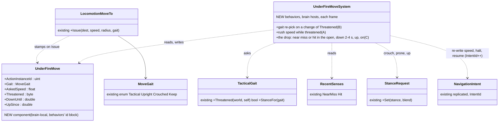
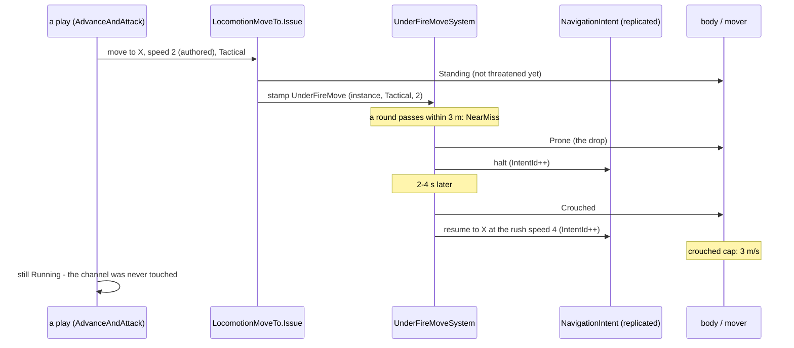
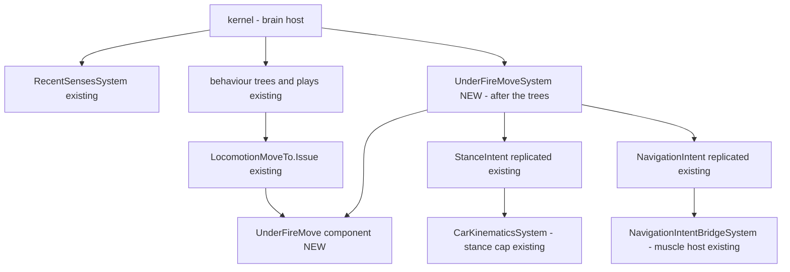

<!--STATUS
state: LIVE — ASKED 2026-10-20, leans per sub-question (§3); waiting on the user
updated: 2026-10-20
build-state: DESIGN — the UML (§2a–§2c) is drawn for the leans; READY-TO-BUILD once approved
current-answer: §3 the leans · §4 sequencing · §5 answers (empty until the user replies)
stale-below: nothing
known-rot: none
known-conflict: none
related-designs:
  - docs/blueprints/Architect_Question_88_Soldier_Speed_And_Retreat_Under_Fire.md — OWNS the sprint (6 m/s), the stance speed caps (crouched 0.5, prone 0.2) and the Tactical gait (R-265); this question re-times WHEN that gait is chosen and adds what happens under fire mid-move
  - docs/DESIGN_Temperament_And_Stress.md — OWNS stress (TS-4) and the break (TS-6: surrender / flee / go to ground, R-2034, not built); the reflex here is the short per-move drop that stress later lengthens or turns into the break
  - docs/designs/group-maneuvers/DESIGN_Squad_Tactics.md — §7.6 OWNS fire and movement ("I'm up, he sees me, I'm down", rush 3–5 s, Speed 4) and its "set … or prone" gate that has no prone order yet
  - docs/DESIGN_Peek_And_Fire.md — OWNS a man AT cover (D12 "under fire = stay down", RelocateSpeed 4.5); the cover move (D below) is its GoToHide
  - docs/DESIGN_Decision_Layer.md — §3.3f OWNS HoldProne (the wounded man with no cover), a posture, not a reflex
  - docs/designs/group-maneuvers/DESIGN_Defend_And_Attack_Position.md — DA-A proficiency tiers, which may shape the drop (F)
  - docs/designs/navig-2/Navigation_Design_v2_0.md — §11 the stance speed ratios AQ88 reused
-->

# Architect Question 96 — how a soldier moves under fire: run, crouch, drop, rise *(CE-2319, CE-2320)*

> 🔒 **User, live, 2026-10-20 (CE-2319):** *"The soldiers instructed to advance … walk slowly and in fully standing posture even if under
> heavy fire, i would expect them to at least run and take combat posture … and to lay down for a while (suppressed) - i.e. some kind of
> self preservation reflexes."*
>
> 🔒 **User, live, 2026-10-20 (CE-2320):** *"I also saw soldier trying to take cover on open field walking slowly and fully standing until
> killed by the attacker. I would expect him to take a lower profile run and maybe some slight zig-zagging to avoid being killed."*

**Asked by:** behaviors. **Decides:** the user. **Builds:** behaviors (all of it; one small read in the mover, §3 C2).
Rows: [`CE-2319`](Blueprint_Issues_Tracker.md), [`CE-2320`](Blueprint_Issues_Tracker.md).

## 1. INVENTORY *(measured 2026-10-20 — codebase-memory `search_graph`, grep for call sites)*

| query | total | what it found |
|---|---|---|
| `search_graph(name_pattern=".*(TacticalGait\|MoveGait\|StanceRequest\|StanceSpeed\|GoProne\|HoldProne\|Suppressed\|NearMiss\|RecentSenses\|GoToGround\|Pinned\|Stress).*")` | 157 (mostly unrelated "pinned") | the movement pieces: `MoveGait` (16 in-edges) · `TacticalGait` · `StanceRequest` · `RecentSenses` + `RecentSensesSystem` · `NearMissEvent` → `NearMissSensingSystem` · `PostureNodes.HoldProne` / `GoProneSeconds` · `DESIGN_Temperament_And_Stress.md` (no code: no `Stress` type exists) |
| grep `LocomotionMoveTo.Issue(` in `Hrot.AI.Behaviors` | **41 calls, 16 files** | gaits passed: 10 `Upright` (civilians), 4 `Crouched`, 3 `Keep`, the rest default `Tactical` |
| grep `StanceId.Prone` in Brains | 6 | a civilian falling (`CivilianBehavior:341`), PeekAndFire's hide / suppressed frame post (`:446`, `:759`), `HoldProne` (`PostureNodes:381`), `WindowDuel` — ⛔ none for a man on the move |
| ⛔ zig-zag / weave / serpentine | 0 | searched `docs/` and `.dev/` (subagent sweep): no design record for infantry; "evasive" exists only for aircraft |

⚠ `check_index_coverage` was not run; the inventory is the graph query above plus grep.

## 2. How it is — the claims the leans rest on

| claim | code (how it IS) | design (how it was MEANT) |
|---|---|---|
| the gait is chosen ONCE, when a move is issued | ✅ `LocomotionMoveTo.Issue` calls `TacticalGait.StanceFor` before writing the channel (`LocomotionMoveTo.cs:93-94`); `AdvanceAndAttack` re-issues only on failure or a moved target (`PostureNodes.cs:289-301`) | ⚠ AQ88 §4 B *"run in slightly crouched pose whenever they feel threatened"*; §5 put it at issue — AQ88's own `known-rot` names this gap |
| "threatened" already exists and is cheap | ✅ `TacticalGait.Threatened`: a remembered contact in the fight, a heard one, or a hit / near miss within 10 s (`LocomotionMoveTo.cs:38-53`) | ✅ AQ88 §5 / R-265 |
| an authored order speed overrides the rush | ✅ `PlatoonAttack.OrderFor` passes the plan's `Speed` into every play (`PlatoonAttackBehavior.cs:415-456`); `FireAndMovement` defaults 4 only when unset (`FireAndMovementBehavior.cs:205`); `pc-defend-house` authors `Speed 2` (behaviors' own scenario) | ✅ Squad Tactics §7.6: a rush is 3–5 s over 10–15 m ⇒ 3–5 m/s · ⛔ no design says what an order's speed means under fire |
| a crouched run is capped at 3 m/s | ✅ `StanceSpeed.Factor` Crouched 0.5 × sprint 6 (`CarKinematicsSystem.cs:150-160`, `VehicleClass.cs:121`) | ✅ AQ88 A/B, R-265 |
| the mover reads the speed only when the intent CHANGES | ✅ `MoveToExecutor.OnEnter` copies `Speed` into `NavigationIntent` once (`:56`); `NavigationIntentBridgeSystem` applies an intent only on a new `IntentId` (`:152-190`) ⇒ a mid-move speed or halt is a re-written intent (one re-plan) | — |
| near misses and hits reach the brain | ✅ `NearMissSensingSystem` → `SensorChange.NearMiss` → `RecentSenses` (`NearMissSensingSystem.cs:24`); within 3 m of a round from another side | ✅ Sensing §6 G, R-206 |
| nothing makes a MOVING man go to ground | ✅ the 6 prone writers above are all static postures | ⚠ Squad Tactics §7.6's "set … or prone" gate has no prone order (CE-2158's own note); TS-6's go-to-ground is the stress BREAK, not a reflex, and is unbuilt |
| a move for cover is not a threat move | ✅ `PeekAndFire.GoToHide` / `GoToFrame` issue the default gait at `RelocateSpeed` 4.5 (`PeekAndFireNodes.cs:398-407`) and `MoveToHide` never re-checks (`:457-476`); the library `TakeCover` asks 2.5 m/s (`TakeCover.btree.json:47`) | ⛔ none — Peek and Fire §8 sets the speed, not the gait |
| a moving TARGET is already harder to hit | ⚠ partly: rounds fly (time of flight) and small arms aim at the target's present middle with no lead (`AimPoint.Middle`); the moving penalty is the SHOOTER's (`HitModel.MovingFactor`) | ⛔ no design on target motion |

## 2a. Classes *(the leans; existing boxes marked)*

*What the picture shows that prose hid: the 41 callers do not change — the move is stamped where it is ISSUED (the one writer, CE-2092)
and one system keeps it honest afterwards, so every play, the library's and the squad's, gets the reflex at once, and the channel the
plays watch is never touched (they see Running throughout).*

## 2b. Sequence — a soldier advancing when the first rounds arrive

## 2c. Modules — who calls it each frame

*What the picture shows that prose hid: the system runs where the brain runs and writes only the two components the brain already
replicates to the muscle — so a split brain/muscle cluster needs no new wire.*

## 3. The sub-questions — each with the lean

### A — the speed under fire

An order's `Speed` (2 in `pc-defend-house`) today holds for the whole move, fire or not.

⭐ **Lean: an order's speed is the pace OUT of contact; while the mover is threatened (`TacticalGait.Threatened`), a Tactical or Crouched
move goes at least the RUSH speed, 4 m/s** (Squad Tactics §7.6) — which the crouched cap makes 3 m/s. Upright (civilian) and Keep moves
are untouched. And fix our own scenario (`pc-defend-house` authors `Speed 2`).
**Blast radius:** every soldier's move under fire gets faster; no play changes. **What would change it:** wanting a deliberately slow
advance under fire (a "creep" order) — then a play sets a gait that opts out.
Rejected: **each play picks its own speed under fire** — 16 files would each grow the same test, and a new play would forget it.

### A2 — the crouched run's cap

⭐ **Lean: keep R-265's 0.5 (3 m/s).** It is approved and twice a walk; the drop (C) does more for survival than another metre a second.
**What would change it:** live runs where 3 m/s still reads as a jog — then 0.6–0.7, one constant.

### B — when the gait is chosen

⭐ **Lean: re-pick it whenever `Threatened` changes during a move, not only at issue** — one system over the stamped move (§2a), so a man
who set off unthreatened drops into the crouched run the moment rounds arrive, and straightens when the threat is gone for 10 s.
**Blast radius:** every Tactical move; the 41 callers are untouched. **What would change it:** none known — this is AQ88 §4 B as written.
Rejected: **re-issue from every node each frame** — 41 sites, and each re-issue restarts the path.

### C — the drop: "I'm up, he sees me, I'm down"

⭐ **Lean: one soldier reflex for every Tactical / Crouched move: a near miss or hit while he is in the open ⇒ prone, the move halted,
for 2–4 s (each man his own draw, seeded); then up, crouched, on at the rush speed; not again until he has been up ≥ 3 s (one rush).**
"In the open" = not within 3 m of where the move ends (he is not arriving at his cover). The plays never see it: the channel stays Running.
**Blast radius:** every soldier moving under fire; a squad's bound takes longer (Squad Tactics' "set" gate waits for him — as it should).
**What would change it:** a play that must not stop (a man carrying a casualty — CE-2152's carrier is exempt, as is a vehicle).
Rejected: **a reaction in the gate that pre-empts the play** — the play loses its state for a 3-second drop and must resume; **wait for
the stress model** — TS-6 is a BREAK (he stays down), not this short reflex, and it is unbuilt.

### C2 — how he stops while down

⭐ **Lean: the system re-writes the move's `NavigationIntent` to halt (Mode None) and back to the same PathToPoint when he rises — two
intent writes, one re-plan; both through the component the brain already replicates.** ⚠ To measure at build: what `NavigationStatus`
the muscle reports for a halted intent, so `MoveToExecutor` keeps Running (it does today for any result but Arrived / Failed).
Rejected: **prone alone** — the prone cap is a 1.2 m/s crawl, not lying still; **strip `CanMove`** — the capability is the Health owner's
(injury writes it), a second writer could stand a casualty up.

### D — the move FOR cover (CE-2320)

⭐ **Lean: a move to a hide or a cover point is a threat move by definition — `MoveGait.Crouched` and at least the rush speed**:
PeekAndFire's `GoToHide` / `GoToFrame`, the EQS `TakeCover` / `FallBack` moves; the library `TakeCover` asset's 2.5 m/s goes to the rush
speed. With B and C it is crouched from the first step and drops when shot at.
**Blast radius:** 4 node sites + 1 asset (+ its generator goldens). **What would change it:** a covert move into cover — a gait that
opts out, as A.

### E — zig-zag

⭐ **Lean: not now.** No design record; the drop and the crouched rush answer the user's "lower profile"; rounds already fly (time of
flight) at a target's present middle with no lead, so a crossing run is missed more than a standing man; and a weave fights the path
follower (a man weaving off the path round a corner). **What would change it:** live runs where a straight crouched rush with drops
still dies in the open at a rate the user finds wrong — then a 1–2 m lateral offset every 2–3 s, in the open only, as one more step of
the same system.

### F — who shapes the drop later

⭐ **Lean: the stress model (TS-4) scales it when built** — more stress, a longer drop; TS-6's break replaces it (he stays down). Until
then fixed bounds (2–4 s). Proficiency (DA-A) is left out now: an untrained man staying down longer is TS's job, not a second knob.
**What would change it:** wanting the tiers to differ before the stress model lands.

## 4. Sequencing *(if approved)*

| step | what | rails |
|---|---|---|
| 1 | `UnderFireMove` (component id from behaviors' 418–433) + the stamp in `Issue` + `UnderFireMoveSystem` B and A | a move set off unthreatened crouches and speeds up when a near miss lands; straightens 10 s after; an Upright move never changes; the channel's instance never changes |
| 2 | C + C2 — the drop, the halt, the rise | near miss in the open ⇒ prone and halted, up after 2–4 s at the rush speed; none within 3 m of the end; none again within 3 s of rising; the play stays Running |
| 3 | D — the cover moves, the `TakeCover` asset (goldens) | GoToHide is crouched at ≥ 4 m/s from the first step |
| 4 | `pc-defend-house` without `Speed 2`; a live run | the user's scene: the assault rushes crouched and drops under fire |

## 5. Answers

*(empty — the user decides)*
