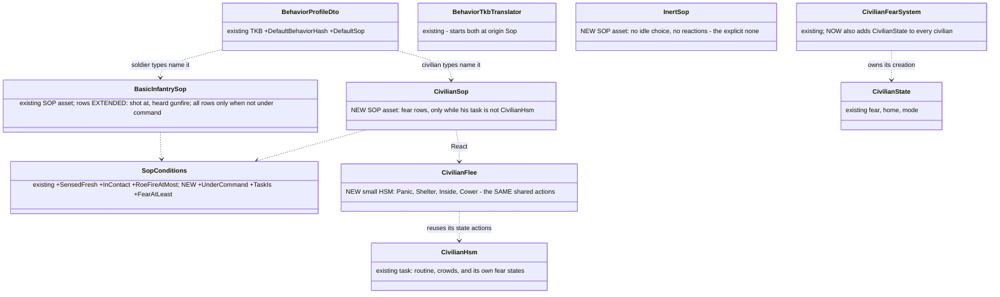
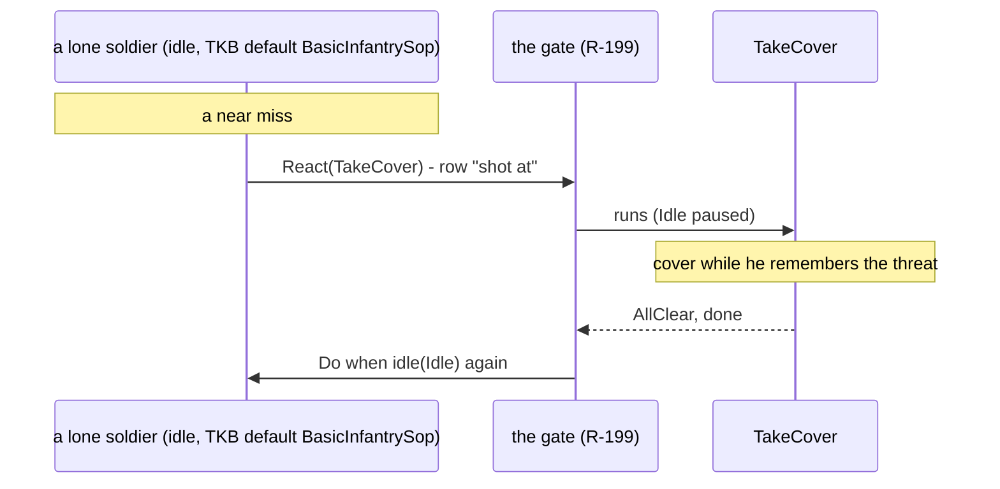
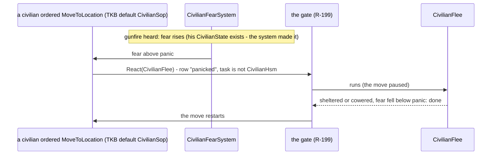
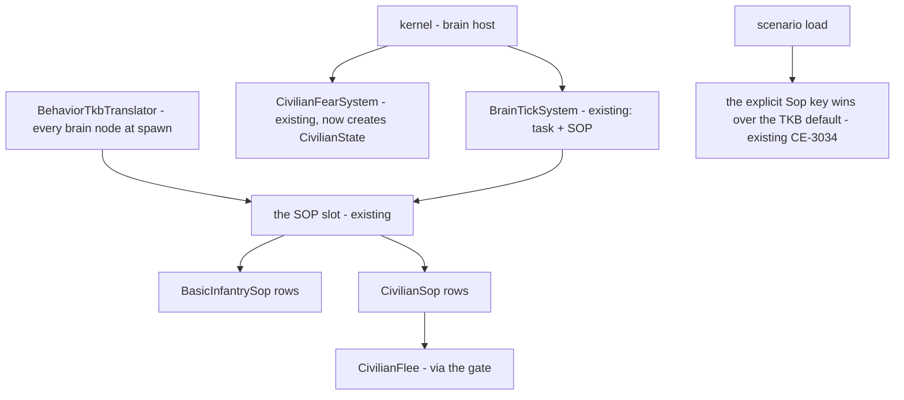

<!--STATUS
state: LIVE — ASKED 2026-10-20, a lean per sub-question (§3); waiting on the user
updated: 2026-10-20
build-state: DESIGN — UML for the leans in §2a–§2c; READY-TO-BUILD once approved
current-answer: §3 the leans · §4 sequencing · §5 answers (empty until the user replies)
stale-below: nothing
known-rot: none
known-conflict: none
related-designs:
  - docs/DESIGN_Decision_Layer.md — §4 OWNS the SOP slot, the four gate rules (R-199), §4.7 BasicInfantrySop (CE-2080); this question gives it to every lone soldier by default and adds rows
  - docs/blueprints/Architect_Question_83_Doctrine_And_Order_Origin.md — §3 OWNS R-188 "no SOP = brain-dead = absolute control; the TKB names the default"; this question keeps the rule and adds the explicit "none"
  - docs/DESIGN_Civilians_And_Crowd_Control.md — OWNS CivilianHsm (CIV-2: Routine, Alarmed, Panic, Shelter, Inside, Cower, Casualty, crowds) and the fear (CivilianFearSystem); this question moves the fear's OWNERSHIP of the state out of the HSM and adds a civilian SOP for a civilian on another task
  - docs/blueprints/Architect_Question_96_Movement_Under_Fire.md — OWNS the reflex of a soldier already MOVING (the drop); this question covers the man who is idle or on a task with no reaction
  - docs/DESIGN_Temperament_And_Stress.md — TS-6's break (later) shapes how a lone man reacts; out of scope here
-->

# Architect Question 97 — every soldier and civilian reacts by default; "no response" is said explicitly

> 🔒 **User, 2026-10-20:** *"When the character is idle with no SOP and gets under fire or is hit, he does not react. Technically this is
> correct (idle is likely a brain death) just it feels a bit weird. How could we make the characters respond in usual expected way … for
> freshly created characters? I think [they] should get some default 'reflexive' SOP, and only [when] we need them to avoid any response,
> could we have some Lethargic SOP to force that unnatural state of the character?"*
>
> 🔒 **User, 2026-10-20:** *"Check how to add the default sop to civilian as it should respond normally even without hsm, response being
> just in hsm seems wrong, isn't it?"*

**Asked by:** behaviors. **Decides:** the user. **Builds:** behaviors (SOP assets, conditions, the civilian fear owner, the TKB defaults,
the scenario stamp).

## 1. INVENTORY *(measured 2026-10-20 — codebase-memory `search_graph`, grep, a scenario sweep)*

| query | total | what it found |
|---|---|---|
| `search_graph(name_pattern=".*(Sop\|Civilian(Fear\|Mind\|State\|Hsm)).*", label=Class)` | 37 | the SOP slot (`SopState`, `AssignSopEvent`, `ClearSopEvent`, `SopActions`, `SopConditions` with 5 conditions), the SOP order node in BTree / blueprint / HSM emit, the civilian fear (`CivilianFear`, `CivilianFearSystem`, `CivilianState`, `CivilianMind`) and their suites (`BasicInfantrySopTests`, `BasicVehicleSopTests`, `SopSlotTests`, `CivilianHsmTests`, `CivilianFearSystemTests`) |
| shipped SOP assets (`Assets/BTrees/Library/Sop/`) | 5 | `BasicInfantrySop` · `BasicSquadSop` · `BasicPlatoonSop` · `BasicVehicleSop` · `PilotSop` |
| TKB types naming a `DefaultSop` (`BdcTkbCatalog`) | 2 call sites | the platoon (`BasicPlatoonSop`, `:884`) and the paratroopers (`Jumper`, `:324`) — ⛔ no soldier type |
| scenario sweep, 88 files | 394 person units | 390 carry no `Sop`; ~160 soldiers have no commander (no `UnitSubordinate`), many with a task; all 133 civilians run `CivilianHsm` (102 named, 29 by the TKB default, 2 `Idle` on purpose) |

⚠ `check_index_coverage` was not run; the inventory is the graph query above plus grep and the scenario sweep.

## 2. How it is — the claims the leans rest on

| claim | code (how it IS) | design (how it was MEANT) |
|---|---|---|
| no SOP = no reaction | ✅ a unit gets an SOP only when its type names one (`BehaviorTkbTranslator.cs:110`) | ✅ R-188 *"no SOP = brain-dead = absolute control; the TKB names the default"* |
| a reacting SOP exists | ✅ `BasicInfantrySop`: hit (fresh 3 s) → React(TakeCover) · first threat → React(FallBack) under HoldFire, else React(TakeCover) · else Do-when-idle(Idle) | ✅ Decision Layer §4.7 (CE-2080), the real TakeCover / FallBack (CE-2094) |
| a near miss and a heard shot are not rows | ✅ Hit and FirstThreat only | ⛔ §4.7 predates the near miss (CE-3064) |
| a cleared SOP does not survive a load once a default exists | ✅ a unit whose scenario stores no `Sop` gets its type's (`:110`); `ClearSopEvent` is not saved | — |
| a civilian's whole response lives in his TASK | ✅ `CivilianHsm` is the civilians' `DefaultBehaviorHash` (`CivilianTkbCatalog.cs:70`); Alarmed / Panic / Shelter / Cower / Casualty are its states | ✅ Civilians §7.2 / CIV-2 — ⚠ written before any civilian was given an order |
| ⛔ a civilian on any other task has NO fear at all | ✅ `CivilianState` (his fear) is ADDED BY THE HSM on its first tick (`CivilianState.cs:39`); `CivilianFearSystem` skips anyone without it (`CivilianFearSystem.cs:62`) ⇒ a civilian placed with `MoveToLocation` (or switched to it) hears gunfire and feels nothing | ⛔ searched the civilians design: no record of an ordered civilian |
| the state actions are reusable | ✅ `Alarmed`, `Panic`, `Shelter`, `Inside`, `Cower`, `Casualty` are `[SharedAiAction]`s (`CivilianBehavior.cs`) | ✅ R-256 L1 (a shared node is the unit of reuse) |
| a squad man's reactions are his squad's | ✅ `BasicSquadSop` (ReactToContact) + the plays order him; a personal SOP's reaction would PAUSE his squad order (R-199 ②) | ✅ R-2042 knowledge by scope |

## 2a. Classes *(the leans)*

*What the picture shows that prose hid: nothing new decides anything. The soldier reacts through the SOP he already could have, the
civilian through the same state actions his HSM runs; the two new assets are thin rows over existing pieces, and the one real change is
WHO creates the civilian's fear (the system that writes it, not the task that happens to read it).*

## 2b. Sequences

## 2c. Modules

*What the picture shows that prose hid: the scenario's own `Sop` key already outranks the TKB default (origin Superior over Sop, CE-3034) —
so an explicit "none" needs only a value to write, not a new rule.*

## 3. The sub-questions — each with the lean

### A — a lone soldier's default

⭐ **Lean: every soldier type names `BasicInfantrySop` as its `DefaultSop`; its rows act only when he is NOT under command** (a new
`UnderCommand` condition: a live commander above him) — a squad man's reactions stay his squad's, and a man whose squad is wiped out
becomes his own master the moment it happens. **Blast radius:** every soldier type in the TKB (data). **What would change it:** wanting
squad men to react on their own too — then the rows lose the condition and the squad's orders get paused by them (R-199 ②).
Rejected: **a second "ReflexSop"** — two SOPs for one job; **reactions hard-wired into the brain** — breaks R-188's absolute control.

### B — what he does

⭐ **Lean: two rows added to `BasicInfantrySop`, above the existing ones:**

| row (first true wins) | reaction |
|---|---|
| hit OR a near miss, fresh | React(TakeCover) — as the hit row today (cover from the threat; the move reflex of AQ96 makes the run to it) |
| gunfire heard within 150 m, fresh (no threat seen) | React(CombatPosture, Stay) — he holds where he is, crouched, his eyes on the sound (the look node's heard rule), and engages if he sees the shooter |
| (existing) first threat → FallBack under HoldFire, else TakeCover · else Idle | unchanged |

**What would change it:** a scene where a heard shot must send him to cover at once — then the heard row reacts with TakeCover too.

### C — "no response", explicitly

⭐ **Lean: a shipped `InertSop` — no idle choice, no reactions** (your "Lethargic" SOP). It behaves exactly like no SOP today; it exists
because once types have a default, an ABSENT `Sop` key means "the type's default", so the only way to say "none" in a saved scenario is a
value. Picked in the editor's SOP field like any other. ⚠ The ROE's `StayOnTask` is not the opt-out — it protects a task, and an idle man has
none. Rejected: **`"Sop": "none"` understood by the loader** — the same meaning, but a loader rule and an editor special case instead of an
asset; **`ClearSop` saved** — a clear is an action, not a state, and would need its own persisted flag.

### D — civilians react under any task

⭐ **Lean, three parts:**

| | |
|---|---|
| D1 | `CivilianFearSystem` creates `CivilianState` for every civilian it hears for (today the HSM adds it on its first tick) — fear exists whatever his task |
| D2 | civilian types name a new `CivilianSop` as `DefaultSop`; its rows act only while his task is NOT `CivilianHsm` (the HSM already handles fear itself — no double reaction): wounded → React(Casualty) · fear ≥ panic → React(`CivilianFlee`) · fear ≥ alarm → React(Alarmed: stop, crouch) · else nothing (the task carries on) |
| D3 | `CivilianFlee` = the HSM's own Panic → Shelter / Cower → Inside chain as a small HSM, built from the SAME shared state actions and the same thresholds (one `CivilianFear` defaults table read by both) — never a copy of their logic |

**Blast radius:** the 4 civilian types (data), one system's first touch, two new assets. **What would change it:** wanting the HSM itself to
give up its fear states so the SOP is the only owner — cleaner on paper, but it rewrites the approved CIV-2 machine (riot → panic, gather →
alarmed, protest → panic are its transitions) and its demos and twins, for the same outcome in the default case.
Rejected: **fear only in the HSM (today)** — an ordered civilian walks through gunfire; **every order a civilian variant (`Civilian<Order>`, R-278)** — one variant per order, and a scenario-authored task still loses it.

### E — the shipped scenarios

⭐ **Lean: a one-time stamp of `"Sop": InertSop` on every shipped lone soldier (no commander) that has no `Sop`** — and on the 2 `Idle`
civilians (the deliberate stand-ins) — so no demo changes its verdict; each owner removes the stamp when they want the reflex. New and
spawned units get the defaults. **What would change it:** wanting the demos to show the reflex at once — then re-run each and refresh its
check (dozens of verdicts).

### F — demos

⭐ **Lean: `df-lone-soldier-reflex`** — two soldiers standing idle, one with the default, one stamped `InertSop`; a hostile opens fire:
the first takes cover and returns fire, the second does nothing. **`df-civilian-ordered`** — a civilian ordered across a street into
gunfire: he panics, shelters, and the move restarts once he calms; a twin with `InertSop` walks on. Both with `header.description`.

## 4. Sequencing *(if approved)*

| step | what | rails |
|---|---|---|
| 1 | `InertSop` + the `UnderCommand` / `TaskIs` / `FearAtLeast` conditions | an InertSop unit is never assigned anything; the conditions' truth tables |
| 2 | `BasicInfantrySop` rows (B) + soldier types' `DefaultSop` (A) + the scenario stamp (E) | `BasicInfantrySopTests` extended: a near miss covers him; a heard shot holds him watching; under command nothing fires; every shipped scenario still loads and its checks still pass (sample run) |
| 3 | D1 + D3 + D2 + civilian types' `DefaultSop` | `CivilianFearSystemTests`: an ordered civilian has fear; `CivilianHsmTests`: under the HSM the SOP never reacts; an ordered civilian panics, shelters, the move restarts |
| 4 | the two demos, live | F |

## 5. Answers

*(empty — the user decides)*
