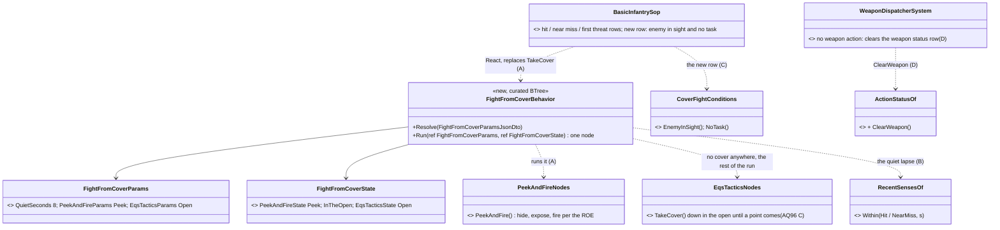
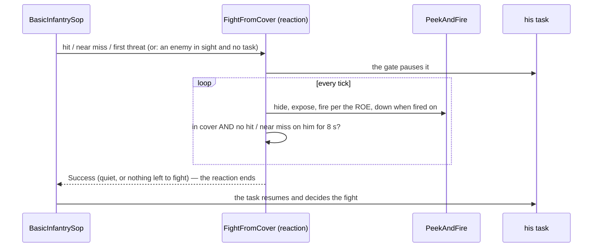
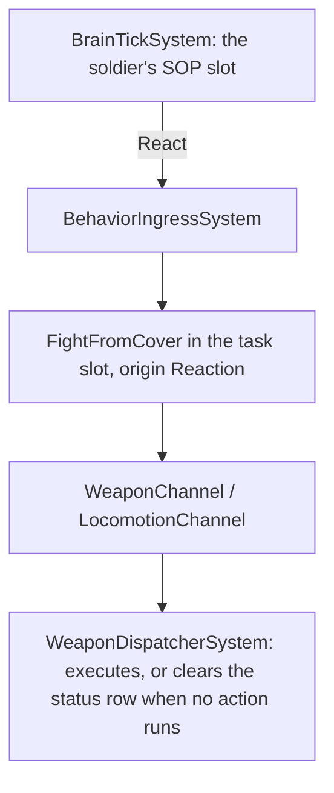

<!--STATUS
state: LIVE — ✅ APPROVED 2026-10-21 (R-2070) — user: "Aq 98 approved." (A · B · C · D, the leans as written)
updated: 2026-10-21 (approved; §3 the design, built — B′ the as-built open-ground half)
build-state: BUILT — §3 (classes, sequence, modules; B′ as-built)
current-answer: §0 the decision · §2 the sub-questions with leans · §3 the design
stale-below: nothing
known-rot: none yet
known-conflict: none — docs/DESIGN_Decision_Layer.md §4.7 (CE-2094 D6) is amended by B (R-2070): the cover reaction ends after a quiet lapse in cover, not when the threat is forgotten
related-designs:
  - docs/DESIGN_Decision_Layer.md — OWNS the SOP slot, reactions and resume (§4.1, §4.7); the rule this question revisits
  - docs/blueprints/Architect_Question_97_Default_Reflexes_Soldiers_And_Civilians.md — OWNS BasicInfantrySop's rows (hit, near miss, first threat → TakeCover)
  - docs/DESIGN_Eqs_Consuming_Behaviours.md — OWNS TakeCover (hide-only, §6) and FallBack
  - docs/DESIGN_Peek_And_Fire.md — OWNS PeekAndFire, the library's fight-from-cover node (§10, R-256 L2) and the look/shoot split (§11, R-2064)
  - docs/designs/group-maneuvers/DESIGN_Platoon_Attack_Defend_Clear.md — the platoon demos this measurement came from (pc-defend-house)
-->

# Architect Question 98 — the under-fire reaction hides and never fights back

## 0. The decision, in under a page

📐 **Measured `2026-10-20`, `pc-defend-house` in-process (240 s, both sides, sampled every 0.5 s):** of 24 soldiers, **9 spent 64–79 % of
the fight in the `TakeCover` REACTION while SEEING the enemy, firing nothing**, and one squad leader stood with no behaviour at all
(`Idle` under his SOP) for 79 % of it, the enemy in sight. ⛔ The aim chain is not the cause (aim clocks complete; a first reading of
"stuck Aiming" was a stale status row — `CE-2333`).

**Why:** `BasicInfantrySop` reacts to a hit, a near miss or a first threat with `TakeCover` — and `TakeCover` is **hide-only** (it fires
only while moving, and only with `FireWhileMoving`) and **ends only when nothing is left to hide from**. That is the rule as designed
(Decision Layer §4.7, CE-2094 D6). In a battle a man always remembers a threat ⇒ the reaction never ends ⇒ his task (the posture that
fights) never resumes and he never fires back.

**Decision (recommended): A + B + C** — the reaction FIGHTS FROM COVER (PeekAndFire, which obeys the ROE), and it ENDS after a quiet lapse
so the task resumes; a man with no task who sees an enemy engages from where he is.

**Rejected:**
- *keep hide-only, shorten nothing* — the measured result: a third of a platoon out of the fight for minutes.
- *drop the cover reaction* — a man shot at in the open must still get to cover first (AQ96, AQ97 ⑧).
- *end the reaction on ARRIVAL in cover* — the task resumes at once and walks him straight back out into the fire that sent him there.

**Design docs checked:** Decision Layer §4.7 — applies: it OWNS the rule (CE-2094 D6) this changes · AQ97 — applies: it set the rows, did
not settle how long they last · Eqs Consuming Behaviours §6 — applies: `TakeCover` stays hide-only for the tree that asks for exactly
that; only the SOP's reaction changes · Peek and Fire §10/§11 — applies: `PeekAndFire` is the library node meant for "fight from cover"
(R-256 L2), and CombatPosture's TakeCover option already runs it.

## 1. INVENTORY *(`search_graph` CLI `.*TakeCover.*`, `.*PeekAndFire.*` Method — production only)*

| symbol | where | role |
|---|---|---|
| `EqsTacticsNodes.TakeCover` | `Hrot.AI.Behaviors/Brains/EqsTacticsNodes.cs:142` | hide-only, `Mode.Reposition \| DownInTheOpen`; Success when nothing to hide from |
| `PeekAndFireNodes.PeekAndFire` | `Hrot.AI.Behaviors/Brains/PeekAndFireNodes.cs:307` | hide, expose, fire (ROE-gated: HoldFire never exposes, ReturnFire only in its window) |
| `BasicInfantrySop` | `Assets/BTrees/Library/Sop/BasicInfantrySop.btree.json` | React rows: air · hit · near miss · first threat → TakeCover / FallBack; DoWhenIdle(Idle) |

| claim | code | design |
|---|---|---|
| the reaction is hide-only | ✅ `EqsTacticsNodes.cs:142` + `FireOnTheMove` `:298-307` | ✅ Eqs Consuming Behaviours §6 |
| it lasts while a threat is remembered | ✅ `TakeCover` doc `:137-140` | ✅ Decision Layer §4.7 (CE-2094 D6) |
| no row engages a SEEN enemy when idle | ✅ the SOP's rows: no "enemy in sight" row | ⛔ searched AQ97, Decision Layer: none asks for one |

## 2. The sub-questions

| # | question | ⭐ lean | blast radius |
|---|---|---|---|
| **A** | what does the cover REACTION run? | ⭐ `PeekAndFire` (the cover search's hide point; it exposes and fires per the ROE, goes down when fired on) — ⛔ not `TakeCover` | the SOP asset's React rows (hit, near miss, first threat); every SOP demo's run (`df-lone-soldier-reflex`, `uf-*`) re-checked |
| **B** | when does the reaction END? | ⭐ after `QuietSeconds` (lean **8 s**) with no near miss / hit on HIM, and only once he is in cover — then the task resumes (the posture decides the fight); a fresh hit restarts it | Decision Layer §4.7's rule (CE-2094 D6) amended: "while a threat is remembered" ⇒ "until a quiet lapse" |
| **C** | a man with NO task who SEES an enemy? | ⭐ a new SOP row under the hit rows: `InSight → React(PeekAndFire)` (ROE-gated) — ⛔ never `Idle` with an enemy in sight | the SOP asset; civilians unaffected (CivilianSop) |
| **D** | the stale weapon status row | ⭐ `CE-2333`: the row is cleared (`None`) when the weapon channel has no running action — the action-status gizmo stops showing "Aiming" over a man who is not | `ActionStatusOf` writers / the dispatcher; the gizmo design (`DESIGN_Ai_Action_Status_Gizmo.md`) |

**What would change the lean:** if a reaction must never fire on its own (the commander alone decides return fire) — then B alone
(end after a quiet lapse, the task fights), and A stays `TakeCover`.

## 3. The design to build *(✅ approved `2026-10-21`, R-2070 — 🔒 user: *"Aq 98 approved."*)*

*What the picture shows that prose hid:* nothing new fights — the reaction is one node that runs the library's `PeekAndFire` and adds only
its END (B); `TakeCover` stays the hide-only node for the trees that ask for exactly that (Eqs Consuming Behaviours §6).

*Caption:* nothing new is scheduled; one behaviour, one SOP row, one status clear in the dispatcher that already runs.

| id | as designed |
|---|---|
| A | `BasicInfantrySop`'s Hit, NearMiss and Contact rows react with `FightFromCover` (the HoldFire withdrawal row keeps `FallBack`) |
| B | `FightFromCover` = `PeekAndFire` + an end: Success once he has reached cover (`PeekAndFireState.Phase` ≥ `Hidden`) and no `Hit` / `NearMiss` on HIM for `QuietSeconds` (8); or when `PeekAndFire` itself ends (nothing left to fight). A fresh hit after the end fires the Hit row again |
| B′ *(as-built, found while building)* | ⭐ **no cover anywhere** — `PeekAndFire` answers Failure after its `NoCoverSeconds` (3) — would have ended the reaction and left him standing in the open, which AQ96 C (`CE-2322`) forbids. ⇒ the rest of the run is `EqsTacticsNodes.TakeCover` (down in the open until a point comes, moves to it — firing while it moves, ROE-gated) and it ends the same way: not on the move, and quiet for `QuietSeconds`. A `[BTreeDeactivator]` releases whichever half runs when the reaction is cut off (a new hit, an order) |
| C | a row before `Idle`: `EnemyInSight` (a hostile in his target memory, alive and in the fight, SEEN — not heard — within 1 s) AND `NoTask` (his task slot empty or `Idle`) ⇒ React `FightFromCover`, urgency Contact ⭐ **As-built correction `2026-10-22` (CE-3306, backend's note):** "within 1 s" is measured on perception's clock (`PerceptionClock.Now` = `GlobalTime.FrameNumber`, CE-3292), the clock `LastSeenTick` is stamped in — it compared with `SimulationTick`, which runs ahead of it in the in-process cluster (3272 vs 3028), so a man looking at the enemy read as not seeing him and stayed `Idle` (`TakeCoverScenarioTests` 3/6 red). The same mix-up fixed in `SquadDismountBehavior` (CE-2347's fresh contact) and `RoomGrenade` (the seen window). Rails: `BasicInfantrySopTests`' harness now runs `SimulationTick` ahead of the frame clock (red-proved on the old reader) |
| C″ *(as-built correction `2026-10-23`, CE-1269, ui)* | ⭐ the no-task guard on the quiet end (`WouldReturn`) asked `EnemyInSight` — but the quiet end is checked while he HIDES, and a hidden man does not see: 📐 measured live (`df-lone-soldier-reflex`), every end came through the quiet end with `EnemyInSight` false, and row C restarted the reaction 0.1–0.2 s later — a fresh cover search every 1–3 s. ⇒ the guard asks `EnemySeenAndRemembered` (a hostile he has SEEN and still remembers, any age); the enemy forgotten still ends it through `PeekAndFire`'s own end. Rail `BasicInfantrySopTests.CE1269_HiddenAndNoLongerSeeing_TheRememberedEnemy_StillKeepsTheReaction` |
| D | `WeaponDispatcherSystem`: a unit with no weapon action (`ActiveAction` 0) has its weapon status row cleared to `None` (`ActionStatusOf.ClearWeapon`) |

