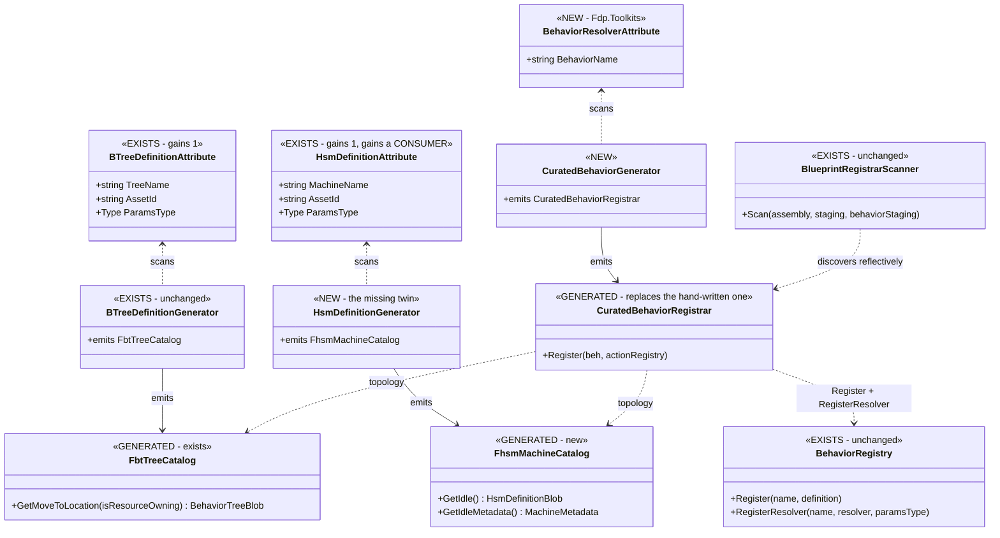
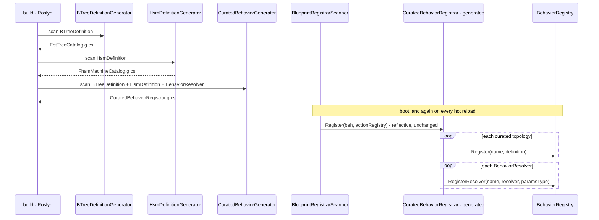
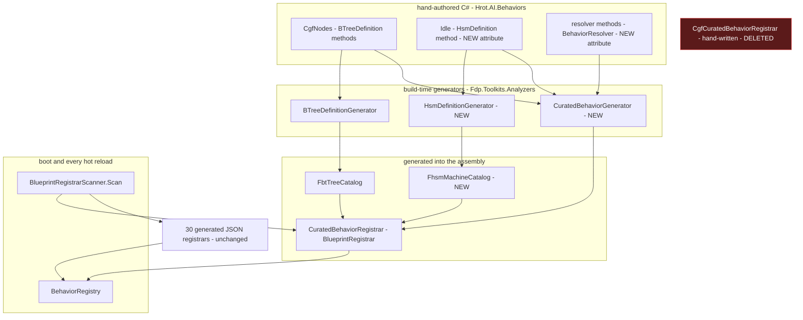
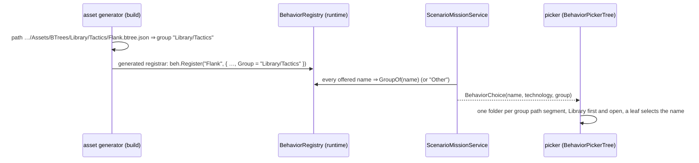
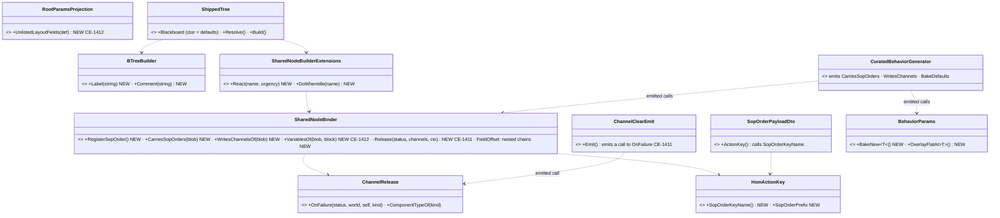
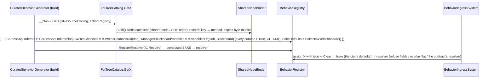
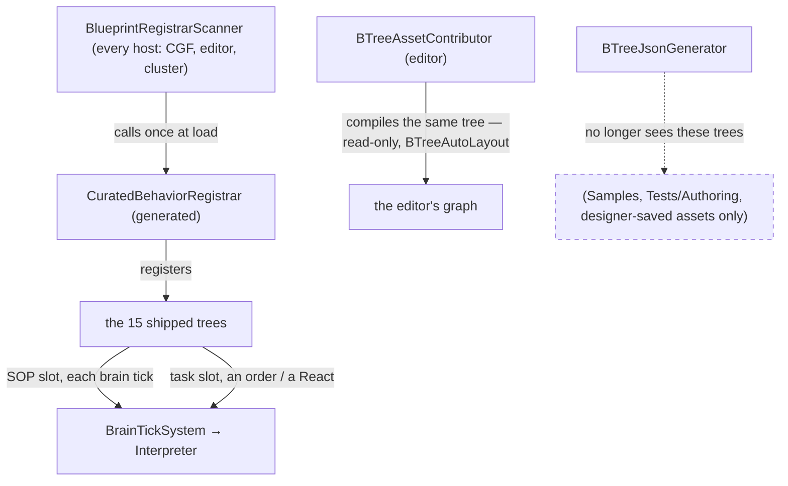

<!--STATUS
state: LIVE
build-state: ✅ BUILT (2026-09-27) — all five §9 items shipped as CE-371..CE-375. ⚠ This line read
  READY-TO-BUILD for the whole of the build and was corrected afterwards; §10a is the AS-BUILT and
  wins over §9 wherever they disagree.
updated: 2026-10-27 (§10d-i — CE-1433 defaults on the code-built rows; CE-1432 the other channel-release copies via ChannelRelease) · 2026-10-27 (§10d-i — CE-1430 a code-built tree's editor Variables rows = its published manifest `SharedNodeBinder.PublishedVariablesOf`, read-only) · 2026-10-27 (§10d-i — CE-1411 one channel release `ChannelRelease`; CE-1412 the variables manifest `SharedNodeBinder.VariablesOf`, opt-in `PublishesVariables`) · 2026-10-27 (§10d — the shipped trees are C#; the curated registration carries SOP orders, channels, the bake, labels — R-1042, CE-1410) · 2026-10-11 (§10c — every behaviour carries a picker GROUP, R-268)
current-answer: ⭐ §10a is the AS-BUILT — read it FIRST for what actually exists. §4 is the decision,
  §5-§7 the UML, §9 the build items as dispatched. ⭐ Start at §2 (INVENTORY)
  if you are about to argue that something here already exists — it probably does, and §2 says which.
stale-below: nothing yet.
known-rot: ⛔ 2026-10-13 (CE-3193 sweep) — superseded vocabulary in this file: [BehaviorContract] is deleted (CE-2134) → [Behavior(Params=…)] / the asset's ParamsDtoTypeId + ParamsDtoRegistry; blueprints declare no Parameters / Get Parameter (R-2004); no generated Inputs/_Blackboard mirror (CE-2135). Current model: ../docs/DESIGN_Orders_Params_Entity_Classes.md §13.10. Read older statements here as history.
  nothing yet.
known-conflict: ⚠ Behavior_Parameter_Resolver_Detailed_Design.md §338 expresses R-132 as "RegisterResolver
  is reached ONLY from CgfCuratedBehaviorRegistrar". This design DELETES that class, so that sentence
  must be re-expressed against the attribute — §8 ①. ⛔ The RULING is unchanged; only its probe moves.
related-designs:
  - Behavior_Architecture_Implementation_Plan.md — ⭐⭐ Phase 2 RETIRED `AiBehaviorFactory` and ruled
    that "every behavior self-registers under its unique name via [BlueprintRegistrar] discovery".
    THIS design finishes that sentence for C#-defined behaviours; the plan owns the sequencing history.
  - Behavior_Parameter_Resolver_Detailed_Design.md — owns the RESOLVER OVERLAY and R-132's
    "curated wins by declaration". ⛔ This design owns only WHERE the overlay is declared, never
    whether it wins.
  - DESIGN_Occurrence_Scoped_Storage.md — §33 (`E6`) adds two registration lines to the class this
    design deletes. ⚠ SEQUENCING: land this BEFORE `CE-364`, or those lines are written twice.
  - DESIGN_Parameter_Model.md — owns what a params region IS. This design only carries its TYPE
    from an attribute to the registration.
  - DESIGN_Per_Variable_Param_Resolver.md — ⭐ `E8c`, still `build-state: DESIGN`. Its inventory
    item ⑧ and its `D1-b` rejection basis DEPEND on what this design's generator emits: that a
    curated resolver is registered by BEHAVIOUR NAME and owns the WHOLE behaviour. ⚠ `CE-374`'s
    deletion left two citations there naming the deleted file; re-measured `2026-09-28` and both
    conclusions held. ⛔ **If this generator ever gains a finer grain than one `ParseParams` per
    `BehaviorDefinition`, `D1-b` must be re-opened** — say so here before changing it.
-->

# DESIGN — **Behaviour self-registration: the curated registrar becomes generated**

> 🔒 **User, `2026-09-27`:** *"can the `CgfCuratedBehaviorRegistrar` be replaced with automatic
> boot-time reflection scan as almost everything else in the engine?"* → then, on being told the Idle
> HSM blocked it: *"why the idle HSM blocks it? for UI authored HSM there is also no hand written
> registrar so why for this one?"*

⭐⭐⭐ **The user was right and the first answer was wrong.** 🔴 *"No HSM catalog generator exists
today"* was stated as *"an HSM built in C# cannot be scanned"* — **a property of the current code
presented as a property of the design space.** ⛔ Nothing blocks it.

---

## 1. ⭐ THE ONE-LINE STATE

⛔⛔ **`CgfCuratedBehaviorRegistrar` is ALREADY discovered by reflection** — it carries
`[BlueprintRegistrar]` and `BlueprintRegistrarScanner.Scan` invokes it, exactly like the 30 generated
registrars. ⭐ **What is hand-written is its BODY**: 11 registrations and 5 resolver bindings that no
generator produces. ⇒ **this design generates that body and deletes the file.**

---

## 2. ⭐⭐⭐ INVENTORY — **measured `2026-09-27`**

📐 `search_graph` + grep, agreeing. ⚠ `check_index_coverage` is unavailable through the CLI, so
*"complete set"* means **two independent tools agreeing**, not a coverage proof.

### 2.1 The attribute-driven scan precedent — ⭐ **it is the engine's normal pattern**

📐 `search_graph(name_pattern=".*(Registrar|Definition|Template|Gizmo)Attribute.*", label="Class")` → **8**

| attribute | its consumer | |
|---|---|---|
| `[BTreeDefinition]` | `BTreeDefinitionGenerator` → `FbtTreeCatalog` | ✅ |
| `[FbtRegistrar]` | `BTreeActionRegistryFactory.BuildFromAssembly` | ✅ |
| `[HsmActionRegistrar]` | `HsmActionGenerator` → `HsmActionRegistrar.g.cs` | ✅ |
| `[EqsTemplate]` | `EqsTemplateGenerator` | ✅ |
| `[UtilityRegistrar]` | `UtilityDecisionGenerator` | ✅ |
| `[BlueprintRegistrar]` | `BlueprintRegistrarScanner` *(runtime)* | ✅ |
| ⛔⛔ **`[HsmDefinition]`** | 🔴 **NOTHING at build or boot.** 📐 The only reader in the repo is the EDITOR's `HsmAssetContributor:34`, for its asset catalogue | **THE GAP** |

⇒ ⭐⭐⭐ **`[HsmDefinition]` is the one attribute in the set with no consumer.** The Idle machine is not
an exception to the engine's pattern — it is the **symptom of a missing generator.**

### 2.2 What the hand-written body actually contains — **143 lines**

| part | count | derivable? |
|---|---|---|
| BTree topologies | 5 | ⭐ **yes** — `FbtTreeCatalog.Get<Name>` is already generated; only the params TYPE is extra |
| HSM topologies | 1 *(`Idle`)* | ⭐ **yes, once `[HsmDefinition]` has a generator** — §2.3 |
| named resolvers | 5 | ⭐ **yes** — 3 plain method refs + **2 arity adapters** *(3-arg → 6-arg)* |

### 2.3 ⭐⭐ The Idle HSM and a JSON HSM are the SAME SHAPE — **measured, and it is the whole argument**

| | JSON-authored | hand-written `Idle` |
|---|---|---|
| topology | `var blob = {core}.Compile();` | `HsmBuilder → Normalize → Flatten → Emit`, inline |
| registration | `beh.Register(id, name, new BehaviorDefinition { HsmDefinition = blob, … })` — `HsmBridgeEmitCore:152-157` | ⭐ **the same call**, hand-written |
| who writes the `Register` | ⭐ a generator | ⛔ **nobody** |

⭐ **`HsmBuilder.Build()` returns `StateMachineGraph`** ⇒ an `[HsmDefinition]` method can return
**either** a `HsmDefinitionBlob` **or** a `StateMachineGraph`, and the generated catalog runs the
pipeline — ⭐⭐ **exactly the two-return-shape trick `BTreeDefinitionGenerator` already does**
*(`BehaviorTreeBlob` or `BTreeBuilder<TBB,TCtx>`, `:138-148`)*.

⭐ **It serves more than `Idle`** — 📐 `FDP/Examples/Fdp.Examples.UrbanCombat/Brains/ApcHsmSetup.cs`
is another hand-built machine.

### 2.4 ⚠ Two facts that CONSTRAIN the mechanism

| | |
|---|---|
| ⭐⭐⭐ **hot reload re-runs registrars, under COLLECTIBLE ALCs** | 📐 `BlueprintRegistrarScanner:91` handles partial assembly loads explicitly ⇒ **whatever is built must survive a reload**, which rules out anything computed once at process start |
| ⭐⭐ **`R-149` already throws on two curated bindings for one params region** | `BehaviorRegistry.RegisterResolver` — ⛔ a generated registrar must not turn that throw into a race |

---

## 3. ⛔ WHAT THIS DESIGN DOES **NOT** TOUCH

⛔ **`R-132` — *"curated wins by declaration, not by arriving first"*** — 📄
`Behavior_Parameter_Resolver_Detailed_Design.md` §338. ⭐ **The ruling is unchanged.** 🔴 It exists
because a two-producer race left `PlatoonHillAttack` reading a wire format nothing wrote and **drove
a platoon to `(0,0)` silently.** ⚠ Only its *probe* moves — §8 ①.

---

## 4. ⭐⭐⭐ THE DECISION — **a GENERATOR emits a `[BlueprintRegistrar]` class**

🔒 **Each curated behaviour self-describes on the attribute it already carries, and a source
generator emits the registrar that today is typed by hand.** ⛔ **Discovery does not change at all** —
the emitted class carries `[BlueprintRegistrar]` and the existing scanner finds it.

| ⭐ why a generator rather than a runtime reflection scan | |
|---|---|
| ⭐⭐⭐ **no new discovery mechanism** | the emitted class is found by the scanner that already runs. ⛔ A second scan is a second thing to debug when a behaviour does not appear |
| ⭐⭐ **hot reload works by construction** | generated code is compiled INTO the assembly ⇒ a reload recompiles and re-runs it (§2.4) |
| ⭐⭐ **it is the engine's own shape** | 📐 `HsmActionGenerator` already emits `HsmActionRegistrar.g.cs`; the JSON assets already emit `[BlueprintRegistrar]` bridges. ⇒ **this adds no concept** |
| ⭐ **AOT-safe and debuggable** | the emitted source is readable, diffable and breakpointable — ⛔ a reflective boot scan is none of those |
| ⚠ **the cost** | one new generator + two attribute properties + one attribute. ⭐ Bounded, and `CE-371` pays for itself twice — see §8 ② |

---

## 5. ⭐ THE CLASSES — `classDiagram`

⚠ **Caption — what the picture shows that prose hid:** **only three boxes are new**, and
`BlueprintRegistrarScanner` and `BehaviorRegistry` are drawn **unchanged** on purpose — ⛔ the thing
people expect this design to touch is the thing it does not touch. ⭐ Note the two catalogs are
symmetric: that symmetry is the user's argument, drawn.

---

## 6. ⭐⭐ REGISTRATION — `sequenceDiagram`

⚠ **Caption:** the **`Note` is the load-bearing part** — registration re-runs on every hot reload, and
that is why the answer is a generator emitting a registrar rather than a boot-time reflective sweep
of its own. ⭐ The `SC → REG` arrow is **the arrow that does not change.**

---

## 7. ⭐⭐⭐ WHO PRODUCES WHAT — **the module diagram**

⭐⭐ **Caption — the edge that matters is `SCAN --> REGG`, and it is IDENTICAL to `SCAN --> JSONREG`.**
⇒ after this change a curated behaviour and a JSON behaviour reach `BehaviorRegistry` by **the same
path**, which is what *"as almost everything else in the engine"* actually means. ⛔ The red box is the
only deletion.

---

## 8. ⭐⭐ THE TWO THINGS THAT MUST MOVE WITH IT

| # | | |
|---|---|---|
| **①** | ⭐⭐⭐ **RE-EXPRESS `R-132`'s PROBE, not its ruling** | 📄 `Behavior_Parameter_Resolver_Detailed_Design.md` §338 says *"`RegisterResolver` is reached **only** from `CgfCuratedBehaviorRegistrar`"* ⇒ **that sentence becomes false the moment the file is deleted.** ⭐ The replacement: *"reached only from the generated `CuratedBehaviorRegistrar`, whose every call site is a `[BehaviorResolver]`-attributed method — **the attribute IS the human declaration**."* ⛔⛔ **A ruling whose probe silently stops matching is exactly how the ledger rots** — update it IN THE SAME COMMIT |
| **②** | ⭐⭐ **`CE-371` CLOSES `CE-370` FOR FREE** | 📐 measured `2026-09-27`: the generated HSM registrar **never sets `HsmMetadata`**, so only the hand-written `Idle` has it, while three consumers read it *(`HsmTraceWorkingMemoryTranslator:52`, `HsmTraceWorkingMemoryRenderer:55`, `BrainTickSystem:447`)*. ⭐ **`FhsmMachineCatalog` is the ONE place that knows both the blob and its `MachineMetadata`** ⇒ emit both, and the gap closes for **every** HSM at once rather than per-emitter |

---

## 9. ⭐⭐ THE BUILD — **five items**

| # | id | item | where | risk |
|---|---|---|---|---|
| **1** | `CE-371` | ⭐⭐⭐ **`HsmDefinitionGenerator` → `FhsmMachineCatalog`** — the missing twin of `BTreeDefinitionGenerator`. Accept **both** return shapes *(`HsmDefinitionBlob` or `StateMachineGraph`, running `Normalize → Flatten → Emit`)*, exactly as the BTree one accepts a blob or a builder. ⭐⭐ **Emit `MachineMetadata` beside the blob** ⇒ closes `CE-370` (§8 ②). ⚠ Mirror `BTree002`'s invalid-method diagnostic | `Fdp.Toolkits.Analyzers` | ⭐⭐ medium |
| **2** | `CE-372` | ⭐ **the declarations** — `ParamsType` on `[BTreeDefinition]` and `[HsmDefinition]`; a new `[BehaviorResolver(name)]`. ⛔ **No new behaviour-identity concept**: the NAME stays the attribute's existing tree/machine name | `Fbt.Kernel` · `Fhsm.Kernel` · `Fdp.Toolkits` | ⭐ low |
| **3** | `CE-373` | ⭐⭐⭐ **`CuratedBehaviorGenerator` → `CuratedBehaviorRegistrar.g.cs`**, decorated `[BlueprintRegistrar]`. Emits one `beh.Register` per attributed topology and one `beh.RegisterResolver` per `[BehaviorResolver]`. ⛔⛔ **It must handle BOTH resolver arities** — the 6-param `ParseParamsDelegate` and the 3-param `(json, ptr, capacity)` form, wrapping the latter. 🔒 Precedent: the deactivator bridge already dispatches 3/4/5-param shapes | `Fdp.Toolkits.Analyzers` | ⭐⭐⭐ **the core item** |
| **4** | `CE-374` | ⭐⭐ **attribute the sources and DELETE the hand-written file** — `[HsmDefinition("Idle")]` on an `Idle` builder method, `ParamsType` on the five BTree definitions, `[BehaviorResolver]` on the five resolvers, then remove `CgfCuratedBehaviorRegistrar.cs`. ⛔ **Includes §8 ①'s doc edit — same commit** | `Hrot.AI.Behaviors` · `docs/` | ⭐⭐ medium |
| **5** | `CE-375` | ⭐⭐ **the rails** — §10 | tests | ⭐⭐ medium |

⭐ **Order:** `2 → 1 → 3 → 4 → 5`. ⛔ **`CE-374` last of the build items** — the file is the fallback
until the generated one demonstrably registers the same set.

⛔⛔ **SEQUENCING AGAINST `E6`: land this BEFORE `CE-364`**, which adds two registration lines to the
file this design deletes. ⚠ Two lines either way, but writing them twice is avoidable.

---

## 10. ⭐⭐⭐ THE RAILS — **and the acceptance gate is a SET COMPARISON**

| rail | what it must do |
|---|---|
| ⭐⭐⭐ **`SR_R1` — THE SET IS IDENTICAL** | register through the **old hand-written** path and through the **generated** one, and assert the two `BehaviorRegistry` contents are **equal as SETS** — names, `BrainTier`, params type, resolver presence. ⛔⛔ **Not a count.** 🔒 *"A matching NET count is not an explanation — diff the SETS"* (`CE-355`'s lesson, paid for once already) |
| ⭐⭐ **`SR_R2` — the name-agreement rail** | every `BehaviorNames` constant resolves to a registered definition. 📐 **The real hazard today**: `BehaviorNames.MoveToLocation`, `[BTreeDefinition("MoveToLocation")]` and `FbtTreeCatalog.GetMoveToLocation` are **three spellings and NOTHING checks they agree** — registering the right blob under a wrong name compiles fine |
| ⭐⭐ **`SR_R3` — the Idle machine still ticks** | through `BrainTickSystem`, from the generated catalog. ⛔ Not *"the catalog has an entry"* — 🔒 the `E6` lesson: the retired orchestrator passed its shape rails for months because nothing ever RAN what it emitted |
| ⭐⭐ **`SR_R4` — `MachineMetadata` is present for a JSON-authored HSM** | `CE-370`'s gap, pinned. ⛔ Currently would FAIL — that is the point |
| ⭐ **`SR_R5` — both resolver arities bind** | the 6-param and the 3-param forms, each asserted by ACTUALLY PARSING a params blob, not by presence |
| ⭐ **`SR_R6` — two curated resolvers for one name still THROW** | `R-149` survives the move to attributes |
| ⭐ **`SR_R7` — hot reload re-registers** | a second `Scan` over the same assembly yields the same set, and `HostedChildren`-style last-writer-wins is unaffected |

⛔ **`SR_R1` is the acceptance gate.** ⚠ It is also **temporary by design** — it needs the old file,
so it runs in `CE-374`'s commit and is **deleted with it**, leaving `SR_R2`…`SR_R7` as the standing
cover. ⭐ Say so in the report rather than leaving a rail that silently references a deleted class.

---

## 10a. ✅ AS-BUILT `2026-09-27` — **one deviation, and the design was WRONG without it**

> ⛔⛔ **THE DESIGN SAID `ParamsType` ON `[BTreeDefinition]` WAS ENOUGH TO IDENTIFY A CURATED
> BEHAVIOUR. IT IS NOT.** 📐 Measured during the build: `Hrot.AI.Behaviors` carries **NINE**
> `[BTreeDefinition]` methods and only **FIVE** are curated topologies.

| the other four | why it is not a curated topology |
|---|---|
| `HideInCover_BT` · `HideInCover_BT_v2` | in `FbtTreeCatalog`, registered as a behaviour **nowhere** |
| `PlatoonHillAttack` · `HullDownAttackRun` | 🔴 **topology owned by their GENERATED JSON registrars** — only their RESOLVERS are curated. ⛔ Registering them here **hard-errors on a duplicate name** |

⛔ **`AssetId == null` does not discriminate either** — those four are hand-written C# attributes and
carry no `AssetId`. ⚠ **`ParamsType` cannot**: `WanderMilitary` legitimately has none.

⇒ ⭐⭐ **DEVIATION: a `bool Curated` opt-in on `[BTreeDefinition]` and `[HsmDefinition]`.** Default
false; the generator registers only `Curated = true`. ⭐ It respects §11's actual objection — the
rejected `[CuratedBehavior]` attribute would have **re-spelled the NAME**, and this does not; the
name still comes from the one attribute that already carries it. ⭐ Pinned by
`TheOptIn_KeepsNonCuratedDefinitionsOut`.

### ⭐ Everything else landed as designed

| | |
|---|---|
| ⭐ generated output | `FhsmMachineCatalog.g.cs` *(`GetIdle` + `GetIdleMetadata`)* · `CuratedBehaviorRegistrar.g.cs` *(6 topologies, 5 resolvers, sorted)* |
| ⭐ `Idle` | `[HsmDefinition("Idle", Curated = true)]` on `CuratedMachines.BuildIdleMachine`, returning `StateMachineGraph` ⇒ **metadata emitted**, which is `CE-370`'s curated half |
| ⭐ both resolver arities | `FollowRoute`/`HullDownAttackRun` wrapped *(3-param)*, `MoveToLocation`/`FireAtTarget`/`PlatoonHillAttack` direct *(6-param)*. ⚠ **A real bug caught in draft:** the params type was emitted **inside** the wrapper lambda instead of as `RegisterResolver`'s third argument |
| ⭐⭐ `SR_R1` | **GREEN, then RED-PROVED** — dropping `Curated = true` from one topology reddens it naming `{"JoinFormation"}`. ⭐ Retired with the class, as designed |
| ⚠ **`SR_R5b` was WRONG and reddened** | it assumed `RegisterResolver` creates an id with no topology. ⛔ It does not — the overlay waits in a **pending map**. ⭐ Re-pointed at the real behaviour: plant the topology afterwards and assert the overlay **binds**, which also covers the deferred order |
| ⚠ **two COMPILE-BREAKING references** the design never mentioned | `CgfBehaviorSetup:50` and `CgfBlueprintRegistryScannerTests` used the deleted class as a **`typeof(...).Assembly` anchor**. ⭐ Re-pointed at `CgfNodes` — hand-written and permanent; ⛔ **not** at the generated registrar, which an assembly curating nothing would not emit |
| ⭐ `R-132`'s probe | moved in `BehaviorRegistry`'s own remarks **and** §338, same commit |

⚠ **`BTreeContext` is in `Fdp.Toolkit.Behavior`, not `Fbt.Runtime`** — the first generated source did
not compile. ⭐ Only `Interpreter` and `ActionRegistry` are in `Fbt.Runtime`.

#### ⛔⛔ AMENDED `2026-09-27` — **§8 ② AND ITS FIRST BUILD WERE BOTH OVERTHOUGHT: `Compile()` ALREADY DID IT**

📐 **The measurement, made while closing `CE-370`'s remaining half:** `StateMachineGraph.Compile()`
ends with `blob.Metadata = HsmEmitter.BuildMachineMetadata(this)`. ⇒ ⭐⭐ **every HSM blob in the repo
has carried its `MachineMetadata` all along** — the only thing missing was the `BehaviorDefinition`
overlay carrying it across.

| ⛔ what this design and its first build said | ⭐ what is true |
|---|---|
| §8 ②: *"`FhsmMachineCatalog` is the ONE place that knows both the blob and its `MachineMetadata`"* | ⛔ **false** — the **blob** knows both. The catalog is one of several places that could read it off |
| §10a *(now corrected above)*: *"a blob-returning method returns `null` metadata; the graph shape is preferred"* | ⛔ **false** — **both** return shapes carry it, because it rides on the blob |
| the first generator draft spelled `Normalize → Flatten → Emit` out by hand | ⛔ a **second copy** of a sequence `Compile()` already is. ⭐ Now `=> <call>().Compile();` and a uniform `Get<Name>Metadata() => Get<Name>().Metadata;` |
| ⭐ the JSON-authored half | **one line** — `HsmMetadata = blob.Metadata,` in `HsmBridgeEmitCore`. ⇒ `CE-370` is closed in **both** halves |

🔒 **The lesson, and it is this session's recurring one:** the row and this design both reasoned from
**what the emitter did**, never from **what the blob held** — *a property of current code is not a
property of the design space.* ⭐ The fix was a one-line carry-across, not a build.

---

## 10b. ⭐ WHICH FORM A TEST BEHAVIOUR TAKES — **C# for tests, JSON only for human demos** *(R-223, user, `2026-10-08`)*

🔒 **User:** *"Only demos for human need to stay json assets. c# hardcoded behaviors of course need to live in Hrot.AI.Behaviors."*
· *"for production use the blueprints does not need any c# hardcoding, as c# itself can be used directly"*.

| what the test is about | ⭐ the form | where |
|---|---|---|
| a node's logic | call the `[SharedAiAction]` C# method directly — no tree | the feature's test suite |
| an engine feature end to end (doors, navigation, sensors) | a **curated C# tree**: `[BTreeDefinition(Name, Curated = true)]` + `BTreeBuilder`, or `[HsmDefinition(Name, Curated = true)]` + `HsmBuilder` returning the graph (§10a); registered by name through this design's generator, loaded by scenarios like any asset | `Hrot.AI.Behaviors/Brains` |
| a blueprint feature | the existing test builder **`BlueprintAssetBuilder`** (`Hrot.Blueprints.Tests/Builders`, ~115 files) | `Hrot.Blueprints.Tests` |
| a demo a human watches or edits in the editor (ua-*, tutorials), or the asset pipeline itself | a JSON asset | `Hrot.AI.Behaviors/Assets`, `Recipes` |

| ⭐ why | |
|---|---|
| C# is compiler-checked and rename-safe | a JSON asset names actions as `MethodFqn` STRINGS — a Roslyn rename never reaches them, a wrong name fails only at load |
| C# diffs are the logic | a JSON asset carries VisualIds, editor coordinates and generated registrars with baked offsets (`…@80`) |
| it already works | 9 curated `BTreeDefinition`s (e.g. `MoveToLocation`) and `CuratedMachines.Idle` load by name today |

⚠ **HSM, measured:** `HsmBuilder` (`Fhsm.Compiler`) is a fluent builder, and curated machines are supported (`CuratedMachines.cs`), but it names
actions and guards by STRING (`OnEntry(string)`, `Activity(string)`, `TransitionBuilder` guard/action). ⭐ Write them as
`nameof(Nodes.Method)` so the compiler and a rename still reach them. Only one curated machine (`Idle`) exists so far.
⭐ **Blueprints:** no new builder — the test builder exists; production needs none (C# is used directly where a blueprint would be
hand-coded).

## 10c. ⭐ EVERY BEHAVIOUR CARRIES A PICKER GROUP — **the attribute for C#, the folder for JSON** *(R-268, CE-3164, `2026-10-11`; build-state: BUILT)*

🔒 User, `2026-10-11`: *"for hardcoded behaviors the attribute sets it, for json asset generated ones this group attrib comes from the
folder structure the asset file stays in"* · *"allowing all to be used just not show all as one plain list in the picker, but various
subfolders."* ⇒ ⛔ the `BehaviorContract.Demo` HIDE (CE-3161) is withdrawn: nothing is hidden, demos are a folder.

📐 **Measured:** all three asset generators already hold the asset's path (`AdditionalText.Path`: `BTreeJsonGenerator`,
`HsmJsonGenerator`, `BlueprintIncrementalGenerator`); the asset globs are recursive (`Assets\BTrees\**\*.btree.json` …); the four
registration emitters are `BTreeBridgeEmitCore`, `HsmBridgeEmitCore`, the blueprint `CSharpEmitter.EmitBehaviorRegistration` and the
curated C# `CuratedBehaviorGenerator`; the pickers are `MissionPanel` and `EntityAiDetailsView`, both fed by
`ScenarioMissionService.GetAvailableBehaviorChoices`.

```mermaid
classDiagram
  class BehaviorDefinition { <<existing>> +Group string? NEW }
  class BehaviorRegistry { <<existing>> +GroupOf(name) NEW, MergeFrom keeps a live group the staging lacks }
  class BehaviorGroups { <<NEW, Hrot.AiEditor.Persistence>> +FromAssetPath(path) "Library/Tactics" }
  class BTreeDefinitionAttribute { <<existing>> +Group NEW }
  class HsmDefinitionAttribute { <<existing>> +Group NEW }
  class CuratedBehaviorGenerator { <<existing>> emits Group from the attribute }
  class BTreeBridgeEmitCore { <<existing>> emits Group from dto.Group }
  class HsmBridgeEmitCore { <<existing>> emits Group from dto.Group }
  class CSharpEmitter { <<existing, blueprints>> emits Group from CompileOptions.BehaviorGroup }
  class AssetGenerators { <<existing: BTree / HSM / Blueprint>> set the group = BehaviorGroups.FromAssetPath(path) }
  class BehaviorChoice { <<existing>> +Group NEW · +OtherGroup }
  class ScenarioMissionService { <<existing>> choice.Group = registry.GroupOf(name) ?? Other }
  class BehaviorPickerTree { <<NEW, Hrot.Presentation>> +Build(choices) Folder · +Combo(label, preview, choices, current, out picked) }
  class MissionPanel { <<existing>> }
  class EntityAiDetailsView { <<existing>> }
  AssetGenerators ..> BehaviorGroups
  AssetGenerators ..> BTreeBridgeEmitCore
  AssetGenerators ..> HsmBridgeEmitCore
  AssetGenerators ..> CSharpEmitter
  CuratedBehaviorGenerator ..> BTreeDefinitionAttribute
  CuratedBehaviorGenerator ..> HsmDefinitionAttribute
  BTreeBridgeEmitCore ..> BehaviorDefinition : Group = …
  ScenarioMissionService ..> BehaviorRegistry
  BehaviorRegistry o-- BehaviorDefinition
  ScenarioMissionService ..> BehaviorChoice
  MissionPanel ..> BehaviorPickerTree
  EntityAiDetailsView ..> BehaviorPickerTree
```

*What the picture shows: the group is decided at BUILD time by the producer that already knows it (the attribute's author, the
asset's folder) and rides the ONE registration record to the ONE picker helper — no lookup table, no second taxonomy.*

| item | decision | why |
|---|---|---|
| JSON group | the folder path BELOW the kind's root (`Assets/BTrees/`, `Assets/HSMs/`, `Assets/Blueprints/`), `/`-separated; a file at the root ⇒ `Other` | R-268; relative, so no machine path reaches generated code or goldens |
| C# group | `[BTreeDefinition(…, Group = "…")]` / `[HsmDefinition(…, Group = "…")]`; hand registrations pass it on the definition | R-268 |
| no group | `Other` | nothing is lost — it is still offered |
| groups across technologies | merged by path: a `Library/Tactics` BTree and a `Library/Tactics` blueprint share one folder; the technology stays in the label | the author picks WHAT, the label says HOW |
| order | `Library` first and open, then the rest alphabetically, `Other` last | the library is what an author should reach for (R-256) |
| demos | a folder (`Demos/…`), not hidden | R-268 withdraws the CE-3161 hide |
| hot reload | the staging→live `MergeFrom` carries the staging groups; a name the staging registration gave no group KEEPS its live group (`BehaviorRegistry.GroupOf`) | the editor's live re-registration knows no path; the group must not fall to `Other` on every save |
| `Other` constant | lives on the picker side (`BehaviorChoice.OtherGroup`), not in `BehaviorGroups` | a root-level asset has NO group (`null`); `Other` is a display choice |

**As-built (commit A):** the groups set today — `Library/Basic` (MoveToLocation, FollowRoute, JoinFormation, WanderMilitary,
FireAtTarget, FireAtPoint, DoorLocksmith, HoldStance, Idle), `Library/Infantry` (CombatPosture), `Library/Squad`
(BoundingOverwatch), `Demos/PeekAndFire` (WindowDuel), `Demos/UrbanCombat` (the example's hand registrations). The JSON assets
were moved into folders by commit B (below). The entity AI details' rows map names to choices
through `EntityAiEditModel.AsChoices` (same technology label as the mission panel).

**As-built (commit B) — the asset folders, i.e. the JSON picker groups** (top level = what an author reaches for first):

| folder | holds |
|---|---|
| `BTrees/Library/Tactics`, `BTrees/Library/Sop` | the library tactics (TakeCover, FallBack, Flank, FiringPosition, Sentry, DangerCrossing) and the shipped SOP |
| `BTrees/Samples`, `HSMs/Samples`, `Blueprints/Samples` (+ `Samples/Tactics`) | editor showcases and feature samples (SampleScout, SampleGuard, the `*Demo.bp.json` feature samples) |
| `BTrees/Demos/HillAttack`, `Blueprints/Demos/HillAttack`, `Blueprints/Demos/Mission` | demo scenarios' behaviours |
| `BTrees/Tests/Authoring`, `HSMs/Tests/Binding`, `Blueprints/Tests` (+ `Tests/Smoke`) | regression assets that pin a generator / binding shape |

⚠ A file's folder is now meaningful: moving it changes its picker group (and its generated registrar — the golden moves by one line).

## 10d. ⭐⭐ THE SHIPPED TREES ARE C# — **the curated registration carries what a JSON asset's did** *(R-1042, CE-1410, ui, `2026-10-27`; build-state: BUILT)*

🔒 User, `2026-10-27`: *"The json btrees - rather conver them to csharp hardcoded ones, easier on ai agent dev. Then no need to solve their
layout."* ⇒ the 15 runtime trees under `Assets/BTrees/{Library/Sop, Library/Tactics, Demos/HillAttack}` are curated C# trees in
`Hrot.AI.Behaviors/Brains` (`BasicInfantrySop.cs`, `BasicSquadSop.cs`, `BasicPlatoonSop.cs`, `BasicVehicleSop.cs`,
`CivilianInertPilotSops.cs`, `LibraryTactics.cs`, `DangerCrossing.cs`, `HillAttackTrees.cs`; `PlatoonHillAttack` is its existing C# twin `HillAttackCommanderNodes.BuildPlatoonHillAttackTree` (CE-430), now registered — not a second copy); `.btree.json` stays the format the EDITOR
saves, and `Samples/` + `Tests/Authoring/` stay JSON (§10b: demos a human edits, fixtures of the asset pipeline).

📐 **INVENTORY** (graph, this worktree, `2026-10-27`: `search_graph name_pattern='.*(SopOrder|SharedNodeBinder|CuratedBehavior|SopActions).*'` — 113 rows, paginated; the SOP-order producers are ALL JSON/editor side: `BTreeBridgeEmitCore.EmitSopOrderThunks`, `HsmBridgeEmitCore.EmitSopOrderThunk`/`CollectSopOrders`, the facet mappers — none for a C# tree · `name_pattern='.*(CarriesSopOrders|WritesChannels|BakeDefaults).*'` — 20 rows, `has_more:false`; + grep for the readers; ⚠ coverage could not be checked, `check_index_coverage` is not in the CLI):
what a JSON tree's GENERATED registrar publishes and the curated one did not — the gap this section closes, each by EXTENDING the one
existing producer (no second registrar):

| the JSON registrar published | used by | the curated path, as built |
|---|---|---|
| SOP order thunks (`SopActions.React/DoWhenIdle`, key `…SopActions.{kind}:{name}:{urgency}@-1`) | the SOP tree's leaves | ⭐ `SharedNodeBinder.RegisterSopOrder` + builder verbs `.React(name, urgency)` / `.DoWhenIdle(name)` — the key's ONE spelling is `HsmActionKey.SopOrderKeyName` (linked; the JSON DTO's `ActionKey` calls it too) |
| `CarriesSopOrders` (CE-1019: an SOP is a tree that carries orders) | the SOP picker, the task pickers, `ScenarioMissionService` | ⭐ read off the compiled blob: `SharedNodeBinder.CarriesSopOrders(blob)` |
| `WritesChannels` (union of bound methods' `[WritesChannel]`; `null` = unknown) | the SOP picker (`Count: 0` only), the SOP slot | ⭐ `SharedNodeBinder.WritesChannelsOf(blob)` — every key's bound method is recorded at bind time; an unknown key or a subtree ⇒ `null`, as the emitter's rule |
| `BakeDefaults` (the variables' `DefaultValueJson`, the asset's `ParamsDefaultJson`) | stage 1 of every parse (`ApplyResolverOverlay` composes it in front of a curated resolver) | ⭐ `BehaviorParams.BakeNew<ParamsType>()` = the block's own constructor (`ParamsDefaults.New`, R-3002) — a tree's tuning is its blackboard's `public Blackboard() { … }` |
| `ParseParams`: `RequireNoStoredFields` (NoParams trees) / `OverlayFlat` (one Input = its params DTO) | the ingress | a `[BehaviorResolver]` per tree: `RequireNoStoredFields(…)` or `BehaviorParams.OverlayFlatAt<T>` (new, width-checked) — composed after the bake as for every curated resolver |
| `JsonParamsDtoType` | `GET /behaviors`, the forms | `[Behavior(name, Params = …)]` (CE-2134), the one producer |
| `DisplayLabel` / comment per node (editor only, never in the blob) | the editor's graph | ⭐ `BTreeBuilder.Label(…)` / `.Comment(…)` annotate the node added last (its `NodeDebugMetadata`); the projector already shows an authored label |
| per-node working memory in occurrence SLOTS (`@po@slotHash`) | stateful nodes | in the BLOCK (`StatefulAction(bb => bb.P, bb => bb.State, …)`, `@po@offset`) — the CombatPosture port's form (R-266); one memory per node per run, held across a pause either way (CE-2081 holds the root params slot) |
| `ManagedBlackboardVariables` | the editor's live Variables values (`LiveBlackboardValueProvider`), the inspector (`RootParamsProjection`) | ⭐ **`CE-1412`:** `SharedNodeBinder.VariablesOf(blob, ParamsType)` — the block's public top-level fields at their managed offsets, ⛔ less every field a stateful node of the blob binds as its WORKING STATE (recorded at bind time, `RecordState`; a JSON asset's `Role=State` half was never in its manifest). Emitted by the curated generator for EVERY curated BTree (`CE-1431`: `VariablesOf(blob, ParamsType)`, an empty manifest when it names no block; ⛔ SUPERSEDED: the opt-in `PublishesVariables`, the 15). A curated HSM has none |
| a `[WritesChannel]` node's release on Failure (`ChannelClearEmit`, plain + param-less thunks; ⚠ NOT the stateful ones) | the dispatcher's OnExit of the abandoned action | ⭐ **`CE-1411`:** ONE runtime implementation, `ChannelRelease.OnFailure` (`Fdp.Toolkits`); `ChannelClearEmit` now emits a CALL to it and `SharedNodeBinder`'s plain / condition / param-less thunks (typed and byte) call it — the same shapes, so the stateful forms release on neither path |

*What the picture shows: every new member sits on a class that already existed; the SOP key has ONE spelling shared by the editor's JSON
path and the C# path, so a tree written either way binds the same thunk.*

*What the picture shows that prose hid: the trees reach every host through the ONE scan that already runs the curated registrar — no host
wiring changed; the dashed edge is what LEFT the JSON generator.*

**The proof (rails):** `ShippedTreesAreCSharpTests` (`Hrot.SimHost.Tests`) prints each PRODUCTION definition as canonical text
(`ShippedTreeDump`: definition facts, the parse of four probes, every node's kind / id / title / comment / bound method / param TYPE and
VALUE / state type) and pins it to `Snapshots/ShippedTrees/*.tree.txt`, recorded from the JSON registration while both were registered
(phase 1: the C# tree under `{name}_Cs`, equal for all 15). Layout: `CodeBuiltTreeLayoutTests.CE1410_…`.

⚠ **Adding a shipped SOP now:** a static class in `Brains/` with a `Blackboard` struct (its constructor = the tuning), a
`[BehaviorResolver]` (`RequireNoStoredFields` for an SOP), and `[Behavior(name, Params = typeof(NoParams))]` +
`[BTreeDefinition(name, AssetId = …, Curated = true, Group = "Library/Sop", ParamsType = typeof(Blackboard))]` on a
`Build()` returning the builder — rows as `.Sequence(row => row.Condition(…).React(name, urgency), Id(…)).Label(…)`.

### 10d-i. ✅ AS BUILT — the two follow-ups *(CE-1411, CE-1412, ui, `2026-10-27`)*

📐 **INVENTORY** (graph, this worktree: `search_graph name_pattern='.*(ManagedBlackboard|ChannelClear|ChannelRelease|ReleaseChannel|VariablesOf|ManifestOf).*'`
— 29 rows, `has_more:false`: the manifest's only producers are the JSON emitter `BTreeBridgeEmitCore.EmitManagedBlackboardVariablesArray` and
the blueprint `InstanceEmitter.InputManifest` — no runtime builder; the channel release's only producer was `ChannelClearEmit`; + grep for
every `ManagedBlackboardVariables` reader and every `ActiveAction = 0` write; ⚠ coverage could not be checked, `check_index_coverage` is not
in the CLI).

**CE-1412 — the variables manifest.** Each of the 15 publishes the manifest its JSON registrar did: the same variables, in order, of the
same types, with the same defaults — measured against the generated registrars and assets at `f72d799c3^` (the three variable-less SOPs
still publish none). ⚠ A variable's NAME is the C# field's, equal to the JSON's up to its first letter (`underFire` → `UnderFire`; the
reserved `Params` is identical): no ingress reads these names (an SOP and `Flank`/`FiringPosition` refuse stored fields; the single-variable
trees are `Params`), so renaming public C# fields to a retired asset's spelling bought nothing. Rails: `ShippedTreesAreCSharpTests`
(`variable` lines in the snapshots + `TheCSharpTree_PublishesTheVariablesItsJsonAssetDid`), `LiveBlackboardValueProviderTests.CE1412_…`,
`RootParamsProjectionTests.CE1412_…`.

- ✅ **`CE-1431` (backend, `2026-10-28`) — the opt-in is GONE: every curated BTree publishes.** `PublishesVariables` is deleted (attribute, generator,
  all uses); `PublishedVariablesOf` = `VariablesOf` when the tree names a `ParamsType`, else an empty manifest. Measured first: ALL curated
  behaviours already declared `[Behavior(Params)]` (0 undeclared of 104), so no declaration had to be added. Rails:
  `BehaviourHostingSnapshotTests.CE1431_…` (`Hrot.SimHost.Tests`). The three hosting readers are re-keyed by the reviewing lane — see the
  CE-1431 tracker row for the measured before/after.
- ⛔ **HISTORY — why it was an OPT-IN (`PublishesVariables`), not every curated tree** — measured: a manifest changes three readers that the other ~77
  curated trees were never tuned to: `BehaviorRegistry.TryGetHostedInputType` (`:812` — a manifest reads as "generated", so a curated tree
  with no declared contract would stop offering a hosted input), `RootParamsAccess.InputBytes` (the hosted Input width — the whole block
  today, the declared contract with a manifest) and the CE-437 resolver-overlay check (`:745`). For the 15 those are exactly the JSON-era
  answers; for the rest they are a design question → `CE-1431`.
- ⭐ **The inspector does not lose the working state.** With a manifest, `RootParamsProjection` used to render the manifest ONLY; a C#-built
  tree's working state lives in its block (not in occurrence slots as a JSON asset's did), so it would have vanished. It now renders the
  block's fields the manifest does not cover under "Behaviour state" (`UnlistedLayoutFields`) — which also shows a generated block's State half.
- ✅ **The editor's rows — `CE-1430` (ui, `2026-10-27`).** ⛔ SUPERSEDED: *"`BehaviorTreeAssetProjector` projects a code-built tree with
  an empty `BlackboardVariables`, so no editor row asks for the values"*. ⭐ Now the catalog (`BTreeAssetContributor.LoadFrom`) reads the
  tree's manifest with **`SharedNodeBinder.PublishedVariablesOf(blob, [BTreeDefinition])`** — `VariablesOf(blob, ParamsType)` when
  `ParamsType`, else none (⛔ SUPERSEDED by CE-1431: an empty manifest, no opt-in): the rule the curated generator applies to fill `ManagedBlackboardVariables` (the generator spells the
  same condition at build time; it cannot hold an attribute instance) — and the projector turns each entry into one
  `BlackboardVariableEntry` (name, type, manifest order). ⇒ the Variables window, the Details rows (`BlackboardSectionRowSource`) and the
  Watch ask `LiveBlackboardValueProvider` for exactly the names it answers. ⛔ No second list: the rail compares the projected rows of
  EVERY code-built tree with its registry definition's manifest.
  - ⭐ **Read-only, decided:** the variables are the block's C# fields and the defaults its constructor — an edit has nowhere to go.
    `IsCodeBuilt` (the one gate, CE-1252) makes the asset refuse default / comment edits, and `BlackboardSectionRowSource` gives a
    code-built asset's rows `ReadOnlyPassthrough` and refuses (says `false` to) their default / properties writes; the Variables window
    was already read-only for it (CE-1277). Live values show.
  - ✅ **Defaults on the rows — `CE-1433` (ui, `2026-10-27`).** ⛔ SUPERSEDED: *"no default on the rows — the planning cell is empty for a
    code-built tree"*. Each row's `DefaultValueJson` is now the block's constructor value of that field (`ParamsDefaults.DefaultOf(ParamsType)`
    — the bake's own answer, `BakeNew<T>()` writes the same object), read by field name and written by the ONE serializer the editor already
    uses for a default (`DefaultValueAuthoring.TrySerialize`, which `CommitAndSerialize` now calls too) in `BehaviorTreeAssetProjector`
    (`BTreeAssetContributor` passes the definition's `ParamsType`). BasicSquadSop's rows read `{"Kind":"SquadUnderFire","Seconds":3}` …
    `{"WithinMetres":30}` — what its JSON asset authored. Still no comment (the code documents itself). Rail:
    `CodeBuiltTreeVariablesProjectionTests.CE1433_…`.
  - Rails: `CodeBuiltTreeVariablesProjectionTests.CE1430_…` ×3 (`Hrot.BTree.Editor.Tests`: BasicSquadSop's rows = its manifest; every
    code-built tree = its manifest, the three variable-less SOPs and every tree without a block none (CE-1431: every curated tree publishes, empty or not); edits refused),
    `LiveBlackboardValueProviderTests.CE1430_TheProjectedCodeBuiltSop_ShowsItsLiveValuesInItsRows` (`Hrot.Editor.Tests`: the projected
    asset's rows render the running unit's values through the formatter).

**CE-1411 — the channel release.** The JSON path's rule (`ChannelClearEmit`) was two inline writes per generated thunk; the C# path had
none. Now `ChannelRelease.OnFailure` is the ONE implementation: the emitter emits a call to it, and `SharedNodeBinder`'s plain action,
plain condition, param-less action and param-less condition thunks — typed and byte — call it with the method's `[WritesChannel]` kinds.
⚠ Parity, measured: the JSON path's STATEFUL thunks (`EmitStatefulActionThunks`) emit no release, so the binder's stateful forms do not
either. ⚠ The same two writes remain in three places with other triggers (the HSM exit cleanup, the blueprint AI primitive, the
arbitration system) — `ChannelRelease.Release` is their home too → `CE-1432`. Rails: `CodeBuiltStatefulActionTests.CE1411_…` (runtime: `ActiveAction` 5 → 0, `ActionInstanceId` 7 → 8, `DispatchedInstanceId`
untouched; Success keeps the claim), `SharedAiBindingCompilesTests.ABTreeAssetBindingSharedAiMethods_…` (the emitted call).

- ✅ **CE-1432 (ui, `2026-10-27`; cross-lane: behaviors' HSM generator and blueprint emitter) — the other three copies of the release go
  through `ChannelRelease.Release`.** `ChannelArbitrationSystem` (a stale claim) calls it for the three kinds; the HSM exit cleanup
  (`HsmActionGenerator.EmitExitCleanupThunk`) emits one call per channel through `ChannelClearEmit.EmitRelease` (the same emitter file as the
  BTree release, so the kind mapping exists once); the blueprint AI primitive's exit cleanup (`AiPrimitiveEmitter.EmitHsmExitCleanupThunk`)
  emits `ChannelRelease.Release(__repo, __bridge->Self, (ChannelKind)n)` **inside its `HasComponent` guard** (a derived channel may not be on
  every entity — a real difference, kept at the call site). ⚠ A channel component that is not one of the three engine channels (a catalog
  entry outside them) keeps the inline writes — `ChannelRelease` switches on `ChannelKind` → `CE-1435`. ⚠ `HostedSubtree` has three more
  (terminal-status-only release) → `CE-1434`. Golden: the Tier-2 emit of the HSM blueprint assets moves by exactly the cleanup body.
  Rails: `ChannelArbitrationTests.CE1432_…`, `BrainTickSystemHsmArmTests.CE1432_…` (the real generated thunk, invoked), `BlueprintChannelDerivationTests.CE1432_…`.

## 11. ⛔ REJECTED

| | why not |
|---|---|
| ⛔ **a runtime reflective sweep of `[BTreeDefinition]`/`[HsmDefinition]` at boot** | it is the literal reading of *"boot-time reflection scan"*, and it is worse: a **second** discovery mechanism beside `BlueprintRegistrarScanner`, not AOT-friendly, and not debuggable. ⭐ The generator gets the same result through the scan that already exists |
| ⛔ **keep the file and only generate the BTree half** | leaves the central file, adds a mechanism ⇒ worst of both. 🔴 **This was my recommendation before the user pushed back, and it rested on the false claim that Idle could not be scanned** |
| ⛔ **a new `[CuratedBehavior]` attribute carrying the name again** | a second spelling of an identity two attributes already carry — the exact drift `SR_R2` exists to kill |
| ⛔ **delete the file first, then build the generator** | no fallback while the generated set is unproven; `SR_R1` needs both |
| ⚠ **RESIDUAL — other hand-written registrars are NOT in scope** | `CgfBehaviorSetup`, `EqsModule`, `AnimationNodeRegistrar` are hand-written `[BlueprintRegistrar]`s too. ⭐ **They are not behaviour-topology lists and this design does not touch them** — ⛔ do not let *"replace the hand-written registrar"* grow into them without their own measurement |
