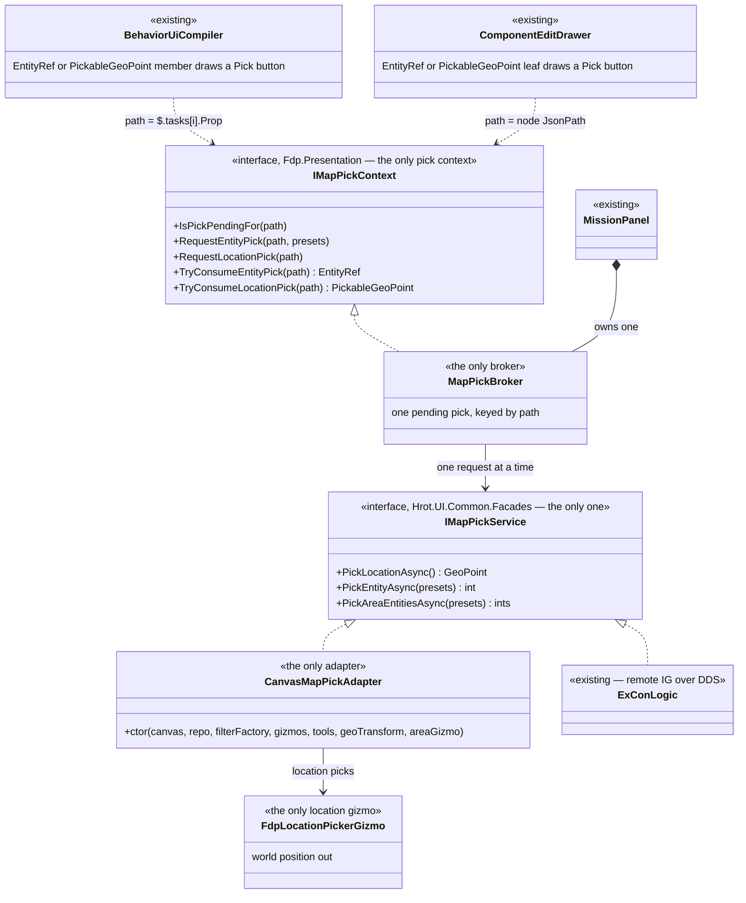
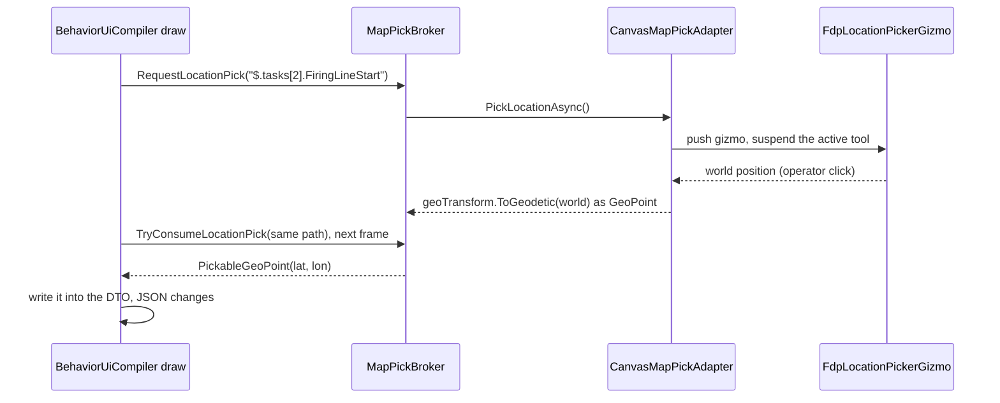
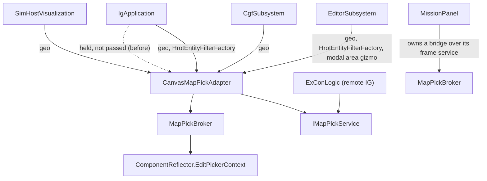
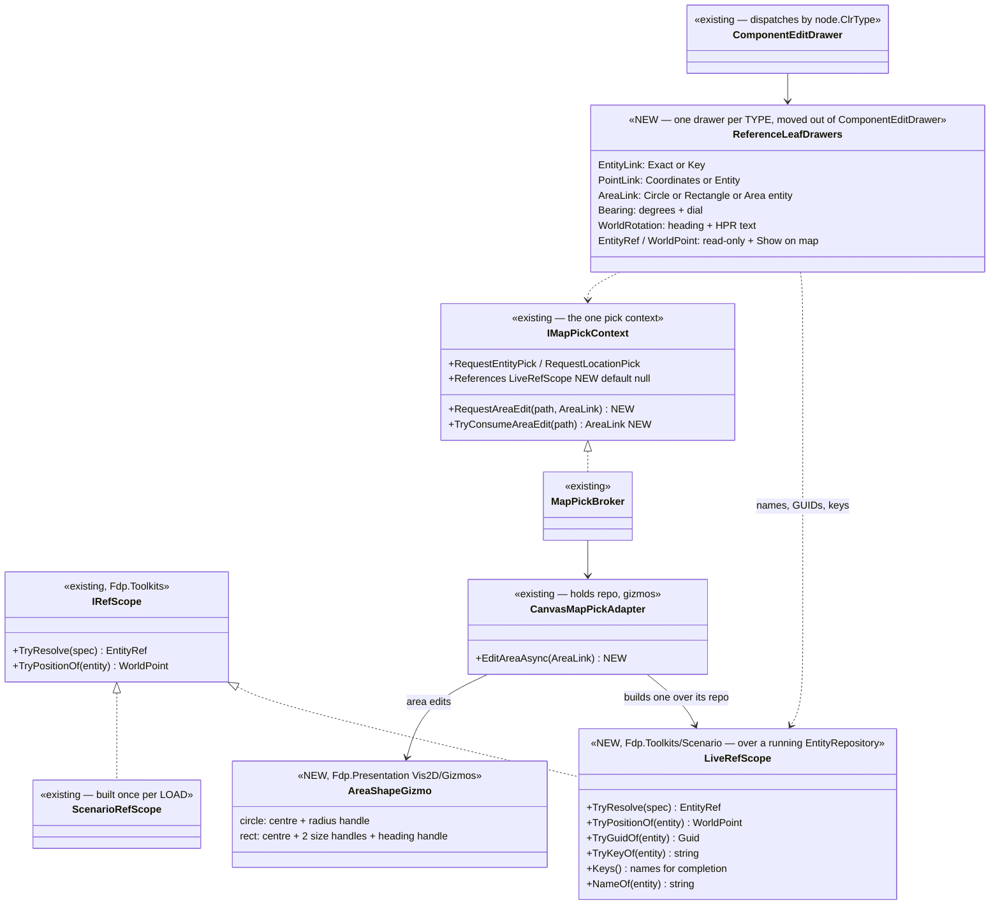
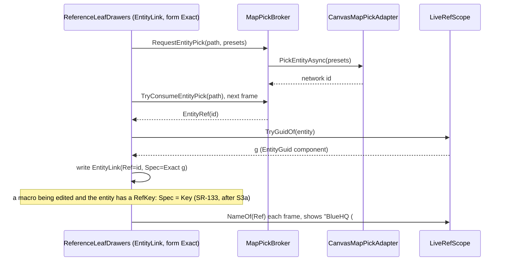
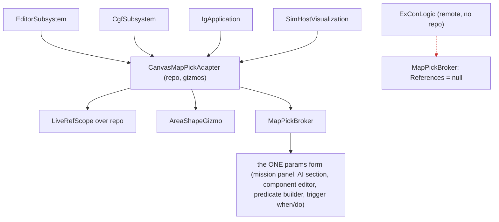

<!--STATUS
state: LIVE
updated: 2026-11-02
build-state: BUILT (2026-10-03 — §5) · §6 (CE-4206, the reference types' forms) READY-TO-BUILD — F1–F9 ✅ APPROVED by the user 2026-11-02
current-answer: §2 (diagrams) and §3 (decisions); §1 is the measured inventory; §5 is the as-built · ⭐ §6 the authored reference types' forms (EntityLink / PointLink / AreaLink / Bearing / WorldRotation, CE-4206)
stale-below: nothing yet.
known-rot: §2's BehaviorUiCompiler box and its sequence participant are DELETED (CE-1023, 2026-10-12) — the mission panel draws THE one params form (BehaviorParamsForm + ComponentEditDrawer) through a ScopedMapPickContext($.tasks[i]) over the same broker, so the paths and the broker are unchanged; see ../DESIGN_Sensors_And_Doctrine.md §7.6b.
known-conflict: none.
related-designs:
  - ../DESIGN_Scenario_Rules.md — SR-133 / SR-134 / SR-138 / SR-140 / SR-141 own the authored reference TYPES; §6 here owns their FORMS in the editor (CE-4206)
  - ../DESIGN_Scenario_Entity_Keys.md — EntityGuid (S1) and the GUID file form (S9′) that §6 F3's pick writes
  - ../DESIGN_Scenario_Rules.md — §9.8 SR-125 (draft 2026-11-01) proposes WorldPoint: ONE place type replacing PickableGeoPoint, point Vector3 fields and lat/lon pairs — still picked by its TYPE (P5), also relocated and resolvable from @Key / GUID
  - ../DESIGN_Orders_Params_Entity_Classes.md — §13.12 (P5b, CE-1059) adds the entity LIST pick to the one broker (IMapPickContext.RequestEntityListPick; offered by the order form, the Editor/CGF mission panels and the Editor's AI view) and makes the preset filter the default on every host (CE-1060).
  - ../DESIGN_Sensors_And_Doctrine.md — §7.6b (CE-1023) puts the ONE params form on every screen, retires BehaviorUiCompiler (the mission panel's second form) and adds ScopedMapPickContext over the one broker.
  - DESIGN_Entity_Reference.md — owns the EntityRef TYPE and the rule "the type makes a field pickable"; this document
    applies that rule to locations and collapses the picking machinery underneath it.
  - Architect_Question_55_Watch_Concrete_Entity_Picker.md — flagged two of the duplicates closed here (two
    IMapPickService, two MapPickableEntityAttribute) and ruled the Facades IMapPickService the keeper (Q55-B).
  - ../DESIGN_Cgf_Scenario_Windows_Slice.md — §8 D2 / §10 F1 deferred CE-063 (the two map-pick adapters) pending a
    capability comparison; §1 below is that comparison.
  - ../designs/comp-edit-1/DESIGN.md — §2.1/§2.2 defined the component editor's picker attributes and
    IMapPickContext; their attribute half is superseded here (the type decides), the interface becomes THE one.
-->

# Map picking — one service, one adapter, one context, one gizmo

> 🔒 **User, 2026-10-03:** *"unification is our goal as always, so pls unify rather duplicate whatever you do… keep
> working autonomously."*

## 1. INVENTORY *(measured 2026-10-03 — `search_graph` `.*MapPickable.*` (15), `.*Pick.*Context.*` (42), grep for
every constructor and implementer; a read-only agent compared the two adapters line by line. `check_index_coverage` is
not reachable from the CLI, so absence claims are grep-corroborated, not proven)*

| layer | before | users |
|---|---|---|
| pick **service** | ⛔ 2 × `IMapPickService`: `Hrot.UI.Common.Facades` (3 members) and `Hrot.ExCon.Services` (the same minus `PickAreaEntitiesAsync`), bridged by `ExConMapPickShim` ("temporary … until Phase 6") | Facades: MissionPanel, WatchEntityPicker, ScenarioMissionView, every adapter · ExCon: `ExConLogic` only |
| pick **adapter** | ⛔ 2: `CanvasMapPickAdapter` (IG, CGF, SimHost) and `EditorMapPickAdapter` (editor) — same ctor shape, same `PickerToolHost`, same `EntityPickerGizmo` (**CE-063**) | — |
| location **gizmo** | ⛔ 2, line-for-line identical: `FdpLocationPickerGizmo` (returns the world position) and `LocationPickerGizmo` (converts to geodetic first) | one per adapter |
| per-frame **broker** | ⛔ 2: `MapPickBroker : IMapPickContext` (component editor; jsonPath keys; `EntityRef`/`Vector3`) and `MissionPanel : IPickInteractionContext` (task+property keys; `long`/`PickableGeoPoint`) — the same one-pending-pick state machine written twice | — |
| **attribute** | ⛔ 2 × `MapPickableWorldLocationAttribute` (Toolkits; Fdp.Presentation) — the entity twin was deleted by DESIGN_Entity_Reference | Fdp.Presentation's: no production user · Toolkits': exactly the five `PickableGeoPoint` members |

🔴 **Found while comparing the adapters:** `CanvasMapPickAdapter.PickLocationAsync` returns the world X/Y *in the
latitude/longitude fields* (its header documents it). Every host that builds it (IG `IgApplication.cs:531`, CGF
`CgfSubsystem.cs:1873`, SimHost `SimHostVisualization.cs:369`) holds a geographic transform it does not pass, so a
mission-panel location pick on those hosts writes metres where degrees belong. IG also builds an
`HrotEntityFilterFactory` (`IgApplication.cs:1050`) and does not pass it, so its filter presets are ignored.

## 2. The design

*What the picture shows that prose hid: two parallel stacks — editor and everyone else, mission panel and component
editor — collapse into one column, and the two capabilities that differed (geodetic conversion, the domain filter)
become constructor dependencies that every host already holds.*





*Who builds what — every host passes the geographic transform and the filter factory it already holds (the
silent-default rule); the dashed edges are the dependencies that were held and not passed.*



## 3. Decisions

| # | decision | rejected — one line each |
|---|---|---|
| P1 | ⭐ **one service**: delete `Hrot.ExCon.Services.IMapPickService` and `ExConMapPickShim`; `ExConLogic` implements the Facades interface (area pick answers empty, as the shim did) | keep the shim — two contracts for one capability (AQ55 Q55-B already ruled the keeper) |
| P2 | ⭐ **one adapter** (CE-063): `CanvasMapPickAdapter` gains optional `IGeographicTransform` (location → geodetic) and an area-gizmo factory; the editor builds it with `HrotEntityFilterFactory`, its transform and its modal area gizmo; `EditorMapPickAdapter` and `LocationPickerGizmo` are deleted. Every host passes the transform it holds; IG passes its filter factory | merge toward the shared adapter as it was — silently degrades the editor to metres-as-degrees (the risk CE-063 named) |
| P3 | ⭐ **one location gizmo**: `FdpLocationPickerGizmo` returns the world position; conversion is the adapter's job | two gizmos differing only in a conversion line |
| P4 | ⭐ **one context, one broker**: `IMapPickContext` (string path keys) is the only pick context; `IPickInteractionContext` is deleted. Its consume results are `EntityRef` and `PickableGeoPoint`. `MapPickBroker` is the only broker; `MissionPanel` owns one over its per-frame service instead of its own pending-pick fields | keep two interfaces with an adapter between them — the state machine would still exist twice |
| P5 | ⭐ **the type makes a field pickable, for locations too**: `PickableGeoPoint` gets the Pick-Map button in the mission panel, the component editor and the agent schema; `MapPickableWorldLocationAttribute` (both copies) is deleted | keep the attribute — it marks exactly the members of that type, so it says nothing the type does not |

## 4. Design docs checked

`DESIGN_Entity_Reference.md` D5 — applies, the rule this extends · `Architect_Question_55` — applies, Q55-B names the
keeper service and flags the duplicates · `DESIGN_Cgf_Scenario_Windows_Slice.md` §8 D2 / §10 F1 — applies, it asked
for exactly the capability comparison in §1 before merging · `comp-edit-1/DESIGN.md` §2.1/§2.2 — applies, its
attributes are superseded and its interface is kept as the one · `UX_Feature_Tool_Model.md` (lists each adapter's
gizmos) — applies as history, no ruling.

## 5. As-built *(2026-10-03)*

| decision | as built | deviation |
|---|---|---|
| P1 | `Hrot.ExCon/Services/IMapPickService.cs` and `ExConMapPickShim` deleted; `ExConLogic : Hrot.UI.Common.Facades.IMapPickService` (area pick answers empty); `IExConLogic.MapPickService` is the shared type; `ExConMock` hands `_logic.MapPickService` to the mission panel | — |
| P2 | `CanvasMapPickAdapter` gains `geoTransform` and `areaGizmo`; a location pick converts through the passed transform, else the world's `IGeographicTransform` singleton (SimHost publishes one and holds no field), else returns world X/Y as before. Editor: built with `HrotEntityFilterFactory`, its transform and `ModalBoxSelectionGizmo`. IG: passes its filter factory and transform. CGF: passes its transform. `EditorMapPickAdapter` deleted; its tests moved onto the shared adapter | ⭐ the world-singleton fallback was added so SimHost needs no new field — the singleton is the same one behaviour resolvers read |
| P3 | `LocationPickerGizmo` deleted; `FdpLocationPickerGizmo` is the one | — |
| P4 | `IPickInteractionContext` deleted. `IMapPickContext` is the one context (entity → `EntityRef`, location → `PickableGeoPoint`); `MapPickBroker` is the one broker (a fixed service, or one read at request time); `MissionPanel` owns one over its frame service and passes it to `BehaviorUiCompiler`, which keys `$.tasks[i].Prop` (`BehaviorUiCompiler.PickPath`). The panel's pending-pick fields, `PollPickCompletion`, `HandlePickLocation/Entity` and `TestHook_PollPickCompletion` are gone | — |
| P5 | `MapPickableWorldLocationAttribute` (both copies) deleted. `BehaviorUiCompiler`, `ComponentEditDrawer` and `DtoJsonSchemaExtractor` key on `PickableGeoPoint`; `PickableLeafFieldEditor(Type)` collapses `EntityRef` OR `PickableGeoPoint` into one leaf (it replaced the step-1 `EntityRefFieldEditor`) | — |
| + | **Watch entity picker, one implementation:** `WatchEntityIdentity.PickerOver(pick)` turns a map pick into a concrete binding; the editor's private `PickWatchEntityBindingAsync` is deleted and CGF — which holds the adapter — now passes the same picker. ⛔ SUPERSEDED: CGF's comment "EntityPicker is deliberately ABSENT … `IMapPickService` lives in `Hrot.ExCon`" (it lives in Facades and CGF builds it) | found while unifying; same family |

*CE-1300 (`2026-11-06`):* a pick's anchor resolves to the TOP CARRIER of an attached / seated entity in the one anchor rule (`NetworkIdResolver.ResolveAnchorId`) — so this adapter's `PickEntityAsync` (via `PickEntity`) answers the vehicle, never its gun or gunner; see `../DESIGN_Gizmo_Anchor_Identity.md` §6.7a.

*Renamed `2026-10-04` (user: "more intuitive names are of course better"), through Roslyn:* `IComponentPickerContext` → `IMapPickContext`, `MapPickServiceBridge` → `MapPickBroker`, the hosts' `_mapPickBridge`/`GetMapPickBridge()`/`PickBridge` → `…Broker`; tests named after deleted classes → `MapPickAdapterTests`, `IMapPickContextTests`, `EntityRefJsonRemapTests`. Older documents keep the old names as history.

*Rails:* `AdapterTests` A004 (moved onto the shared adapter) + `PickLocationAsync_IsGeodetic_ThroughTheHostTransform` + `PickLocationAsync_FallsBackToTheWorldsTransformSingleton` · `ComponentEditDrawerTests.P5_APickableGeoPointField_IsOneLeaf_AndALocationPickLandsInTheComponent` · `MissionPanelRegistryTests` (the panel picks through the broker; path-keyed; once-only consume; no frame service ⇒ ignored) · `BehaviorUiCompilerTests` (asks the context for `$.tasks[0].TargetNetworkId`) · `PresentationAttributeTests` C008 SC2 (only the `PickableGeoPoint` member is pickable).

## 6. CE-4206 — the editor authors the reference types' FORMS *(ui, `2026-11-02` — build-state: READY-TO-BUILD; ✅ F1–F9 APPROVED by the user `2026-11-02`, verbatim: "Approved")*

> 🔒 **User:** *"we will need to update the editor to support those XXXLink types."* · dispatched by
> [HANDOFF_Coordinator_To_Ui_Scenario_Authoring](batches/HANDOFF_Coordinator_To_Ui_Scenario_Authoring.md) ① (frozen at `d358a8728`).
> Basis: [`DESIGN_Scenario_Rules.md`](../DESIGN_Scenario_Rules.md) SR-133 (the leaf's form switch, what a pick writes), SR-134 (one `AreaLink`,
> three shapes), SR-138 (what tools see), SR-140 (`EntityRef` vs `EntityLink`), SR-141 (*show on map* by type) · the types as built:
> `FDP/Toolkits/Fdp.Toolkits/Replication/Links.cs`, `FDP/Engine/Fdp.Core/World/RefSpec.cs` (S0 item 5).

### 6.1 INVENTORY *(graph + grep, `2026-11-02`; ⚠ `check_index_coverage` is not reachable from the CLI — absences are grep-corroborated, not proven)*

```
search_graph .*(Area|Circle|Rect|Region|Zone).*(Gizmo|Arm|Tool|Editor|Handle).* Class → 11: AreaAuthoringArm (polyline AREA ENTITY authoring),
    DangerAreaGizmo, SectorAreasGizmo, TacticalAreaGizmo, TerrainZoneGizmo (draw-only), ZoneEditorPanel — ⛔ none edits a circle or a rotated rectangle
search_graph .*(Rotated|Rect|Circle|Radius).*(Gizmo|Handle|Drag|Tool).* Class → 0
search_graph .*Gizmo$ Class → 80 read: BoundingBoxPickerGizmo (axis box drag, the predicate's box), FdpLocationPickerGizmo (the one point pick),
    EntityPickerGizmo, EntityRotatorGizmo (heading handle on an entity), VertexEditGizmo, PointSequenceGizmo, MeasureGizmo
search_graph .*(Bearing|Heading|Compass|Rotation|Orientation).*(Gizmo|Dial|Editor|Text|Widget|Handle).* Class → 3 (EntityRotationGizmo + settings + test) — no dial
search_graph .*(MapPick|PickTarget|Pickable|LocationPick|EntityPick).* Class → 16: IMapPickContext, MapPickBroker, CanvasMapPickAdapter,
    ScopedMapPickContext, PickableLeafFieldEditor, MapPickableEntityAttribute, MapPickableBoundingBoxAttribute, PickableGeoPoint (⚠ still present)
search_graph .*(EntityGuid|RefKey|Guid).* Class → 26: GuidFieldDrawer, GuidFieldEditor, FederatedGuidResolver, NetworkIdGuid … ⛔ no live GUID→entity index
grep "interface IRefScope" → Fdp.Toolkits/Replication/EntityRefRemap.cs:481 (TryResolve(spec) · TryPositionOf · Describe); implementers:
    ScenarioRefScope (RefKey.cs:32, built ONCE per load by the extractor), two test / migration scopes — ⛔ no LIVE one over a running world
grep ComponentEditDrawer.cs → the link branches are hard-coded inline: :297-:403 (pick buttons), :440-:510 (text inputs): EntityLink writes a BARE id
    (:355, :469), PointLink coordinates (:376, :456); AreaLink only via MapPickableBoundingBox → AreaBoxes.FromBox (:259, :403)
grep ComponentEditServices.cs → WorldRotation edits as Y/P/R (QuaternionEulerFieldEditor); EntityLink/PointLink/WorldPoint/EntityRef → PickableLeafFieldEditor;
    ⛔ AreaLink and Bearing have NO leaf (drawn as a struct of members)
grep "Show on map" → EntityBrainView.cs:565/:683 (a unit's pinned gizmos) — ⛔ no per-field "show on map"
```

### 6.2 The picture

*What the class diagram shows that prose hid: today ONE drawer class holds every link branch inline, and the only thing that can answer
"which entity is GUID g / key k HERE" is a scope built once at LOAD — so an editor showing a name needs a LIVE scope, and the pick
needs the reverse lookup (entity → its GUID / key) that `IRefScope` does not have.*



*What the sequence shows: the pick still returns an `EntityRef` (the broker's contract is unchanged); the LEAF turns it into the authored
form through the live scope, so every host and every surface that draws the one form gets the GUID write for free.*



*Who builds what — the scope and the area gizmo come from what each adapter ALREADY holds (repo, gizmo manager); a host without a repo
(ExCon over DDS) keeps the plain forms, drawn honestly (no name, a GUID shown as text).*



### 6.3 Decisions *(✅ all approved `2026-11-02`)*

| # | decision | ⭐ lean | rejected — one line each |
|---|---|---|---|
| **F1** | where the per-type forms live | ⭐ move the inline link branches out of `ComponentEditDrawer` into `ReferenceLeafDrawers` (one static drawer per type, the drawer dispatches by `ClrType`) — ONE leaf per type for every surface (P4 / P5) | keep growing the inline `if` chain — ~200 lines already, three more types make it unreviewable · a field editor per surface — two editors for one type (P5) |
| **F2** | how the editor answers "which entity is GUID g / key k" and the reverse | ⭐ `LiveRefScope : IRefScope` over the running `EntityRepository` (`EntityGuid` + `RefKey` components; an index rebuilt when the world's structural version moves) + reverse `TryGuidOf` / `TryKeyOf` / `Keys` / `NameOf`; exposed as `IMapPickContext.References` (default `null`), built by `CanvasMapPickAdapter` over the repo it already holds | a scan per frame per field — O(entities) per drawn link · resolving through `ScenarioRefScope` — built once at load, stale after the first edit |
| **F3** | what an entity pick writes into an `EntityLink` | ⭐ SR-133: `Exact` = the picked entity's `EntityGuid`; no GUID (a bullet, an unsaved helper) ⇒ the bare id with the leaf showing *"no stable id — will not survive a save"*; `Key` while a MACRO is edited (⏳ after S3a — `header.kind`) | always a bare id (today) — the file keeps a number, which S9′ exists to remove |
| **F4** | the `EntityLink` leaf | ⭐ a two-way switch *[Exact \| Key]* + the value: Exact shows `Name (#id)` and *Pick / List*; Key is a text box completing from `Keys()`, unresolved shown red with *"no entity with key 'X' here"*. *Param* (bind to a macro parameter) is CE-4210's, not this one | a free text box parsing `@…` / GUIDs — the user cannot see which form they wrote |
| **F5** | `PointLink` | ⭐ *[Coordinates \| Entity]*: x, y, z + *Pick Map* (today's) · Entity = F4's controls, the answer = the entity's position at resolution (a snapshot, SR-130) · *Show on map* | — |
| **F6** | `AreaLink` editing on the map | ⭐ ONE new `AreaShapeGizmo` (circle: centre drag + radius handle; rectangle: centre drag, two edge handles, a heading handle — the `EntityRotatorGizmo` handle pattern) armed through the broker (`RequestAreaEdit` / `TryConsumeAreaEdit`), as the location pick is. Form switch *[Circle \| Rectangle \| Area entity]* + numeric fields; *Area entity* = F4's controls over area entities. The predicate builder's box (`MapPickableBoundingBox` → `AreaBoxes.FromBox`) becomes this leaf | stretch `BoundingBoxPickerGizmo` — axis-aligned and pick-once, no handles, no circle · draw the shape with `PointSequenceGizmo` — that authors an AREA ENTITY (a polygon), the third form, not a value |
| **F7** | `Bearing` / `WorldRotation` | ⭐ `Bearing`: degrees + a small compass dial (drag the needle) in the form; the map arrow at the owner is phase 2 · `WorldRotation`: keep the Y/P/R editor (`QuaternionEulerFieldEditor`) + a read-out through `OrientationText` | a map gizmo for every heading now — no owner position is known to the form in general |
| **F8** | the internal types in read-only views | ⭐ `EntityRef` / `WorldPoint` in the inspector / watch / brain view: the value + *Show on map* (centres the map and flashes the place / entity for 2 s through the existing map overlay) | — |
| **F9** | `RefKey` editing + the agent schema | ⭐ `RefKey` drawn in the entity details with a uniqueness check against `LiveRefScope.Keys()` (a duplicate is red and refuses to apply, SR-126 "loud") · `DtoJsonSchemaExtractor` emits `x-hrot-ref: entity \| point \| area \| bearing` per type (SR-138 ④) | — |

### 6.4 Phases

| phase | scope | rails |
|---|---|---|
| **R1** | F1 + F2 + F3 + F4 + F5 | `LiveRefScope` (GUID / key round trip, a duplicate key, an index after a spawn); the leaf writes `Exact g` on a pick and a bare id with the warning when no GUID; a scenario saved and reloaded keeps the GUID form (S9′) |
| **R2** | F6 (+ the predicate builder's box) | `AreaShapeGizmo` handles move centre / radius / size / heading; the predicate builder edits a circle and a rotated rectangle; frame rail under `xvfb-run -a` |
| **R3** | F7 + F8 + F9 | dial writes degrees; *Show on map*; RefKey duplicate refused; schema hint present |

### 6.5 Design docs checked

`DESIGN_Scenario_Rules.md` SR-133 / SR-134 / SR-138 / SR-140 / SR-141 — apply, they fix what each form is and what a pick writes ·
`DESIGN_Scenario_Entity_Keys.md` (S1 `EntityGuid`, S9′ the GUID file form) — applies, F3 writes what S9′ saves · §2–§5 above (P4 one
context, P5 the type makes a field pickable) — apply, F1 / F6 extend them, no second context · `DESIGN_Terrain_Zones_And_Assets.md` §2.1
(`AreaAuthoringArm`) — does NOT apply to F6: it authors an area ENTITY (a polygon), the `AreaLink` third form, not a circle / rectangle value ·
`DESIGN_Entity_Brain_View.md` *Show on map* — does not apply directly: it pins gizmo families on a unit, F8 is a one-off flash of a value.

### 6.6 As built — R1 *(2026-11-02)*

| decision | as built | deviation |
|---|---|---|
| F1 | `Fdp.Presentation/ImGui/Editing/ReferenceLeafDrawers.cs` — one static class, one draw method per type (`EntityLink`, `PointLink`, `EntityRef`, `WorldPoint`); `ComponentEditDrawer.DrawLeafNode` dispatches on `ReferenceLeafDrawers.Handles(ClrType)` and its inline `EntityLink` / `PointLink` / `EntityRef` / `WorldPoint` branches (value inputs and pick buttons) are gone. `EntityRef` / `WorldPoint` draw as before. What a pick or an edit WRITES is in public static helpers (`PickToLink`, `TryKeyToLink`, `KeyProblem`, `SwitchToKey`, `SwitchToExact`, `PointFromSpec`, `PointFromPick`) that the rails call without ImGui | the delete `X` of an array element now follows the whole value cell (it used to sit between the input and the pick buttons) |
| F2 | `LiveRefScope : IRefScope` (`Fdp.Toolkits/Scenario/LiveRefScope.cs`): GUID→ref, key→ref, ref→GUID / key / name / position, `Keys()`, `HasDuplicate(key)` (reported, never thrown). It indexes entities that carry a `NetworkIdentity` (an `EntityRef` IS a network id). `IMapPickContext.References` (default `null`) · `ScopedMapPickContext` forwards it · `IMapPickService.References` (default `null`) · `CanvasMapPickAdapter.References` = one `LiveRefScope` over the repo it holds · `MapPickBroker.References` = an explicit value, else the service's | **Rebuild policy:** the world exposes no structural version, so the index rebuilds lazily when `EntityCount` or `MaxEntityIndex` changed (a spawn / destroy — at once), or — for a key / GUID edited in place — when `GlobalVersion` moved and 250 ms have passed; `Invalidate()` forces it. Hosts need no wiring: every host builds its broker over a `CanvasMapPickAdapter` that holds a repo (rail `PickReferencesAreWiredOnEveryHostTests` greps that each production construction passes one) |
| F3 | an entity pick in the Exact form writes `EntityLink(picked, ByExact(guid))`; no GUID (or no scope) ⇒ the bare id, and with a scope the leaf draws *"no stable id — will not survive a save"* | the Key-on-pick of a MACRO is not built (SR-133, after S3a) — a comment marks the place |
| F4 | `[Exact \| Key]` radio switch · Exact = `Name (#id)` (else `#id`) + Pick / List · Key = text box + `v` completion popup from `Keys()` + red *"no entity with key 'X' here"* / *"key 'X' is not unique"* / the 31-byte refusal as text (the `ArgumentException` is caught). Switching Exact→Key prefills the entity's `RefKey`; Key→Exact takes the resolved entity's GUID | the form a person switched to is held by the drawer per field path (`ReferenceLeafDrawers.State`), because an empty key is not a legal `RefSpec` and so cannot carry the choice in the value |
| F5 | `[Coordinates \| Entity]`: Coordinates = x, y, z + Pick Map as before; Entity = F4's controls over the entity the spec names, and `Local` is the entity's position at assignment (`SimTransform`, a snapshot — SR-130). An entity with no GUID cannot be a reference: its position is copied as coordinates and the leaf says so | *Show on map* skipped: no centre / flash hook exists on the pick context — it is F8 (R3) |

*Rails:* `ComponentEditDrawerTests` `R1_*` (Exact on a GUID pick, bare id without one, no scope, Key text / unresolved / duplicate / over-long, form switching, PointLink entity snapshot, the four types) · `LiveRefScopeTests` (round trips, rebuild after a spawn, in-place edit, duplicate reported, empty world) · `S0TypesTests.EntityLink_ReadsEveryForm…` (the Exact-GUID file form `{"NetworkId":n,"Ref":"<guid>"}`, S9′) · `CE4206_TheBrokerCarriesTheLiveReferenceScope…` · `PickReferencesAreWiredOnEveryHostTests`. *Red-proofs:* `PickToLink` returning the bare id ⇒ 3 `R1_*` rails red; `LiveRefScope` never rebuilding on a spawn ⇒ `A_spawn_after_the_first_query_is_found` red. *No frame screenshot:* `ComponentEditDrawer` has no `FrameRail` (its tests run a headless ImGui frame, no GPU).

### 6.7 As built — R2 *(2026-11-03)*

| decision | as built | deviation |
|---|---|---|
| F6 gizmo | `Fdp.Presentation/Vis2D/Gizmos/AreaShapeHandles.cs` (pure: `HandlesOf`, `HitHandle`, `HitRadiusFor`, `Drag`, `Outline`, `BearingTo`, `NewAt`) + `AreaShapeGizmo` (`IEntityStatefulGizmo`, ctor `(AreaLink start, Action<AreaLink> onDone, Action onRemove, Action? onCancelled)`). Circle: centre + a rim handle; rectangle: centre, width / length edge handles, a heading knob beyond the front edge. Enter or a click on the Done button (drawn beside the shape) commits (after `onRemove`, as the location gizmo orders it); right-click or Esc cancels. No start shape ⇒ the first click places a 50 m circle there; committing with nothing placed cancels | the hit radius is a tenth of the shape's size (2–40 m) because the gizmo does not know the camera scale; ⛔ SUPERSEDED (2026-11-03): the right-click COMMIT — it came from the brief and contradicted the sibling `FdpLocationPickerGizmo`. Now **Enter or a click on the Done button commits; right-click or Esc cancels**, exactly as the sibling does |
| F6 service | `IMapPickService.EditAreaAsync(AreaLink start, ct)` (default: answers `start`) · `CanvasMapPickAdapter.EditAreaAsync` pushes the gizmo through `PickerToolHost.RunPickAsync` under the new tool id `ScenarioToolIds.EditAreaShape` (Esc ⇒ the task is cancelled) · `IMapPickContext.RequestAreaEdit(path, start)` / `TryConsumeAreaEdit(path, out AreaLink)` (defaults: no-op / false) · `MapPickBroker` implements them (one task, consumed once, for its path only) · `ScopedMapPickContext` forwards | — |
| F6 leaf | `ReferenceLeafDrawers` draws `AreaLink`: `[Circle \| Rectangle \| Area entity]`; circle = x, y, radius; rectangle = x, y, width, length, heading°; *Edit on map*; Area entity = R1's Exact / Key controls (`DrawEntityLinkCore`). `SwitchAreaForm` keeps the centre (a circle's diameter becomes the square's side, a rectangle's longer half the radius; from an area entity the centre is its position when a scope says). Registered in `ComponentEditServices.CreateBuilder` (the standard leaves) | the entity form does NOT filter to area entities (`EditablePolyline`) — any entity can be picked; optional in the brief |
| F6 predicate box | the search panel's `AreaLink` (`SpatialBoundingPredicateDto.Bounds`) is the same leaf. `ReplaySearchPanel.PickContext` (an `IMapPickContext`) replaces `SpatialPickerCtx`; the Replay Browser builds a `MapPickBroker` over a `CanvasMapPickAdapter` (rebuilt when its canvas is replaced) | **Box path decision — DELETED:** `ISpatialPickerContext`, the drawer's two `MapPickableBoundingBoxAttribute` branches, `BoundingBoxFieldDrawer`, `BoundingBoxFieldEditor`, the subsystem's `ReplaySpatialPickerContext` and the stub test class `ISpatialPickerContextTests`. **KEPT:** `MapPickableBoundingBoxAttribute` (read by `DtoJsonSchemaExtractor` → the agent schema `picker: boundingBox`; F9 / R3 replaces it with `x-hrot-ref`), `BoundingBoxPickerGizmo` + its tests and `ScenarioToolIds.PickBounds` (now unused — marked SUPERSEDED, to be removed after a design-corpus check, not rushed) |

*Rails:* `AreaShapeGizmoTests` (centre / radius / edge / heading maths, handle positions and hits, the grab-drag-release state machine, Enter / Esc / right-click, place mode, the draw) · `ComponentEditDrawerTests` `R2_*` (one leaf, a finished edit written once, form switching keeps the centre, the entity form round trip, the predicate's `Bounds` drawn by the leaf) · `CE4206_R2_TheBrokerRunsAnAreaEdit…` (request → service → consume once, cancel, scoped path, the interface default). *Red-proofs:* `BearingTo` with X/Y swapped ⇒ the heading rail red; the leaf not writing a consumed edit ⇒ both `R2_*` write rails red. *No frame screenshot:* the repo has no 2-D gizmo frame rail to extend (its `FrameRail`s are 3-D film scenes); the draw is asserted on the primitive buffer.

### 6.8 As built — R3 *(2026-11-03)*

| decision | as built | deviation |
|---|---|---|
| F7 `Bearing` | `ReferenceLeafDrawers` draws it: a degrees box (wrapped to [0, 360)) + a 48 px compass dial (N up, a needle you drag). The maths is pure: `BearingDial.Wrap` / `FromDrag(center, mouse)` / `NeedleEnd`. Registered in `ComponentEditServices` | — |
| F7 `WorldRotation` | its Y/P/R editor is untouched; the drawer adds a muted read-out line through `OrientationText` (`ReferenceLeafDrawers.RotationReadout`) | — |
| F8 Show on map | every reference leaf (`EntityRef`, `EntityLink`, `WorldPoint`, `PointLink`, `AreaLink`) draws a small *Show* button when the context can. `IMapPickContext.CanShowOnMap` / `ShowOnMap(EntityRef)` / `ShowOnMap(WorldPoint)` (default members) → `ScopedMapPickContext` → `MapPickBroker` → `IMapPickService` (same defaults) → `CanvasMapPickAdapter`: an entity through `CenterOnEntitySystem.CenterOn` (the map menu's Center View), a point through `MapCamera.FocusOn` on its canvas camera. `ReferenceLeafDrawers.ShowTarget` says what a value stands for (an area: its centre or its area entity) | **no new command:** the existing camera seams already do both moves, so no `CenterOnPointCommand`; **no 2 s flash:** the repo has no map ping / flash overlay to reuse — centre only. The leaves draw it for editable values too (the inspector's in-place edit is this drawer) |
| F9a `RefKey` | a leaf: a text box; `RefKeyProblem` / `TryApplyRefKey` — a duplicate is refused in red *"key 'X' is already used by <name>"* (from `LiveRefScope.References`) and NOT applied (SR-126), an over-31-byte key is refused in red, its own current key is fine, empty clears | — |
| F9b schema | `DtoJsonSchemaExtractor` names the picker by TYPE: `AreaLink` ⇒ `"area"` (was `"boundingBox"`), `Bearing` ⇒ `"bearing"`, `WorldRotation` ⇒ `"rotation"`; `entity` / `worldLocation` unchanged | `MapPickableBoundingBoxAttribute` had no reader left and is **deleted** (with its one use on `SpatialBoundingPredicateDto.Bounds`); `BoundingBoxPickerGizmo`, its tests and `ScenarioToolIds.PickBounds` stay as R2 left them |

*Rails:* `R3_*` in `ComponentEditDrawerTests` (the dial N/E/S/W and the wrap, the Bearing leaf, RefKey duplicate / over-long / unique / own / clear, Show-on-map targets) · `CE4206_R3_ShowOnMap_GoesBrokerToServiceToTheCanvasCamera…` (the forwarding rail, a point and an entity) · `CE4206_TheSchemaNamesTheAreaBearingAndRotationPickers_ByType`. *Red-proofs (one per item):* the dial with X/Y swapped ⇒ dial rail red · `RefKeyProblem` not looking the key up ⇒ duplicate rail red · the broker not forwarding a point ⇒ forwarding rail red · the `AreaLink` hint back to `"boundingBox"` ⇒ schema rail red.

**CE-4206 F1–F9 are all built.** Left open by design, not by omission: the macro Key-on-pick (SR-133, after S3a) · the Area-entity form's `EditablePolyline` filter (optional) · the 2 s flash (no overlay exists) · removal of the unused `BoundingBoxPickerGizmo` / `PickBounds` (needs a corpus check).
