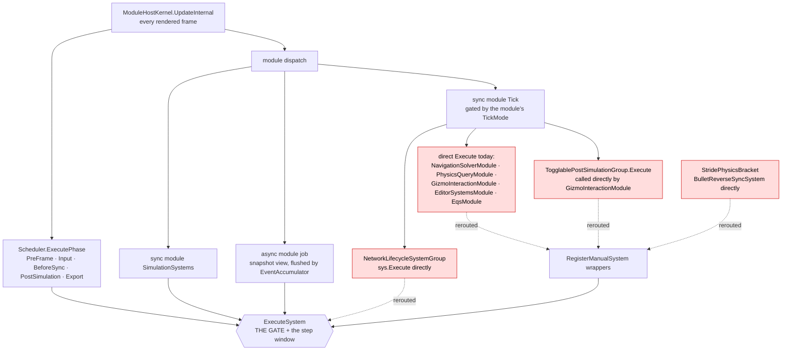
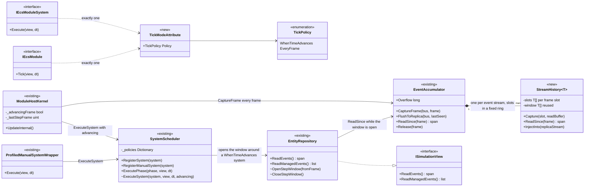
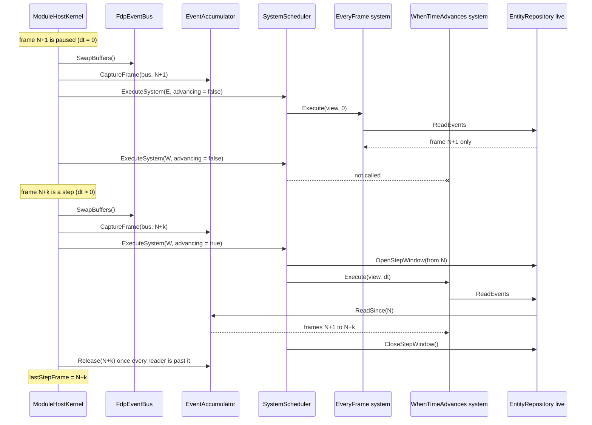

<!--STATUS
state: LIVE
build-state: READY-TO-BUILD
updated: 2026-10-21 (created — backend; CE-3293, R-3036, R-3037)
current-answer: §1 the rules · §2–§4 the diagrams · §7 the build order. Appendix A/B are the per-system and per-module verdicts.
stale-below: nothing.
known-rot: none.
known-conflict: none.
related-designs:
  - docs/blueprints/DESIGN_Time_Architecture.md — owns time: who changes it, the zero-delta pause, §17 stepped-mode determinism
    (sim-time cadence, the step wait). Its §17 OPEN item "event visibility across paused frames" is what THIS document settles.
  - docs/designs/mgmt-1/DESIGN.md — owns editing while paused ("Entities placed/modified", :431) and Always Recording (:1941):
    the reasons ~40 % of systems must run while paused.
  - docs/DESIGN_Film_Director.md — a CONSUMER: needs stepped runs to repeat (R-3035); paused until this lands (R-3034).
  - FDP/Engine/Fdp.ModuleHost/docs/UserGuide/05_EventBus.md — owns the bus and its one-frame double buffer.
-->
# ⭐⭐⭐ PAUSED AND STEPPED EXECUTION — **every system says when it runs; a step-only system reads every event since the last step**

> 🔒 **User, `2026-10-21`:** *"if it's 40% of those that need to run in pause, then we need to explicitly tell for every
> system what mode it is in. There shouldn't be any default."* · *"System should simply read event, and the framework should
> make sure that the system that shouldn't be ticked when time is paused is not ticked when time is paused, meaning that when
> the system reads the event from its bus using a normal and simple read event, will get those accumulated events."*
> ⇒ **R-3036.** Tracker [`CE-3293`](Blueprint_Issues_Tracker.md).

## INVENTORY *(run `2026-10-21`)*

| query | total |
|---|---|
| Roslyn `roslyn_find_implementations("IEcsModuleSystem")`, workspace `Hrot.Core.csproj` (`is_msbuild_workspace: true`, root solution) | **251** → 202 production, 48 test/example, 1 abstract base |
| Roslyn `roslyn_find_implementations("IEcsModule")`, same workspace | **85** → 40 production |
| the only project outside the root solution, `Stride/HrotStrideApp.Windows` | Roslyn could not load it (never restored); its one source file is a 51-line launcher, no system |
| prior art: `search_code` for `TickWhenPaused · RunsWhilePaused · PausePolicy · TickMode · RunWhenPaused` over code and docs | **0** |
| `repo.Bus.Read*` in production files · `view.ReadEvents*` · casts of the view to `EntityRepository` | **43 · 70 · 158** files (grep) |

Every production system and module was read, its `Execute`/`Tick` body included (Appendix A, B). ⚠ `check_index_coverage` is not
available through the codebase-memory CLI; the counts above come from Roslyn, not the graph.

## 0. The problem, in one table

| today | consequence |
|---|---|
| pause = a **zero delta**; every system is still called every rendered frame | work scaled by `dt` stops, ⛔ but reacting to an EVENT does not — it happens at full strength on a paused frame |
| an event is readable for **one frame** (`FdpEventBus` double buffer) | a system that skips paused frames (the brain, `BrainTickSystem.cs:135`) **misses** every event that became readable on one |
| 8 systems skip paused frames **by hand** (`if (deltaTime <= 0f) return;`) | the rest run while paused by accident, not by design — 📐 no design says simulation reacts while paused |

⇒ stepped runs depend on how many frames were drawn between steps (the §17 OPEN item of
[`DESIGN_Time_Architecture.md`](DESIGN_Time_Architecture.md)).

## 1. ⭐⭐ The rules

| # | rule | why |
|---|---|---|
| **1** | ⭐⭐⭐ **Every system and every module carries exactly one `[TickMode(...)]`: `WhenTimeAdvances` or `EveryFrame`.** Registration **throws** on a system or module without one. ⛔ No default. | 📐 80 of 202 production systems must run while paused, 118 must not (Appendix A) — neither is a safe default (R-3036) |
| **2** | ⭐⭐ **The gate is `SystemScheduler.ExecuteSystem`**: on a frame whose delta is 0, a `WhenTimeAdvances` system is not called. The kernel gates a module's own `Tick` the same way. | the one method every scheduled call passes (`SystemScheduler.cs:147`) |
| **3** | ⭐⭐ **No system is called around the gate.** The 7 direct calls (§3, red) go through `ExecuteSystem` — a module ticks its systems through `RegisterManualSystem` wrappers, and the wrapper calls `ExecuteSystem`. | a gate a call can bypass is not a gate |
| **4** | ⭐⭐⭐ **A system reads events only through its view** (`view.ReadEvents<T>()` / `ReadManagedEvents<T>()`), never `repo.Bus.Read<T>()`. | the view is the designed per-reader window: *"Events include history since module's last run"* (`ISimulationView.cs:53-57`) |
| **5** | ⭐⭐⭐ **While `ExecuteSystem` runs a `WhenTimeAdvances` system on the live world, the live world's `ReadEvents<T>()` answers every event since the previous step** (from the existing `EventAccumulator`); otherwise it answers the current frame. The system calls the same plain read. | the framework delivers what a skipped system missed; the system does not know (user, above) |
| **6** | ⭐⭐ **The accumulator keeps a frame until its last reader has had it** — the step window's start and every background module's last-seen frame — ⛔ not a fixed 60 frames. A cap remains; what it drops is **counted** (`Overflow`), never silent. | 📐 `EventAccumulator.cs:16` keeps 60 frames: a background module held over a pause longer than 1 s at 60 fps loses events today |
| **7** | ⭐ **A clock that goes back (a load, a preview Stop) restarts the window**: nothing from before it is delivered after it. | the CE-3292 timeline epoch, applied to events |
| **8** | ⭐ **The 8 hand-written `deltaTime <= 0` returns go** once the mark gates them. | one mechanism (ruling 9) |
| **9** | ⭐⭐⭐ **No allocation on the hot path** — capture every frame, the step-window read, the flush to a background module: **0 bytes per frame in steady state.** A buffer grows only when a new high-water mark is reached (a new event type, a busier frame than ever), and growth is counted. | 🔒 user, `2026-10-21`: *"The accumulator must be free of allocations on the hot path."* ⚠ today's accumulator is not (§1a) |

### 1a. ⭐⭐ Zero allocation — **what allocates today, and what replaces it**

📐 Read in the code `2026-10-21` (not yet measured — rail ⑤ in §7 measures it, red first):

| today, every frame | allocates | replaced by |
|---|---|---|
| `SnapshotCurrentBuffers` makes two `new List<…>` per frame (`FdpEventBus.cs:607-609`) | 2 lists + their growth | a **fixed ring of frame slots**, created once at the cap; a slot is reused, never freed |
| it walks `_nativeStreams.Values` / `_managedStreams.Values` — `ConcurrentDictionary.Values` builds a new collection on every call (`FdpEventBus.cs:612, 625`) | 2 snapshots per frame | an **append-only array of streams**, filled when a stream is created (rare), walked by index |
| managed events copied through `InspectReadBuffer()`, a `yield` iterator returning `object` (`ManagedEventStream.cs:43-49`) | an iterator per stream with events · ⛔ **a box per event** for a managed struct (`PublishManaged` allows structs) | each managed stream owns a **typed history** (`StreamHistory<T>`): the stream copies its read buffer into it by a virtual call — no iterator, no `object`, no box |
| native bytes copied into `ArrayPool` rentals and returned on trim | none after warm-up, but a rent and return per type per frame | a **byte arena per stream in each slot**, grown to its high-water mark and kept |
| the flush to a background snapshot goes through `InjectManagedIntoCurrent`: `GetMethod` + `MakeGenericMethod` + `Invoke(new object[] …)` per managed type (`FdpEventBus.cs:580-590, 712`) | reflection + an argument array per type per flush | the typed history **injects itself** into the replica's stream of the same `T` — a virtual call, no reflection |

**The step-window read** (`ReadSince`, rule 5):
- **When the window is only the current frame** (live play, and a step with no paused frame before it), it returns **the bus span itself**: zero copy.
- **Otherwise** it concatenates the window into the stream history's **reusable contiguous buffer** (`T[]` for native events, a reused `List<T>` for managed), once per type per frame. Every step-only reader of that type shares it.

### 1b. ⭐⭐ Systems that run while paused AND on steps — **where their events come from**

| | `EveryFrame` system | `WhenTimeAdvances` system |
|---|---|---|
| called | every frame, paused or not (`dt` = 0 while paused) | only on a frame that advances |
| `view.ReadEvents<T>()` returns | ⭐ **the current frame only** — the bus's read buffer, exactly as today; the step window is never open for it | everything since the previous step |
| an event published at step N is read | once, on frame N+1 — whether N+1 is paused or a step | once, at the next step |

⭐ An `EveryFrame` system runs on every frame, so it never misses an event and never sees one twice — it needs no accumulator. On a
step frame both kinds read the same frame's events; the step-only one also gets the paused frames before it.
⚠ It still receives `dt` = 0 while paused, so its `dt`-scaled work stands still exactly as today.

⚠ **A system whose work is HALF paused-time, half sim-time is split, not given a third mode.** The readers found three, all
`WhenTimeAdvances`, each with a small duty an operator expects to see while paused (§8):

| system | the paused-time duty it carries today | split into |
|---|---|---|
| `CarKinematicsSystem` | ground-clamps Z after a vehicle is dragged (`CarKinematicsSystem.cs:623-624`) | an `EveryFrame` clamp of moved entities |
| `AirMotionSystem` | recompiles the `AirPath` when a route is edited (`AirMotionSystem.cs:48`) | an `EveryFrame` route compile, beside `RouteTrajectorySyncSystem` |
| `UnitCentroidSystem` | moves a commander to his members' centroid after a drag (`UnitCentroidSystem.cs:20-45`) | an `EveryFrame` centroid on a member's move |

⭐ **In live play every frame advances** ⇒ the window is always the current frame ⇒ `ReadEvents` returns the bus span itself
(zero-copy). Nothing changes for live play.

⭐ **Why an `EveryFrame` system stays deterministic:** it reads each event exactly once, on the first frame after it was
published, ⛔ always before the next step. The number of paused frames in between changes nothing.

## 2. ⭐⭐ Who calls what each frame — **the module relationship**

*What the picture shows that prose hid:* **seven call sites never reach `ExecuteSystem` today** (red; file:line in
Appendix B). A gate placed only in the scheduler would not see them — `BulletReverseSyncSystem` (drag while paused) and
`DeferredTakeoverSystem` (ownership, reachable only through `NetworkLifecycleSystemGroup`) among them.

## 3. ⭐⭐ The classes

*What the picture shows that prose hid:* **only two types are new** (`TickPolicy`, `TickModeAttribute`). The accumulator, the
view's event reads, the manual wrapper and the gate's home all exist; each gains one member. ⭐ The window is a field on the
**live** `EntityRepository` instance — a background module's snapshot is a different instance and keeps reading its own,
already-flushed bus.

## 4. ⭐⭐ A pause, then a step

*What the picture shows that prose hid:* the step-only system's read covers **N+1 … N+k inclusive** — events published late
in step N (readable on N+1, a paused frame) are delivered once, at N+k. Paced and HTTP stepping therefore deliver the same
events to the same step.

## 5. ⭐ Claim table — what the rules rest on

| claim | code — how it IS | design — how it was MEANT to be |
|---|---|---|
| pause is a zero delta; every system is still called | ✅ `ModuleHostKernel.cs:517-805` (phases on `_liveWorld` with `deltaTime`) | ✅ `Blueprint_Issues_Tracker.md:3633` *"That is the intent — a paused world should not animate"* (a tracker row, not a design) · ⛔ searched `docs/`+`.dev/`: no design says simulation reacts while paused |
| every scheduled call passes `ExecuteSystem` | ✅ `SystemScheduler.cs:134-197`; kernel module systems `ModuleHostKernel.cs:735-738` | ⛔ searched `docs/`+`.dev/` (`TickWhenPaused`, `RunsWhilePaused`, `PausePolicy`, `TickMode`): no record of a pause gate |
| 7 call sites bypass it | ✅ Appendix B (module reader, 40/40 modules) | — |
| main-thread systems share the live world as their view | ✅ `ModuleHostKernel.cs:700-703` (`view = _liveWorld`) | — |
| the view's event read is the designed per-reader window | ✅ `EntityRepository.View.cs:96-103` (today it forwards to `Bus.Read`) | ✅ `ISimulationView.cs:53-57` *"Events include history since module's last run"* |
| 43 production files read `repo.Bus.Read` directly; 70 use the view | ✅ grep, `2026-10-21` | — |
| the accumulator captures every frame, keeps 60 | ✅ `ModuleHostKernel.cs:567`, `EventAccumulator.cs:16,34` | ✅ its class doc: *"Enables slow modules to see accumulated events since last run"* |
| 80 / 118 / 4 split | ✅ Appendix A — Roslyn `find_implementations(IEcsModuleSystem)` = 251, 202 production, every one read | ✅ `docs/designs/mgmt-1/DESIGN.md:431, :1941` (editing while paused, Always Recording) |

## 6. Rejected — one line each

- **A default (either way)** — 80 vs 118 (Appendix A): whichever default, a new system silently gets the wrong one; the user ruled no default.
- **Decide by phase** — `RecentSensesSystem` is Input, `BallisticsSystem` PostSimulation, `BehaviorIngressSystem` Input: both kinds live in every phase.
- **Decide by event type** — every type the brain reads also has paused-frame readers (`SensorChangedEvent`: `RecentSensesSystem`, `CivilianFearSystem`, `SquadSensing`).
- **A mark on the module only** — mixed packs (the editor's input group holds ingress and edit systems) — a module mark would be a default for its members.
- **Systems register the event types they want** — the system would know about pausing; the user ruled it must not.
- **A different bus object per kind of system** — 158 production files cast the view back to `EntityRepository`; a wrapper view fails the cast and those systems silently do nothing.
- **A switch inside `FdpEventBus.Read`** — leaves two event-reading APIs and cements the 43 bypassing sites.
- **Keep paused-frame events alive for everyone** — an `EveryFrame` reader would see the same event on every paused frame.

## 7. ⭐⭐ Build order — each slice green before the next

| slice | what | behaviour change |
|---|---|---|
| **S1** | `TickPolicy` + `TickModeAttribute`; marks on all 202 production systems (Appendix A), the 48 test/example systems and every module (Appendix B); registration throws without one; rail: every `IEcsModuleSystem`/`IEcsModule` type in loaded assemblies carries exactly one | none — not yet read |
| **S2** | reroute the 7 bypasses (§2) through `ExecuteSystem` | none |
| **S3** | the 43 `repo.Bus.Read*` sites → `view.ReadEvents*` (mechanical; Roslyn-checked); rail: no `IEcsModuleSystem` calls `Bus.Read*` | none |
| **S4** | the allocation-free accumulator (§1a: frame-slot ring, stream array, `StreamHistory<T>`, typed injection); retention by last reader + cap + `Overflow`; `ReadSince`; the live world's step window; clock-back restart | none yet (no window opened); background modules lose the per-frame garbage |
| **S5** | ⭐ turn the gate on (rule 2) and open the window (rule 5); remove the 8 hand gates | ⭐ step-only systems skip paused frames and read every event since the last step |

**Acceptance (S5), each red before and green after:**
① a `SensorChangedEvent` published at a step and followed by a paused frame reaches `BrainTickSystem` at the next step ·
② an entity deleted while paused gets its `DestructionOrder` cleanup in `WeaponDispatcherSystem`, `AnimationDispatcherSystem`
and `PhysicsBodyLifecycleSystem` at the next step (no body leak) ·
③ a background module held over 120 paused frames still sees every event (today: the 60-frame trim) ·
④ the three-reload probe of §17 at 15 Hz HTTP-stepped: identical including `RecentSenses.NearMiss` / `UnderFire.LastTime`, and
paced vs HTTP stepping agree ·
⑤ **zero allocation** (S4, red today): after a warm-up, `GC.GetAllocatedBytesForCurrentThread()` across 1 000 frames of capture +
`ReadSince` over a 30-frame window + a flush to a replica, native and managed-struct events in every frame, is **0** — the
precedent is `BlueprintAssetTickTests.cs:116`.

## 8. ⚠ Open — leans, for the user

| question | lean |
|---|---|
| `UnitHierarchySystem`, `TacticalIntentResolutionSystem` are fed by the operator while paused AND by the simulation on steps | **`EveryFrame`** — each event applied once before the next step (§1 determinism note); the ORBAT shows the change at once |
| `AnimationRuntimeBridgeSystem` — must a character placed while paused register and show its pose before the first step? | **`EveryFrame`** |
| `PossessionSystem` — must a possess/release clicked while paused take effect before Resume? | **`WhenTimeAdvances`** — the window delivers the click at the next step |
| the three half-and-half systems of §1b — split, or leave their paused duty undone until the next step? | **split** — each paused duty becomes its own small `EveryFrame` system; the sim work stays `WhenTimeAdvances`. ⛔ Not a third mode: a mode that means "partly" brings back the per-system `dt` checks |
| `HierarchyOrderSystem` has no production registration | **`EveryFrame`** (map ordering, UI) — marked so the rule holds when it is registered |
| frame-counted service timeouts in `EveryFrame` systems (`NetworkGatewaySystem`, `DeferredConstructionParticipant`, `LifecycleSystem`, `MissionControlExecutionSystem`) and `GhostPromotionSystem`'s 2 ms budget | **keep** — service plumbing, not simulation; they already must move while paused |

## 9. Related, not built here — **one way to mark an event** (R-3037)

🔒 **User, `2026-10-21`:** *"we need to unify the event. It's not acceptable that some has the attributes and some doesn't. And the
event type must be found by reflection scan at the beginning, no other way."* 📐 Measured: 40 of 76 managed event types carry no
`[EventId]` (their id is a per-process string hash), and ids 9059 collide (`MergeLogsIntent`, `StagingRemapPublishedEvent`, both
managed so the clash is dormant). ⭐ Independent of this design: the step window works on whatever id the bus uses. Its own design
is pending.

## Appendix A — every production system *(Roslyn: 251 implementations, 202 production; all read `2026-10-21`)*

**Legend:** **STEP** = `WhenTimeAdvances` · **EVERY** = `EveryFrame` (tag: edit · net · ui · rec) · **GROUP** = forwards to
members, carries no mark of its own (members decide). ⚠ = reads events a paused frame can carry — rule 5 delivers them.
Paths abbreviated; each resolves under `FDP/` `Hrot/` or `Stride/`.

| system | phase | mode | why | evidence |
|---|---|---|---|---|
| ActiveSensorTracksUpdateSystem | Simulation | STEP ⚠ | brain track memory fed by DDS events | ActiveSensorTracksUpdateSystem.cs:35-50 |
| AirMotionSystem | PostSimulation | STEP | moves air bodies | AirMotionSystem.cs:32,48 |
| AnimationBackendCleanupSystem | PostSimulation | EVERY edit | a delete while paused must free the backend slot | AnimationBackendCleanupSystem.cs:43-56; StrideAnimationBackend.cs:178 |
| AnimationCapabilityChangeReactorSystem | Input | STEP | capability edges — same mode as CognitiveInterrupt/Cleanup | AnimationCapabilityChangeReactorSystem.cs:29,56 |
| AnimationDispatcherSystem | Simulation | STEP ⚠ | montage executors; DestructionOrder teardown | AnimationDispatcherSystem.cs:62-75 |
| AnimationRuntimeBridgeSystem | Simulation | EVERY edit (lean, §8) | a character placed while paused registers and shows its pose | AnimationRuntimeBridgeSystem.cs:53-61,79 |
| AnimationStateReporterSystem | PostSimulation | STEP | montage/stance completion | AnimationStateReporterSystem.cs:94-145 |
| AreaEffectCloudSystem | Simulation | STEP | cloud drift, irritation, expiry | AreaEffectCloudSystem.cs:39-69 |
| AreaEffectSystem | Simulation | STEP ⚠ | area damage from detonations | AreaEffectSystem.cs:49-76 |
| BallisticsSystem | PostSimulation | STEP | bullets (hand gate today) | BallisticsSystem.cs:48 |
| BehaviorFrameSystem | Simulation | STEP | brain pulse (hand gate today) | BehaviorFrameSystem.cs:31 |
| BehaviorGizmoManagerSystem | PostSimulation | EVERY ui | redraws behaviour gizmos each frame | BehaviorGizmoManagerSystem.cs:89-104 |
| BehaviorIngressSystem | Input | STEP ⚠ | paused edits call AssignNow/ClearNow directly | EntityAiDetailsView.cs:172-179 |
| BleedOutSystem | Simulation | STEP | health drain by dt | BleedOutSystem.cs:43-48 |
| BlueprintApplicationSystem | BeforeSync | EVERY edit | Add Entity in Preview injects template components | BlueprintApplicationSystem.cs:33-40 |
| BlueprintEventIngressSystem | Input | STEP ⚠ | paused attach/detach applies directly | EntityBlueprintsEditModel.cs:160-175 |
| BlueprintMaterializationSystem | Input | EVERY edit | slots for entities added/loaded while paused | BlueprintMaterializationSystem.cs:67 |
| BlueprintTickSystem | Simulation | STEP | blueprint instances (hand gate today) | BlueprintTickSystem.cs:51 |
| BrainHandOverSystem | Input | EVERY net | a paused ownership transfer runs the intent on the gainer | BrainHandOverSystem.cs:43-51 |
| BrainTickSystem | Simulation | STEP ⚠ | the brain (hand gate today) | BrainTickSystem.cs:129-135,157-229 |
| BulletReverseSyncSystem | PostSimulation | EVERY edit | drag/reposition while paused (bypass, §2) | StridePhysicsBracket.cs:177,196,219 |
| CanvasMenuUpdateSystem | PostSimulation | EVERY ui | the right-click menu; the cluster boots paused | CanvasMenuUpdateSystem.cs:37,52 |
| CarKinematicsSystem | PostSimulation | STEP | vehicle motion | CarKinematicsSystem.cs:107 |
| CarryStationSystem | Simulation | STEP ⚠ | RestationEvent from brain behaviours | CarryStations.cs:126-128 |
| CenterOnEntitySystem | PostSimulation | EVERY ui | camera "center on" while paused | CenterOnEntitySystem.cs:64-72 |
| CgfThreatEvaluationSystem | Simulation | STEP | threat decay/boost by dt | CgfThreatEvaluationSystem.cs:27 |
| ChannelArbitrationSystem | Simulation | STEP | stale channels before the brain tick | ChannelArbitrationSystem.cs:44-48 |
| ChargeSystem | Simulation | STEP ⚠ | charges detonated by behaviours | Charges.cs:126-128 |
| CivilianFearSystem | Simulation | STEP ⚠ | fear from sounds and hits | CivilianFearSystem.cs:59-70 |
| ClusterCapabilityIngestSystem | Input | EVERY net | membership, heartbeats, init barrier | ClusterCapabilityIngestSystem.cs:22-24,97-134 |
| CognitiveCleanupSystem | Simulation | STEP | clears interrupt bits — ⚠ today erases bits no brain tick saw | CognitiveCleanupSystem.cs:43-45 |
| CognitiveInterruptSystem | Input | STEP | capability edges (same mode as Cleanup) | CognitiveInterruptSystem.cs:105-116 |
| CombatTraceSystem | PostSimulation | STEP | shot logs grow only on steps | CombatTraceSystem.cs:24-25 |
| ContextActionIngressSystem | Input | EVERY ui | context-menu clicks | ContextActionIngressSystem.cs:72-85 |
| ContextMenuSystem | PostSimulation | EVERY ui | right-click menus | ContextMenuSystem.cs:53-121 |
| CoordinateTransformSystem | PostSimulation | STEP | Position → geodetic | CoordinateTransformSystem.cs:28-51 |
| CorridorPreviewSystem | Simulation | STEP | path look-ahead for the brain | CorridorPreviewSystem.cs:61-87 |
| CountermeasureSystem | PostSimulation | STEP | decoys on sim time | CountermeasureSystem.cs:37-48 |
| CreateEntityRequestSystem | Input | EVERY edit | Add Entity in Preview, ExCon/DDS creates | CreateEntityRequestSystem.cs:158-165 |
| CrowdAgentUpdateSystem | Simulation | STEP | Detour crowd by dt | CrowdAgentUpdateSystem.cs:81,120 |
| CrowdSystem | Simulation | STEP | crowd formation, contagion | CrowdSystem.cs:86-129 |
| CustodySystem | Simulation | STEP ⚠ | custody timers on sim time | Custody.cs:138-160 |
| CycloneEgressSystem | Export | EVERY net | paused edits reach other nodes | CycloneEgressSystem.cs:93-98 |
| CycloneIngressSystem | Input | EVERY net | polls translators (no production constructor found) | CycloneIngressSystem.cs:51-56 |
| CycloneNetworkCleanupSystem | Export | EVERY net | wire deletes for paused deletes | CycloneNetworkCleanupSystem.cs:105-120 |
| CycloneNetworkIngressSystem | Input | EVERY net | control plane while frozen | CycloneNetworkIngressSystem.cs:33-36,97-109 |
| DamageCalculationSystem | Simulation | STEP ⚠ | damage from detonations | DamageCalculationSystem.cs:44-55 |
| DamageSystem | Simulation | STEP | hit damage to Health | DamageSystem.cs:38-83 |
| DangerAreaSensorSystem | Simulation | STEP ⚠ | brain sensor | DangerAreaSensorSystem.cs:36-41 |
| DataBreakpointSystem | PostSimulation | STEP | a hit rewinds to the pre-tick snapshot | DataBreakpointManager.cs:557-563 |
| DataDrivenGizmoSystem | PostSimulation | EVERY ui | gizmos redrawn each frame | DataDrivenGizmoSystem.cs:268-272 |
| DeadReckoningSyncSystem | PostSimulation | STEP | replica blend scaled by dt | DeadReckoningSyncSystem.cs:113 |
| DebugPrimitivesBatchPublisherSystem | Export | EVERY ui | gizmo buffer to remote viewers | DebugPrimitivesBatchPublisherSystem.cs:34-46 |
| DebugPrimitivesBatchSubscriberSystem | Input | EVERY ui | remote gizmos into the local buffer | DebugPrimitivesBatchSubscriberSystem.cs:40-86 |
| DebugSnapshotProvider | BeforeSync | STEP | pre-tick image only for advancing ticks | DataBreakpointManager.cs:560,673 |
| DebugStatePatchSystem | Input | EVERY ui | gizmo pins, AI-trace toggles | GizmoPins.cs:53 |
| DeferredConstructionParticipant | BeforeSync | EVERY net | acks constructions made while paused | DeferredConstructionParticipant.cs:70,90 |
| DeferredTakeoverSystem | BeforeSync | EVERY net | ownership handover (bypass, §2) | DeferredTakeoverSystem.cs:76-125 |
| DeleteEntityRequestSystem | Input | EVERY edit | deletes while paused | DeleteEntityRequestSystem.cs:79-104 |
| DescentLandingSystem | PostSimulation | STEP | landing wait in sim time | DescentModels.cs:514-521 |
| DetonationMemorySystem | Simulation | STEP ⚠ | brain memory of bursts | RecentDetonations.cs:86-88 |
| DisposalMonitoringSystem | PostSimulation | EVERY net | NetworkEntityMap after paused deletes | DisposalMonitoringSystem.cs:44-45 |
| DoorCommandSystem | Simulation | STEP ⚠ | doors from sim/ingress only | OpenDoorExecutor.cs:89 |
| DoorPassageSystem | Simulation | STEP | door holds by dt | DoorPassageSystem.cs:68-80 |
| DroneImpactSystem | PostSimulation | STEP | flyer collisions (hand gate today) | DroneImpactSystem.cs:34 |
| EditorPerceptionSetupSystem | Simulation | EVERY edit | "seed target" while paused (bypass, §2) | EditorSubsystem.cs:2536 |
| EditorZoneAuthoringSystem | Simulation | EVERY edit | obstacle placement click (bypass, §2) | EditorZoneAdapter.cs:100 |
| EffectSpawnSystem | PostSimulation | STEP ⚠ | effects from fire/hit events | EffectSystems.cs:71,137 |
| EjectionSystem | Simulation | STEP ⚠ | ejection on request or low health | EjectionSystem.cs:43-52 |
| EmbarkationSystem | Simulation | EVERY edit | embark/disembark from menu and ORBAT | EmbarkOrders.cs:18,27 |
| EmbarkedStateSystem | Input | EVERY net | passenger side from the replicated buffer | EmbarkedStateSystem.cs:51-73 |
| EngagementAreaSystem | Input | EVERY edit | sector edits from the API | DebugApiService.Sector.cs:53 |
| EngineBackedPathResponseSystem | Input | STEP ⚠ | path answers for sim requests | NavigationIntentBridgeSystem.cs:509 |
| EntityAttributeSchemaPublisherSystem | BeforeSync | EVERY net | schema once at startup (boots paused) | EntityAttributeSchemaPublisherSystem.cs:40-45 |
| EntityRequestFinalizationSystem | PostSimulation | EVERY net | final ack for create/delete | EntityRequestFinalizationSystem.cs:137 |
| EqsResultUpdateSystem | Simulation | STEP ⚠ | EQS answers | EqsResultUpdateSystem.cs:57,97 |
| EqsSolverSystem | Simulation | STEP | driven by EqsModule.Tick (bypass, §2) | EqsModule.cs:102,127 |
| EventHistoryCaptureSystem | PostSimulation | EVERY rec | bus history incl. paused-time commands | EventHistoryCaptureSystem.cs:32 |
| EventToEffectSystem | PostSimulation | STEP ⚠ | legacy IG effects from sim events | EventToEffectSystem.cs:46,54 |
| FireProcessingSystem | Input | STEP ⚠ | fire intents | FireProcessingSystem.cs:54 |
| FormationTargetSystem | Simulation | STEP | formation slots | FormationTargetSystem.cs:36-55 |
| GenesisMaterializationSystem | Input | EVERY edit | scenario-load passengers, hierarchy, routes | GenesisMaterializationSystem.cs:49-54 |
| GeodeticSmoothingSystem | Input | STEP | lerp by dt | GeodeticSmoothingSystem.cs:46 |
| GhostCreationSystem | BeforeSync | STEP | Execute is empty | GhostCreationSystem.cs:48 |
| GhostPromotionSystem | BeforeSync | EVERY net | ghosts of entities created while paused | GhostPromotionSystem.cs:132-199 |
| GhostTimeoutSystem | — | STEP | unregistered; ⚠ stamps frames, ages steps | GhostTimeoutSystem.cs:26,39 |
| GlobalActionDispatchSystem | Input | EVERY ui | map-menu actions | GlobalActionDispatchSystem.cs:26-29 |
| GlobalGizmoManager | PostSimulation | EVERY ui | placement/picker tools | GlobalGizmoManager.cs:212-224 |
| GuidedRoundSystem | PostSimulation | STEP | guided rounds (hand gate today) | GuidedRoundSystem.cs:91 |
| HandsFuzeSystem | Simulation | STEP | fuze in hand by dt | RoundPickUpSystem.cs:97,106 |
| HealthApplicationSystem | Simulation | STEP ⚠ | damage events | HealthApplicationSystem.cs:60 |
| HierarchyOrderSystem | BeforeSync | EVERY ui (lean, §8) | unregistered map ordering | HierarchyOrderSystem.cs:39-44 |
| HistoryRecordingSystem | Simulation | STEP | trail sampled by dt | HistoryRecordingSystem.cs:59 |
| HitResolutionSystem | Input | STEP | sim raycast hits (bypass, §2) | HitResolutionSystem.cs:67 |
| IGCapabilitiesPublisherSystem | PostSimulation | EVERY net | capabilities once at startup | IGCapabilitiesPublisherSystem.cs:30-39 |
| IdAllocationMonitorSystem | — | EVERY net | refills id blocks (unregistered) | IdAllocationMonitorSystem.cs:59-92 |
| InitialBrainMaterializationSystem | Input | EVERY edit | loaded unit's AI → editor events | InitialBrainMaterializationSystem.cs:36-43 |
| InteractionDispatcherSystem | Simulation | STEP ⚠ | interaction executors | InteractionDispatcherSystem.cs:28-78 |
| LifecycleSystem | BeforeSync | EVERY edit | entity lifecycle for paused creates/deletes | LifecycleSystem.cs:52-76 |
| LifespanSystem | PostSimulation | STEP | expiry by sim time | LifespanSystem.cs:39-43 |
| LightweightRoundIdentitySystem | PostSimulation | STEP | ids for rounds (steps only) | LightweightRoundIdentitySystem.cs:51-58 |
| LinearKinematicsSystem | PostSimulation | STEP | projectiles by dt | LinearKinematicsSystem.cs:89 |
| LocalAuthorityYieldSystem | BeforeSync | EVERY net | yields grants on paused creates | NedReplicationModule.cs:725 |
| LocalGridBuilderSystem | Manual | STEP | perception grid | LocalGridBuilderSystem.cs:63 |
| LocomotionDispatcherSystem | Simulation | STEP ⚠ | locomotion executors | LocomotionDispatcherSystem.cs:16,30 |
| LookAtDispatcherSystem | Simulation | STEP ⚠ | look-at executors | LookAtDispatcherSystem.cs:19,42 |
| LookFollowSystem | PostSimulation | STEP | head yaw on sim time | LookFollowSystem.cs:21,32 |
| MapCullingSystem | PostSimulation | EVERY ui | pan/zoom while paused | MapCullingSystem.cs:55 |
| MapLayerAssignmentSystem | PostSimulation | EVERY ui | layers for entities placed while paused | MapLayerAssignmentSystem.cs:66 |
| MapSelfCheckSystem | PostSimulation | EVERY ui | checks the drawn frame | MapSelfCheckSystem.cs:92 |
| MenuOrders | — | EVERY ui | the clicked order | MenuOrders.cs:186 |
| MenuShortcuts | — | EVERY ui | key → menu action | MenuShortcuts.cs:46 |
| MissileWarningSensingSystem | Simulation | STEP | missile warning | MissileWarningSensingSystem.cs:17 |
| MissionAdapterSystem | Simulation | STEP | phase changes (state) | MissionAdapterSystem.cs:30 |
| MissionControlExecutionSystem | Input | EVERY edit | mission commits acked | MissionControlExecutionSystem.cs:162 |
| MissionDirectorSystem | Simulation | STEP ⚠ | mission phases by dt | MissionDirectorSystem.cs:62,153 |
| MontageQueueAdvanceSystem | Simulation | STEP | montage queue | MontageQueueAdvanceSystem.cs:25 |
| NavigationExecutionSystem | Simulation | STEP | arrival/stall (hand gate today) | NavigationExecutionSystem.cs:84 |
| NavigationIntentBridgeSystem | Simulation | STEP | intent → path request | NavigationIntentBridgeSystem.cs:42 |
| NavigationPathDetailsUpdateSystem | Input | STEP ⚠ | path details from sim | NavigationPathDetailsUpdateSystem.cs:45 |
| NearMissSensingSystem | Simulation | STEP | near miss | NearMissSensingSystem.cs:14 |
| NetworkGatewaySystem | BeforeSync | EVERY net | construction barrier | NetworkGatewaySystem.cs:30,247 |
| NetworkPollingSystem | Input | EVERY net | DDS into the cluster cache | NetworkPollingSystem.cs:8,20 |
| NetworkSpawningSystem | BeforeSync | EVERY edit | spawn/destroy commands | NetworkSpawningSystem.cs:99,105 |
| NetworkTranslatorEgressSystem | PostSimulation | EVERY ui | gizmo state to remote terminals | GizmoNetworkTransportModule.cs:55,106 |
| NetworkTranslatorIngressSystem | Input | EVERY ui | remote gizmo interactions | GizmoNetworkTransportModule.cs:55,96 |
| NotifyEventEmitterSystem | PostSimulation | STEP | animation notifies | NotifyEventEmitterSystem.cs:17 |
| OffMeshLinkDetectionSystem | Simulation | STEP | off-mesh traversal | OffMeshLinkDetectionSystem.cs:31 |
| OwnershipEgressSystem | Export | EVERY net | ownership changes | OwnershipEgressSystem.cs:10,29 |
| OwnershipIngressSystem | Input | EVERY net | remote ownership updates | OwnershipIngressSystem.cs:42 |
| OwnershipRecomputeSystem | Input | EVERY net | record follows claim | OwnershipRecomputeSystem.cs:101,116 |
| OwnershipTransferInitiationSystem | Input | EVERY net | transfer requests | OwnershipTransferInitiationSystem.cs:63 |
| PartialOwnerReclaimSystem | Input | EVERY net | a node leaves at any time | PartialOwnerReclaimSystem.cs:62 |
| PathTraceSystem | PostSimulation | STEP | path trace | PathTraceSystem.cs:17 |
| PathfindingResultMaterializationSystem | Input | STEP | solver results to the BTree | PathfindingResultMaterializationSystem.cs:18 |
| PathfindingSolverSystem | Simulation | STEP | sim requests only (bypass, §2) | NavigationSolverModule.cs:128-130 |
| PersonalRouteAuthoringSystem | Input | EVERY edit | route authoring click (pairs with RouteTrajectorySync) | PersonalRouteAuthoringSystem.cs:91 |
| PhysicsBodyLifecycleSystem | Simulation | STEP ⚠ | Bullet bodies; DestructionOrder (leak today) | PhysicsBodyLifecycleSystem.cs:64,166 |
| PlaybackTickSystem | PostSimulation | EVERY rec | replay seek while paused | PlaybackTickSystem.cs:103 |
| PossessionSystem | Input | STEP (lean, §8) | possess/release at the next step | Possession.cs:185,219 |
| ProficiencyFillSystem | Simulation | STEP | proficiency copy | ProficiencyFillSystem.cs:15 |
| ProfiledManualSystemWrapper | — | GROUP | forwards to its inner system | SystemScheduler.cs:445-451 |
| RaycastResultMaterializationSystem | Input | STEP | raycast hits to the BTree | RaycastResultMaterializationSystem.cs:18 |
| RaycastSolverSystem | Input | STEP | sim requests only (bypass, §2) | RaycastSolverSystem.cs:46,100 |
| RecentSensesSystem | Input | STEP ⚠ | stamps sensor changes | RecentSensesSystem.cs:13 |
| RecorderTickSystem | PostSimulation | EVERY rec | Always Recording | RecorderTickSystem.cs:60,65 |
| ReportingRequirementsSystem | Input | STEP ⚠ | SetReportingEvent | ReportingRequirementsSystem.cs:36 |
| ResumeAndDrainSystem | PreFrame | STEP | staged writes on advancing frames | ResumeAndDrainSystem.cs:63 |
| RoeSystem | Input | STEP ⚠ | paused ROE edits call Apply directly | EntityAiDetailsView.cs:194 |
| RoundPickUpSystem | Simulation | STEP ⚠ | grenade pick-up | RoundPickUpSystem.cs:18 |
| RouteContextSystem | Simulation | STEP | waypoint interrupts by dt | RouteContextSystem.cs:81 |
| RouteTrajectorySyncSystem | BeforeSync | EVERY edit | compiles routes authored while paused | RouteTrajectorySyncSystem.cs:30 |
| SeatPresetSystem | Input | EVERY edit | crews a host placed while paused | SeatPresets.cs:66-80 |
| SelectionEgressSystem | PostSimulation | EVERY net | selection to remote observers | SelectionEgressSystem.cs:76,99 |
| SelectionInteractionSystemAdapter | PostSimulation | EVERY ui | map selection | SelectionInteractionSystem.cs:85 |
| SelectionNotificationSystem | PostSimulation | EVERY ui | selection announcements | SelectionNotificationSystem.cs:88 |
| SelectionRequestSystem | PostSimulation | EVERY ui | the one place selection changes | SelectionRequestSystem.cs:81,93 |
| SimMapRenderSystem | Export | EVERY ui | draws the map | SimMapRenderSystem.cs:44 |
| SimulatedInitReadinessParticipant | BeforeSync | EVERY edit | joins every construction | SimulatedInitReadinessParticipant.cs:75 |
| SmartEgressSystem | Export | STEP | caches the world only; no caller | SmartEgressSystem.cs:16-20 |
| SoundEmissionSystem | Simulation | STEP ⚠ | sound ranges | SoundEmissionSystem.cs:39-60 |
| SpatialHashSystem | Simulation | STEP | collider grid | SpatialHashSystem.cs:57-118 |
| SpawnLevelSystem | PostSimulation | EVERY edit | ground level the frame an entity is born | SpawnLevelSystem.cs:12,26 |
| SquadCoordinationSystem | Simulation | STEP | squad perception and fire | SquadCoordinationSystem.cs:56-85 |
| StaffComposerSystem | Simulation | STEP ⚠ | command-chain reports | StaffSystems.cs:75,89 |
| StaffInboxSystem | Simulation | STEP ⚠ | reports into the CommandPicture | StaffSystems.cs:426 |
| StanceTransitionSystem | Simulation | STEP | stance changes | StanceTransitionSystem.cs:25-79 |
| StatelessGizmoSystem | PostSimulation | EVERY ui | stateless gizmos each frame | StatelessGizmoSystem.cs:107,160 |
| StaticObstacleBakeSystem | BeforeSync | EVERY edit | obstacle bake "must also fire while paused" (R-244) | StaticObstacleBake.cs:37,201 |
| StyleResolutionSystem | PostSimulation | EVERY ui | map symbol styles | StyleResolutionSystem.cs:57-160 |
| SubEntityCleanupSystem | PostSimulation | EVERY edit | parts of a parent deleted while paused | SubEntityCleanupSystem.cs:21-25 |
| TacticalIntentResolutionSystem | Simulation | EVERY edit (lean, §8) | operator orders while paused + mission/commander intents | EntityOrders.cs:167,265 |
| TerrainQueryInitializationSystem | Input | STEP | ground-clamp batch (quartet, test-installed) | TerrainQueryInitializationSystem.cs:24-41 |
| TerrainQueryResolutionSystem | PostSimulation | STEP | clamp HitZ (quartet) | TerrainQueryResolutionSystem.cs:38-83 |
| TerrainQuerySolverSystem | Simulation | STEP | solves the batch (quartet) | TerrainQuerySolverSystem.cs:34-44 |
| TerrainQuerySubmitSystem | Input | STEP | per-entity clamp queries (quartet) | TerrainQuerySubmitSystem.cs:36-76 |
| ThermalHeatSystem | Simulation | STEP | heat from speed | ThermalHeatSystem.cs:40-49 |
| ThreatEvaluationSystem | — | STEP ⚠ | inner of CgfThreatEvaluationSystem | ThreatEvaluationSystem.cs:72,91 |
| TogglableInputGroup | Input | GROUP | members decide | SystemScheduler.cs:176-196 |
| TogglablePostSimulationGroup | PostSimulation | GROUP | members decide (direct call today, §2) | MapInteractionPack.cs:212 |
| TogglableSimulationGroup | Simulation | GROUP | members decide | SystemScheduler.cs:176-196 |
| ToolActivationDrainSystem | PostSimulation | EVERY ui | tool presses | ToolActivationDrainSystem.cs:111 |
| TraceBufferLifecycleSystem | BeforeSync | STEP | trace buffers from DebugState | TraceBufferLifecycleSystem.cs:37-111 |
| TrafficBodyFeedSystem | Input | STEP | bodies to SUMO | TrafficBodies.cs:49-53 |
| TrafficHandoverSystem | Input | STEP | traffic hand-over | TrafficHandover.cs:31-36 |
| TrafficMirrorSystem | Input | STEP | SUMO/DDS cars | TrafficModules.cs:172 |
| TrafficPanicSystem | Input | STEP ⚠ | shots frighten pedestrians | TrafficPanic.cs:86,90 |
| TrafficShadowFollowSystem | Simulation | STEP | body follows its shadow | TrafficShadowFollowSystem.cs:37-91 |
| UnderFireMoveSystem | Simulation | STEP | under-fire reflex | UnderFireMoveSystem.cs:335-345 |
| UnitCentroidSystem | Simulation | STEP | commander at the centroid | UnitCentroidSystem.cs:20-45 |
| UnitHierarchySystem | Simulation | EVERY edit (lean, §8) | ORBAT assigns while paused + sim assigns on steps | ScenarioOrbatAdapter.cs:213; UnitHierarchySystem.cs:54-147 |
| UpdateEntityAttributeRequestSystem | Input | EVERY edit | attribute patches | UpdateEntityAttributeRequestSystem.cs:200 |
| UpdateEntityDescriptorRequestSystem | Input | EVERY edit | position/overlay requests | UpdateEntityDescriptorRequestSystem.cs:91 |
| VehicleCommandSystem | Simulation | STEP ⚠ | VehicleAPI from sim executors | VehicleCommandSystem.cs:37 |
| VehicleNavigationIntentSystem | Simulation | STEP | vehicle path following | VehicleNavigationIntentSystem.cs:173-317 |
| VisualEffectCleanupSystem | PostSimulation | STEP | effects aged by dt | EventToEffectSystem.cs:152 |
| WeaponAmmoMirrorSystem | Simulation | STEP | ammo for the HUD | WeaponAmmoMirrorSystem.cs:26-66 |
| WeaponDeploySystem | Simulation | STEP | deploy deadlines | WeaponSystemComponents.cs:109-123 |
| WeaponDispatcherSystem | Simulation | STEP ⚠ | weapon executors; DestructionOrder | WeaponDispatcherSystem.cs:32-129 |
| WeaponTaskDispatcherSystem | Input | STEP | turret slew by dt | WeaponTaskDispatcherSystem.cs:21-31 |
| WorldSurveyApplySystem | Simulation | STEP ⚠ | survey answers | WorldSurveyApplySystem.cs:33 |
| WreckSpawnSystem | PostSimulation | STEP | flames at the health crossing | EffectSystems.cs:359-385 |

**Totals:** STEP 118 · EVERY 80 (edit 27 · net 24 · ui 26 · rec 3; 4 of them leans, §8) · GROUP 4 = **202**. Plus `DispatcherSystemBase<TChannel>`
(abstract; its subclasses are marked) and 48 test/example systems (S1 marks them too). ⚠ Same-mode sets: the three
capability-interrupt systems · `PersonalRouteAuthoringSystem` + `RouteTrajectorySyncSystem` · the four terrain-query systems.

## Appendix B — every production module *(Roslyn: 85 implementations of `IEcsModule`, 40 production; all read)*

Only these eight have a `Tick` that does work; the other 32 have an empty `Tick` and take **`WhenTimeAdvances`** (their systems
carry their own marks).

| module | policy | Tick | mode | bypassed systems (rerouted in S2) |
|---|---|---|---|---|
| GizmoInteractionModule | Synchronous | gizmo DDS ingress/egress, interaction systems | **EVERY** ui | all of them — GizmoInteractionModule.cs:67-88; `TogglablePostSimulationGroup.Execute` called directly (MapInteractionPack.cs:212) |
| EditorSystemsModule | Synchronous | two editor-authoring systems | **EVERY** edit | EditorPerceptionSetupSystem, EditorZoneAuthoringSystem — EditorSystemsModule.cs:51-55 |
| NedReplicationModule | Synchronous | descriptor pairings + the lifecycle group | **EVERY** net | GhostCreationSystem, DeferredTakeoverSystem via `NetworkLifecycleSystemGroup` — NedReplicationModule.cs:637-642, NetworkLifecycleSystemGroup.cs:111-116 |
| OrchestrationLogicPack | Synchronous | `ClusterSlave.Tick` — capability, 1 Hz heartbeat | **EVERY** net | — |
| PhysicsQueryModule | Synchronous | raycasts + hits | **STEP** | RaycastSolverSystem, HitResolutionSystem — PhysicsQueryModule.cs:40-44 |
| NavigationSolverModule | SlowBackground 10 Hz | path solver | **STEP** | PathfindingSolverSystem — NavigationSolverModule.cs:126-131 |
| EqsModule | SlowBackground 10 Hz | grid + solver (already gated on dt) | **STEP** | LocalGridBuilderSystem, EqsSolverSystem — EqsModule.cs:105-128 |
| TrafficSteppingModule | SlowBackground 20 Hz | SUMO stepping toward a target time | **STEP** | — |

Outside the solution: `Stride/HrotStrideApp.Windows` — one 51-line launcher, no system (Roslyn could not load it: never restored).
