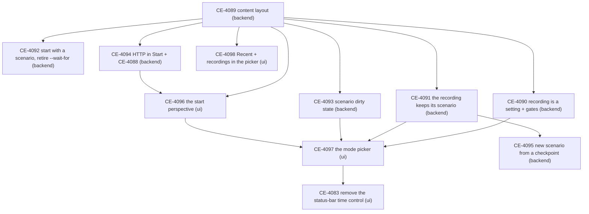

<!--STATUS
state: LIVE — the dispatch record (coordinator, 2026-10-28)
updated: 2026-10-28
current-answer: §1 the order · §2 the tasks with their lane and success conditions · §3 how progress is checked
stale-below: nothing
related-designs:
  - ../DESIGN_Content_Layout.md — R-4097: the content move (CE-4089)
  - Architect_Question_108_Run_Mode_Picker.md — R-4098: the run modes, the start perspective, D19–D21 (sixth pass)
  - Blueprint_Issues_Tracker.md — one row per task below
-->

# PLAN — run modes, the start perspective and the content layout: the lane tasks

⭐ Designs: [`DESIGN_Content_Layout.md`](../DESIGN_Content_Layout.md) (R-4097) and [`Architect_Question_108_Run_Mode_Picker.md`](Architect_Question_108_Run_Mode_Picker.md)
(R-4098). This plan only cuts them into tasks — every "what" and "why" is in those two documents; a task cites its section.

## 1. The order

*What the picture shows:* the content move goes first (the start surface and the picker list its folders); after it, backend and ui run in
parallel; only the mode picker (CE-4097) waits on three backend tasks — the dirty flag it prompts on, the gates it greys, the recorded copy it opens.

## 2. The tasks

| id | lane | what (design §) | done when |
|---|---|---|---|
| **CE-4089** | backend | the content move: `scenarios/`, `assets/`, `recipes/` at the repo root; the repo seeds the NAS at a dev start; *Save to Git* for every kind; `AssetRoots` the one path authority; exe-folder copy rules gone (Content_Layout §1–§4) | every listed folder moved; no path into a project folder remains (grep); a production layout (no source tree) reads only the NAS (rail); the editor and a `run_All` cluster load demo-city from the new tree (live run) |
| **CE-4090** | backend | Live does not imply recording (AQ108 D14, D15, §5a): the cluster-wide setting *Record live runs* (default ON) handed with the live load; the gates of §5a at the top (DAR, checkpoint, restore, the inventory ledger, the branch; the verifier forces ON); a review needs an explicit start (D9); a *discard this recording* operation for D15 | with the setting OFF a live run writes no `exercises/<id>`, DAR / checkpoint / "AAR the last exercise" refuse with a reason (no throw on any node); each gate a rail; `EnterReview` without a position refused |
| **CE-4091** | backend | the recording keeps its scenario (D7): the CE-3119 copy takes the WHOLE folder (`takes/`, `foreign/`), stamps name + hash + `RecordedAt` at go-live from the saved file; open the recorded copy as a new unsaved scenario (AAR → Preview) | a recording made after an edit → save → go-live carries the saved file's hash; the copy holds every subfolder; opening the recorded copy never writes the original |
| **CE-4092** | backend | start with a scenario (D18): `--startup-scenario <name>` on the orchestrator's runner; `recipes/scenarios/…` ⇒ an unsaved new scenario, else the saved one; it waits on the bootstrap latch WITHOUT a deadline, cancellable, `load.notice` shows what it waits for; retire `--wait-for` and its "required" rule, `--no-wait` an accepted no-op (M8) | `run_Server` with the option boots into the scenario once SimHost and CGF are up (live, nodes started in any order, 60 s apart); without it the cluster rests Idle; nothing reads a removed option |
| **CE-4093** | backend | the scenario dirty state (D20): enumerate the authoring choke points first (graph + grep — list them in the design), then ONE master-held `ScenarioDirty` raised by any of them and cleared by a completed save round, announced with the cluster state; `GET /status` shows it | an edit on ANY host (editor, an operator's create request, the HTTP / MCP authoring routes) sets it everywhere; a save clears it; a rail per choke point |
| **CE-4094** | backend | HTTP while `Start` shows (M7): the dispatcher's `Start` alias routes to the gate's remembered perspective and `/status` reports `Start` (+ `routedTo`); `POST /perspective` answers 409 with the reason; the MCP skill sources, `ui-snapshot.py`, `ownership-e2e.py` and the system rails that switch perspective without a load (incl. the vacuous `if (!switched.Ok) continue`); + CE-4088 (the coordinator's gizmo-listener leak) | with `Start` active on `--mode all`, `/entities` and `/sim/state` answer 200 on the remembered perspective; a perspective switch answers 409; no rail passes vacuously |
| **CE-4095** | backend | a new scenario from a checkpoint (D8): replay to the checkpoint, take the world as a scenario (the existing save extraction), save under a new name, open it for editing | from a checkpoint in a recording, a new scenario opens whose entities match the checkpoint's; the recording is untouched |
| **CE-4096** | ui | the start perspective (D16, D12): the shared start-surface window claiming `Start` (New from a recipe · Open scenario · Open recording · Exit · Help); the start gate in the shared presentation layer (the cluster RESTING in Idle, never an Idle passed through); `WindowManager.SwitchPerspective` refuses while `Start`; the *allowed in Idle* menu flag (default not allowed); the waiting variants (a Player, master gone); the host's armed mode as one bootstrap parameter | every host shows `Start` at boot and whenever the cluster returns to Idle, and only then; Open / New / Open recording leave it; a frame rail per host family |
| **CE-4097** | ui | the mode picker (AQ108 §1–§3, D1, D5, D10, D11, D17, D21): the indicator's choice (dim / bright / blink, red-or-green Live), every move of §3 with its confirmation, ■ per R2, the toasts, Save / Ctrl+S = checkpoint in Live / AAR, the status-bar note, the File-menu fold, the timeline's right-click menu, the words Preview / Live / DAR / AAR | every row of AQ108 §3 driven by a rail (headless editor, `SubsystemConfig { Headless = true }`); no move changes mode except through the indicator or the timeline |
| **CE-4098** | ui | the picker (D19): a *Recent* section first in every open picker (per kind, the user folder), `AssetKind.Recording` + File › Open Recording | a picked item is first in Recent after a restart; a recording opens into AAR from the picker |
| **CE-4083** | ui | remove the status-bar time control (already filed) | no host shows a time control in the status bar; the toolbar one still drives time on every host |

## 3. How progress is checked (coordinator)

- Each lane gets ONE handoff (`batches/HANDOFF_Coordinator_To_<Lane>_Run_Modes.md`) listing its tasks in this order, frozen at its dispatch sha.
- After every piece of work the coordinator fetches the lanes, reads their started-markers, reports and tracker rows, and checks each finished task
  against its *done when* above and the gate report contract (CLAUDE.md, Rule 8) — the tests are believed, the claims are spot-verified.
- A deviation is folded back into the owning design by the lane that built it (obligation ⑤); the coordinator checks the design moved.
