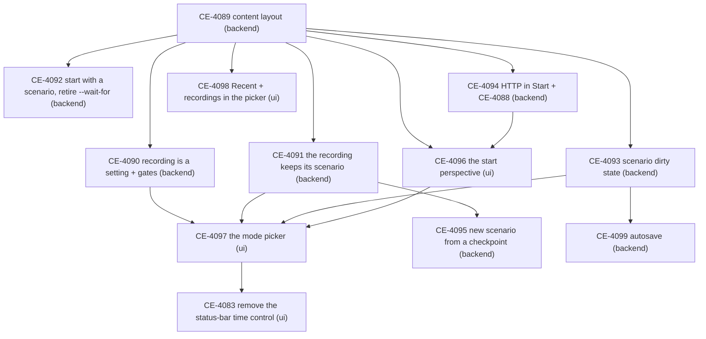

<!--STATUS
state: LIVE — the dispatch record (coordinator, 2026-10-28)
updated: 2026-10-28
current-answer: §1 the order · §2 the tasks with their lane and success conditions · §2a who builds each (Sonnet or the lane's own model) · §3 how progress is checked · §4 decisions taken after dispatch
stale-below: nothing
related-designs:
  - ../DESIGN_Content_Layout.md — R-4097: the content move (CE-4089)
  - Architect_Question_108_Run_Mode_Picker.md — R-4098: the run modes, the start perspective, D19–D21 (sixth pass)
  - Blueprint_Issues_Tracker.md — one row per task below
-->

# PLAN — run modes, the start perspective and the content layout: the lane tasks

⭐ Designs: [`DESIGN_Content_Layout.md`](../DESIGN_Content_Layout.md) (R-4097) and [`Architect_Question_108_Run_Mode_Picker.md`](Architect_Question_108_Run_Mode_Picker.md)
(R-4098). This plan only cuts them into tasks — every "what" and "why" is in those two documents; a task cites its section.

## 1. The order

*What the picture shows:* the content move goes first (the start surface and the picker list its folders); after it, backend and ui run in
parallel; only the mode picker (CE-4097) waits on three backend tasks — the dirty flag it prompts on, the gates it greys, the recorded copy it opens.

## 2. The tasks

| id | lane | what (design §) | done when |
|---|---|---|---|
| **CE-4089** | backend | the content move: `scenarios/`, `assets/`, `recipes/` at the repo root; the repo seeds the NAS at a dev start; *Save to Git* for every kind; `AssetRoots` the one path authority; exe-folder copy rules gone (Content_Layout §1–§4) | every listed folder moved; no path into a project folder remains (grep); a production layout (no source tree) reads only the NAS (rail); the editor and a `run_All` cluster load demo-city from the new tree (live run) |
| **CE-4090** | backend | Live does not imply recording (AQ108 D14, D15, §5a, D22): the cluster-wide setting *Record live runs* (default ON) handed with the live load; the gates of §5a at the master (DAR, checkpoint, restore, the inventory ledger, the branch; the verifier forces ON) answering 409 *"this run was not recorded"* over HTTP; `POST /review` needs its start (D9); `DELETE /exercises/{id}` (D15); `POST /scenario/save` 409 in Live and AAR; `GET /status.recording` | with the setting OFF a live run writes no `exercises/<id>`, every gate refuses with the reason (no throw on any node); each gate a rail; `POST /review {}` refused |
| **CE-4091** | backend | the recording keeps its scenario (D7): the CE-3119 copy takes the WHOLE folder (`takes/`, `foreign/`), stamps name + hash + `RecordedAt` at go-live from the saved file; open the recorded copy as a new unsaved scenario — `POST /scenario/load/edit {recorded: <exerciseId>}` | a recording made after an edit → save → go-live carries the saved file's hash; the copy holds every subfolder; opening the recorded copy never writes the original |
| **CE-4092** | backend | start with a scenario (D18): `--startup-scenario <name>` on the orchestrator's runner; `recipes/scenarios/…` ⇒ an unsaved new scenario, else the saved one; it waits on the bootstrap latch WITHOUT a deadline, cancellable, `load.notice` shows what it waits for; retire `--wait-for` and its "required" rule, `--no-wait` an accepted no-op (M8) | `run_Server` with the option boots into the scenario once SimHost and CGF are up (live, nodes started in any order, 60 s apart); without it the cluster rests Idle; nothing reads a removed option |
| **CE-4093** | backend | unsaved changes = the WHOLE WORLD compared ON DEMAND, no indicator (D20 final): each node hashes a binary keyframe of its whole world (`WorldKeyframes.Capture`, the preview's own capture) against its own baseline (load commit, completed save, catch-up); a CHECK ROUND the master asks and every node answers, run before go-live / open another / back to Start / exit and by an HTTP load without `discardUnsaved`; `POST /scenario/load/live` 409 while changed unless `discardUnsaved` (D22) | the noise test FIRST (load, camera, selection, panels, nothing else ⇒ every round "unchanged" on every node); an edit on any host ⇒ the next round "changed"; a save ⇒ "unchanged"; a late joiner adds no false change; the round's time on demo-city-1000 reported |
| **CE-4099** | backend | AUTOSAVE (D23): a periodic keyframe capture while editing, serialized to scenario JSON by a background task from a temporary world (the `RecordingExportService` sandbox precedent), per node merged like a save, into `scenarios/<name>/.autosave/`; recovery offered on the next open or after a crash | an edited, unsaved scenario survives a killed editor: the next open offers the autosave and it restores the edits; the capture never stalls a frame by more than the measured keyframe time; Open never lists `.autosave` |
| **CE-4094** | backend | HTTP while `Start` shows (M7, D22): the dispatcher's `Start` alias routes to the gate's remembered perspective; `/status` reports `perspective: Start` + `routedTo` (also on the editor); `POST /perspective` answers 409 with the reason; the MCP skill sources + regenerated catalog ("load first"), `ui-snapshot.py`, `ownership-e2e.py` and the system rails that switch perspective without a load (incl. the vacuous `if (!switched.Ok) continue`); + CE-4088 | with `Start` active on `--mode all`, `/entities` and `/sim/state` answer 200 on the remembered perspective; a perspective switch answers 409; no rail passes vacuously |
| **CE-4095** | backend | a new scenario from a checkpoint (D8): replay to the checkpoint, take the world as a scenario (the existing save extraction), save under a new name, open it for editing — `POST /scenario/from-checkpoint {exerciseId, label, name}` | from a checkpoint in a recording, a new scenario opens whose entities match the checkpoint's; the recording is untouched |
| **CE-4096** | ui | the start perspective (D16, D12): the shared start-surface window claiming `Start` (New from a recipe · Open scenario · Open recording · Exit · Help); the start gate in the shared presentation layer (the cluster RESTING in Idle, never an Idle passed through); `WindowManager.SwitchPerspective` refuses while `Start`; the *allowed in Idle* menu flag (default not allowed); the waiting variants (a Player, master gone); the host's armed mode as one bootstrap parameter | every host shows `Start` at boot and whenever the cluster returns to Idle, and only then; Open / New / Open recording leave it; a frame rail per host family |
| **CE-4097** | ui | the mode picker (AQ108 §1–§3, D1, D5, D10, D11, D17, D21, D22): the indicator's choice (dim / bright / blink, red-or-green Live), every move of §3 with its confirmation, ■ per R2, the toasts, Save / Ctrl+S = checkpoint in Live / AAR, the status-bar note, the File-menu fold, the timeline's right-click menu, the words Preview / Live / DAR / AAR; HTTP: `POST /sim/stop` (the SAME `ITimeTransportFacade.Stop` as ■), `POST /run-mode {armed}`, `GET /status.armedMode` | every row of AQ108 §3 driven by a rail (headless editor, `SubsystemConfig { Headless = true }`); `POST /sim/stop` and ■ produce the same transitions (one rail); no move changes mode except through the indicator, the timeline or `/run-mode` |
| **CE-4098** | ui | the picker (D19): a *Recent* section first in every open picker (per kind, the user folder), `AssetKind.Recording` + File › Open Recording | a picked item is first in Recent after a restart; a recording opens into AAR from the picker |
| **CE-4083** | ui | remove the status-bar time control (already filed) | no host shows a time control in the status bar; the toolbar one still drives time on every host |

### 2a. Who builds it — Sonnet subagent or the lane's own model *(user, `2026-10-28`: token thrift — a SUGGESTION for the lanes)*

🔒 User: *"because of the token thrift, I would like some of the tasks to be done via Sonnet subagent. Could you mark in the tasks which one are
suitable for that? So the lanes will take that as suggestion?"* — the split follows CLAUDE.md *Sonnet delegation*: Sonnet for well-scoped,
mechanical or mirror-pattern work whose brief can name the files and the done-when; the lane's own (Opus) model for new orchestration, design
calls and work whose brief cannot yet be written. ⭐ Either way: the brief carries the task's **done when** as success conditions, Sonnet writes
its own rails until they pass, the lane reviews the tests and the diff (not a re-run), and every *"cannot / does not exist"* claim is verified.

| id | ⭐ suggestion | why |
|---|---|---|
| CE-4089 content move | **Sonnet** | mechanical and large: moves + routing ~15 named paths through `AssetRoots`; the design lists every step |
| CE-4094 HTTP in `Start` + CE-4088 | **Sonnet** | M7 already names every file and line, and the fix shape |
| CE-4093 unsaved changes | **Sonnet for the node side** (the keyframe hash, the baseline points, the NOISE TEST first) · **Opus for the master's check round** | the hash is one call on an existing capture; the check round is a new kind of cluster round (ask, collect, decide) |
| CE-4090 recording setting + gates | **Sonnet** | every gate is named in AQ108 §5a with its site; the setting rides the existing live load |
| CE-4091 the recording keeps its scenario | **Sonnet** | extends one existing copy (CE-3119) and one stamp site |
| CE-4092 start with a scenario, retire `--wait-for` | **Sonnet** | the retire is mechanical (M8 lists every caller); the start-up load sits on the CE-4087 latch |
| CE-4095 scenario from a checkpoint | **Sonnet** | composes existing pieces: replay to a checkpoint, the save extraction, open for edit |
| CE-4099 autosave | **Opus** (Sonnet for the recovery prompt afterwards) | new background work beside the frame thread (what may run off it — R-4001's rule), a per-node merge and a recovery flow — design calls first |
| CE-4098 Recent + recordings in the picker | **Sonnet** | one list per kind in the user folder, one new asset kind, one menu item |
| CE-4096 the start perspective | **Opus** for the gate and its placement in the shared bootstrap · **Sonnet** for marking the menu items *allowed in Idle* and the waiting variants | the gate decides how every host is composed (by construction, one place); the rest is mark-up |
| CE-4097 the mode picker | **Opus** for the core (the indicator's choice, ■ per R2, the moves of §3) · **Sonnet** for the parts that mirror it (confirmation texts, toasts, the timeline menu items, the words, `/sim/stop` and `/run-mode`) | the core is the state logic every move rests on; the rest repeats one pattern many times |
| CE-4083 remove the status-bar time control | **Sonnet** | a deletion with a check that every host keeps a time control |

## 3. How progress is checked (coordinator)

- Each lane gets ONE handoff (`batches/HANDOFF_Coordinator_To_<Lane>_Run_Modes.md`) listing its tasks in this order, frozen at its dispatch sha.
- After every piece of work the coordinator fetches the lanes, reads their started-markers, reports and tracker rows, and checks each finished task
  against its *done when* above and the gate report contract (CLAUDE.md, Rule 8) — the tests are believed, the claims are spot-verified.
- A deviation is folded back into the owning design by the lane that built it (obligation ⑤); the coordinator checks the design moved.

## 4. Decisions taken after dispatch

| date | decision |
|---|---|
| `2026-10-28` | **R-4099** — CE-4096's gate treats the cluster as RESTING when Idle has held ≥ 0.5 s (ui's design, AQ108 §2.6 on `ui`); the ordinary load stays TWO requests (Idle, then the load — CE-295), no "resting" flag on the master's broadcast, no wire change. A slow client may flash `Start` for a moment between the two requests — accepted as cosmetic. 🔒 User: *"lean accepted, no chnage in messages (keep load in 2 parts as is now)"* |
| `2026-10-29` | **R-3066** (backend, user-approved) — `ClusterView` V1–V5 approved (CE-1436: one cluster-facts ingress and one read model on every node — the fix for a CGF host going live without the unsaved prompt), and **development PAUSED** until the run-modes duplicates are unified (backend's CE-3340; ui audits its own — `batches/NOTE_Coordinator_To_Ui_Unification_Pause.md`). 🔒 User: *"We need to pause any development until we enforce the unification and sharing."* Paused: CE-3339 (the two hashes), CE-4095, CE-4089 round 2, CE-4092, CE-4083; CE-4099 deferred by the user. One Sonnet agent at a time (CLAUDE.md). |
| `2026-10-29` | **The armed-mode MVP (user)** — 🔒 *"focus on making the armed mode switching work with whatever is requires, but in 'minimal viable' way - meaning avoiding not absolutely necessary parts like change detection, autosave. excone retirement can wait. first let's finish the remaining parts of the unification. bt-window-duel scenario failures are out of scope"* · goal: record an exercise in the editor's live run and film it with the director in the Replay Browser. ⇒ in: CE-1441, CE-3341 (ui half), CE-4102 (the end-to-end proof). ⛔ out for now: CE-4099 autosave, more change-detection work, CE-4100 ① ③ (keep/discard prompt, DAR start default), CE-3339 (the two hashes), CE-4095, CE-4092, ExCon retirement (R-3067), CE-3342. |
