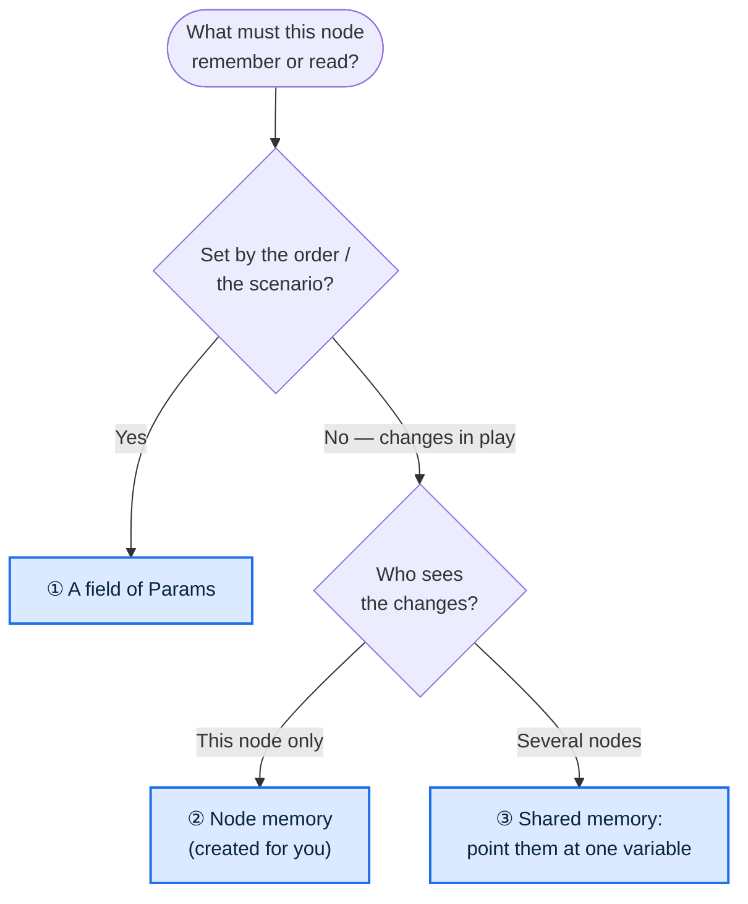

<!--STATUS
state: LIVE
updated: 2026-10-13
current-answer: the whole file. This is the DESIGNER-facing document; the engineering record is
  docs/DESIGN_Orders_Params_Entity_Classes.md §5c / §13.10 ⑦ (one params DTO, no variable kinds) and
  docs/blueprints/DESIGN_Occurrence_Scoped_Storage.md (where memory lives).
stale-below: nothing.
known-rot: none known. ⛔ HISTORY (2026-10-13, CE-3193): this file taught "four kinds" set through a Role (Input/State)
  and a Scope (Node/Behavior/Entity) on each variable. Role and Scope are gone — nothing about a variable's kind is
  authored — and so are the Entity scope (CE-441) and the Get Shared / Set Shared nodes (CE-440).
related-designs:
  - docs/DESIGN_Orders_Params_Entity_Classes.md — owns the params DTO and the derived working-state rule (§13.10 ⑦)
  - docs/blueprints/DESIGN_Occurrence_Scoped_Storage.md — owns the storage behind node memory and unit memory
-->
# Behavior Variables — Designer Quickstart

> **Who this is for:** anyone authoring BTree / HSM behaviors who is *not* thinking about bytes, slots or
> hashing. It answers one question: **"What kind of data does my node need, and how do I set it up?"**

---

## Start here

You never pick a "kind" for a variable. The editor shows **one list — `Params` first, then your variables** — and
what a variable is follows from how nodes use it:



| # | You want… | How |
|---|-----------|-----|
| **①** | a **setting** the order or scenario supplies ("move at **4 m/s**") | it is a field of the behaviour's **params DTO** — the read-only **`Params`** row. Bind a node to `Params` or to `Params.<field>` |
| **②** | scratch memory **only this node** keeps between ticks | drop a stateful node: it gets its own memory variable, shown under **Node-Owned Allocations**. You don't touch it |
| **③** | memory **several nodes** read and write together | point the other nodes' **working state** at the **same** variable (the working-state picker on the node). Naming it is what makes it shared — there is nothing to switch on |

**Rule of thumb:** most nodes need only ① and ②. Sharing (③) means "someone else can change this too" — reach for it
deliberately.

---

## Single value or a bundle?

A variable holds **one value** (a number, a position, a flag) or a **bundle** (a small struct, e.g.
`{ RallyCount, LastRallyTime }`). The **Add variable** dropdown lists the basic types and every bundle type the project
defines.

---

## Why do parameters live in a variable at all?

**So that "fixed setting" and "something else drives this" are the same thing.** A node bound to `Params.speed` reads
whatever the order sent; point it at a variable instead and it reads whatever writes that variable — the node did not
change.

### You do not create node memory by hand

Picking a stateful node creates its memory variable, typed and bound, under **Node-Owned Allocations** (read-only).
Delete the node and the variable goes with it.

### What it costs you

| ⚠ | |
|---|---|
| **Values apply at assignment** | a new default takes effect when the behaviour is assigned again |
| **One bundle per node** | a node binds its parameter bundle to one place — a variable or a field of one (`Params.walk`, CE-3182) |

---

## Memory across behaviours and across a unit

Memory that must survive the entity switching behaviours, or that a commander and its subordinates share, is **unit
memory** — see `docs/blueprints/DESIGN_Occurrence_Scoped_Storage.md`. ⛔ The old "Scope = Entity" and the Get Shared /
Set Shared nodes were removed (CE-441, CE-440).

---

## Cheat sheet

```
Set by the order / scenario?  ──► ① a field of Params
Changes, only this node?  ──────► ② node memory        (created when you drop the node)
Changes, shared by nodes?  ─────► ③ one variable, named by each node's working state
```
