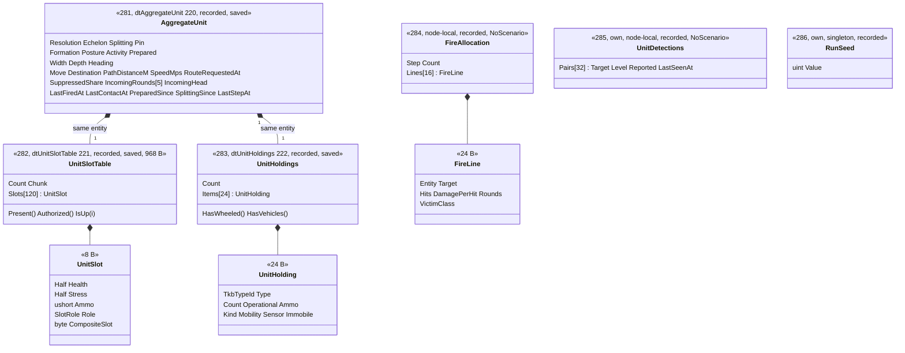

<!--STATUS
state: LIVE
updated: 2026-11-16
current-answer: §1 (the components), §2 (enums), §3 (the routing table), §4 (ids)
stale-below: none
related-designs:
  - docs/designs/aggregate-units/DESIGN_Stochastic_Units_And_Resolution.md — owns the model (§14–§19), the rulings, §22 UML, §23 dispatch; this NOTE is the as-built layout of its §23.2 contract
  - docs/blueprints/batches/HANDOFF_Coordinator_To_AggBackend.md — the dispatch this NOTE answers (CE-4616, dispatched at 3f33c0ee3)
-->

# NOTE — exp/agg-backend → exp/agg-behaviors, exp/agg-ui: the aggregate contract *(CE-4616 §23.2, CE-8000)*

⭐ **Merge `exp/agg-backend` at or after this commit and build against these names.** The layouts are FIXED (SV-12: a recorded layout change
refuses old recordings) — ⛔ a field you need that is missing is a finding to this lane, never a local addition.

📄 Source: `FDP/Toolkits/Fdp.Toolkits/Aggregate/AggregateComponents.cs` (namespace `Fdp.Toolkit.Aggregate`) ·
routing `Hrot/Engine/Hrot.Core/Tkb/ResolutionRouting.cs` · rails `AggregateContractRails` (Toolkits.Tests), `ResolutionRoutingTableTests` (Core.Tests).

## 1. The components


*What it shows: every table lives on the UNIT entity itself — so each per-entity phase writes only its own entity (the parallel rule), and the
whole company fits one 968 B slot table (no chunk entities).*

| field | meaning | written by |
|---|---|---|
| `AggregateUnit.Resolution` | 1 Physical · 2 Fusion · 3 Stochastic; `0` (unset) reads as Physical (`Effective`) | the resolution manager (ST-5), authored |
| `Echelon` | `Fdp.Toolkit.Squad.Echelon` (0 squad, 1 platoon, 2 company) | authored |
| `Width` / `Depth` / `Heading` | frontage (m) · depth (m; a column's length) · `Bearing` | the path follower, the plays |
| `SuppressedShare` | 0..1, rounds per exposed man over the last 5 s (`IncomingRounds` ring, one bucket per 1 s step) | phase B (ST-3) |
| `Prepared` / `PreparedSince` | P-5 time in position | the Defend play (behaviors) |
| `Splitting` / `SplittingSince` | §16a stage + the deadline's clock | the resolution manager (ST-5) |
| `UnitSlot.Health` | the soldier's scale (25 = a fit man); down below `UnitSlotTable.DownBelow` (0.5) | phase B, the area sink |
| `UnitSlot.Stress` | 0..1, `StressModel` constants | phase B |
| `UnitHolding.Operational` / `Immobile` | K-kills reduce Operational, M-kills raise Immobile | phase B |
| `FireLine.Hits` | expected hits λ, ⭐ already × the FIRER's suppression; phase B multiplies by the victim's cover | phase A (ST-3) |

⭐ **Readers (agg-behaviors' RV-5 branch):** `UnitSlotTable.Present()` is Present, `Authorized()` the authored strength, `IsUp(i)` per slot;
ammo is the sum of `Slots[i].Ammo` over up slots (+ holdings' `Ammo` for crew-served systems); standing = up and `Stress` below the
broken threshold (`StressModel`). ⛔ Never store Present (SV-11).

## 2. Enums *(values fixed — they are on the wire and in recordings)*

| enum | values |
|---|---|
| `AggregateResolution` | Unset 0 · Physical 1 · Fusion 2 · Stochastic 3 |
| `UnitFormation` | NoFormation 0 · Column 1 · Line 2 · Assault 3 |
| `UnitPosture` | Dismounted 0 · Mounted 1 |
| `UnitActivity` *(flags)* | Quiet 0 · Moving 1 · Firing 2 |
| `SplitStage` | NotSplitting 0 · Planning 1 · Materialising 2 · Handover 3 · Merging 4 |
| `PreparedLevel` | Unprepared 0 · Hasty 1 · Prepared 2 · Fortified 3 |
| `ResolutionPin` | NoPin 0 · PinKeep 1 · PinPhysical 2 · PinStochastic 3 |
| `UnitMoveState` | Stopped 0 · AwaitingRoute 1 · OnRoute 2 · Arrived 3 · RouteFailed 4 |
| `SlotRole` | Empty 0 · Rifleman 1 · Leader 2 · MachineGunner 3 · AntiTank 4 · Grenadier 5 · Marksman 6 · Medic 7 · Crew 8 · Radio 9 |
| `HoldingKind` / `HoldingMobility` / `HoldingSensor` | NoKind 0 · Weapon 1 · Vehicle 2 · Sensor 3 / NoMobility 0 · Wheeled 1 · Tracked 2 / NoSensor 0 · Optics 1 · Thermal 2 · Radar 3 |

**Slot capacity per echelon** (`UnitSlotTable.CapacityFor`): squad **13** · platoon **48** · company **120** (= `Capacity`, one table).

## 3. The routing table *(SV-2, B-1, RV-7)*

```csharp
OrderResolver.Result r = ResolutionRoutingTable.Default.Resolve(EntityClassTable.Default, dis, unit.Effective, orderName, isBehaviour);
```

| | |
|---|---|
| Physical / unset | exactly `OrderResolver.Resolve` (`<Class><Order>`), untouched |
| Stochastic | a ROW for the most specific class of the entity's chain; no row ⇒ `NoBehaviour` (refused ⇒ TaskFailed, B-8). ⛔ never the physical play |
| Fusion | a row if one exists, else the physical rule (X-1) |
| the SOP | order name `ResolutionRoutingTable.SopOrder` = `"Sop"` |

**Default rows** (class `Unit`, resolution Stochastic): Move · March · Dash ⇒ `StochasticUnitMove` · Defend · Hold ⇒ `StochasticUnitDefend` ·
Attack · ClearBuilding · Bound · FireAndMovement · SupportByFire ⇒ `StochasticUnitAttack` · BreakContact ⇒ `StochasticUnitBreakContact` ·
Sop ⇒ `StochasticUnitSop`. ⛔ No row (refused): Strike, ObserveFire, Recover. Embark / Dismount: added with ST-3 (the posture, S-9).
⭐ The play behaviours are agg-behaviors'; until a play is registered, `isBehaviour` is false and the order resolves to `NoBehaviour`.

## 3a. Movement — what a play calls *(ST-1, CE-8004; added after the first NOTE commit)*

```csharp
ref var u = ref world.GetComponentRW<AggregateUnit>(unit);       // the play's OWN unit (safe in a per-entity phase)
UnitMoves.Order(ref u, destination, UnitFormation.Column, UnitMoves.ColumnDepth(in u, in holdings, in slots), now);
// then read u.Move: AwaitingRoute → OnRoute → Arrived (Set, B-2) · RouteFailed (re-order it — B-2's "a dropped route re-requested")
UnitMoves.Stop(ref u);
```
⭐ The follower (`StochasticUnitMovementSystem`, in `CgfLogicPack`) owns everything after the order: the plan, the speed (`UnitSpeedModel`),
the unit's `SimTransform`, `Heading`, `SpeedMps`, `Activity.Moving`. ⛔ A play never writes those.

## 4. Ids allocated by this commit

| | |
|---|---|
| components | 281 `AggregateUnit` · 282 `UnitSlotTable` · 283 `UnitHoldings` · 284 `FireAllocation` (contract) · 285 `UnitDetections` · 286 `RunSeed` · 287 `UnitRoute` (own, ST-1) — 288–289 free |
| descriptors | 220 `dtAggregateUnit` · 221 `dtUnitSlotTable` · 222 `dtUnitHoldings` — 223–229 free |
| tracker / rulings | `CE-8000` (the contract) · `R-8000`, `R-8001` (lane decisions, `STATUS_AggBackend.md`) |

⚠ **Enumerator names are unique across the module** — the DDS code generator emits every enum of `Fdp.Toolkit.Aggregate` into one IDL
module, where enumerators share one scope (`None` twice fails the build). ⇒ a new enum here takes unique names too.
