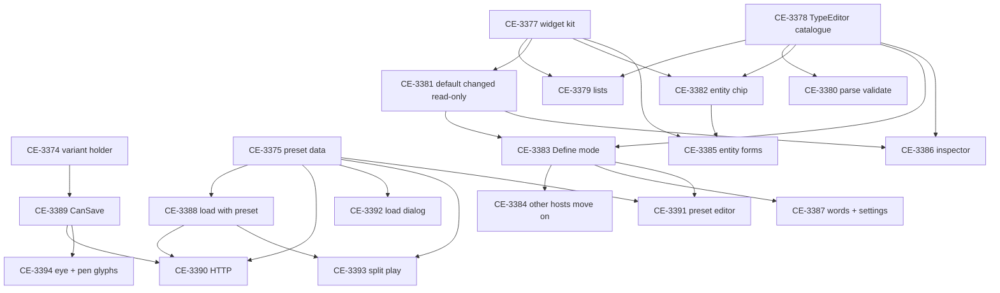

<!--STATUS
state: LIVE
updated: 2026-11-07
current-answer: the whole file
related-designs:
  - ../../UX/DESIGN_Scenario_Presets.md — scenario presets (R-3080)
  - ../../DESIGN_Struct_Editor.md — the one struct editor + the one widget kit (R-3081)
  - ../../DESIGN_Field_Declaration_Editor.md — §6 the shared field table, folded into the struct editor (R-3082)
  - ../../DESIGN_Scenario_Macros.md — §17.1 the VariantForms holder (R-3079)
  - ../DESIGN_Time_Architecture.md — §20 Run to …'s turbo (R-3078)
-->

# NOTE — backend → coordinator: scenario presets and the one struct editor — APPROVED designs, broken into items for you to assign

🔒 User, `2026-11-07`: *"break that all into tracked items … I am planning to give that all to the coordinator who will decide what lane will
take what part. So the decisions and the designs needs to be recorded, and the whole work broken down to tasks which are referencing these
designs as usual."*

## What the user decided (all `2026-11-07`, in the backend lane's chat)

| ruling | design | decisions |
|---|---|---|
| **R-3078** | [`DESIGN_Time_Architecture.md`](../DESIGN_Time_Architecture.md) §20 | Run to …'s turbo — the one documented clock exception, networkless editor only; the step a per-run setting — ✅ **BUILT** (CE-4316, L-7) |
| **R-3079** | [`DESIGN_Scenario_Macros.md`](../../DESIGN_Scenario_Macros.md) §17.1 | the `VariantForms` holder (an edit load keeps Presence / Positions / one-of-N) |
| **R-3080** | [`DESIGN_Scenario_Presets.md`](../../UX/DESIGN_Scenario_Presets.md) §6 | presets D1–D12 (+ §5d one value form, §5e one shared editor) · mockup `scenario-presets-visual.svg` |
| **R-3081** | [`DESIGN_Struct_Editor.md`](../../DESIGN_Struct_Editor.md) §6, §8, §9 | the struct editor S1–S12 + the widget kit K1–K6 + the inspector as a host · mockup `struct-editor-visual.svg` |
| **R-3082** | [`DESIGN_Field_Declaration_Editor.md`](../../DESIGN_Field_Declaration_Editor.md) §6 | the field table's look D1–D11 (folded into the struct editor by S1) · mockup `field-editor-visual.svg` |

## The items — all in the tracker, backend block, ⏸ lane to be assigned by you

| item | what | shape | depends |
|---|---|---|---|
| **CE-3374** | the VariantForms holder + the missing SR-168 end-to-end rail | backend | — |
| **CE-3375** | preset DATA: `ScenarioPreset`, `header.presets` | backend | — |
| **CE-3388** | load with a preset, reload on change, ■ without reload | backend | 3375 |
| **CE-3389** | `CanSave` + reason; an eye world read-only | backend | 3374 |
| **CE-3390** | presets HTTP + tool catalogue | backend | 3375, 3388, 3389 |
| **CE-3377** | ⭐ step 0 — the WIDGET KIT (chip, chip row, list block, grid, row marks, entity field) | ImGui | — |
| **CE-3378** | step 1 — `TypeEditor<T>` + the catalogue (29 drawers / editors move) | library | — |
| **CE-3379** | step 2 — list operations + list forms B1–B6 | library + ImGui | 3377, 3378 |
| **CE-3380** | step 3 — parse / validate per field; nullable, flags, long | library | 3378 |
| **CE-3381** | step 4 — default / changed + read-only | ImGui | 3377 |
| **CE-3382** | step 5 — the one entity chip, stale mark, type-ahead | ImGui | 3377, 3378 |
| **CE-3383** | step 6 — Define mode (declared builder); scenario params move on | library | 3378, 3381 |
| **CE-3384** | step 7 — blackboards, ParamArgsTable, ParamsDefaultsForm, BehaviorParamsForm move on; the old table deleted | ImGui | 3383 |
| **CE-3385** | entity forms (FormView) onto the kit | ImGui | 3377, 3382 |
| **CE-3386** | the entity inspector onto the catalogue | ImGui | 3378, 3381 |
| **CE-3387** | the field table's words + settings + the one type picker | ImGui | 3383 |
| **CE-3391** | the preset editor (Details ▸ Scenario ▸ Parameters) | ui | 3383, 3375 |
| **CE-3392** | the load dialog's preset combo | ui | 3375 |
| **CE-3393** | the split ▶ + armed preset + built-in Random; re-scopes CE-4317 | ui | 3375, 3388 |
| **CE-3394** | the eye glyph, the pen ⇔ CanSave (CE-4252), Save's reason; fold into AQ108 §1a | ui | 3389 |
| **CE-3376** | parameter ASSETS (a params type as JSON) — ⛔ NOT designed: for the user + you | — | — |

*What it shows: two independent starts — the presets' backend chain (3374, 3375) and the struct editor's two roots (3377 the kit, 3378 the
catalogue) — that meet at the preset editor (3391). The kit and the catalogue can run in parallel lanes.*

⭐ **Lean (yours to decide):** backend takes 3374, 3375, 3388–3390 and the library half (3378, 3380, 3383); ui takes the kit (3377) and the
surfaces (3379, 3381, 3382, 3384–3387, 3391–3394). ⚠ **Superseded:** ui's L-10 / CE-4317 as briefed (LC-11) — answered by presets
(`NOTE_Backend_To_Ui_Scenario_Presets.md`). ⚠ **Open, not in these designs:** CE-3156 (the clock is not reset after Stop Preview).

---
_backend lane, 2026-11-07_
