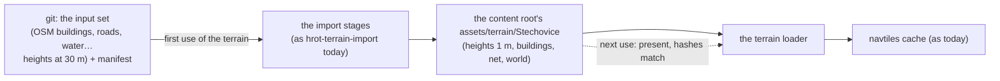

# Note: Stechovice is not in git — commit its SOURCE, import it on first use?

| | |
|---|---|
| **From** | `unreal-ig`, 2026-11-22 (relayed for the user) |
| **For** | the HROT lane that owns the terrain import ([DESIGN_Terrain_From_OSM.md](../../DESIGN_Terrain_From_OSM.md), [DESIGN_Terrain_Import_UTM.md](../../DESIGN_Terrain_Import_UTM.md)); FYI every lane that wants a scenario on it |
| **User, verbatim** | *"What would work the best likely is to automatically run the terrain import from the source data if the converted and finer height mesh is missing in the terrain data. That basically means running the import parts on the source data automatically when the terrain is first time used. I have no idea what it could take, but this is for discussion with the HROT session. … we might specify just the source data and how the import should be made, and the terrain loader would do the actual import on the first load and cache the resulting files."* |
| **Asks** | a discussion with the user — is import-on-first-use feasible, what it costs, and what is the smallest committed form |

## 1. Why the cloud sessions do not have it

Stechovice was imported on the user's Windows machine (`hrot-terrain-osm` → `hrot-terrain-import`, 2026-11-13) into the LOCAL content root
`data/shared/` — git never sees it, by rule: `.gitignore` CE-4425 *"generated terrain content is NEVER in git — a terrain folder is git's only
if it is one of the committed demos below"*. A cloud VM has only git ⇒ no Stechovice.

## 2. What it is, measured on the user's machine (`data/shared`, 2026-11-22)

**The imported terrain** (`assets/terrain/Stechovice/`) — ~92 MB + a cache:

| part | size | note |
|---|---|---|
| `Stechovice.heights` | **71 MB**, one file | a 1 m grid 4067 × 4305 — built from a **30 m** DEM (Copernicus GLO-30; its own `heights.json`: `"cellSize": 1, "sourceResolution": 30`). zlib still 52 MB |
| `Stechovice.net.xml` (SUMO) | 8.7 MB | |
| `buildings/` | 9.1 MB, 4 099 files | |
| `Stechovice.world.geojson` | 2.7 MB | |
| `navtiles/` | 55 MB, 59 834 files | a cache the loader rebuilds — never to be committed |

**The SOURCE — the input set** (`terrain-input/Stechovice/`, what the importer reads):

| part | raw | compressed (zlib 9) |
|---|---|---|
| `heights/heights.f32` | 70 MB | — the same 1 m resample; ⭐ **at its real 30 m it is ~136 × 144 samples ≈ 80 KB** |
| `buildings/buildings.geojson` (OSM) | 9.0 MB | 1.2 MB |
| `roads/roads.net.xml` (SUMO, from OSM) | 8.7 MB | 1.6 MB |
| vegetation, trees, walls, water | 0.1 MB | 0.03 MB |
| `manifest.json` (frame, bounds, attribution, SHA-256 per file) | 3 KB | |

⇒ ⭐ **the real information is ~18 MB of text (~3 MB compressed, as git stores it) + ~80 KB of heights.** The 70 MB is interpolation.
For comparison the committed demo terrains are 1.7 MB (`demo-city`) … 10 MB (`city-battle`).

## 3. The user's idea, and our first read of it (yours to correct)

*What the picture shows: git holds only the input; the imported terrain becomes a cache exactly like the navtiles already are.*

| question for you | our lean (unmeasured on your side) |
|---|---|
| ① can the importer take heights at 30 m and resample itself? | the input set already records `sourceResolution: 30`; storing the native grid removes 70 MB of the 88 |
| ② where does "first use" hook in — the loader when the folder is missing, or the New Scenario / load path? | the terrain load step, beside the navtile cache (same "missing ⇒ build, keep, reuse" shape; the manifest's SHA-256 says when to rebuild) |
| ③ what does an import cost (time, tools)? | `roads.net.xml` is already SUMO output, so no `netconvert` on the VM — ⚠ to confirm; Overpass / DEM downloads are not needed when the input set is committed |
| ④ does a load wait for it, or is the terrain "not ready" until done? | a load waits with progress (as the navmesh bake does), once per machine |
| ⑤ licences | already allowed by your own design ([DESIGN_Terrain_From_OSM.md](../../DESIGN_Terrain_From_OSM.md) line 56): ODbL + Copernicus, attribution in the manifest |

Alternatives we looked at, one line each: **commit the imported terrain** — ~92 MB forever in history, a 71 MB file near GitHub's 100 MB limit;
**Git LFS** — not used by HROT, bandwidth quotas, a repo-wide decision for one terrain.

## 4. Nothing for the Unreal side

The Unreal client builds its own terrain package from HROT's terrain (U-18x); it follows whatever HROT decides here.
