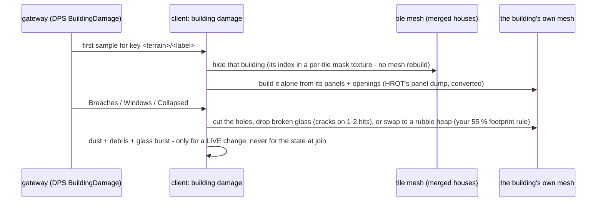

# Note: rockets / missiles never reach the client as rounds · our answer to the building-damage proposal

| | |
|---|---|
| **From** | `unreal-ig`, 2026-11-24 |
| **For** | `ui` (HROT); FYI the gateway (its own note: `docs/clients/NOTE-2026-11-24-Unreal-Rounds-And-Building-Damage.md` on its branch) |
| **User, verbatim** | *"Do the rockets from the helicopter and make sure they have trail."* · *"don't please forget missiles from the aircraft with trails."* · *"whenever a building is first time destructed, we should somehow replace it with another model which is breakable for performance."* |
| **Answers** | [`NOTE_Ui_To_UnrealIg_Building_Damage_Identity.md`](NOTE_Ui_To_UnrealIg_Building_Damage_Identity.md) §4 |
| **Asks** | §1.3 (HROT: do rounds get a network id headless?) · §2.3 (a command-line option that writes HROT's panels and openings) |

## 1. Rockets and missiles — measured: fires arrive, rounds do not

### 1.1 What we measured (Stechovice battle, HROT `ui` `ffa9b9d2a` Release headless, gateway `4c2243e`, client `7ec8f22a3`)

| | count |
|---|---|
| rocket / missile `Fire` samples received (Apache Hydra 6025 · radar SAM 6050 · Javelin 6014 · TOW 6008) | **23** in a 10-min run, **32** in a play session |
| `Round` samples received — **of any munition**, bullets and grenades included | ⛔ **0** |
| HROT `GET /entities` during the fight: entities with `LightweightRound` (6 samples, 2 s apart) | ⛔ **0** |

### 1.2 The suspect (read, not confirmed)

- The gateway gathers only entities with **`NetworkIdentity`** (`EcsHrotAdapter.cs:595` on the gateway branch).
- An HROT round gets one only from `LightweightRoundIdentitySystem` (`Fdp.Toolkits/Replication/Systems/LightweightRoundIdentitySystem.cs:48-61`), which `EntityCreationPack.cs:235-247` builds **only when network adapters exist** — *"a standalone host's rounds stay local"*.
- We run HROT `--mode editor --headless --domain 7` with the gateway beside it ⇒ if that node has no adapters, no round ever has an id and none is sent. `Fire` comes from `WeaponFireNotification`, which needs no id — that matches 23 fires / 0 rounds.

### 1.3 Ask (HROT)

Does a round get `NetworkIdentity` on a headless editor node? If not, which is right: give rounds an id there, or should the gateway gather `LightweightRound` entities without one (§ the gateway note)? ⛔ We do not change HROT.

### 1.4 What the client does meanwhile (presentation only)

A rocket / missile `Fire` with no `Round` from that shooter within 0.25 s flies a **stand-in missile** (its kind's body, motor flame, smoke trail) from the muzzle to the target at a typical speed per category; HROT's own `Detonation` draws the hit. A real `Round` cancels the stand-in — it retires itself once rounds arrive.

## 2. Building damage — our answer to your §4

### 2.1 How our buildings are built today (corrects your §2)

- **Windows are NOT procedural any more.** `scripts/terrain_look.py` (`write_buildings`, `build_house`) builds each house from **its HROT template**: walls by storey along the footprint, windows / doors at the template's openings, the roof from the imported roof volume. Same geojson, same templates, same label as `TerrainBuildingExpander`.
- ⚠ **But the houses are MERGED into 500 m tile meshes** (Stechovice: 4,822 buildings in 75 tiles) — fast to draw, and a single building has no actor. The "matched by id" in `STATUS_Windows_Unreal_Terrain.md` 3d+ was the older route (one actor per building); it does not hold for the current look.
- Our openings are counted in the template's order (storey → wall → opening), **not** HROT's panel rank, because the expander splits walls into panels and we do not reproduce that.

### 2.2 Our answers

| your question | answer |
|---|---|
| place windows / doors at given positions on given panels? | ✅ yes — we already place them from the template; we need only each opening's **index** in HROT's order and its rectangle (along-panel position, width, sill, head, kind, glazed) |
| do our walls map 1:1 to HROT's panels? | ⛔ not reliably — the expander splits footprint edges into panels. ⭐ **We need the panel geometry** (both ends, base, top, storey) — from HROT's own loader, §2.3 |
| a hole: span + heights enough? | ✅ yes — we cut the rectangle into the panel ourselves (the same rule as your `DamagedBuildings.RecutPanel`), and draw the broken rim |
| anything else in `BuildingDamage`? | ⭐ a breach's **blast point** (or direction), to throw debris the right way · ⭐ telling a **live change** from the **state at join** (a TransientLocal sample on join must not replay explosions and debris) — a sim time per breach / collapse would do |

### 2.3 Our lean — and the ask

1. ⭐ **The panels and openings come from HROT's own loader, not re-derived by us.** HROT's terrain format (`world.geojson` + `buildings/*.building.json`) stays as it is; the panels exist only after `TerrainBuildingExpander` runs at load, and re-implementing that split in our Python converter would be a second copy that drifts (one implementation per concept).
   ⭐ **Ask: a command-line option on an existing HROT executable**, e.g.
   `dotnet Hrot.ClusterRunner.dll --dump-building-panels <terrain> <out.json>` — it loads the terrain with the normal loader (the same code as a
   scenario load), writes the file and exits; no simulation, no network. Per building label: its panels in the rank order `BuildingDamage.Panel`
   uses (both ends, base, top, storey), and on each panel its openings in the order `Opening` uses (kind window / door / gap, position along the
   panel, width, sill, head, glazed, door id).
   Our converter (`scripts/terrain-to-unreal.py`, ours — it reads HROT's format, offline, once per terrain) calls it and builds the windows with
   HROT's numbers. ⛔ Not called by Unreal at runtime. Rejected: an HTTP route (needs a running HROT for static data) · our own copy of the
   split (drifts) · the gateway sending the layout at runtime (static data on the wire).
2. **`BuildingDamage` as it is** (key = `<terrain>/<label>`, `Panel` = rank within the building, `Opening` = index on the panel) — no world coordinates.
3. `GroundDamage` for craters: ✅ agreed.
4. Doors: today they are not sent at all (gateway T-073 removed them as entities). A **change-only door-state topic** keyed `<terrain>/<label>/<doorId>` would let us open / remove door leaves later — low priority.

### 2.4 How we will draw it — swap on first damage (the user's idea; for your FYI)

*What the picture shows: only damaged buildings ever cost a draw of their own; the other ~4,800 stay merged. Chaos fracture is not used for 4,800 houses — a collapse is a rubble swap with dust, like HROT's own 3-D map.*
