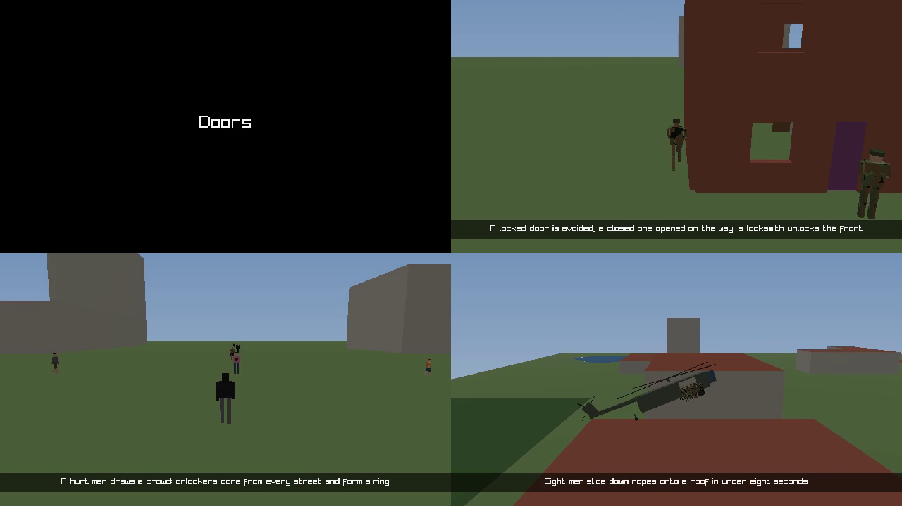

<!--STATUS
state: LIVE
updated: 2026-10-21
current-answer: the whole report
related-designs:
  - ../../DESIGN_Film_Director.md — THE DESIGN; §8 is the as-built this report summarises
  - HANDOFF_Backend_To_Ui_Film_Director.md — the dispatch this answers (scope frozen at 687208f56)
-->

# REPORT — ui → backend: the film director, slice 1 (CE-4038)

**Built on `ui`** from `36c225111` (merged `backend@36c225111`, which carries the dispatch `687208f56`); started marker `a3ee50773`.
⭐ Design obligation ③: the design had **19 classes and 4 sequences**; what was built matches §1 / §1a and deviates from §2 in eight
places, each folded into [DESIGN_Film_Director.md §8.3](../../DESIGN_Film_Director.md) and marked SUPERSEDED in its STATUS block.

## The items

| # | built | where |
|---|---|---|
| B0′ | ✅ the two-run identity rail — REPORT mode (a gate behind `HROT_DIRECTOR_IDENTITY_GATE=1` after CE-3293 S5, `CE-1240`) | `Hrot.SystemTests/DirectorIdentityRails.cs`; every cut's world is in each take's report (`cuts[]`) |
| B1 | ✅ `Take` / `Reel` / `TakeStore` / `TakeJson`; unknown names refused WITH the name (and near names); Save As copies `takes/` | `Hrot.Presentation/Map3D/Director/`, `EditorScenarioSession.SaveAs` |
| B2 | ✅ `ShotEvaluator` — film.py's `_shot_for` ported; film.py keeps no copy (`/film/shot {spec, t}`, `--take`) | `ShotEvaluator.cs`, `scripts/film.py` |
| B3 | ✅ `PacedClock` + `DirectorRunner`: one step per rendered frame (asserted), held to real time | `Hrot.Editor/Director/DirectorRunner.cs` |
| B4 | ✅ `ScenarioReadyProbe` extracted; the load route uses it | `Director/ScenarioReadyProbe.cs`, `DebugApiHost.HandleScenarioLoad` |
| B5 | ✅ `/director/takes · reels · take/{s}/{t} (GET, PUT) · play · scout · stop · next · pause · resume · status`, each documented | `DebugApiHost.Director.cs`, `DebugApiRouteDocs.cs` |
| B6 | ✅ View › Director | `Director/DirectorWindow.cs` |
| B7 | ✅ `AnchorBook` (component state + the combat logs, ⛔ no `Bus.Read`) + the scout mode that bakes (rate, scenario hash) | `AnchorBook.cs`, `DirectorRunner.Bake` |
| B8 | ✅ capture: a frame per film frame, cards, captions, one movie per reel with chapters and sound; no retakes | `DirectorRunner.Capture/StartEncoding`, `FilmCaptureRequest.Caption/Card` |
| B9 | ✅ cinema mode (`WindowManager.Cinema`) + the card/caption overlay; Esc stops | `EditorCinema` |
| B10 | ✅ a take's layers: a transient override, never written; `/map/layers` = the user's click | `LayerControlGizmo.SetOverride/SetRows` |
| B11 | ✅ the 2-D ear, `/audio`, a take's `sound`, the film's sound track (logged, rendered offline) | `AudioLayer.Ear2D`, `SoundTrack.cs` |
| B12 | ✅ 55 takes seeded from `clips.json`; `films/features.reel.json` reads (it was already there) | `scenarios/*/takes/main.take.json` |

## Gates

### Gate 5 — the measurements (cloud VM: Xvfb + llvmpipe, a 2200×1200 window; `scripts/director-check.py live director-check --tick-hz 60 20 15`)

| reel `director-check` (3 scenarios, 64 s of sim) | 60 Hz | 20 Hz | 15 Hz |
|---|---|---|---|
| status | ok · ok · ok | ok · ok · ok | ok · ok · ok |
| realtime factor (bt-doors · ua-civ-gathering · ua-fast-rope-roof) | ×0.41 · ×0.27 · ×0.28 | ×1.00 · ×0.75 · ×0.72 | ×1.00 · ×0.97 · ×0.86 |
| ⭐ steps asked in one frame (max) | 1 | 1 | 1 |
| ⭐ steps the KERNEL took in one frame (max, from the clock) | 1 | 1 | 1 |
| frames waiting on the master | 0 | 0 | 0 |
| frame time, panels on → cinema | (boot-skewed: 454 → 40 ms) | 65 → 46 ms (×1.42) | 67 → 50 ms (×1.34) |

⇒ ⭐ **two steps per frame: NO** — the master takes a step ONE FRAME after it is asked (measured on the first run: the first guard
stepped every other frame; fixed in `0adef0cb6`, design §8.2). ⭐ **`tickHz` on this VM: 15** (20 where a scene is light); a desktop at
60 fps keeps 60 Hz — ⚠ not measured here (no desktop). B9's gain: **~1.4× with the panels off** on the VM, where the renderer, not the
panels, is the cost — ⚠ D-7's "~0.8 s per frame, mostly the panels" was a capture-mode figure. R-106: B3's "within 5 % on a desktop"
is not measurable from the cloud — reported, not claimed.

### Gate 4 — the integration rows

**① live** — `POST /director/play {reel: "director-check"}` in the editor: 3 takes from 3 scenarios, unattended, every take `ok`
(gate 5 below). **② capture on the cloud VM** — the same reel, `capture {dir, fps 15, size 640x360}`: ⭐ **ONE movie**, 30.4 s
(390 film frames + three 1.5 s title cards), H.264 + AAC, **three chapters** (Doors · Onlookers · Down the rope), a sound track
(mean −42 dB, peak −11 dB), captions burned in; every take ×1 steps, one per frame at the kernel, 0 waits; 243 s wall.

**③ the scout table of the 55 seeded takes** — `scripts/director-check.py scout-all --headless` (nothing baked), 1894 s:
⭐ **40 found · 14 missing a beat · 1 name not found.** The 15 that are not `found` (the 40 are in `/tmp/director-scout.json` of that run;
re-run the script for the current answer):

| take | verdict | missing | what was seen / the problem |
|---|---|---|---|
| `Recipes/demo-city/main` | missing beat | burst | — |
| `bt-mortar-roof/main` | missing beat | tube, blast | — |
| `pc-defend-house/main` | missing beat | set, clear | seen: lift 11.167 |
| `ua-air-attack/door-gun` | name not found | — | anchor 'gunner': no unit's name contains 'Door Gunner' |
| `ua-armed-celebration/main` | missing beat | volley, fire | — |
| `ua-armed-gas-throwback/main` | missing beat | pick | seen: throw 4.217 |
| `ua-casualty-care/main` | missing beat | down, medic | — |
| `ua-civ-contagion/main` | missing beat | far | seen: fire 1.183 |
| `ua-civ-escalation/main` | missing beat | warn | seen: lethal 1.05 |
| `ua-civ-provocation/main` | missing beat | arrive, charge | seen: riot 57.15 |
| `ua-civ-shelter/main` | missing beat | door | seen: fire 1.183 |
| `ua-danger-crossing/main` | missing beat | hold, rush | — |
| `ua-hill-attack/main` | missing beat | first | — |
| `ua-indirect-fire/main` | missing beat | b1, ffe | — |
| `ua-weather-regions/main` | missing beat | fog, cloud | — |

⚠ **Not triaged here** — each is either the scenario not doing the beat in a stepped preview, or the anchor naming it in a way the
scout does not match (e.g. a `task` named differently from the registry's name). Filed as `CE-1241` for the take authors.

### Gates 1–3, 6–8 — the commands and counts

| # | command | result | vs the dispatch base `36c225111` |
|---|---|---|---|
| 2 ⭐ T-1 | `dotnet test Hrot.Presentation.Tests --no-build --filter "FilmTests\|FilmFrameRail\|FilmDirectorTests"` | 34 / 0 / 3 (the skips: `FilmFrameRail`'s window rail and two audio rails that need a device) | `FilmTests` + `FilmFrameRail` unchanged green; +14 |
| 2 | `dotnet test Hrot.SystemTests --no-build --filter "DeterminismRails"` (the load-readiness cases, now through the extracted `ScenarioReadyProbe`) | 5 / 0 | green before and after |
| 3 | new rails: `DirectorRunnerTests` ×6, `FilmDirectorTests` ×14, `GZH011_Tests.CE4038_ATakesLayers_…`, `AudioTests.CE4038_ATakesSoundSwitch_…`, `DirectorIdentityRails` | all green | 🔴 red-proven: two steps in a frame · the old wait-for-each-step guard (one-frame lag) · the override written · FPS silenced |
| 3 | B0′ `DirectorIdentityRails` (two scouts of `ua-tank-ammo`, every cut compared) | ⭐ **IDENTICAL at every cut** (s1 9.150, s2 17.883 both runs; 1494 steps; one per frame) | a REPORT until CE-3293 S5 (`CE-1240`) — ⚠ one take, one process: not yet the 3-load measurement §0 asks for |
| T1 | `dotnet test <proj> --no-build`, every touched project | Presentation 806/0/41 · Editor 526/0/2 · Editor.AiShared 2121/0/2 · Fdp.Presentation 580/0/1 · SimHost 1797/**1**/6 | ⚠ SimHost's one red, `FullBranchPipelineTests.BranchedRecording_CapturesHistoricalStateAsKeyframe`, **passes alone** (record/replay; not touched here) — a suite-order flake, not filed by this batch |
| 6 | test projects built (`dotnet build <tests.csproj> --no-restore`, after one restore post-merge); ⭐ one full-solution build `dotnet build HROT.sln --no-restore` at the end | the touched projects: 0 errors · ⛔ **the solution: 7 errors in 4 projects this batch did not touch** (`Hrot.NodeComposition`, `Hrot.SimHost.Integration.Tests`, `Hrot.Blueprints.Tests`, `ClusterRunner.Integration.Tests`: `Hrot.SimHost.Serializers` / `NodeBootstrapper` not found) | ⛔ **PRE-EXISTING**: they moved to `Hrot.EcsNode` in `650b381df`, which is in the base; `git diff --name-only 36c225111 HEAD` touches none of the four — backend's to fix |
| 7 | `git status` after the suites · `tracker-counts.py --check` · `rulings-check.py` · `design-digest.py --check` · `mermaid-check.mjs docs/DESIGN_Film_Director.md` | clean · OK · 371/371 (staleness warnings only for the docs edited here) · OK · 8/8 blocks parse | — |
| 8 | ids and design sections | below | — |

### ⭐ After CE-3293 S5 (merged `2026-10-21`) — filmed = scouted

`dotnet test Hrot.SystemTests --no-build --filter DirectorIdentityRails` (now a GATE, `CE-1240`): ⭐ **3 / 0** — `ua-tank-ammo`,
`bt-grenade-posture`, `ua-civ-melee`, **three fresh loads each, IDENTICAL at every cut**, one step per frame asked and taken, 0 waits.
📐 S5 moved the beats (M1 rounds 9.150 / 17.883 → 8.933 / 17.667 s) ⇒ every seeded take is re-scouted and baked after it. The director's
rails against S5: Presentation 34/0/3 · Editor 13/0 · GZH011 11/0.

## Ids allocated (ui block)

`CE-1239` (an OGG clip is missing from a film's sound track) · `CE-1241` (15 seeded takes the scout does not complete) · `CE-1240` (re-scout the takes and turn B0′ into a gate after CE-3293
S5). No ruling ids. Design sections updated to the as-built: Film Director §8 (new) + its STATUS · Map 3D Mode §6ab-i · FPS Audio §8.2 ·
Terrain Combat Tuning §5e.2 · RUNBOOK_Filming §0a · PLAN_Feature_Films §3.
