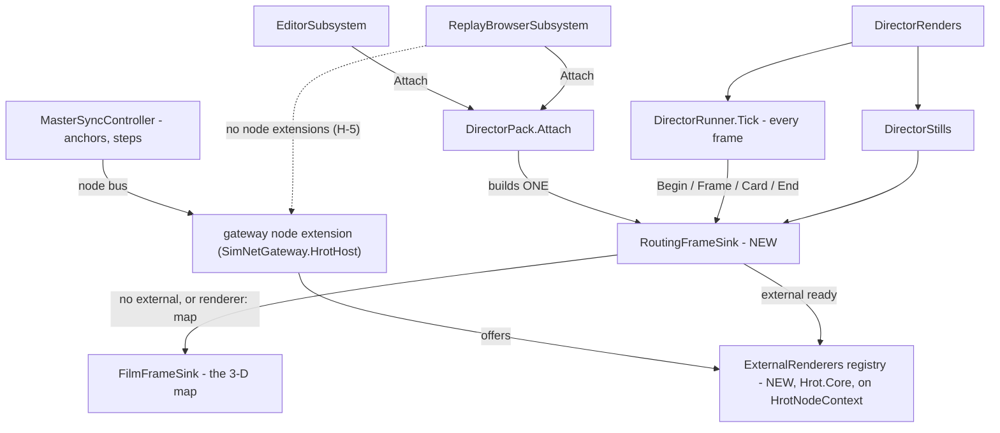
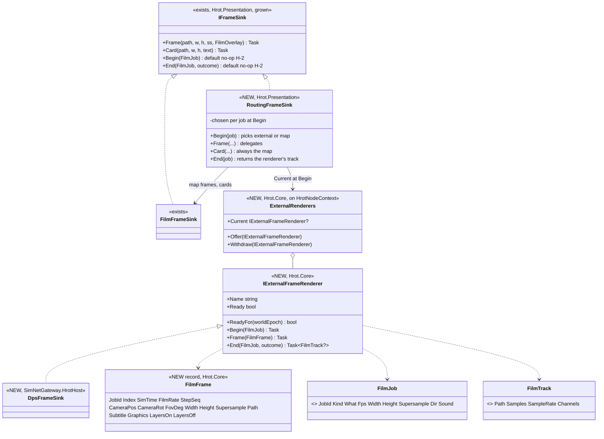
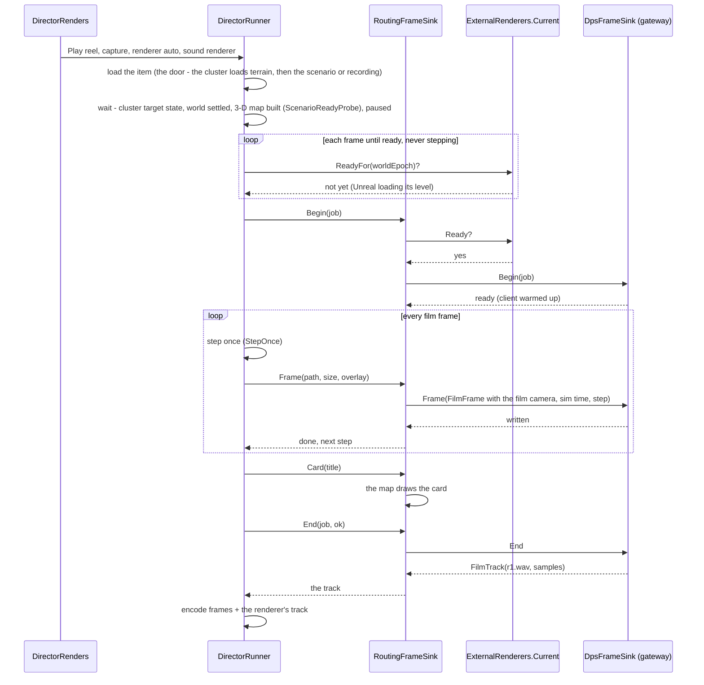
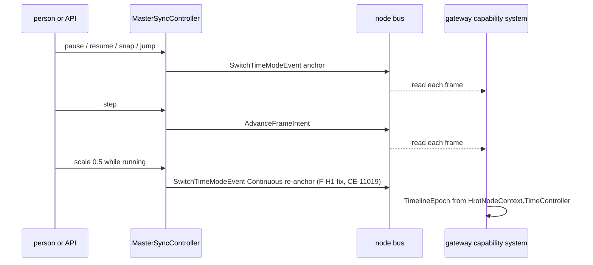

<!--STATUS
state: LIVE
updated: 2026-11-21
build-state: DESIGN — the leans await the user in Architect_Question_113 (nothing built)
current-answer: §2 the diagrams, §3 the items H-1 … H-8 with their CE ids, §4 the decisions (leans; the questions are Q113)
stale-below: nothing
known-rot: none
known-conflict: none
related-designs:
  - ../../DESIGN_Film_Director.md — OWNS the runner, reels, capture, the frame sink IFrameSink, IDirectorSound, the live stepping rule (R-3038); THIS adds a second sink and per-job sink choice, never a second runner
  - ../../DESIGN_Director_Timeline_Editor.md — OWNS the render queue DirectorRenders (§11u) and the stills job; THIS gives a job its renderer and its sound source
  - ../../DESIGN_Film_Production.md — OWNS the film process (F-1 recordings are the source, F-2 one director on every host); THIS keeps both and names what the Replay Browser lacks (H-5)
  - ../../blueprints/DESIGN_Time_Architecture.md — OWNS the clocks, anchors (SwitchTimeModeEvent) and steps; THIS reads them for a node extension and fixes F-H1 (a running scale change sends no anchor)
  - ../vehicle-appearance/DESIGN_Look_Rules_For_Renderers.md — OWNS the look library and the camera suggestion (D-1, R-11000); THIS uses the suggestion only as live advice, the frame's camera travels with the frame
  - ../../DESIGN_Node_Extensions.md — OWNS how an outside product joins a node (INodeExtension -> INodeCapability); THIS adds what an extension may OFFER the director
  - DRAFT_Unreal_Image_Generator.md (branch unreal-ig) — the Unreal client; it consumes SimNetGateway DD-022, which this serves
  - SimNetGateway docs/design/DD-022-Dps-Director-Rendering.md (rev 4, approved R-138 there) — the wire side: SimClock, ClockStep, the render topics; THIS is its HROT half (H-1 … H-8)
-->

# External renderer for the director — HROT's half of DD-022

🔒 **User, `2026-11-21`** (SimNetGateway R-136): *"I still need to run HROT 3D map together with the Unreal. Just when the Unreal is connected
via the gateway, the director will not take pictures of internal HROT 3D map, but will use the Unreal over the gateway. This way I will be able
to prepare the clips without Unreal in plain HROT, and when I connect the Unreal I can tell the director to render the clips by rerunning all
prepared reels, and the Unreal will render them."* · R-137 there: *"follow the conventions the HROT nodes are using regarding time control"* ·
*"take the audio track from the Unreal, the same way as we are taking snapshots from there"* · R-138 there: *"DD-022 rev 4 approved."*

⭐ The gateway runs inside a HROT node as a node extension and does not reference `Hrot.Presentation` (its `.csproj`: Hrot.Common, Hrot.Core,
Hrot.Look, Hrot.Traffic, Fdp.*). The director lives in `Hrot.Presentation`. ⇒ the contract an extension offers must live **below** both — the
same reason the camera suggestion went to `Hrot.Core` (R-11000).

## 1. INVENTORY — the queries run (`2026-11-21`, graph indexed this session on `ui` = `coordinator` `ecbe256d4`)

| query | total | what it says |
|---|---|---|
| `search_graph name_pattern=".*FrameSink.*"` | 14 (2 code) | ONE sink interface `IFrameSink` (`DirectorHost.cs:110-121`), ONE implementation `FilmFrameSink` (`DirectorAdapters.cs:135`) |
| `search_graph name_pattern=".*DirectorSound.*"` | 10 (3 code) | `IDirectorSound` (`DirectorHost.cs:124-142`), ONE implementation `AudioDirectorSound` (`DirectorAdapters.cs:149`) |
| `search_graph name_pattern=".*DirectorPack.*"` | 44 | `DirectorPack.Attach(DirectorPackHost)` (`DirectorPack.cs:95`) builds ONE sink (`:101`: `h.Headless ? null : new FilmFrameSink()`) handed to the runner, the stills and the render queue; two hosts call it: `EditorSubsystem.cs:1805`, `ReplayBrowserSubsystem.Director.cs:44` |
| `search_graph name_pattern=".*RenderRequest.*\|.*RenderJob.*\|DirectorRenders"` | 22 | `DirectorRenders` (`DirectorRenders.cs:123-369`): `Refusal => _sink == null ? NoRenderer` (`:168`) |
| `search_graph name_pattern=".*NodeExtension.*"` · `".*NodeCapabilit.*"` | 31 · 39 | `INodeExtension.CreateCapability(NodeExtensionContext)` (`NodeExtensions.cs:18-25`) -> `INodeCapability` (`NodeCapability.cs:142-217`; `PopulateSystems(HrotNodeContext, …)`) — an extension gets the node's context, it OFFERS nothing to the director today |
| `search_graph name_pattern=".*CameraSuggest.*"` | 10 | `CameraSuggestion` (`Hrot.Core`), the one writer `CameraSuggestions` + `ICameraSuggests` (`Hrot.Presentation/Map3D/CameraSuggestions.cs`) |
| `search_graph name_pattern="SwitchTimeModeEvent"` · grep `Publish(new SwitchTimeModeEvent` | 22 · 6 sites | the master publishes every anchor on the node's bus (`MasterSyncController.cs:130, 457, 497, 537, 579, 605`); steps as `AdvanceFrameIntent` (`:383`) |
| grep `SharedApplicationBootstrapper\|NodeExtensions.` in `Hrot/Subsystems` | 10 files | Editor, Player, SimHost, CGF, Traffic, Stride compose extensions — ⛔ **the Replay Browser does not** (no bootstrapper, no `HrotNodeContext` in `Hrot.ReplayBrowser/*.cs`) |
| grep `TimeController` in `HrotNodeContext.cs` | 1 | `HrotNodeContext.TimeController` (`:183`) — a capability can read the clock (`TimelineEpoch`, scale) |

⚠ `check_index_coverage` is not available through the CLI: the absence claims (no second sink, no extension seam into the director, no
extension composition in the Replay Browser) rest on the graph plus grep, not on a coverage check.

## 2. Diagrams

### 2a. Who calls what each frame — the module view

*What the picture shows that prose hid:* the routing happens in the ONE object `DirectorPack.Attach` already builds for every host, so the
editor and the Replay Browser cannot differ in how a renderer is chosen — and the dashed edge: the Replay Browser composes no node extension
today — but the editor's replay (AAR) hosts the same director over its own recording (Review Perspective §1), so a film from the editor's
recording reaches the gateway without it; the Replay Browser integration is not built (R-11008).

### 2b. Classes

*What the picture shows that prose hid:* the extension never sees a `Hrot.Presentation` type — `FilmFrame` carries the overlay already
resolved to world points and text (`FilmOverlay`'s values, copied), and the camera of the frame (H-3); `RoutingFrameSink` is the only place
that knows both worlds.

### 2c. Render a reel through the external renderer

### 2d. The clock for the gateway — no new HROT API (H-6)

### 2e. Who waits for whom on a load (user `2026-11-21`: *"how it will block until the Unreal actually loads everything"*)

Nothing blocks the cluster's load: it loads the terrain, then the scenario or recording, at its own pace. The **director's runner** waits — it
already enters each reel item's run PAUSED and steps it itself (`DirectorRunner.cs:124-128`), so waiting is simply *not stepping yet*: after
`ScenarioReadyProbe` (cluster target state, world settled, 3-D map built) it also waits for `ExternalRenderers.Current.ReadyFor(worldEpoch)`
(the gateway answers from Unreal's `RenderClient`, Ready for that world), checked each frame beside the map build; an error or a stall fails
the item with the reason, never an endless wait. Outside a film nothing waits for the renderer — a viewer never holds the simulation.

## 3. The items — HROT's requests from DD-022, with their ids

| DD-022 | CE | what | where |
|---|---|---|---|
| H-1, H-2, H-3, H-4 | [CE-11018](../../blueprints/Blueprint_Issues_Tracker.md) | `IExternalFrameRenderer` + `FilmFrame` / `FilmJob` / `FilmTrack` + `ExternalRenderers` (Hrot.Core); `IFrameSink.Begin/End` (default no-ops); `RoutingFrameSink` built once in `DirectorPack.Attach`; the runner passes the film camera, film rate and step with each frame; a faulted frame fails the job with its reason; `renderer: auto \| map` on the capture request | Hrot.Core, Hrot.Presentation Director |
| H-5 | ~~CE-11020~~ dropped | ✅ R-11008: no Replay Browser integration — the director renders from the editor's own replay (AAR); a job naming another recording plays once the editor passes its opener (Q113-G, CE-11023); multi-node exercises stay out | — |
| H-6 | — | no HROT change: the gateway reads the anchors and steps on the node bus and `TimelineEpoch` from `HrotNodeContext.TimeController` (2d) | — |
| H-7 | [CE-11021](../../blueprints/Blueprint_Issues_Tracker.md) | `sound: renderer \| hrot` per job; with `renderer` the encode muxes `FilmTrack` and checks its samples against the frames; `IDirectorSound` stays for map renders | Hrot.Presentation Director |
| H-8 / F-H1 | [CE-11019](../../blueprints/Blueprint_Issues_Tracker.md) | a running scale change publishes a Continuous re-anchor, so cluster slaves follow it | Fdp.Toolkits Time (backend's area: a cross-lane edit) |
| H-8 / F-H2 | [CE-11022](../../blueprints/Blueprint_Issues_Tracker.md) | the time docs say the anchor model (no pulse, no PLL); the stale comment at `MasterSyncController.cs:153`; the unused `TimeConfig` PLL fields named | Time Architecture, FDP.Toolkit.Time.md |
| (G) | [CE-11023](../../blueprints/Blueprint_Issues_Tracker.md) | the editor's director gets the editor's recording opener (`ScenarioDoor.OpenRecording`) — a job or reel item naming another recording then plays in the editor | Hrot.Editor |
| (H) | [CE-11024](../../blueprints/Blueprint_Issues_Tracker.md) | `EffectCause.Kind` + `EffectCause.Shooter` from `RoundImpactNotification` — the gateway makes `Impact` from the effect entities, live and in replay (R-11007) | Hrot.Core, the effect spawner |

**Acceptance (R-4277 — a feature works when its scenarios pass):** the `showcases/player-station` scenario with a promoted take rendered
twice — once with no renderer (the map, as today: frame count, MP4) and once with the gateway's reference client in `--render` mode (the same
frame count, the client's PNGs, the client's tone track muxed, the samples total right). Rails: `RoutingFrameSink` picks external / map /
forced map; `Card` never reaches the external renderer; a faulted frame fails the job with the reason; `FilmFrameSink` behaviour unchanged
(the existing `FilmTests` / `FilmFrameRail` under `xvfb-run -a`); the scale re-anchor in `MasterSyncControllerTests` + the cross-node
invariant in `SimTimeSyncIntegrationTests`.

## 4. Decisions — the leans (the questions with their blast radius: [Architect_Question_113](../../blueprints/Architect_Question_113_External_Renderer_For_The_Director.md))

| | lean | rejected |
|---|---|---|
| D-1 | the contract `IExternalFrameRenderer` in **Hrot.Core**, offered through an `ExternalRenderers` registry **on `HrotNodeContext`** (precedent: `TerrainContent`, `HrotNodeContext.cs:192`) | a world singleton component holding a live object — state of the node, not of the world; recorded and saved paths would need opting out |
| D-2 | **one `RoutingFrameSink`** built in `DirectorPack.Attach`, the choice made at `Begin` per job | choosing in each caller (runner, stills, queue) — three places that could disagree |
| D-3 | the **runner passes the film camera** in `FilmFrame` | the renderer reading `CameraSuggestion` itself — written by `MapViewModeLayer`'s update, possibly a frame off the runner's `Frame` call (not measured) |
| D-4 | **cards stay the map's** | sending cards to the renderer — a second card look |
| D-5 | **H-6 needs no HROT API** (bus + context) | a new clock-export component — a second source of time (R-126: one source of paused) |
| D-6 | **F-H1 fixed in the master** | the gateway's own re-anchor only — the cluster's slaves would still miss a scale change |
