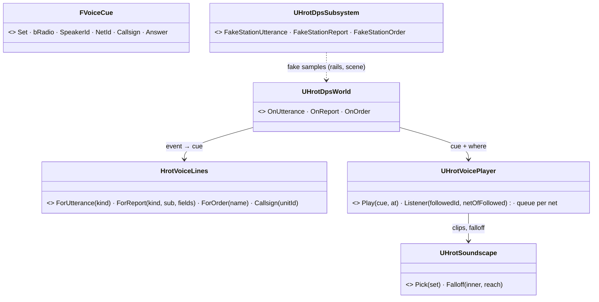
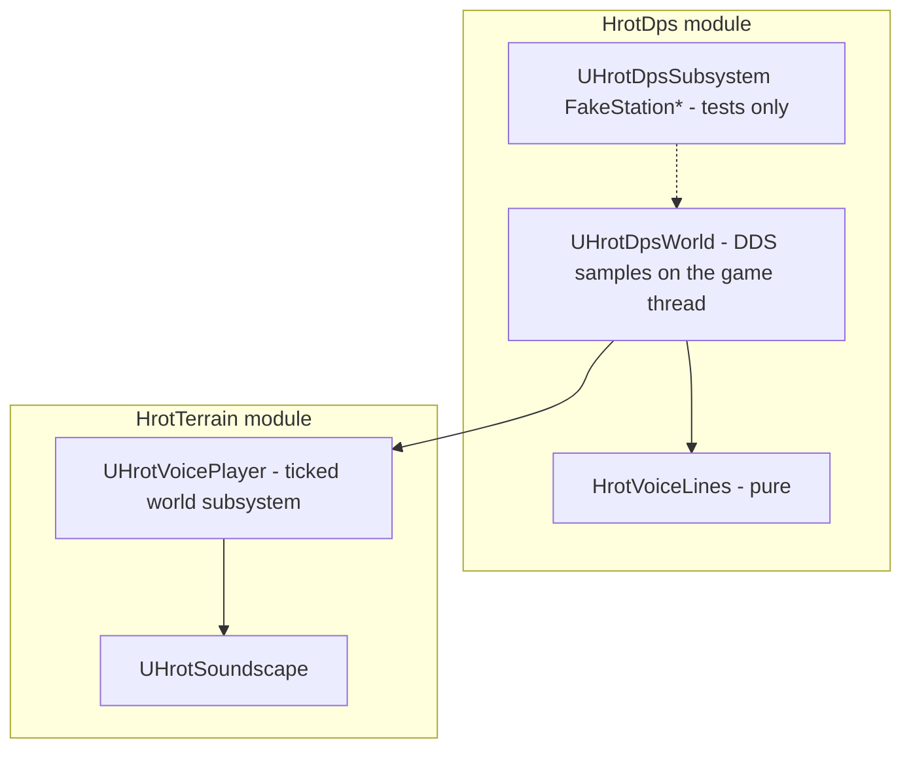
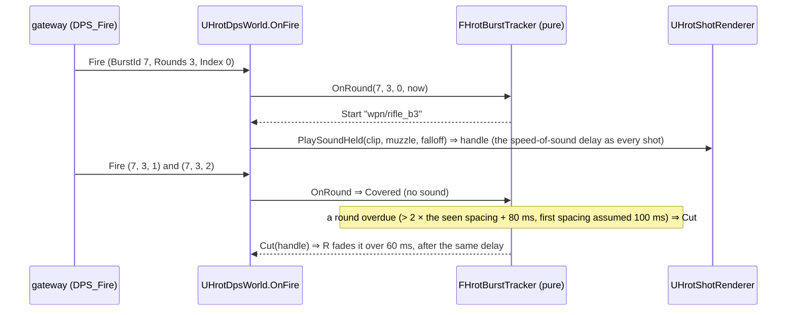
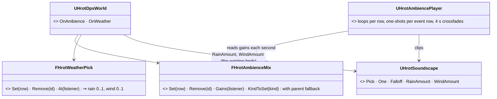
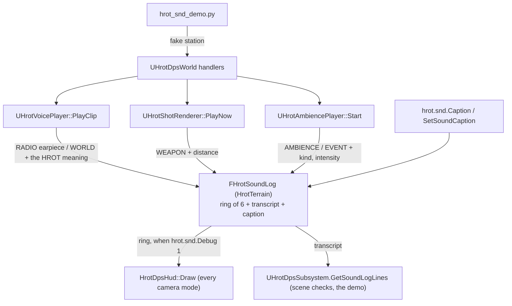

<!--STATUS
state: LIVE
updated: 2026-11-22  (as-built folded in at U-19b)
build-state: BUILT (U-19a contract, U-19b voice — CE-4651); U-19c..e READY-TO-BUILD
current-answer: the whole file — §1 diagrams, §2 the line map, §3 decisions, §4 slices and rails
stale-below: none
known-rot: none
known-conflict: none
related-designs:
  - DRAFT_Unreal_Image_Generator.md — the IG's row table (U-19a/b point here); U-18n/o the soundscape and the private pack this plays from
  - ../../blueprints/Architect_Question_105_Squad_Callouts.md — OWNS when a man shouts (the Utterance kinds); this file only plays them
  - ../audio/DESIGN_FPS_Audio.md §9 — HROT's OWN voices (placeholder synth, one voice per side); unchanged by this file
  - ../audio/DESIGN_Ambience.md — the ambience kinds (U-19d, a later slice of the same player)
  - SimNetGateway docs/design/DD-026-Dps-Voice-Events.md — OWNS the wire: Utterance / Report / Order; DD-027 bursts; DD-028 ambience and weather
-->

# The squad's radio in the Unreal IG — HROT's shouts, reports and orders as recorded voice lines *(unreal-ig, `2026-11-22`, CE-4651 U-19)*

🔒 User, `2026-11-22`: *"Some of them might make sense when the squad commander is telling something to his subordinates, or when he does something over the
radio to the HQ. And it might be nice effect if we follow that leader or simply be somewhere close to hear those, no matter how realistic it is."* ·
*"the samples will stay in Unreal only. The HROT is just the source of a good triggers for those sounds."* · *"Yes, please start."*

Basis: the notes [NOTE_UnrealIg_To_Hrot_Squad_Voice.md](../../blueprints/batches/NOTE_UnrealIg_To_Hrot_Squad_Voice.md) (the 140 lines, the map) and the
gateway's answer `NOTE-2026-11-22-Gateway-Contract-Ready-Voice-Bursts-Ambience-Fade.md` (gateway `7b98118`: the topics are in the IDL, nothing is
written yet ⇒ the client is built against a fake publisher first).

## 0. INVENTORY *(measured 2026-11-22: grep of `tools/unreal/HrotTerrain/Source`; the plugin is not in the codebase-memory graph — C++ outside the index)*

| exists | where | used as |
|---|---|---|
| `UHrotSoundscape::Pick(set)` (one of `<set>_01..NN`), `Falloff(inner, reach)`, AudioPro-first libraries | `HrotTerrain/Public/HrotSoundscape.h` | ⭐ the clip source and the falloff — no second loader |
| `UHrotDpsWorld::Start` `Sub(topic, handler)`; `Ents` (`FEnt`: `Side`, `ParentId` = mounted on, `bIsUnit`, the actor) | `HrotDps/Private/HrotDpsWorld.cpp:164` | ⭐ three more `Sub` lines; the speaker's position |
| `AHrotDpsCameraPawn::FollowedId()` | `HrotDps/Public/HrotDpsCameraPawn.h:77` | ⭐ who the listener follows (the earpiece rule) |
| `UHrotDpsSubsystem::FakeStation*` test publishers | `HrotDps/Public/HrotDpsSubsystem.h` | ⭐ + `FakeStationUtterance / Report / Order` |
| `sound_cut.py` modes loop / loopfile / shots, `R_PRO` (the private pack) | `scripts/unreal/sound_cut.py` | ⭐ + a `whole` mode (a spoken line, trimmed and levelled) |
| `dps_gen.py` (the IDL → C plumbing) | `scripts/unreal/dps_gen.py` | ⭐ re-run on the gateway tip |
| ⛔ a voice player, a line map | none | NEW |

## 1. The diagrams


*What the picture shows that prose hid:* the MEANING → LINE map is a pure function (`HrotVoiceLines`, railed without a world), and the player owns only
WHO HEARS and WHEN; no second clip loader beside `UHrotSoundscape`.

```mermaid
sequenceDiagram
  participant G as gateway (DPS_Report)
  participant W as UHrotDpsWorld
  participant L as HrotVoiceLines
  participant P as UHrotVoicePlayer
  participant S as UHrotSoundscape
  G->>W: Report(From 12, To 0, Lace, Kia 2)
  W->>L: ForReport(...)
  L-->>W: cue {vox/rep_losses, radio, net 12, "Cooper"}
  W->>P: Play(cue, unit 12's position)
  P->>P: net 12 busy? queue (≤ 2, oldest dropped) · listener on net 12? earpiece or world
  P->>S: Pick(radio/beep) → Pick(vox/sgt_cooper) → Pick(vox/rep_losses) → Pick(vox/over) → Pick(radio/squelch)
  Note over P: chained on each clip's duration; a world cue at the position with Falloff(5 m, 40 m)
```


*Caption:* the player sits beside the soundscape (HrotTerrain owns every sound); the DPS world calls it, as it calls `UHrotShotRenderer` today.
Nothing writes the three topics until gateway T-064 lands — the dashed fake path is the only producer meanwhile.

## 2. The line map (sets; a set's variants `_01..` are the synonyms, picked at random)

| cue | from | set — the pack's lines | heard |
|---|---|---|---|
| `CmdMove` | Utterance | `cmd_move` — move out · go · push forward · advancing on the enemy | world |
| `CmdHold` | Utterance | `cmd_hold` — hold · holding position | world |
| `CmdFallBack` | Utterance | `cmd_fallback` — break contact | world |
| `CmdDown` | Utterance | `cmd_down` — get down · take cover | world |
| `CallCovering` / `CallSuppress` | Utterance | `call_cover` — covering fire · cover me / `call_suppress` — suppressing fire | world |
| `CallReloading` / `CallFragOut` | Utterance | `call_reload` — reloading / `call_fragout` — grenade out | world |
| `CallContact` | Utterance | `call_contact` — enemy spotted · hostiles in the area | world |
| `CallGrenade` | Utterance | `call_grenade` — incoming | world |
| `CallAck` | Utterance | `ack` — affirmative · yes | world |
| `CallClear` / `CallManDown` | Utterance | `call_clear` — the area is clear / `call_medic` — need medical attention | world |
| other kinds (civil, animal) | Utterance | none — not this file's (HROT's own voices / the soundscape) | — |
| Contact | Report | `rep_contact` — enemy spotted · target acquired | radio |
| Spot, `Count` ≤ 3 / larger or `Activity` Moving | Report | `rep_spot` — hostiles in the area / `rep_spot_big` — enemy forces approaching · we have hostile forces incoming | radio |
| Progress Set / ObjectiveSecure, BuildingClear, RoomClear / FallingBack, Displacing / TaskFailed / TargetsDown | Report | `rep_set` — in position · ready to move / `rep_done` — objective complete · the area is clear / `rep_fallback` — break contact · I'm moving to a better position for cover / `rep_failed` — the mission is a failure / `rep_targetsdown` — target neutralized · the enemy has retreated | radio |
| Lace, `Kia` + `Wia` ≥ 2 / else | Report | `rep_losses` — we're taking heavy losses / `rep_status_ok` — holding position | radio |
| Sitrep, `Strength` green / amber / red | Report | `rep_advantage` — we have the advantage / `rep_status_ok` / `rep_tight` — we're in a tight spot, requesting immediate assistance | radio |
| Request Casevac / FireSupport / Reinforce / Permission / other | Report | `rep_casevac` — need medical attention / `rep_fires` — request immediate support / `rep_backup` — requesting backup · need backup / `rep_permission` — permission to engage / `rep_backup` | radio |
| any order | Order | by the name's keyword: attack / assault ⇒ `ord_attack` (attack · open fire); defend / hold ⇒ `ord_defend` (defend · we need to hold this position at all costs); flank ⇒ `ord_flank` (move to flank); move / advance / go ⇒ `ord_move` (move out); else `ord_standby` (standby for orders); then the receiver's `ack` (affirmative · ready to move) 1.5 s later | radio |
| the frame | every radio cue | `radio/beep` · `sgt_<name>` (this is Sergeant X) · the line · `over` (1 in 2) · `radio/squelch` | radio |

Callsign: a unit's first transmission takes the next unused of the 11 sergeant names (Brown … Taylor), kept for the session; beyond 11 the names repeat.

## 3. Decisions

| # | decision | rejected |
|---|---|---|
| V-1 | **World** cue at the speaker (Utterance: his body's head; Report / Order: the sender entity's position — a body-less unit's is its members' centroid), `Falloff(5, 40, -30 dB)` (HROT's `VoiceRange`; ⭐ 2026-11-22 by ear: the default -60 dB at 40 m left a shout weak at 20 m and silent at 35 m ⇒ -30 dB: ≈ -13 dB at 20 m, -26 dB at 35 m; the natural-sound curve HOLDS -30 dB beyond its reach, so the player CUTS world speech beyond 50 m — heard: "the faint at 50 was ok but so weak that we can cut it there") | the shot's reach — a voice is not heard at 800 m |
| V-2 | **Earpiece**: a radio cue whose net is the LISTENER's is played 2-D at full level, any distance. The listener's net = the unit of the followed man — ⚠ the wire has no man → unit link (`Entity.ParentId` is "mounted on"): v1 takes the nearest same-side `IsUnit` within 150 m of the followed man; a membership field is asked of the gateway (appending is free) | no earpiece — the user's "follow that leader … hear those" |
| V-3 | **One transmission at a time per net**, queue ≤ 2 (the oldest dropped); a speaker's world shouts ≥ 2 s apart; ≤ 3 voices at once overall | every event spoken — a firefight would be a babble |
| V-4 | `Synthetic` reports play (they are how the rails and the debug API test this); `bSilentSynthetic` switches them off | silent by default — the fake path would test nothing |
| V-5 | the clips are WHOLE spoken lines: `sound_cut.py` mode `whole` (leading / trailing silence below -50 dB trimmed, mono, peak -3 dBFS) into `/Game/Hrot/AudioPro/vox/<set>_NN` and `/radio/` — private, as U-18o | cutting by onsets — a phrase is not a shot |

## 3a. As built (U-19b) — deviations from §1–§3, marked here so §1's boxes are read with them

| design said | built | why |
|---|---|---|
| `FVoiceCue { Set, bRadio, SpeakerId, NetId, Callsign, Answer }` in `HrotVoiceLines` | `FVoiceCue { Set, bRadio, AnswerSet, Callsign, ToId }` lives in **HrotTerrain** (`HrotVoicePlayer.h`); speaker and net are `Play(...)` arguments | `HrotDps` depends on `HrotTerrain`, never the reverse: the player (HrotTerrain) must name the cue's type |
| one `ack` set (affirmative · yes · ready to move) | `ack` = affirmative · yes (a man's `CallAck`); **`ack_order`** = affirmative · ready to move (an order's answer) | `ready to move` is not a reply to `CallAck`; one set per meaning |
| queue / spacing logic "in a pure helper" | `FHrotVoiceSched` (HrotTerrain, pure, `Now` injected): `Offer` / `PopStartable` / `Finish` / `AllowShout` / `BuildChain` / `IsEarpiece` — railed as `Hrot.Dps.Voice.Player` | the rails need no world and no audio |
| Sitrep Strength green / amber / red | Unknown and Black ⇒ no line | the design names three colours; a destroyed unit does not radio |
| Progress kinds not in the row (PhaseLine, Foothold, RoomBlocked, Detained, FireLifted) | no line | §2 lists none; add a row when the user wants one |
| "over" (1 in 2) | every second radio transmission, counted from the second (the 1st has none) | deterministic, so the scene check and the rail can state the chain |
| the order's answer | the chain repeats the frame: `+1.5 s` beep → `ack_order` → squelch, same net, still one transmission | the receiver keys the radio too |
| the world voice position of a Report / Order | the FromId entity's actor (+1.6 m) or, body-less, its shown position + 1.6 m | `HrotDpsCards.cpp` uses +2 m for the card; a voice is at head height |

The clips: `sound_cut.py --set vox` (mode `whole`) → `D:\Work\Unreal\sounds\military_cut\{vox,radio}` (outside git) → `/Game/Hrot/AudioPro/{vox,radio}` (78 clips, no source missing).

## 4. Slices and rails

| slice | what | ⭐ done when |
|---|---|---|
| **U-19a** | `dps_gen.py` on the gateway tip (`7b98118`+): the new topics' C types and QoS rows; the plugin builds; the existing rails pass | the topic table lists DPS_Utterance / Report / Order / Ambience / Weather; build green |
| **U-19b** | the clips (recipes + `whole` mode + import); `HrotVoiceLines`; `UHrotVoicePlayer`; three handlers; three fakes | rail `Hrot.Dps.Voice.Lines`: every row of §2 (incl. Lace by counts, Sitrep by colour, Spot by count, an unknown order ⇒ standby, a civil kind ⇒ none, callsigns stable and distinct); rail `Hrot.Dps.Voice.Player`: per-net queue (third dropped), shout spacing, earpiece vs world by the listener's net; the scene run plays a fake Report and logs the chain (beep → sgt → line → squelch) and `LibraryMissing` 0 |
| **U-19c** | bursts on `Fire` (DD-027) — §5 | rail `Hrot.Dps.Burst`: index 0 of N starts one `_b<N>` clip, indices 1..N-1 play nothing, `BurstId` 0 plays per round, a gap fades the clip, no clip for N ⇒ the nearest shorter count, none at all ⇒ per round; scene: a fake 3-round burst plays ONE clip |
| **U-19d** | ambience + weather (DD-028) — §6 | rail `Hrot.Dps.Ambience`: kind fallback (`alarm.airraid.preliminary` → `alarm.airraid` → `alarm`, unknown family ⇒ none), gains (positionless = Intensity, positioned by distance to Radius), ≤ 2 battle beds (the loudest), an event plays once per row, a disposed row fades; rail `Hrot.Dps.Weather`: the region containing the camera wins over the global row, the feather blends, rain mm/h and wind m/s → the soundscape's 0..1; scene: a fake `battle.city` bed and a positioned `alarm.airraid` row start their loops, the dispose fades them, a fake rain row raises `RainAmount` |
| **U-19e** | the director's fade and subtitle — §7 | rail `Hrot.Dps.Overlay`: the subtitle's y by position (top 0.08, centre 0.5, bottom as the render path), alpha applied, empty = none, fade 0 = no rect / 1 = opaque; scene: a fake `View` with Fade 0.5 + a subtitle ⇒ the HUD drew both (counters), a render job with `FrameRequest.Fade` 1 writes a black frame |

## 5. Bursts on `Fire` (U-19c, DD-027) *(unreal-ig, 2026-11-22)*

🔒 HROT's user (DD-027): *"send the burst information to the DPS instead of a single shot … cannot apply to player"*. Each round stays one `Fire`
sample (tracers, impacts); `BurstId` / `BurstRounds` / `BurstIndex` say which rounds the AI fired as one burst.


*What the picture shows that prose hid:* the burst's sound is decided ONCE, at index 0, from `BurstRounds`; the later rounds only keep it
alive — and a cut must travel through the same delay as the sound, or a distant burst would stop before it is heard.

| # | decision | rejected |
|---|---|---|
| B-1 | clips with an EXACT round count: `sound_cut.py` mode `burst` finds a file's onsets and cuts every run of N consecutive rounds (N = 2..8) plus its decay ⇒ `wpn/<set>_b<N>_NN` for `rifle`, `rifle_east`, `mg`, `mg_heavy` (sources: the pack's short burst / full auto / burst files of that class) | one long burst clip faded at round N — the cadence of the cut would not end on a round |
| B-2 | no clip of N ⇒ the longest shorter one, then per-round for the rest; none at all ⇒ per round (today's path) | silence |
| B-3 | `BurstId` 0 (an aimed single, a player's round) ⇒ per round, unchanged | |
| B-4 | the recording's own cadence is kept (it differs a little from the sim's round spacing; tracers stay per round) | time-stretching — artefacts, and nobody counts |
| B-5 | the state is a pure `FHrotBurstTracker` (per `BurstId`; forgotten 2 s after its last round), railed without audio | |

### 5a. As built (U-19c)

| design said | built | why |
|---|---|---|
| `PlaySoundHeld(...) ⇒ handle`, a cut through the same delay | `UHrotShotRenderer::PlaySoundHeld` / `FadeHeld(handle, 0.06)`; the fade is scheduled `Dist / SpeedOfSound` after the cut (the same delay the start had), applied to the spawned `UAudioComponent` | as §5 |
| clips by "the onset finder of `cut_shots`" | ⭐ **(2026-11-22, by ear)** a second onset finder (`burst_onsets`): 2.5 ms envelope, a 5 dB rise within 5 ms; ⭐ two rises closer than 0.7 of the take's PERIOD are one round (the louder kept). The period (`burst_period`) is the take's strongest envelope autocorrelation lag in 55–300 ms; the gun family's median over its takes; a take whose own period is outside 0.75–1.35 × the family's is skipped (its rate is unreadable). ⭐ Every round of a run peaks within 8 dB of the run's loudest | 📌 **the user counted the cuts:** "7-round" clips held 3–4 — each shot's echo / action (~70 ms after it, ~18 dB down) and a heavy MG round's ringing had been counted as rounds. Measured cadences: rifles 122 ms, AK 105–122, mg (M240B / modern) 145, AR10 158, heavy MG 170–188. ⛔ The earlier row's "real cadence ~70 ms" was the double count |
| 4 variants per (set, N) | the 4 best runs over all source files; score = spacing max/min + 0.8 for a round < 300 ms before + ⭐ **3.0** for a round < 300 ms after (no natural end) + 1.5 for a mean cadence outside 55–200 ms. ⭐ A run cut before the next round (continuous fire) borrows the take's own NATURAL ending — the decay after the round where the gunner stopped, from the same offset after its round, level-matched (±12 dB) and crossfaded in 25 ms | heard: a run cut mid-stream "feels cut way too early"; the spliced tail "sounded good" (AK 5 rounds). ⛔ "AK 47 firing multiple bursts" is not a source: heard as one soft round, not an AK |
| autocannon | per round (no `autocannon_b<N>` clips) | §5 lists rifle, rifle_east, mg, mg_heavy only |
| the stem of an MG burst | `wpn/mg_heavy_` for a vehicle gun (`bKitGun`), else `wpn/mg_` | as today's per-round choice |
| `UHrotSoundscape` | + `Has(set)` (quiet: no `LibraryMissing`) | the tracker's "is there a clip of N" predicate must not count misses |
| scene: "no per-round rifle sound" | `sounds played` of the renderer rose by exactly 1 (and `HeldStarted` by 1) for a 3-round burst | the `rifle shot` event counts every ROUND (the tracer / visual path), not a sound |

Clips: 112 (7 counts × 4 sets × 4 variants) in `/Game/Hrot/AudioPro/wpn/<stem>b<N>_NN` (private, outside git).

## 6. Ambience and weather (U-19d, DD-028) *(unreal-ig, 2026-11-22)*

HROT keeps ambience LAYERS as entities (HROT `docs/designs/audio/DESIGN_Ambience.md`, CE-11034: a dotted kind, an intensity, optionally a place and a
radius, an end); the gateway sends them as `DPS_Ambience` STATE rows (a late joiner hears a siren already sounding) and HROT's weather as `DPS_Weather`
rows (global, or a region with its outline).


*What the picture shows that prose hid:* weather needs NO new player — it only drives the two numbers the soundscape's existing rain and wind beds
already read (today set by hand); the war layers get their own player because they are keyed rows, not the soundscape's surroundings.

⭐ **Remapped 2026-11-22 by the user's ear** — the pack's names lie: "Sniper shooting in the distance" is a close fight, "Intense mid range battlefield" is sparse single shots. All 11 loop joints heard seamless.

| kind | the pack's recordings (set) | how |
|---|---|---|
| `battle.distant` | `amb/war_distant` — Distant gunshots and indoor battlefield | bed (loop) |
| `battle.city` | `amb/war_city` — City battlefield ambience | bed |
| `battle.night` | `amb/war_night` — Nighttime battlefield with distant shots | bed |
| `battle.heavy` | `amb/war_heavy` — Sniper shooting in the distance (heard: a CLOSE fight) · Tank fire on the battlefield (heard: distant artillery) | bed |
| `battle.sniper` | `amb/war_sniper` — Intense mid range battlefield (heard: individual mid-distance shots over a far rumble) | bed |
| `battle.ambush` | `amb/war_ambush` — Jungle patrol ambush ambience | bed |
| `battle.aftermath` | `amb/war_aftermath` — Burning house war zone ambience ×3 | bed |
| `event.airstrike` · `.drone` · `.rocket` · `.convoy` · `.evacuation` · `.evacuation.city` · `.nuclear` | `amb/ev_airstrike` Atomic bomb drop and explosion (heard: siren, falling-bomb whistle, distant blast = an air attack from the ground; ⛔ not "Tactical airstrike": heard INSIDE the bomber ⇒ kept as `amb/pov_aircraft`, no kind yet) · `ev_drone` Drone attack and explosion · `ev_rocket` Nighttime rocket launch and explosion — ⭐ the first launch + its explosion only, 0–11 s (the take repeats it 3 times; `_SPANS`) · `ev_convoy` Armored convoy approaching · `ev_evacuation` Military trucks evacuation ambience · `ev_evacuation_city` Citywide evacuation · `ev_nuclear` Atomic bomb drop and explosion | one-shot, once per row |
| *(no kind yet)* | `wpn/missile_launch` — the same take's launch alone, 0–6.3 s (heard: "might be a SAM launch, which we need") | ⏳ for a SAM's `Fire` — not wired; ⚠ levelled as a bed (-24 dBFS RMS), not as a weapon |
| `alarm.airraid` · `.preliminary` · `alarm.bell` · `alarm.intruder` · `alarm.emergency` | `amb/al_airraid` War air raid siren ×3 · `al_airraid_pre` preliminary alert ×1 (⛔ "alert 2" heard as a car alarm) · `al_bell` Emergency alarm bell ring ×4 · `al_intruder` Enemy base intruder alarm ×3 · `al_emergency` City emergency sirens and explosions | loop while the row lives |
| `naval.*` | `amb/nv_ship` ship at sea ×3 · `nv_warship` Warship rumbling ×2 · `nv_underwater` Underwater battlefield | bed |

| # | decision | rejected |
|---|---|---|
| A-1 | a kind maps to a set by the table; an unknown kind drops its last part until known; an unknown family ⇒ nothing (logged once) | a hard-coded enum — HROT adds kinds without a contract change |
| A-2 | positionless ⇒ a 2-D stereo bed at `Intensity` × the ambience volume; positioned ⇒ a source AT `Position` (a siren is heard from the town) with full level within ½ `Radius`, silent at `Radius` | every row 2-D — a siren with no direction |
| A-3 | ≤ 2 battle beds at once (the two loudest), crossfaded over 4 s; events one at a time (a second waits); alarms ≤ 3 | every row at once — a wall of noise |
| A-4 | `UntilSim` is HROT's to honour (the row is disposed); the client only fades on dispose (2 s) | a client timer — would drift from HROT |
| A-5 | the battle beds have shots baked in ⇒ under the simulated fire they are mixed 6 dB lower while simulated shots were heard in the last 10 s | the bed at full level — it contradicts the picture |
| A-6 | weather: the region whose outline holds the camera (the feather blending toward the global row) else the global row; `RainAmount` = clamp(mm/h ÷ 8), `WindAmount` = clamp(m/s ÷ 15); the hand / console values are used only when no row exists | a new rain player — the beds exist (U-18n) |
| A-7 | the beds are cut whole (`loopfile`-style, stereo, levelled to the U-18n beds' -24 dBFS RMS) into `/Game/Hrot/AudioPro/amb/` — private | onset cutting — a bed is not a shot |
| A-8 | the derived "battle beyond what you see" (our note's option ①) is NOT in this slice | scope — HROT's layers come first |

### 6a. As built (U-19d)

| design said | built | why |
|---|---|---|
| `FHrotAmbienceMix` / `FHrotWeatherPick` in HrotDps | both in **HrotTerrain** (`HrotAmbience.h`) beside `UHrotAmbiencePlayer`; `UHrotDpsWorld` owns the weather pick and hands ambience rows to the player (`SetRow` / `RemoveRow`) | the player (HrotTerrain) reads the mix; HrotDps depends on HrotTerrain, not the reverse (as U-19b) |
| looping vs one-shot imports | `hrot_sound_import.py`: group `amb`, names `war_*`, `al_*`, `nv_*` LOOP even as `_NN` variants; `ev_*` never loops. The wave carries the flag; the player only starts the component | a component cannot loop a non-looping wave; one rule in the importer, none at play time |
| a bare family kind | `battle` ⇒ `war_distant`, `alarm` ⇒ `al_emergency`, `naval` ⇒ `nv_ship`; a bare `event` ⇒ none | A-1's fallback needs an end of the chain; an event is always a named one |
| the war layers' volume | `UHrotAmbiencePlayer::WarVolume` (default 1, console `hrot.snd.War`), not `AmbienceVolume` (0, the free beds) | user's hold on the free beds |
| A-2 positioned rows | the source sits AT the position with `Falloff(R/2, R)`; the pure `GainOf` (full within R/2, linear to 0 at R) ranks the rows for A-3 and is the 2-D gain only for positionless ones | the engine attenuates a spatial source; the mix must still pick the loudest two |
| A-5 | `OnFire` calls `NoteShot()` for every Fire; `war_*` beds (not `nv_*`) are ×0.5 for 10 s | a naval bed has no shots baked in |
| weather outside any region, no global row | blends toward calm (0 rain, 0 wind) while rows exist; with NO rows at all the soundscape's hand / console values are restored | A-6 |
| `Outline` | the gateway's ground-plane metres (x, y of the points); the camera is converted with `UnrealToEnuM`; polygon test + distance to the edge for the feather | A-6 |
| precipitation | drizzle, rain, sleet, hail drive the rain bed; snow does not | the rain bed is rain |
| the dispose | the writer's dispose reaches `OnAmbience` / `OnWeather` as `!bAlive`; the test client got `FHrotDpsClient::Dispose` | the fakes must be able to end a row |
| clips (A-7) | `sound_cut.py --set amb` (mode `bed`, exact name match, whole file, stereo, RMS -24 dBFS, a loud take held at a -0.4 dBFS peak): 37 files in `/Game/Hrot/AudioPro/amb/` (30 loops, 7 events); `war_night` is held at RMS -31 (peaks) | no clipping |
| a device-less run (`-NoSound`) | `Start` finds the clip but has no component; the loop is still counted and timed | the scene runs with no audio device; the clip lookup (`LibraryMissing`) is still proven |

## 7. The director's fade and subtitle (U-19e, DD-022 P-7 / P-8) *(unreal-ig, 2026-11-22)*

HROT's director dips to black and shows a caption; a render job's `FrameRequest` carries `Subtitle` / `SubtitlePosition` / `SubtitleAlpha` (drawn
into the image today, `HrotDpsRender.cpp:587`) and `Fade` (P-7 — ⛔ not applied yet); the LIVE `View` now carries the same four (P-8).

| # | decision | rejected |
|---|---|---|
| F-1 | ONE overlay painter `HrotDpsOverlay::Paint(Canvas, size, subtitle, pos, alpha, fade)` — the subtitle as the render path draws it today, then a black rect at `Fade` over everything — used by the render job's image AND the live HUD | two copies — they drift (the shared-and-unified rule) |
| F-2 | live: drawn by `AHrotDpsHud` only while the client shows the director's view (`-HrotIgDirector` / the station's suggestion followed); a free or followed camera ignores them | always — a man flying his own camera would see the director's black |
| F-3 | the values are the last `View` sample's (state, as the pose) — no client-side timing | a client fade ramp — HROT already sends the ramp per frame |

### 7a. As built (U-19e)

| design said | built | why |
|---|---|---|
| `HrotDpsOverlay::Paint(Canvas, size, subtitle, pos, alpha, fade)` | `HrotDpsOverlay::Paint(Canvas, Size, FSpec, Font)` (`HrotDpsOverlay.h/.cpp`), with the pure `SubtitleY` / `SubtitleOpacity` / `FadeOpacity` / `HasSubtitle` / `HasFade`; `UHrotDpsRender::DrawOverlay` calls it LAST (the fade covers the director graphics and the subtitle); the graphics stay where they were | F-1 |
| the render path draws a fade | `FRequest.Fade` ← `FrameRequest.Fade` (P-7 is in the generated struct); the overlay canvas is also opened when only a fade is set | a fade-only frame must still be painted |
| subtitle alpha | an unset (<= 0) alpha is opaque (as the render path always drew it); the same rule live | one rule |
| F-2 "director mode" | `AHrotDpsHud` / the debug-draw host (`HrotDpsHud::Draw`) paint it only when `AHrotDpsCamera::GetMode() == Director` (set by `-HrotIgDirector` or the V key) and a View exists | a followed or free camera ignores it |
| F-3 | `UHrotDpsWorld::OnView` keeps `Fade`, `Subtitle`, `SubtitlePosition`, `SubtitleAlpha` of the last sample; `OverlayNow()`; probes `OverlaySubtitlesDrawn` / `OverlayFadesDrawn` | state, as the pose |
| scene: a render job with `Fade` 1 writes a black frame | NOT run: the render-job harness (`hrot_dps_render7.py`: job states, lockstep, non-real-time audio) is heavy and `FakeStationFrame` has no Fade argument; `Hrot.Dps.Overlay` rails the painter's maths (y by position, alpha, fade 0 / 0.5 / 1 / clamps) and the render path calls the same `Paint`; the black-frame check is the next addition to that harness | proportion |

## 8. Sound log and demo (U-19f) *(unreal-ig, 2026-11-22)*

🔒 User, `2026-11-22`: *hear a sound and read on screen what it is.* One log, fed by every play path; one scripted demo that drives it.

**INVENTORY** *(grep of `Source/` — the plugin is not in the codebase-memory graph)*: the play choke points are exactly three —
`UHrotVoicePlayer::PlayClip` (earpiece 2-D vs world), `UHrotShotRenderer::PlayNow` (every weapon / hit / explosion sound, delayed by the speed of sound),
`UHrotAmbiencePlayer::Start` (beds, alarms, events). The soundscape's own beds / footsteps / animals are NOT logged (too chatty).


*What the picture shows that prose hid: the HUD and the machine read ONE object; the only per-feed work is a one-line `Add` at a choke point.*

| what | where | rule |
|---|---|---|
| the log | `HrotTerrain/Public/HrotSoundLog.h`, `Private/HrotSoundLog.cpp` | ring of the last **6**; an entry lives **6 s**, opaque for 4.5 s, then fades to 0; the screen line is formatted once on `Add`; a transcript (last 256 lines, numbered) for the machine; `hrot.snd.Debug 0/1` (default 0) |
| the line | `FHrotSoundLog::Format` | `RADIO · earpiece · rep_contact_02 — Report Contact from unit 12` · `WORLD 18 m · cmd_move_03 — man 31 Utterance CmdMove` · `WEAPON 42 m · mg_b7_01` · `AMBIENCE · war_city_01 — battle.city 0.8` · `EVENT · …`; metres are integers, other numbers one decimal, never a comma |
| radio / world | `PlayClip`: `FVoiceCue::Why` is set by `UHrotDpsWorld::SayCue` (`{who}` → `man 31` / `unit 9`) from the handlers: `Utterance <Kind>`, `Report <Kind> from <who> [to <id>]`, `Order <name> <who> -> <to>` | the line and the receiver's answer carry the meaning (`answer: …`); the framing clips (beep, sgt, over, squelch) show their set |
| a voice beyond the falloff | the world line is still logged, with `(inaudible, beyond 40 m)` | the clip IS started (the engine silences it by attenuation) — the log says so instead of hiding it |
| weapon | `PlayNow`, at the moment the delayed sound really starts | every sound through the shot renderer (weapons, hits, blasts) is channel Weapon; the enum's `Fx` is reserved |
| ambience | `Start`: `Ambience` for beds and alarms, `Event` for `ev_*`; detail = the row's kind + intensity | |
| HUD | `HrotDpsHud::Draw` → `DrawSoundLog`: lower-left, above the status lines, newest at the bottom, colour per channel (radio cyan, world yellow, weapon orange, ambience green, event magenta); the CAPTION is a larger line top-centre | draws only live entries: nothing playing and no caption ⇒ nothing drawn |
| the caption | `hrot.snd.Caption <text>` / `UHrotDpsSubsystem::SetSoundCaption(text, seconds)` | what the listener should hear next |
| readback | `UHrotDpsSubsystem::GetSoundLogLines()` / `ClearSoundLog()` | the machine reads the transcript, never a picture |
| rail | `Hrot.Dps.SoundLog` (`Private/Tests/HrotSoundLogTests.cpp`) | ring keeps 6, expiry / alpha, every channel's format, caption, run under `cs-CZ` |

**The demo** `scripts/unreal/hrot_snd_demo.py` (job env `HROT_SND_DEMO_JOB` = `{domain, partition, out, pace, shots?}`; full editor, PIE, the fake station;
modelled on `hrot_dps_labels.py`): unit 9 'Alpha' at the origin, men 1..4 ~10 m around it, two hostiles far east. A caption precedes every step.

| step | caption | what is checked in the result json |
|---|---|---|
| 1 order | a shout in the world, camera 4 m from man 1 | a `WORLD 4 m` line `man 1 Utterance CmdMove` |
| 2 radio | follow man 1: his unit's net in the earpiece | ≥ 6 `RADIO` lines: the order, `Report Contact from unit 9`, beep / sgt / over / squelch |
| 3 away | shouts from 5, 20, 35, 50 m | `WORLD 5/20/35 m` lines; at 50 m the line says `inaudible, beyond 40 m` *(chosen: logged as inaudible, not dropped)* |
| 4 bursts | 3 (rifle), 5 (the east's AK), 7 (machine gun) rounds, 60 m away | one `WEAPON 60 m` line each, the clip's round count in its name (`_b3` / `_b5` / `_b7`) |
| 5–7 | a city battle bed; an air-raid siren 70 m north; an airstrike | `AMBIENCE battle.city`, `AMBIENCE alarm.airraid`, `EVENT event.airstrike` |
| 8 stop | rows disposed, `Demo done` | — |

### 8a. As built (U-19f)

| design said | built | why |
|---|---|---|
| burst of 3 rifle, 5 mg, 7 heavy mg | 3 rifle, 5 the east's AK (`rifle_east_`), 7 machine gun (`mg_`) | a heavy MG needs a vehicle gun kit (`bKitGun`); the fake station has none. `FakeStationBurstRoundAs(…, bMachineGun)` added beside `FakeStationBurstRound` |
| a log fed from `HrotVoicePlayer.cpp:144` only for earpiece/world | the framing clips and the answer are logged too | the user hears them; the log must show what he hears |
| siren positioned 300 m north | the camera stands 70 m south of it (radius 200: full level inside 100 m) | from the squad the row would be 300 m away — silent, nothing to show |
| the HUD draws without allocation | no allocation of its own (formatted once on `Add`); the engine's canvas text item still makes its `FText` per drawn line | `FCanvasTextItem` takes an `FText`; the existing HUD text does the same. Only while entries are live |
| entries expire 6 s | the **transcript** is kept apart from the ring | a scene check reads 8 s after the sound; the ring (display) has expired by then |
| `Fx` channel | in the enum, unused | no non-weapon feed exists apart from `PlayNow`'s shared path |
| the log in the UE log (U-19g) | every `FHrotSoundLog::Add` also writes the formatted line to `LogHrotSound` (Display) | a live run is checkable afterwards (bursts included); the scene check read 17 such lines |
