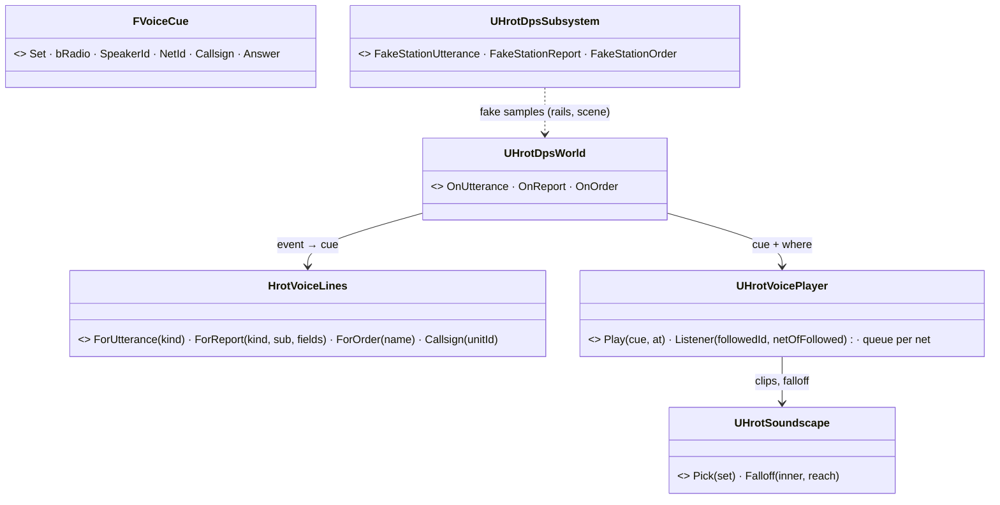
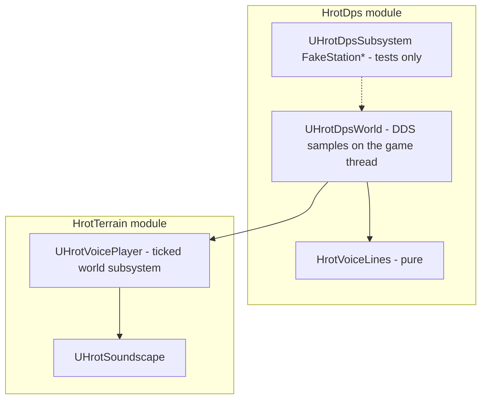

<!--STATUS
state: LIVE
updated: 2026-11-22
build-state: READY-TO-BUILD (U-19a contract, U-19b voice — CE-4651)
current-answer: the whole file — §1 diagrams, §2 the line map, §3 decisions, §4 slices and rails
stale-below: none
known-rot: none
known-conflict: none
related-designs:
  - DRAFT_Unreal_Image_Generator.md — the IG's row table (U-19a/b point here); U-18n/o the soundscape and the private pack this plays from
  - ../../blueprints/Architect_Question_105_Squad_Callouts.md — OWNS when a man shouts (the Utterance kinds); this file only plays them
  - ../audio/DESIGN_FPS_Audio.md §9 — HROT's OWN voices (placeholder synth, one voice per side); unchanged by this file
  - ../audio/DESIGN_Ambience.md — the ambience kinds (U-19d, a later slice of the same player)
  - SimNetGateway docs/design/DD-026-Dps-Voice-Events.md — OWNS the wire: Utterance / Report / Order; DD-027 bursts; DD-028 ambience and weather
-->

# The squad's radio in the Unreal IG — HROT's shouts, reports and orders as recorded voice lines *(unreal-ig, `2026-11-22`, CE-4651 U-19)*

🔒 User, `2026-11-22`: *"Some of them might make sense when the squad commander is telling something to his subordinates, or when he does something over the
radio to the HQ. And it might be nice effect if we follow that leader or simply be somewhere close to hear those, no matter how realistic it is."* ·
*"the samples will stay in Unreal only. The HROT is just the source of a good triggers for those sounds."* · *"Yes, please start."*

Basis: the notes [NOTE_UnrealIg_To_Hrot_Squad_Voice.md](../../blueprints/batches/NOTE_UnrealIg_To_Hrot_Squad_Voice.md) (the 140 lines, the map) and the
gateway's answer `NOTE-2026-11-22-Gateway-Contract-Ready-Voice-Bursts-Ambience-Fade.md` (gateway `7b98118`: the topics are in the IDL, nothing is
written yet ⇒ the client is built against a fake publisher first).

## 0. INVENTORY *(measured 2026-11-22: grep of `tools/unreal/HrotTerrain/Source`; the plugin is not in the codebase-memory graph — C++ outside the index)*

| exists | where | used as |
|---|---|---|
| `UHrotSoundscape::Pick(set)` (one of `<set>_01..NN`), `Falloff(inner, reach)`, AudioPro-first libraries | `HrotTerrain/Public/HrotSoundscape.h` | ⭐ the clip source and the falloff — no second loader |
| `UHrotDpsWorld::Start` `Sub(topic, handler)`; `Ents` (`FEnt`: `Side`, `ParentId` = mounted on, `bIsUnit`, the actor) | `HrotDps/Private/HrotDpsWorld.cpp:164` | ⭐ three more `Sub` lines; the speaker's position |
| `AHrotDpsCameraPawn::FollowedId()` | `HrotDps/Public/HrotDpsCameraPawn.h:77` | ⭐ who the listener follows (the earpiece rule) |
| `UHrotDpsSubsystem::FakeStation*` test publishers | `HrotDps/Public/HrotDpsSubsystem.h` | ⭐ + `FakeStationUtterance / Report / Order` |
| `sound_cut.py` modes loop / loopfile / shots, `R_PRO` (the private pack) | `scripts/unreal/sound_cut.py` | ⭐ + a `whole` mode (a spoken line, trimmed and levelled) |
| `dps_gen.py` (the IDL → C plumbing) | `scripts/unreal/dps_gen.py` | ⭐ re-run on the gateway tip |
| ⛔ a voice player, a line map | none | NEW |

## 1. The diagrams


*What the picture shows that prose hid:* the MEANING → LINE map is a pure function (`HrotVoiceLines`, railed without a world), and the player owns only
WHO HEARS and WHEN; no second clip loader beside `UHrotSoundscape`.

```mermaid
sequenceDiagram
  participant G as gateway (DPS_Report)
  participant W as UHrotDpsWorld
  participant L as HrotVoiceLines
  participant P as UHrotVoicePlayer
  participant S as UHrotSoundscape
  G->>W: Report(From 12, To 0, Lace, Kia 2)
  W->>L: ForReport(...)
  L-->>W: cue {vox/rep_losses, radio, net 12, "Cooper"}
  W->>P: Play(cue, unit 12's position)
  P->>P: net 12 busy? queue (≤ 2, oldest dropped) · listener on net 12? earpiece or world
  P->>S: Pick(radio/beep) → Pick(vox/sgt_cooper) → Pick(vox/rep_losses) → Pick(vox/over) → Pick(radio/squelch)
  Note over P: chained on each clip's duration; a world cue at the position with Falloff(5 m, 40 m)
```


*Caption:* the player sits beside the soundscape (HrotTerrain owns every sound); the DPS world calls it, as it calls `UHrotShotRenderer` today.
Nothing writes the three topics until gateway T-064 lands — the dashed fake path is the only producer meanwhile.

## 2. The line map (sets; a set's variants `_01..` are the synonyms, picked at random)

| cue | from | set — the pack's lines | heard |
|---|---|---|---|
| `CmdMove` | Utterance | `cmd_move` — move out · go · push forward · advancing on the enemy | world |
| `CmdHold` | Utterance | `cmd_hold` — hold · holding position | world |
| `CmdFallBack` | Utterance | `cmd_fallback` — break contact | world |
| `CmdDown` | Utterance | `cmd_down` — get down · take cover | world |
| `CallCovering` / `CallSuppress` | Utterance | `call_cover` — covering fire · cover me / `call_suppress` — suppressing fire | world |
| `CallReloading` / `CallFragOut` | Utterance | `call_reload` — reloading / `call_fragout` — grenade out | world |
| `CallContact` | Utterance | `call_contact` — enemy spotted · hostiles in the area | world |
| `CallGrenade` | Utterance | `call_grenade` — incoming | world |
| `CallAck` | Utterance | `ack` — affirmative · yes | world |
| `CallClear` / `CallManDown` | Utterance | `call_clear` — the area is clear / `call_medic` — need medical attention | world |
| other kinds (civil, animal) | Utterance | none — not this file's (HROT's own voices / the soundscape) | — |
| Contact | Report | `rep_contact` — enemy spotted · target acquired | radio |
| Spot, `Count` ≤ 3 / larger or `Activity` Moving | Report | `rep_spot` — hostiles in the area / `rep_spot_big` — enemy forces approaching · we have hostile forces incoming | radio |
| Progress Set / ObjectiveSecure, BuildingClear, RoomClear / FallingBack, Displacing / TaskFailed / TargetsDown | Report | `rep_set` — in position · ready to move / `rep_done` — objective complete · the area is clear / `rep_fallback` — break contact · I'm moving to a better position for cover / `rep_failed` — the mission is a failure / `rep_targetsdown` — target neutralized · the enemy has retreated | radio |
| Lace, `Kia` + `Wia` ≥ 2 / else | Report | `rep_losses` — we're taking heavy losses / `rep_status_ok` — holding position | radio |
| Sitrep, `Strength` green / amber / red | Report | `rep_advantage` — we have the advantage / `rep_status_ok` / `rep_tight` — we're in a tight spot, requesting immediate assistance | radio |
| Request Casevac / FireSupport / Reinforce / Permission / other | Report | `rep_casevac` — need medical attention / `rep_fires` — request immediate support / `rep_backup` — requesting backup · need backup / `rep_permission` — permission to engage / `rep_backup` | radio |
| any order | Order | by the name's keyword: attack / assault ⇒ `ord_attack` (attack · open fire); defend / hold ⇒ `ord_defend` (defend · we need to hold this position at all costs); flank ⇒ `ord_flank` (move to flank); move / advance / go ⇒ `ord_move` (move out); else `ord_standby` (standby for orders); then the receiver's `ack` (affirmative · ready to move) 1.5 s later | radio |
| the frame | every radio cue | `radio/beep` · `sgt_<name>` (this is Sergeant X) · the line · `over` (1 in 2) · `radio/squelch` | radio |

Callsign: a unit's first transmission takes the next unused of the 11 sergeant names (Brown … Taylor), kept for the session; beyond 11 the names repeat.

## 3. Decisions

| # | decision | rejected |
|---|---|---|
| V-1 | **World** cue at the speaker (Utterance: his body's head; Report / Order: the sender entity's position — a body-less unit's is its members' centroid), `Falloff(5, 40)` (HROT's `VoiceRange`) | the shot's reach — a voice is not heard at 800 m |
| V-2 | **Earpiece**: a radio cue whose net is the LISTENER's is played 2-D at full level, any distance. The listener's net = the unit of the followed man — ⚠ the wire has no man → unit link (`Entity.ParentId` is "mounted on"): v1 takes the nearest same-side `IsUnit` within 150 m of the followed man; a membership field is asked of the gateway (appending is free) | no earpiece — the user's "follow that leader … hear those" |
| V-3 | **One transmission at a time per net**, queue ≤ 2 (the oldest dropped); a speaker's world shouts ≥ 2 s apart; ≤ 3 voices at once overall | every event spoken — a firefight would be a babble |
| V-4 | `Synthetic` reports play (they are how the rails and the debug API test this); `bSilentSynthetic` switches them off | silent by default — the fake path would test nothing |
| V-5 | the clips are WHOLE spoken lines: `sound_cut.py` mode `whole` (leading / trailing silence below -50 dB trimmed, mono, peak -3 dBFS) into `/Game/Hrot/AudioPro/vox/<set>_NN` and `/radio/` — private, as U-18o | cutting by onsets — a phrase is not a shot |

## 4. Slices and rails

| slice | what | ⭐ done when |
|---|---|---|
| **U-19a** | `dps_gen.py` on the gateway tip (`7b98118`+): the new topics' C types and QoS rows; the plugin builds; the existing rails pass | the topic table lists DPS_Utterance / Report / Order / Ambience / Weather; build green |
| **U-19b** | the clips (recipes + `whole` mode + import); `HrotVoiceLines`; `UHrotVoicePlayer`; three handlers; three fakes | rail `Hrot.Dps.Voice.Lines`: every row of §2 (incl. Lace by counts, Sitrep by colour, Spot by count, an unknown order ⇒ standby, a civil kind ⇒ none, callsigns stable and distinct); rail `Hrot.Dps.Voice.Player`: per-net queue (third dropped), shout spacing, earpiece vs world by the listener's net; the scene run plays a fake Report and logs the chain (beep → sgt → line → squelch) and `LibraryMissing` 0 |
| U-19c | bursts on `Fire` (DD-027) | later |
| U-19d | ambience + weather (DD-028) | later |
| U-19e | the director's fade and subtitle on `View` | later |
