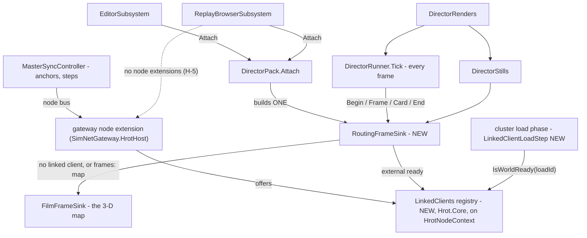
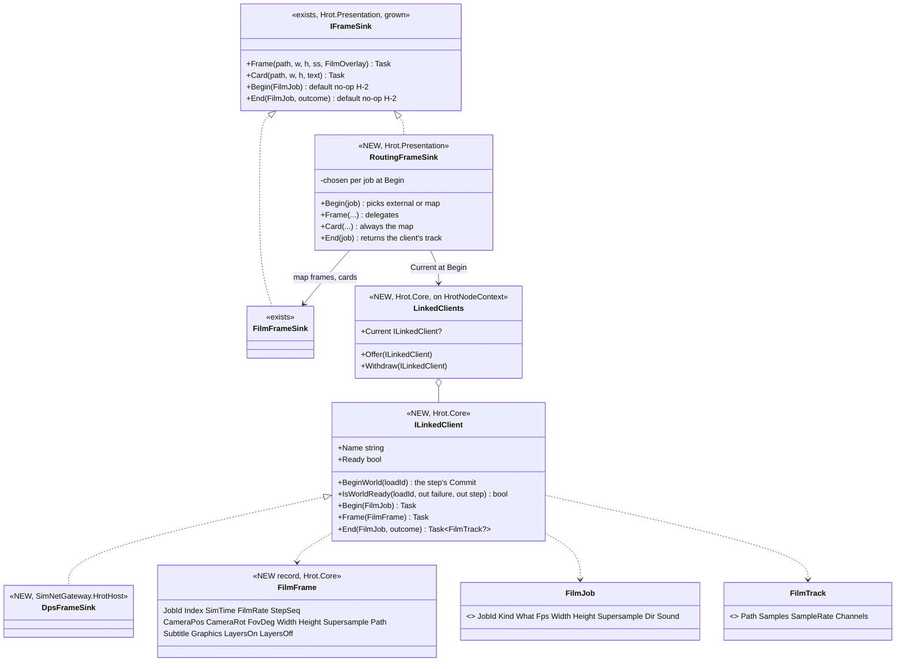
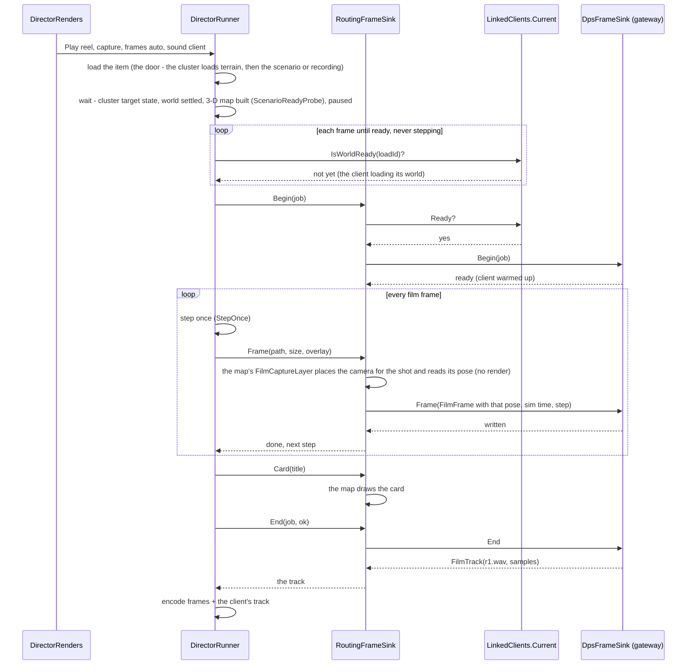
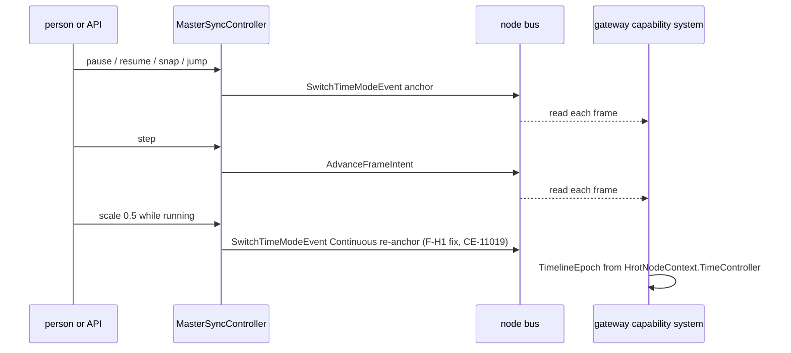
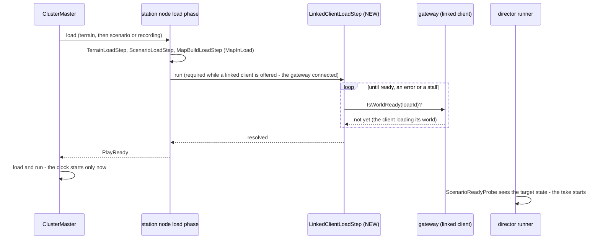
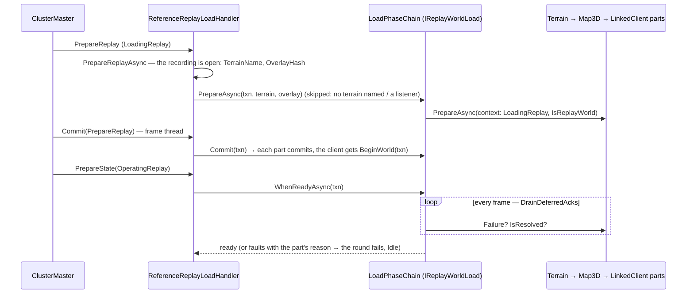

<!--STATUS
state: LIVE
updated: 2026-11-21
build-state: BUILDING — CE-11018 BUILT (§3a); CE-11019, CE-11022, CE-11023, CE-11024, CE-11025 in backend's batch (STATUS_Backend_Linked_Client.md)
current-answer: §2 the diagrams, §3 the items H-1 … H-8 with their CE ids, §4 the decisions (leans; the questions are Q113)
stale-below: nothing
known-rot: none
known-conflict: none
related-designs:
  - ../../DESIGN_Film_Director.md — OWNS the runner, reels, capture, the frame sink IFrameSink, IDirectorSound, the live stepping rule (R-3038); THIS adds a second sink and per-job sink choice, never a second runner
  - ../../DESIGN_Director_Timeline_Editor.md — OWNS the render queue DirectorRenders (§11u) and the stills job; THIS gives a job its client and its sound source
  - ../../DESIGN_Film_Production.md — OWNS the film process (F-1 recordings are the source, F-2 one director on every host); THIS keeps both and names what the Replay Browser lacks (H-5)
  - ../../blueprints/DESIGN_Time_Architecture.md — OWNS the clocks, anchors (SwitchTimeModeEvent) and steps; THIS reads them for a node extension and fixes F-H1 (a running scale change sends no anchor)
  - ../vehicle-appearance/DESIGN_Look_Rules_For_Renderers.md — OWNS the look library and the camera suggestion (D-1, R-11000); THIS uses the suggestion only as live advice, the frame's camera travels with the frame
  - ../../DESIGN_Cluster_Load_Phase.md — OWNS the load phase, its load steps and the readiness protocol (R-3072, R-3075); THIS adds the external-client load step (Q113-I)
  - ../../DESIGN_Node_Extensions.md — OWNS how an outside product joins a node (INodeExtension -> INodeCapability); THIS adds what an extension may OFFER the director
  - DRAFT_Unreal_Image_Generator.md (branch unreal-ig) — the Unreal client; it consumes SimNetGateway DD-022, which this serves
  - SimNetGateway docs/design/DD-022-Dps-Director-Rendering.md (rev 4, approved R-138 there) — the wire side: SimClock, ClockStep, the render topics; THIS is its HROT half (H-1 … H-8)
-->

# Linked client for the director — HROT's half of DD-022

🔒 **User, `2026-11-21`** (SimNetGateway R-136): *"I still need to run HROT 3D map together with the Unreal. Just when the Unreal is connected
via the gateway, the director will not take pictures of internal HROT 3D map, but will use the Unreal over the gateway. This way I will be able
to prepare the clips without Unreal in plain HROT, and when I connect the Unreal I can tell the director to render the clips by rerunning all
prepared reels, and the Unreal will render them."* · R-137 there: *"follow the conventions the HROT nodes are using regarding time control"* ·
*"take the audio track from the Unreal, the same way as we are taking snapshots from there"* · R-138 there: *"DD-022 rev 4 approved."*

⭐ The gateway runs inside a HROT node as a node extension and does not reference `Hrot.Presentation` (its `.csproj`: Hrot.Common, Hrot.Core,
Hrot.Look, Hrot.Traffic, Fdp.*). The director lives in `Hrot.Presentation`. ⇒ the contract an extension offers must live **below** both — the
same reason the camera suggestion went to `Hrot.Core` (R-11000).

## 1. INVENTORY — the queries run (`2026-11-21`, graph indexed this session on `ui` = `coordinator` `ecbe256d4`)

| query | total | what it says |
|---|---|---|
| `search_graph name_pattern=".*FrameSink.*"` | 14 (2 code) | ONE sink interface `IFrameSink` (`DirectorHost.cs:110-121`), ONE implementation `FilmFrameSink` (`DirectorAdapters.cs:135`) |
| `search_graph name_pattern=".*DirectorSound.*"` | 10 (3 code) | `IDirectorSound` (`DirectorHost.cs:124-142`), ONE implementation `AudioDirectorSound` (`DirectorAdapters.cs:149`) |
| `search_graph name_pattern=".*DirectorPack.*"` | 44 | `DirectorPack.Attach(DirectorPackHost)` (`DirectorPack.cs:95`) builds ONE sink (`:101`: `h.Headless ? null : new FilmFrameSink()`) handed to the runner, the stills and the render queue; two hosts call it: `EditorSubsystem.cs:1805`, `ReplayBrowserSubsystem.Director.cs:44` |
| `search_graph name_pattern=".*RenderRequest.*\|.*RenderJob.*\|DirectorRenders"` | 22 | `DirectorRenders` (`DirectorRenders.cs:123-369`): `Refusal => _sink == null ? NoRenderer` (`:168`) |
| `search_graph name_pattern=".*NodeExtension.*"` · `".*NodeCapabilit.*"` | 31 · 39 | `INodeExtension.CreateCapability(NodeExtensionContext)` (`NodeExtensions.cs:18-25`) -> `INodeCapability` (`NodeCapability.cs:142-217`; `PopulateSystems(HrotNodeContext, …)`) — an extension gets the node's context, it OFFERS nothing to the director today |
| `search_graph name_pattern=".*CameraSuggest.*"` | 10 | `CameraSuggestion` (`Hrot.Core`), the one writer `CameraSuggestions` + `ICameraSuggests` (`Hrot.Presentation/Map3D/CameraSuggestions.cs`) |
| `search_graph name_pattern="SwitchTimeModeEvent"` · grep `Publish(new SwitchTimeModeEvent` | 22 · 6 sites | the master publishes every anchor on the node's bus (`MasterSyncController.cs:130, 457, 497, 537, 579, 605`); steps as `AdvanceFrameIntent` (`:383`) |
| grep `SharedApplicationBootstrapper\|NodeExtensions.` in `Hrot/Subsystems` | 10 files | Editor, Player, SimHost, CGF, Traffic, Stride compose extensions — ⛔ **the Replay Browser does not** (no bootstrapper, no `HrotNodeContext` in `Hrot.ReplayBrowser/*.cs`) |
| grep `TimeController` in `HrotNodeContext.cs` | 1 | `HrotNodeContext.TimeController` (`:183`) — a capability can read the clock (`TimelineEpoch`, scale) |

⚠ `check_index_coverage` is not available through the CLI: the absence claims (no second sink, no extension seam into the director, no
extension composition in the Replay Browser) rest on the graph plus grep, not on a coverage check.

## 2. Diagrams

### 2a. Who calls what each frame — the module view

*What the picture shows that prose hid:* the routing happens in the ONE object `DirectorPack.Attach` already builds for every host, so the
editor and the Replay Browser cannot differ in how a job's frames are routed — and the dashed edge: the Replay Browser composes no node extension
today — but the editor's replay (AAR) hosts the same director over its own recording (Review Perspective §1), so a film from the editor's
recording reaches the gateway without it; the Replay Browser integration is not built (R-11008).

### 2b. Classes

*What the picture shows that prose hid:* the extension never sees a `Hrot.Presentation` type — `FilmFrame` carries the overlay already
resolved to world points and text (`FilmOverlay`'s values, copied), and the camera of the frame (H-3); `RoutingFrameSink` is the only place
that knows both worlds.

### 2c. Render a reel through the linked client

### 2d. The clock for the gateway — no new HROT API (H-6)

### 2d-1. The world-readiness contract — why `BeginWorld` (measured `2026-11-21`)

A step that only asked "are the clients ready for world N?" could poll right after the terrain commit, before the gateway has seen the new
world, and read the OLD world as ready. ⇒ the step's `Commit` calls `ILinkedClient.BeginWorld(loadId)` (the gateway then forces a new
`Session.WorldEpoch`), and `IsWorldReady(loadId, …)` is true only when every client that asks to be waited for reports Ready for THAT new
world (gateway DD-022 §3g `ClientWorld`); none asking ⇒ true at once. The registry lives on every node's `HrotNodeContext` (`LinkedClients`,
like `TerrainContent`, `HrotNodeContext.cs:192`) and `EcsHostClusterHandlers` step 7 composes the `LinkedClientLoadStep` for EVERY ECS host,
beside the map's (`EcsHostClusterHandlers.cs:172-186`) — the gateway always offers its client when DPS is configured; a node with no linked
client resolves at once.

**As built (CE-11026, `2026-11-21`)** — `ILinkedClient` (world-readiness members only: `Name`, `BeginWorld(Guid)`, `IsWorldReady(Guid, out failure, out step)`; the frame members come with CE-11018) and `LinkedClients`
(`Hrot.Core/Infrastructure/LinkedClients.cs`, namespace `Hrot.Common.Infrastructure`; one volatile reference, a lock only on Offer/Withdraw; a second Offer replaces the first with a log line; a Withdraw of a replaced client is ignored);
`HrotNodeContext.LinkedClients` (`{ get; init; } = new()`, beside `TerrainContent`); `LoadPart.LinkedClient = 5` (appended); `LinkedClientLoadStep` (`Hrot.Core/Services/LoadPhase/`, `MapBuildLoadStep`'s shape).
Composed in `EcsHostClusterHandlers.Compose` step 7 for EVERY ECS host from `EcsHostClusterHandlerInputs.LinkedClients`, appended to the chain parts AFTER the map's, so it runs after the terrain and the map; the registry travels
`HostOrchestration` (`linkedClients: context.LinkedClients`) -> `NodeBootstrapper.ComposeClusterSlave(linkedClients:)` -> the handler inputs (rails: `CE11026_*`). Findings:
- the step remembers at its `Commit` which client it asked; `IsResolved` is true for a load that asked nobody, and polls only the client it asked - so it can never call `IsWorldReady` before `BeginWorld` (the race, red-proved); a client offered AFTER the commit is not waited for by that load;
- a late joiner's catch-up load runs the step too (the chain skips only the scenario part), so a catch-up calls `BeginWorld` with its own transaction id - the gateway bumps its world epoch for it;
- `Abort` forgets the asked client; `Failure` / `ProgressStep` are the client's while a client was asked, null otherwise;
- no deviation from §2b/§2e; a host with no context (a rail composition) passes no registry and gets no step.

### 2e. Who waits for the linked client on a load — the cluster's load phase (Q113-I)

*What the picture shows that prose hid:* the linked client joins the SAME readiness the cluster already uses for the filming node's 3-D map
(R-3075, `DESIGN_Cluster_Load_Phase.md` §11.10) — the same `ILoadPartProvider` shape as `MapBuildLoadStep` (poll a status, fail with its
reason, report its step), required while a linked client is offered: the node is play-ready only after BOTH HROT's 3-D map and the client's world;
the master, live play and the director all wait through one path. ⚠ Every load that changes the world (user: *"any terrain load … It must work
also in the live"*): a live / edit load runs the chain; a replay open runs `ReferenceReplayLoadHandler` instead (`LoadPhaseChain.cs:160`) and — measured — makes NO terrain
resident at all (F-H3: `TerrainWorld` / `TerrainDefinition` are `NoReplay`; the replay plan has no terrain step; only the Replay Browser loads a
recording's terrain). Q113-J: the replay open runs the chain's shared Terrain / Map3D / linked-client parts for the recording's terrain. ⛔ SUPERSEDED (same day): a first version had the director's runner wait on its own — a second readiness path the
master and live play could not see.

### 2e-1. ✅ As built — a replay open's world (CE-11025, backend, `2026-11-21`)

*What the picture shows that the prose in §2e hid:* the chain is not handed the replay op. The replay handler keeps the op and calls the chain's
WORLD parts only — never the knowledge base, never the scenario entities (the recording brings those). It is the same providers and the same
per-frame readiness a live load uses.

| decision (lane: backend) | why — and what would change it |
|---|---|
| the replay handler drives the chain through `IReplayWorldLoad` (Fdp.Toolkits), set by `EcsHostClusterHandlers.Compose` | the handler is in Fdp.Toolkits and cannot see `LoadPhaseChain`; one composition hands it on every ECS host (the silent-default rule). ⛔ Rejected: the chain claiming `PrepareState(OperatingReplay)`, because the terrain name only exists after `PrepareReplay` opened the file |
| `LoadPhaseContext.OverlayHash` + `IsReplayWorld` (`TargetState = LoadingReplay`) | a replay's terrain and additions come from the RECORDING. ⛔ The staged scenario header may belong to an earlier run |
| additions missing on this machine ⇒ the base terrain + a warning (a live load stays strict) | the same as the Replay Browser (CE-4420 O-8). A strict replay would refuse to show a recording made elsewhere |
| no terrain named / a listener ⇒ nothing runs | `TerrainResidency.Prepare(null)` UNLOADS. ⚠ A listener keeps whatever is resident. The master's aggregated `ReplayPrepareResult.TerrainName` could serve it later — not built |
| the resident terrain loads nothing new (`TerrainResidency.Prepare` idempotent on name + folder + overlay) | ⚠ `MapBuildLoadStep.Commit` still calls `Request3D()` and the client still gets `BeginWorld`. Whether that map request is a no-op for an unchanged terrain is NOT measured |
| ⚠ no `Loading` phase / step for `LoadingReplay` on the node's status | the replay handler is not an `ILoadProgressSource`; the wait itself is in the round. Named, not built |

Rails: `ReferenceHandlerTests.CE11025_*` (the handler), `LoadPhaseChainTests.CE11025_*` (world parts only, the recording's terrain, the readiness
and the failure), `TerrainLoadStepTests.CE11025_*` (the recording's additions over a stale staged header, missing additions, resident = same
instance), `EveryEcsHostComposesTheLoadPhaseChainRails.CE11025_*` (the composition hands the chain).

## 3. The items — HROT's requests from DD-022, with their ids

| DD-022 | CE | what | where |
|---|---|---|---|
| H-1, H-2, H-3, H-4 | [CE-11018](../../blueprints/Blueprint_Issues_Tracker.md) | `ILinkedClient` + `FilmFrame` / `FilmJob` / `FilmTrack` + `LinkedClients` (Hrot.Core); `IFrameSink.Begin/End` (default no-ops); `RoutingFrameSink` built once in `DirectorPack.Attach`; the runner passes the film camera, film rate and step with each frame; a faulted frame fails the job with its reason; `frames: auto \| map` on the capture request | Hrot.Core, Hrot.Presentation Director |
| (I) | [CE-11026](../../blueprints/Blueprint_Issues_Tracker.md) **built (`2026-11-21`, as-built in §2d-1)** | the `LinkedClients` registry on `HrotNodeContext`; `ILinkedClient` world readiness (`BeginWorld`, `IsWorldReady`); `LinkedClientLoadStep` + `LoadPart.LinkedClient` composed for every ECS host (§2d-1, §2e) — live loads; replay opens follow with J (CE-11025) | Hrot.Core, Hrot.Network.Orchestration |
| H-5 | ~~CE-11020~~ dropped | ✅ R-11008: no Replay Browser integration — the director renders from the editor's own replay (AAR); a job naming another recording plays once the editor passes its opener (Q113-G, CE-11023); multi-node exercises stay out | — |
| H-6 | — | no HROT change: the gateway reads the anchors and steps on the node bus and `TimelineEpoch` from `HrotNodeContext.TimeController` (2d) | — |
| H-7 | [CE-11021](../../blueprints/Blueprint_Issues_Tracker.md) | `sound: client \| hrot` per job; with `client` the encode muxes `FilmTrack` and checks its samples against the frames; `IDirectorSound` stays for map renders | Hrot.Presentation Director |
| H-8 / F-H1 | [CE-11019](../../blueprints/Blueprint_Issues_Tracker.md) **built (`2026-11-21`, Time Architecture §21)** | a running scale change publishes a Continuous re-anchor, so cluster slaves follow it | Fdp.Toolkits Time (backend's area: a cross-lane edit) |
| H-8 / F-H2 | [CE-11022](../../blueprints/Blueprint_Issues_Tracker.md) **built (`2026-11-21`)** | the time docs say the anchor model (no pulse, no PLL); the stale comment at `MasterSyncController.cs:153`; the unused `TimeConfig` PLL fields named | Time Architecture, FDP.Toolkit.Time.md |
| (G) | [CE-11023](../../blueprints/Blueprint_Issues_Tracker.md) **built (`2026-11-21`, as-built in §3b)** | the editor's director gets the editor's recording opener (`ScenarioDoor.OpenRecording`) — a job or reel item naming another recording then plays in the editor | Hrot.Editor |
| (H) | [CE-11024](../../blueprints/Blueprint_Issues_Tracker.md) **built (`2026-11-21`): the field is `Impact` (ImpactKind + 1; 0 = not a round impact)** | `EffectCause.Kind` + `EffectCause.Shooter` from `RoundImpactNotification` — the gateway makes `Impact` from the effect entities, live and in replay (R-11007) | Hrot.Core, the effect spawner |
| (J) / F-H3 | [CE-11025](../../blueprints/Blueprint_Issues_Tracker.md) **built (`2026-11-21`, as-built in §2e-1)** | a replay open makes the recording's terrain resident through the load chain's shared parts (Terrain with the recording's name and overlay hash, then Map3D, then the linked client) | the load phase (backend's: a cross-lane change) |

**Acceptance (R-4277 — a feature works when its scenarios pass):** the `showcases/player-station` scenario with a promoted take rendered
twice — once with no linked client (the map, as today: frame count, MP4) and once with the gateway's reference client in `--render` mode (the same
frame count, the client's PNGs, the client's tone track muxed, the samples total right). Rails: `RoutingFrameSink` picks external / map /
forced map; `Card` never reaches the linked client; a faulted frame fails the job with the reason; `FilmFrameSink` behaviour unchanged
(the existing `FilmTests` / `FilmFrameRail` under `xvfb-run -a`); the scale re-anchor in `MasterSyncControllerTests` + the cross-node
invariant in `SimTimeSyncIntegrationTests`.

### 3a. ✅ As built — CE-11018 (backend, `2026-11-21`; the contract: [NOTE_Backend_To_Ui_Linked_Client_Frames.md](../../blueprints/batches/NOTE_Backend_To_Ui_Linked_Client_Frames.md))

⭐ Built as §2b / §2c draw it. Where it deviated or chose, this is the current answer:

| | as built | why |
|---|---|---|
| `ILinkedClient` film members | `CanFilm`, `BeginFilm`, `Frame`, `EndFilm` — **default interface members** (a world-only client compiles unchanged, films nothing) | ⛔ §2b's `Ready` / `Begin` / `End`: beside `BeginWorld` a bare `Begin` reads as a world call; `CanFilm` is read at a job's start only |
| the camera | `FilmCamera(Position, Forward, Up, FovDeg)` — a forward + up basis | ⛔ §2b's `CameraRot` quaternion: a basis leaves no axis convention to agree with the gateway |
| every frame index reaches the client | `FilmFrameKind.Scene` · `Repeat` (slow motion repeats the last scene; HROT copies the PNG) · `Silence` (one per card frame; the card stays the map's, D-4) | the client's track stays frame for frame (CE-11021 checks the samples) |
| the pose (D-3) | `FilmCaptureRequest.PoseOnly`: the map's film layer places the camera exactly as for a render and hands back `FilmFrame.Camera` — nothing drawn or written; refused FIRST on a 2-D view with `RoutingFrameSink.TwoDRefused` | the same mailbox as a map frame |
| order | `RoutingFrameSink` chains every client call (a frame waiting for its pose never overtakes a repeat); a fault ends the chain with the first reason | — |
| the job | `IFrameSink.Begin` / `Frame(…, FilmFrameContext)` / `Advance` / `End` (defaults = the map's behaviour); the runner begins at the capture's start (the first frame waits for it), ends once — Ok at the encode, Stopped on Stop, Failed with the run's error; the stills begin / end their own `Still` job | — |
| wiring | `DirectorPackHost.LinkedClients` = a `Func<LinkedClients?>` (the editor passes `() => _node?.LinkedClients`: its node can be rebuilt); the Replay Browser passes none (R-11008) | the silent-default rule — rail `DirectorPackTests.CE11018_ThePack_*` |
| `frames: auto \| map` | `CaptureOptions.Frames`, `RenderRequest.Frames`, parsed by the one capture reader (`CaptureFieldsOf`) | — |
| ~~⚠ not carried yet~~ | ~~`FilmJob.Sound` is always `Hrot`~~ — SUPERSEDED by CE-11021, below | — |

📐 **Rails:** `DirectorRunnerTests.CE11018_*` ×4 (every frame in order with the REAL film layer's pose, the cards the map's · no client / `frames: map` · a client fault · a 2-D take) · `DirectorPackTests.CE11018_*` ×2 · `FilmFrameRail.CE11018_*` (xvfb).

### 3b. ✅ As built — CE-11023 (backend, `2026-11-21`)

| piece | as built |
|---|---|
| the opener | `EditorDirectorHost : IRecordingOpener` → `ScenarioDoor.OpenRecording(exercise, at, the director's asker)`. It is the same shape as the scenario load (CE-4267): a wait (the run gate, a run in progress) is asked again; a refusal is the reason. An exercise id opens directly; files open by their `.meta.json`'s exercise id; Empty is refused (the editor does not pick "the newest") |
| ready | `IRecordingOpener.Opening` (new, default false) stays true until the cluster is `OperatingReplay` with THAT exercise (`ReplayModule.RecordedExerciseId`) and the shown map is built. `OpenFailure` (new) reports a refusal, the cluster's error state, or no progress for 30 s. The runner and the render queue wait on both after the open's settle frames (the Replay Browser keeps its defaults: ready after the settle) |
| the load wall | `DirectorRunner.LoadTimeoutSeconds` no longer bounds a load. `LoadStallSeconds` (30 s) is measured from the last change of the run gate's load step (`IDirectorHost.LoadProgress`, new), the entity count or the map build. `IDirectorHost.LoadError` (new) fails it at once with the cluster's reason. ⚠ The wait for the DOOR to take the load (before it went) keeps the 30 s cap: that is not a load |
| measured | a scenario load never stops a run the user started — it waits and fails with the reason; the recording open does the same |

Rails: `DirectorRunnerTests.CE11023_*` (an advancing 45 s load plays; a stalled one fails; the error fails at once) and
`TheDirectorsStopIsTheOneIdleIntentTests.CE11023_*` (the door, by id and by files; ready only for THAT exercise; the error; Empty refused).

## 4. Decisions — the leans (the questions with their blast radius: [Architect_Question_113](../../blueprints/Architect_Question_113_Linked_Client_For_The_Director.md))

| | lean | rejected |
|---|---|---|
| D-1 | the contract `ILinkedClient` in **Hrot.Core**, offered through an `LinkedClients` registry **on `HrotNodeContext`** (precedent: `TerrainContent`, `HrotNodeContext.cs:192`) | a world singleton component holding a live object — state of the node, not of the world; recorded and saved paths would need opting out |
| D-2 | **one `RoutingFrameSink`** built in `DirectorPack.Attach`, the choice made at `Begin` per job | choosing in each caller (runner, stills, queue) — three places that could disagree |
| D-3 | **the frame's camera is the pose the map's film layer would render**: a linked-client frame goes through the SAME mailbox as a map frame (`FilmStudio.Capture` → `FilmCaptureLayer.Serve`, `Film.cs:296-320`); after the layer has placed the 3-D camera for the shot (`Direct()`), `Serve` reads `camera.Pose` (eye, orientation, field of view) and the overlay and hands them to the linked client instead of rendering (measured `2026-11-21`: `FilmStudio` holds the shot SPEC, the pose is resolved per frame by the map). A take with a 2-D shot (`FilmStudio.TwoD`) cannot go to a client: such a job is refused for the linked client with the reason (`frames: map` renders it) | the runner computing a pose itself (the shot is resolved only by the map's driver) · the client reading `CameraSuggestion` (written by `MapViewModeLayer`, possibly a frame off) |
| D-4 | **cards stay the map's** | sending cards to the client — a second card look |
| D-5 | **H-6 needs no HROT API** (bus + context) | a new clock-export component — a second source of time (R-126: one source of paused) |
| D-6 | **F-H1 fixed in the master** | the gateway's own re-anchor only — the cluster's slaves would still miss a scale change |

### 3b. CE-11021 as built — `sound: client | hrot` *(ui, `2026-11-22`; H-7 BUILT)*

`CaptureOptions.Sound` / `RenderRequest.Sound` (`FilmSound`, default `Hrot`; HTTP `capture.sound`: `"hrot"` · `"client"`, anything else is a 400) reach `FilmJob.Sound`. In `DirectorRunner.StartEncoding`, with **`Sound == Client`** HROT's own mixer is not run (`IDirectorSound.EndLog` is skipped) and, once the job's `End` has returned the track (`ClientTrack`), the encode muxes `FilmTrack.Path` instead of `sound.wav`; **`Sound == Hrot`** is unchanged (no track is read, no check made). The check (`DirectorRunner.CheckTrack`): `|Samples - round(frames x SampleRate / Fps)| <= TrackSampleTolerance` (**1024**, the named constant; the client's measured miss was 71 552 against 72 000, one mixer buffer); a larger miss FAILS the job with both numbers ("the client's sound track has N samples, the film's F frames at 30 fps need M at 48000 Hz (the tolerance is 1024)") and nothing is encoded; a null track with `Client` fails the job ("... the linked client returned no track" - e.g. `frames: map`, or a client that returned none). The encoder is a seam (`DirectorRunner.Encoder`, default ffmpeg) so the rails record its inputs. Rails (`DirectorRunnerTests`): the client's WAV is the mux input; a total at +-1024 passes and at +-1025 fails with both numbers; a null track fails; HROT sound unchanged (HROT's `sound.wav`, a 100 000-sample client miss ignored). Red-proofs: the check off; HROT's sound muxed despite `Client`. **Client facts that stay true (gateway `NOTE-2026-11-21-Unreal-Round-7-Render.md`):** a voice may start up to one film frame late (33 ms at 30 fps); the track is centred (no panning: Unreal UE-381932); the reel-boundary fade (Q-10) and slow motion are not built on the client, so a reel with either renders and its soundtrack may be wrong there - not detected here. Not changed: the stills job (no sound).

### 3c. As built — the first end-to-end run on Unreal (CE-11064 → CE-11065 / CE-11066 / CE-11067, unreal-ig, `2026-11-27`)

Unreal's run ([NOTE_UnrealIg_To_UiIntegration_Director_Test.md](../../blueprints/batches/NOTE_UnrealIg_To_UiIntegration_Director_Test.md)) passed no test; the causes, measured:

| finding | cause (measured) | fix |
|---|---|---|
| live: 0 `View` samples (H-1) | ① the test take anchored every key on a live event, so with no bake the map stayed 2-D until the event (GET /view: 2D until 12.4 s) ② on a THREADED node `CameraSuggestions.Write` wrote world A only; the gateway reads S | ① the take uses fixed times ② CE-11066: the suggestion and the caption reach S (see DESIGN_Look_Rules_For_Renderers RR-6) |
| the slow-motion segment skipped live (H-4) | the same anchors: segment 2 starts at `s1-1`, known only once `s1` happened, so the playhead was already past it | the fixed-time take (R-3034 is right: a live run cannot rewind) |
| the first film job went to HROT's map, silently (H-3, G-3) | the gateway's `CanFilm` needed the client's world; `RoutingFrameSink.Begin` reads it once | gateway T-085 (a live render client can film) + CE-11067: `RoutingFrameSink.Route` / `IFrameSink.Route`, shown as `framesTo` in the director's and the stills' status |
| a load inside a film job hung 30 s (G-1) | the gateway's render barrier held the new world's `Session` until a step; HROT steps only once the client's world is ready | gateway T-085: `Session` is never held |
| `/film/shot` with no pitch: -1718.87° (H-5) | the degree fallback was used as radians | CE-11065 |
| the rerun: `movie` named with no file; a map job with `sound: client` failed "no track" (H-8) | `MoviePath` set before the encode; the client's sound asked regardless of where the frames went | CE-11068: named only when written; the client's track only when the client filmed (`IFrameSink.FilmsOnClient`), else HROT's sound |
| the rerun: stills refused on the editor (H-7) | stills need a host that SEEKS (`DirectorStills.Refusal`, `IDirectorHost.CanSeek`); the editor's host never seeks, and the Replay Browser (which does) has no linked client (R-11008) | ⛔ not changed — ⇒ **stills through a linked client are not reachable today** although `RoutingFrameSink` routes a Still job (CE-11018 §3a). Making the editor's director seek in its own replay would open it (a feature — the user's call) |

