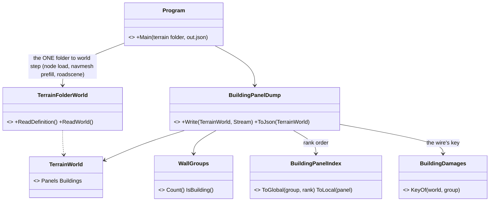
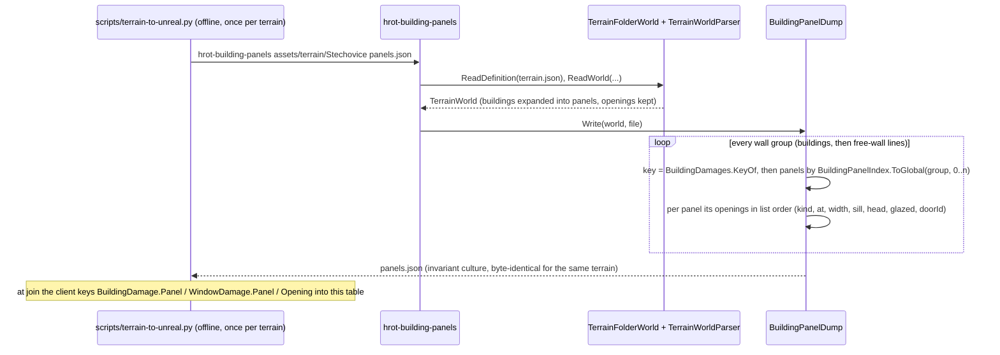

<!--STATUS
state: LIVE — a DRAFT (recorded direction, not a buildable design)
updated: 2026-11-24
current-answer: the whole file; the measured results in "Measured on Windows `2026-11-17`"
stale-below: none
known-rot: none
known-conflict: none
related-designs:
  - ../../reference/NED_DDS_Protocol.md — OWNS the wire an outside node reads and writes (its first outside reader is the DIS/HLA gateway)
  - DESIGN-IG.md — the image-generator node role (IG) inside HROT, today raylib / the 3-D map; the Unreal client is another IG
  - ../thermal/DESIGN_Thermal_Drivers.md — the external INFRARED image generator connects the same way (DDS, the drivers on the entities)
  - ../weapons/DRAFT_Weapon_Malfunctions_And_Physical_Devices.md — physical devices in the loop: another outside node on the same bus
-->

# DRAFT — Unreal Engine as an image generator next to HROT (option B) — CE-4651

🔒 User, `2026-11-16`: *"Is there any real possibility how to embed the HROT engine into an Unreal based application?"* — then, on the two options:
*"Yes, the option B looks very attractive."* · `2026-11-17`: *"we talked about Unreal Engine integration using option B, which is actually HROT engine running
in parallel to Unreal Engine plugin, and they talk over DDS. Is that recorded somewhere?"* — recorded here.

## The direction (option B)

**Unreal runs next to a background HROT and joins its cluster as an IMAGE-GENERATOR node** — just another node on the bus:

| part | how |
|---|---|
| process | the Unreal plugin starts `Hrot.ClusterRunner` (headless) as a background process, or connects to a cluster already running elsewhere |
| data in | the plugin subscribes to the **DDS Player Station (DPS)** topics that SimNetGateway's `dps` plugin publishes from inside a HROT node (positions and rotations, damage, effects, …) through CycloneDDS's native C library — the contract and the client guide: SimNetGateway `docs/clients/DPS-Client-Guide.md`, IDL in `docs/clients/idl` (DD-017/018/019). ⚠ superseded: this row first named `NED_DDS_Protocol.md` (HROT's inter-node wire) — the IG reads DPS instead. The plumbing: U-18a |
| same machine | ✅ **local sockets** (🔒 user, `2026-11-17`: *"no shared memory support, we will use local sockets"*) |
| control | the existing HTTP debug API (load, play, pause, possess) or the command topics |
| what HROT changes | nothing — the IG role exists; Unreal only subscribes and draws |

**Why B, not A** (A = the .NET runtime hosted INSIDE the Unreal process via `nethost` / `hostfxr`, the way the Stride host composes a node in-process):
B keeps two processes (a crash in one does not kill the other; each debugs normally), changes nothing in HROT, fits the cluster design, and the same client
can later point at a remote cluster or join a multiplayer session. ⇒ A only for a specific need: one executable to ship, the lowest possible latency for a
first-person player, or game code that must call the simulation synchronously (and even then HROT steps on its own threads, Unreal reads snapshots).

## The user's direction, `2026-11-17`

🔒 *"unreal should play the same role as the 3d map, including the gizmos and FPS player inputs"* · *"how to import terrains is the right question,
likely the one to be solved first as everything depends on that. I need to use the nice unreal renderer and its capability to render nice terrain. Out
terrains are minimalistic but unreal can render them in nice way. We could import our terrain to unreal to make it nicer, or vice versa."* ·
*"maybe we can author terrain in unreal is a way compatible with our terrain?"*

⇒ the Unreal client is a full **3-D map station**: it draws the world, the gizmos (selection, routes, areas, labels, the NATO symbols) and takes the
FPS player's input — the role the 3-D map has in HROT today. ⇒ **the terrain comes first.**

## What a HROT terrain IS *(measured `2026-11-17`)*

| layer | today | file |
|---|---|---|
| ground | a HEIGHT GRID — small terrains an ASCII grid (10–100 m cells, e.g. `basic-desert` 61 × 61 at 10 m); the large imported ones a TILED store (256 × 256 posts, 1 m, 16-bit) from a GeoTIFF DEM | `*.height.asc`, `DESIGN_Terrain_Import_UTM.md` §2 |
| the semantic world | ONE GeoJSON: `building` (footprint + height; interiors designed), `wall` (a line + a material: hedge, wood fence, steel plate, …), `surface` (an area of class `open` / `forest` / `water`), `prism`, `ramp`, `slab`, lone trees | `*.world.geojson` (`city-battle`: 472 buildings, 194 walls, 146 surfaces) |
| roads | the SUMO network (lanes with their geometry) + `roads.json` | `roads.json`, the `.net.xml` |
| geo | an origin (lat / lon) or a UTM frame | `terrain.json` |
| changes at run time | breaches, craters, felled trees, collapsed buildings, bulldozer cuts — replicated (Dynamic Terrain, §2b of CAPABILITIES) | the terrain feature topics |

⇒ our terrain is **minimal geometry + rich MEANING** (what each area and line IS). That is exactly what a renderer needs to DRESS it procedurally.

## How Unreal makes it look far better — dressing the MEANING, not replacing the ground

| what | Unreal feature | driven by our data |
|---|---|---|
| the ground surface | a **Landscape** from our height samples (World Partition for the large terrains); an **auto-material** blending grass / dirt / rock / sand by slope, height and noise, with **Runtime Virtual Texturing** so roads and objects blend into the ground; fine **displacement** (Nanite tessellation) for close-up relief — cosmetic only, within a few cm | the height grid + the `surface` classes as landscape layer weights |
| forests, grass, rocks, hedges | the **PCG framework** (procedural content generation) scatters trees in `forest` polygons, grass and small stones on `open`, hedges along `hedge` walls, reeds at water edges; **Nanite foliage**; free photogrammetry assets (**Fab / Megascans**) | the `surface` and `wall` features; lone trees placed EXACTLY |
| buildings | **procedural facades** on our footprints and heights (PCG shape grammar / modular kits: walls, windows, roofs, doors where our doors are); damaged variants for breaches | `building` footprints, heights, doors, interiors |
| roads | road meshes and markings along the SUMO lanes (landscape splines or PCG along a spline), kerbs, sidewalks | the SUMO network's lane geometry |
| water | the **Water** plugin (lakes, rivers, shores with foam) | `surface: water` + OSM waterways |
| sky, light, weather | **Lumen** global illumination and reflections, **Sky Atmosphere**, **Volumetric Clouds**, height fog, rain / snow particles, the sun from the date and lat / lon | our replicated weather and time of day (`WeatherConditions`, the solar position) |
| effects | **Niagara** explosions, smoke, fire, dust, muzzle flashes; **decals** and mesh patches for craters and scorch; **Chaos** fracture for a breaching wall | our effect and terrain-change messages |
| beyond the map edge | **Cesium for Unreal**: real-world terrain and imagery around the play area, georeferenced by our origin — a horizon instead of the world's end (aircraft already fly beyond the map, RS-2a) | the terrain's geo origin |
| people and vehicles (later) | MetaHumans, motion matching driven by our pose and gait | the replicated pose, stance, animation state |

## ⭐ The one rule — what may differ between HROT and Unreal

| must be IDENTICAL (it changes the simulation) | may be Unreal-ONLY (cosmetic) |
|---|---|
| ground height (a man and a tank stand on the same ground; line of sight is HROT's) · every building's footprint, height, doors and windows · walls and their materials · forest outlines and lone trees · water · roads | ground texture and micro-relief (≤ a few cm) · grass, flowers, small stones, leaves · facade detail, signs, clutter that blocks nothing · lighting, sky, post-processing |

## The direction — ⭐ the terrain PACKAGE is the contract, written and read by both sides *(lean, not decided)*

| option | what | lean |
|---|---|---|
| **A** HROT → Unreal | an exporter turns the terrain package into an Unreal level: the landscape from the heights, the semantic features as data the plugin's PCG graphs dress | ⭐ FIRST — every existing and OSM-imported terrain becomes beautiful with no hand work; one-way, simple |
| **B** Unreal → HROT (the user's idea) | the terrain is AUTHORED in Unreal — sculpt the landscape, place TAGGED actors (a `HrotBuilding` with its footprint and height, `HrotWall` splines with a material, `HrotSurface` volumes: forest / water / open, road splines) — and an exporter WRITES the same package (heights → our tiles; tagged actors → the GeoJSON; roads → a SUMO network) | ⭐ SECOND — feasible because the package's vocabulary is small; the Unreal-only dressing stays in the level, untagged, never exported |
| round trip | A and B are one MAPPING TABLE used both ways; the package is versioned by content hash (terrain versions, AQ112), so a terrain edited in Unreal is a new version every node loads | — |
| ⛔ rejected | Unreal-native data as the truth (HROT reading `.umap` / landscape assets) — HROT would depend on an Unreal installation, and the OSM pipeline and the editor's terrain tools would lose their output format | — |

## Open — to measure before a design (updated)

| # | question |
|---|---|
| U-2 | the minimal entity snapshot (pose, type, damage, person pose, effects) — which topics and rates |
| U-3 | type → Unreal asset (the DIS type / TKB class chain — the same key the 3-D map's families use) |
| U-4 | the FPS player's input from Unreal back to HROT (`ManualDrive`, station commands) and its latency |
| U-5 | the terrain export (option A): landscape sizes (Unreal needs particular vertex counts per component — pad or resample our posts), 1 m posts for the large terrains, the world-partition grid, the UTM / lat-lon frame |
| U-6 | ⭐ **the gizmos in Unreal**: HROT draws them with its own projectors (ImGui / raylib); lean — stream the projectors' PRIMITIVE draw lists (lines, rings, labels, icons in world space) to the client so ONE gizmo implementation serves both maps, rather than re-implementing each gizmo in Unreal |
| U-7 | dynamic terrain in Unreal: a breach, a crater, a felled tree, a collapsed building — which become mesh swaps, decals or a landscape patch |
| U-8 | option B's tagged-actor vocabulary and the exporter (an Unreal editor plugin) |

## Where the terrain starts — OSM straight into Unreal, or OSM into HROT then amended in Unreal? *(`2026-11-17`; lean, not decided)*

🔒 User: *"or we import from open street maps directly to unreal using some existing importer that does it nice? or we import to our terrain and ammend
it in unreal?"*

**Existing OSM → Unreal importers** (web search `2026-11-17`; vendor claims, not verified): **City Generator** and **Road Generator (OSM to Unreal)** on Fab
— roads on landscape splines, buildings and driveways from OSM through PCG graphs (a 4 × 4 km Miami recreation is shown); **Landscape Combinator** — real
DEM landscapes, OSM ways as splines, buildings from OSM; **TopoFetch** — elevation, satellite texture, buildings and roads, UE 5.8+; the old
**StreetMap** plugin (UE4, flat — no heights); **Cesium for Unreal** — streamed OSM buildings or Google photorealistic tiles, georeferenced, with only
approximate collision. ⚠ DEM support and what each exposes as data is unconfirmed.

| option | what | ⭐ verdict |
|---|---|---|
| **1** OSM → Unreal directly (one of the importers) | the nicest look fastest | ⛔ as the SOURCE: it is a SECOND interpretation of the same OSM — its building heights, road geometry and ground resampling will not match HROT's, and HROT needs its own data anyway (SUMO's network for traffic, the navmesh, line of sight, breaching). Two importers of one source drift ("one implementation per concept") — and the simulation and the picture would disagree on where a wall is |
| **2** OSM → **HROT** (our pipeline, built: DEM heights, buildings, walls, surfaces, the SUMO network by `netconvert`) → export to Unreal → **amend in Unreal** → the sim-relevant amendments exported back (tagged actors, option B above) | one interpretation of OSM; the simulation and the picture agree by construction; Unreal adds the beauty and the hand edits | ⭐ **the lean** |
| **2 + 1's generators** | in step "export to Unreal", feed the importers' PCG building / road generators OUR footprints, heights and lanes instead of raw OSM — their nice facades and road meshes on our geometry | ⭐ worth measuring (U-9): do their PCG graphs accept generic polygons / splines as input? |
| Cesium | the real world BEYOND the play area (a horizon), never inside it | ✅ as a backdrop |

| # | open |
|---|---|
| ~~U-9~~ | ✅ answered below: Landscape Combinator yes (GeoTIFF + GDAL vectors), City / Road Generator only through splines, TopoFetch no |
| U-10 | what an Unreal amendment may change and still export (a moved building, a new wall, a sculpted ditch) — the tag vocabulary of option B |

### U-9 answered from the documentation *(`2026-11-17`; three web readers — vendor docs, not tried in Unreal)*

| plugin | price · licence | takes OUR data? | fit |
|---|---|---|---|
| **Landscape Combinator** (open source, GitHub; UE 5.8, Windows + Linux) | free for personal use from GitHub; ⚠ commercial = its paid Fab listing (the LICENSE file not read) | ✅ **heightmap**: a local **GeoTIFF**, georeferenced (CRS default EPSG:4326), or a folder of `_x0_y0` tiles; Z scale 1 = real size · ✅ **vectors**: "any vector file supported by GDAL (e.g., Shapefile, GeoJSON, KML)" · ✅ **buildings** from closed footprint SPLINES, height from a `height` tag / floors from `building_levels` (⚠ whether a local file's attributes reach those tags is not stated) · ✅ **roads** from spline components | ⭐ **the best fit** — our height tiles as GeoTIFF, our `*.world.geojson` (⚠ local metres today: needs our geo frame written into it, or "Skip Coordinate Conversion"), our lanes as splines |
| **City Generator** ($99.99) / **Road Generator** ($39.99), Fab | licence text blank on both listings | ⛔ not documented: OSM import or splines drawn by hand; building height one parameter stepped by floor; roads are landscape splines; no GeoJSON / CSV / heightmap input | ⚠ usable only through a script of ours that creates their splines from our data — their docs do not promise it |
| **TopoFetch** ($49.99, commercial licence) | — | ⛔ downloads everything itself (OpenTopography, OSM, imagery); no own-file input | ⛔ out |
| Epic's PCG / Georeferencing / landscape import | free with Unreal | ⚠ not verified — the docs pages did not render for the reader | to check in an installed Unreal (`Engine/Plugins`) |

⇒ **lean for option A's first step**: export our terrain as a **GeoTIFF heightmap + GeoJSON vectors with our geo frame**, and let **Landscape Combinator** build the landscape, buildings and road splines in Unreal; dress the rest with Epic's PCG. ⚠ The first concrete test (on the Windows machine with Unreal): one of our terrains through Landscape Combinator — do the heights line up to the centimetre, and do our building heights reach its tags?

Sources: [StreetMap](https://github.com/MikeFricker/StreetMap) · [OSM importer forum](https://forums.unrealengine.com/t/plugin-openstreetmap-importer/81775) ·
[Landscape Combinator](https://forums.unrealengine.com/t/plugin-landscape-combinator-a-plugin-to-create-real-world-landscapes-free-for-personal-use/772305) ·
[Road Generator (OSM to Unreal), Fab](https://www.fab.com/listings/f205fd21-1428-4a4b-b067-a46d1a2fe86f) · [City Generator thread](https://forums.unrealengine.com/t/yazan-hanna-city-generator/2719107) ·
[Miami City Environment](https://forums.unrealengine.com/t/miami-city-environment/2856143) · [Cesium photorealistic tiles](https://cesium.com/learn/unreal/unreal-photorealistic-3d-tiles/) ·
[Cesium collision](https://community.cesium.com/t/enabling-collision-sun-shadows/27862) · [Landscape Combinator docs](https://landscapecombinator.github.io/LandscapeCombinator/) · [its GitHub](https://github.com/LandscapeCombinator/LandscapeCombinator) · [City Generator, Fab](https://www.fab.com/listings/657d0a1d-dd2f-4016-a3df-821560216c78) · [TopoFetch docs](https://topofetch.com/docs)

## ⭐ Measured on Windows `2026-11-17` — our terrain through Landscape Combinator (CE-4651, branch `unreal-ig`)

Unreal 5.8.4, Landscape Combinator 0.9.0 (GitHub `main`, compiled into a C++ project outside the repo, `D:\Work\HrotUnreal`), driven headless-ish
by the editor's own Python (`scripts/unreal/lc-measure.py` → `hrot_lc_import.py`); the export is `scripts/terrain-to-unreal.py`. Machine,
timings and every run: [`STATUS_Windows_Unreal_Terrain.md`](../../blueprints/batches/STATUS_Windows_Unreal_Terrain.md).

| measured | `basic-desert` (61 × 61 posts, 10 m) | `city-battle` (1 501 × 1 501, 1 m, UTM 32N) |
|---|---|---|
| ⭐ ground height at the posts, Unreal line trace − HROT `TerrainHeightGrid.Sample` | mean 1.1 mm, max 1.8 mm (2 000 posts) | mean 0.4 mm, max 2.3 mm (2 000 posts) |
| between the posts | max 0.47 m — ⚠ Unreal splits a cell along the OTHER diagonal (UL-6) | max 2.6 mm (2 000 cell centres) |
| placement | exactly 0…600 m (after UL-4) | exactly 0…1 500 m |
| landscape build | 1–24 s, 16 components | 18–26 s, ⚠ 10 000 components (UL-7) |
| buildings | — | ✅ all 472 built in 26 s, each on the ground (base − ground 0.0 m); ⭐ **footprints exact** (median edge 0.00 m per template); ⚠ **heights = 3 m × floors + ~1.2 m** (UL-8): +0.9…+1.7 m above ours, −0.3 m on the barn |

| # | decision / finding | why (measured) |
|---|---|---|
| UL-1 | the plugin from GitHub compiles against 5.8.4 with no change (431 actions, 333 s), its own GDAL bundled | — |
| UL-2 | drive the editor with its Python: `-ExecutePythonScript` + `EditorPythonScripting.set_keep_python_script_alive(True)`, a Slate tick callback, and the plugin's "Generation for … finished / failed" log line as the completion signal | without keep-alive the editor closes one tick after the script returns; the plugin's status is not readable from Python |
| UL-3 | the CRS handed to the plugin is its SHORT form (`EPSG:n`, or a PROJ string) — never WKT | it names a working folder after the CRS; WKT is not a valid path |
| UL-4 | the GeoTIFF's pixel north-west CORNER sits on the HROT post | the plugin puts a landscape vertex there; pixel-is-area put the landscape half a cell (5 m) off |
| UL-5 | the vector files it reads are WGS84 lon / lat | its spline importer reads every vector file as EPSG:4326, whatever the file declares |
| UL-6 | ⚠ OPEN: Unreal's landscape triangulates each cell along the other diagonal than HROT (south-west → north-east) | harmless at 1 m posts (below the 16-bit step); up to ~0.5 m between 10 m posts on a slope. Either HROT adopts Unreal's diagonal (a sim change: `TerrainHeightGrid.Sample`) or coarse terrains are exported resampled to 1–2 m |
| UL-7 | ⚠ OPEN: pad the export to an efficient component size (e.g. 127 quads) by repeating the edge posts | 1 500 quads divide only by the 15-quad component ⇒ 10 000 components (Unreal advises ~1 000); the frame-time cost not yet measured |
| UL-8 | ⚠ OPEN: building HEIGHTS do not follow ours | the plugin's height is floors × its style's `LevelHeight` (+ a wall top): no per-building metres. Options: one style per height class · scale each generated building to our height afterwards · our own generator on our footprints (the footprint half already matches exactly) |

⇒ **U-5 answered for the ground** (the frame, the padding question as UL-7, sizes); **U-9 verified in Unreal**: GeoTIFF + vectors ✅, building footprints ✅,
building heights ⚠ (UL-8). Not yet measured: road splines, walls, forests, the frame time in the viewport, the large tiled terrains (no Stechovice
package on this machine).

## ⭐ The look in Unreal — built `2026-11-17/18` (UL-9 … UL-14), and what the user asked for next

🔒 User, `2026-11-18`: *"so far it looks amazing. note we would like to have some windows transparent so that we can place character behind them -
maybe stechovice as OSM imported terrain is missing opened windows but that would be nice (later) adding to HROT as imported building post-process
to include internal floors to selected houses so that we can really place characters inside and they see outside."*

| built | how (all from OUR terrain package) |
|---|---|
| UL-9 the ground | `tools/unreal/HrotTerrain` `ImportHeights` — exact (≤ one 16-bit step) in seconds; Landscape Combinator dropped |
| UL-10 the look | `scripts/unreal/look.py` + `hrot_look.py`: sky / sun / clouds / fog / Lumen; a ground material placing Megascans surfaces by OUR cover mask (forest / water / open) and slope; soil patches |
| UL-11 trees | European beech (Nanite, Fab) at points inside OUR forests, on HROT's ground (`ScatterInstances`) |
| UL-12 roads | the ground's roads mask by OSM class (asphalt / dirt) + SUMO's junction polygons |
| UL-13 houses | each house from ITS template (`scripts/terrain_look.py`): walls by storey, the template's windows (frame + glass) and doors, a pitched roof from the imported roof volume, wall / roof materials varied; grass and ferns near the cameras |
| UL-14 road meshes | `hrot-roadscene` → HROT's own `TrafficRoadScene` (SumoSharp `Sim.Scene`: lanes, junction fills, sidewalks, markings, crosswalks) |

| # | open — the user's list |
|---|---|
| U-11 | ⭐ **transparent windows** a character can stand behind — the glass is opaque today (UL-13 draws a frame and a pane on a solid wall) ⇒ cut the wall at the template's openings and use a translucent glass |
| U-12a | 🔒 User, `2026-11-18`: *"HROT is working on converting non-enterable solid houses into houses with inner floors and windows. And to mark windows as having glass (by default) or shattered or damaged (cracks with bullet holes). We not yet done. Just record we should return to it later."* ⇒ ⏸ RETURN LATER: when HROT's building conversion lands, the Unreal houses follow the template — interior floors, and each window drawn by its STATE (glass · shattered · cracked with bullet holes), the state replicated at run time (U-7) |
| U-12 | ⭐ **enterable houses**: an import post-process in HROT that gives SELECTED imported houses their internal floors (and the opened windows OSM does not carry), so characters stand inside and see out — the HROT side first (the building template's storeys / slabs / openings), then Unreal draws what the template says |
| U-16 | ⭐ **people**: 🔒 user, `2026-11-18`: stances (stand with idle sway, crouch, prone), gaits (walk, run, crouch-run with aimed weapon, crawl), weapons (rifle, pistol, shoulder-fired tube) lowered / aimed / holstered with upper-body aim twist, fire with kick, grenade / stone throw, phone carried and used; dressed — uniforms and civilian clothes. 🔒 *"i need to show 1000+ characters in scene so the assets need to support LOD"* ⇒ every character asset on ONE skeleton with a LOD chain; tiers by distance (full skeletal + layers near, cheap skeletal mid, instanced vertex-animation / impostors far). Sources being fetched: Game Animation Sample, Lyra, Mixamo, City Sample Crowds, MetaHumans |
| U-16a | ✅ built `2026-11-19` (contact sheets, scratchpad): **the state-driven person** — `UHrotPersonState` (an actor component: HROT's per-person state lands here) + `UHrotPersonAnimInstance` (native, no graph): base = stance + gait in place, upper body = weapon + state layered from `spine_01`, an additive action (fire / reload / grenade toss), aim yaw / pitch over the spine; every change CROSSFADES (`BlendTime` 0.25 s, the stride phase kept) and the aim turns at `AimTurnRate` (240 °/s). Sources on ONE skeleton (UE5 mannequin): Lyra (rifle / pistol / unarmed, aim, fire, reload, toss, hits), Mixamo retargeted by script (`scripts/unreal/hrot_mixamo.py`: prone, crawl, kneel, phone, idles). ⚠ an unattended editor does not tick animation: the sheets pose explicitly (`PoseNow`) — the game / IG ticks normally, not yet checked there. Missing: stone throw, shoulder-fired launcher, holster, texting |
| U-16b | ✅ built `2026-11-19`: **dressed people + PLAY MODE**. The same state-driven person on the City Sample crowd bodies (`/Game/Hrot/People/BP_Person_NN`): the clip set retargeted Manny → crowd skeleton `SK_Base` by script (`scripts/unreal/retarget.py` → `/Game/Hrot/People/Anims`, same names, IK rig auto-generated, 40 clips); the weapon at `hand_r` where `weapon_r` sits on the mannequin (the crowd skeleton has none). Checked in **Simulate** (the engine ticks the people, no explicit posing): states switched live, actors moved by the host at the gait's speed (anim lab `live` row). 📐 Measured traps: ① the crowd Blueprint's LEADER is a hidden root `SkeletalMeshComponent0` (the `*_base` mesh) — Body / Top / Bottom / Shoes copy its pose, so the anim instance goes on the leader, never on `Body`; ② the retargeted clips carry the pelvis HEIGHT in `root` (the retargeter's root-motion op) — so "in place" drops only the root's horizontal travel, and the copies get `enable_root_motion` + `force_root_lock` OFF (either pins the root to the reference pose: the people sank ~80 cm); ③ the crowd body faces its actor's +Y, like the mannequin; ④ an ADDITIVE clip in the upper slot (Lyra's `MM_Rifle_Fire`) played as a pose collapsed the upper body — the anim instance now adds it on top (fading with the crossfade), so HROT's clip table may put either kind there; ⑤ first-time crowd texture builds (4K, ~750 MB each) exhausted memory ⇒ `Editor.AsyncTextureCompilationMaxConcurrency=2` in the project. Next: a uniformed soldier body (a uniform outfit on the same skeleton) and the LOD tiers for 200 people |
| U-16c | ✅ built `2026-11-19`: **the uniformed soldier + SHOTS**. Fab "US_Soldier" (user's pick: modular low-poly, its own skeleton with the mannequin's proportions — pelvis / head / hand within 0.1 cm; ⚠ **no LODs**, 15 parts, 12 materials on the body ⇒ LODs + a merge before 200 of them) gets the same 40 clips (`retarget.py --target …SK_US_Soldier_Base`). **The weapon is PART OF THE PERSON STATE** (`UHrotPersonState.Weapon` / `WeaponSocket` / `WeaponOffset`, a static or skinned mesh, null = unarmed): a component of the person, re-applied in play. **`UHrotWeaponFx::FireShot(weapon, fx, hits, normals)`** = one shot as HROT will report it: Lyra's Niagara set (`/Game/Effects`, copied as is: muzzle flash `NS_WeaponFire`, tracer, shell eject, concrete impact), driven by their `User.*` parameters the way Lyra's `B_WeaponFire` / `B_WeaponImpacts` do; a miss still draws its tracer (300 m). 📐 Measured traps: ① a Character Blueprint (US_Soldier) starts its own idle on BeginPlay ⇒ the state component re-applies our anim on its first tick (once) and on re-register; ② Character movement (gravity, AI possession) ⇒ off: HROT moves people; ③ a separate weapon ACTOR attached to a Blueprint body lost its attachment in play ⇒ a component of the person; ④ `set_editor_property` on a Blueprint person REBUILDS its components (anim reset, weapon doubled, crowd face loose) ⇒ state written without the edit notification; ⑤ hold Lyra's **SK_** weapons (Muzzle / ShellEject sockets; SM_Rifle is SK_Rifle turned 180°) with Lyra's attach transform (yaw −90 at `weapon_r`) — a body without `weapon_r` holds it where the mannequin does, transferred **through a shared animated pose** (the bone-relative offset tilted it 25°, the reference poses reversed it); ⑥ a skinned weapon's bones must refresh (its muzzle socket rides on a bone); ⑦ the body's own gun hidden (`BODY_HIDE`); ⑧ **retarget poses NOT auto-aligned** (user caught twisted feet): `auto_align_all_bones` re-aimed the feet — Lyra's clips came out toes-up ~80° on the crowd and the soldier, Mixamo's with pointed toes on the mannequin; now Manny → crowd / soldier keep the shared reference pose (identical foot axes), Mixamo → Manny aligns the ARM bones only — measured heel→ball within 0.5 cm of the mannequin on every body; ⑨ Lyra's `weapon_r` transform only on the mannequin skeleton — the crowd skeleton has its own `weapon_r` (the civilians' rifles came out reversed); measured muzzles now agree on all bodies. ⚠ the contact sheet poses explicitly ⇒ the crowd FACE (own head anim) is posed after the body, or it stays at standing height. Not yet: the impact on a surface checked in a picture, a pooled effect per weapon (one Niagara system per shot today) |
| U-16d | ✅ measured `2026-11-19`: **200 soldiers**. ① LODs generated for the soldier pack (`scripts/unreal/hrot_lods.py`, Unreal's skeletal reduction, 4 levels): 25 703 → 6 380 → 3 181 → 1 583 vertices a soldier, sections 37 → 32 → 31 → 31. ② `UHrotPersonState::MergeBodyParts` merges the parts that follow the leader (same skeleton) into ONE mesh, cached per combination and shared (Epic's SkeletalMerging plugin); sections kept. ③ the person setup is ONE module, `scripts/unreal/hrot_person.py` (`PersonKit.make`), used by the anim lab and the crowd test. 📐 Stechovice, editor, AC power, uncapped — 200 armed soldiers: street view **+5.7 ms separate → +2.4 ms merged** (empty 12.2 ms), village aerial +3.9 / +4.1 ms (far: LODs carry it, the merge does not). ⚠ single runs inside the editor — a direction, not a budget. 📐 traps: the editor throttles to 60 Hz **on battery** (`r.DontLimitOnBattery 1`) and never above the engine's SmoothedFrameRateRange (62 fps; lifted in the project's DefaultEngine.ini) — an empty scene at exactly 16.67 ms is a cap, not a cost; a person is NAMED and foldered at spawn (a later rename is an edit: the Blueprint rebuilds and leaves the weapon behind). Next: draw calls (~31 a soldier: a texture atlas / fewer materials), the cheap far tier, measured in play rather than the editor |
| U-16e | ✅ built + measured `2026-11-19`: **MANY shots, cheaply** (user: *"performance of the fire effects - there will be many"*, *"more realistic muzzle flash than the laser beam"*). `UHrotShotRenderer` (a world subsystem, ticks in the editor and in play): every MUZZLE FLASH of the world = 3 cards (one facing along the barrel, two along it) in ONE instanced mesh with Lyra's flipbook art (`T_MuzzleFlash_Directional_01_MSK`: 4 × 2 frames along U × V; B = the flash from the front, R / G = the tongues from the side — read off a channel render), 60 ms; every TRACER = a 1.5 m streak flying at 850 m/s, 1 round in 5 per weapon, in a second instanced mesh — replaces Lyra's beam drawn muzzle → impact. Materials by script (`scripts/unreal/hrot_shotfx_assets.py`; ⚠ a Power node's inputs are `Base` / `Exp`). The NEAR extras (Lyra's smoke + sparks, shell, impact) stay Niagara, pooled, each with a RATE budget per second (smoke 60, shell 60, impact 30) within range of the view (40 m; impacts 150 m). `FireShot`'s signature is unchanged. 📐 200 merged soldiers, Stechovice street view, ~970 rounds/s (10 rounds/s in 1 s bursts): **old way 125 ms (8 fps, then out of memory) → per-frame budget 22.8 ms → rate budgets ≈ 0 ms** (under the 120 fps cap); flash + tracer + 4 lights alone: 0 ms measurable; each extra alone at 8 a frame: shell +0.1, smoke +0.7, impact +2.0 ms; pooling changed nothing (the cost is running the effects, not creating them). `StartTestFire` (native) drives the measurement; `crowd.py --fire 10 [--all-niagara] [--only smoke|shell|impact]`. ⚠ the editor's frame cap moved to 120 fps (8.33 ms) in these runs: costs under it are unmeasured |
| U-16f | ✅ measured `2026-11-19`, **in PLAY mode** (Simulate, `crowd.py --play`): **200 soldiers 31.8 ms → 9.0 ms** (empty map 8.33 ms, the 120 fps cap), checked in a picture (posed, armed). Not draw calls: shown vs hidden differed ~2 ms. ① **people animate only when rendered** (`UHrotPersonState::ApplyAnimation` sets it, + URO; the anim lab alone asks `always_tick` for its off-screen rows) — always-tick cost +23 ms, when-rendered +8–10 ms; ② **`UHrotPersonState::QuietOwner`**: the body actor's tick and every hidden / meshless skinned component off (the 14 parts merged into the body and the Character's empty mesh ticked every frame in play — ~8.7 ms with NOTHING drawn or animated). Measured on the way: our layered state animation costs ~0.5 ms over the engine's plain single-clip animation for 200; animation fully frozen saved ~1 ms; forcing URO to every 8th frame ~1.5 ms. ⇒ the vertex-colour / single-material soldier (the soldier pack is textureless flat colours — `M_*` with no textures) is **parked**: rendering is ~2 ms of the old 23. ⚠ a measurement that changes a person's property with `set_editor_property` REBUILDS it in play too (its parts tick again: +8 ms) — the crowd test writes by attribute |
| U-16g | ✅ built `2026-11-19`: **combat states** (user: grenade, launcher, camos to tell the sides apart at a glance, dying / dead). ① `UHrotPersonState.bBaseLoops` = false: the base clip plays ONCE from its start and holds its last frame — dying → dead is one state (the clip HROT picks: front / back / left / right). ② the UNIFORM is person state: `MaterialOverrides` (slot → material, `ApplyMaterials`, again in play and after a merge); sides by script (`hrot_person.SIDES`): A = the pack's camo tinted woodland green, B = FLAT desert tan (⚠ measured: a tint alone left both camo-brown — the camo texture carries its own colours). ③ grenade: Lyra's full-body toss once, or its additive on any gait. 📐 Lyra's 6 death clips END MID-COLLAPSE (kneeling / bent — Lyra dissolves its dead into cubes): full falls come from Mixamo (`Dying` lies flat, held) — more requested from the user. ⏳ shoulder-fired launcher: no mesh or pose on disk (Fab / Mixamo); ragdoll: decided AGAINST as the default (user asked) — a death clip is identical on every IG channel and in replay, a ragdoll is not; an opt-in for blasts later, computed once and shared |
| U-17 | ⏳ **vehicles** (user, `2026-11-19`: *"vehicles with controllable turrets and damaged/destroyed states"*): first thinking — per-vehicle STATE from HROT (hull pose, speed, turret yaw, gun pitch, secondary weapon, hatches, lights, damage intact / damaged / destroyed + kill kind; events gun fired, hit); Unreal: hull + turret + gun as child parts rotated from the state (no animation system); gunfire through `UHrotShotRenderer` (a muzzle socket on the gun); damaged = budgeted smoke + scorch; destroyed = burnt material, fire → smoke, turret displaced. Waiting: which vehicle types, and assets with SEPARATE turret / gun parts (Fab) |
| U-17a | 📐 measured `2026-11-19` (`scripts/unreal/hrot_inventory.py`: LOD0 triangles from the asset registry, LODs, bounds, bones): **the user's vehicle packs.** ⭐ turret + gun as SEPARATE parts: **M4 Sherman** (static parts: hull 18k, turret 4.2k, main gun 1.8k, tracks 47k, wheels, hatches, interior; 4 LODs on most — the best fit) and **M103** (skeletal parts: hull `CHETI` 16k, turret `PAOTA` 7.4k, mantlet/gun `PAODUN` 2.3k, wheels `LUN` 29k, track `LVDAI` 29k with 199 bones + a track animation; 98k total, 1 LOD, ⚠ bounds ~2.8 m long = imported at the wrong scale). ⛔ ONE merged mesh (the turret cannot turn without splitting it): T-34-85 (70k), IS-3M (103k, ⚠ 13.9 m long), BTR-60PA (1.7k — cheap), the light tank of *Low Poly Armor* (3.1k), the RTS pack's three (2–3k; ⚠ two are 15–21 m). ⛔ too heavy for many on screen, no LODs: the 40 mm AA gun (533k, ⚠ 18 cm), the robotic rover (489k), the bulldozer (967k), the B-21 (561k), the OH-1 helicopter (275k), the F-16 (174k); fine: the Apache (14k), the MiG-15 (0.6k). People: two rigged characters (Rigify skeletons, ~100k triangles each, 1 LOD — heavier than the US soldier). Props: RPG-7 (20k), Strela (8.9k), sandbags / trench walls (Megascans, Nanite) |
| U-17b | ⚠ built `2026-11-19`: **the first steerable vehicle — the M4 Sherman.** `AHrotVehicle` (no tick: the state moves two pivots when it changes) built from a **kit** (`UHrotVehicleKit` data asset: parts = mesh + parent hull / turret / gun + transform; turret pivot = the ring centre, gun pivot = the trunnion, muzzle, engine deck). The kit is made by `hrot_vehicle_kit.py` from the vendor's showcase map, read by `hrot_level_probe.py` (every part placed; the Sherman's turret and gun meshes are pivoted at the ring and the trunnion) — 45 parts, interiors skipped. State: `TurretYaw`, `GunPitch`, `Damage` (Intact / Damaged = smoke from the engine deck / Destroyed = `M_HrotBurnt` on every part, fire + smoke, the turret lifted and knocked askew — a fixed pose, the same on every channel); `FireMainGun()` = an instanced flash ×8 (`AddFlash` gained a size), a light, muzzle smoke (budgeted). ⚠ measured: the parts are transient construction components, so a PLAY copy arrived without them — it builds them at `BeginPlay`. Pictured: `hrot_vehiclelab.py` (5 Shermans: intact, yaw 45 / pitch 12, yaw −150, damaged, destroyed; one fires). ✅ yaw, pitch, the wreck's fire and smoke, the knocked turret. ⏳ the burnt material reads too rust-orange; the damaged smoke is a faint wisp (too weak); the main-gun flash card is not in the 0.03 s picture (flash life 0.06 s — the capture is probably later; not proven) |
| U-17c | ⚠ built `2026-11-20` (user: *"sherman, with muzzle flash and smoke effect. And civilian cars. And aircraft. And animals"*). **Sherman:** ✅ the main gun's flash — measured, not assumed: the 0.15 s flash is not in the lab's 0-s picture, but with a 1.5 s test life (`UHrotVehicleKit.FlashLife`) it is drawn at the muzzle, lighting the ground ⇒ the lab's picture lands later than 0.15 s of game time (live at 60 fps it shows ~9 frames); ✅ the blast smoke (`P_Explosion_Smoke` ×1.5 ahead of the muzzle, growing over 2 s) — ⚠ measured: its `sparks` / `sparks_l` emitters threw firework sparks (and so did `Big_A`, dropped) ⇒ those emitters are switched off at spawn; ✅ damaged smoke ×3 (was a wisp); ✅ the burnt material darker (mostly soot). **Cars:** the City Sample vehicles as kits (`DA_City_*`: 4 cars, a van, a truck, a bus) — each part modelled IN PLACE (the wheels too: measured bounds), so a kit = the parts at the origin, no probe (their Blueprints do not load here: the City Sample game code is absent); the vendor's merged `_LOD` mesh (1.3 M triangles) skipped; ✅ textured, damaged / destroyed — `DamageFxScale` per kit (⚠ measured: a tank-sized fire hid a whole car; cars ×0.5). **Aircraft:** kits from the 10-pack (Apache, F-16, F-22, Typhoon, AC-130) + the MiG-15, centred, ⛔ **WHITE**: the pack is bare FBX (materials named `AC130_USAF_Gray` … but no textures, the colours lost on import) — needs a textured pack or our own paint. **Animals:** ⛔ the *Lowpoly Animal* pack is ONE merged static mesh (horse, cow, goat, sheep, pig, … fused, untextured) — cannot walk or be placed one by one; rigged animals with clips are needed (e.g. Epic's *Animal Variety Pack* — to be confirmed on Fab). Kits: `hrot_vehicle_kit.py` builds several per run and updates an existing kit IN PLACE (⚠ measured: a lab map referencing a kit blocks deleting it). Lab: `hrot_vehiclelab.py` takes per-entry kits or bare meshes and a fire picture series (`firePics`) |
| U-17d | ⚠ built `2026-11-20` (user: *"plain military paint for aircraft until i find something better"*; added the *Animal Variety Pack*). **Aircraft paint:** `hrot_paint.py` — one flat material `M_HrotPaint` (Color / Roughness / Metallic) + instances (`/Game/Hrot/Paint/MI_Paint_*`: olive drab, USAF grey, dark grey, silver, glass, rubber, metal, exhaust); each slot is painted by a regex over its slot + material name (glass / tyre / exhaust / interior / rotor / metal; *nacelle* = body), the rest the aircraft's body colour (Apache, OH-1 olive; F-16, Typhoon, AC-130 grey; F-22 dark grey; MiG-15 silver). ⚠ it rewrites the VENDOR mesh's slots (outside git) — every user is painted; a textured pack replaces it. **OH-1** (the Japan helicopter): the same untextured FBX (4 slots, one merged mesh, rotor not separate) ⇒ painted, kit `DA_Air_OH1` (`hrot_vehicle_kit.py` `"ground": true` = centred, lowest point on the ground, from the mesh bounds). ✅ all seven painted (pictured). **Animals:** the *Animal Variety Pack* (crow, doe, stag, fox, pig, wolf) — skeletal, textured, each its own skeleton and clips (idle, walk, run, death, rest, attack …, in-place and `_RM` root-motion variants) ⇒ no retargeting. `hrot_vehiclelab.py` gained `"skeletal"` + `"anim"` entries, `"at"` (a grid) and `"views"` (any framing). ⚠ measured: the saved single-node data alone left a one-shot death STANDING in play ⇒ the lab starts each clip in the game world and freezes a one-shot on its last frame. ✅ idle / walk / run / dead for all six (pictured). ⏳ an animal ACTOR driven by HROT state (like `AHrotVehicle` / the person), wheels and rotors do not turn |
| U-17e | ⚠ built `2026-11-20` (user: *"i need one heli one jet one transport plane but they must look right … many are broken"*; *"I'd add an animal actor that HROT drives the way it drives people — yes"*). **Aircraft — checked from three exact directions** (the lab's `"views"` gained `"az"`; ⚠ measured: the U-17d pictures were taken at an angle with neighbours and the floor's edge in frame, and read as fine). ⛔ **the 10-pack F-16, Typhoon and Apache are BROKEN in the source** (parts out of place: a one-sided wing, engines and stores beside the body, the Apache's tail and stubs scattered) — ⚠ measured: re-importing with Unreal's classic FBX importer (`hrot_fbx_import.py`, `Interchange.FeatureFlags.Import.FBX False`) gave the SAME meshes (same bounds) ⇒ the vendor's FBX itself, not our import. ✅ **the three kept: OH-1 (helicopter), F-22 (jet, 57 k triangles), AC-130 (transport)** + the MiG-15 (0.6 k, no landing gear) — each turned nose onto the actor's +X (`hrot_vehicle_kit.py` `"rot"` with `"ground"`: F-22, AC-130 180°, OH-1, MiG-15 +90°). **Animal actor:** `AHrotAnimal` + `UHrotAnimalKind` (body, `MeshYaw`, one clip per `EHrotAnimalState`: Idle / Walk / Run / Rest / Attack / Fly / Dead; a missing state plays Idle's) — ⭐ the pose is played by the PERSON machinery (`UHrotPersonState` + `UHrotPersonAnimInstance`: in place, crossfade, a one-shot held), no second player; no tick of its own; a fixed per-name time offset (neighbours out of step, the same on every channel). Kinds by `hrot_animal_kinds.py` (`/Game/Hrot/Animals/DA_Animal_*`: crow, doe, stag, fox, pig, wolf). ✅ every state pictured (`hrot_vehiclelab.py` `"animal"` entries; `"then"` = a state change in play: a running wolf → Dead). ⏳ wheels and rotors do not turn; the crow is not checked up close |
| U-17f | ⚠ built `2026-11-20` (user: *"flamethrower effect and the flame on the ground, and the flamethrower from soldier and from helicopter and from dragon. And basically everything can be burning"*). ⭐ **ONE fire implementation** (`HrotFire.h`): **`UHrotBurning`** — any actor on fire, `SetBurning(Actor, Intensity)`: `P_Fire_Big` spread over its local bounds (≤ 6, each ~2.5 m) + a smoke column, a small thing (< 1.2 m) a small fire; `SetBurningAt` = one fire at a point — ⭐ the vehicle WRECK now burns through it (was its own spawn); **`AHrotGroundFire`** — Radius + Intensity: low flames on a sunflower spiral (≤ 24) + a heart fire for a wide patch + embers + a scorch decal that outlasts the flames; **`UHrotFlamethrower`** — attach to any point (X = the stream), `SetFiring`; ticks only while firing (its landing point burns). State: **`UHrotPersonState.bFlamethrower / bFlameFiring`** (on the weapon's `Muzzle`), **`UHrotVehicleKit.FlameMount / FlameSize` + `AHrotVehicle.bFlaming`** (the OH-1's nose; the **dragon** as a kit: the Fab mesh ×6, nose turned onto +X, grounded — a STATIC mesh, it cannot flap or walk). 📐 measured (fire lab, `hrot_vehiclelab.py` `"fx"` entries): `P_flamethrower` streams along its **+Z** (−90 pitch onto X), ~10–12 m; `P_Fire_Big` ~3 m + a black column; `P_Fire_Wall` a low ~1 m flame (×2.2 for ground — at ×1 it read as flickers); `P_Fire_Small` too weak to use; `P_Molotov` a one-shot. ⚠ measured: the dragon's head is along its mesh +Y and its pivot at its centre (half underground) — the kit turns and grounds it (`hrot_vehicle_kit.py` scale-aware `"ground"`, `"flame"`). ✅ pictured: soldier, OH-1 and dragon streaming; ground fire 3 m / 7 m; a tank, a car, a soldier, a pig burning; the wreck unchanged |
| U-17g | ⚠ built `2026-11-20` (user: *"missiles in flight … the smoke trail so we can see the trajectory … four rockets fired from helicopter, RPG-7 or … Javelin, anti-aircraft missile like Igla or Stinger, and air-to-air missiles … ground to air"*). **`AHrotMissile`** — HROT sets its transform each frame + `bMotor`; the IG adds the body, the motor's flame (flash cards back from the tail) and ⭐ a **smoke trail**: puffs dropped along the path (`UHrotShotRenderer::AddPuff` — every puff of the world ONE instanced mesh, 3 crossed soft cards each, growing and fading; `M_HrotTrailSmoke`, translucent lit), `Launch()` = a backblast burst + flash, `Detonate()` = `UHrotExplosionFx`. **`UHrotMissileKind`** (`hrot_missile_kinds.py`, `/Game/Hrot/Missiles/DA_Missile_*`): Rocket70 (helicopter rocket: the AIM-120 ×0.38), **RPG7** (the user's RPG-7 — its rocket CUT out of the loaded launcher by material slot, `hrot_missile_meshes.py`, Geometry Scripting), Javelin (the Strela's missile, cut the same way, ×6.5), Manpads (Igla / Stinger: the Strela missile ×9.5), AAM (AIM-120 ×1), SAM (AIM-120 ×1.5). 📐 measured: the packs' scales are wrong (RPG-7 63 cm, Strela 18 cm, AIM-120 correct 3.65 m); every mesh's nose is along its −Y (yaw +90 onto X — measured from a still line-up, first guessed wrong); trails at 45 cm ×4 read as hair-thin lines at a few hundred metres ⇒ 50–160 cm ×5–8, opacity 0.8. ✅ pictured: the helicopter's 4-rocket salvo, the Javelin's top-attack arc onto a tank, MANPADS, air-to-air, surface-to-air. ✅ **the RPG-7 on the shoulder** (user: *"when fired, it needs to be on the shoulder"*): no RPG animation exists ⇒ the soldier takes the AIMED-rifle pose and the launcher (×1.5, its real 95 cm) takes the rifle's place along the rifle's barrel line (`hrot_vehiclelab.py` `shoulder_launcher`: the barrel from the rifle's `Muzzle` socket); on firing the loaded rocket's slot gets `M_HrotInvisible`, a flying `AHrotMissile` leaves the tube's front (`AHrotMissile::SpawnMissile` — ⚠ measured: Python cannot spawn into the play world) and `Launch()` throws the backblast behind — ✅ pictured from above: the trail forward, the backblast behind the soldier. ⚠ measured: swapping a person's weapon between a skeletal and a static mesh was a FATAL error (the destroyed `HrotWeapon` kept its name) — fixed in `UHrotPersonState::ApplyWeapon` (renamed before it is destroyed). ⏳ the shoulder hold as a person-state option (today the lab computes it). Test flights: `AHrotMissile::FlyTest` (an arc, the lab's stand-in for HROT) |
| U-17h | ⚠ built `2026-11-20` (user: *"minigun fire from a helicopter … tracer … heavy machine gun … just few per second … puffs when the round hits the surface"*). ⭐ the SAME shot path as a soldier's rifle, per-weapon settings on `FHrotShotFx`: `TracerEvery`, `TracerLength`, `TracerWidth`, `FlashSize`, impact `Dust*` (a puff where each round lands — instanced, `AddPuff`, any range, unlike the near-only Niagara impact). Presets: **`MinigunFx`** (every round a tracer, 9 m streaks — at 50 rounds/s and ~850 m/s the rounds fly ~17 m apart: a dashed stream, which the user approved as it is), **`HeavyMgFx`** (1 in 5, 3.5 m thick streaks, big flash and dust). `UHrotWeaponFx::FireShotAt` (an explicit muzzle) + **`AHrotVehicle::FireGun`** (the kit's Muzzle: the OH-1's chin). ⚠ measured: a 4 cm tracer 70 m away drew under a tenth of a pixel ⇒ **`TracerMinAngle`** (a tracer glows: at least ~2.5 mrad wide on screen). Lab: job `"guns"` (rate, target patch). ✅ pictured: minigun stream and dust; ✅ HMG tracers — ⚠ measured: over a 50 m lab range a tracer flies 0.06 s (2 a second ⇒ on screen ~13 % of the time: 18 pictures caught none); over 400 m, ~0.5 s each, caught in 5 of 6 pictures |
| U-17i | ⚠ built `2026-11-20` (user: *"can it flap his wing while flying"* → *"try doing the wing cut"*). 📐 measured: the Fab dragon (glb) has NO skeleton and NO animations; its 6 'parts' are one ~660 k-triangle mesh split into chunks that each span the whole body. ⇒ **the wings CUT out**: `hrot_mesh_cut.py` (Geometry Scripting) profiles the vertices along the wingspan (the body \|x\| < 20, a wing a strip y 3–37 beyond) and splits the mesh by boxes into `SM_Dragon_Body` (508 k) + two wings (76 k each). The kit gained **wing parts**: `EHrotVehicleParent::WingLeft / WingRight`, `UHrotVehicleKit.WingLeftPivot / WingRightPivot` (the shoulders) + `FlapAmplitude` / `FlapRate`; **`AHrotVehicle.bFlying`** beats them (a rigid roll about each shoulder, both up together) — the actor ticks ONLY while flapping. ✅ pictured: the beat (down / up / up / down), the body without a hole, the resting dragon unchanged. **The BOB** (user: *"synchronized up/down motion on top of HROT steady altitude"*): a **`Lift`** component between the actor (HROT's transform, never moved) and everything the vehicle is — parts, turret, wings, flamethrower, riders (`UHrotRiding` seats on it) — rises `FlapBob` cm with the beat: wings down → body high, wings up → body low. ⚠ measured (five identical side pictures against reference lines): a positive beat angle LOWERS the wings, so the first sign had the body rising with them — flipped and re-pictured ✅ (the dragon: 60 cm). ⚠ a rigid flap, no fold; still ~660 k triangles, no LODs |
| U-17j | ⚠ built `2026-11-20` (user: *"a character like human could be placed on the back of the animal … the deer … best if it will work also with the dragon … two seats, one for the driver and the other for the passenger … Mixamo animation for driving"*). **`FHrotSeat`** (name, a bone to ride on — an animal's spine follows its stride — an offset in the mount's frame, the seated clip) on **`UHrotAnimalKind.Seats`** and **`UHrotVehicleKit.Seats`**; **`UHrotRiding::SitOn(rider, mount, seat)`** / `GetOff` — the rider placed upright in the mount's frame, attached keeping that, its person state playing the seat's clip. The user's Mixamo **Driving** clip imported and retargeted onto the US soldier (`RTG_Driving_mixamo_com`, `animlab.py` group `seated`). Seats (`hrot_animal_kinds.py` / `hrot_vehicle_kit.py` `"seats"`): the stag's driver and passenger on its back, the dragon's at the base of its NECK (user: *"move the dragon seat forward, closer to the neck … now the rider is flying above the back"*): 📐 measured — the body's vertices profiled along a 36 cm strip down the spine (`hrot_mesh_cut.py` `"within"`): the back's top at mesh z ≈ 2–3 for y 10–22, the neck rising from y 23 ⇒ in kit space the back is at ~250 cm (the first seats at 330–340 hung ~90 cm above it); seats driver (128, 0, 266), passenger (85, 0, 261) = the back + 17 cm (a rider actor's origin is its hips). ✅ pictured: two soldiers riding the walking stag; two sitting ON the flying dragon's back behind its neck. ⚠ the car pose: legs forward, not astride; from straight side-on a raised wing hides them; seats on the mount's root today (the stag's spine bones logged for a stride-following seat: `STAG_-Spine1` ~96 cm) |
| U-17k | ⚠ PARTLY built `2026-11-20` (user: *"deal with the sounds, like shots, detonations, flamethrower hum, hit sounds … rotor … tracks … dragon wing whoosh"*; *"Sounds should play on any IG channel. And relatively to the camera position and direction"*). ⭐ ONE path: **`UHrotShotRenderer::PlaySound`** — heard from the view (each channel's camera is its listener), arriving after distance ÷ `SpeedOfSound` (the flash first, the bang later), `SoundRange`. Sounds on **`FHrotShotFx`** (shot + impact: Lyra's `MSS_Weapons_Rifle_Fire`, `ATT_Rifle`, `SCON_Guns_StopFarthest`, `sfx_ImpactDefault`; HMG / minigun = the rifle pitched — ⚠ stand-ins) and per blast kind in `UHrotExplosionFx` (Lyra's `MSS_Explosions_Grenade`, deeper and louder for rocket / mortar / tank HE — ⚠ stand-ins). Lyra's `/Game/Audio` copied from the Lyra project (309 MB, same engine). 📐 measured (the lab's per-sound log, `bLogSounds`): a tank shell 343 m away started **1.013 s** after its flash; shots and impacts 21 / 60 m away 0.06–0.19 s; all on the play world's device, its active sounds rising. ⚠ **the project must set `[Audio] UnfocusedVolumeMultiplier=1.0`** in `Config/DefaultEngine.ini` (set here; the engine default 0.0 SILENCES any window not in focus — every IG channel but one). ⚠ NOT proven audible: the lab's hidden editor records exact silence even for a 2D sound, though the device is soloed (`ActivateWorldAudio`) and real-time audio is on — an editor-Simulate quirk; a standalone / visible run is the audible check. ⏳ loops (flamethrower, rotor, tracks, missile motor, the dragon's whoosh) and real heavy-weapon sounds: no assets yet (Lyra has none) — a library is needed (the user was pointed at the Sonniss GDC bundle) |
| U-17l | ⚠ built `2026-11-20` (user: *"a motorcycle model … can we use the driving pose with it?"* → *"add a passenger behind the driver … just want to be prepared for HROT sending the passenger"*). The user's bike (`/Game/Bike`, `SK_rsg_bike_UE_04`: a Chaos-vehicle pack — one SKINNED mesh, 2.7 m, textured; bones `FR` / `RR` (wheels), `rudder_bone` (fork), `suspension_F`). ⇒ the kit gained a **skinned body**: `UHrotVehicleKit.SkinnedBody` / `SkinnedTransform` (shown in its rest pose on `Lift`; burnt with the parts when destroyed); `DA_Motorcycle` with two **seats** (`hrot_vehicle_kit.py` `"skinned"`, `"seats"`): driver at the front of the saddle (10, 0, 148), passenger snug behind (−38, 0, 144) — placed by the user from the pictures (driver up 30 / forward 30, then back 10 / down 10; passenger up 10 / forward 10); both the Driving pose — ⚠ measured (user: *"sitting way too low, below the saddle … too far from handlebars"*): a person actor's origin is the capsule centre, and in the seated pose the hips sit ~40 cm BELOW it — the first seats (−24, 88 / −62, 96) put the hips ~40 cm under the saddle; raised 40 cm and 14 cm forward — the same `UHrotRiding::SitOn` as the stag and the dragon. ✅ pictured: driver + passenger from four sides. ⚠ the Driving pose: the hands fall short of the bars, the legs a car's; ⏳ wheels spinning / the fork steering from HROT's state (the bones are there) |
| U-17m | ⚠ built `2026-11-20` (user: *"do we have some apc vehicle? HROT supports embarkation … likely not rendering entities that are embarked INSIDE a vehicle … HROT will later send you more info on how this is described"*). **Transport vehicles** from the user's packs (📐 measured `hrot_inventory.py`): the **BTR-60PA** (8-wheeled APC, 7.45 m, 1.7 k triangles, one merged mesh) → `DA_BTR60`; the RTS pack's **ATV** (an armoured 4×4 truck, 5.1 m, 3 k) → `DA_ArmoredTruck`. ⚠ both UNTEXTURED (white) ⇒ the plain paint (`hrot_paint.py`, olive drab; the ATV's wheels rubber — its own material slot); the BTR is ONE material, so its wheels were CUT out (`hrot_mesh_cut.py`: the triangles inside two side boxes |x| 100–150, z < 140 → `SM_BTR60_Wheels` 962, `SM_BTR60_Hull` 728) and painted rubber (user: *"paint the BTR wheels in much darker color"*), the kit = both parts; ⚠ the RTS pack's `*_LOD4/5` assets are MATERIALS, not meshes (only `*_LE` are vehicles); its other two are 15–21 m (wrong scale). Both turned nose onto +X and grounded (`hrot_vehicle_kit.py`). **Embarkation, the IG's half**: **`UHrotRiding::Embark(person, vehicle)`** — attached to the vehicle (it travels with it), HIDDEN, its skeleton not updated (an embarked soldier costs nothing to draw); `Disembark` = detached and shown where it is (HROT places it next). ✅ pictured before / after: three soldiers by the BTR, two embark at 8 s and are gone, one stays. **Turnable guns** (user: *"cut the machine gun/turret on the top of the vehicles and make it turnable"*): 📐 measured (vertex profiles above each roof): the BTR's MG (z 216–261, its post at mesh y ≈ 146) and the truck's weapon station (z 250–299) CUT out (`SM_BTR60_MG` 194, `SM_ATV_MG` 184 triangles; painted dark grey) and put on the kit's **GUN** pivot — `hrot_vehicle_kit.py` mesh parts now take `"parent": TURRET | GUN` (placed relative to that pivot) — turret pivot at the post, gun pivot at the trunnion, the muzzle set: HROT's `TurretYaw` / `GunPitch` turn them as on the Sherman, `FireGun` fires from the muzzle. **Matte finish** (user: *"recolor the wheels to much darker"*, *"too shiny … unrealistic for a military vehicle"*): ⚠ measured — the paint's default specular 0.5 made near-black rubber read mid-grey and the olive roof glare pale; `M_HrotPaint` gained a `Specular` parameter (`hrot_paint.py` adds it to the existing base), rubber 0.006 / rough 1 / specular 0.1, the body paints rough 0.92 / specular 0.2 (shared instances: the aircraft follow). ✅ pictured: straight, turned (BTR 60° / +15°, truck −45° / +10°) and firing the HMG. ⏳ how HROT describes embarkation (to come from the HROT side); the wheels static |
| U-18a | ✅ built `2026-11-20`: **the DDS PLUMBING** (user: *"the idl is still changing so pls do just the plumbing"*). Reads the **DPS** contract (SimNetGateway `docs/clients/DPS-Client-Guide.md`, committed IDL `docs/clients/idl`, DD-017/018/019) — ⛔ no topic is mapped onto actors yet. ⭐ **Nothing contract-specific is hand-written**: `scripts/unreal/dps_gen.py` ① copies CycloneDDS C (headers, `ddsc.lib`, `ddsc.dll`) from the CycloneDds.NET native build (`D:/Work/CycloneDds.NET/artifacts/native-install`, idlc 11.0.1 — no source build needed) into `Source/ThirdParty/CycloneDDS`, ② runs `idlc -l c` on the committed IDL into `Source/HrotDps/Private/Generated`, ③ writes the topic table (name, idlc descriptor, QoS) from the gateway's `[DdsTopic]`/`[DdsQos]` attributes in `DpsTopics.cs` — ⚠ the QoS is NOT in the IDL and a durability mismatch fails the match silently. Both outputs are git-ignored: after a contract change, re-run the script and rebuild. **Runtime module `HrotDps`**: `FHrotDpsClient` — one participant in the station's domain + partition, a reader / writer per topic made on first use with the gateway's QoS, `Poll()` takes on the GAME THREAD (DDS buffers between frames: state topics keep the latest per instance, events 1024) and calls handlers with `FHrotDpsSample` (the idlc struct + valid / alive / disposed); `Write()` for the player topics (automatic liveliness with the contract's lease). `UHrotDpsSubsystem` (engine subsystem) polls every frame; console `hrot.dps.start <domain> <partition>` · `hrot.dps.stop` · `hrot.dps.stats`. ⚠ measured: `ddsc.dll` is delay-loaded and loaded by full path from the plugin's Binaries (Windows does not look there); the C sources need `UndefinedIdentifierWarningLevel` off (CycloneDDS tests `__GNUC__` with `#if`). ✅ **proved** (`scripts/unreal/hrot_dps_probe.py`, commandlet): a C# stand-in publisher using the gateway's own protocol assembly (CycloneDDS.NET 1.2.20, as the gateway) wrote Session, 2 Entities, EntityState at 50 Hz and 50 Fire on domain 77; Unreal matched all of them and decoded every field exactly (strings, int64 type id, quaternion, bank, Fire origin), the late-joined Session/Entity arrived (TRANSIENT_LOCAL), the Entity dispose arrived as a key-only sample. ✅ **re-run on DPS round 4/5** (gateway `75de5e9`, DD-020: rate classes, `PersonAim`, timed motions as start time + target + duration, contract enums, `Session.Vocabulary`): regenerated with no hand edit — 35 topics, 31 subscribed, same decode; `dps_gen.py` now also fails when a topic named in `DpsProtocol.cs` is not parsed from `DpsTopics.cs` (the gateway added a `[DpsRate]` attribute in front of `[DdsTopic]`; a pattern miss would have dropped the topic silently). ⏳ next: the mapping (entities → actors, dead reckoning, frames) once the contract settles; a run against the real gateway in HROT's `showcases/player-station` |
| U-18b | ✅ built `2026-11-20`: **the DPS WORLD — entities as actors, moved on the sim clock** (user: *"what we can do now already - some basics like entity locations and damage state…"*; developed against the stand-in publisher, HROT + the real gateway only when ready). `UHrotDpsWorld` (`Source/HrotDps`, a game / PIE world subsystem): `Start(domain, partition)` restarts the DDS client (so this world's readers get the late-join history) and takes `Session` / `Entity` / `EntityState`; an entity gets an actor once it has both; a not-ALIVE sample removes it; a new `WorldEpoch` drops everything. ⭐ **Which model**: `KitsByType` (the contract's type id) → `KitsByDis` (DIS prefix, longest wins) → `KitsByDomain` → a plain box, so nothing is ever invisible; people are a stand-in (`PersonMesh` + a looped `PersonClip`, `PersonMeshYaw`) until their animation is mapped; Munition / Animal are counted, not drawn yet. `EntityState.Damage` → `AHrotVehicle::SetDamage` (intact / damaged smoke / destroyed fire). ⭐ **Motion** (`HrotDpsMotion`, pure functions + 3 automation rails `Hrot.Dps.Motion.*`): all math in the contract's frame (m, ENU, forward +x), converted once — position `(x, −y, z)·100` (the terrain importer's +Y = south), rotation `(−x, y, −z, w)`; the guide's LIVE curve: second-order dead reckoning (the SENDER's reference model, so the error stays within its 0.05 m / 1° thresholds), held after 10 s; `EntityState.Bank` as a look-only roll. ⭐ **Sim clock** (`FHrotDpsClock`): moves only FORWARD on samples (a late joiner's history carries old times), runs at `Session.TimeScale`, 0 while paused. ⚠ **measured, three defects found by the scene test and fixed**: ① a kit loaded on its first spawn stalled the editor ~9 s inside the poll → the kit table is loaded at `Start`; ② a correction blended from the last DRAWN pose (a frame old, or a stall old) pulled every entity back by a frame of travel (5 m after a 1 s stall) → from where the old curve puts it NOW; ③ a lerp from a FIXED start pose trails a moving entity by up to v·0.25 s/4 (0.75 m at 12 m/s) at every sample → the correction is an OFFSET riding on the moving curve, fading over 0.25 s (rail: a sample that agrees with the curve changes nothing). ✅ **proved** (`scripts/unreal/hrot_dps_scene.py`, editor + Simulate; the stand-in publisher sends like the gateway — threshold against its own dead reckoning + 5 s heartbeat — and writes the truth): 6 entities (BTR-60 by DIS prefix, armoured truck by type id, Sherman by DIS, Apache by domain, a walking soldier, an unknown type → box), 24 s; shown position vs truth at the same sim time — median 0.0–0.9 cm, p95 ≤ 3.2 cm (the 12 m/s Apache on a 25 m circle), the truck 0.1 cm; actor yaw within 1.5° of the true heading (screen pictures top-down confirm the axes); the Sherman went damaged → destroyed, the Apache's dispose removed it, the writer leaving removed all. ⚠ open: the contract does not state the FRAME of `AngularVelocity` (taken as world) — ask the gateway owner; the type → kit table is the test's, the product table (HROT's TKB types → kits) is still to make; `HrotTerrain` is an Editor module that `HrotDps` now depends on (fine for the editor-run IG, a split before a packaged game). ⏳ next: Fire / Detonation / Effect onto the existing weapon and blast effects, `VehicleLook` + `Articulation`; then the live run against HROT. |
| U-18c | ✅ built `2026-11-20`: **SHOTS AND BLASTS from DPS** (the next step of U-18b; on the gateway's round 6, `12bdbd9` — `PersonState.StanceFrom` added, regenerated with no hand edit, the U-18b rails and scene unchanged). ⭐ **Drawn from what the station SENDS** (the guide: *"where DPS carries the result, Unreal draws what it receives and does not re-derive it"*), onto the effects U-17 built: `Effect` MuzzleFlash → `UHrotShotRenderer::AddFlash` at the anchor's muzzle (`AHrotVehicle::MuzzleTransform` for a kit, else the effect's own position and rotation; size `Effect.Size × FlashPerMetre`, ⚠ a first guess) · `Effect` Explosion → `UHrotExplosionFx::Explode` by size class (Small → Grenade, Medium → Rocket, Large → TankHE; no class → by `Size`) · `Fire` MachineGun / Autocannon → a tracer from `Fire.Origin` along `Fire.Velocity` out to 500 m + the heavy MG's sound (HROT's `FireStreams`: tracers are the client's rule, not on the wire; ⏳ its dash spacing not ported) · `Fire` SmallArms → the rifle sound · `Fire` TankGun / Howitzer → `AHrotVehicle::FireMainGun` (the kit's tuned flash, blast and smoke) — and the Effect flash anchored to that vehicle within 0.5 s is then SKIPPED, so one shot is one flash · `Articulation` turret 0 → `SetAim(−deg(Azimuth), deg(Elevation))` (kept on the entity, applied at spawn too) · `Detonation` counted only (its blast and mark come as `Effect`). Not drawn yet, counted as such: ground marks, wreck flame / smoke effects (the vehicle's own damage look stands for them), Fire of rockets / missiles / mortars (their rounds are entities, later). `UHrotDpsWorld::EventCounts()` says what was drawn per kind. ✅ **proved** (`hrot_dps_scene.py` + the stand-in's `SceneEvents`; pictures now timed on the SIM clock): sent 41 Fire, 44 Effect, 3 Detonation, 143 Articulation → drawn 3 main-gun shots (their 3 Effect flashes skipped as the gun's own), 38 tracers, 38 flashes, 1 Grenade + 1 Rocket + 1 TankHE explosion, 117 turret updates (KEEP_LAST 1 per instance: the newest per frame); the shot renderer reported up to 14 live tracers and flashes on 372 frames; positions unchanged (medians 0–1 cm). ⚠ measured: a tracer at 850 m/s crosses the 30 m around its gun in 0.035 s — a picture of a burst rarely shows one; the renderer's `LiveTracers` is the proof, not the frame. ⏳ next: `VehicleLook` (part damage, kill kind, burning / smoking, openings and the rotor spool as timed motions), then PEOPLE (stance timing is now complete on the wire: `StanceFrom` → `TargetStance` from `StanceChangedAt` over `StanceSeconds`; posture, `PersonAim`, seats), then the live run against HROT `coordinator` (the gateway tests at `c5f8c1971`). |
| U-18d | ✅ built `2026-11-20`: **PEOPLE from DPS** (user: *"People first, for sure."* — the stance timing is complete on the wire since the gateway's round 6). ⭐ **`UHrotPersonKit`** (`HrotTerrain/Public/HrotPersonKit.h`, the person twin of `UHrotVehicleKit`): one body as one asset — the Blueprint or mesh, its leader mesh's yaw and height on the actor, the components to hide, the rifle and its grip, the two sides' camouflage, and the **clip table by ROLE**; built by `scripts/unreal/hrot_person_kit.py` from what `hrot_person.PersonKit` already measures (no second copy of those rules). `DA_Person_USSoldier`: 24 roles, none missing (yaw −90, z −90 cm, rifle at `hand_r`). ⭐ **`HrotDpsPeople`** (pure rules, 2 rails `Hrot.Dps.People.*`): `Look()` PersonState → roles — `<Rifle|Unarmed>.<Stand|Crouch|Prone>.<Idle|Walk|Run>` (gait from speed on HROT's LocomotionBlend thresholds, with hysteresis), the posture on the upper body (`Upper.Ready` hip-fire / `Upper.Aimed` ADS; none prone), a stated stance transition (`StanceFrom` → `TargetStance` from `StanceChangedAt` over `StanceSeconds`: a crossfade that long, crouch→prone its own clip played once at length/seconds), dead = the death of the stance he fell from once and held, incapacitated = dying, phone / wave / throw, hidden while seated inside (`SeatVehicleId`, not exposed); `Fallback()` when a body lacks a role; `Aim()` HROT's rule (guide "People aiming" = `Hrot.Look` `UpperBody.TryAim`): shoulder 1.31 / 0.98 m, twist ±75°, pitch ±35°, none under 0.1 m, none prone or dead, the target's chest (its shown position + 1 m) or the stated point, eased 0.12 s on SIM time. `UHrotDpsWorld` takes `PersonState` + `PersonAim`, spawns the kit's body (a Character: no AI possession, its movement off), and writes `UHrotPersonState` every frame (clip, loop, crossfade, play rate = speed / the clip's own, 0 while paused, the rifle in or out of the hand, the aim). ✅ **proved** (`hrot_dps_scene.py` + the stand-in's `PeopleScene`: 11 soldiers + a walking enemy): all 19 checks — at ease, walk-ready, run, crawl, phone, wave, hidden in a vehicle, the walker; P6 stand → crouch (0.6 s) → `Transition.CrouchToProne` once over 1.2 s → prone idle → stand (1.0 s); P7 `Death.Crouch` once; P2's twist follows the enemy (−39.7 → −26.3 → +6.0 vs the geometry's −37.5 / −25.0 / +7.6), P3's crouched aim at a point 31.0° / −2.4° exact; ON SCREEN P2's shoulder line turned −48° for a −45° change of the asked twist. ⚠ **measured, three traps of the MEASURING, none in the product** (they cost a wrong "fix", reverted): ① people animate only when rendered (the product default) — a bone read off screen is a stale pose, so a test reads bones only with `ALWAYS_TICK_POSE_AND_REFRESH_BONES` on (test only); ② a held skinned rifle's `Muzzle` socket lagged the hand by frames — measure the shoulder line (clavicles), not the weapon; ③ `unreal.Rotator(a, b, c)` is (ROLL, PITCH, YAW) — a probe spawned the soldier pitched over and "showed" a broken twist; with the yaw named, U-16a's spine twist is exact on the soldier and the mannequin (±45.0°). ⚠ open: the soldier's standing idle with a rifle is Lyra's hip-fire pose (raised) — no relaxed rifle idle in the pack; the head turn (`HeadYaw`, look target) is not drawn (the anim instance has no head layer); seats shown in place, carrying, gestures beyond wave / throw, the second body (insurgents) and side → kit choice, crowds' LOD at 1000+. ⏳ next: `VehicleLook`, then the live run against HROT. |
| U-18e | ✅ built `2026-11-20`: **THE FIREFIGHT from DPS** (user, asked whether shooting, hitting and their effects were tried: *"Yes, please."*). ⭐ **Explosion effects by HROT's TYPE** (`Effect.EffectType`, vocabulary `hrot/1` = `EffectTkbCatalog`): ⚠ measured — HROT's `ExplosionSmall` (7111, 0.8 m) is a BULLET's IMPACT PUFF and the inert-round puffs (7115/7116), the backblast (7161) and the gun blast (7162) are Explosion effects too; U-18c's size-class mapping would have drawn every bullet hit as a grenade. Now: puff → `UHrotShotRenderer::AddPuff` (HROT's size and lifetime; lighter on a building, a SPARK on a vehicle), backblast / gun blast → a dust cloud (a main gun's own skipped), 7112 / 7113 / 7114 → Grenade / TankHE / Mortar blasts; an unknown type falls back by size. ⭐ **A soldier's shot**: `Fire` from a person → his sound (and the machine gun's tracer; HROT's `FireStreams` draws none for small arms) + the **kick** (`Action.Fire` = `MM_Rifle_Fire`, ADDITIVE, held at its time since the shot); the MuzzleFlash Effect anchored to him → a flash at **his rifle's `Muzzle` socket**. `Impact` → the surface's sound + Lyra's chips near the view (the puff is the Effect). `Detonation` on a person → the **flinch** (`Hit.Front` = `MM_HitReact_Front_Hvy_01`, also ADDITIVE — ⚠ measured: played as the body clip an additive collapses the pose, so both ride the action layer; not while he goes down, prone or hidden). `ManDowned` counted (the fall is his `PersonState`). ⭐ **Rounds in flight** (`Round` + `MunitionLook`, Domain Munition): a motor or a smoke trail → the U-17g `AHrotMissile` (`MissileKindsByType` / `DefaultMissileKind`; `Launch()` = its backblast; the motor flame while `now − LaunchedAt < BurnSeconds`; the trail as it moves; removed with its entity — the blast is the Effect, never `Detonate()`); else a small body of its `MunitionLook` size (≥ 6 cm). ⚠ **measured, a product bug the pictures caught**: `Place()` set the full actor transform → scale 1: the grenade flew as a 1 m ball (and U-18b's unknown-type box was never box-sized) — the actor's scale is kept now. ✅ **proved** (`hrot_dps_scene.py` + the stand-in's `FightScene`: two squads, a concrete wall, a BTR; `EventCounts` against what was SENT, one for one): 17 rifle shots, 16 MG tracers, 34 flashes all at a rifle's muzzle (the RPG launch flash on B3's included), 15 soil + 16 concrete impacts, 33 puffs and no bullet drawn as a blast, 1 backblast dust cloud, 2 blasts, 2 hits + the flinch on the standing one, 1 man down → `Death.Stand`, the throw, kicks, the RPG drawn as `DA_Missile_RPG7` (flame, trail, its blast destroying the BTR), the grenade as a 6.5 cm body lying until it blew — 0 failed. ⚠ **test traps (not the product)**: a high-res screenshot is taken at a LATER render — moving the camera for the next picture first changed the earlier one (two close pictures came out the same); the test now waits for each file. Each picture stalls ~0.7 s, and a 0.8 s flinch inside a stall is never drawn — so short looks are proven by counts of what STARTED on screen (`drawn: flinch`, `drawn: <role>`), not by sampled looks. ⚠ open: HROT's impact puff (0.8 m, 0.35 s, sand colour) is faithful but hard to see on sand — whether the IG exaggerates it is a look decision (the user's); ground marks and the wreck flame / smoke effects not drawn; a person's other weapons (pistol, the RPG tube on his shoulder); casualties' blood; the dash spacing of tracer streams. ⏳ next: `VehicleLook`, then the live run against HROT. |
| U-18f | ✅ built `2026-11-20`: **VEHICLES AND AIR FIGHTING from DPS** (user: *"exaggerate a little bit to make it better visible … test that you can turn the turrets and fire from tank cannon and from the machine gun mounted on the APC vehicles, and that there are tracers … so that we know where we are aiming … fire from helicopters … the minigun and the rocket … RPG launch from the tube on the soldier … burning vehicles"*). ⭐ **Tracer STREAMS — HROT's `FireStreams` ported 1:1** (`Hrot.Look/Effects/FireStreams.cs`, `Dashes`): every machine-gun / autocannon shot shows, for 0.35 s, 1.8 m dashes every 5 m running out at 900 m/s from the gun's muzzle AT EACH INSTANT (a turning turret carries its stream) toward its target (a person's chest) else along the shot 300 m, ≤ 500 m, fading 1 → 0 — a dashed line that shows where the gun aims. `UHrotShotRenderer::AddDash` (new: a dash for the next frame only, drawn with the tracers' glowing cards); `UHrotDpsWorld::DrawStreams`. ⚠ measured: U-18c's one streak per shot at 850 m/s showed as specks — not an aim. ⭐ **A vehicle's gun**: its machine-gun stream and flash start at ITS KIT's muzzle (`UHrotVehicleKit::Muzzle` — the BTR-60 and armoured-truck MGs cut out and turnable in U-17m, the Sherman's cannon); a kit with no gun (the Apache) uses the station's origin. ⭐ **The RPG tube**: `TkbType` (subscribed; HROT's JSON, PascalCase, enums by name — `descriptors[type=WeaponSuiteDto].data.Mounts[i].Category`, read case-insensitively) gives a type's mounts; while `PersonState.ActiveSlot` selects a Rocket / ATGM mount the soldier holds `UHrotPersonKit::Launcher` (the Fab RPG-7, ×1.5) at `LauncherOffset` — measured by `hrot_person_kit.py` with the vehicle lab's `shoulder_launcher` rule (70 cm behind the rifle's muzzle, 8 cm up, along its barrel) once instead of on a posed soldier — in the aimed pose; with no type data, for 1.5 s after a rocket shot. ⭐ **Helicopter rockets**: `MissileKindsByType` (Hydra 70 → `DA_Missile_Rocket70`): the U-17g missile, its motor for `BurnSeconds`, its trail. ⭐ **Burning**: `VehicleLook` subscribed — a kill or `Burning` → destroyed (fire, then smoke), `Smoking` or a hurt part → damaged; the shown damage is the worse of it and `EntityState.Damage`; a `WreckFlame` effect on a vehicle → its destroyed look, off one → an `AHrotGroundFire` for the effect's lifetime (`WreckSmoke` → a long dark puff). ⭐ **Puffs exaggerated** (tunable `PuffSizeScale` 2.5, `PuffLifeScale` 3, `PuffMinLife` 1.5 s, brightness 0.8 / 0.85 — ⚠ measured: ×1.6 and a darker 0.4 rendered as faint bluish dots: a dark puff draws MORE transparent, not more visible). ✅ **proved** (`hrot_dps_scene.py` + the stand-in's `VehicleScene`: the Sherman's turret turns to a truck and fires twice — the truck blows up and burns; the BTR-60's MG turns and fires 5 s; an Apache at 25 m fires its chain gun 5 s then 4 Hydras; a soldier switches to his RPG (ActiveSlot → the Rocket mount of his `TkbType`) and hits a second truck, which smokes, then burns; a wreck fire on open ground): 22 / 22 — turrets, 2 cannon shots, every MG / chain-gun shot a stream (the BTR's all from its kit muzzle), 45 flashes, 5 missiles (Hydras as `DA_Missile_Rocket70`), 7 blasts, the puffs, the backblast, the tube only while the rocket slot is selected, both trucks burning, the ground fire; pictures: the BTR's dashed stream from its gun to the impacts, the Apache's streams to the ground, rockets on their trails, burning wrecks. ⚠ **test traps**: a high-res screenshot renders ~0.5–1 s after it is asked — a 0.35 s stream or a 1 s puff is gone by then unless the burst lasts (bursts of 5 s); the first run after a C++ rebuild stalled the editor ~13 s loading packages (the stand-in played meanwhile) — rerun. ⚠ open: the Apache kit has no gun muzzle (its stream starts where the station says); the tube is shown in the rifle's aimed pose (no RPG clip); the minigun of a door-gun helicopter is the same rule (Autocannon / MachineGun) but no such kit exists yet. ⏳ next: the live run against HROT. |
| U-18g | ✅ run `2026-11-20`: **LIVE — Unreal on the REAL station** (user: *"Yes, sure"* to the live run; *"you will need to import one of the mini terrains … because the scenario is using one of the terrains"*). ⭐ **Set-up, reproducible**: HROT `coordinator` `4a3800d29` in a WORKTREE (`D:/Work/HROT-live`, detached — the `unreal-ig` checkout untouched), Release `Hrot.ClusterRunner` (1 min 35 s); SimNetGateway `35c9536` built with `HROT_ROOT` = that worktree (⚠ `../hrot` resolves to the `unreal-ig` checkout on Windows: names ignore case) and packaged with `scripts/package-extension.sh` from Git Bash (⚠ the solution's test project calls `bash` in a post-build step: fails from PowerShell, the plugins are fine); `simnetgateway.json` `{dps: {domain 5, partition ig-live}}`; the editor hidden with `HROT_DEBUG_API_PORT` 8111; `POST /scenario/load/live showcases/player-station` (it stays paused), Unreal joins, THEN `POST /sim/play` — the firefight is in the first minute. ⭐ **demo-city in Unreal** (`/Game/Maps/demo_city_look`): the scenario's terrain is FLAT (its world has no `heightGrid`: groundZ 0 over 0…800 m) — the exporter refuses a flat terrain, so a scratch COPY gets a synthesized flat grid at groundZ (`flat_copy.py`, scratchpad) and coordinator's own `scripts/terrain-to-unreal.py --look` + `scripts/unreal/look.py` build it unchanged: the ground, HROT's 169 buildings in place, sky. ⏳ the exporter itself could treat a world without a heightGrid as flat at its groundZ (a small change in coordinator's script; not made from this lane); SUMO roads are not exported. ✅ **measured live** (75 s from the first shot; `scripts/unreal/hrot_dps_scene.py` with `map`, `simBase: join`, pictures that `follow` a unit): 75 rifle shots each with its flash at the shooter's rifle and the kick, 44 detonations (40 hits on soldiers, 5 flinches), 8 men down (dying, prone deaths), 77 impact puffs on soil / concrete, 3 sparks on vehicles, the 8 kg breach as a Mortar blast, 4 vehicles destroyed / burning and 11 damaged, soldiers walking, running, crouching, going prone through the transition clip; Blue in woodland, Red in tan; every unit on demo-city's ground where HROT has it. ⚠ **measured live, fixed in the product**: ① 510 of 551 entities were Domain Other — HROT's DOORS (sent as entities with no state yet), groups, score holders, the terrain's own buildings — each drawn as a 5 m box (one under Rifleman 1) ⇒ Domain Other is counted, never drawn; ② every soldier drew UNARMED: HROT's `WeaponPosture.HeldItem` is the civilians' (CE-3234 — a phone, binoculars, a stone; only `HeldItems.Set` writes it), a soldier's stays None while HROT's map draws his weapon from his MOUNTS ⇒ None + a weapon on his selected mount (`TkbType` `WeaponSuiteDto`) = armed; ③ the M2 HMG beside the HMMWV is its own entity (a HROT WEAPON SYSTEM, DIS category 50 — `NedTkbCatalog.WeaponSystemType`: the M2, the M134, Kornet; it arrived with `ParentId` 0) and drew as a vehicle-sized box that hid the HMMWV ⇒ a weapon system with no model is a gun-sized box (1.6 × 0.25 × 0.35 m), and an entity mounted on another (`ParentId` set) with no model is not drawn. ⏳ not drawn yet on the live station: the flamethrower (`FlameJet`, `FireSpots`), ground marks, traffic (`Mover` / `MoverTracks`), animals; a model table for HROT's types (here the run's own `kitsByDis`: HMMWV → the armoured truck, motorcycle, cars); the player's own join (`JoinRequest` / `ControlFrame`). |
| U-18h | ✅ built `2026-11-20`: **ANIMALS, TRAFFIC AND FLAME from DPS** (user: *"Vehicles, animals, flamethrower would be nice, of course, it's nice effect."*). ⭐ **Rules ported, not re-invented** (`HrotDpsLife`, 4 new rails `Hrot.Dps.Life.*`, all 9 `Hrot.Dps` rails green): the animal FAMILY from the DIS category (HROT `VisualFamily`, CE-4623: 200 cattle … 209 rabbit), the gait bands (`QuadrupedGaits.BandsOf`), a FLOCK's birds at `FlockBirds.Offset` / `Yaw` (closed form of seed, index, sim time, mode: every channel shows the same birds), the delayed traffic track (SimNetGateway `TrackCurve`: Hermite with the knots' velocities, `MoverPlayback`: 1.2 s behind, shown from the second knot), the spot fade and jet length (`FlameLook`). ⭐ **Wiring** (`UHrotDpsWorld`): an Animal entity = an `AHrotAnimal` (U-17e) of its family's kind (`AnimalKinds` / `AnimalScales`, defaults from the Animal Variety Pack: cattle and horse as the stag, sheep and goat as the doe, dog as the wolf, cat and rabbit as the fox, birds as the crow), its clip from `Animal.Mode` + speed (dead, fly, rest, attack, idle, walk, run with the rate following the speed); a flock (type 707) = up to `MaxFlockDrawn` (40; HROT draws 400 boxes) crows. A `FlameJet` lights the shooter's `UHrotFlamethrower` (U-17f; a person's at his weapon's muzzle via `UHrotPersonState::ApplyFlame`), turned to the aim (the target's chest when it is drawn) and as long as `min(distance, RangeM)`; `PersonState.Burning` = `UHrotBurning` on the man; `FireSpots` = `AHrotGroundFire` at HROT's world points, a holder's burning vehicle not doubled; a `BurnedArea` ground mark = a scorch decal (thermal marks not drawn). Traffic: `Mover` + `MoverTracks` (never an `Entity`) = a city car kit by length (car / van-truck / bus, picked by mover id), pedestrians counted, not drawn yet. ✅ **measured live** (`showcases/player-station`, HROT `coordinator` `4a3800d29` + SimNetGateway `35c9536`): 6 cattle, a riding horse, a yard dog and a flock drawn and switching idle / walk / run (55 cattle walk changes in 80 s), the flamer's jet in the first seconds with the ground burning where it lands (`flame-1..3` pictures), 1 fire spot, 1078 SUMO cars drawn on their tracks. ⚠ **measured, not ours**: demo-city's SUMO net reaches 4.9 km (`origBoundary` 150…4900 m) while its terrain and buildings cover 800 m — HROT lays the net flat at groundZ and drives cars far past its own terrain, so in Unreal they ride over the backdrop beyond the 800 m ground (⏳ a flat ground to the net's extent, `flat_copy.py` now takes an extent). ⚠ the harness's first "densest car" pick was all-pairs over 1078 cars and stalled the editor ~30 s ⇒ nearest-to-a-point. ⏳ not yet: civilian pedestrians (`PersonLook` by seed), the cars' paint (`ColourRgba`), riders on horses (`UHrotRiding` exists, U-17j), real cattle / horse / dog bodies, a vehicle's flame by its TKB mount, the frame cost of ~1000 cars (not measured). |
| U-18i | ⚠ built `2026-11-20`, PEDESTRIAN PERFORMANCE OPEN (user: *"pedestrians, car colors, riders on horses. We actually have just deer in Unreal, so riders on deers."* · *"Riders on motorcycles. and the passenger can be firing. There is a special scenario for this motorcycle stuff."*). ⭐ **Riders**: `PersonState.SeatVehicleId` / `SeatIndex` on a mount whose kit or kind has that seat (U-17j stag: driver + passenger; U-17l motorcycle: driver + pillion) = `UHrotRiding::SitOn` (attached, the seat's clip as the body), the upper body still readies and aims, the twist and the kick as on foot; `Place` leaves a seated rider to its mount; a closed seat (none on the kit) stays hidden inside. ⚠ HROT's `SeatExposed` is not "visible" (the motorcycle driver's seat does not say it) ⇒ the kit's seat list decides. ✅ **measured live, `ua-moto-drive-by` on test-town** (a new `test_town_look` level, flat 400 m, same route as demo-city): rider + pillion seated all run; the pillion readies at 13 s, aims 57-75° to his side from 15 s with the kick, the sentries go down. ✅ **`ua-animal-horse-rider` on farm** (`farm_look`): the rider on the war horse (the stag) at a gallop, aims and fires at 14 s — ⚠ he sat 15 % low with his legs under the belly: `SitOn` placed the seat `NoScale` while the horse is the stag ×1.15 ⇒ the seat offset now scales with the mount (`HrotRiding.cpp`; ⏳ not re-pictured). ⭐ **Car colours**: HROT's street paint (`Mover.ColourRgba`, 0xRRGGBBAA, `TrafficPaint` in the gateway) on the City Sample paint slot — measured (`probe_cars.py`): every city car kit has `veh_carPaint` with a `BaseColor` vector ⇒ `UHrotVehicleKit::PaintSlot` / `PaintParam`, `AHrotVehicle::SetPaint` (a dynamic instance per part with the slot, re-applied on `Build`); ✅ 1078 / 1078 cars painted (⏳ not looked at up close). ⭐ **Civilians and pedestrians**: 8 civilian person kits from the City Sample crowd bodies (`DA_Person_Civ_00…28`, `hrot_person_kit.py` now builds a list in one run; 22 roles, no death clips — the dying clip stands in); a civilian entity (DIS life form category 2) gets one by its id, a pedestrian `Mover` by its seed, driven by `ApplyPerson` from its track's speed. No HROT scenario authors pedestrians ⇒ the run raises `TrafficDemand.TargetPedestrians` to 300 over the debug API (`POST /entities/{id}/component`) before Unreal joins. ✅ 299-308 pedestrians drawn walking. ⛔ **measured: 1078 cars + 300 pedestrians ran at ~1.3 fps** (frames counted by the harness) — the DPS people had none of U-16's savings. Fixed so far: people join `UHrotPeopleLod`'s distance tiers; no actor is RENAMED after spawn (a tag instead — a rename rebuilds a Blueprint person, U-16d); at most `MaxMoverSpawnsPerFrame` (16) new traffic bodies a frame. ⛔ `MergeBodyParts` on 300 pedestrians spawned together froze one frame for 320 s ⇒ removed (⏳ one merged body per kit, made once). ⏳ NOT YET MEASURED after these changes: the steady-state frame rate with the cars alone vs with the pedestrians — the measuring runs were stopped by the machine running out of memory (two HROTs and Unreal at once). ⚠ HROT side, measured: `POST /sim/pause` after a live load reports *"the cluster pause barrier appears stuck"* and the exercise keeps running (Unreal joined at sim 15-63 s); after many reloads the editor HROT stopped sending traffic tracks (restart fixed it). The test HROT now runs on DDS domain 7, so a developer's `run_Editor.bat` (domain 0) on the same machine does not cross it. |
| U-18j | ✅ measured `2026-11-20`: **TRAFFIC AND PEDESTRIANS AT A USABLE FRAME RATE, THE PAINT VISIBLE** (U-18i's open items; frames counted by the harness between pictures, editor in Simulate, `showcases/player-station` on demo-city, the developer's own HROT running beside it). 📐 the chain, each step measured: ① ~1050 cars, all of them built and moved every frame (8 parts each) = **~9 fps** and ~9 GB in Unreal ⇒ ② a **traffic draw distance** (`TrafficDrawRadiusCm`, 800 m from the nearest view in `UWorld::ViewLocationsRenderedLastFrame` — an editor viewport, a game camera, every cluster channel; 5 % hysteresis): a mover beyond it is neither spawned, moved nor animated ⇒ cars alone **30-36 fps** (174-241 drawn of ~1000) ⇒ ③ 6 pedestrians on screen halved it (**~17 fps**): a City Sample crowd FACE runs its own head Anim BP (RigLogic) every frame ⇒ `UHrotPersonState::QuietOwner` now makes a visible part that animates on its own FOLLOW the leader's pose and drops its Anim BP (a neutral face) ⇒ 30 pedestrians **30-39 fps** ⇒ ④ **300 pedestrians + ~1000 cars: 13-15 fps** steady (40-85 pedestrians and 220-380 cars within 800 m) — ~0.4 ms a pedestrian in view, ⏳ a shorter pedestrian radius or a merged body per KIT (made once) is the next step. ⚠ also: at most `MaxMoverSpawnsPerFrame` (16) new traffic bodies a frame; nothing renamed after spawn (tags `DPS_Mover` / `DPS_Walker` — a rename rebuilds a Blueprint person). ✅ **the paint is VISIBLE now**: ⚠ measured (`probe_paint.py`): the City Sample paint takes the body colour from a palette texture (`Paint Var Tex` / `Paint Var Lookup`, Mass Traffic's) while its static switch **Paint Variation** is on — `BaseColor` alone did nothing (1078 'painted', all beige). ⇒ `scripts/unreal/hrot_car_paint.py` makes, per city kit, `MI_HrotPaint_<kit>` (child of the slot's own material, Paint Variation and Albedo Variation OFF) as the kit's `PaintMaterial`; `SetPaint` instances that ⇒ black, silver, white, grey cars as HROT's `TrafficPaint` says. ✅ **the rider on the deer — the SEAT was too low, not the clip** (user: *"the deer is higher than motorcycle so the deer rider must sit higher on deer's back and not inside deers belly; this has little to do with animation but with the relative location"* — right; an earlier reading here blamed the car-driving clip and was WRONG). 📐 measured, both meshes profiled along their centre line (vertex tops per 10 cm): the motorcycle's seat ~120 cm under seats at 148 / 144 (**+23…28 cm**); the stag's back ~126 cm under seats at 127 / 122 (**+1 / −4**) — U-17j's "back + 17" was measured on the dragon and never carried to the stag ⇒ the stag's seats raised to the bike's calibration, driver (15, 0, 152), passenger (−45, 0, 148) (`hrot_animal_kinds.py`, scratchpad `unreal/riding/kinds-job-u18j.json`); with the seat now scaling with the mount (×1.15 for a horse) ✅ pictured live: the rider ON the galloping deer's back, thighs on it, the shins along its side. ⚠ the seated clip is still a car's (legs forward) — an astride clip would put the feet in stirrups, a refinement, not a fix. ⚠ HROT side, measured again: after many reloads an editor HROT cleared the old world and never loaded the new one (cluster Idle, 0 entities) ⇒ the runner now aborts with LOAD FAILED; a restarted HROT loads fine. |
| U-18k | ✅ built `2026-11-20`: **THE FRENCH ARMY VEHICLES — kits, turrets, dark wheels, a matte GREEN livery, the stand-ins replaced** (user: *"great use them, replace stand-ins, cut turrets, recolor wheel to dark; bet if can have matt green version of these"*). 📐 measured (`hrot_inventory.py`): Fab *French Army Vehicles Low Poly* — Leclerc, VBCI, Griffon, Jaguar, Serval, VAB, Panhard, VBL: ONE static mesh each, 1.5–2.5 k triangles, one material (colour, normal, packed AO R / roughness G, 2k), forward = mesh +y, origin on the ground, true lengths (the tall bounds are whip antennas). ⭐ **CUT** (`hrot_mesh_cut.py`, now several meshes a run): the wheels by the dense |x| band near the ground (measured per vehicle, `probe_fr.py`), the turret and the gun of the Leclerc / VBCI / Jaguar by boxes read off ASCII side and top elevations of the vertices (`probe_elev.py`). ⚠ measured: the Leclerc's barrel continues INSIDE its turret — the first gun box (from y 180) took 47 triangles and the barrel stayed on the hull (top view: the turret turned, the gun did not) ⇒ the gun slab from y 40 (78 triangles, the whole barrel), the turret's boxes split round it. ⭐ **LIVERIES** (`hrot_camo.py`, new): one base `M_HrotCamo` — the vehicle's own textures; BaseColor = lerp(colour, desaturated colour × Tint × Gain, TintAmount) so GREEN keeps the camouflage's pattern as brightness; Roughness = max(texture, RoughMin) — matte (0.7 desert, 0.88 green); Specular 0.3 / 0.2. Wheels: the matte rubber paint (U-17m). ⭐ **one mesh, two liveries**: `FHrotVehiclePart.Materials` (per-slot overrides, `hrot_vehicle_kit.py` `"materials"`) ⇒ 16 kits `DA_FR_<Name>` (desert) and `DA_FR_<Name>_Green`, the gun vehicles with turret ring, trunnion and muzzle. ✅ pictured: green and desert, turrets turned 60° / −45° with their guns, dark wheels. ⭐ **stand-ins replaced** (`UHrotDpsWorld::DefaultLife`, by DIS prefix, a job's entry wins): `1.1.225.1` US tank (M1, M67) → Leclerc green (was the Sherman), `1.1.222.1` T-72 → Leclerc desert (was the BTR-60), `1.1.225.2` Bradley → VBCI green (was a box), `1.1.225.6` HMMWV → VBL green (was the armoured truck), `1.1.225.6.9` drone-jammer HMMWV → Serval green, other Russian `1.1.222` → BTR-60; the test harness's own Sherman / truck mappings removed. ✅ **live**: `farm-under-fire` — HROT's M1 Abrams drawn as the green Leclerc. ⚠ the vehicle lab now names its map per run (`<level>_R<time>`): the editor reopens the lab's last map, and deleting a loaded map leaves its `.umap` on disk. ⏳ the remote weapon stations of the Griffon / Serval / VBL (not cut); the Jaguar, Griffon, VAB and Panhard await HROT types; no live T-72 / Bradley scenario pictured yet. |
| U-18l | ✅ built `2026-11-20`: **THE IG CAMERA — free flight and FOLLOW, HROT's** (user, on *"the free camera and over the shoulder entity bound cameras … entity selection gizmo … player inputs"*, step 1 of the agreed order: *"yes"*). ⭐ **the rules ported 1:1** (`HrotDpsCamera.h`, 3 rails `Hrot.Dps.Camera.*`, all 15 `Hrot.Dps` rails green): HROT's `UnitCameraRig` (the continuum — orbit beyond 12 m, the pivot smoothstepped to the shoulder under 3 m, 0.55 m aside / 0.2 m up reached at 1.5 m, his eyes at 0; the spring arm 0.25 m before a wall, in at once, out at 4 m/s; lifted toward 0.6 m over his eyes when squeezed; a vehicle ×4, a flyer ×8), `FollowCameraDriver.Step` (×1.2 a notch, eyes under 0.4 m, out of the eyes to 1.5 m, 400 m max), `MapCamera3D`'s free flight (0.4 m/s per metre of eye height, ≥ 1.2, doubled near the ground; 25 % → full in 1 s → ×5 in 3 s; Shift ×4, Ctrl ×20, both ×100; a wheel click 0.1 s of flight, growing in a fast streak). Kept in HROT's frame (metres, ENU, yaw counter-clockwise) so the numbers compare with HROT's own. ⭐ **`AHrotDpsCamera`** (a pawn, Player0 possesses it): right button + W/S/A/D/E/Q flies, the wheel steps; a LEFT CLICK selects the entity under the cursor (its actor → its id, a rider or a part resolving to what it rides); **F** follows the selection; following, the wheel walks the continuum, the right button orbits (at his eyes it offsets the look and springs back at 4/s), W/A/S/D or Esc hand back to free flight at the same spot, the unit's end too. Placed from the unit's pose for THIS frame (`UHrotDpsWorld::PoseNow` — HROT's BeforeDraw, CE-1352); the arm traces Unreal's world ignoring the unit and what rides it; never below the ground. Callable without input (a test, a render node): `Follow`, `Orbit`, `Wheel`, `CameraTransform`. ✅ **live** (`farm-under-fire`, pictures taken THROUGH the rig: the harness copies its camera into the viewport every frame): the tank orbited at 30 m and from the side, its chase at 9 m, a soldier at 14 m (orbit), 2.2 m (over his shoulder), 0 (his eyes), one notch out = 1.5 m (shoulder) — at 86 fps. ⚠ measured: at his eyes the camera was INSIDE his head (helmet and gun from within) ⇒ his visible meshes are hidden while at his eyes and only those come back. ⏳ at his eyes the look is his body heading (HROT: his gaze, `PersonAim`'s look target); the mouse delta's scale (Unreal's units, not pixels) to be set by hand in a visible editor; the player (possessed) camera, selection's gizmos and player input are the next steps. ⚠ seen, not chased: farm-under-fire's Rifleman holds his rifle ~83° off his body (aim 0) — a person-look item, not the camera's. |
| U-18m | ✅ built `2026-11-21`: **THE PLAYER — possession, input, the HUD, the unit menu, HROT's** (user: *"Player possession and player input, please … head-up display … which weapon is selected and what the health is, and where from the damage comes, and the aiming cross, and how the mouse moves turns the view … escape will exit … returning back to the free flight camera … right-clicking, opens a menu. This is how HROT is doing that."*). ⭐ **the rules ported 1:1** (`HrotDpsCamera.h` namespace `HrotPlayer`, 3 rails `Hrot.Dps.Player.*`): `FpsCameraDriver` — the look 0.0025 rad/px scaled by the zoom (`FpsZoom.SensitivityFor`, 45° → 30° iron sights), pitch ±1.4; over the shoulder the body lags the look (dragged past 45° standing, turned at 540°/s moving) and W/A/S/D are camera-relative turned into the body frame by `Wrap(yaw − bodyYaw)`; the wheel walks the play distance (0.5 m × scale a notch, ahead of the eyes ≤ 0.75 m, his eyes at 0, ≤ 5 m a person / 24 m a vehicle; O toggles eyes ↔ shoulder); a vehicle's look eases back behind the hull after 1.5 s at 90°/s; a flyer's heading led 0.8 rad by A/D and HELD when released (CE-1354); 1-4 weapon from `OwnUnit.Ammo`, R round, L sight/lock, X cancel, F use, C/Z crouch/prone, Ctrl held crouched, Shift run, Q/E lean (the camera goes to that shoulder), B binoculars, LMB press = `ShotSeq` (+ the unit under the crosshair) and held = trigger, RMB zoom; the aim = the crosshair ray against terrain and units, else 1000 m. `HitFeedback` — the arc's screen angle, 6-18 px by damage, 2 s; the marker 0.3 s, red when the man went down. ⭐ **`UHrotDpsStation`** (the DDS side): reads `PlayerSlot` (state, offers) / `OwnUnit` / `Detonation` (on us = an arc FROM the round's travel or the shooter; by us = the marker) / `ManDowned`; writes `JoinRequest` (Kind Unit), `ControlFrame` (both the old bytes and the new enums), `Leave`; one random ClientId; re-subscribes when `UHrotDpsWorld::Start` restarts the client. ⭐ **`AHrotDpsCamera` Player mode**: possession FOLLOWS THE SLOT (HROT's view follows `PossessedBy`): `Possess` asks and watches him; the slot saying Playing our unit switches to his view (cursor captured); losing it (dead, taken) or Esc (`Leave`) flies free from where the camera is. ⭐ **the unit menu** (right CLICK = press + release < 0.35 s, < 6 px; a drag stays the look / orbit): HROT's `MapMenuActions` rows *Follow with the camera* (F) and *Possess (FPS)* (P, greyed with the reason: not offered / taken / no slot). ⭐ **`AHrotDpsHud`** (one drawing, `HrotDpsHud::Draw`, also through the debug-draw service when there is no controller): the crosshair, the spread circle, the hit marker, the damage arcs, the use prompt, bottom-left HEALTH, every weapon (`> 1 RIFLE 5.56x45 ball 149/150 [29]`, LOADING / OVERHEATED / heat), STANCE, AIM SIGHT/LOCK, ZOOM; watching: the status line and the menu. ⭐ **`AHrotDpsGameMode`** — Play puts you behind the IG camera with the HUD and joins the station (`Domain` / `Partition`, or `-HrotDpsDomain=` `-HrotDpsPartition=`; the gateway's defaults 0 / empty); set it as a level's GameMode Override. 📌 **measured LIVE** (`player-station`, PIE, real player controller): Choosing → join → **Playing in 60 ms** → 485 control frames → Leave → Choosing; the body lag (look 62°, body dragged to 17°), the eyes (body hidden), a burst at zoom (rifle 149 → 140, heat 3 %, the impact at the crosshair), the menu's Possess row joining Rifleman 2; 22 fps. ⚠ **found**: the DPS client guide says `Lateral` is *(forward, right)*, but HROT's own station sends A = +1 = LEFT (`EmbodiedKeys` MoveSide) — ported as HROT does; the guide needs correcting. ⚠ **harness**: a high-res screenshot holds no canvas — the HUD is proved by a UI shot in PIE (`pie` job key), and one screenshot request at a time (Unreal keeps one global request). ⏳ the gaze at the eyes (still the heading); J/G/H/U/T/I/M (not in the contract, guide §83); the barrel circle and the blocked X (no muzzle point on the wire); death screen / kill cam; the mouse-scale tuning by hand. |
| U-18n | ✅ built `2026-11-21`: **THE SOUNDSCAPE — ambience, engines, animals, surfaces, heavy weapons** (user: *"check … Sonniss.com-GDC2024-GameAudioBundle … if there is anything we could use as sounds"*, *"ambient sounds are important as well; also animal sounds, vehicle sounds whatever makes the scene more realistic"*, *"yes please"*). ⭐ **the library** (raw WAVs and cuts outside git: `D:\Work\Unreal\sounds`, assets `/Game/Hrot/Audio/<group>/<name>`, HrotUnreal not in git): the GDC 2024 bundle (royalty-free, commercial use without attribution per its Readme; a sampler, 609 files, 3-4 per pack) → 147 files of 44 packs (6.6 GB) extracted → `scripts/unreal/sound_cut.py` (numpy, recipes in the file): loops = the steadiest window (lowest spread of 0.25 s loudness), made seamless by an equal-power crossfade into the audio before it; one-shots = the loudest separate onsets until a 50 dB decay; AmbiX / surround downmixed, 96/192 kHz decimated to 48 kHz, 16-bit → **159 sounds, 242 MB cut, 152 MB imported** (`hrot_sound_import.py`, commandlet: 31 loops, 128 one-shots). ⭐ **`UHrotSoundscape`** (`HrotTerrain`, a world subsystem, PIE / game worlds only): **ambience** — 12 stereo beds (countryside, meadow wind, forest, tree wind calm / gusts, night woods, town day / night, city traffic, rain light / heavy, town rain at night) crossfaded over 4 s by town (buildings + traffic near the view), forest (foliage), open, night (the atmosphere sun's elevation, -6° .. +4°), `RainAmount`, `WindAmount`, faded above 60 m over the ground; **engines** — the nearest 12 `AHrotVehicle`s get an idle + run loop, attached, crossfaded and pitched by the speed they actually move, the class from the kit (tracked: Bandkanon 1C; heavy wheeled: the V8 pitched down; light: Range Rover V8; motorcycle: Suzuki VS800; helicopter; propeller), a destroyed one goes off once (car explosion) and falls silent; the dragon: a whoosh per wing beat; **animals** — calls by HROT's family (`AHrotAnimal::Family`, new): horse snorts and a trot loop when it moves, pig, poultry (chicken / goose / rooster), a lone bird's raptor call (flocks silent); **fires** — ground fires and burning wrecks crackle, a firing flamethrower roars (a leaf blower's roar); **hits** — `ImpactFor(material)`: armour, metal, glass, wood, flesh, stone (else Lyra's). Hooked: impacts by surface, the main gun's report (FH77 howitzer), the rocket launch (RPG), rocket / mortar / tank HE blasts (library; the grenade stays Lyra's) + debris rattle within 60 m. Console `hrot.snd.Rain|Wind|Night|Ambience|Engines`. 📌 **measured LIVE** (`player-station`, PIE, the game's mixed output recorded: `AudioMixerLibrary` start / stop recording; harness `sound` job key, `run_live2.ps1 -Sound`): town 0.8-0.96 in the city, 12 engines, the rain / night beds on cue; five recordings with signal (RMS -20 .. -28 dB, peaks -1.6 .. -8.9 dBFS); 21-25 fps. ⚠ **found**: (1) a hidden, unfocused editor mixes to EXACT digital silence (the unfocused volume multiplier 0, background audio off) — `ActivateWorldAudio` now lifts both, as Movie Render Queue does; (2) the demo city's houses are NOT primitives in this level (a scan of every visible primitive found 7 building-sized pieces, none near) — town is carried by traffic until the houses are drawn; (3) the Python names: `unreal.AudioMixerLibrary` (ScriptName), a subsystem through a static `for_world`. ⏳ no dog, cattle, sheep, deer, jet, rocket motor, outdoor MG bursts, footsteps, voices / radio in this bundle (the GDC 2023 bundles are being downloaded); glass and door events are not on the DPS wire; weather (rain, wind) is not on the wire either (a gateway request); the live sound runs on the wall clock — the film soundtrack on sim time is DD-022's S-1. |
| U-18o | ✅ built `2026-11-21`: **COMBAT SOUND FROM THE PURCHASED PACK** (user: *"for warfare lets use the purchased one (note the purchased ones should not be published, only shipped as part of compiled unreal app where they are hopefully not stored as free files)"*, *"we can take animals from GDC (btw check out the older one)"*, *"put those sounds aside for now (will be great for ambient but later)"*). ⛔ **PRIVATE**: the Military Warfare SFX Pack (GfxSounds, 1305 WAVs, 1.8 GB) — raw and cuts only in `D:\Work\Unreal\sounds\military_*` (outside git), assets only in `/Game/Hrot/AudioPro` (HrotUnreal is not in git); the repo holds only `sound_cut.py`'s recipe rows (file names); a packaged IG holds them cooked inside its pak / IoStore containers (encryptable), never as loose files. ⭐ **two libraries, one lookup**: `UHrotSoundscape::LibraryOf(set)` = AudioPro when it has the set (or its _01), else the free `/Game/Hrot/Audio`; the variants of a set come from ONE library (no mix) — a checkout without the purchase still sounds. ⭐ **cut** (`sound_cut.py --set pro`, 59 recipes → 240 sounds, 63 MB; `loopfile` = a finished loop converted whole): rifle single shots (M4 / M16 / HK416 / SCAR / spec-ops / tactical; the east's side an AK-47), single ROUNDS cut from the M240B, heavy-MG and slow-MG bursts, pistol, sniper, tank cannon, artillery cannon, rocket launcher, mortar, missile fly-by, flamethrower bursts + a burst loop; bullet hits (body, head, metal, dirt), tank armour hit, bullet / sniper cracks; grenade, large grenade, mine, C4, wooden-structure, distant bomb, smoke grenade; jeep / truck idle + running loops, tank moving + interior loops, turret, helicopter idle + flight loops, jet pass-bys, truck horn; boots on dirt / mud / sand / street / metal / glass, bodies falling, bone snaps. ⭐ **hooked**: small arms → the rifle shot (Side 2 → AK) + a CRACK where a supersonic round passes within 8 m of the view (not within 15 m of the muzzle); MG / autocannon → a round per Fire (+ crack); tank gun / howitzer → their own; rocket / ATGM → the launcher; a Detonation on a person → the body hit at him; impacts: earth → dirt, flesh → body, armour, metal (+ the free stone / wood / glass); blasts by size (grenade / rocket / shell) and the distant boom beyond 800 m; engines: tracked → the tank loops, heavy wheeled → the truck, light military (VBL, Serval, Panhard, HMMWV) → the jeep, civilian cars → the free V8, helicopter flight ↔ idle by speed, a jet → a pass-by when it closes within 900 m; **footsteps**: a soldier on his feet walking (1.8 strides/s scaled by speed) or running (2.7), crouched quieter, within 30 m, street in town else dirt. **GDC 2023** (14 zips indexed, 897 files): geese flock, sheep (sheep / goats now call), the draft horse's walk loop (a walking horse is heard walking, trotting one trotting), crickets. Ambience beds OFF by default (`AmbienceVolume` 0; `hrot.snd.Ambience 1`). 📌 **measured LIVE** (`player-station`, PIE, the mixed output recorded): 55 rifle shots and 37 hits on people sounded from the pack (library misses 0), 61 footsteps, 12 engines, 27 fps; five recordings with signal (RMS -21 .. -28 dB, peaks -2.2 .. -8 dBFS). ⏳ no crack heard in the run (no round passed within 8 m of the camera); the horse's first call now comes 0.5-5 s after it is near (it fell outside the 9 s window); the radio voices (~160 lines) wait for a design (HROT's callouts); no pack loop for a rocket motor in flight; no dog / cattle / deer in either free bundle. |
| U-18p | ✅ built `2026-11-21`: **DPS ROUND 7 §1 — THE STATION'S CLOCK, STEPS, VIEW WITH RATES, WORLD READINESS** (SimNetGateway handoff `docs/clients/HANDOFF-2026-11-21-Unreal-DPS-Round-7.md`, DD-022 rev 5 §3b-3d / §3g, IDL at gateway `ff6b413`; types regenerated by `dps_gen.py`, 46 topics). ⭐ **`SimClock`** → `FHrotDpsClock` becomes HROT's slave formula once anchored (Continuous: AnchorSimTime + (stationNow − AnchorWallTicks)/10⁷ × TimeScale; Stepped: held), samples no longer move it; a re-anchor in one TimelineEpoch eases < 0.5 s out over 0.25 s, a pause freezes at once (D-A2), a new TimelineEpoch jumps and entity / view curves restart (no blend across it); before any SimClock the old sample-fed clock. ⭐ **`ClockProbe`/`ClockEcho`** on a PROBE THREAD (`HrotDpsWorldClock.cpp`): CycloneDDS's sample info has no reception time and the client polls once a frame, so an echo stamped at the poll is late by up to a frame on ONE leg → ~16 ms offset bias; the thread writes the probe and waits on the echo (waitset). HROT's TimeConfig constants (RTT > 200 ms dropped, first / > 1 s snap, else steer 10 %); the local tick = UtcNow once + the monotonic clock. ⚠ **measured by the rail** `Hrot.Dps.Motion.Anchor`: a tick is ~6.4e17 where a double resolves 128 ticks (12.8 µs) — the formula subtracts in int64 first. **`ClockStep`**: while Stepped the TargetSimTime exactly; ⏳ `StepAck` + the D-B4 barrier with render jobs (handoff §2). **`View`**: read and dead-reckoned like an entity (AngularVelocity body frame), a new CutSeq / timeline jump = hard cut; the camera's new **Director** mode (V): bound (Orbit / Eyes / Shoulder / Chase + TargetId) = the IG's own follow rig at the binding's distance and side against OUR prediction of the unit, look from View's orientation; unbound = the view's pose; FovDeg vertical → Unreal horizontal. **`ClientWorld`**: Ready for each Session.WorldEpoch (the IG presents the level it was started in), Loading before a Session, `WaitForMe` (`bWaitForMe`, default true), re-said every 2 s (volatile QoS). One process ClientId (`UHrotDpsSubsystem::GetClientId`) for the player slot, the probe and ClientWorld. 📌 **proved**: rails 17/17 (`Hrot.Dps.*`; new `Motion.Anchor`, `Motion.AnchorProperty` = DD-022 §7's clock equivalence over 400 seeded play / pause / step / scale / seek ops, 1e-6 s, one jump per epoch); END TO END over real DDS against the plugin's FAKE STATION (`UHrotDpsSubsystem::FakeStation*` test probes, `scripts/unreal/hrot_dps_round7.py`, PLAY on a private domain, no HROT / gateway) 18/18: offset to a station 3 s ahead 3002.2 ms (the fake stamps probes at its poll — the bias the gateway note warns of), the formula within +3..+7 ms (that bias × scale), pause and three steps EXACT, a seek jumps, the unbound view at 10.01 m/s with no jump within a cut and a hard cut on a new one, the bound view following unit 77 from our own curve (x 116.02 vs 116.00), ClientWorld Loading → Ready epoch 1 → Ready epoch 2 with the entities dropped. ⏳ the live gateway does not publish SimClock / ClockEcho / View rates yet (its next step); §2 (render jobs, FrameRequest, the soundtrack) next. |
| U-18q | ✅ built `2026-11-21`: **THE RENDER CLIENT — DPS ROUND 7 §2** (handoff §2, DD-022 §3e/§3f, D-B4): `UHrotDpsRender` (`HrotDpsRender.h/.cpp`), only in a process started `-HrotDpsRender [-HrotDpsRenderRoot=<dir>] -deterministicaudio` (view-only, D-7). ⭐ **RenderClient** every 2 s (volatile QoS): limits 3840×2160 ×2, PNG, WAV PCM16 only with the non-real-time device, its rate; `ReadyJobId` after the job's warm-up (shader compile flush, streaming). **RenderJob** Starting = validate (size / supersample / Dir under the root / audio needs the NRT device and its rate) — a job beyond the limits fails BEFORE frame 0 with the limit named (RenderJobResult Failed); Done = the track closed + RenderJobResult; Failed / Cancelled = dropped. ⭐ **the D-B4 barrier, counted since our last presentation**: in lockstep nothing of step n is written before we answer n−1, so every WORLD sample taken after presenting n−1 is step n's (`FHrotDpsClient::GetWorldTaken`, all topics but the clock's, render topics, GizmoFrame and the client-written ones; in render mode every world topic is read so none goes uncounted) — exact also for topics with NO SimTime (Entity, TkbType …: the window rule could not place them); then **StepAck**. ⭐ **one step = one frame**: the engine on a FIXED time step (0.1 ms while idle, FilmRate / Fps for the frame's own engine frame), then at end of frame a **scene capture** (SCS_FinalColorLDR, persistent rendering state) through the request's exact camera (vertical fov → horizontal), 4 warm-up captures after a cut (jump > 30 m / turn > 25° / new TimelineEpoch), the **overlay drawn into the image** (subtitle by position + alpha; Ring / Arrow / Route / Area / Label projected through the frame's camera), box-filter supersampling, PNG under the render root (`..` / absolute refused); the IG camera stands at the frame's camera so it is the LISTENER. ⭐ **the soundtrack (S-1)**: Movie Render Queue's recipe — the master submix recorded, `Update(true)` + `RenderAudio(1 / Fps)` per frame, remainder carried; the speed-of-sound delays on SIM time (`UHrotShotRenderer::TimeSource`); title cards zeroed in the finished track. ⚠ **measured, each a run**: `au.nrt.RenderEveryTick` (default 1) rendered FApp's start delta on every tick → a 45-frame track 574 s long; set the way MRQ does (`SetWithCurrentPriority`) with `au.NeverMuteNonRealtimeAudioDevices` and `au.NeverDisableSubmixes`; **every SPATIALIZED sound mixed to digital zero** — isolated by playing one sound 2-D (heard), spatialize-only (silent), attenuate-only and attenuate+LPF (heard): Epic **UE-381932** (open; the NRT platform reports an 8-speaker layout on a 2-channel device) ⇒ during a job the soundscape's falloffs attenuate (distance, air LPF) but do NOT pan (`UHrotSoundscape::SetSpatialize`) — ⏳ stereo panning needs S-2 (the cue sheet) or our own panner; **async decodes** finish in wall time → the same shot 59 vs 181 ms after its frame in two identical runs ⇒ `au.ForceSyncAudioDecodes` 1 (then two runs differ by one 1024-sample mixer buffer only); a constant mixer latency ⇒ `hrot.render.AudioLatencyFrames` 2 (head dropped, tail drained); zeros inserted mid-stream landed 2 frames early ⇒ cards zeroed at the end. 📌 **proved** (`scripts/unreal/hrot_dps_render7.py` against the plugin's fake station — `FakeStationRenderJob/RenderStep/Frame/Fire` — PLAY, a private domain, `-deterministicaudio`) 7/7: RenderClient announced; an 8000×4000 job refused with the limit named; ReadyJobId; a step whose world sample is held back 0.6 s NOT presented, then presented; 45 frames in lockstep (45 FrameDone + 45 StepAck, ~40-50 ms a frame at 640×360); 43 PNGs (the truck at its sim time, the ring + label and the subtitle in the image), the 2 title cards without images and exact zeros in the track; the track 71552 of 72000 samples (within one mixer buffer); the two shots 29 m away start 93 / 96 ms after their frames (85 ms of air). Rails 17/17. ⏳ LayersOn / LayersOff are not drawn; a voice starts at its frame, not at its sub-frame offset (≤ 1 frame); slow motion (FilmRate < 1) is untested; the reel item boundary fade (Q-10) is not built; HROT's runner is not driving it yet (CE-11018). |
| U-18r | ✅ built `2026-11-21`: **THE BARRIER BY INSTANCES, AND THE IG FOLLOWS THE STATION'S TERRAIN** (the gateway's answer to the render note, NOTE-…-Round-7-Render §5 / DD-022 rev 6; HROT `ui`'s linked-client load step CE-11026 trusts ClientWorld). ⭐ **D-B4 counted as the gateway states it**: since `ReadyJobId` and each presentation, a STATE topic counts once per INSTANCE taken (keep-last-1 can fold two writes of one instance into one sample), an EVENT topic (Fire, Detonation, Effect, Impact, ManDowned, PlayerMessage, MoverTracks) once per sample (`FHrotDpsClient::ResetStepCount / GetStepCount`); present at equality, above it = the gateway's defect, logged and presented (`over`). ⭐ **the terrain**: on a new `Session.WorldEpoch` the world resolves `Session.Terrain` to a level (`UHrotDpsSubsystem::TerrainLevels`, else `-`→`_` and `/Game/Maps/<name>_look`, else `<name>`: demo-city → demo_city_look, farm → farm_look, test-town → test_town_look, city-battle → city_battle, basic-desert → basic_desert); this level → Ready; none → **ClientWorld Failed** with the names looked for (the station's load fails with it, never a wrong-place film); another level → `OpenLevel` (with the IG game mode) and Loading said by the ENGINE subsystem (`BeginTravel`, every second) until the new world's Session confirms it. ⚠ **the participant is KEPT across the load**: the world's Start used to restart the DDS client for the late-join history — that deletes our ClientWorld writer, which the station reads as the client gone (its waiter lets the load go on without us); now each topic's reader is made fresh instead (`FHrotDpsClient::Refresh`) and the game mode of the new level rejoins the same station. `bFollowTerrain` (default on). 📌 **proved** against the fake station: the render test 8/8 with a doubled write in one step counted once (over 0, timeouts 0); `scripts/unreal/hrot_dps_travel.py` 7/7 — alpha → Ready in level A; beta → `2 Loading 'level DpsTravelB for terrain beta'` → Ready in B 0.3 s later; an unknown terrain → Failed with the reason; beta again in a new epoch → Ready with no load; the ClientWorld writer never lost; the round-7 clock test and rails 17/17 again green. 🧹 the test scripts now reuse ONE scratch level each (DpsRound7, DpsRender7, DpsTravelA/B, deleted by the runner before a run); 21 timestamped scratch levels of the day removed. ⏳ eight of HROT's 13 terrains have no Unreal level yet (air-range, berlin, bt-range, cqb-village, highway-rest, indirect-fire-range, roadblock-street, scale-1); the live run against the gateway's round-7 build (`610cb14`) and HROT `ui`'s load step is next. |
| U-18s | ✅ built `2026-11-21`: **THE IG AS ONE PACKAGED CLIENT APP (step 1 of terrain packages)** (user: *"i would like to have one unreal client app that is able to load preprocessed terrain bundles by name (name comes from HROT). cooking on machine with editor is no issue. just i do not want to recompile the client for every new terrain."*). ⭐ **the plugin split**: `HrotTerrain` held the runtime classes (vehicles, people, animals, missiles, fire, the shot renderer, the soundscape) in an EDITOR module — a shipped app cannot load one; it is now a **Runtime** module (its name kept: every kit asset points at `/Script/HrotTerrain.<Class>`), the importer `UHrotTerrainLibrary` moved to the new editor module **`HrotTerrainEditor`** (same class name — the scripts keep calling `unreal.HrotTerrainLibrary`), its two runtime functions to `UHrotRuntimeLibrary` (PoseNow, AddPersonState; the editor library forwards); UnrealEd only under `bBuildEditor`; the ShaderCompiler include guarded. ⭐ **`scripts/unreal/hrot_package_client.ps1`**: the start level `/Game/Maps/IgStart` (`hrot_ig_start_level.py`: ground, sun, sky, the IG game mode), a marked packaging block in the project's DefaultGame.ini (IoStore + pak; cook ONLY the start level + the shared folders the code loads by path: /Game/Hrot Vehicles · People · Air · Dragon · Paint · Missiles · Animals · Fx · Audio · AudioPro, and exactly the Lyra subfolders of the assets named in code — NO terrain level), `GameDefaultMap=IgStart`, then `BuildCookRun … -createreleaseversion=1.0` → `D:\Work\HrotIG\1.0` (5.9 GB) and `HrotUnreal\Releases\1.0` (the base a terrain package is cooked against). ⚠ **measured on the way**: cooking Lyra's whole /Game/Audio and /Game/Characters/Heroes failed (203 errors: gameplay Blueprints needing LyraGame, MotionWarping, GameplayMessageRuntime); then 40 of OUR animations (`/Game/Hrot/People/Anims*`, copied from Lyra) carried Lyra's editor-only FootstepEffectTagModifier record, whose Blueprint the cooker loads and fails on → `scripts/unreal/hrot_strip_lyra_modifiers.py` (dry-run first; strips only records naming that modifier; the footstep notifies stay) — cook 0 errors. ⭐ **the packaged client reports on itself** (no Python there): `-HrotIgStatusEvery=<s>`, `-HrotIgShotAt=<s>` (HighResShot), `-HrotIgQuitAt=<s>` on AHrotDpsGameMode. 📌 **proved LIVE** (test HROT, `showcases/player-station`, the gateway on domain 5 / ig-live, the client off-screen `-RenderOffScreen` 1280×720): joined, ClientWorld Ready for epoch 1, 557-561 entities and ~1070 traffic movers tracked, ~35 fps, the screenshot shows the scenario's vehicles on the start level (camera at the origin; this HROT build sends no terrain name, so no level switch). ⚠ found: `ddsc.dll` is staged next to the exe, the module looked only in the plugin folder (a false error; now both); **CitySample's `M_Crowd_Head_v2` does not compile when cooked** (it needs mesh distance fields, off in this project) → civilians' heads use the default material in the packaged client — enabling `r.GenerateMeshDistanceFields` changes the editor for every mesh: the user's call. 🗂 outside git (the Unreal project): IgStart.umap, the config block, the 40 stripped animations. ⏳ step 2: a terrain cooked as its own package against release 1.0; step 3: mounted by name. |
| U-18t | ✅ built `2026-11-21`: **TERRAINS AS SEPARATE PACKAGES, LOADED BY NAME** (steps 2-3 of U-18s; the user: one client, terrain bundles by HROT's name, cooking on an editor machine fine, no client recompile per terrain). ⭐ **a terrain package = a content plugin `HrotTerrain_<name>` cooked as DLC against the client's release**: `scripts/unreal/hrot_package_terrain.ps1 -Terrain <name> [-Source <level>]` writes the plugin (mount point `/HrotTerrain_<name>/`), COPIES the terrain's level into it as `/HrotTerrain_<name>/Maps/<name>` (`hrot_terrain_into_package.py`; the source level stays), runs `BuildCookRun -dlcname=HrotTerrain_<name> -basedonreleaseversion=1.0 -iostore` (only what the release lacks is cooked in: the landscape, its buildings, trees, materials and their shader library) and copies the package into `<client>\Windows\HrotUnreal\Terrains\<name>\`. ⭐ **the client mounts by name**: `UHrotDpsSubsystem::ResolveTerrain` (called for every Session.Terrain, U-18r) tries TerrainLevels, the /Game/Maps convention, then the package — present (the editor) or `<TerrainsDir>/<name>/*.pak` mounted through `FCoreDelegates::MountPak` (with its IoStore container), the content path registered (`FPackageName::RegisterMountPoint`) and its **shader library opened** (`FShaderCodeLibrary::OpenLibrary(<plugin>, …)` — a plugin manager mount would, a hand mount must; without it the terrain's materials fall back); TerrainsDir = `-HrotTerrains=<dir>` or `<project>/Terrains`; the Failed reason names the folder looked in. `-HrotIgTerrain=<name>` shows a terrain without a station (preview / check), `-HrotIgView=X,Y,Z,Pitch,Yaw` places the camera. The base packaging sets `Plugins\HrotTerrain_*` aside while it runs (no terrain in the base) and warns that packages of an older build of the release must be re-cooked. 📌 **proved**: the client re-packaged (release 1.0, 0 errors), then `farm` cooked as a package (0 errors; 814 MB ucas; its own shader library ~900 shaders), then the packaged client — built BEFORE the terrain existed — started with `-HrotIgTerrain=farm`: mounted the package and its shader library, opened `/HrotTerrain_farm/Maps/farm` in 0.98 s; the screenshot shows the landscape with its blended materials, the farmhouse and the sky. The terrain-follow test (fake station) 7/7 again. 🗂 outside git: `HrotUnreal/Plugins/HrotTerrain_farm` (the copied level), the client in `D:\Work\HrotIG\1.0` with `Terrains\farm`. ⏳ the other terrains (demo-city, test-town, city-battle, basic-desert) not packaged yet; a live Session naming the terrain (this test HROT build sends none) not yet run; package encryption (the purchased sounds in the base) not yet on; the importer could write terrains straight into their plugin. |
| U-18u | ✅ built `2026-11-21`: **ENCRYPTED PACKAGES, ALL FIVE LEVELLED TERRAINS PACKAGED, THE UNREAL PROJECT UNDER LOCAL VERSION CONTROL** (user: *"yes"* to encryption + the other terrains, after the Sonniss licence was read: games are allowed (*"synchronization with … games"*, *"may be sold as incorporated into licensee project"*), sharing the files is not (*"may not … share … with any other party"*, no *"network-drive, server"*), one workstation (*"sole editor, otherwise a multi-user license"*); no encryption required). ⭐ **encryption**: `hrot_package_client.ps1` makes an AES-256 key ONCE into the project's `Config/DefaultCrypto.ini` (never printed, never in git) and turns on pak index / asset / ini encryption; the key is compiled into the client, terrain packages are cooked with it. 📌 measured: the base container mounts `Flags=(Compressed|Encrypted|Indexed)`, so do the terrain containers; the client re-packaged (0 errors), then farm, demo-city, test-town (~814 MB each), city-battle (4.4 MB), basic-desert (3.9 MB) packaged (0 errors each) and the client showed farm and demo-city by name (each loaded in ~1.2 s). ⚠ what it is: an obstacle, not a lock — the key sits in the shipped exe (community tools find it). If the key is LOST: shipped clients keep working; new packages need a new key → re-package the client + re-cook every terrain (no work lost). ⭐ **the Unreal project's local VCS** (user: *"no github and no public server then, we can stay local"* · *"what i want to keep in local VCS is our own content (or the modification of the original assets…) … pick what is easiest for you (and for me to backup)"*): `D:\Work\HrotUnreal` is a git + LFS repo (843 files, 1.5 GB, 824 LFS objects): Content/Hrot, our levels, the terrain-package plugins, Config, Source, and the 86 files we changed inside third-party packs (force-added; the rule: force-add any pack file changed later); out: the re-downloadable packs (THIRD_PARTY.md lists them), the sound cuts (licensed audio; regenerated by sound_cut.py + hrot_sound_import.py), caches, Releases, Data, the key. `backup.ps1` mirrors `.git` + the key to `E:\HrotUnrealBackup` (the external SanDisk SSD; C: and D: are ONE physical disk) — fsck clean, all LFS objects, the key identical. ⏳ the three big packages each carry the same trees and ground (EuropeanBeech 3.7 GB source, Fab/Megascans, MSPresets): a shared terrain kit in the base is next. |
| U-18w | ✅ built `2026-11-21`: **THE SHARED TERRAIN KIT IN THE BASE CLIENT** (user: the terrain packages of farm, demo-city and test-town were ~814 MB each because every one repeated the same vegetation and ground materials). `scripts/unreal/hrot_terrain_kit.py` (run in the editor, `-nullrhi`) takes the UNION of the `/Game/...` packages in every `Plugins/HrotTerrain_*/…/Metadata/ReferencedSet.txt` (232 packages: `/Game/EuropeanBeech` textures + SimpleWind meshes + materials, `/Game/Fab/Megascans` plants and surfaces, `/Game/MSPresets/MS_Foliage_Material`, `/Game/Fab` material functions, textures and parameter collection), excluding `/Game/Hrot/Buildings|Roads`, `/Game/Maps` and every `/HrotTerrain_*` package, and writes the 54 FOLDERS holding them to `Config/HrotTerrainKitDirs.txt` of the Unreal project (a union with the existing file - the list only grows, because once the kit is in the base the terrain packages no longer reference it); `hrot_package_client.ps1` adds each folder to `DirectoriesToAlwaysCook`. ⚠ **a PrimaryAssetLabel does NOT work for this** (tried first, as designed): the label with `explicit_assets` and AlwaysCook was created and the AssetManager scanned it (`DumpTypeSummary` count 1, it listed the assets as dependencies) - ⛔ yet the client cook pulled in none of them, with the rule priority -1 and with 1; so the label asset was dropped and the folder list is the mechanism. 📌 measured (the same five terrains, 0 errors each): the base client `.ucas` 5108 → 6437 MB (the whole `D:\Work\HrotIG.0` ≈ 7374 MB without the terrains, was ~5.9 GB; the base's cook set 4532 → 4838 packages); terrain packages farm **814 → 26.9 MB**, demo-city 814 → 26.9, test-town 814 → 26.7, city-battle 4.4, basic-desert 3.8 (all five together 89 MB, was 2.4 GB). The client showed farm and demo-city by name (terrain package mounted, `LoadMap(/HrotTerrain_farm/Maps/farm)` 1.09 s, demo-city 1.14 s), 0 `invalid ShaderMap`; the farm frame has the grass / dirt ground materials and the farmhouse. ⚠ ALSO FOUND: the client build failed with C++ duplicate-definition errors in unity files (`HrotWeaponFx.cpp` vs `HrotExplosionFx.cpp`, `HrotDps*.cpp` - anonymous-namespace helpers of the same name) because the project became a git repo and UBT's adaptive unity (working set from `git status`) cannot see the HrotTerrain sources, which are a link into this repo; so the client script now builds with `-ubtargs=-DisableUnity` (the duplicates stay in the C++, harmless without unity). ⚠ caveats: a folder is cooked whole (a few unused neighbours of the used assets ride along); a terrain using a NEW kit asset carries it in its own package until `hrot_terrain_kit.py` is run again and the client re-packaged (then every terrain cooks again); the 11 loose `/Game/Hrot/*` assets stay in the terrain packages. |
| U-18x | ✅ built `2026-11-21`: **TERRAIN PACKAGES BY NAME AND CONTENT; THE FIRST LIVE RUN AGAINST HROT `ui` + THE GATEWAY; UNITY-BUILD COLLISIONS FIXED** (the gateway's NOTE-…-Gateway-Terrain-Seats-Offers: `Session.Terrain` + appended `TerrainBaseHash` / `TerrainOverlayHash`, "pick your bundle by name AND hashes"; types regenerated at gateway `0563759`). ⭐ **a package's identity**: `scripts/unreal/hrot_terrain_manifest.py` writes `hrot-terrain.json` beside a package — the HROT terrain's content hash, HROT's `TerrainContentHash.OfTerrain` reproduced byte for byte (📌 equals HROT's own `terrain.hash` for test-town) — and `hrot_package_terrain.ps1` writes it every time; manifests written for the five packages. ⭐ **the client** (`UHrotDpsSubsystem::ResolveTerrainVersion`): a stated base hash must match the manifest, a stated overlay must be carried (none is yet) — else ClientWorld Failed naming which; the editor's /Game/Maps working levels are not checked (logged); the world re-resolves on a new epoch OR a changed terrain / version. 📐 HROT: the base hash is stated ONLY with an overlay (`TerrainResidency.Commit`: `ResolvedBaseHash = OverlayFolder != null ? BaseHash : ""`), the overlay hash is the overlay header's. ⚠ **unity-build collisions (measured)**: since the Unreal project is its own git repo, UBT's adaptive unity no longer sees our plugin's files as edited and merges them — `HrotDpsWorldClock.cpp` / `HrotDpsRender.cpp` re-defined `Real`, `V3`, `Copy`, `StateName` (anonymous namespaces), `HrotCamera::Near` shadowed a local, two identical `LoadRooted` templates — renamed per file, the local renamed, `LoadRooted` made ONE `HrotLoadRooted` (HrotRuntimeLibrary.h); the worker's `-DisableUnity` workaround removed; editor and game build with unity. 📌 **LIVE** (HROT `ui` `f5851caf0` Release + gateway `0563759` via `package-extension.sh`, the packaged client): the clock anchors on SimClock (sim 3.798 → 7.799 → 11.798 at 4 s reports; pause → Stepped held at 11.997), the probe offset 0.77-1.1 ms (RTT 0.3-0.8 ms); farm mounted + loaded 0.82 s, test-town 0.77 s, berlin Failed with the reason. ⛔ **HROT's load did not wait for the client**: the epoch's FIRST Session named no terrain (the name came 10 ms later), and a Failed for exactly the load's epoch did not fail it (the LinkedClient step logged nothing) — reported: gateway NOTE-2026-11-21-Unreal-Live-Linked-Load.md (`b740b39`). Rails 17/17, the terrain-follow test 7/7. ⏳ Megascans grass (`MI_skFjJ`, `MI_rbEkI` + billboards) lack the InstancedStaticMeshes usage flag → default material in the cooked client; DD-022 P-7 (FrameKindRepeat, Fade) when it reaches the IDL. |
| U-18y | 🔄 IN PROGRESS `2026-11-21`: **ENTITY LABELS (3-D CARDS), HROT's WAY** (⭐ `2026-11-22`, user: *"we can leave the HROT labels via Gizmo, but we do not need to subscribe to that layer, so it stays optional"* ⇒ the cards are the CLIENT's, drawn from entity data; DD-024's card layers only with `-HrotIgWireCards` (`bWireCards`); the missing facts — symbol, health fraction, commander, behaviour, stress — asked of HROT as an on-change `EntityStatus` on the world partition, [NOTE_UnrealIg_To_Ui_Entity_Status.md](../../blueprints/batches/NOTE_UnrealIg_To_Ui_Entity_Status.md)) (owner R-143 three modes; gateway DD-024 / R-144: HROT's card gizmos over `GizmoFrame`, cutoffs the CLIENT's, rule A = an Air anchor's card never cut; our counter-proposal NOTE-2026-11-21-Unreal-Labels-Via-Gizmos `6a2e289`). ⭐ built: `HrotCards.h/.cpp` — HROT's `SymbolCode` / `SymbolGeometry` / `SymbolRenderer.Measure` and `EntityCardRenderer.Layout` / `DrawCard` ported line by line (MinWidth 72, Padding 4, RowGap 2, Leader 20; frame row 0, bar row 10, name row 20; items carry a client-side m/px cutoff); `HrotCardLayer` — a card painted once into a render target (2x supersampled, the anchor at the texture centre) shown as a screen-space `UMaterialBillboardComponent` at the body's top, DEPTH-TESTED (HROT's per-pixel occlusion); repaint only on content / visible-items change (R-2084); material `/Game/Hrot/Fx/Labels/M_HrotCard` (`scripts/unreal/hrot_card_material.py`: AlphaComposite, unlit, after DOF, opacity max(a,r,g,b) because runtime-font canvas text writes RGB only); `HrotDpsCards.cpp` — a STAND-IN source from Entity data in HROT's card shape until DD-024 lands; modes 1 off / 2 commanders (+ aircraft) / 3 every unit, L key, `-HrotIgLabels=`, status line; `UHrotCardLayer::ExportSymbolSheet`. Rails `Hrot.Dps.Cards.Symbol` / `.Layout` ✅ (19/19 with the rest). ⏳ the scene check `scripts/unreal/hrot_dps_labels.py` (cards, wall occlusion, cutoffs, rule A, the symbol sheet) not yet passed — `new_level` failed to save on the editor's 2nd frame (retried with a 5 s delay); the billboard's screen-size formula (`ScreenSize`) is UNVERIFIED against a measured frame; then the DD-024 wire adapter (when built) and a re-package. |
| U-18z | 🔄 IN PROGRESS `2026-11-21`: **HROT's GIZMOS IN THE IG** (SimNetGateway DD-017 §3.7, DPS-Client-Guide "Gizmos"). ⭐ built, compiles, UNVERIFIED: `HrotDpsGizmos.cpp` — `GizmoLayers` (HROT DebugTraceLayers names) sent as `GizmoView` (ClientId = the ClientWorld id, 10 Hz, re-sent every 2 s: the view is VOLATILE), `GizmoFrame` per layer kept as its complete primitive list (a disposed layer removed), drawn every frame through the line batcher (DrawDebug*, Development builds): LineStrip, Arrow, Circle (a sphere, Width = radius m), Polygon (a triangle's outline on the ground, z 0 on the wire), Box (centre + extent x / y / angle), Text; Icon reserved. G key toggles Paths / Contacts / FireTraces / Routes; the status line reports it. ⏳ a fake-station rail (FakeStationGizmoFrame) and a live run against the gateway; filled triangles; the DD-024 entity cards as one more kind here (U-18y). |
| U-19 | ✅ built against FAKES `2026-11-22` (U-19a `f1feb79d4` · b `f1feb79d4` · c `733ba0478` · d `ea87a55f7` · e `beebeb6e4`; 28 rails, the fake-station scene green) — ⏳ LIVE once the gateway writes the topics (T-064..T-067); ⏳ a man's `UnitId` asked (gateway `a98df9f`): **THE SQUAD'S RADIO — HROT's shouts, reports and orders as the private pack's recorded lines** (user: *"it might be nice effect if we follow that leader or simply be somewhere close to hear those"*, *"Yes, please start."*). ⭐ Design: [DESIGN_IG_Squad_Radio.md](DESIGN_IG_Squad_Radio.md) — slices U-19a (the contract regenerated: Utterance / Report / Order / Ambience / Weather, bursts, fade), U-19b (the voice: `HrotVoiceLines` pure map, `UHrotVoicePlayer`, world vs earpiece), U-19c–e (bursts, ambience + weather, fade / subtitle). Wire: SimNetGateway DD-026/027/028, nothing written yet ⇒ built against fakes. |
| U-19g | ✅ built `2026-11-22`: **five fixes from a LIVE run** (`player-station`, demo-city, the user watching). ① **prone death** (U-18d, `HrotDpsPeople::Look`): incapacitated in a crouch / prone plays `Death.Crouch` / `Death.Prone` (the kit's roles), standing keeps `Dying` (→ `Death.Stand`); dead from the same stance is the same base, so no fall replays; the standing death used to jump a prone man up. ② **no idle engine on an empty parked vehicle** (U-18n, `UHrotSoundscape::UpdateEngines`): pure `EngineWanted(bGround, bCrewed, stillFor)` — a ground vehicle with nobody aboard that stood < 0.5 m/s for 2 s has no voice (a new one is assumed still until seen moving); aircraft and crewed vehicles unchanged. ⭐ ONE owner of the crew fact: `UHrotDpsWorld::UpdateCrews` (a person entity's `SeatVehicleId` / `ParentId` names the vehicle) writes `AHrotVehicle::bCrewed` each frame (default true for hosts that do not know); the soundscape never scans riders. ③ **click-to-select on soldiers** (U-18m, `AHrotDpsCamera::PickAt`): the visibility trace does not see skeletal bodies, so every drawn entity (`UHrotDpsWorld::CentreOf`: a man 1 m up, a vehicle's bounds centre, a body-less unit's anchor) is projected to the screen; the nearest within 24 px (the projection is in mouse units, so DPI is already in it) wins unless the trace hit is nearer the camera (pure `HrotDpsPick::Choose`). Nothing drew the selection: the HUD now draws four yellow brackets at the selected entity (`DrawSelection`). Hooks `ScreenOf` / `TestClick`; proved by the labels scene (man 30 m ahead: left click selects, brackets drawn, a click on nothing deselects, right click opens the unit menu). ④ the sound log also goes to the UE log (`LogHrotSound`, Display; DESIGN_IG_Squad_Radio.md §8). ⑤ `-HrotIgFollow=<id>`: follow that entity as soon as it exists (beside `-HrotIgFollowFirst`). Rails `Hrot.Dps.People.Look` (extended), `Hrot.Dps.LiveFix.Pick` / `.Engine`, each red-proved by one mutation. ⭐ **Second batch (live play):** ③a a man is a SEGMENT feet -> head, not a point (clicking his head worked, his body did not): `UHrotDpsWorld::BodyBox` = his visible skeletal meshes' bounds (a held rifle excluded; prone / crouched shrink by themselves); `HrotDpsPick::FCand` has a second screen point (`bSeg`), the distance is point-to-2D-segment (`DistToSegment`), threshold 24 px; a vehicle / unit stays a point at its box centre. ③b the brackets enclose the entity's OWN body: the vehicle's mesh components only (not `GetActorBounds` of the whole actor - effects, parts, sockets - which put the rectangle far above a HMMWV), the 8 projected corners' screen rectangle (+4 px a vehicle, +6 a man) via `AHrotDpsCamera::ScreenRectOf`; the pick uses the same box. ⑥ the mouse: RMB held for LOOK (past `MenuClickSeconds` or `MenuClickTravel`) hides the cursor and switches to `FInputModeGameOnly` (relative, no screen edge); on release the cursor is put back at the press point (`SetMouseLocation`); a short click is untouched and opens the menu where it was clicked. ⑦ the follow camera crossing the eyes stage keeps the view: pure `HrotCamera::EyesEntry` (the held offsets from his heading that make the gaze = the orbit's yaw / pitch) in, `EyesLook` out (the orbit continues from the gaze); Follow mode only (a director-bound view is the station's pose). ⚠ the eyes' HROT spring (4 / s, `LookSpringRate`) still eases the held offset back to his heading after entry - unchanged by design. Rails `Hrot.Dps.LiveFix.Pick` (+ the segment cases), `.Eyes`; labels scene: body click, 30 px beside misses, the vehicle's box and rectangle ignore a 6 m attached part, eyes in / out worst step 0.00 deg (50 deg with the fix removed). ⚠ the mouse capture is input and not provable by a scene - checked by code and by the user's run. ⭐ **Third batch (remote drive, `2026-11-23`, against HROT `ui` CE-11041 + gateway DD-029 / T-070 / T-071):** ⑧ the camera follows the SLOT when HROT moves our seat to another unit (`AHrotDpsCamera::Tick`: Playing, `PlayedUnit` non-zero and not ours ⇒ `EnterPlayer` on it — the drive hand-over's vehicle, get-out's soldier), never a client-side decision; ⑨ `OwnUnit.Actions` (HROT's offered-verb list, in its order) is read into `UHrotDpsStation::Actions()` (`FHrotDpsUseAction`) and logged with the use line — the hold-F list draws from it (⏳ not drawn yet). The check script `hrot_drive_check.py` now aims until the crosshair rests on the vehicle 10 ticks, holds W, measures the vehicle's travel, then taps use again (get out). ✅ **Measured live `2026-11-23`** (`--mode editor`, HROT `ui` `cd48f7c97` + gateway `f996d96` T-072, the deploy-flow seat): Drive at 2.8 m ⇒ seated as driver ⇒ the slot moves to the HMMWV, the camera follows; W 6 s ⇒ the HMMWV moved **71.1 m**; a second press ⇒ Get out, the slot and the camera back on the soldier. (Earlier runs: T-072 missing — the slot stayed on him; the script pressing at the reach's edge — refused OutOfReach; it now presses only while HROT offers the action.) ⭐ **U-19h (`2026-11-23`, the user away; `0cb8e33aa`, `af58cdc62`):** ⑩ the hold-F list (`HrotDpsUseList.h`: a tap = the primary on release; held ≥ 0.25 s = HROT's `OwnUnit.Actions`, wheel / 1-8 over available rows, release sends that `Verb`); ⑪ a missing death clip falls back Death.Crouch/Prone → Death.Stand → `Dying` (the civilian kits have only `Dying` — measured by `hrot_kit_audit.py`; a shot civilian showed the reference pose); ⑫ a SUMO car HROT takes over (same network id = the mover id, `TrafficGather.cs:76`; DIS `1.1.0.81`, TKB 1002/1050-1056) gets the mover's car / van / bus model by TypeId (`HrotDpsTrafficKit.h`); a weapon system (DIS cat 50, the M2) is a cube-built gun stand-in (no HMG mesh in the project); ⑬ ATGM / SAM / air-to-air Fire plays `wpn/missile_launch` (mono, weapon-levelled); ⑭ demo-city's roads: HROT's road scene (`Hrot.Tools.RoadScene`, 301 tiles) laid into the existing `demo_city_look` (`hrot_add_roads.py`; per-terrain flat materials, ⛔ never the shared `M_HrotRoad`); ⚠ a PACKAGED client needs the demo-city terrain package re-made. Measured: the civilians stand upright (bones and pictures; `hrot_person_pose_check.py`, `hrot_live_shots.py`); the freezes are the editor building skinned assets on first draw (19.8 s) and first-use synchronous loads (1-3 s), none at the first shot (`hrot_freeze_check.py`; [note](../../blueprints/batches/NOTE_UnrealIg_To_Ui_Models_And_Freezes.md)). ⑮ the freezes, fixed at join (`4b2b44914`, `989c9a891`): one preload loads every person kit, builds each civilian body class 6 times to collect the outfit / face meshes its Blueprint picks (32 beyond the kits'; the 6th round adds 0), finishes their skinned-mesh build in the editor, and loads all 637 sounds — measured live: the first-appearance hitch 19.8 s → 14.7 s (kits only) → **3.2 s**; in play ≤ 0.44 s (was 1.1–2.9 s); the join pays 25 s once in the editor. ⑯ civilians lying (user: after a few minutes): NOT reproduced in four live runs (12 min, and with gunfire toward them): HROT sends them upright (`SimTransform` yaw-only, polled over HTTP), the client draws them upright (bones at LOD 0, pictures every 90 s); in these runs HROT deletes them after they hide (CivilianBehavior `Inside`, CE-2236, by design — DESIGN_Civilians_And_Crowd_Control R-4035). The user's session (22 Nov, before the CitySample 16-bit bone-index setting) kept them in the `Unarmed.Stand.Run` clip for 10 min. ⭐ a diagnostic now logs any person who ARRIVES tilted from HROT (`HROT person %d arrives tilted`, pitch / roll > 20°, log only). ⑰ **Stechovice performance, measured `2026-11-23`** (HROT `ui` `96722b016` headless + gateway, the client as a game, 1920 × 1080, Ryzen 7 6800H / RTX 3070 Laptop; Unreal CSV profiler, 6,000 frames, load excluded): frame 24.1 ms mean (≈ 41 fps), p95 32.9 — ⭐ **game-thread bound**: game thread 24.0, render thread 12.1 (12.1 of it waiting), GPU 11.1, RHI 5.4. Game thread: EndOfFrameUpdates 8.6 ms (render-state / transform pushes), Tickables 6.2 (UHrotDpsWorld's tick: DDS reads, Place of every entity, cards, sound), Animation 3.3, TickActors 1.8. ⏳ ours: place only what moved, measure the tickable by part. HROT's side: [NOTE_UnrealIg_To_Ui_Headless_Performance_Stechovice.md](../../blueprints/batches/NOTE_UnrealIg_To_Ui_Headless_Performance_Stechovice.md). ⭐ Step A (`4b124cdbe`): CSV scopes `HrotDps/<part>` — our world tick 4.1 ms (Place 3.1 for 89 bodies re-placed every frame). Step B (`84f021d22`): a still body is not re-placed (`NeedsPlace`) — 89 → 33 bodies, our tick 4.1 → 3.0 ms, the frame unchanged. Step C (Unreal Insights, `-trace=cpu,frame -statnamedevents`, the game thread's events exported by `TimingInsights.ExportTimingEvents`, the last 60 s): ⛔ **the US soldier is 16 skinned meshes** (SK_US_Soldier_Base + 15 accessories: helmet, scope, glass, backpack, pouches, belt, guards, holsters) — each one's `SkelComp UpdateTransform → MeshObject Update` every frame ≈ 30 % of the game thread (47,000 updates / s); Cascade `P_Fire_Wall` (fire spots) 6 %. Step D (`509be0bf8`): one merged mesh per soldier kit (the existing `UHrotPersonState::MergeBodyParts`, cached and rooted, merged at the preload: 14 parts → 1 mesh, 28 material slots, 0.01 s; merged-in parts destroyed) — ✅ **measured: frame 21.1 → 13.2 ms (≈ 76 fps, p95 15.4), game thread 20.9 → 8.0, EndOfFrameUpdates 7.3 → 0.55, Animation 3.0 → 1.0**; the client is now render-thread / GPU bound (12.7 / 11.7 ms). ⚠ a packaged build needs CPU access on the 15 soldier part meshes for the runtime merge; crowd bodies are not merged yet. ⑲ **Stechovice live play (`2026-11-23`, HROT `ui` `9208d62fe` with CE-11045/11046)**: HROT alone headless 48.3 sim ticks/s (was 23), with the gateway + client attached 25.6 ticks/s (⏳ why); the client 13.7 ms mean / 21.7 p95, render-thread / GPU bound. The user's list: soldiers float / sink; grey, giant grass that drops detail early; the Vltava dry; Apache and A-10 grey blocks; label cards squashed and cut on the left; no tracers; no rotor / jet sound; walk cadence faster than the motion (sliding feet). Measured (`hrot_ground_compare.py`, 74 soldiers, HROT z vs the Unreal ground below): mean 0.88 m, max 2.78 m, both signs; the best single horizontal shift within ±60 m leaves 0.88 m ⇒ ⛔ not an offset — the same 30 m source interpolated into two different surfaces ⇒ ✅ rebuilt (`terrain-to-unreal.py --look` from HROT's imported `assets/terrain/Stechovice`, `hrot-roadscene`, `look.py`): 0.01 m mean, 0.16 m max over the same 74 soldiers; HrotUnreal `baca6f6`. ⚠ `hrot_look.py` named a terrain's cover / road masks and ground / road materials ONE name for every terrain (`T_HrotCover`, `T_HrotRoads`, `M_HrotGround`, `M_HrotRoad`) — a rebuild overwrote what the other look levels read; now `<name>_<terrain>` (`tname`). |
| U-16h | ⚠ PARTLY built `2026-11-19`: **projectiles + explosions** (user: *"grenade in flight position will be sent from HROT; what is needed are grenade model and explosions (also for other stuff like tank/mortar shells)"*). A projectile in flight = HROT's position each frame on a plain mesh (Lyra's `SM_grenade` copied to `/Game/Weapons/Grenade`; the lab flies it on an arc). **`UHrotExplosionFx::Explode`(location, normal, kind)** — kinds Grenade / Rocket / Mortar / TankHE, one table row each (effect scale, flash light, scorch size); the flash always (`UHrotShotRenderer::Flash`, pooled lights), the effect + scorch within `BlastRange` under `BlastPerSecond`. ✅ the flight, the call, the flash light. ⛔ **the explosion LOOK**: Lyra's `NS_Grenade_Explosion` drew nothing spawned this way (Lyra sets it up from its game-feature code; stylised anyway) — a realistic pack is wanted (Fab: Vefects' free *Realistic Starter VFX Pack*), one system per kind; ⏳ the scorch: our own soot decal (`M_HrotScorch`) replaces Lyra's particle-only decal (it painted a flat tan box) — not yet checked in a picture |
| U-16j | ⚠ built `2026-11-19`: **the explosion look + the Mixamo deaths and throw.** ① `UHrotExplosionFx` takes any effect (`UFXSystemAsset`: a Cascade `ParticleSystem` or a Niagara system; `ExplodeWith` for a trial); the table now names the user's **Realistic Starter VFX Pack Vol 2** (Cascade): Grenade = `P_Explosion_Big_B` ×1, Rocket = `Big_A` ×1, Mortar = `Big_B` ×2, TankHE = `Big_A` ×2 — from the ISOLATED trial (`animlab.py --only live --blasts Effect@scale,…`, each blast 40 m from the last, its own camera): Big_B = fire + dust + debris, Big_A = a fireball, debris, then a smoke cloud; at ×2 both read as a heavy shell; Big_C = a fireball → a smoke mushroom, Molotov = lasting fire, Side / Smoke = small puffs. ⛔ SUPERSEDED: the first trial (side by side) mixed one blast's smoke into the next picture and was read as "Big_C / Side / Molotov = a black column for a destroyed vehicle" — wrong. ⚠ **the lab's pictures were throttled**: the editor runs hidden and idles when not in front — six blast pictures 0.12 s / 1 s apart showed the SAME frame; the live phase now switches the throttling off (the crowd test's console commands) and times blast pictures by GAME time — ⏳ the default three kinds not yet re-pictured since. ② the user's Mixamo clips (7 deaths: front, back, both headshots, crouching headshot, crouch, prone; an overhand throw) imported (`hrot_mixamo.py`), retargeted onto the US soldier (52 clips, none missing), pictured (`animlab.py --only deaths,throw`, new `--only`). ⚠ pre-existing: the `throw` row's *hit heavy* soldier is not drawn (also in an earlier sheet) |
| U-16k | ⚠ built `2026-11-19` (user: *"try adopting the Middle East fighter"*): **the Fab "Middle Eastern Armed Fighter" as a person body** — a bare skeletal mesh (no Blueprint: `hrot_person.BODY_MESHES`, hand bone `HAND`), a Blender **Rigify** skeleton (`DEF-*` bones). 📐 measured: Unreal's auto retarget definition returned success with **0 chains** on it ⇒ the 20 chains by hand, named as `IK_Mannequin`'s (`retarget.py --body-spec`); T-pose arms: `CHAIN_TO_CHAIN` alignment ran (upper arm 122°) and still left the arms raised (rifle at the face, left hand reaching out) — **`MESH_TO_MESH` fixed it** (both hands on the rifle). 52 clips (`/Game/Hrot/People/Anims_Fighter`), 4 LODs (it had 1; ~100 k triangles at LOD0, 13 material slots). Pictured: `animlab.py --only fighter`. ⛔ **untextured (white)**: its FBX references ~40 texture files (`Afghan-Head-Color.jpg` …) that the Fab download did not contain (the bare FBX only, `%TEMP%/FabLibrary/…/afghanbetter_fbx.fbx`) — waiting on the user for the texture files |
| U-16l | ✅ built `2026-11-20` (user: the fighter's textures were missing — *"probably bad choice of model"*; two packs from one maker instead): **Fab "Modern Insurgent 7" and "Modular Insurgent 2" as person bodies** (`hrot_person.BODY_MESHES` `Insurgent` = `SK_Insurgent_P7`, `Insurgent2` = `SK_Preset3`). Unreal-native packs: textured, material variants (camo / colours), separate parts + merged presets, **UE4-mannequin skeletons** ⇒ the AUTO retarget definition works (21 chains, root pelvis), no alignment, no hand chains — the same path as the US soldier. 52 clips each (each pack has its own skeleton asset ⇒ its own copies: `Anims_Insurgent`, `Anims_Insurgent2`), 4 LODs (they had 1). 📐 `SK_Insurgent_P7` 40 k triangles, 11 material slots; `SK_Preset3` ~32 k vertices at LOD0. Pictured (`animlab.py --only insurgent,insurgent2`, the states shared as `animlab.INSURGENT_STATES`): rifle in both hands, walk / jog / crouch-walk aimed, yaw, unarmed, prone, dead — all correct. ⏳ the packs' other skins (`P7_Skin2/3`) and material variants for variety are not used yet |
| U-16i | ✅ measured `2026-11-19` (user: *"stechovice with 1000 fighting soldiers … at least at 30Hz, optimize"*): **1000 armed soldiers within 150 m, firing ~4 900 rounds/s, in play: 21.0 ms → 11.3 ms mean (p95 26.1 → 13.3 ms)** — 88 fps, checked in a picture. ① a SKINNED weapon is posed once and never ticks again (`ApplyWeapon`; its bones never animate) — −3.1 ms; ② **`UHrotPeopleLod`** (a world subsystem, every person registers in play): the body's tick by distance — within 25 m every frame, to 60 m 30 Hz, beyond 15 Hz — re-tiered a SLICE per frame, so each person's updates start on their own frame (staggered). 📐 why: the cost was the body component's tick COUNT (~7.5 µs each, every frame); URO, even forced to every 8th frame, changed nothing; one interval for all cut the mean but left the p95 (everyone on the same frame). The shots: firing driver + FireShot 1.1 ms, instance rebuild 0.2 ms (the renderer's own timers). ⚠ a still cannot show the far tiers' 15 Hz motion — to be judged live; editor play mode, not a packaged IG |
| U-13 | asphalt reads brown (darkened gravel) — a grey asphalt surface; the street view a little dark |
| U-14 | conifers: the Megaplants trees are SKELETAL (not instanceable) — a static Megascans spruce / pine set |
| U-15 | lane markings on rural roads: Sim.Scene draws dividers only between same-direction lanes — a centre line would be a SumoSharp change (read-only in HROT, R-4046): the user decides |

## ⭐ Building panels for Unreal — `hrot-building-panels` *(CE-11052, ui, `2026-11-24`; build-state: BUILT)*

Unreal's ask ([`5c36842fa`](../../blueprints/batches/NOTE_UnrealIg_To_Ui_Missiles_And_Building_Damage.md) §2.3; our answer [NOTE_Ui_To_UnrealIg_Rounds_And_Building_Damage_Decisions.md](../../blueprints/batches/NOTE_Ui_To_UnrealIg_Rounds_And_Building_Damage_Decisions.md)):
`BuildingDamage` / `WindowDamage` name a wall by `(building key, panel, opening)` — the panel is its rank within the building (`BuildingPanelIndex`), the opening its index on that panel —
but the panels exist only after HROT's loader splits the footprint walls. A second copy of that split in the Python converter would drift, so HROT writes the table.

*What the pictures show that prose hid:* the tool owns no geometry rule — it is `TerrainFolderWorld` (the loader every HROT path shares) plus one writer that numbers panels by the
same `BuildingPanelIndex` the save, the load and the wire use; ⛔ the base terrain only (a scenario's overlay blocks are not merged — they are part of the scenario, not the terrain).

**File** `{ "format": 1, "terrain": "<name>", "buildings": [ { "key": "<terrain>/<label>", "kind": "building" | "wallLine", "group": n, "template", "baseZ", "storeys", "panels": [ { "panel": rank, "a": [x, y], "b": [x, y], "base", "top", "thickness", "storey", "openings": [ { "opening": i, "kind": "window" | "door" | "gap", "at", "width", "sill", "head", "glazed", "doorKey"?, "doorId"? } ] } ] } ] }` —
metres, absolute Z; `at` = metres along the panel from its `a` end. A free-wall line is keyed `<terrain>/wall:<label>` (`BuildingDamage` keys it the same way).
**Rails** (`FDP/Toolkits/Fdp.Toolkits.Tests/Terrain/BuildingPanelDumpTests.cs`): a breach and a window hit written through the damage records and the save are found at the same panel and opening in the dump;
every panel sits at its rank; the bytes are identical twice and under `cs-CZ`; cqb-village dumps every panel deterministically.

## ⛔ HISTORY — the first open list

| # | question |
|---|---|
| ~~U-1~~ | ✅ answered: no shared memory — local sockets |
| U-2 | the minimal entity snapshot an Unreal client needs (pose, type → its Unreal asset, damage state, pose of a person, effects) — which topics, which rates |
| U-3 | the type → Unreal asset mapping: the DIS type / the TKB class chain (the same key the 3-D map's families use) |
| U-4 | the possessed player: input from Unreal back to HROT (the existing `ManualDrive` / station commands) and the latency it adds |
| U-5 | the terrain: the same height field and buildings as HROT (the terrain package export) so a body stands on the same ground on both sides |

⛔ Not approved as a build; a design comes when the user asks for one.
