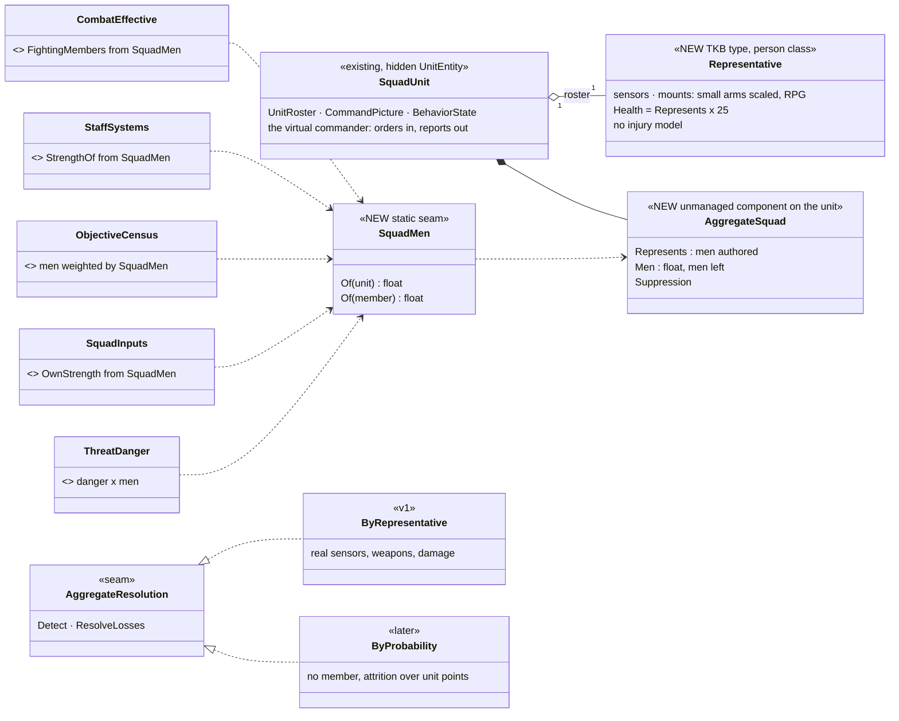
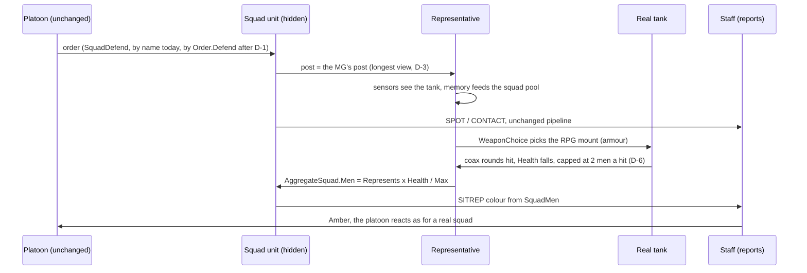
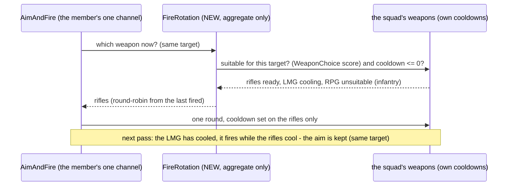

<!--STATUS
state: LIVE
build-state: DESIGN — D-1…D-3, D-5…D-9 approved (R-4245); D-4′ (weapon rotation, §4a) is a lean for the user; the shape is ruled (R-4244)
updated: 2026-11-14 (first version — coordinator)
current-answer: the whole file — §1 the request · §2 INVENTORY · §3 diagrams · §4 decisions · §5 every squad behaviour with one member · §6 real-squad defects found · §7 slices · §8 acceptance · §9 design docs checked
stale-below: nothing
known-rot: none
known-conflict: DESIGN_Squad_Tactics.md §7.6.3 ("fire and movement ends … a half gone") — D-5 changes it for a squad down to one man; folded there when built
related-designs:
  - MEASURED_Aggregate_Squad_Seams.md — OWNS the measurements behind every row here (two sweeps, calibration numbers, R-4244 §8)
  - ../group-maneuvers/DESIGN_City_Battle_Showcase.md — §12 the test ladder: the aggregate battle is a rung between ② (puppet bench) and ③ (dry twins)
  - ../group-maneuvers/DESIGN_Command_Chain_Example.md — OWNS orders down / reports up, the seam the aggregate squad plugs into; §8e the battalion's reserve
  - ../group-maneuvers/DESIGN_Squad_Tactics.md — OWNS the squad plays §5 classifies (bounding, fire and movement, suppress and manoeuvre, crossing, march)
  - ../group-maneuvers/DESIGN_Defend_And_Attack_Position.md — OWNS SquadDefend (D-2a…D-2m, the lone man's round DL-4, the MG's post D-2h)
  - ../group-maneuvers/DESIGN_Building_Clearing.md — OWNS the room drill and ClearBuilding (§6a reduced squads) the aggregate version replaces for this class
  - ../../DESIGN_Orders_Params_Entity_Classes.md — OWNS order routing (`Order.<name>` → `<Class><Order>`, R-273, D3-C) that D-1 extends to the squad orders
  - ../weapons/DESIGN_Weapon_Layers.md — OWNS one fire channel per entity and the turret ruling D-4 leans on
  - ../../DESIGN_Scenario_Rules.md — §10.2 the objective census D-2's seam feeds
-->

# DESIGN — the aggregate squad: a squad unit with ONE representative member *(R-4244)*

⭐ **Names (lean, 2026-11-14):** *aggregate squad* = the umbrella; **avatar squad** = this design (one body — the squad's AVATAR — carries
everything); **abstract squad** = the later probabilistic one with no member. In code: `AggregateSquad.Resolution = Avatar | Abstract`, the
member's type `SquadAvatar`. 🔒 User: *"something that will differentiate the single all-in-one man from a truly aggregated squad with
probabilistic calculations only."*

## 1. The request

🔒 User, `2026-11-14`: *"replace the squads with a puppet squad, meaning just the Squad commander will play for the whole squad … a great base for
simulating larger battles without individual units"* · *"We go with the aggregate squad … keep the vehicles in the play … approximate the squad
position and firepower with the aggregate squad, carrying weapons and sensors"* · *"record the decision to have just one member. In addition to the
virtual commander"* · *"either let's design these behaviors to work even with a single member squad … or to replace with specific aggregated squad
behaviors"* · *"how to deal with … placing squad members … the machine gunner likely needs different position … will it be able to use them at
once"* · *"leave the doors open to … fully aggregated squads that are having no real member … simulated with probabilistic calculations."*

**Why:** prove the command chain (battalion → company → platoon → squad) with ~80 entities instead of ~1 000, and start constructive simulation.

## 2. INVENTORY *(measured 2026-11-14; nine read-only sweeps, the decisive claims re-read by the coordinator — detail in [the measurements](MEASURED_Aggregate_Squad_Seams.md))*

| query | found |
|---|---|
| `search_graph` `.*(Aggregate\|Constructive\|Lanchester\|Attrition).*` Class (3) · `.*(Aggregate\|Representative).*` · `.*Puppet.*` (0) | ⛔ no aggregate model; `AggregateState` (Vis2D) has no writer or reader |
| `search_graph` `.*Play$` Class (19) + the runner | the squad plays: one runner, one element partition at Start (`SquadManeuverRunner.cs:406`), gates that pass on an empty element (`SquadGates.cs:61-90`) |
| `search_graph` `.*(SquadRole\|CoveragePost\|PostPlan\|SquadDefend\|FireTeam).*` (8) · `.*(Coverage\|Role\|Gunner\|Mount\|WeaponState\|FireIntent\|AimAndFire\|AmmoChoice\|ThreatDanger).*` (67) | one role reader (`SquadRoles.CarriesSupportWeapon`), four users; one fire channel per entity |
| grep `IsHidden`, `CombatEffective.*`, `ObjectiveCensus.*`, `CommandOrders.Assign/Order`, `OrderResolver` | ✔ a unit is hidden (`PhysicalPresence.cs:27`); strength = men counted (`CombatEffective.cs:54-56`); platoons order squads by concrete name (`CommandNodes.cs:80-86`) |
⚠ Graph coverage not checkable through the CLI; every absence above is also a grep.

| the proven solution for the problem class | adopted / adapted — why |
|---|---|
| constructive simulators move UNITS (position, strength, posture) and resolve combat by attrition (Lanchester-type, range / cover / suppression factors); mixing units with individual entities is the hard multi-resolution problem | ⭐ **adapted**: v1 resolves combat through ONE representative entity that uses the EXISTING sensors, weapons and damage — so a real tank, mortar or aircraft meets it with no new interaction code (multi-resolution solved by construction); the probabilistic resolver stays a second implementation of the same two seams (D-2) |

## 3. Diagrams

### 3.1 Classes

*What it shows that prose hid: the squad's state lives on the UNIT (`AggregateSquad`), not on the member — so every reader (strength, colour,
census, ratios, threat) goes through ONE seam (`SquadMen`) and does not care whether a representative or a probability model fills it. That is
the open door to the fully aggregated squad.*

### 3.2 One engagement — a real tank meets an aggregate squad

*What it shows: nothing between the tank and the representative is new — sight, weapon choice, rounds and damage are today's paths; the only new
step is the strength read-back to the unit, and everything the platoon sees comes from it.*

### 3.3 Who runs what

*What it shows: the one new per-frame system writes the unit's `Men` from the representative's health; a later probabilistic resolver writes the
same field with no member (dashed) — nothing downstream changes.*

## 4. Decisions — ✅ D-1…D-3, D-5…D-9 APPROVED (user, `2026-11-14`: *"Approved except D4."* — R-4245); D-4 replaced by D-4′ (lean)

| # | decision | ⭐ lean | why | rejected |
|---|---|---|---|---|
| **D-1** | how an aggregate squad gets its OWN version of a play | ⭐ **the order routing, staged** (`Order.<name>` → `<Class><Order>`; class `AggregateInfantrySquad` = `11.1.*.1.2.2`, TKB 307, more specific than `InfantrySquad`, falls back to it) — FIRST make the order bookkeeping order-aware (record the order + its resolved name, the CE-4307 sender-side precedent) and fix the three readers that compare a behaviour hash (`StillRunning` / `Gave`, `NotDefending`, `HoldsFirm`), THEN move the platoons' squad orders one by one (Defend first) | it is what the routing was built for (R-273), the user's model ("orders will be translated to whatever the unit can do"), and the staging also fixes a latent bug (a squad given `Order.Hold` breaks contact today — `HoldsFirm` misses `InfantrySquadHold`) | a dispatch inside each behaviour (a second mechanism for one concept) · moving every call site at once (CE-2346 / CE-2359 return) |
| **D-2** | where the squad's state lives | ⭐ **on the UNIT**: `AggregateSquad { Represents, Men, Suppression }`; ONE seam `SquadMen.Of` feeds `CombatEffective`, `StrengthOf`, the census, `SquadEnemyStrengthRatio`, `ThreatDanger`, target weights (FPV, spotter) and seats; v1 writes `Men` from the representative's health | the open door to the fully aggregated squad (user): a probability resolver writes the same field | state on the member only (the no-member squad would have nowhere to keep it) |
| **D-3** | where the one member stands | ⭐ **where the squad's firepower decides**: in a defence with a threat area, the MG's post — the longest view down it (D-2h's view fan over the candidate posts, run for the lone man); all round, coverage rank 0 + the lone man's guard round (DL-4, already built); in a march, the lead; elsewhere what the play gives its first element | the MG is the squad's base of fire (DA-48, DA-19); the member carries it | the centre of the posts (an unaimed compromise) · the leader's post (the unit is the leader) |
| **D-4** ⛔ SUPERSEDED by D-4′ below (user, `2026-11-14`: rotate the weapons) | firing the squad's weapons | ~~v1: one fire stream, scaled~~ | — | — |
| **D-5** | the plays that fail with one man | ⭐ **make them work with one man** (they fail for a REAL squad's last man too): fire and movement (Start `live < 1`; an empty half is skipped, not a failure), break contact's smoke (the mover throws it when nobody covers); **aggregate versions only where one man cannot mean the squad**: suppress-and-manoeuvre's assault and `ClearBuilding` (§5) | R-4244: no hack into the half logic — a play either works with one man or is replaced | — |
| **D-6** | damage to a representative | ⭐ health = `Represents × 25` (a rifle hit ≈ one man); a hit removes at most **2 men**; a burst's fragments scaled by the squad's frontage (`PresentedAreaM2`); no injury model | measured: a 125 mm hit (1100) would empty the pool; a burst tests one man-sized body | per-round dispersion (no hook; under-represents, never over) |
| **D-7** | the squad's nerve | ⭐ squad-level stress on the representative: stimuli scaled `1/Represents`, "alone" off, leader calming on, outnumbering by `SquadMen` | measured: ~4 hits break one body standing for 8; "alone" grows for ever | per-man stress unchanged (it routs the squad on four hits) |
| **D-8** | seats | ⭐ a representative takes `ceil(Men)` seats | else one carrier "carries" 12 squads | one seat |
| **D-9** | role tag | ⭐ the representative is the squad's `SquadLeader` (succession is then a no-op) and carries the MG mount; ⚠ check DA-13 (snipers rank MG gunners) before tagging it `MachineGunner` | the leader-only case is designed (`SquadSensing.cs:113-117`) | — |

## 4a. D-4′ — the member ROTATES through the squad's weapons *(lean; 🔒 user, `2026-11-14`: "the single member can fire just one weapon at a time, but then some special mechanism would switch his weapon to the other one that would belong to the other squad member, and so on. So the single member actually fires from multiple weapons, just not simultaneously.")*

| claim | code — how it is | design |
|---|---|---|
| one fire action per entity; one round per decision | one `WeaponChannel` (`ChannelComponents.cs:29`); one `WeaponFireIntent` per pass (`AimAndFireExecutor.cs:293`) | Weapon Layers :205-215 |
| ✔ the weapon is chosen ONCE per engagement and kept while the target, the force level and its ammo last | `EngagementMount` (`AimAndFireExecutor.cs:850-870`) | WL-4 W-12a |
| ✔ every weapon keeps its OWN cooldown, ammo, magazine and heat; the cooldown is set on the weapon that fired | mount 0 on the owner, mounts 1+ child entities (`CombatTkbTranslator.cs:86-125`); `CooldownSecondsRemaining` set at `:307`, checked for the chosen weapon only (`:209`) | — |
| ✔ the AIM restarts only when the TARGET or the STANCE changes — never when the weapon changes | `aim.Restarted(p.Target, stance)` (`:197-198`) | CE-2323 |
| switching to another TARGET costs an aim time and a body turn | `PacedAimSecondsFor` (`:903`), `BodyAim.HoldsFire` (`:249`) | — |
| suitability per target already exists | `WeaponChoice.Choose` scores every weapon (armour effect, range, ammo, readiness) (`WeaponChoice.cs:8-27`) | WL-4 |
| the proven solution | constructive models fire a unit's weapon SYSTEMS by type, each at its own rate; the unit's volume of fire is their sum | ✅ adopted: rotation reproduces the SUM through one channel |

*What it shows that prose hid: the rotation costs nothing the engine does not already do — each weapon cools on its own and the aim is kept
while the target is the same, so the member's volume of fire becomes the SUM of the squad's weapons, one round at a time.*

| | the lean |
|---|---|
| ⭐ **R-1 — rotate the weapons on the ENGAGED target** | the representative carries a `FireRotation` marker (aggregate only — real men keep today's choice); `EngagementMount` then returns the NEXT weapon that is suitable for the target (`WeaponChoice` score > 0) AND has cooled, round-robin from the last one fired; none ready ⇒ wait for the first to cool. Same target ⇒ no new aim ⇒ the rate is the sum of the suitable weapons' rates |
| ⭐ **R-2 — weapons by TYPE, each standing for its men** | one weapon per type the squad carries: the rifles (one weapon standing for k rifles: rate × k), the LMG / MG, the RPG / AT, grenades; each its own ammo pool (the squad's real totals); the rifles' k and the others' availability shrink with the men left (`SquadMen`, a gun is lost when the men left fall below its crew) |
| ⭐ **R-3 — the RPG goes to vehicles by itself** | `WeaponChoice` already scores it 0 against men and high against armour ⇒ against infantry it is skipped; when the behaviour engages a vehicle it joins the rotation (and the rifles drop out if they cannot hurt it) |
| ⏳ **R-4 — two targets at once (later)** | a real squad fires the RPG at the tank WHILE the rifles keep the infantry down. v1 engages ONE target at a time (switching costs an aim and a turn, measured). Later: a target per weapon from the squad's fire distribution, with the aim kept per target — its own decision when v1 is seen · ⭐ **rare in this model** (🔒 user, `2026-11-14`: *"For a squad, very likely the target would be another squad, which would be represented by one single man. So one squad might mean one target in many cases."*): against an aggregate squad there is ONE body to engage, so the whole rotation lands on it with no aim restarts; R-4 matters only in a MIXED fight (infantry and a vehicle at once) |
| ⭐ **why squad vs squad comes out right** | the shooter's volume is the sum of its weapons (R-1, R-2); each aimed round has about one man's hit chance (as at a real man); each rifle hit removes about one man (health 25 per man, D-6) ⇒ the exchange tracks a real one with nothing new; suppression the same (near misses on the one body) |
| rejected | one scaled stream (the superseded D-4 — loses the weapon mix) · a second fire channel (simultaneous fire; per-mount tasks were rejected for turrets, Weapon Layers :215) |

## 4b. D-4″ — each weapon its own target; the view and the body as DATA; one model for both kinds of squad *(✅ APPROVED, user `2026-11-14`: "D-4″ Approved." — R-4246)*

🔒 User, `2026-11-14`: *"can't each weapon has its own target? Also the sensors, the field of view, the aggregated squad will need to have some
aggregated field of view, and maybe we could somehow also fake the body, that the weapon is not really tied to the body location. Maybe this could
be made data driven so it fits both the multi-soldier squad as well as single power soldier squad … the situation when there are infantry and tanks
together that requires really two targets at the same time."*

| claim | code — how it is | design |
|---|---|---|
| the field of view is already DATA, default all round | `SensorCapabilitiesDto.FieldOfViewDegrees = 360` (`Tkb/Domain/SensorCapabilitiesDto.cs:30`) | Sensors |
| each weapon already has its own muzzle OFFSET from the body (data) | `MuzzleOffsetX/Y/Z` per mount (`Combat/Muzzle.cs:37, :55`), the shot starts along the aim line (`FireProcessingSystem.cs:305-309`) | CE-3059 |
| the body TURNS before a person fires beyond its twist limit | `BodyAim.HoldsFire` — a person, not embarked, off-body > `HumanGait.MaxAimTwist` (`BodyAim.cs:34-38`) | — |
| the aim is per TARGET; a weapon change keeps it | `aim.Restarted(p.Target, stance)` (`AimAndFireExecutor.cs:197-198`) | CE-2323 |
| one channel, one target per entity | `ChannelComponents.cs:29` | Weapon Layers :205-215 |

| | the lean |
|---|---|
| ⭐ **F-1 — each weapon its own TARGET and AIM, fired in rotation** | the representative keeps, per weapon, a target and that target's aim clock (a small fixed table on the entity — no allocation); the squad's fire distribution assigns them (the RPG to the tank, the rifles and LMG to the infantry); D-4′'s rotation then fires the next weapon that is ready AT ITS OWN target. ⇒ two targets "at once", interleaved round by round — at aggregate scale indistinguishable from simultaneous fire — through ONE channel and ONE entity |
| ⭐ **F-2 — the view is data** | the representative's type authors the squad's view: all round (360°, the default) or the squad's sector; range as a soldier's |
| ⭐ **F-3 — the body is data** | each weapon's muzzle offset places it across the squad's frontage (the MG on the flank); the body's twist limit becomes a per-type value (all round for the representative ⇒ it never turns to fire); ⏳ optional later: each round's origin drawn within the frontage |
| ⭐⭐ **F-4 — ONE model for both kinds of squad** | the squad's weapons are a table of **fire elements** — weapon, target, aim, origin. A real squad: one element per man (his weapon, his target, his body). The aggregate squad: one element per weapon type, all on the one representative. The fire distribution assigns TARGETS TO ELEMENTS in both — so it does not care which kind of squad it serves |
| rejected | each weapon a separate self-controlled weapon-system entity with its own brain (the sentry-gun pattern — simultaneous, but +3 entities a squad and a brain each) · one target at a time (D-4′ R-4's deferral — the user: infantry with tanks needs two targets) |

**What a target per weapon does to today's one-target-per-entity code** *(measured `2026-11-14`, the user's question)*:

| what assumes ONE target per entity | code | with F-1 |
|---|---|---|
| the fire channel (one action, one target) | `ChannelComponents.cs:29`, `AimAndFireParams.Target` | unchanged — the behaviour still issues ONE action with a main target; only the avatar's executor branch fires each weapon at its own target (the main one for weapons with none) |
| the squad's fire distribution | `ThreatMatrixAssignmentSystem` → `SquadCognitiveState.Assignment`, by roster place; read only through `SquadAssignment.TargetOf` (`SquadAssignment.cs:18`) | the SOURCE of per-weapon targets: the avatar's slots are one per WEAPON instead of one per man (the fire elements, F-4) |
| `WeaponPosture` — what the entity is aimed at + the active weapon | `WeaponPosture.cs:31-40`: replicated, saved, read by the 3-D figure, `LookFollowSystem`, the kinematics' body turn, `ForceLevels` / `EscalationLadder`, `Covering` | ⚠ the risk: it keeps the MAIN target (what the figure faces, what is saved and sent); the per-weapon targets stay internal — else the figure would flip its aim every round |
| the per-shot guards: friendly / neutral on the line, ROE, the muzzle mask, the force level | `AimAndFireExecutor.cs:255-290`, `ForceLevels.LevelFor` | must take the FIRING weapon's target — contained in the one executor |
| the aim clock and the chosen weapon | `AimTimer` / `EngagementMount` in the channel state | per weapon, in the avatar's fixed table (no allocation, R-2084) |
| real soldiers | — | unchanged: every branch above is behind the avatar's marker |

## 5. Every squad behaviour with ONE member *(analysis of design + code, no runs)*

| behaviour | one member — what happens | verdict |
|---|---|---|
| SquadDefend | one post, Set when he reaches it, the lone man's round (DL-4 designed for him), Displace / Flanked / ShootAndMove work (`SquadDefendBehavior.cs:395, :586, :807, :868-881`) | ✅ works · D-3 adds the MG post for a threat area |
| BoundingOverwatch | bounds; the empty element passes on the next tick; Success → Set (`BoundingOverwatchBehavior.cs:113, :156, :182-201`) | ✅ works (one tick of hold per switch) |
| FireAndMovement | Start fails `live < 2` (`FireAndMovementBehavior.cs:66`), Outcome fails on an empty half (`:100-104`) | 🔧 D-5 fix; ⚠ changes Squad Tactics §7.6.3 |
| SuppressAndManeuver / `InfantrySquadAttack` | Start fails `live < 2` (`SuppressAndManeuverBehavior.cs:120`) | ♦ aggregate version: the member holds as the base of fire; the assault is a timed strength exchange (attacker and defender `SquadMen`, intensity, cover), ending Success / TaskFailed |
| SquadDangerCrossing | crosses alone, empty gates pass, Success | ✅ works |
| BreakContact | moves to the answer, Success within 8 m; no smoke (only a coverer throws, `SquadContactBehaviors.cs:241`) | ✅ works · 🔧 smoke by the mover |
| SquadMarch / Move | he is the lead; Success on arrival | ✅ works |
| SquadCover | an empty element is Ready (`SquadCover.cs:66`) | ✅ works |
| ReactToContact | ratio counts one body (`SquadInputs.cs:251-282`) ⇒ breaks contact against anyone; assault falls through two failing plays to Hold | 🔧 the D-2 seam for the ratio; an assault that cannot start becomes Hold at choice time |
| BasicSquadSop rows | UnderFire, Contact, AirThreat work; LeaderDown / MemberDown inert (correct) | ✅ works |
| CasualtyCare / SquadRecover | inert for the representative (no injury, D-6) | ✅ (aggregate) · see §6 for real squads |
| ShelterFromAir · Coordination · Callouts | per member, works; a lone man never calls (optional exemption) | ✅ works |
| ClearBuilding / ClearRoom | the room drill runs with one man (entry size 1, `RoomEntryPlan.cs:177`) — mechanically fine, wrong for a member standing for 9 | ♦ aggregate version — the contract in [the measurements](MEASURED_Aggregate_Squad_Seams.md) §5 / the building sweep: same DTO, survey, a time per room (38–50 s measured, scaled by area and intensity), a strength exchange with the occupants per room, Foothold / RoomClear / BuildingClear reports, Success / Failure |
| Embark / Dismount / FastRope / AirborneExit | per body, work | ✅ works · D-8 seats |

## 6. Real-squad defects the analysis found *(independent of the aggregate — filed CE-4605…CE-4610)*

| row | defect | evidence |
|---|---|---|
| CE-4605 | ⭐ suppress-and-manoeuvre reports **Success with nobody having assaulted** when a reduced squad's survivors all fall in the base half (the split counts dead slots) | ✔ `SuppressAndManeuverManeuver.cs:69-76`, `SuppressAndManeuverBehavior.cs:121, :152-166` |
| CE-4606 | a 2-man squad with one down **livelocks** in casualty care (the survivor is the leader, `MedicFor` skips the leader) | `CasualtyCareBehavior.cs:282-287`, `SquadContactBehaviors.cs:437, :465-470` |
| CE-4607 | a convoy **never finishes** when a squad's only man is down (`LiveMen` counts the down man) | `PlatoonConvoyBehavior.cs:242-245, :406-408, :525-534` |
| CE-4608 | a spent assault squad relieved to reserve **keeps clearing** instead of holding the foothold (Building Clearing §6a) | `PlatoonAttackBehavior.cs:532, :664-672` |
| CE-4609 | a squad given `Order.Hold` **breaks contact** (`HoldsFirm` misses `InfantrySquadHold`) | `SquadContactBehaviors.cs:390` |
| CE-4610 | no producer for PROGRESS FallingBack / PhaseLine / ObjectiveSecure / FireLifted, LACE, ammo colour — the company reads FallingBack (`CompanyBehaviors.cs:804`); Building Clearing CB-3 vs CB-51 disagree on the two-man entry | the designs name senders (`DESIGN_Platoon_Attack_Defend_Clear.md:163, :199, :203`) |

## 7. Slices

| slice | builds | needs |
|---|---|---|
| **A-0** | the real-squad defects CE-4605…CE-4609 (they make every squad better, and the aggregate rests on the same plays) | — |
| **A-1** | D-1 staged: order-aware bookkeeping + the three hash readers; then `Order.Defend`, … one order at a time | A-0 (CE-4609) |
| **A-2** | the type (TKB 307 + the representative type), `AggregateSquad` on the unit, `SquadMen` and its readers (D-2), seats (D-8), role (D-9) | — |
| **A-3** | the combat model: the weapon rotation (D-4′ R-1…R-3) with a target per weapon and the view / body as data (D-4″ F-1…F-4), damage cap and burst frontage (D-6), squad nerve (D-7), the MG post (D-3), fire and movement / break contact with one man (D-5) | A-2 |
| **A-4** | the aggregate plays: assault, ClearBuilding | A-1, A-2 |
| **A-5** | the command-hierarchy scenario on aggregates (battalion → squads, ~80 entities; vehicles, mortars, drones real) + `Strength` / `QuietArea` objective kinds + the battalion reserve (CE-4589) + live checks and the dynamism measure (CE-7033) | A-3, A-4 |

## 8. Acceptance

1. A real tank, a mortar burst and an FPV drone each damage a representative through today's paths; it fires back with its RPG at the tank (rails).
2. The platoon sees Green → Amber → Red as the representative loses health; the census counts `Men`; a 125 mm hit removes ≤ 2 men (rails).
3. Every §5 ✅ row has a one-member rail; every 🔧 row is fixed and its rail red-proved; the two ♦ rows run as the aggregate class only.
4. A-1: every existing squad suite byte-identical in choices (the same play runs); `StillRunning` / `NotDefending` / `HoldsFirm` rails on routed orders.
5. A-5: the battalion → squad scenario runs 20+ minutes in seconds of run time with phase lines, tempo, a support call and the reserve, judged by its live check; `HROT_PARALLEL_SIM=1` + `HROT_READ_CHECK=1` + `stepped-hash.py --threads 1,4,8` equal.

## 9. Design docs checked

Squad Tactics §3, §6.1, §7.6–§7.7 — applies (the plays; §7.6.3 changes, known-conflict) · Defend and Attack Position §8c D-2h / D-2m / DL-4, DA-19,
DA-48 — applies (the lone man and the MG post) · Building Clearing §6a, CB-3 / CB-51 — applies (reduced squads; the contradiction filed) · Orders,
Params and Entity Classes §5a, §7.4, §8, R-273, R-277, R-278 — applies (D-1) · Weapon Layers :205-215 and Weapon Systems :354, :427 — applies (D-4,
one channel; self-controlled weapons) · Temperament and Stress TS-4 / TS-7 — applies (D-7) · City Battle §12 — applies (the test ladder) ·
Command Chain §8e — applies (A-5's reserve) · ⛔ no aggregate / constructive design existed (searched `docs/` and `.dev/`).
