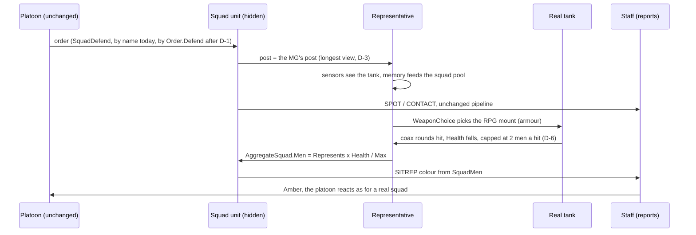
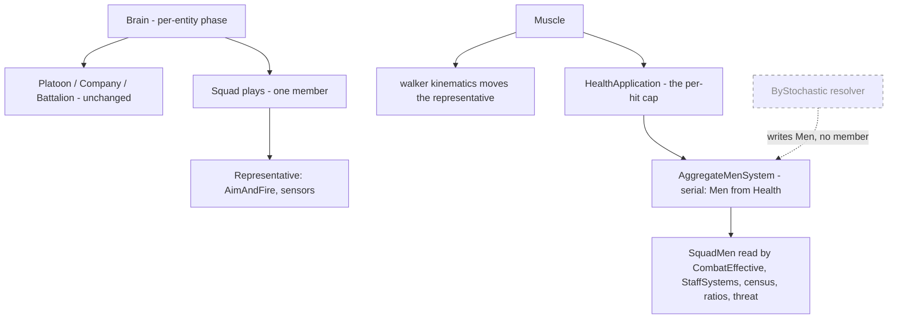
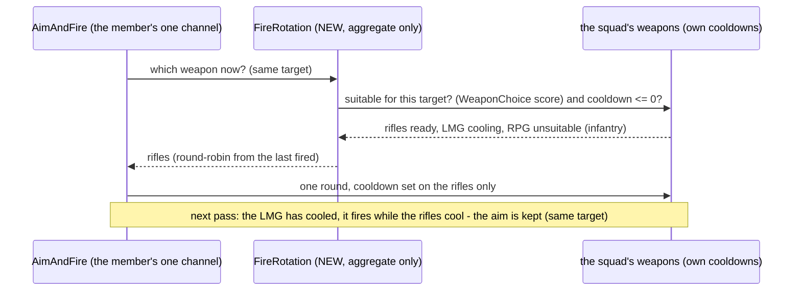
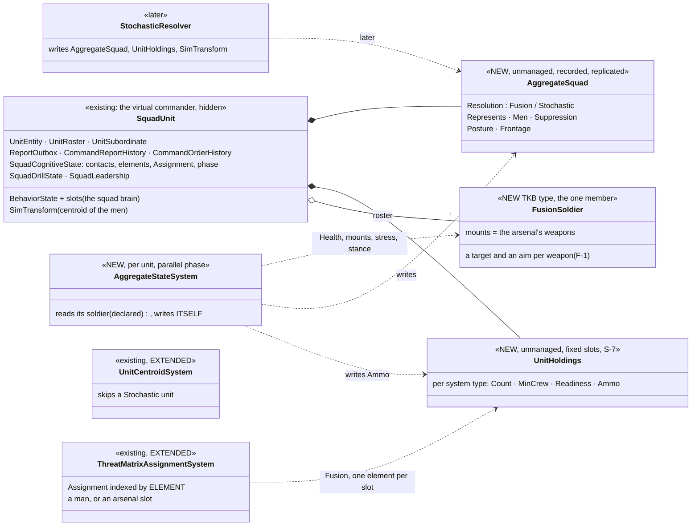
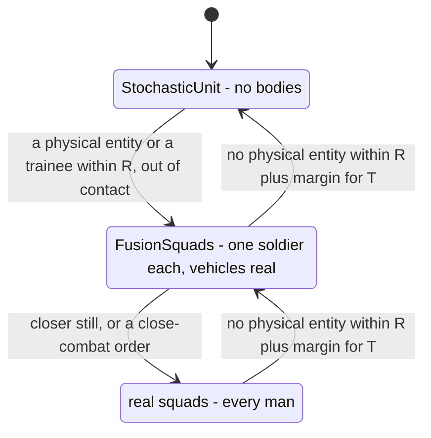

<!--STATUS
state: LIVE
build-state: DESIGN — D-1…D-3, D-5…D-9 approved (R-4245); D-4′ (weapon rotation, §4a) is a lean for the user; the shape is ruled (R-4244)
updated: 2026-11-14 (first version — coordinator)
current-answer: the whole file — §1 the request · §2 INVENTORY · §3 diagrams · §4 decisions · §5 every squad behaviour with one member · §6 real-squad defects found · §7 slices · §8 acceptance · §9 design docs checked
stale-below: nothing
known-rot: none
known-conflict: DESIGN_Squad_Tactics.md §7.6.3 ("fire and movement ends … a half gone") — D-5 changes it for a squad down to one man; folded there when built
related-designs:
  - MEASURED_Aggregate_Squad_Seams.md — OWNS the measurements behind every row here (two sweeps, calibration numbers, R-4244 §8)
  - ../group-maneuvers/DESIGN_City_Battle_Showcase.md — §12 the test ladder: the aggregate battle is a rung between ② (puppet bench) and ③ (dry twins)
  - ../group-maneuvers/DESIGN_Command_Chain_Example.md — OWNS orders down / reports up, the seam the aggregate squad plugs into; §8e the battalion's reserve
  - ../group-maneuvers/DESIGN_Squad_Tactics.md — OWNS the squad plays §5 classifies (bounding, fire and movement, suppress and manoeuvre, crossing, march)
  - ../group-maneuvers/DESIGN_Defend_And_Attack_Position.md — OWNS SquadDefend (D-2a…D-2m, the lone man's round DL-4, the MG's post D-2h)
  - ../group-maneuvers/DESIGN_Building_Clearing.md — OWNS the room drill and ClearBuilding (§6a reduced squads) the aggregate version replaces for this class
  - ../../DESIGN_Orders_Params_Entity_Classes.md — OWNS order routing (`Order.<name>` → `<Class><Order>`, R-273, D3-C) that D-1 extends to the squad orders
  - ../weapons/DESIGN_Weapon_Layers.md — OWNS one fire channel per entity and the turret ruling D-4 leans on
  - ../../DESIGN_Scenario_Rules.md — §10.2 the objective census D-2's seam feeds
-->

# DESIGN — the aggregate squad: a squad unit with ONE representative member *(R-4244)*

⭐ **Names (✅ user, `2026-11-14`: "perfect, fusion & stochastic" — R-4247):** *aggregate squad* = the umbrella; **FusionSquad** = this
design (one fighter, the `FusionSoldier`, carries the whole squad); **StochasticUnit** = the later one with no member, resolved by probability, at ANY echelon (S-6; a "StochasticSquad" is its squad case).
In code: `AggregateSquad.Resolution = Fusion | Stochastic`, the member's type `FusionSoldier`.

## 1. The request

🔒 User, `2026-11-14`: *"replace the squads with a puppet squad, meaning just the Squad commander will play for the whole squad … a great base for
simulating larger battles without individual units"* · *"We go with the aggregate squad … keep the vehicles in the play … approximate the squad
position and firepower with the aggregate squad, carrying weapons and sensors"* · *"record the decision to have just one member. In addition to the
virtual commander"* · *"either let's design these behaviors to work even with a single member squad … or to replace with specific aggregated squad
behaviors"* · *"how to deal with … placing squad members … the machine gunner likely needs different position … will it be able to use them at
once"* · *"leave the doors open to … fully aggregated squads that are having no real member … simulated with probabilistic calculations."*

**Why:** prove the command chain (battalion → company → platoon → squad) with ~80 entities instead of ~1 000, and start constructive simulation.

## 2. INVENTORY *(measured 2026-11-14; nine read-only sweeps, the decisive claims re-read by the coordinator — detail in [the measurements](MEASURED_Aggregate_Squad_Seams.md))*

| query | found |
|---|---|
| `search_graph` `.*(Aggregate\|Constructive\|Lanchester\|Attrition).*` Class (3) · `.*(Aggregate\|Representative).*` · `.*Puppet.*` (0) | ⛔ no aggregate model; `AggregateState` (Vis2D) has no writer or reader |
| `search_graph` `.*Play$` Class (19) + the runner | the squad plays: one runner, one element partition at Start (`SquadManeuverRunner.cs:406`), gates that pass on an empty element (`SquadGates.cs:61-90`) |
| `search_graph` `.*(SquadRole\|CoveragePost\|PostPlan\|SquadDefend\|FireTeam).*` (8) · `.*(Coverage\|Role\|Gunner\|Mount\|WeaponState\|FireIntent\|AimAndFire\|AmmoChoice\|ThreatDanger).*` (67) | one role reader (`SquadRoles.CarriesSupportWeapon`), four users; one fire channel per entity |
| grep `IsHidden`, `CombatEffective.*`, `ObjectiveCensus.*`, `CommandOrders.Assign/Order`, `OrderResolver` | ✔ a unit is hidden (`PhysicalPresence.cs:27`); strength = men counted (`CombatEffective.cs:54-56`); platoons order squads by concrete name (`CommandNodes.cs:80-86`) |
⚠ Graph coverage not checkable through the CLI; every absence above is also a grep.

| the proven solution for the problem class | adopted / adapted — why |
|---|---|
| constructive simulators move UNITS (position, strength, posture) and resolve combat by attrition (Lanchester-type, range / cover / suppression factors); mixing units with individual entities is the hard multi-resolution problem | ⭐ **adapted**: v1 resolves combat through ONE representative entity that uses the EXISTING sensors, weapons and damage — so a real tank, mortar or aircraft meets it with no new interaction code (multi-resolution solved by construction); the probabilistic resolver stays a second implementation of the same two seams (D-2) |

## 3. Diagrams

### 3.1 Classes

*What it shows that prose hid: the squad's state lives on the UNIT (`AggregateSquad`), not on the member — so every reader (strength, colour,
census, ratios, threat) goes through ONE seam (`SquadMen`) and does not care whether a representative or a probability model fills it. That is
the open door to the fully aggregated squad.*

### 3.2 One engagement — a real tank meets an aggregate squad

*What it shows: nothing between the tank and the representative is new — sight, weapon choice, rounds and damage are today's paths; the only new
step is the strength read-back to the unit, and everything the platoon sees comes from it.*

### 3.3 Who runs what

*What it shows: the one new per-frame system writes the unit's `Men` from the representative's health; a later probabilistic resolver writes the
same field with no member (dashed) — nothing downstream changes.*

## 4. Decisions — ✅ D-1…D-3, D-5…D-9 APPROVED (user, `2026-11-14`: *"Approved except D4."* — R-4245); D-4 replaced by D-4′ (lean)

| # | decision | ⭐ lean | why | rejected |
|---|---|---|---|---|
| **D-1** ⚠ *(adjusted by §13 X-1, R-4250: the routing key is `<Resolution><Class><Order>` from a run-time field; the TKB type below is only a preset)* | how an aggregate squad gets its OWN version of a play | ⭐ **the order routing, staged** (`Order.<name>` → `<Class><Order>`; class `AggregateInfantrySquad` = `11.1.*.1.2.2`, TKB 307, more specific than `InfantrySquad`, falls back to it) — FIRST make the order bookkeeping order-aware (record the order + its resolved name, the CE-4307 sender-side precedent) and fix the three readers that compare a behaviour hash (`StillRunning` / `Gave`, `NotDefending`, `HoldsFirm`), THEN move the platoons' squad orders one by one (Defend first) | it is what the routing was built for (R-273), the user's model ("orders will be translated to whatever the unit can do"), and the staging also fixes a latent bug (a squad given `Order.Hold` breaks contact today — `HoldsFirm` misses `InfantrySquadHold`) | a dispatch inside each behaviour (a second mechanism for one concept) · moving every call site at once (CE-2346 / CE-2359 return) |
| **D-2** | where the squad's state lives | ⭐ **on the UNIT**: `AggregateSquad { Represents, Men, Suppression }`; ONE seam `SquadMen.Of` feeds `CombatEffective`, `StrengthOf`, the census, `SquadEnemyStrengthRatio`, `ThreatDanger`, target weights (FPV, spotter) and seats; v1 writes `Men` from the representative's health | the open door to the fully aggregated squad (user): a probability resolver writes the same field | state on the member only (the no-member squad would have nowhere to keep it) |
| **D-3** | where the one member stands | ⭐ **where the squad's firepower decides**: in a defence with a threat area, the MG's post — the longest view down it (D-2h's view fan over the candidate posts, run for the lone man); all round, coverage rank 0 + the lone man's guard round (DL-4, already built); in a march, the lead; elsewhere what the play gives its first element | the MG is the squad's base of fire (DA-48, DA-19); the member carries it | the centre of the posts (an unaimed compromise) · the leader's post (the unit is the leader) |
| **D-4** ⛔ SUPERSEDED by D-4′ below (user, `2026-11-14`: rotate the weapons) | firing the squad's weapons | ~~v1: one fire stream, scaled~~ | — | — |
| **D-5** | the plays that fail with one man | ⭐ **make them work with one man** (they fail for a REAL squad's last man too): fire and movement (Start `live < 1`; an empty half is skipped, not a failure), break contact's smoke (the mover throws it when nobody covers); **aggregate versions only where one man cannot mean the squad**: suppress-and-manoeuvre's assault and `ClearBuilding` (§5) | R-4244: no hack into the half logic — a play either works with one man or is replaced | — |
| **D-6** | damage to a representative | ⭐ health = `Represents × 25` (a rifle hit ≈ one man); a hit removes at most **2 men**; a burst's fragments scaled by the squad's frontage (`PresentedAreaM2`); no injury model | measured: a 125 mm hit (1100) would empty the pool; a burst tests one man-sized body | per-round dispersion (no hook; under-represents, never over) |
| **D-7** | the squad's nerve | ⭐ squad-level stress on the representative: stimuli scaled `1/Represents`, "alone" off, leader calming on, outnumbering by `SquadMen` | measured: ~4 hits break one body standing for 8; "alone" grows for ever | per-man stress unchanged (it routs the squad on four hits) |
| **D-8** | seats | ⭐ a representative takes `ceil(Men)` seats | else one carrier "carries" 12 squads | one seat |
| **D-9** | role tag | ⭐ the representative is the squad's `SquadLeader` (succession is then a no-op) and carries the MG mount; ⚠ check DA-13 (snipers rank MG gunners) before tagging it `MachineGunner` | the leader-only case is designed (`SquadSensing.cs:113-117`) | — |

## 4a. D-4′ — the member ROTATES through the squad's weapons *(lean; 🔒 user, `2026-11-14`: "the single member can fire just one weapon at a time, but then some special mechanism would switch his weapon to the other one that would belong to the other squad member, and so on. So the single member actually fires from multiple weapons, just not simultaneously.")*

| claim | code — how it is | design |
|---|---|---|
| one fire action per entity; one round per decision | one `WeaponChannel` (`ChannelComponents.cs:29`); one `WeaponFireIntent` per pass (`AimAndFireExecutor.cs:293`) | Weapon Layers :205-215 |
| ✔ the weapon is chosen ONCE per engagement and kept while the target, the force level and its ammo last | `EngagementMount` (`AimAndFireExecutor.cs:850-870`) | WL-4 W-12a |
| ✔ every weapon keeps its OWN cooldown, ammo, magazine and heat; the cooldown is set on the weapon that fired | mount 0 on the owner, mounts 1+ child entities (`CombatTkbTranslator.cs:86-125`); `CooldownSecondsRemaining` set at `:307`, checked for the chosen weapon only (`:209`) | — |
| ✔ the AIM restarts only when the TARGET or the STANCE changes — never when the weapon changes | `aim.Restarted(p.Target, stance)` (`:197-198`) | CE-2323 |
| switching to another TARGET costs an aim time and a body turn | `PacedAimSecondsFor` (`:903`), `BodyAim.HoldsFire` (`:249`) | — |
| suitability per target already exists | `WeaponChoice.Choose` scores every weapon (armour effect, range, ammo, readiness) (`WeaponChoice.cs:8-27`) | WL-4 |
| the proven solution | constructive models fire a unit's weapon SYSTEMS by type, each at its own rate; the unit's volume of fire is their sum | ✅ adopted: rotation reproduces the SUM through one channel |

*What it shows that prose hid: the rotation costs nothing the engine does not already do — each weapon cools on its own and the aim is kept
while the target is the same, so the member's volume of fire becomes the SUM of the squad's weapons, one round at a time.*

| | the lean |
|---|---|
| ⭐ **R-1 — rotate the weapons on the ENGAGED target** | the representative carries a `FireRotation` marker (aggregate only — real men keep today's choice); `EngagementMount` then returns the NEXT weapon that is suitable for the target (`WeaponChoice` score > 0) AND has cooled, round-robin from the last one fired; none ready ⇒ wait for the first to cool. Same target ⇒ no new aim ⇒ the rate is the sum of the suitable weapons' rates |
| ⭐ **R-2 — weapons by TYPE, each standing for its men** | one weapon per type the squad carries: the rifles (one weapon standing for k rifles: rate × k), the LMG / MG, the RPG / AT, grenades; each its own ammo pool (the squad's real totals); the rifles' k and the others' availability shrink with the men left (`SquadMen`, a gun is lost when the men left fall below its crew) |
| ⭐ **R-3 — the RPG goes to vehicles by itself** | `WeaponChoice` already scores it 0 against men and high against armour ⇒ against infantry it is skipped; when the behaviour engages a vehicle it joins the rotation (and the rifles drop out if they cannot hurt it) |
| ⏳ **R-4 — two targets at once (later)** | a real squad fires the RPG at the tank WHILE the rifles keep the infantry down. v1 engages ONE target at a time (switching costs an aim and a turn, measured). Later: a target per weapon from the squad's fire distribution, with the aim kept per target — its own decision when v1 is seen · ⭐ **rare in this model** (🔒 user, `2026-11-14`: *"For a squad, very likely the target would be another squad, which would be represented by one single man. So one squad might mean one target in many cases."*): against an aggregate squad there is ONE body to engage, so the whole rotation lands on it with no aim restarts; R-4 matters only in a MIXED fight (infantry and a vehicle at once) |
| ⭐ **why squad vs squad comes out right** | the shooter's volume is the sum of its weapons (R-1, R-2); each aimed round has about one man's hit chance (as at a real man); each rifle hit removes about one man (health 25 per man, D-6) ⇒ the exchange tracks a real one with nothing new; suppression the same (near misses on the one body) |
| rejected | one scaled stream (the superseded D-4 — loses the weapon mix) · a second fire channel (simultaneous fire; per-mount tasks were rejected for turrets, Weapon Layers :215) |

## 4b. D-4″ — each weapon its own target; the view and the body as DATA; one model for both kinds of squad *(✅ APPROVED, user `2026-11-14`: "D-4″ Approved." — R-4246)*

🔒 User, `2026-11-14`: *"can't each weapon has its own target? Also the sensors, the field of view, the aggregated squad will need to have some
aggregated field of view, and maybe we could somehow also fake the body, that the weapon is not really tied to the body location. Maybe this could
be made data driven so it fits both the multi-soldier squad as well as single power soldier squad … the situation when there are infantry and tanks
together that requires really two targets at the same time."*

| claim | code — how it is | design |
|---|---|---|
| the field of view is already DATA, default all round | `SensorCapabilitiesDto.FieldOfViewDegrees = 360` (`Tkb/Domain/SensorCapabilitiesDto.cs:30`) | Sensors |
| each weapon already has its own muzzle OFFSET from the body (data) | `MuzzleOffsetX/Y/Z` per mount (`Combat/Muzzle.cs:37, :55`), the shot starts along the aim line (`FireProcessingSystem.cs:305-309`) | CE-3059 |
| the body TURNS before a person fires beyond its twist limit | `BodyAim.HoldsFire` — a person, not embarked, off-body > `HumanGait.MaxAimTwist` (`BodyAim.cs:34-38`) | — |
| the aim is per TARGET; a weapon change keeps it | `aim.Restarted(p.Target, stance)` (`AimAndFireExecutor.cs:197-198`) | CE-2323 |
| one channel, one target per entity | `ChannelComponents.cs:29` | Weapon Layers :205-215 |

| | the lean |
|---|---|
| ⭐ **F-1 — each weapon its own TARGET and AIM, fired in rotation** | the representative keeps, per weapon, a target and that target's aim clock (a small fixed table on the entity — no allocation); the squad's fire distribution assigns them (the RPG to the tank, the rifles and LMG to the infantry); D-4′'s rotation then fires the next weapon that is ready AT ITS OWN target. ⇒ two targets "at once", interleaved round by round — at aggregate scale indistinguishable from simultaneous fire — through ONE channel and ONE entity |
| ⭐ **F-2 — the view is data** | the representative's type authors the squad's view: all round (360°, the default) or the squad's sector; range as a soldier's |
| ⭐ **F-3 — the body is data** | each weapon's muzzle offset places it across the squad's frontage (the MG on the flank); the body's twist limit becomes a per-type value (all round for the representative ⇒ it never turns to fire); ⏳ optional later: each round's origin drawn within the frontage |
| ⭐⭐ **F-4 — ONE model for both kinds of squad** | the squad's weapons are a table of **fire elements** — weapon, target, aim, origin. A real squad: one element per man (his weapon, his target, his body). The aggregate squad: one element per weapon type, all on the one representative. The fire distribution assigns TARGETS TO ELEMENTS in both — so it does not care which kind of squad it serves |
| rejected | each weapon a separate self-controlled weapon-system entity with its own brain (the sentry-gun pattern — simultaneous, but +3 entities a squad and a brain each) · one target at a time (D-4′ R-4's deferral — the user: infantry with tanks needs two targets) |

**What a target per weapon does to today's one-target-per-entity code** *(measured `2026-11-14`, the user's question)*:

| what assumes ONE target per entity | code | with F-1 |
|---|---|---|
| the fire channel (one action, one target) | `ChannelComponents.cs:29`, `AimAndFireParams.Target` | unchanged — the behaviour still issues ONE action with a main target; only the fusion soldier's executor branch fires each weapon at its own target (the main one for weapons with none) |
| the squad's fire distribution | `ThreatMatrixAssignmentSystem` → `SquadCognitiveState.Assignment`, by roster place; read only through `SquadAssignment.TargetOf` (`SquadAssignment.cs:18`) | the SOURCE of per-weapon targets: the fusion soldier's slots are one per WEAPON instead of one per man (the fire elements, F-4) |
| `WeaponPosture` — what the entity is aimed at + the active weapon | `WeaponPosture.cs:31-40`: replicated, saved, read by the 3-D figure, `LookFollowSystem`, the kinematics' body turn, `ForceLevels` / `EscalationLadder`, `Covering` | ⚠ the risk: it keeps the MAIN target (what the figure faces, what is saved and sent); the per-weapon targets stay internal — else the figure would flip its aim every round |
| the per-shot guards: friendly / neutral on the line, ROE, the muzzle mask, the force level | `AimAndFireExecutor.cs:255-290`, `ForceLevels.LevelFor` | must take the FIRING weapon's target — contained in the one executor |
| the aim clock and the chosen weapon | `AimTimer` / `EngagementMount` in the channel state | per weapon, in the fusion soldier's fixed table (no allocation, R-2084) |
| real soldiers | — | unchanged: every branch above is behind the fusion soldier's marker |

## 5. Every squad behaviour with ONE member *(analysis of design + code, no runs)*

| behaviour | one member — what happens | verdict |
|---|---|---|
| SquadDefend | one post, Set when he reaches it, the lone man's round (DL-4 designed for him), Displace / Flanked / ShootAndMove work (`SquadDefendBehavior.cs:395, :586, :807, :868-881`) | ✅ works · D-3 adds the MG post for a threat area |
| BoundingOverwatch | bounds; the empty element passes on the next tick; Success → Set (`BoundingOverwatchBehavior.cs:113, :156, :182-201`) | ✅ works (one tick of hold per switch) |
| FireAndMovement | Start fails `live < 2` (`FireAndMovementBehavior.cs:66`), Outcome fails on an empty half (`:100-104`) | 🔧 D-5 fix; ⚠ changes Squad Tactics §7.6.3 |
| SuppressAndManeuver / `InfantrySquadAttack` | Start fails `live < 2` (`SuppressAndManeuverBehavior.cs:120`) | ♦ aggregate version: the member holds as the base of fire; the assault is a timed strength exchange (attacker and defender `SquadMen`, intensity, cover), ending Success / TaskFailed |
| SquadDangerCrossing | crosses alone, empty gates pass, Success | ✅ works |
| BreakContact | moves to the answer, Success within 8 m; no smoke (only a coverer throws, `SquadContactBehaviors.cs:241`) | ✅ works · 🔧 smoke by the mover |
| SquadMarch / Move | he is the lead; Success on arrival | ✅ works |
| SquadCover | an empty element is Ready (`SquadCover.cs:66`) | ✅ works |
| ReactToContact | ratio counts one body (`SquadInputs.cs:251-282`) ⇒ breaks contact against anyone; assault falls through two failing plays to Hold | 🔧 the D-2 seam for the ratio; an assault that cannot start becomes Hold at choice time |
| BasicSquadSop rows | UnderFire, Contact, AirThreat work; LeaderDown / MemberDown inert (correct) | ✅ works |
| CasualtyCare / SquadRecover | inert for the representative (no injury, D-6) | ✅ (aggregate) · see §6 for real squads |
| ShelterFromAir · Coordination · Callouts | per member, works; a lone man never calls (optional exemption) | ✅ works |
| ClearBuilding / ClearRoom | the room drill runs with one man (entry size 1, `RoomEntryPlan.cs:177`) — mechanically fine, wrong for a member standing for 9 | ♦ aggregate version — the contract in [the measurements](MEASURED_Aggregate_Squad_Seams.md) §5 / the building sweep: same DTO, survey, a time per room (38–50 s measured, scaled by area and intensity), a strength exchange with the occupants per room, Foothold / RoomClear / BuildingClear reports, Success / Failure |
| Embark / Dismount / FastRope / AirborneExit | per body, work | ✅ works · D-8 seats |

## 6. Real-squad defects the analysis found *(independent of the aggregate — filed CE-4605…CE-4610)*

| row | defect | evidence |
|---|---|---|
| CE-4605 | ⭐ suppress-and-manoeuvre reports **Success with nobody having assaulted** when a reduced squad's survivors all fall in the base half (the split counts dead slots) | ✔ `SuppressAndManeuverManeuver.cs:69-76`, `SuppressAndManeuverBehavior.cs:121, :152-166` |
| CE-4606 | a 2-man squad with one down **livelocks** in casualty care (the survivor is the leader, `MedicFor` skips the leader) | `CasualtyCareBehavior.cs:282-287`, `SquadContactBehaviors.cs:437, :465-470` |
| CE-4607 | a convoy **never finishes** when a squad's only man is down (`LiveMen` counts the down man) | `PlatoonConvoyBehavior.cs:242-245, :406-408, :525-534` |
| CE-4608 | a spent assault squad relieved to reserve **keeps clearing** instead of holding the foothold (Building Clearing §6a) | `PlatoonAttackBehavior.cs:532, :664-672` |
| CE-4609 | a squad given `Order.Hold` **breaks contact** (`HoldsFirm` misses `InfantrySquadHold`) | `SquadContactBehaviors.cs:390` |
| CE-4610 | no producer for PROGRESS FallingBack / PhaseLine / ObjectiveSecure / FireLifted, LACE, ammo colour — the company reads FallingBack (`CompanyBehaviors.cs:804`); Building Clearing CB-3 vs CB-51 disagree on the two-man entry | the designs name senders (`DESIGN_Platoon_Attack_Defend_Clear.md:163, :199, :203`) |

## 7. Slices

| slice | builds | needs |
|---|---|---|
| **A-0** | the real-squad defects CE-4605…CE-4609 (they make every squad better, and the aggregate rests on the same plays) | — |
| **A-1** | D-1 staged: order-aware bookkeeping + the three hash readers; then `Order.Defend`, … one order at a time | A-0 (CE-4609) |
| **A-2** | the type (TKB 307 `FusionInfantrySquad` + `FusionSoldier`), `AggregateSquad` + `UnitHoldings` on the unit and `AggregateStateSystem` (§11, S-1), `SquadMen` and its readers (D-2), seats (D-8), role (D-9) | — |
| **A-3** | the combat model: the weapon rotation (D-4′ R-1…R-3) with a target per weapon and the view / body as data (D-4″ F-1…F-4), damage cap and burst frontage (D-6), squad nerve (D-7), the MG post (D-3), fire and movement / break contact with one man (D-5) | A-2 |
| **A-4** | the aggregate plays: assault, ClearBuilding | A-1, A-2 |
| **A-5** | the command-hierarchy scenario on aggregates (battalion → squads, ~80 entities; vehicles, mortars, drones real) + `Strength` / `QuietArea` objective kinds + the battalion reserve (CE-4589) + live checks and the dynamism measure (CE-7033) | A-3, A-4 |

## 8. Acceptance

1. A real tank, a mortar burst and an FPV drone each damage a representative through today's paths; it fires back with its RPG at the tank (rails).
2. The platoon sees Green → Amber → Red as the representative loses health; the census counts `Men`; a 125 mm hit removes ≤ 2 men (rails).
3. Every §5 ✅ row has a one-member rail; every 🔧 row is fixed and its rail red-proved; the two ♦ rows run as the aggregate class only.
4. A-1: every existing squad suite byte-identical in choices (the same play runs); `StillRunning` / `NotDefending` / `HoldsFirm` rails on routed orders.
5. A-5: the battalion → squad scenario runs 20+ minutes in seconds of run time with phase lines, tempo, a support call and the reserve, judged by its live check; `HROT_PARALLEL_SIM=1` + `HROT_READ_CHECK=1` + `stepped-hash.py --threads 1,4,8` equal.

## 9. Design docs checked

Squad Tactics §3, §6.1, §7.6–§7.7 — applies (the plays; §7.6.3 changes, known-conflict) · Defend and Attack Position §8c D-2h / D-2m / DL-4, DA-19,
DA-48 — applies (the lone man and the MG post) · Building Clearing §6a, CB-3 / CB-51 — applies (reduced squads; the contradiction filed) · Orders,
Params and Entity Classes §5a, §7.4, §8, R-273, R-277, R-278 — applies (D-1) · Weapon Layers :205-215 and Weapon Systems :354, :427 — applies (D-4,
one channel; self-controlled weapons) · Temperament and Stress TS-4 / TS-7 — applies (D-7) · City Battle §12 — applies (the test ladder) ·
Command Chain §8e — applies (A-5's reserve) · ⛔ no aggregate / constructive design existed (searched `docs/` and `.dev/`).

## 10. The StochasticUnit (was "StochasticSquad", renamed S-6) — scope, use cases, and what binds NOW *(leans; 🔒 user, `2026-11-14`: "can we think a bit more about the stochastic squad version? … that one is likely not compatible with physical individual entities like vehicles. better fitted for higher level constructive simulation where everything is stochastical. i want to have clear idea about the split/use cases, as this might still form the design in some way")*

**The proven solution:** constructive simulators at brigade level and up resolve a unit as a point with state (strength, ammo, posture,
suppression, readiness) at a fixed step: DETECTION as a probability (range, terrain / line of sight, posture, the target's size and activity),
ATTRITION as a Lanchester-type exchange (losses = enemy firepower × kill factors × cover × suppression, from weapon data), MOVEMENT along roads /
the navmesh by posture and terrain. No rounds, no bodies — thousands of units, faster than real time, Monte Carlo repeats.

| a StochasticSquad meets … | fits? | why (measured) |
|---|---|---|
| other stochastic units | ✅ | the classic case |
| the commanders above (platoon → battalion) | ✅ unchanged | reports + `SquadMen` (D-2); orders by class (D-1: `StochasticInfantrySquad<Order>`) |
| mortars, artillery, air strikes | ✅ easy | they fire at a POINT (HQ, battery, aircraft paths) ⇒ a burst = a casualty fraction: its radius ∩ the unit's frontage × cover |
| objectives, census, reports, replay | ✅ | all through the unit's state |
| tanks, IFVs, real soldiers, FusionSoldiers in DIRECT fire | ⚠ the hard boundary | they see bodies and fire rounds; it has neither — the standard answer is DISAGGREGATION (become a FusionSquad when a physical entity comes near) |

| resolution | used for |
|---|---|
| real squad | close combat, trainees, possession, film, buildings |
| **FusionSquad** | battalion battles WITH real vehicles, fires, drones, air; the command-chain test; the showcase cheaper |
| **StochasticSquad** | brigade and up; course-of-action analysis; repeated faster-than-real-time runs; a background war far from the trainees |

| # | binds NOW (lean) | why |
|---|---|---|
| **S-1** | the UNIT holds the squad's WHOLE state — men, suppression, ammo per weapon type, the weapon inventory, posture, frontage (extends D-2); while a resolution runs it is the truth and writes the unit's copy every tick | cheap now; the only thing that makes a later resolution switch possible |
| **S-2** | resolution SWITCHING (by distance / contact) kept possible, NOT built | with S-1 a switch is "instantiate from the unit's state"; its known traps (flip-flop ⇒ hysteresis, switch only out of contact; jumps in losses ⇒ one calibration, S-5) are designed when a use case asks |
| **S-3** | stochastic dice are deterministic — seeded per unit per step, a fixed resolution step, each unit writes only itself | the parallel rule; equal at 1 / 4 / 8 threads |
| **S-4** | the first StochasticSquad meets only stochastic units and point-fire assets; direct fire with physical entities waits for the disaggregation boundary | the multi-resolution problem is the expensive one |
| **S-5** | ONE calibration: the FusionSquad's live exchanges and the measured drill times (§6 of the measurements) set the stochastic tables | the two resolutions agree, so a switch does not jump |

## 11. The squad's commander entity — what changes *(lean; 🔒 user, `2026-11-14`: "what would it mean for the virtual squad commander entity? new components, changes in behaviors, ...")*

*What it shows that prose hid: the commander keeps EVERYTHING it has today (it still runs the squad brain, reports and takes orders); it only
GAINS two state components (S-1) and one system that copies the running resolution into them — and the existing `Assignment` table, indexed by
"element" instead of "man", is the F-4 fire-element model with no new table.*

| area | change | why / basis |
|---|---|---|
| **new components** | `AggregateSquad { Resolution, Represents, Men, Suppression, Posture, Frontage }` · `UnitHoldings` (S-7; fixed slots: system type, count, minimum crew, readiness, ammo — weapons now, vehicles later) — unmanaged, `DataPolicy.Default` (recorded, saved, seek-safe); replicated so display nodes and the Player show strength (W-10) | S-1, D-2; CLAUDE.md "new components": unmanaged when recorded |
| **authored where** | the squad's TKB type `FusionInfantrySquad` (307, a variant of 302): `Represents` and the arsenal from its composite (1 leader + 9 riflemen ⇒ rifles 7, LMG 1, RPG 1, grenades); one `FusionSoldier` slot | measured precedent: `AsLandUnit(…, variant)` (`NedTkbCatalog.cs:1055`) |
| **new system** | `AggregateStateSystem` — per unit in the parallel phase: reads ITS soldier (a declared read), writes ITSELF: `Men = Represents × Health / Max`, ammo per slot from the soldier's mounts, `Suppression` from the soldier's stress, posture from its stance | the parallel rule (write your own entity, declare the read) |
| **existing systems** | `ThreatMatrixAssignmentSystem`: `Assignment` indexed by element — a man (real squad) or an arsenal slot (FusionSquad) · `UnitCentroidSystem`: unchanged for Fusion (the centroid IS the soldier), skips a Stochastic unit · `CombatEffective` / `StrengthOf` / census / ratio / threat read `SquadMen` (D-2) | F-4, D-2 |
| **behaviours (the squad brain on this entity)** | the SOP and the reports unchanged · the plays: the D-5 one-man fixes (generic, every squad) · the two aggregate plays as `FusionInfantrySquad<Order>` (assault, ClearBuilding) through the class routing (D-1) — every other order falls back to `InfantrySquad<Order>` | D-1, D-5 |
| **ownership** | the unit stays on CGF (brain); the soldier's `Health` is in the brain group (`HrotOwnershipGroups.cs:53, :171-175`) ⇒ the copy is brain-local | measured |
| **StochasticSquad, later** | the SAME components; no soldier; a `StochasticResolver` writes them and moves the unit's `SimTransform` itself | S-1…S-4 |

## 12. Vehicles in the stochastic mode — combined-arms units, not single vehicles *(✅ S-6…S-9 APPROVED, user `2026-11-14`: "approved!" — R-4249; 🔒 user, `2026-11-14`: "in the stochastic mode, how would we handle the vehicles? no individual vehicles, but stochastic higher level constructs (an aggregated stochastic unit representing some stochastic squad AND vehicles?)")*

**The proven solution:** a constructive unit is a HOLDING of men and systems by type (a mechanised platoon ≈ 30 men + 4 IFVs as ONE unit);
attrition is resolved per PAIRING of firing system type × target type (a killer–victim table: rifles → men, an ATGM → IFVs, a 25 mm → both);
movement follows the unit's state (mounted: road speed; dismounted: walking; the slowest part limits it). The leaf of a stochastic force is
usually the platoon or the company, because the vehicles belong there.

| # | lean | why |
|---|---|---|
| **S-6** | the stochastic resolution is a unit of ANY echelon — squad, platoon, company; its subunits do not exist (it is the leaf), and the commander above it runs unchanged because it reports like that echelon ⇒ the name is **StochasticUnit** (a "StochasticSquad" is its squad case; R-4247's FusionSquad unchanged) | vehicles belong to platoons; the command chain above any leaf is unchanged (reports + `SquadMen`-style strength) |
| **S-7** | ⭐ **binds NOW**: the unit's state is a `UnitHoldings` table — men + SYSTEM TYPES (rifles, MGs, ATGMs, IFVs, tanks, mortars), each with count, readiness and ammo — instead of a squad-only `UnitHoldings`; the FusionSquad v1 fills only its infantry weapons | renaming before it is built and replicated costs nothing; after, a migration |
| **S-8** | the killer–victim factors are DERIVED from the same TKB weapon data the fusion and real resolutions use (penetration vs armour through `ArmorModel`, dispersion, rate of fire) — an ATGM's chance against an IFV is ONE number in every resolution | S-5's single calibration, extended to vehicles |
| **S-9** | mounted / dismounted is the unit's POSTURE (speed, exposure, which systems fire) | the mounted infantry fight's essence, without seats |

## 13. De-aggregation — a StochasticUnit becomes physical units for precise combat *(✅ X-1…X-5 APPROVED, user `2026-11-14` — R-4250; 🔒 user, `2026-11-14`: "let's think about the de-aggregation of stochastical unit into physical units for more precise combat simulation. is that something we could achive? maybe it would further form our existing design which is cheap now")*

**The proven solution** (multi-resolution modelling — aggregate / entity federations): a unit is DISAGGREGATED when a trigger fires (a physical
entity or a trainee comes within range, or an engagement with one is imminent) and RE-AGGREGATED when it is out of contact for a while. The known
problems and their standard answers: **state mapping** (instantiate the entities from the unit's state; sum them back) · **thrashing** (hysteresis:
a wider radius and a minimum time to re-aggregate) · **discontinuity** (switch BEFORE contact, never mid-engagement; one calibration so the
expected losses agree) · **chain** (one level at a time) · **identity** (the same unit and the same children every time, so reports, recordings
and the after-action review stay continuous).

*What it shows: the switch is ONE level at a time, and FusionSquad is the natural middle step — a stochastic platoon becomes three FusionSquads
and its REAL vehicles, long before every man is created.*

| measured / designed | basis |
|---|---|
| the order resolver keys ONLY on the entity's DIS type | `OrderResolver.Resolve(table, dis, order, …)` (`Hrot/Engine/Hrot.Core/Tkb/OrderResolver.cs:33`) ⇒ a resolution baked into the TYPE (D-1's TKB 307) cannot change at run time without changing the entity's type |
| a unit's children are described by its TKB composite (slots), created explicitly today | `NedTkbCatalog.cs:973-992` (`AutoCreateChildren = false`), macros write each man (`city_battle_macros.py:24-38`) |
| entities can be created and destroyed mid-run (macro insertion, creation requests); recordings and seek carry them | `MacroInsertion.cs:23-45`, `CreateEntityRequestSystem.cs:475-480` |
| S-1 / S-7 put the unit's whole state on the unit | §10, §12 |

| # | binds NOW — cheap (lean) | why |
|---|---|---|
| ⭐ **X-1** | **the UNIT entity persists across every resolution; its resolution is a run-time FIELD (`AggregateSquad.Resolution`), and the order routing tries `<Resolution><Class><Order>` first** (`FusionInfantrySquadAttack`, then `InfantrySquadAttack`) — the TKB type only gives the DEFAULT resolution. ⚠ **This adjusts approved D-1**: its class `AggregateInfantrySquad` / TKB 307 becomes a preset, not the routing key | a resolution in the TYPE cannot switch without replacing the entity, which would break its identity, its subordinate links and its reports |
| ⭐ **X-2** | **the unit keeps its CURRENT ORDER (name + params)**, not only the behaviour it resolved to — on a switch it RE-RESOLVES the same order under the new resolution (a stochastic platoon's attack becomes the real `PlatoonAttack` ordering its new squads) | D-1's order-aware bookkeeping already records the order on the commander's side; the receiver keeping its own is the same field |
| ⭐ **X-3** | **children come from the TKB composite with STABLE keys `<unit>/<slot>`** — the same unit disaggregated twice gives the same children | identity continuity for reports, recordings, replay and the after-action review |
| **X-4** | the mapping rules, written once: men left ⇒ which slots live (deterministic order: the MG crew and the leader last), health / ammo split by slot, positions inside the frontage by the existing formation / post planners, stress from suppression; back: sums and the centroid | consistent both ways; S-5 keeps the expected losses equal |
| **X-5** | switch one level at a time, before contact, with hysteresis; never while engaged | the standard answers to thrashing and discontinuity |
| ⏳ not now | building the switch, the triggers, the cost per switch (a platoon is ~30 creations — measure when built) | — |

## 14. Movement of a StochasticUnit — its shape and composition against the terrain *(leans; 🔒 user, `2026-11-14`: "what about movement of stochastical units? it will need likely a very specialized motion model counting with unit structure and size vs terrain.")*

**The proven solution:** aggregate movement plans on the road / cross-country network, moves at the SLOWEST element's speed × a terrain factor ×
posture, and carries a FORMATION: a road column (length = vehicles × spacing — its tail arrives later and is exposed along the road) or a
deployed line (frontage × depth). Trafficability comes from the composition (wheeled vehicles never through woods), not from a body.

| what exists (measured) | where |
|---|---|
| one route planner over the navmesh, the road graph, or both spliced (`Hybrid`) | `Navigation/RoutePlanner.cs:73-106` |
| two navmesh layers (infantry 60° / 0.4 m step; vehicle 20° / 0.3 m) and per-mover AREA prices (woods: wheeled forbidden, tracked dear) | `RecastNavmeshBaker.cs:68-89`, `NavDoorways.cs:132` (`DoorAwareQueryFilter`) |
| the hull guard, avoidance and the walker assume ONE body | `HullClearance.cs`, `CarKinematicsSystem.cs` |

| # | lean | why |
|---|---|---|
| **M-1** | plan with the EXISTING planner: mounted ⇒ the vehicle layer + roads (`Hybrid`); dismounted ⇒ the infantry layer; the area prices from the unit's holdings (any wheeled system mounted ⇒ woods forbidden) | one route planner for every mover (shared, not duplicated) |
| **M-2** | speed = the slowest holding's speed × the area's terrain factor × posture × suppression — the factors derived from the same TKB numbers (S-5, S-8) | one calibration |
| ⭐ **M-3** | **binds NOW**: the unit's state gains `Formation` (column / line / assault), `Depth`, `Heading`; in a column the unit is a SEGMENT of its path (the head moves, the tail follows `Depth` behind) — its exposure (a burst on the road) and its arrival time come from it | adding recorded fields later is a migration; the segment is what makes a column real |
| **M-4** | a dedicated, deterministic PATH FOLLOWER for the unit's point (no hull guard, no avoidance; congestion and bridges later from the road graph) — ⛔ not the body kinematics | the hull guard and the walker are wrong for a 300 m column |

## 15. Sensors of a StochasticUnit — detection as a probability *(leans; 🔒 user, `2026-11-14`: "similarly the sensors for those unit would need to work differently")*

**The proven solution:** detection per observer–target pair per step as a probability: line of sight (sampled across both footprints), range,
the target's SIGNATURE (its size, vehicles, and activity: moving or firing raises it), the observer's sensors (optics, thermal), vegetation and
weather / night; glimpses ACCUMULATE into a contact.

| # | lean | why |
|---|---|---|
| **N-1** | per step (~1–2 s): candidate pairs from a spatial grid; line of sight checked between a few sample points of each footprint through the EXISTING terrain query (on the Muscle, R-2037); Pd from range × signature × the observer's sensor holdings × the woods grid (UTM T-2) × the weather / night modifiers perception already has; seeded per observer and step (S-3) | the same terrain and modifiers as the physical sensors — one model of the world |
| **N-2** | a detection writes the SAME squad contact pool ⇒ SPOT / CONTACT, the picture and every commander above unchanged | the reports seam |
| **N-3** | a stochastic observer MAY detect physical entities (one way — it only reads them); physical sensors do not see a stochastic unit (S-4 until de-aggregation) | observing is cheap and safe; being seen needs a body |
| ⭐ **N-4** | **binds NOW**: the unit's state gains `Activity` (moving / firing — the signature) and the holdings' slots carry SENSOR systems (optics, thermal, radar) beside weapons | the signature and the observer quality are inputs N-1 cannot invent later |
