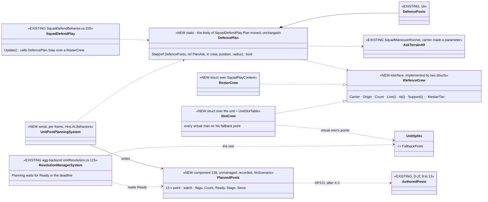
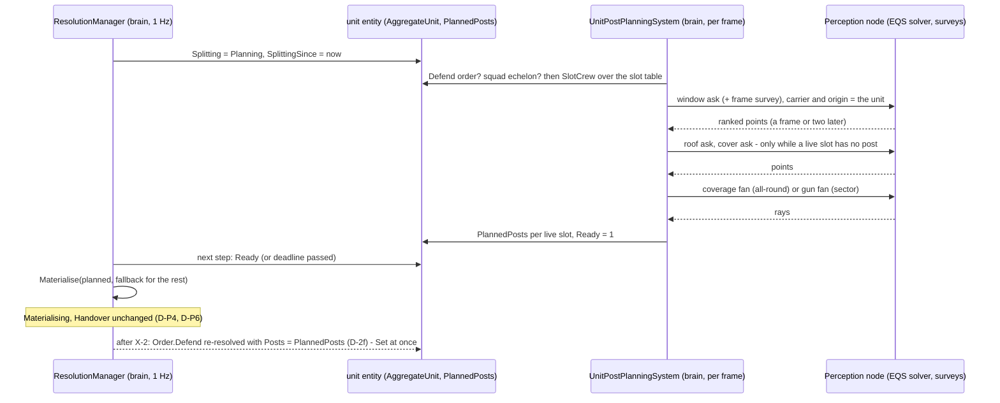
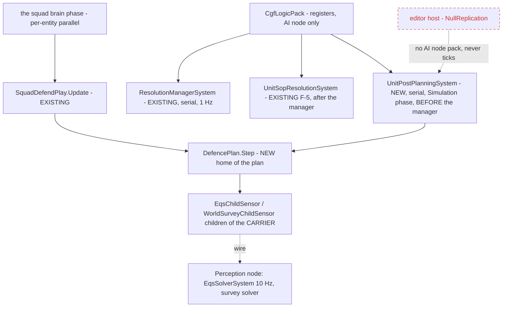

<!--STATUS
state: LIVE
build-state: READY-TO-BUILD — DP3-A…DP3-D APPROVED as written (user 2026-11-17, R-4286; NOTE_Coordinator_To_AggBehaviors_DP3_Approved.md); DP3-B's manager wait is agg-backend's
updated: 2026-11-17 (approved, R-4286)
current-answer: §0 the decision · §2 the claim table · §3 classes · §4 sequence · §5 modules · §6 the sub-questions with leans · §7 acceptance
stale-below: nothing.
known-rot: none.
known-conflict: DESIGN_Stochastic_Units_And_Resolution.md §16 P-1 / P-2 (posts surveyed ONCE when the unit settles) — already SUPERSEDED there by §16a; this design follows §16a / SV-5 (posts planned during the split's Planning stage)
related-designs:
  - DESIGN_Stochastic_Units_And_Resolution.md — OWNS the split process (§16a D-P1…D-P7), SV-5 (the planned-posts component), the manager (§16b) and R-8330 (why ST-5 C stopped); this file answers its D-P3 for the SQUAD leaf only
  - ../group-maneuvers/DESIGN_Defend_And_Attack_Position.md — OWNS SquadDefend's plan (§8c D-1…D-2m), D-2f authored posts (the handover path) and §13b R-2037 (the brain asks the muscle, never reads geometry) that rules out a synchronous plan
  - ../eqs-2/EQS_Design_v1.3_final.md — OWNS the child-sensor road the asks ride (EqsChildSensor, epochs, the Muscle's 10 Hz solver) and the baked cover provider (A7) that is this problem's "precomputed tactical data"
  - ../../DESIGN_World_Survey_Sensor.md — OWNS the frame / fan / coverage surveys (WorldSurveyChildSensor) the plan's later stages ask
  - ../../DESIGN_Orders_Params_Entity_Classes.md — OWNS the order routing the handover's re-resolution (X-2) goes through
-->

# D-P3 — real defence posts for a splitting stochastic squad *(agg-behaviors, `2026-11-16`)*

🔒 The ask (§16a D-P3, SV-5): a stochastic squad about to split gets REAL posts (windows, frames, roof, cover) so its men materialise on them —
today they land on `UnitSplits.FallbackPosts`' line (`UnitResolution.cs:84-99`). Stopped once (R-8330, §23.5c) because the plan is bound to a
commander's sensors and live men. Links: [main design](https://github.com/pjanec/HROT/blob/exp/agg-behaviors/docs/designs/aggregate-units/DESIGN_Stochastic_Units_And_Resolution.md) ·
[SquadDefend §8c](https://github.com/pjanec/HROT/blob/exp/agg-behaviors/docs/designs/group-maneuvers/DESIGN_Defend_And_Attack_Position.md).

## 0. The decision *(under a page)*

**Decision.** Run SquadDefend's OWN plan — not a copy — over a *crew* abstraction: the physical play's crew is its roster (unchanged); the
stochastic crew is the unit entity itself (a placed origin, the EQS carrier) plus its slot table (count, roles) with every virtual man standing
on his fallback point. A behaviors-side `UnitPostPlanningSystem` steps that plan every frame for each squad-echelon unit in `Planning` whose
current order is a Defend, and writes the result into **`PlannedPosts` (138)** on the unit. agg-backend's manager **waits** in `Planning` until
`PlannedPosts.Ready` or its existing `DeadlineSeconds` (`UnitResolution.cs:41`, D-P5), then materialises the men AT the planned posts (fallback
for any slot left without one). Once the order re-resolution on a switch (X-2) exists, the same posts ride the re-resolved `SquadDefend` order as
D-2f `Posts`, so the physical squad starts Set with no survey.

**Rejected** *(one line each)*
- a separate stochastic post planner — a second implementation of the defence plan (shared-and-unified rule); it drifts from D-2a…D-2m at once.
- posts precomputed per house (at load, or when the unit settles — §16 P-1) — P-1 is SUPERSEDED (§16a: a split happens anywhere, any time), and R-2037 forbids the brain from reading baked geometry: doors, smoke and damage are known only to the muscle.
- a synchronous plan inside the manager's Planning step — the asks are solved on the Perception node (10 Hz banded solver, EQS §19 / §13b), so no answer exists within one call; and `Fdp.Toolkits` cannot reference `Hrot.AI.Behaviors`.
- the manager calling a planner seam at its 1 Hz step — each of the plan's ≤ 5 stages would wait for the next step (≥ 5 s for a plan the solver answers in about a second), and the manager would own a behaviour's state.
- writing the posts straight into the physical squad's blackboard at the handover — a second entry beside the order contract; D-2f `Posts` already is that entry.

**Design docs checked**
- `DESIGN_Stochastic_Units_And_Resolution.md` §16a / §16c / SV-5 / R-8330 — applies: owns the requirement and the component; ⚠ its P-1 / P-2 are superseded and not followed.
- `DESIGN_Defend_And_Attack_Position.md` §8c (D-2f…D-2m) — applies: the plan reused, D-2f is the handover path. §13b (R-2037 / R-2038) — applies and DECIDES DP3-A / DP3-B: geometry comes from the muscle, asynchronously.
- `EQS_Design_v1.3_final.md` §19.5 (`EqsContext.Self`: slot 0 any PLACED entity) and A7 (cover provider baked at terrain residency) — applies: the unit entity can be the origin, and the "precomputed tactical data" of the proven solution already sits under the asks on the muscle.
- `DESIGN_World_Survey_Sensor.md` — applies: frame / fan / coverage surveys take a carrier entity and an area, no member.
- `DESIGN_Orders_Params_Entity_Classes.md` — applies to DP3-D only (re-resolution); ⚠ X-2 is not built (§2 row 9).
- `DESIGN_Aggregate_Squad.md` (FusionSquad) — does not apply: optional and deferred (R-4253); nothing here needs a FusionSoldier.

## 1. INVENTORY *(graph AND grep; `scripts/cbm.sh`, project `home-user-HROT`, indexed this session)*

| query | total | what it found that matters |
|---|---|---|
| `search_graph name_pattern=".*Post.*" label=Class` | 32 | `AuthoredPosts`, `DefencePosts`, `DefencePostPicker` (`SquadDefendBehavior.cs`), `CoveragePosts`, the EQS templates `FindDefensiveWindowPosts` / `…SetBackPosts` / `FindWindowPostsAllRound` / `…SetBackPostsAllRound` / `FindRoofPosts` / `FindCoverPosts`, `SquadManeuverRunner.MemberPost` — ⭐ no planned-post or post-planner type exists |
| `".*Planned.*"` Class | 2 | `PathReplannedEvent`, `PlannedPathGizmo` — ⭐ `PlannedPosts` does not exist (138 reserved, R-8329) |
| `".*Planner.*"` Class / Interface | 5 / 0 | `RoutePlanner`, `TransitionPlanner`, `ClusterMasterPlanner`, `SocialPlanner` — none plans posts |
| `".*Defen[cs]e.*"` Class | 7 | `DefencePostPicker`, `DefencePosts`, `PlatoonDefencePlan`, `PlatoonDefendBehavior`, `SquadDefendBehavior` (+ air defence) — the ONE defence plan is `SquadDefendPlay.Plan` |
| `".*SquadDefend.*"` Class | 7 | `SquadDefendPlay`, `SquadDefendParams`, `SquadDefendBlackboard`, `SquadDefendManeuver` (Fdp.Toolkits), the two DTOs |
| `".*Resolution.*"` Class / Interface | 17 / **0** | `TacticalIntentResolutionSystem`, `TerrainQueryResolutionSystem` … ⚠ the graph MISSED `IUnitResolutionSwitch` and `ResolutionManagerSystem` — grep finds both (`UnitResolution.cs:52, :125`) |
| `".*Split.*"` Class | 10 | `PlatoonDefendBehavior.SectorSplit` — nothing splits a unit's posts |
| `".*Eqs.*"` Class / Interface | 134 / 7 | `EqsChildSensor`, `EqsContext`, `EqsSchedule`, `EqsCognitiveBuffer` — the carrier road takes any parent entity |
| `".*Survey.*"` Class · `".*CoverProvider.*"` Class | 24 · 4 | `WorldSurveyChildSensor`; the muscle's baked `TerrainCoverProvider` |
| `".*Tactical.*"` · `".*Footprint.*"` Class | 23 · 8 | no tactical-position store on the brain; `VehicleFootprint` (EQS hull sizing) only |
| `search_code "ReResolve\|Reissue.*Order\|ResolutionChanged"` regex | 0 relevant | ⭐ nothing re-issues an order on a resolution switch (X-2 unbuilt) |
| grep `AggregateChild` | 4 files | the split's children join no roster (no squad code reads the tag) |

⚠ Coverage could not be checked (`check_index_coverage` is not in the CLI); the `Resolution` miss above is why every absence row is grep-confirmed.

## 2. The claim table

| the lean rests on | code — how it IS | design — how it was MEANT |
|---|---|---|
| 1 the plan is one async state machine over a commander's EQS children, measured from the first live man | ✅ `SquadDefendBehavior.cs:492-566` (`FirstLive` :495, `AskTerrainAll` :524-527), `SquadManeuverRunner.cs:778-818` (carrier = `ctx.Commander`) | ✅ §8c D-1, §23.5c R-8330 |
| 2 the roster is read only in four places: `AnyWithoutPost`, `PickAll`, `MedianTier`, `GunOnTheLongestView` | ✅ `:858-864`, `:707-747`, `:631-639`, `:574-584` | ⛔ searched §8c, none states it |
| 3 any PLACED entity can be the ask's origin; a carrier needs only to be alive | ✅ `EqsContext.cs:19-30` (slot 0, else observer, else carrier's parent); `EqsChildSensor.Ensure(view, parent, …)` `EqsChildSensor.cs:67` | ✅ EQS §19.5 |
| 4 the unit entity is placed and on the wire | ✅ brain: the manager's query `With<SimTransform>` `UnitResolution.cs:157`; wire: `dtAggregateUnit` 220 `AllDescriptors.cs:224`. ⛔ its `SimTransform` on the Perception node assumed (the generic position descriptor) — **measured first in slice ①**; if false the ask has no origin and returns empty ⇒ fallback (safe) | ✅ ST-2 N-1 (LOS between footprint samples on the Muscle) presumes it |
| 5 geometry cannot be read synchronously on the brain | ✅ asks go out as `EqsSensor` config, answers come back (`EqsSensorConfigEgressTranslator`, `EqsResultIngressTranslator`) | ✅ R-2037 / R-2038, §13b |
| 6 the manager's Planning is one step and already carries a deadline | ✅ `UnitResolution.cs:245-252` (Materialise at once), `DeadlineSeconds = 10` declared, unread (`:41`) | ✅ D-P5 |
| 7 `Materialise` places the k-th LIVE slot on `posts[k]` | ✅ `UnitResolution.cs:333-352` | ✅ D-P4 |
| 8 a slot carries a role, no proficiency | ✅ `UnitSlot` `AggregateComponents.cs:210-222`, `SlotRole.MachineGunner = 3` | ⛔ searched, none on the stochastic tier — the unit's own proficiency (or Regular) stands in |
| 9 X-2 (re-resolve the order on a switch) is NOT built; children join no roster | ✅ `Handover` maps health / stress / ammo only (`UnitResolution.cs:359-380`); search_code 0 | ✅ X-2, SV-10, RV-17 say it should be ⇒ DP3-D part ② waits on it |
| 10 authored posts skip the asks when every man holds one; cap 8 | ✅ `:496-506`, `SquadDefendPostJsonDto.MaxPosts = 8` | ✅ D-2f |
| 11 the proven solution for this class: plan from the aggregate's origin / footprint with the same unit planner, over precomputed tactical position data, as an async stage with a lead time and a deadline fallback to the formation template | adopt / adapt: origin ✅ (row 3) · precomputed data ✅ already on the muscle (`TerrainCoverProvider`, EQS A7) · async + deadline ✅ (rows 5, 6) · a brain-side position database ⛔ rejected (R-2037) | — |

## 3. Classes

*What it shows that prose hid: ONE plan (`DefencePlan`) and two crews — the physical squad's behaviour changes only by an extract-method, and the
stochastic path adds a crew and a system, never a second planner. The only agg-backend box that changes is the manager's wait.*

## 4. Sequence — a stochastic squad holding a house splits

*What it shows: the plan is a race against the deadline the manager already declares; every stage times out on its own 5 s
(`AskTimeoutSeconds`), so a silent muscle degrades to the fallback line, never to a stall. The last arrow is DP3-D part ②.*

## 5. Modules — who runs it each frame

*What it shows: the planner rides the SAME registration site as the manager (`CgfLogicPack.cs:290-301`), so every host that splits also plans
— by construction. It runs serially before the manager, so the manager sees `Ready` in the same frame; the brain phase keeps the physical play
on its own path. ⚠ The dashed edge: a host without the CGF pack runs neither the manager nor the planner — consistent, nothing splits there.*

## 6. The sub-questions — each with a lean

| # | question | ⭐ lean | blast radius | would change it |
|---|---|---|---|---|
| **DP3-A** | where the plan runs | **reuse SquadDefend's plan**: extract `SquadDefendPlay.Plan` (and `Settle` / `Frames` / `PickAll` / `Coverage` / `GunOnTheLongestView`) into `DefencePlan.Step` over an `IDefenceCrew` (constrained generic, no boxing — R-2084); `AskTerrainAll` takes the carrier instead of reading `ctx.Commander`. `SlotCrew`: carrier = origin = the unit; live = `IsUp(i)`; at = the slot's `FallbackPosts` point; support = `Role == MachineGunner`; tier = the unit's proficiency, else Regular. Squad echelon only (`Echelon == 0`, ≤ 13); a platoon / company keeps the fallback until P-3/P-4's allocation | Hrot.AI.Behaviors only: `SquadDefendBehavior.cs`, `SquadManeuverRunner.cs` (one overload), one new file. The physical defence is an extract-method — proved by its suites unchanged (§7) | the user wanting the platoon / company planners in the same slice; or slot 0 not placed on the muscle (row 4) ⇒ then slot 1's point (`ContextPoint1`) as the target and a placed carrier added — measured first |
| **DP3-B** | sync or async Planning, and its deadline (agg-backend) | **async**, stepped by `UnitPostPlanningSystem` every frame for units in `Planning`; the manager's Planning case changes from "materialise now" to: `forced` ⇒ as today (C-7); else `PlannedPosts.Ready` **or** `now − SplittingSince ≥ DeadlineSeconds` ⇒ `Materialise` with planned posts first, `FallbackPosts` for the remaining live slots. Keep `DeadlineSeconds = 10` (the stage timeouts are 5 s each; measured answers come within the 10 Hz solver's banding). A withdrawn trigger clears `PlannedPosts` | agg-backend: `UnitResolution.cs:245-252` (≈ 10 lines) + the D-P1 lead absorbing up to 10 s more; `agg-split-on-contact` / `agg-squad-holds-house` goldens move (the split lands later) | a measured plan time > 10 s on `sq-defend-house` ⇒ raise the deadline in `ResolutionPolicy`, not the code |
| **DP3-C** | what 138 stores, and its record policy | **`PlannedPosts`** (id 138, unmanaged, ≤ 1024 B — RV-11): per LIVE-slot order (the order `Materialise` walks) 13 × { point (3 float), watch point (3 float, zero = the sector — D-2f's convention), flags byte: window · roof · frame · authored · gun }, `Count`, `Ready`, `Stage` (so a seek mid-plan restarts the asks), `PlannedAt`. **Recorded, `NoScenario`** (like `AggregateChild`: process state, never saved); **no wire descriptor** — only the owning AI node writes and reads it | Fdp.Toolkits (the struct, beside `AggregateChild`), `HrotSharedComponentRegistry`; ⚠ SV-12: add every field NOW — a later field is a versioned break | agg-ui wanting to draw the planned posts on the split's progress ⇒ add a descriptor then |
| **DP3-D** | how the handover passes the posts | **two parts.** ① now: `Materialise` places each man AT his planned post (D-P4) — this alone delivers the ask (the men appear on windows, not the line). ② when X-2 lands (a switch re-resolves the unit's current order from `BehaviorStartRecord`, RV-17, and the children join the squad's roster): the re-resolved `Order.Defend`'s params carry `Posts` = `PlannedPosts` (D-2f) ⇒ authored first, no ask, every man within `PostRadius` ⇒ Set at once. Raise `SquadDefendPostJsonDto.MaxPosts` 8 → 13 (= `CapacityFor(0)`) in that slice, else men 9–13 are surveyed again | ① none beyond DP3-B. ② the `SquadDefendParams` layout grows (5 more posts): ⛔ whether the blackboard is recorded is NOT measured — if it is, a versioned break under SV-12 | X-2 being designed to hand the play's state over directly (phase mapping, SV-10) instead of a fresh order ⇒ pass the posts through that seam |

⭐ **Physical defence unchanged:** the only change to the physical path is the extract-method and the carrier parameter; the plan's stages, timeouts,
picker and the D-2a…D-2m semantics stay byte-for-byte. ⛔ `PlannedPosts` is never read by `SquadDefendPlay` except through D-2f `Posts`.

## 7. Acceptance *(R-4277: scenarios are the verdict)*

| what | rail / scenario | ⭐ passes when |
|---|---|---|
| the physical defence unchanged — its OWN suites (T-1) | `SquadManeuverTests` `CE2275_*` (posts, window way, median tier, roof, gun, D-2j, authored, D-2l ×4, alternate, flanked, hold-fire), `CE2304_*`, `CE2345_*`, `CE2359_*`, `CE2373_*` ×2, `CE2376_*`, `CE7007_*` (ActiveDefence), `CE2276_PlatoonDefend_*` | all green, no edit to any assertion |
| the defence scenarios | `sq-defend-house`, `pc-defend-house`, `bc-house-defended`, `ts-house-defenders`, `ts-three-defenders`, `ia-area-defend`, `agg-probe-defend`, `agg-prepared-defence` | `scripts/scenario-regression.sh` pass, goldens SAME |
| the parallel rule | the rails above under `HROT_PARALLEL_SIM=1` + `HROT_READ_CHECK=1` + `HROT_WORLD_GUARD=1`; `stepped-hash.py --threads 1,4,8` on `sq-defend-house` | no throw; the same hash |
| the planner | new rails in `SquadManeuverTests` (the defence's suite): a memberless squad in a house gets window posts within the deadline; a silent muscle ⇒ fallback at the deadline; a withdrawn trigger clears `PlannedPosts`; a steady planning frame allocates 0 B | red-proved by a compiling mutation each |
| the feature | `agg-squad-holds-house` re-judged: its `checks.json` line rows become "each child within `PostRadius` of a window post" | pass + golden; `$doc` updated |
| agg-backend's wait | `UnitResolutionRails` (Fdp.Toolkits.Tests): Ready ⇒ planned posts used; deadline ⇒ fallback; forced ⇒ no wait | red-proved |

## 8. Slices

| # | lane | builds |
|---|---|---|
| ① | agg-behaviors | measure row 4 (the unit placed on the Perception node); `DefencePlan` extract + carrier parameter — the physical suites and scenarios green FIRST, nothing else in the commit |
| ② | agg-backend | `PlannedPosts` (138 — agg-behaviors' id, declared in the shared pack per §23.2) + the manager's wait (DP3-B) |
| ③ | agg-behaviors | `SlotCrew` + `UnitPostPlanningSystem` + its rails; `agg-squad-holds-house` re-judged |
| ④ | whoever builds X-2 | DP3-D ② and `MaxPosts` 13 |
