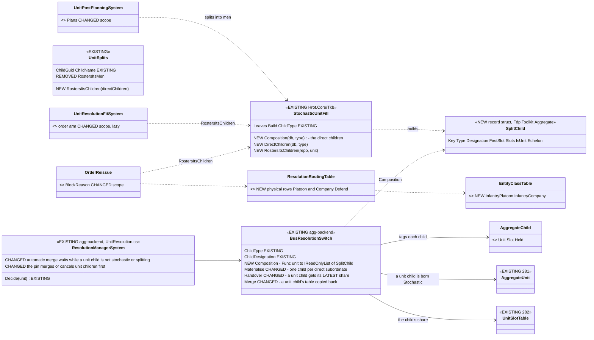
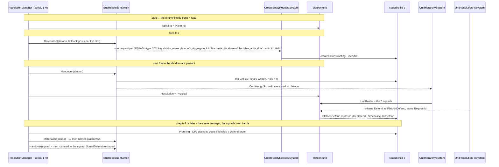
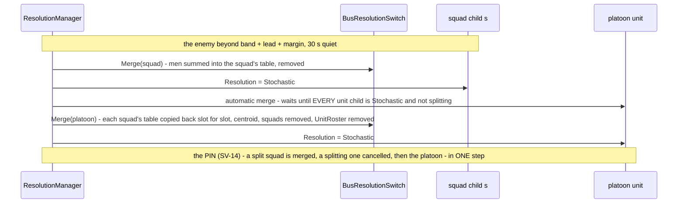
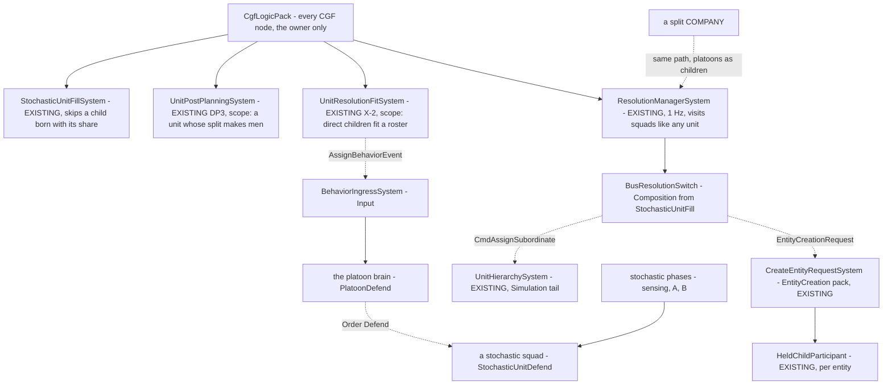
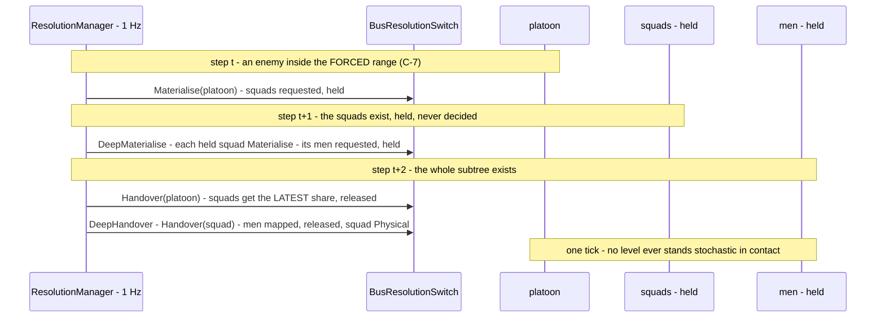

<!--STATUS
state: LIVE
build-state: BUILT (2026-11-17, agg-behaviors — CE-8307, §11 the as-built; was READY-TO-BUILD; lane decisions R-8382 … R-8391 "for the user's review"; the independent review folded in §10 — R-8392 … R-8399, the coordinator's decisions)
updated: 2026-11-24 (§10 F1 — a hold-back attack re-resolves to PlatoonSupportByFire, CE-4686 ③) · 2026-11-17
current-answer: §11 AS BUILT (read first) · §10 the review (its decisions OVERRIDE the rows they name) · §0 the decision · §3–§5a the UML · §6 the sub-questions with leans · §7 slices and acceptance
stale-below: nothing.
known-rot: §6 Q-e's "an order with no platoon row … holds the AUTOMATIC split" and §9 F-SOL-2 — SUPERSEDED by §10 R-8392 (Attack / Hold / Bound / SupportByFire rows, the relay); §6 Q-a's Pin ("a unit child starts unpinned") — SUPERSEDED by R-8395
known-conflict: none — this design RESOLVES DESIGN_X2_Order_Reresolution.md's known-conflict (F-X2-1: the split flattens a platoon to men, against §13 X-5 / §16a D-P7)
related-designs:
  - ../llm-commander/DESIGN_LLM_Commander.md — the LLM commander's seat over aggregated units (§5d): the run that measured the hold-back clear (§5d.1)
  - DESIGN_Stochastic_Units_And_Resolution.md — OWNS the split process (§16a D-P1 … D-P7), the manager and its bands (§16b, §23.4 F-23), X-3 / X-4 / X-5 (§13), SV-1 … SV-15 (§17.1); this file builds X-5 / D-P7 "one level at a time" for the switch agg-backend built (§23.4)
  - DESIGN_X2_Order_Reresolution.md — OWNS the order re-issued on a switch (the reconciler, the roster through CmdAssignSubordinate, SwitchBlocked); filed F-X2-1, which this file closes, and X2-I's "platoons later" that §6 Q-e here builds
  - DESIGN_DP3_Planned_Posts.md — OWNS the squad's planned posts (PlannedPosts 138, UnitPostPlanningSystem); after this design a platoon's split hands its SQUADS to it, so DP3 applies at every echelon's leaf (§6 Q-g)
  - ../group-maneuvers/DESIGN_Defend_And_Attack_Position.md — OWNS PlatoonDefend (the platoon's physical Defend) that a split platoon re-resolves to
  - ../../DESIGN_Orders_Params_Entity_Classes.md — OWNS the entity class table and the order routing the new InfantryPlatoon / InfantryCompany classes extend
-->

# Split ONE level — a stochastic platoon becomes stochastic SQUADS, not 30 men *(agg-behaviors, `2026-11-17`, CE-8307)*

🔒 User, `2026-11-17`: *"Please work on making stochastic platoon split into squads instead of 30 soldiers."* The approved rule it builds:
§13 X-5 *"switch one level at a time"* and §16a D-P7 *"a deep split runs the SAME cascade, level by level, quickly — no special path;
re-aggregation is the reverse and simpler (sum, then remove)"*. Links: [main design](https://github.com/pjanec/HROT/blob/exp/agg-behaviors/docs/designs/aggregate-units/DESIGN_Stochastic_Units_And_Resolution.md) ·
[X-2](https://github.com/pjanec/HROT/blob/exp/agg-behaviors/docs/designs/aggregate-units/DESIGN_X2_Order_Reresolution.md) ·
[DP3](https://github.com/pjanec/HROT/blob/exp/agg-behaviors/docs/designs/aggregate-units/DESIGN_DP3_Planned_Posts.md).

## 0. The decision *(under a page)*

**Decision.** A split creates the unit's **DIRECT subordinates** from its TKB composite, never its flattened leaves. A direct subordinate that is
itself a composite (a platoon's squad, a company's platoon) becomes a **stochastic unit** — an `AggregateUnit { Stochastic }` of that type carrying
**its share of the parent's slot table** (the slots of the leaves under it, renumbered to its own composite); a direct person stays a man
(today's path); a vehicle leaf is not materialised (as today). The manager then governs each child by its OWN bands, so with the enemy inside the
band the squads split into men on the next steps — the cascade (D-P7). The merge is the reverse: a parent merges only once every unit child is
stochastic again (automatic) — leaves first — and copies each child's table back slot for slot. Everything rides agg-backend's existing switch: ONE
new host seam on `BusResolutionSwitch` (`Composition` — the unit's direct children with their leaf ranges, given by `StochasticUnitFill`, beside
`ChildType`), no new component, no layout change. The split platoon becomes a physical command unit: its squads join its `UnitRoster` (X-2's
assign path) and its order re-resolves to `PlatoonDefend` (new `InfantryPlatoon` / `InfantryCompany` classes + physical fallback rows), which
orders the stochastic squads by kind (ST-0's routing).

**Rejected** *(one line each)*
- a platoon play that de-aggregates its own squads — §16b: the manager owns the resolution; the brain never takes part.
- partitioning the slot table onto chunk entities (one table, ranges on the parent) — R-8000: a slot table lives on its unit; a chunk on another entity is a cross-entity write.
- splitting the parent's HOLDINGS among the children — a holding is a count by TYPE, not by leaf (`UnitHoldings`); the children get none, the parent keeps them (conserved), and vehicles are not materialised today either (F-SOL-1).
- keying children by the flattened leaf (`child:<leaf>`) — a squad of the platoon would be `child:1`, `child:11`, `child:21`; the direct index (`child:1..3`) is what F-22's names and X-3's "same children" mean at every echelon, and for a squad direct == leaf, so every squad golden holds.
- a new `AggregateChild.Group` field — a layout change (SV-12); the child's own `AggregateUnit` says it is a unit child, and `Slot` carries its key.
- merging the whole tree in one step on the automatic path — the children's own quiet / observed / contact rules would be bypassed; leaves-first keeps each level's rule (the PIN does cascade in one step, SV-14).
- `RostersItsMen` kept (echelon 0 and ≤ 16 slots) — the echelon is unreliable (an authored table never sets it, R-8372) and the question is now "do the DIRECT children fit a roster".

**Design docs checked**
- `DESIGN_Stochastic_Units_And_Resolution.md` §13 X-3 / X-4 / X-5, §16a D-P2 / D-P4 / D-P6 / D-P7, §17.1 SV-4 / SV-6 / SV-12 / SV-14, §23.4 — applies and DECIDES (one level; the same cascade; identity; held; no layout change).
- `DESIGN_X2_Order_Reresolution.md` §7 X2-B / X2-D / X2-I, §10 F-X2-1, §11 R-8372 — applies: the roster and the re-issue are reused unchanged; X2-I's platoon rows are built here.
- `DESIGN_DP3_Planned_Posts.md` §0, §9 — applies: its scope ("echelon 0") becomes "a unit whose split creates men", so the squads of a split platoon plan their posts.
- `../group-maneuvers/DESIGN_Defend_And_Attack_Position.md` (PlatoonDefend orders squads) — applies: the physical play over stochastic squads (ST-0 R-8305 routes by kind).
- `../../DESIGN_Orders_Params_Entity_Classes.md` §15 (Fulfils, R-2089) — applies: decides which platoon plays get rows (only those that FULFIL the kind: `PlatoonDefend`, `CompanyDefend`; `PlatoonAttack` declares no kind — F-SOL-2).
- `DESIGN_Aggregate_Squad.md` (FusionSquad) — does not apply: deferred (R-4253).

## 1. INVENTORY *(graph AND grep; `scripts/cbm.sh`, project `home-user-HROT`)*

| query | total | what it found that matters |
|---|---|---|
| `search_graph ".*(Split\|ResolutionSwitch\|ResolutionManager\|UnitSplits\|HeldChild\|StochasticUnitFill).*" Class` | 20 | `BusResolutionSwitch`, `ResolutionManagerSystem`, `UnitSplits`, `HeldChildParticipant`, `StochasticUnitFill(+System)`, `SplitProgress` (UI) — ⭐ ONE switch, ONE manager, ONE fill: extend them |
| `search_graph ".*(Composition\|Composite).*" Class` | 24 | `TkbCompositionDef` (the composite), `CompositeUnitTkbTranslator`, `CompositeEntityCreationRequestSource`, ⚠ `UnitCompositionDto` (Fdp.Toolkits, `Gen.UnitComposition`) — grep: **no reader** (a dormant mirror; not used here, F-SOL-3) |
| `search_graph ".*Roster.*" Class` | 9 | `UnitRoster` (cap 16) is the one commander list; `RosterCrew` (DP3) — no aggregate roster |
| `search_graph "(Leaves\|ChildType\|…\|RostersItsMen\|Expand)" Method` | 60 (page) | only rails beyond the switch; grep below is the call-site set |
| grep `StochasticUnitFill\.(Leaves\|ChildType\|ChildDesignation\|Build\|EchelonOf)` | 4 production | `CgfLogicPack.cs:302, :308` (the switch's two Funcs), the fill itself — ⭐ ONE place wires the composite into the switch |
| grep `RostersItsMen` | 5 | `UnitResolution.cs:110, :458` · `UnitResolutionFitSystem.cs:119` · `OrderReissue.cs:39` · rail `X2I_*` |
| grep `"InfantrySquad"` in classes / rows | 3 | `EntityClassTable.cs:257` (`11.1.*.1.2`), `ResolutionRouting.cs:94-95` — ⭐ NO `InfantryPlatoon` / `InfantryCompany` class |
| grep `Fulfils = ` (platoon / company plays) | ~~3~~ **5** *(corrected by the review)* | `PlatoonDefend`, `CompanyDefend` (Defend), `PlatoonHold` (Hold), `PlatoonBound` (Bound), `PlatoonSupportByFire` (SupportByFire) — `PlatoonAttack` / `CompanyAttack` declared none (they do now, R-8392) |
| grep `u.Echelon == 0` | 1 | `UnitPostPlanningSystem.Plans` (DP3's scope) |

⚠ Coverage could not be checked (`check_index_coverage` is not in the CLI); every absence above is grep-confirmed.

## 2. The claim table

| # | the lean rests on | code — how it IS | design — how it was MEANT |
|---|---|---|---|
| 1 | the split flattens: one child per live slot, typed by the flattened leaf | ✅ `UnitResolution.cs:414-442` (`Materialise`), `StochasticUnitFill.cs:31-50` (`Leaves`) | ⛔ conflicts with X-5 / D-P7 (§13, §16a) — F-X2-1 |
| 2 | the platoon composite (305) is 3 × squad (302); the squad is 1 officer + 9 riflemen ⇒ leaves 1–10 / 11–20 / 21–30 | ✅ `NedTkbCatalog.cs:1179-1206` | ✅ X-3 / SV-3: the same composite the physical units are built from |
| 3 | a child is a TRANSIENT creation request with arbitrary initial components (struct components applied as given) | ✅ `UnitResolution.cs:426-438`; the scenario spawn path feeds `AggregateUnit` / `UnitSlotTable` the same way (`ScenarioSpawnAdapter.cs:263-292`) | ✅ SV-4 |
| 4 | a held child is Constructing ⇒ invisible to default queries (the manager's, combat's) until `Held = 0` | ✅ `HeldChildren.cs`, §23.4 ST-5 HELD row | ✅ SV-6 |
| 5 | the fill leaves a unit with a non-empty table alone ⇒ a child born with its partition is not re-filled | ✅ `StochasticUnitFill.cs:200` (`Count > 0 ⇒ continue`) | ✅ CE-8016 "filled once" |
| 6 | the manager decides every owned `AggregateUnit` each second by the nearest physical enemy — a stochastic squad child is one | ✅ `UnitResolution.cs:193, :211-212` | ✅ §16b; D-P7 "the SAME cascade" |
| 7 | the handover maps the LATEST table (losses during Materialising count) | ✅ `UnitResolution.cs:453-484` | ✅ D-P4 |
| 8 | the merge copies each child's health / stress / ammo back into its slot and marks a slot with no child down | ✅ `UnitResolution.cs:492-524` | ✅ X-4, D-P7 "sum, then remove" |
| 9 | a physical platoon has no physical row for Defend (no `InfantryPlatoon` class) ⇒ `BlockReason` would hold its split | ✅ `EntityClassTable.cs:249-258`, `ResolutionRouting.cs:94-95`; X2 §11 R-8369 | ✅ X2-I: "then `(InfantryPlatoon, Physical, Defend) → PlatoonDefend` rows and new classes (DIS echelon 4 / 5)" |
| 10 | `PlatoonDefend` routes `Order.Defend` to a STOCHASTIC member (the generic play) | ✅ `CommandNodes.Route` (`CommandNodes.cs:59-77`), used by `PlatoonDefendBehavior.cs` | ✅ ST-0 R-8305 |
| 11 | the roster lands through `CmdAssignSubordinate` — a unit entity may be a subordinate | ✅ `UnitResolution.cs:476-481`; physical platoons hold squad commanders (`city_battle_macros`, CC-D) | ✅ commander-subordinates §5.2 |
| 12 | `AggregateChild` layout must not change (recorded) | ✅ `UnitResolution.cs:18-29` (16 B, NoScenario ⇒ recorded) | ✅ SV-12 "a layout change is a finding" |
| 12a | ⚠ **DEPARTURE from §16a D-P2 / D-P4** (review F5): D-P2 plans TOP-DOWN before anything is created (each level's real planner, children in parallel); here a parent creates its children at FALLBACK posts and each child plans its own posts only once it exists and holds its parent's order (R-8397). On the FORCED path nobody plans (C-7: no planning time) — as before | ✅ `UnitResolution.cs` `AwaitsParentsOrder`, `DeepMaterialise` | ⛔ D-P2 says top-down planning — no platoon / company planner exists to plan for (D-P3 "⏳ their inputs not yet measured") ⇒ the departure is the cost of having only the squad planner; recorded in the main design's §16a note |
| 13 | **the proven solution** (multi-resolution: HLA aggregate/entity federations, JTLS-JCATS, the "aggregate-level disaggregation" literature): disaggregate ONE echelon at a time, each level an aggregate in its own right with its own trigger; state partitioned by subordinate, summed back on re-aggregation | adopt: per-level children, partition by leaf range, leaves-first merge · reject: partitioning holdings (no per-leaf state exists to partition) | ✅ §13 "the proven solution — chain: one level at a time" |

## 3. Classes

*What the picture shows that prose hid: ONE new type (`SplitChild`, a value) and ONE new seam (`Composition`) on the existing switch — every other
box is an existing owner whose SCOPE changes. The composite is read in exactly one place (`StochasticUnitFill`), as `ChildType` already was.*

## 4. Sequence — a platoon splits, its squads split (the cascade)

*What it shows: there is no "deep split" path — the squad is just another unit the manager visits on its next step. A forced (C-7) range skips
Planning at each level, so a platoon in contact reaches men in ~2–3 s.*

## 5. Sequence — the merge back (leaves first)

*What it shows: the platoon's own quiet clock runs while its squads merge, so the platoon follows its last squad within one step — "the reverse and
simpler". The pin is the only path that merges two levels in one step.*

## 5a. Modules — who runs it each frame

*What it shows: every arrow already exists — the squads are reached by the manager and the stochastic phases because they ARE stochastic units, not
through anything new. The company edge is the recursion (Q-f): nothing is added for it.*

## 6. The sub-questions — each with a lean *(lane decisions R-8382 … R-8391, for the user's review)*

| # | question | ⭐ lean | blast radius | would change it |
|---|---|---|---|---|
| **Q-a** · **R-8382** | what a split creates | one child per DIRECT subordinate instance of the composite (`StochasticUnitFill.Composition`: key, type, designation, its leaf range, is-it-a-composite, echelon). A composite ⇒ an `AggregateUnit { Stochastic, Echelon, Formation, Posture, Prepared, Heading, Width = parent / unit children }` of that type with its share of the table; a person ⇒ a man (unchanged); a vehicle leaf ⇒ nothing (unchanged, F-SOL-1). Created only with ≥ 1 live slot. The parent becomes Physical — a body-less command unit | `UnitResolution.cs` (Materialise / Handover / Merge / Cancel), `StochasticUnitFill.cs`, `CgfLogicPack.cs` one Func | the user wanting the old flat split as an option (a policy flag) |
| **Q-b** · **R-8383** | the partition, conservation | a child's table = the parent's slots whose `CompositeSlot` lies in its leaf range, in table order, `CompositeSlot` renumbered `− FirstSlot + 1` (= its own composite's leaf index, so ITS split keys its men exactly as an authored squad's). Up AND down slots go (its `Authorized` stays true). Written at Materialise, OVERWRITTEN with the latest share at the Handover (D-P4). Merge: each child slot copied back to the parent slot with the same leaf — health, stress, ammo bit for bit (Half → Half); a parent slot whose child is gone is down (the existing rule). Holdings stay on the parent | as Q-a | — |
| **Q-c** · **R-8384** | the cascade | nothing new: the squad is a stochastic unit, owned on the same node, visited by the same manager the next step with the same bands — inside the band ⇒ Planning; inside the forced range ⇒ straight to Materialising. A deep split = consecutive steps (D-P7) | none | — |
| **Q-d** · **R-8385** | names and keys | the child key is its DIRECT-subordinate index (1-based): guid `ChildGuid(parent, key)`, name `<parent>/<key>`. A squad's men: direct == leaf ⇒ unchanged (every squad golden holds). A platoon's squads: `<platoon>/1..3`; their men `<platoon>/<s>/<n>` (`n` = the man's leaf in the squad). `AggregateChild.Slot` = the key for a unit child (discriminated by its `AggregateUnit`), the table index for a man (unchanged) | goldens of the platoon scenarios move (re-judged) | — |
| **Q-e** · **R-8386** | the platoon's order | X-2's reconciler unchanged: once the squads are rostered, the platoon's Defend re-resolves at Physical to `PlatoonDefend` — new classes `InfantryPlatoon` (`11.1.*.1.4`), `InfantryCompany` (`11.1.*.1.5`) and fallback rows `(InfantryPlatoon, Physical, Defend) → PlatoonDefend`, `(InfantryCompany, Physical, Defend) → CompanyDefend`. `PlatoonDefend` routes `Order.Defend` to its stochastic squads (ST-0). ⚠ An order with no platoon row (Attack, Move, BreakContact) holds the AUTOMATIC split (X2-D, approved) — F-SOL-2. Merge: the platoon merges when every squad is stochastic and quiet; `PlatoonDefend` re-resolves to `StochasticUnitDefend` (projected) | `EntityClassTable.cs`, `ResolutionRouting.cs` (agg-backend's), `OrderReissue` / fit scope | the user wanting a platoon under Attack / Move to split anyway (then a `PlatoonAttack` `Fulfils` + a row, behaviors') |
| **Q-f** · **R-8387** | company, battalion | the same rule, recursively: a company's children are its 3 stochastic platoons; each then splits into squads, each squad into men. A company's own table (≤ 120) partitions into platoon tables (30 ≤ 48) | none beyond Q-a | — |
| **Q-g** · **R-8388** | held, DP3, recording, replication | a unit child is HELD exactly like a man (the same per-entity participant; Constructing ⇒ no combat, no manager visit). DP3: its scope moves from "echelon 0" to "a unit whose split makes men" (`!StochasticUnitFill.SplitsIntoUnits`) — the squads of a split platoon plan their posts; a platoon plans none. Recording: no new component, no field, no layout change (SV-12); a child is an ordinary transient unit entity (`AggregateUnit`, `UnitSlotTable` already replicate) | `UnitPostPlanningSystem.Plans` | — |
| **Q-h** · **R-8389** | `RostersItsMen` / R-8372 | replaced by ONE rule, `UnitSplits.RostersItsChildren(n)` = `n ≤ UnitRoster.Capacity`, where `n` = the split's DIRECT children: the switch counts its `Composition` (else the table's slots); the behaviours side asks `StochasticUnitFill.RostersItsChildren(repo, unit)` (the composite's direct count, no allocation; no composite ⇒ the table's count). The echelon is no longer read (R-8372's trap disappears: `agg-merge-back`'s authored platoon table now groups into 3 squads) | `UnitResolution.cs`, `OrderReissue.cs`, `UnitResolutionFitSystem.cs`; rail `X2I_*` rewritten | — |
| **Q-i** · **R-8390** | the automatic merge of a parent | waits (no reset of its quiet clock) while any unit child is Physical or splitting; the PIN merges a split child and cancels a splitting one first, in the same step | `ResolutionManagerSystem.Decide` | the user wanting the platoon's quiet time to start only after its last squad merged |
| **Q-j** · **R-8391** | the reconciler's per-frame cost | the scope check moves AFTER the hash compare (only a misfit asks the TKB) — the steady frame stays one hash compare, 0 B | `UnitResolutionFitSystem.OrderArm` | — |

## 7. Slices and acceptance *(R-4277: the scenarios are the verdict)*

| # | builds | ⭐ passes when |
|---|---|---|
| **S1** *(cross-lane: agg-backend's `UnitResolution.cs`; ours + Hrot.Core)* | Q-a … Q-d, Q-h (switch half), Q-i; `StochasticUnitFill.Composition / DirectChildren / SplitsIntoUnits / RostersItsChildren`; `CgfLogicPack` wires `Composition` | `UnitResolutionRails` (+ `OL_*`): a 3 × 4 "platoon" splits into 3 held stochastic children keyed `child:1..3`, named `Alpha/1..3`, each table its leaf range renumbered with health / stress / ammo equal to the parent's; the handover writes the LATEST share; a child then splits into men named `Alpha/2/n`; the parent's automatic merge waits for its children, then the sums are exact; the pin cascades. `StochasticUnitFillTests` (+): 305's composition is 3 squads (1–10, 11–20, 21–30), 302's is 10 men with key == leaf. Each red-proved by one compiling mutation |
| **S2** *(ours; agg-backend's `ResolutionRouting.cs`)* | Q-e, Q-g (DP3 scope), Q-h (behaviours half), Q-j | `ResolutionRoutingTableTests` (+): a platoon's Defend at Physical ⇒ `PlatoonDefend`, a company's ⇒ `CompanyDefend`, the name rule still wins elsewhere; `BehaviorParamsValidationTests.X2C2_*` (every physical row fulfils its order) green with the new rows; `SquadManeuverTests.X2_*` green, + a split platoon's reconciler re-issues `PlatoonDefend` with the same id after its squads are rostered; 0 B steady |
| **S3** *(scenarios)* | the new and re-judged scenarios below | each `scripts/scenario-regression.sh <name>` passes, golden captured then SAME in a second fresh process |

**Feature-test scenarios** (`scripts/gen-agg-scenarios.py`, `scenarios/demos/aggregates/<name>/`):

| scenario | what | ⭐ the expect rows |
|---|---|---|
| **agg-platoon-splits-into-squads** *(new)* | a stochastic platoon (305, Defend) on berlin; a physical patrol walks in from 700 m to 150 m | the platoon Physical; 3 squads `
/1..3` each `AggregateUnit.Resolution` Stochastic at the platoon's handover, keyed `uuid5(P, child:s)`; each squad's table 10 slots up; the platoon's `UnitRoster` = 3; the platoon runs `PlatoonDefend`; later each squad Physical with its 10 men `
/<s>/<n>`; the platoon's table untouched (30 up); never a man named `
/<n>` (the flat split) |
| **agg-platoon-merges-back** *(new)* | the same platoon with LOSSES (authored: 3 dead, 2 hurt); the patrol comes, then leaves | splits to squads, then (forced range) to men; the patrol leaves past 800 m; the squads merge first, then the platoon — Stochastic; the table keeps every loss: exactly 3 down, 2 at 12.5, 27 up, never 28 |
| **agg-split-on-contact** *(re-judged)* | as built — a platoon | the handover now yields 3 squads `
/1..3`, not 30 men; the squads then split into `
/<s>/<n>` as the patrol closes inside their band |
| **agg-merge-back** *(re-judged)* | as built — the authored platoon | the same conservation rows; the children are squads; the pin re-split gives the SAME squad keys |

Parallel rule: the S1 / S2 rails under `HROT_PARALLEL_SIM=1 HROT_READ_CHECK=1 HROT_WORLD_GUARD=1`; `stepped-hash.py --threads 1,4,8 --chunk 60` on
`agg-platoon-splits-into-squads` — STATE EQUAL. Everything new is serial (the manager, the switch, the reconciler); no phase writes anything new.

## 8. Cross-lane edits *(named, per the lane protocol)*

| file | lane that owns it | the edit |
|---|---|---|
| `FDP/Toolkits/Fdp.Toolkits/Aggregate/UnitResolution.cs` | agg-backend | `SplitChild`, `BusResolutionSwitch.Composition`, one-level Materialise / Handover / Merge, the manager's merge wait + pin cascade, `UnitSplits.RostersItsChildren` (replaces `RostersItsMen`) |
| `Hrot/Engine/Hrot.Core/Tkb/StochasticUnitFill.cs` | agg-backend | `Composition`, `DirectChildren`, `SplitsIntoUnits`, `RostersItsChildren` |
| `Hrot/Engine/Hrot.Core/Tkb/ResolutionRouting.cs` | agg-backend | two physical fallback rows |
| `Hrot/Engine/Hrot.Core/Tkb/EntityClassTable.cs` | shared (classes) | `InfantryPlatoon`, `InfantryCompany` |
| `Hrot/Subsystems/Hrot.CGF/CgfLogicPack.cs` | shared | the `Composition` Func |
| `Hrot/Engine/Hrot.Core/MapDefinitions/Behavior/PlatoonAttackParamsJsonDto.cs`, `CompanyAttackParamsJsonDto.cs` | behaviors (the attacks) | the neutral `AttackOrder` fields (R-8392) |
| `Hrot/Engine/Hrot.Presentation/Forms/SplitProgress.cs` | **agg-ui** | `MenCreated` counts men (a squad child counts the men it carries) — review F10 |
| `Hrot/Engine/Hrot.Common/Diagnostics/Gizmos/HeldManGizmo.cs` | **agg-ui** | a held UNIT child drawn as a unit (a wider double ring) — review F10 |

## 10. The independent review — folded *(2026-11-17; verdict "build after the BLOCKERs"; the coordinator's decisions, recorded as lane decisions R-8392 … R-8399 for the user's review)*

| # | finding | ⭐ decision (as built) | id |
|---|---|---|---|
| **F1** ⛔ BLOCKER | §6 Q-e made a platoon under Attack / Move / Hold / Bound / SupportByFire / BreakContact WAIT stochastic (and Blocked pre-empted a FORCED split) — against §13 X-2 *"a stochastic platoon's attack becomes the real PlatoonAttack"* | (a) `PlatoonAttack` and `CompanyAttack` declare `Fulfils = Attack`; their DTOs accept the neutral `AttackOrder` (Target, Position, SearchRadius, HoldBack) — R-8300 rail; physical rows `(InfantryPlatoon, Physical, Attack / Hold / Bound / SupportByFire) → PlatoonAttack / PlatoonHold / PlatoonBound / PlatoonSupportByFire`, `(InfantryCompany, Physical, Attack) → CompanyAttack`. (b) ONE relay, `UnitRelayBehaviors.Relay`, registered as `UnitRelayMove` / `UnitRelayBreakContact` (one per neutral DTO, X2C2 needs one `Fulfils` per play): it passes the SAME order by kind with the same json to every rostered child (`CommandOrders.Order` — the routing table resolves it per child). ⚠ Deviation: rows on `InfantryPlatoon` / `InfantryCompany`, not `InfantryUnit` (an `InfantryUnit` row would also catch a squad's March / Dash, which have no name-rule play today — a behaviour change for physical squads). March / Dash need no row: a stochastic unit runs them as Move (X2-J). (c) a FORCED split is never held by `Blocked`. ⛔ ~~A HOLD-BACK attack (support by fire) has no platoon / company play (both close) ⇒ it still waits (F-SOL-4)~~ — ⭐ **AMENDED by CE-4686 ③** (backend, `2026-11-24`, cross-lane): a hold-back attack IS support by fire ⇒ at Physical it re-resolves to the kind SupportByFire's play (a platoon: `PlatoonSupportByFire`, which never closes; its Position — where it stands — carried, HoldBack dropped, `OrderReissue.ParamsFor`); a COMPANY has none and still waits. 📐 Measured: the old rule did not even wait — at a FORCED split (inside the band) the reconciler CLEARED the order (`its order has no play at Physical`), the platoon TaskFailed 150 m short of its support position (`llm-company-aggregated`, Haiku). Rail `CE8307_APlatoonsAttack_HasAPhysicalPlay_AHoldBackAttackBecomesItsSupportByFire` | R-8392 |
| **F2** ⛔ BLOCKER | the cascade released stochastic squads 250 m from the enemy — they fought ≥ 1 step before their own split (against X-5 *"before contact"*); `agg-forced-handover`'s golden named 30 men | a FORCED split materialises the WHOLE subtree HELD (`DeepMaterialise`: each held unit child creates its children, held, recursively) and every level hands over in ONE tick (`DeepHandover`). ⭐ D-P1's lead, re-stated per echelon: the trigger band's lead (200 m) buys the AUTOMATIC process ~1 manager step per level (planning + creation + handover ≈ 3 s for a squad, + 1 s per extra level — measured in the rails: platoon → men in 3 steps forced, 4 steps for a company); C-7's forced range (300 m) is where that budget is gone, so the forced path collapses every level into one held build | R-8393 |
| **F3** | a wiped-out Physical squad never merged ⇒ its platoon's leaves-first merge waited forever | a SPLIT unit (explicit `Physical` — only the handover writes it) with no live child merges at once, its slots down | R-8394 |
| **F4** | the pin cascaded on merge, not on split | a unit child inherits the parent's `PinPhysical` — DERIVED each step (`EffectivePin`), never copied (lifting the parent's pin lifts it below) | R-8395 |
| **F5** | the squad split ~1 s after its handover, before `PlatoonDefend`'s order landed ⇒ fallback posts, no DP3 | on the AUTOMATIC path a released unit child waits until it runs a SUPERIOR task or `DeadlineSeconds` (10 s) passes (`AwaitsParentsOrder`); the D-P2 departure is claim 12a and a note in the main design §16a | R-8397 |
| **F6** | the §7 sweep named 4 scenarios | §7a: a row for EVERY `agg-*` scenario with a stochastic 305 / 306, run one by one | — |
| **F7** | S2 did not compile without S1; `SplitsIntoMen` looked up the TKB every Planning frame; reds not proved at base | S1 re-landed with S2 in ONE buildable commit; `SplitsIntoMen` cached per (database, type), thread-safe, 0 B once filled; base `87d10e9b7` measured: `CgfLogicPackTests` ×3 (55 vs 52) and `CE4621_TheConductTable` RED AT BASE (pre-existing, the coordinator merge); `DP3_ASteadyPlanningFrame_AllocatesNothing` GREEN at base under the parallel checks ⇒ it was ours (the uncached lookup) | — |
| **F8** | the unit-level state did not fold back (X-4 "sums") | merge: the latest `LastContactAt` / `LastFiredAt`, the LEAST `Prepared`, the MOST `SuppressedShare` across the unit children | R-8399 |
| **F9** | the roster was assigned in entity-index order; `PlatoonDefend` picks squads by roster POSITION | the handover assigns in KEY order (stable across split → merge → split) | R-8396 |
| **F10** | the UI counted squads as men; the held-man ring drew a held squad as a man | `SplitProgress.MenCreated` counts MEN (a squad child counts the men it carries); `HeldManGizmo` draws a held unit child as a double, wider ring (cross-lane, agg-ui's files) | — |
| **F11** | DP3 "planned" for vehicle-only composites | `Plans` also needs a person in the slot table | — |
| **F12** | mixed composites untested; `RostersItsChildren` counted vehicles never created | a rail with an HQ man beside two squads; the switch counts the RELEASED children, `DirectChildren` counts persons and composites only | R-8398 |
| **F13** | the new classes change `Chain()` for every infantry platoon / company | the class-table rails and the order-menu tests run (§11) | — |
| untested | cluster grants, the split squad's SOP / cognitive state, a 3-level company, a pin mid-split, held units out of combat, key stability, stepped-hash | rails `Company_CascadesThreeLevels_OnAForcedSplit`, `PinMidSplit_*`, `F9_*`, `AHeldSquad_IsInvisibleToTheStochasticPhasesQuery`; the cluster grants were READ, not run: `BuildOwnershipGrants` takes the TEMPLATE's groups (`CreateEntityRequestSystem.cs:621-633`) and a squad template (302) is a Brain template whose group holds `AggregateUnit` / `UnitSlotTable` (`HrotOwnershipGroups.cs:118-119, :183, :198`) — the same as an authored stochastic squad's ⇒ no change; ⚠ no cluster-tier run (filed, §9 F-SOL-5) | — |

*What it shows that §4 could not: under C-7 the cascade is one held build — the squads are never released stochastic, so nothing between "stochastic platoon" and "men" ever fights.*

## 11. AS BUILT *(agg-behaviors, `2026-11-17` — read this first)*

| slice | built | commit | rails *(each red-proved by one compiling mutation)* |
|---|---|---|---|
| **S1** (cross-lane, agg-backend's files) | ✅ §0 + §10 F2 / F3 / F4 / F5 / F8 / F9 / F12 | `521da8993` (re-landed with S2; the first push `cc57bb263` was reverted by the coordinator as `87d10e9b7` — it did not build alone) | `UnitResolutionRails` OL1 … OL4, F2, F3, F4, F8, F9, F12, PinMidSplit, Company (3 levels) · `UnitResolutionWiringRails.AHeldSquad_*` · `StochasticUnitFillTests.CE8307_*` |
| **S2** | ✅ §6 Q-e … Q-j + §10 F1 / F7 / F10 / F11 | `521da8993` | `ResolutionRoutingTableTests.CE8307_*` · `SquadManeuverTests.CE8307_*` ×3 (the platoon's Defend → PlatoonDefend, same id; the relay; a hold-back attack waits) · `BehaviorParamsValidationTests` R8300 (Attack plays ≥ 4 incl. PlatoonAttack / CompanyAttack, BreakContact 3) and X2C2 (13 physical rows, each fulfils its order, the name rule finds nothing) |
| **S3** | ✅ the scenarios (§7a) | see git | — |

**Deviations from §6 / §10, each with its reason**

| design said | as built | why |
|---|---|---|
| F1 (b): ONE relay play on `InfantryUnit` | ONE `Relay` function, TWO registered plays (`UnitRelayMove`, `UnitRelayBreakContact`), rows on `InfantryPlatoon` / `InfantryCompany` | a play declares ONE params DTO and ONE `Fulfils` (R-8300, X2C2); an `InfantryUnit` row would also catch a physical SQUAD's March / Dash (no name-rule play today) — a behaviour change nobody asked for. March / Dash need no row: a stochastic unit runs them as Move (X2-J) |
| F1 (b): "via `CommandOrders.Route`" | `CommandOrders.Order` (by kind) for every child | `Route` needs a physical play name to send a physical child; the relay knows only the kind — `Order` is what `Route` does for a stochastic child and the routing table resolves it for a physical one |
| F4: copy `PinPhysical` down | DERIVED each step (`EffectivePin`) | a copy outlives the parent's pin; derived, lifting the parent's pin lifts it below |
| F1 (a): PlatoonAttack / CompanyAttack fulfil Attack | + a HOLD-BACK attack resolves to no echelon play (`OrderReissue.HoldsBack`) | both plays close; re-resolving a support-by-fire order to them would assault (F-SOL-4) |
| §7 S2 a rail "0 B steady" | `X2_ASteadyFrame_AllocatesNothing` and `DP3_ASteadyPlanningFrame_AllocatesNothing` (parallel) green — the latter was RED with the uncached lookup (F7) | — |

**Gates** (T-1 the features' own suites; plain and under `HROT_PARALLEL_SIM=1 HROT_READ_CHECK=1 HROT_WORLD_GUARD=1`): Fdp.Toolkits `Aggregate` 72 / 0 ·
Hrot.Core (`StochasticUnitFill`, `ResolutionRouting`, `EntityClassTable`, `OrderResolver`) 30 / 0 · SimHost (`SquadManeuverTests`, `CgfLogicPackTests`, `BehaviorParamsValidationTests`,
`TacticalIntentResolutionSystemTests`, `ScenarioRulesTests`, `BasicInfantrySopTests`) 548 / 4 plain, 544 / 8 parallel — every red RED AT BASE `87d10e9b7`
(`CgfLogicPackTests` ×3 — fixed by the coordinator merge `b872e1565`, `CE4621_TheConductTable`; parallel-only `BasicInfantrySopTests` ×4) · F13: `MenuOrdersTests` 38 / 1
(`K2_OrderLettersAreDeclaredAndDistinct` — "order 'Convoy' declares no map letter", RED at base), `OrderVocabularyTests` + `ScenarioChecksTests` 26 / 0.

**Parallel safety** (`HROT_PARALLEL_SIM=1 python3 scripts/stepped-hash.py --threads 1,4,8`, the Debug runner): `agg-platoon-merges-back` `--chunk 60`
(6 s: the platoon's split at 2.25 s, its squads' splits into men; 135 entities) — STATE EQUAL · `agg-platoon-splits-into-squads` `--chunk 760` (76 s: the
platoon's handover at 69.25 s and squads 1 and 2 into their men; 210 entities) — STATE EQUAL.

**Sync** (R-4286): `origin/coordinator` (it already held these commits) fast-forwarded to `66712852f`; agg-backend / agg-ui had nothing new. After it, the test
projects restored and rebuilt: Aggregate 72 / 0, Hrot.Core 30 / 0, SimHost 553 / 1 plain, 549 / 5 parallel (the same pre-existing reds; the coordinator fixed the CGF
pack counts), and the two new scenarios pass with golden SAME.

### 11a. The scenario sweep *(R-4277; each in its own fresh process, `scripts/scenario-regression.sh <one name>`)*

| scenario | stochastic 305 / 306 | expected change | result |
|---|---|---|---|
| **agg-platoon-splits-into-squads** *(new)* | 305 | the platoon → 3 squads (roster 3, `PlatoonDefend` at 69.25 s) → each squad → its 10 men (72.25 / 74.25 / 79.25 s — squad 3 waited its 10 s deadline for an order) | 28 / 28; golden captured + SAME |
| **agg-platoon-merges-back** *(new)* | 305 | squads carry the authored losses; the pin merges the whole tree in one step; 3 down / 2 hurt / 27 up | 23 / 23; golden captured + SAME |
| **agg-split-on-contact** *(re-judged)* | 305 | squads, then men `
/<s>/<n>` | 33 / 33; golden re-captured + SAME |
| **agg-merge-back** *(re-judged)* | 305 | squads then men; leaves-first merge; the pin's split gives the same 3 squads | 18 / 18; golden re-captured + SAME |
| **agg-forced-handover** *(re-judged)* | 305 ×2 | C-7: squads and men built held, one-tick handover; no squad fire line / loss | 15 / 15; golden re-captured + SAME |
| agg-battalion-fight · agg-march-mounted · agg-march-open · agg-mixed-company-attack · agg-out-of-ammo · agg-platoon-duel · agg-platoon-under-company · agg-prepared-defence · agg-recorded · agg-route-dropped · agg-shelled-unit | 305 / 306 | none — no PHYSICAL enemy inside any stochastic unit's band (the manager splits only on a physical enemy), so nothing splits | all pass, golden SAME |
| the squad / X-2 ones: agg-break-contact · agg-commanded-split · agg-defend-fires · agg-detect-by-range · agg-merge-keeps-order · agg-refused-order · agg-sees-physical · agg-split-keeps-order · agg-squad-holds-house | — (302) | none — a squad's direct children are its men (key == leaf) | all pass, golden SAME |
| sq-defend-house · pc-defend-house · bc-house-defended · ts-three-defenders | — | none (physical defence) | all pass |

## 9. Findings *(measured while designing)*

| # | finding | where it goes |
|---|---|---|
| **F-SOL-1** | a split materialises no vehicle / weapon-system holding at any echelon (today and after) — a mechanised platoon's vehicles stay a count on the parent | the main design §12 / S-7 (agg-backend) |
| **F-SOL-2** *(⛔ SUPERSEDED by §10 R-8392: both fulfil Attack now)* | `PlatoonAttack` / `CompanyAttack` declared no `Fulfils` ⇒ no physical row for a platoon's Attack ⇒ under X2-D an automatically-splitting stochastic platoon under Attack / Move / BreakContact WAITS stochastic | behaviors (a `Fulfils` + the R-8300 neutral-DTO rail for it) |
| **F-SOL-3** | `UnitCompositionDto` (`Gen.UnitComposition`, Fdp.Toolkits) has no reader — a second composite shape beside `TkbCompositionDef` | coordinator (ruling 9: one implementation) |
| **F-SOL-4** | a HOLD-BACK attack (`AttackOrder.HoldBack`, support by fire) has no platoon / company physical play — `PlatoonAttack` / `CompanyAttack` close; the reconciler never re-resolves one to them (an automatic split waits; a forced / pinned one clears the order with TaskFailed), but a DIRECT `Order.Attack{HoldBack}` to a PHYSICAL platoon now runs the full attack | behaviors (a support preset on `PlatoonAttack`, or a `SupportByFire` kind for the stochastic hold-back row) |
| **F-SOL-5** | the one-level split is not exercised on the cluster tier (`TIER=cluster`): the squads' ownership grants were read, not run | agg-backend / the nightly cluster run |
