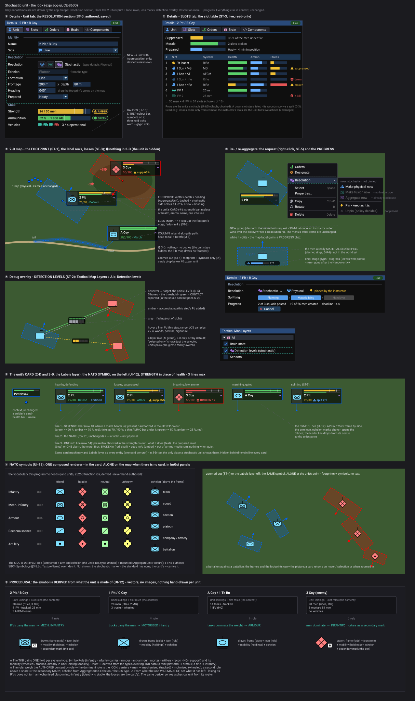
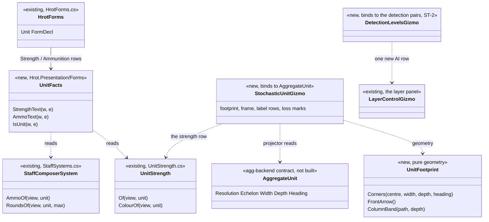
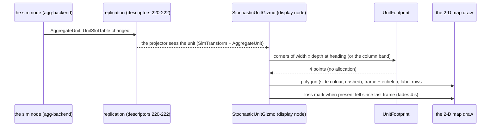
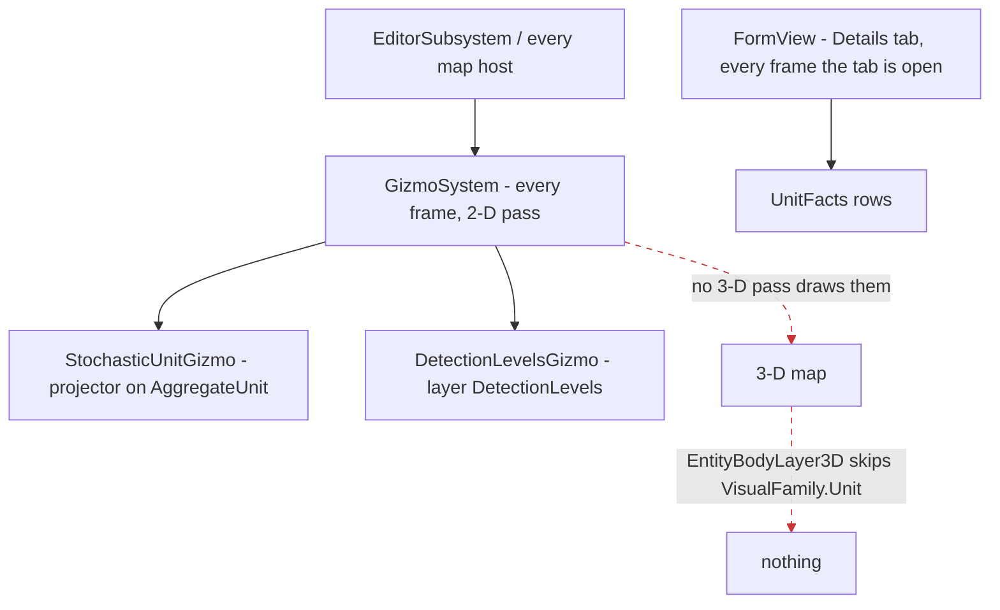

<!--STATUS
state: LIVE
build-state: DESIGN (the leans UI-1…UI-9 for the user's review) · BUILT on exp/agg-ui: UI-3 (strength rows), UI-4 geometry, UI-2 / UI-5 / UI-6 the map gizmo (bound to exp/agg-backend's contract)
updated: 2026-11-16
current-answer: the whole file — §1 the picture, §2 inventory, §3 UML, §4 the decisions, §5 what is built / waiting
stale-below: nothing
known-rot: none
known-conflict: none
related-designs:
  - DESIGN_Stochastic_Units_And_Resolution.md — OWNS the stochastic unit (§10–§22) and the dispatch (§23); THIS file is the agg-ui column of §23.3 drawn out
  - DESIGN_Aggregate_Squad.md — OWNS UnitStrength (§18, R-D4), the one strength seam the form's Strength row reads
  - ../../UX/UX_Feature_Entity_Symbology.md — OWNS the 2-D symbol paths (silhouette / nato2525 stub, §3.8); a unit has NO symbol today — UI-2 adds one for memberless units only
  - ../../UX/DESIGN_Details_Forms.md — OWNS the forms (FormDecl / FormView, §3) the Resolution section and the Strength rows extend
  - ../../DESIGN_Command_Display.md — OWNS the command picture's echelon diamonds and the layer-bit precedent (§8) the detection overlay follows
  - ../../GUIDE_Debug_Gizmos.md — the Tactical Map Layers panel and gizmo families the overlay row joins
-->

# DESIGN — the stochastic unit's UI *(exp/agg-ui, CE-8600; handoff [HANDOFF_Coordinator_To_AggUi.md](../../blueprints/batches/HANDOFF_Coordinator_To_AggUi.md))*

🔒 User, `2026-11-16`: *"follow its stochastic aggregate units handoff (ui part), work autonomously on what is clear, present design for what the UI
might look of the aggregation"*.

## 1. The picture

*The mockup (R-4143) is the acceptance spec: ① the Unit tab's Resolution section · ② the Slots tab · ③ the 2-D footprint, its label rows, loss
marks, a march column · ④ the detection-levels overlay and its layer row · ⑤ the right-click Resolution group and the split's progress. Generator:
`scripts/gen-agg-ui-mockup.py`. Scope (R-4151): only these; the Details frame, the other tabs, the map and the menu's other items are context.*

## 2. INVENTORY *(graph re-indexed `2026-11-16`; queries run, then grep to confirm)*

| query | total | what it found |
|---|---|---|
| `search_graph .*(FormDecl\|FormView\|EntityDetailsBundle\|UnitForm).*` Class | 5 | `FormDecl`, `FormView` (Fdp.Presentation/ImGui/Forms), `EntityDetailsBundle`, `TheUnitFormDrawsTests` — ONE form system; the Unit form (`HrotForms.cs:112`) applies to every `EntityInfo` entity, any echelon |
| `search_graph .*(UnitStrength\|CombatEffective\|StaffSystem).*` Class | 2 | `UnitStrength`, `CombatEffective` — ⛔ **no editor surface calls either** (grep: only staff systems, behaviours, the debug API) |
| `search_graph .*(UnitCentroid\|CommandPicture\|Sector).*` Class | 8 | `UnitCentroidSystem` (a unit sits at its live men's centroid; with none it never moves), `CommandPictureGizmo`, `SectorAreasGizmo`, `SectorArcGizmo` |
| `search_graph .*(MapLayer\|LayerMask\|TacticalMapLayers).*` Class | 20 | `LayerControlGizmo` (the panel, groups Units/Command/AI/Fire/Map), `MapLayerRegistry`, `MapLayerPreferences`, `DebugTraceLayers` |
| grep `MilStd2525\|Echelon` in Presentation | — | ⛔ **no unit symbol is drawn**: `EntityClassShapeLibrary.cs:81` draws nothing for DIS kind 11; `MilStd2525Renderer` is a stub nobody emits; `UnitEchelon` (`UnitDis.cs:19`) is read by no presenter |
| grep the form's Strength row | — | `HrotForms.cs:148` — **`Health.Current`, a man's health**; a unit shows no strength at all |
| grep `AggregateUnit\|UnitSlotTable` | 0 types | only the ids (`GlobalComponentIds.cs:1351-1356`) and the descriptor block comment — ⇒ the contract is NOT built yet (no `exp/agg-backend` branch) |

⚠ Coverage could not be checked (`check_index_coverage` is not in the CLI).

## 3. UML

*What it shows that prose hid: the form rows and the map's strength row read the SAME two existing seams (`UnitStrength`, `AmmoOf`) — so when the
behaviors lane adds the slot-table branch (§23.3 ST-0 ①), every UI surface reads a stochastic unit with no UI change; and the only box that waits
for the backend is the gizmo's projector.*

*What it shows: the display node draws only from replicated state — no simulation runs there — and the loss mark is DERIVED from a fall in the
present strength, so no new "loss event" has to cross the wire.*

*What it shows: both gizmos ride the ONE gizmo pass every map host already runs, so every host draws them by construction; the red edges are
deliberate dead paths — a stochastic unit has no body and draws nothing in 3-D (§23.3 ST-1).*

## 4. The decisions *(lane leans, `R-8600`…, for the user's review — built where marked)*

| # | decision (lean) | rejected — one line each | would change it |
|---|---|---|---|
| **UI-1** | the Resolution section on the Unit tab: a three-way icon switch (Physical / Fusion / Stochastic — the unit's AUTHORED start resolution, saved), Echelon read-only from the type, Formation, frontage × depth, heading, Prepared; shown only when the unit carries `AggregateUnit` | a separate "Aggregate" tab — the resolution is a property of the unit, the Unit tab is where an author looks · a free number for resolution — the three are a closed set (§23.2) | the backend declaring resolution per TYPE only (then the switch is read-only) |
| **UI-2** | a memberless unit draws a FOOTPRINT (width × depth × heading, side-coloured 22 % fill, DASHED edge = not physical, an arrow off the front edge) with a small APP-6-style FRAME at its centre (friend rectangle / hostile diamond, the arm's mark, the echelon dots / bars from `UnitEchelon`); a physical unit is unchanged (its men are the picture) | the unit as one dot at its centre — hides the frontage, the one thing that decides what a burst or a sensor covers (M-3, C-6) · the full STANAG renderer for every unit — a symbology decision for the whole product (Symbology §3.8.1 left it unbuilt), not this experiment's | the user wanting the frame on physical units too (then it becomes Symbology's item) |
| **UI-3** ✅ BUILT | the Unit tab's **Strength** for a UNIT reads `UnitStrength.Of` (men present / authorized + the SITREP colour) and **Ammunition** reads the staff's `RoundsOf` / `AmmoOf` — for EVERY unit, physical included; a man keeps his Health row | a stochastic-only row — two strength readers for one concept (the shared-and-unified rule); the SITREP and the form must agree · reading the slot table in the UI — the behaviors lane's `UnitStrength` branch makes it one seam | — |
| **UI-4** | a march COLUMN is a band along the unit's path, head to tail = `Depth`, the frame at the head; a deployed unit (line / assault) the rectangle | the rectangle stretched along the road — wrong on a bend, and the tail's exposure (M-3) is the point | the backend storing the column as something other than a path segment |
| **UI-5** | label rows under the frame: a strength bar (the SITREP colour) and `name · present/authorized · ≈` (≈ = not physical); ⛔ they drop when the unit is under 40 px wide (ST-4's zoomed-out picture: footprints and frames only) | the existing card rows — a card is per entity at a point; the footprint's rows belong to its frame · always-on labels — a battalion-vs-battalion picture becomes text | — |
| **UI-6** | LOSSES on the map: `−n` + a skull at the footprint's front edge for 4 s, derived from a FALL in present strength between frames (no new event on the wire) | a casualty marker per man — there are no men · a new replicated loss event — the strength fall already says it | the backend publishing losses as events anyway (then the mark reads them) |
| **UI-7** | the Slots tab (live, read-only): the unit's suppressed share, morale, prepared level as bars, then one row per slot — the system's icon, health / ammo / stress bars, a flag (suppressed / broken / down / K-kill); a down slot stays listed | rows in the raw Components column — unreadable at 34 slots · editable slots — losses come only from combat (C-3); the instructor's tools are the existing live actions | — |
| **UI-8** | DETECTION LEVELS: a debug layer row in Tactical Map Layers ▸ AI (2-D only, off by default, the gizmo family's "selected only" honoured): a line per observer → target pair, a 5-box level meter at its middle — green = contact reported, amber = accumulating, grey = fading; hover shows Pd, range, LOS samples, woods, posture, signature | always-on lines — O(n²) clutter at battalion scale · a separate panel — the level is spatial | N-5's level count differing from 5 (the meter takes the threshold from the table) |
| **UI-9** | the de- / re-aggregate REQUEST: a `Resolution ▸` group in the unit's right-click menu (Make physical / fusion now, Aggregate now, Pin, Unpin — each disabled with its reason); the PROGRESS: a chip under the frame (stage glyph · leaves posted n/m) + a Resolution block in the Unit tab (Planning › Materialising › Handover, counts, deadline, Cancel); held men drawn as dashed rings | a modal dialog — an instructor acts on many units mid-run · progress only in a panel — the instructor watches the map | §16a's stages changing (the chip shows whatever stages the process records) |

## 5. Built now / waiting *(as-built `2026-11-16`; `exp/agg-backend` merged at `64255766d` — its contract NOTE_AggBackend_To_Agg_Contract.md)*

| item | state |
|---|---|
| UI-3 Strength / Ammunition rows for units (CE-8601) | ✅ `UnitFacts` + two Unit-form rows; reads the existing seams — a stochastic unit appears the day `UnitStrength` gains its slot-table branch (behaviors, RV-5) |
| UI-4 geometry (CE-8602) | ✅ `UnitFootprint` — the rectangle, the front arrow, the column segment; pure, 0 B |
| UI-2 / UI-5 / UI-6 the map gizmo (CE-8603) | ✅ `StochasticUnitGizmo` (projector `AggregateUnit` + `SimTransform`, layer 0): the footprint (or the column band where `UnitRoute` exists — it is NoReplay and node-local, so a display node draws the rectangle), the frame + echelon marks, the strength-coloured label, the `-n` loss mark for 4 s; only for `Effective == Stochastic` |
| UI-1 Resolution section | ⏳ **finding to agg-backend:** the form needs `AggregateUnit` fields in the ATTRIBUTE vocabulary (`AttributeVocabulary` row + JSON setter + binary handler + reader — `FormCatalogue.AttributeOf` throws without them); their component, their wire ⇒ theirs |
| UI-7 Slots tab | ⏳ next (reads `UnitSlotTable` / `UnitHoldings`, both merged) |
| UI-8 overlay | ⏳ next (reads `UnitDetections` 285, merged) |
| UI-9 request + progress | ⏳ waits for ST-5's resolution manager (`ResolutionPin`, `Splitting` exist as fields; nothing writes them yet) |

**⛔ Deviations from the first mockup, folded back into it (R-4146):** the frame is a plain box (the 2-D layer cannot draw a pixel-sized cross around a
world point) · the echelon marks and the label START at the unit's point instead of centred (2-D text has no x offset) · `·` and `~` replace `•` and `≈`
(the gizmo font has neither) · the strength is the label's colour and a backdrop, not a bar · the form's Strength / Ammunition are read-only text rows
(FormView draws a derived field disabled), not bars. Rails: `StochasticUnitGizmoTests` (primitives, 0 B), `StochasticUnitLookFrameRail` (the real 2-D
frame, measured: the tint inside the footprint, the frame's 2525 fill).
