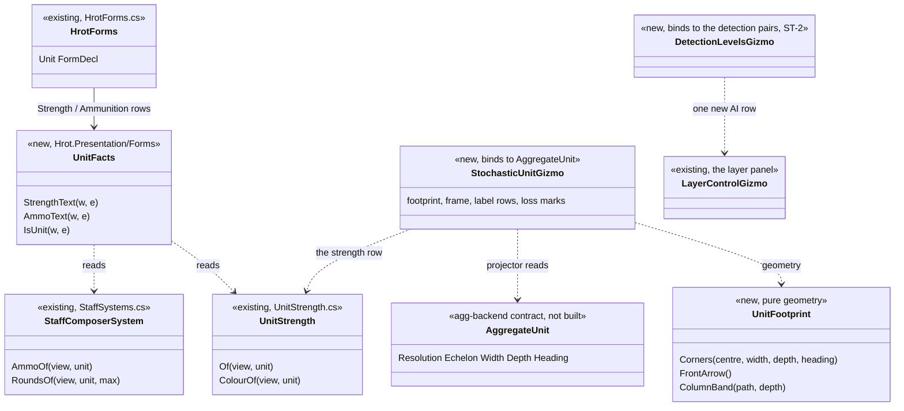
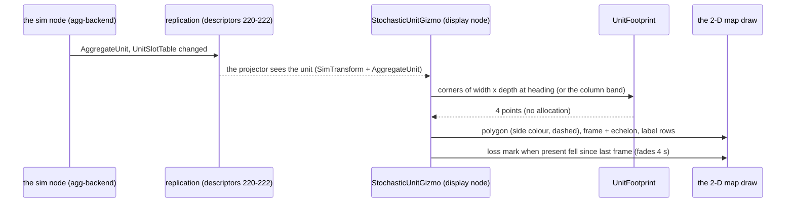
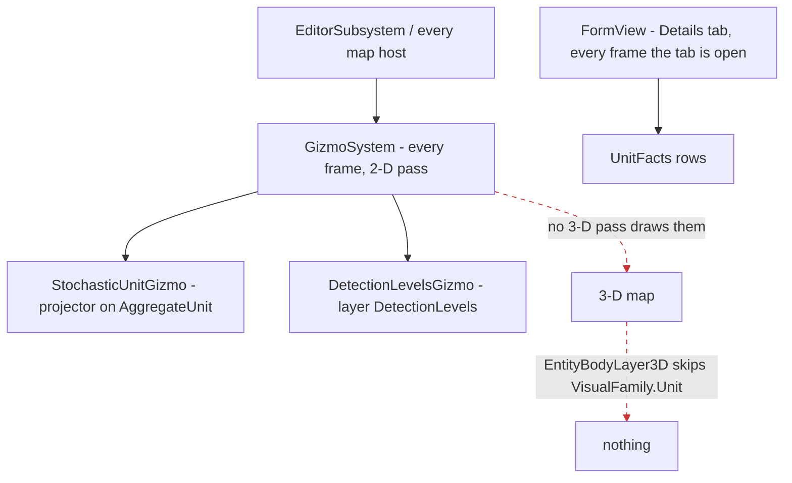
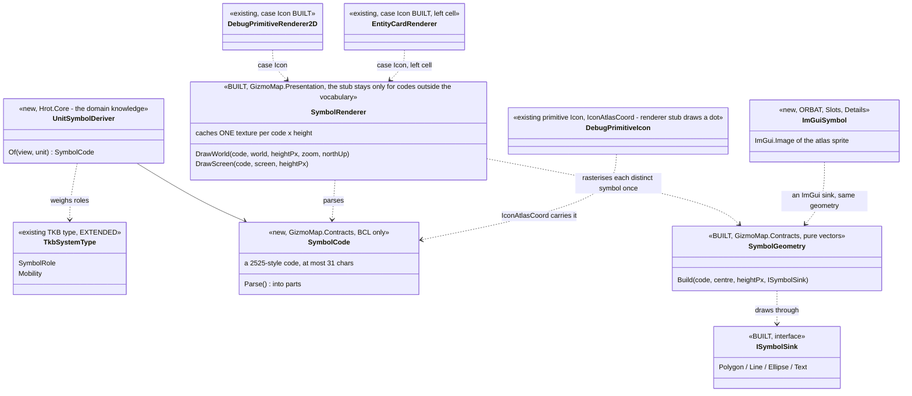

<!--STATUS
state: LIVE
build-state: DESIGN (the leans UI-1…UI-9 for the user's review) · BUILT on exp/agg-ui: UI-3 (strength rows), UI-4 geometry, UI-2 / UI-5 / UI-6 the map gizmo (bound to exp/agg-backend's contract)
updated: 2026-11-16
current-answer: the whole file — §1 the picture, §2 inventory, §3 UML, §4 the decisions, §6 NATO symbols, §5 what is built / waiting
stale-below: nothing
known-rot: none
known-conflict: none
related-designs:
  - DESIGN_Stochastic_Units_And_Resolution.md — OWNS the stochastic unit (§10–§22) and the dispatch (§23); THIS file is the agg-ui column of §23.3 drawn out
  - DESIGN_Aggregate_Squad.md — OWNS UnitStrength (§18, R-D4), the one strength seam the form's Strength row reads
  - ../../UX/UX_Feature_Entity_Symbology.md — OWNS the 2-D symbol paths (silhouette / nato2525 stub, §3.8); a unit has NO symbol today — UI-2 adds one for memberless units only
  - ../../UX/DESIGN_Details_Forms.md — OWNS the forms (FormDecl / FormView, §3) the Resolution section and the Strength rows extend
  - ../../DESIGN_Command_Display.md — OWNS the command picture's echelon diamonds and the layer-bit precedent (§8) the detection overlay follows
  - ../../GUIDE_Debug_Gizmos.md — the Tactical Map Layers panel and gizmo families the overlay row joins
  - ../../UX/DESIGN_Unit_Symbols.md — OWNS when and where a PHYSICAL unit shows its NATO symbol (the layer cases A–G); this file owns the symbol itself (§6)
-->

# DESIGN — the stochastic unit's UI *(exp/agg-ui, CE-8600; handoff [HANDOFF_Coordinator_To_AggUi.md](../../blueprints/batches/HANDOFF_Coordinator_To_AggUi.md))*

🔒 User, `2026-11-16`: *"follow its stochastic aggregate units handoff (ui part), work autonomously on what is clear, present design for what the UI
might look of the aggregation"*.

## 1. The picture

*The mockup (R-4143) is the acceptance spec: ① the Unit tab's Resolution section and the GAUGE rows (UI-10) · ② the Slots tab · ③ the 2-D footprint, its label rows, loss
marks, a march column · ④ the detection-levels overlay and its layer row · ⑤ the right-click Resolution group and the split's progress · ⑥ the unit's CARD in its states (UI-11) · ⑦ the NATO symbol vocabulary and the zoomed-out picture · ⑧ the symbol derived from the content (UI-12) · ⑨ the ORBAT's icons (UI-13) and the layer panel's NATO row (UI-14). Generator:
`scripts/gen-agg-ui-mockup.py`. Scope (R-4151): only these; the Details frame, the other tabs, the map and the menu's other items are context.*

## 2. INVENTORY *(graph re-indexed `2026-11-16`; queries run, then grep to confirm)*

| query | total | what it found |
|---|---|---|
| `search_graph .*(FormDecl\|FormView\|EntityDetailsBundle\|UnitForm).*` Class | 5 | `FormDecl`, `FormView` (Fdp.Presentation/ImGui/Forms), `EntityDetailsBundle`, `TheUnitFormDrawsTests` — ONE form system; the Unit form (`HrotForms.cs:112`) applies to every `EntityInfo` entity, any echelon |
| `search_graph .*(UnitStrength\|CombatEffective\|StaffSystem).*` Class | 2 | `UnitStrength`, `CombatEffective` — ⛔ **no editor surface calls either** (grep: only staff systems, behaviours, the debug API) |
| `search_graph .*(UnitCentroid\|CommandPicture\|Sector).*` Class | 8 | `UnitCentroidSystem` (a unit sits at its live men's centroid; with none it never moves), `CommandPictureGizmo`, `SectorAreasGizmo`, `SectorArcGizmo` |
| `search_graph .*(MapLayer\|LayerMask\|TacticalMapLayers).*` Class | 20 | `LayerControlGizmo` (the panel, groups Units/Command/AI/Fire/Map), `MapLayerRegistry`, `MapLayerPreferences`, `DebugTraceLayers` |
| grep `MilStd2525\|Echelon` in Presentation | — | ⛔ **no unit symbol is drawn**: `EntityClassShapeLibrary.cs:81` draws nothing for DIS kind 11; `MilStd2525Renderer` is a stub nobody emits; `UnitEchelon` (`UnitDis.cs:19`) is read by no presenter |
| grep the form's Strength row | — | `HrotForms.cs:148` — **`Health.Current`, a man's health**; a unit shows no strength at all |
| grep `AggregateUnit\|UnitSlotTable` | 0 types | only the ids (`GlobalComponentIds.cs:1351-1356`) and the descriptor block comment — ⇒ the contract is NOT built yet (no `exp/agg-backend` branch) |

⚠ Coverage could not be checked (`check_index_coverage` is not in the CLI).

## 3. UML

*What it shows that prose hid: the form rows and the map's strength row read the SAME two existing seams (`UnitStrength`, `AmmoOf`) — so when the
behaviors lane adds the slot-table branch (§23.3 ST-0 ①), every UI surface reads a stochastic unit with no UI change; and the only box that waits
for the backend is the gizmo's projector.*

*What it shows: the display node draws only from replicated state — no simulation runs there — and the loss mark is DERIVED from a fall in the
present strength, so no new "loss event" has to cross the wire.*

*What it shows: both gizmos ride the ONE gizmo pass every map host already runs, so every host draws them by construction; the red edges are
deliberate dead paths — a stochastic unit has no body and draws nothing in 3-D (§23.3 ST-1).*

## 4. The decisions *(✅ UI-1…UI-9 APPROVED `2026-11-16` — R-4278; UI-10, UI-11 asked for by the user; UI-12…UI-14 approved with DESIGN_Unit_Symbols — R-8602)*

| # | decision (lean) | rejected — one line each | would change it |
|---|---|---|---|
| **UI-1** | the Resolution section on the Unit tab: a three-way icon switch (Physical / Fusion / Stochastic — the unit's AUTHORED start resolution, saved), Echelon read-only from the type, Formation, frontage × depth, heading, Prepared; shown only when the unit carries `AggregateUnit` | a separate "Aggregate" tab — the resolution is a property of the unit, the Unit tab is where an author looks · a free number for resolution — the three are a closed set (§23.2) | the backend declaring resolution per TYPE only (then the switch is read-only) |
| **UI-2** | a memberless unit draws a FOOTPRINT (width × depth × heading, side-coloured 22 % fill, DASHED edge = not physical, an arrow off the front edge) with a small APP-6-style FRAME at its centre (friend rectangle / hostile diamond, the arm's mark, the echelon dots / bars from `UnitEchelon`); a physical unit is unchanged (its men are the picture) | the unit as one dot at its centre — hides the frontage, the one thing that decides what a burst or a sensor covers (M-3, C-6) · the full STANAG renderer for every unit — a symbology decision for the whole product (Symbology §3.8.1 left it unbuilt), not this experiment's | the user wanting the frame on physical units too (then it becomes Symbology's item) |
| **UI-3** ✅ BUILT | the Unit tab's **Strength** for a UNIT reads `UnitStrength.Of` (men present / authorized + the SITREP colour) and **Ammunition** reads the staff's `RoundsOf` / `AmmoOf` — for EVERY unit, physical included; a man keeps his Health row | a stochastic-only row — two strength readers for one concept (the shared-and-unified rule); the SITREP and the form must agree · reading the slot table in the UI — the behaviors lane's `UnitStrength` branch makes it one seam | — |
| **UI-4** | a march COLUMN is a band along the unit's path, head to tail = `Depth`, the frame at the head; a deployed unit (line / assault) the rectangle | the rectangle stretched along the road — wrong on a bend, and the tail's exposure (M-3) is the point | the backend storing the column as something other than a path segment |
| **UI-5** ⛔ *superseded by UI-11 (the card)* | label rows under the frame: a strength bar (the SITREP colour) and `name · present/authorized · ≈` (≈ = not physical); ⛔ they drop when the unit is under 40 px wide (ST-4's zoomed-out picture: footprints and frames only) | the existing card rows — a card is per entity at a point; the footprint's rows belong to its frame · always-on labels — a battalion-vs-battalion picture becomes text | — |
| **UI-10** *(user, `2026-11-16`: "the Details section might show more colored and visualized form of the strength and ammunition (not so ugly as basic imgui text field)")* | the Unit tab's Strength / Ammunition become GAUGE rows: a bar in the SITREP colour with the numbers ON it (`26 / 30 men`, `62 % · 1 860 rds`), ticks at the thresholds (strength 70 / 90 %, ammo 25 / 50 %), and the SITREP word as a chip with its glyph (never colour alone — Details forms §6.3); Vehicles as one coloured icon per system, a lost one red with ×. ⭐ ONE new generic form field kind, `FieldKind.Gauge` (a fraction, a colour, a text, a chip), in the shared `FormView` — a man's Health row can use it too | a custom ImGui panel for units only — a second drawing path beside the form system (the shared-and-unified rule) · bars without numbers — the instructor reads the exact count | — |
| **UI-11** *(user, `2026-11-16`: "the Label/card of the aggregated unit should show it too (strength in place of usual health … 3 lines max — different colors, strength as a health bar")* | the unit's CARD (the one card per entity, Labels layer, 2-D and 3-D — §6am) carries: **line 1** the STRENGTH bar in ROW 10, where a man's health bar is (present / authorized, the SITREP colour, ticks at 70 / 90 %) with a thin AMMO bar under it (row 13); **line 2** the name (row 20, unchanged) + a violet `~` = not physical; **line 3** ONE info line (row 64): present / authorized in the strength colour · what it does (teal) · the prepared level (blue) — or ONE alarm, the worst first: `BROKEN n` (red, skull) > `supp nn%` (amber) > out of ammo > `split n/m`; nothing when quiet. ⛔ it REPLACES UI-5's label under the frame (one place for the unit's text) | a separate floating label — two texts about one unit (§6am already folded every free text into the card) · more lines — the user: 3 max, a quick overview; the details are the Slots tab | the card machinery not drawing in 3-D for a hidden unit (then 2-D only) |
| **UI-12** *(user, `2026-11-16`: "we also do not have yet any true NATO symbols for aggregated units … let's design how to achieve that" · "best if these could be procedurally created - drawn as vectors from the actual content of the unit" · "if that requires extending tkb etc, so be it")* | a TRUE APP-6 / 2525 land-unit symbol, PROCEDURAL and VECTOR (§6): frame by side, icon by the unit's dominant ROLE, mobility indicator, one secondary mark, echelon marks — DERIVED from the unit's authored content; it is the card's LEFT CELL (part of the card, spanning its 3 lines), and the SAME symbol is drawn ALONE at the unit's point when no card shows (zoomed out, Labels off). ⭐ The TKB gains `SymbolRole` per system type | an image atlas (milsymbol-generated PNGs) — no images in git (R-4117 allows only thumbnails), and a combination per content would be a combinatorial atlas · a hand-picked SIDC per unit type — the user asked for it derived from the content; the TKB-authored SIDC stays only as an OVERRIDE · a symbol separate from the card — two things about one unit to place, declutter and hide (§6am: one card per unit) | ✅ ruled `2026-11-16`: physical units get it too (UI-14) |
| **UI-13** *(user, `2026-11-16`: "the icons you suggested … i would like to have those in the orbat view … different icon for vehicles, squad, leaders etc")* | the ORBAT row's icon says WHAT the entity is: a UNIT ⇒ its NATO symbol (UI-12's geometry through the ImGui sink, row-sized, no echelon marks — the tree's depth says it), physical and stochastic alike; a MAN ⇒ by role (leader: amber crown; MG / AT / rifle: the blue rifleman, the role as the row's right-hand text); a VEHICLE ⇒ by its class (van / truck / tank glyph, Colour Icons §2); destroyed / down ⇒ dimmed with the red skull / fire. A STOCHASTIC unit lists its SLOTS as read-only child rows (it has no child entities) with the Slots tab's icons — ⭐ ONE role→icon map shared by the ORBAT and the Slots tab | today (measured): `ScenarioOrbatAdapter.IconKeyOf` (`:255-261`) gives a unit the teal "people" glyph and EVERY man and vehicle the same cube — the kind is invisible · a per-template authored icon — the content already says it | — |
| **UI-14** *(user, `2026-11-16`: "physical unit should get the symbol too … turnable on/off from the layer panel … still thinking if the nato symbol (which might be expensive to render) should be part of the label … or … in place of the 2d map vector symbol")* | **physical units get it too** (ruled). ONE new layer row **Units ▸ NATO unit symbols** (on by default): Labels on ⇒ the symbol is the CARD's left cell; Labels off ⇒ the SAME symbol ALONE at the unit's point; off ⇒ none. Men and vehicles keep their silhouettes ("Entities") — ⛔ no NATO mode for them (§6 S-8). ⭐ **Cost — the two placements cost the same**: cards and map symbols are both primitives of the ONE staggered gizmo pass (`StatelessGizmoSystem`: 256 entities fresh per frame, the rest HELD ≤ 3 frames — `MapInteractionPack.cs:193`) and both are DRAWN every frame; a symbol is ~10–20 vector segments, comparable to a silhouette, built from a cached `UnitSymbol` (no derivation per frame); units ≈ 165 per 1 000 soldiers with ONE level shown per zoom (§6 S-4), each a stamped atlas sprite (§6 S-6) | "in place of the vector symbol" — a UNIT has no vector symbol to replace (`EntityClassShapeLibrary.cs:81`: kind 11 draws nothing); men / vehicles keep theirs (§6 S-8) · symbol ONLY inside the card — lost when Labels are off and on the zoomed-out picture | a Windows measurement showing the symbols cost a visible share of the frame (the build adds a rail: 500 symbols drawn, ms per frame) |
| **UI-6** | LOSSES on the map: `−n` + a skull at the footprint's front edge for 4 s, derived from a FALL in present strength between frames (no new event on the wire) | a casualty marker per man — there are no men · a new replicated loss event — the strength fall already says it | the backend publishing losses as events anyway (then the mark reads them) |
| **UI-7** | the Slots tab (live, read-only): the unit's suppressed share, morale, prepared level as bars, then one row per slot — the system's icon, health / ammo / stress bars, a flag (suppressed / broken / down / K-kill); a down slot stays listed | rows in the raw Components column — unreadable at 34 slots · editable slots — losses come only from combat (C-3); the instructor's tools are the existing live actions | — |
| **UI-8** | DETECTION LEVELS: a debug layer row in Tactical Map Layers ▸ AI (2-D only, off by default, the gizmo family's "selected only" honoured): a line per observer → target pair, a 5-box level meter at its middle — green = contact reported, amber = accumulating, grey = fading; hover shows Pd, range, LOS samples, woods, posture, signature | always-on lines — O(n²) clutter at battalion scale · a separate panel — the level is spatial | N-5's level count differing from 5 (the meter takes the threshold from the table) |
| **UI-9** | the de- / re-aggregate REQUEST: a `Resolution ▸` group in the unit's right-click menu (Make physical / fusion now, Aggregate now, Pin, Unpin — each disabled with its reason); the PROGRESS: a chip under the frame (stage glyph · leaves posted n/m) + a Resolution block in the Unit tab (Planning › Materialising › Handover, counts, deadline, Cancel); held men drawn as dashed rings | a modal dialog — an instructor acts on many units mid-run · progress only in a panel — the instructor watches the map | §16a's stages changing (the chip shows whatever stages the process records) |

## 6. NATO symbols — procedural, from the unit's content, drawn ONCE and stamped *(UI-12; REVISED `2026-11-16` after the user's performance questions)*

> 🔒 User, `2026-11-16`: *"units are not few in a scenario with 1000 soldier entities … (unless we render the squad symbol for the whole squad, not individual
> men)" · "where (in what part of the sw)/how would we render the NATO icons? it is quite generic feature, should not be just in the 2d/3d map code" ·
> "does it make sense to somehow cache the symbols instead of re-rendering them all the time?"*

*What it shows that prose hid: ONE geometry draws every symbol through a sink (raylib image for the map and card, ImGui for the panels) — the renderer
rasterises each DISTINCT symbol once and then stamps one quad (as-built, S-6 below) — and the whole renderer sits in the GIZMO library beside the primitive it draws, not in any map; HROT only DERIVES the code; the map's existing `Icon` primitive (built in the protocol, a dot in both renderers today) carries the key, so nothing new crosses the wire.*

| # | decision (lean) | why — measured where it can be |
|---|---|---|
| **S-1** | `SymbolRole` on the TKB system type; unset ⇒ derived from the type's existing TKB data | the content decides; authoring only where the derivation is wrong |
| **S-2** | the rule: the authored content (holdings / roster) weighed by role ⇒ icon, carriers ⇒ mechanised / motorised + mobility, a second role > 20 % ⇒ one secondary mark, echelon from the unit | mockup ⑧ |
| **S-3** | ⚠ from what the unit WAS MADE OF, not what it has left | identity is stable; losses are the card's |
| ⭐ **S-4** | **a symbol is a UNIT's, never a man's**: a squad draws ONE symbol for its nine men. 1 000 soldiers ≈ 111 squads + 37 platoons + 12 companies + 4 battalions ≈ **165 symbols**, and **ECHELON DECLUTTER** shows only one level per zoom (zoomed out: companies ≈ 12; mid: platoons ≈ 37; close: squads) | the user's worry is right for men (1 000) — it is not the design: the men keep their silhouettes |
| ⭐ **S-5** | **WHERE: the GIZMO renderer library, not map code** *(user, `2026-11-16`: "it is the symbol gizmo who renders it - needs to be part of the gizmo renderer")* — the symbol CODE and the part geometry in `GizmoMap.Contracts` (BCL only, shared with the IG over DDS); the atlas and `SymbolRenderer` in `GizmoMap.Presentation`, REPLACING the `MilStd2525Renderer` stub, called from the existing `case DebugPrimitiveShape.Icon` in BOTH `DebugPrimitiveRenderer2D` and `EntityCardRenderer`; ImGui panels call the same renderer. HROT only DERIVES the code (`UnitSymbolDeriver`, Hrot.Core — the TKB and the holdings are domain knowledge) and emits an `Icon` primitive with it in `IconAtlasCoord` | one renderer for every host that draws gizmos (editor, CGF, SimHost, Replay Browser, the IG) by construction; the wire already carries the primitive |
| ⭐ **S-6** *(as-built `2026-11-16`, R-8603 — supersedes the parts atlas below)* | **CACHE EACH DISTINCT SYMBOL** — `SymbolRenderer` rasterises a symbol (code × pixel height) ONCE through `SymbolGeometry` into an image (2× supersampled, halved ⇒ antialiased), uploads it, and every draw after is ONE textured quad (rows un-mirrored on the north-up map, S-7) | 📐 **measured, `SymbolRendererFrameRail`: 500 symbols as raw vectors every frame = 39.5–40.8 ms CPU (rejected); cached = 0.09 ms, 0 B.** Whole-symbol beats parts: one quad not 2–6, and the parts do not tile cleanly (the secondary box is sized by its mark, the echelon marks sit on the frame's top, which differs per affiliation). The keys are bounded by the distinct codes in a scenario (dozens); a live modifier changes the code ⇒ one new rasterise, once |
| ⛔ ~~S-6 (designed)~~ | ~~**CACHE THE PARTS, COMPOSE AT DRAW TIME** *(user: "NATO symbols is composable so not sure how far we can cache it")* — the atlas holds each PART once per size bucket (16 / 24 / 40 px): frames × affiliation (4 shapes × 4 fills), role icons (~10), mobility (2), secondary marks (~8), echelon marks (6), status overlays (damaged / destroyed); a symbol = 2–6 stamped quads from ONE texture, batched. ⭐ Any combination works with nothing new rasterised; the part set is fixed and small (~50 sprites per size). Text modifiers (a designation like "2/B") go through the gizmo font, not the atlas | whole-symbol caching would be bounded too (keys ≈ distinct units), but parts make the cache independent of the scenario and let a LIVE modifier (damaged, reduced) change without a re-rasterise — SUPERSEDED by the measured S-6 above~~ |
| **S-7** | the symbol stays UPRIGHT and screen-sized (the standard's way: the heading is a separate staff / arrow, never a rotated frame); in 3-D it lives only in the card (a screen-space overlay) — no perspective distortion | APP-6 symbols are never rotated or skewed |
| **S-8** | ⛔ **NOT in place of the men's / vehicles' vector symbols** — those stay rotated and perspective-correct; a NATO EQUIPMENT mode for vehicles is not proposed (it would trade the rotated footprint, which shows facing and size, for an upright sign) | the user, `2026-11-16`: "each entity has a 2d vector current symbol now, rotated and even perspective distorted" — the earlier "a later switch" line is WITHDRAWN |

## 5. Built now / waiting *(as-built `2026-11-16`; `exp/agg-backend` merged at `64255766d` — its contract NOTE_AggBackend_To_Agg_Contract.md)*

| item | state |
|---|---|
| UI-3 Strength / Ammunition rows for units (CE-8601) | ✅ `UnitFacts` + two Unit-form rows; reads the existing seams — a stochastic unit appears the day `UnitStrength` gains its slot-table branch (behaviors, RV-5) |
| UI-4 geometry (CE-8602) | ✅ `UnitFootprint` — the rectangle, the front arrow, the column segment; pure, 0 B |
| UI-2 / UI-5 / UI-6 the map gizmo (CE-8603) | ✅ `StochasticUnitGizmo` (projector `AggregateUnit` + `SimTransform`, layer 0): the footprint (or the column band where `UnitRoute` exists — it is NoReplay and node-local, so a display node draws the rectangle), the frame + echelon marks, the strength-coloured label, the `-n` loss mark for 4 s; only for `Effective == Stochastic` |
| UI-1 Resolution section | ⏳ **finding to agg-backend:** the form needs `AggregateUnit` fields in the ATTRIBUTE vocabulary (`AttributeVocabulary` row + JSON setter + binary handler + reader — `FormCatalogue.AttributeOf` throws without them); their component, their wire ⇒ theirs |
| UI-10 gauge rows (CE-8606) | ✅ `FieldKind.Gauge` + `FormGauge` in the shared `FormView` (bar in the status colour, the text dark over the fill and light past it, ticks, word + glyph chip; or icons); the Unit tab's Strength / Ammunition / Vehicles; pixels measured in `TheUnitFormDrawsTests`. ⚠ Deviation: the bar's text is the regular font (no bold face in the editor font) |
| UI-11 the unit card (CE-8607) | ✅ `UnitCardGizmo` (rows 10 / 13: strength bar + ticks, ammo bar) and `UnitCardFacts.InfoRow` (row 40, written by `EntityEditorLabelGizmo` — one writer per row): `~ 26/30 · Defend · SUPP 35%`; physical units too; the label under the footprint frame removed. Real cards rendered (`StochasticUnitLookFrameRail.CE8607_…`). ⚠ Deviations: the violet `~` opens the INFO line (the name row is `EntityNameGizmo`'s, with the `#id`), the alarm is a WORD without a glyph (the card font has no FontAwesome), and a stochastic unit shows no ammo bar (its slots carry rounds, not a capacity) |
| UI-12 the symbol core (CE-8608) | ✅ `SymbolCode` + `SymbolGeometry` (GizmoMap.Contracts), `SymbolRenderer` (GizmoMap.Presentation, the per-symbol texture cache — R-8603, S-6 as-built); the `MilStd2525` / `Icon` cases of the 2-D and card renderers route to it. Rails `SymbologyTests`, `SymbolRendererFrameRail` |
| UI-12 the derivation (CE-8609) | ✅ `UnitSymbolDeriver` (Hrot.Core): the unit TYPE's composition walked to its bodies, each read from its DIS type (a lifeform = a man; land platform category 1 tank · 2/3 carrier · 4 SP artillery · 5 towed gun · 10 mortar), weapons and seats; weights man 1 · crew weapon 3 · combat vehicle 6; secondary at ≥ 15 % (⚠ deviation: the mockup's "> 20 %" — with these weights the mockup's own AT and mortar examples land at 16.7 %); echelon = the unit's DIS subcategory; the override is `MapVisualDef.SymbolRole`. ⚠ From the TYPE only: a stochastic unit's holdings are not read (it keeps the composite type it was made from — S-3); the existing `MapVisualDef.SymbolCode` (one default SIDC on every type, read only by the Player's legacy texture name) is NOT used. Rail `UnitSymbolDeriverTests` |
| UI-14 the NATO row (CE-8610) | ✅ layer bit 31 **Units ▸ NATO unit symbols** (on); `UnitSymbolCardGizmo` puts the symbol in the unit card's LEFT CELL (`EntityCardRow.Symbol` on row 0 — the card renderer reserves the cell, shifts the rows and the bars right of it); `UnitSymbol{Squad,SquadPastCards,Platoon,Company,Battalion}Gizmo` draw it ALONE, anchored, 2-D only, each in its echelon's zoom band (the new `GizmoProjectorAttribute.MinMetresPerPixel`); `UnitSymbolSelectedChildrenGizmo` adds a selected unit's subordinate units past the cards' zoom. ⚠ As-built: the standalone symbol also shows past the cards' zoom with cards ON (squads 1–1.5 m/px; platoons and up are past the cards anyway) — otherwise zooming out with cards on would show nothing. Rails `UnitSymbolGizmoTests`, `UnitSymbolFrameRail`, `StatelessGizmoSystemTests.CE8610_…`, `LayerControlGizmoTests` |
| UI-13 the ORBAT icons (CE-8611) | ✅ `ScenarioOrbatAdapter.IconKeyOf`: a UNIT ⇒ `symbol/<code>` (the panel draws the map's own cached texture — `SymbolRenderer.TextureOf` — as a WIDE row image: `RowIcon.Aspect`, 12 px frame, no echelon marks); a MAN by his `UnitSubordinate.Designation` (leader crown amber · medic kit green · rifleman blue); a VEHICLE by its DIS type (vehicle · truck · aircraft · crew weapon); dead / destroyed ⇒ the red skull. A STOCHASTIC unit's slots are read-only rows (`slot 2 · MG`, negative ids like the Scenario view's groups; a down one dimmed). ⚠ As-built: men's MG / AT roles keep the rifleman icon as the mockup draws them; the rows' right-hand detail column of the mockup (weapon / state) is not built — the ORBAT row has one label |
| UI-7 the Slots tab (CE-8612) | ✅ `SlotsForm` (Hrot.Presentation/Forms), offered for a STOCHASTIC unit only: three gauges (Suppressed = `SuppressedShare`, tick at 25 % · Morale = the standing men over the men up, "n slots broken", ticks 70 / 90 % · Prepared = `PreparedLevel` / 3) and, in the form's `After` block, the table — `#` · role icon + role · weapon (by role) · Health (`SlotFullHealth`) · Ammo (the role's basic load via `KillerVictimTkb.PersonalSoldiers`) · Stress (over `BreakLevel`) · flag (suppressed ≥ ½ the break level · broken · down — the skull, the row dimmed); then one row per VEHICLE of the holdings (operational · M-kill · K-kill). Tab icon `tab/slots` (violet list-check). ⚠ As-built: the table and every gauge draw at FULL alpha inside a read-only (live) form — the form's disabled fade would wash the status colours out (`FormView` gauge case + `PushStyleVar(Alpha, 1)`); the mockup's "1 Sqn / MG" sub-unit naming is not built (a slot carries no sub-unit), the row says the role |
| UI-1 the Resolution section (CE-8614) | ✅ the Unit tab, between Identity and State, for a unit carrying `AggregateUnit` (`UnitFacts.IsAggregate`): **Resolution** as three glyph toggles (users blue · object-group teal · dice violet — `FormField.ChoiceIcons`, a generic choice-as-toggles in `FormView`) + the word + "(not set: Physical)" when unset, writing the AUTHORED `Aggregate.Resolution` (CE-8015's attribute rows: component + wire) · **Echelon** read-only · **Formation** · **Frontage** `200 m × 80 m` and **Heading** `045°` READ-ONLY (⚠ deviation: `Width` / `Depth` / `Heading` have no attribute rows yet — the mockup draws them editable; a finding for agg-backend) · **Prepared**. ⚠ `Posture` (mounted) has a row in the vocabulary but the mockup draws none, so it is not shown. The selected toggle uses the product's toggle chrome (CE-4333's blue fill) |
| O-1 the split cards (CE-8605) | ✅ "Unit cards" (bit 30) + "Men's cards" (the Labels bit) — `EntityCards.Card(net, layer, unitCard)` |
| UI-7 Slots tab | ⏳ next (reads `UnitSlotTable` / `UnitHoldings`, both merged) |
| UI-8 overlay | ⏳ next (reads `UnitDetections` 285, merged) |
| UI-9 request + progress | ⏳ waits for ST-5's resolution manager (`ResolutionPin`, `Splitting` exist as fields; nothing writes them yet) |

**⛔ Deviations from the first mockup, folded back into it (R-4146):** the frame is a plain box (the 2-D layer cannot draw a pixel-sized cross around a
world point) · the echelon marks and the label START at the unit's point instead of centred (2-D text has no x offset) · `·` and `~` replace `•` and `≈`
(the gizmo font has neither) · the strength is the label's colour and a backdrop, not a bar · the form's Strength / Ammunition are read-only text rows
(FormView draws a derived field disabled), not bars. Rails: `StochasticUnitGizmoTests` (primitives, 0 B), `StochasticUnitLookFrameRail` (the real 2-D
frame, measured: the tint inside the footprint, the frame's 2525 fill).
