<!--STATUS
state: LIVE
build-state: READY-TO-BUILD → DISPATCHED 2026-11-16 to exp/agg-backend, exp/agg-behaviors, exp/agg-ui (§23, R-4276) (2026-11-15) — every decision RULED: S-1…S-9, X-1…X-5, SV-1…SV-15, M / N / P / D-P / R groups, C-1…C-8, B-1…B-9, the slices and the §21 review RV-1…RV-17 (R-4248…R-4250, R-4252, R-4255…R-4257); UML §22; build order §20 (ST-0 first); the FusionSquad is NOT a prerequisite (R-4253)
updated: 2026-11-15 (the §21 review folded, READY-TO-BUILD — coordinator)
current-answer: §23 the dispatch, ids and contract · the whole file above HISTORY — §10 scope · §12 vehicles · §13 de-aggregation · §14 movement · §15 sensors · §16 placing the men · §16a the de-aggregation process · §16b who decides the resolution · §17 the first review · §18 combat · §19 orders · §20 slices · §21 the second review · §22 UML
stale-below: § HISTORY at the bottom (§18–§20 as first approved); §16 P-1 / P-2 (superseded by §16a, marked inline)
known-rot: §10's table row "`StochasticInfantrySquad<Order>`" and §13 X-1's string-keyed `<Resolution><Class><Order>` names are superseded by SV-2 (a (class, resolution, order) TABLE, no name concatenation); §10 S-5's "the FusionSquad calibrates" is superseded by C-8 (R-4253); §13 X-2's "keeps its order (name + params)" is DERIVED, not stored (§19)
known-conflict: none
related-designs:
  - DESIGN_Split_One_Level.md — OWNS X-5 / D-P7 as BUILT for the switch (CE-8307, R-8382…R-8391): a split creates the DIRECT subordinates (a platoon's stochastic squads, each with its share of the slot table), the cascade, the leaves-first merge; closes F-X2-1
  - DESIGN_Aggregate_Squad.md — OWNS the FusionSquad (one FusionSoldier carries the squad) — the resolution built first, and the unit state, order routing and child keys this design's "binds now" items put there
  - DESIGN_DP3_Planned_Posts.md — OWNS D-P3 / SV-5 for the squad leaf (R-8330's follow-up): SquadDefend's plan over a slot-table crew, PlannedPosts (138), the manager's Planning wait
  - DESIGN_X2_Order_Reresolution.md — OWNS X-2 as designed (agg-behaviors, R-8353…R-8363): the order re-issued on a switch by the F-5 reconciler, the split squad's roster (Handover / Merge), SV-10's switch gate, DP3-D ② (the posts as D-2f Posts); files F-X2-1 (the split flattens a platoon to men, against X-5 / D-P7)
  - MEASURED_Aggregate_Squad_Seams.md — OWNS the measurements (the no-member squad's weak points W-1…W-11 are this design's checklist; the calibration numbers S-5 uses)
  - ../group-maneuvers/DESIGN_Defend_And_Attack_Position.md — OWNS SquadDefend's plan (D-2f authored posts) that §16a D-P3 splits into plan-for-count + assign
  - ../group-maneuvers/DESIGN_City_Battle_Showcase.md — §4b the World Environment settings precedent §16b's policy follows
  - ../../DESIGN_Orders_Params_Entity_Classes.md — OWNS the order routing X-1 extends with the run-time resolution
  - ../../DESIGN_Terrain_Import_UTM.md — §9.6 T-2 the woods grid N-1's detection reads
-->

# DESIGN — stochastic units and the choice of resolution *(the future half of the aggregate programme)*

🔒 User, `2026-11-14`: *"leave the doors open to the idea of fully aggregated squads that are having no real member with no real weapons, where
the fight is just simulated with probabilistic calculations"* · *"can we think a bit more about the stochastic squad version? … i want to have
clear idea about the split/use cases, as this might still form the design in some way and better thinking now than struggling later."*

The names (R-4247, R-4249): the umbrella is the **aggregate unit**; the **FusionSquad** carries its squad in one fighter
([DESIGN_Aggregate_Squad.md](DESIGN_Aggregate_Squad.md)); the **StochasticUnit** (any echelon) has no member and is resolved by probability.

⭐ **The FusionSquad is OPTIONAL for this programme** (🔒 user, `2026-11-14`: *"stochastic units with deaggregation into physical units are still very
interesting though"*; the FusionSquad deferred, R-4253): de-aggregation goes STOCHASTIC → PHYSICAL directly; the fusion level in §13's diagram is
an optional middle step, never a dependency. Everything this design binds lives on the UNIT (`AggregateUnit`, the per-slot table, the planned posts,
`CurrentOrder`, `UnitStrength`) — none of it needs a FusionSoldier.

## 10. The StochasticUnit (was "StochasticSquad", renamed S-6) — scope, use cases, and what binds NOW *(leans; 🔒 user, `2026-11-14`: "can we think a bit more about the stochastic squad version? … that one is likely not compatible with physical individual entities like vehicles. better fitted for higher level constructive simulation where everything is stochastical. i want to have clear idea about the split/use cases, as this might still form the design in some way")*

**The proven solution:** constructive simulators at brigade level and up resolve a unit as a point with state (strength, ammo, posture,
suppression, readiness) at a fixed step: DETECTION as a probability (range, terrain / line of sight, posture, the target's size and activity),
ATTRITION as a Lanchester-type exchange (losses = enemy firepower × kill factors × cover × suppression, from weapon data), MOVEMENT along roads /
the navmesh by posture and terrain. No rounds, no bodies — thousands of units, faster than real time, Monte Carlo repeats.

| a StochasticSquad meets … | fits? | why (measured) |
|---|---|---|
| other stochastic units | ✅ | the classic case |
| the commanders above (platoon → battalion) | ✅ unchanged | reports + `UnitStrength` (D-2); orders by class (D-1: `StochasticInfantrySquad<Order>` — ⛔ superseded by SV-2's table) |
| mortars, artillery, air strikes | ✅ easy | they fire at a POINT (HQ, battery, aircraft paths) ⇒ a burst = a casualty fraction: its radius ∩ the unit's frontage × cover |
| objectives, census, reports, replay | ✅ | all through the unit's state |
| tanks, IFVs, real soldiers, FusionSoldiers in DIRECT fire | ⚠ the hard boundary | they see bodies and fire rounds; it has neither — the standard answer is DISAGGREGATION (become a FusionSquad when a physical entity comes near) |

| resolution | used for |
|---|---|
| real squad | close combat, trainees, possession, film, buildings |
| **FusionSquad** | battalion battles WITH real vehicles, fires, drones, air; the command-chain test; the showcase cheaper |
| **StochasticSquad** | brigade and up; course-of-action analysis; repeated faster-than-real-time runs; a background war far from the trainees |

| # | binds NOW (lean) | why |
|---|---|---|
| **S-1** | the UNIT holds the squad's WHOLE state — men, suppression, ammo per weapon type, the weapon inventory, posture, frontage (extends D-2); while a resolution runs it is the truth and writes the unit's copy every tick | cheap now; the only thing that makes a later resolution switch possible |
| **S-2** | resolution SWITCHING (by distance / contact) kept possible, NOT built | with S-1 a switch is "instantiate from the unit's state"; its known traps (flip-flop ⇒ hysteresis, switch only out of contact; jumps in losses ⇒ one calibration, S-5) are designed when a use case asks |
| **S-3** | stochastic dice are deterministic — seeded per unit per step, a fixed resolution step, each unit writes only itself | the parallel rule; equal at 1 / 4 / 8 threads |
| **S-4** | the first StochasticSquad meets only stochastic units and point-fire assets; direct fire with physical entities waits for the disaggregation boundary | the multi-resolution problem is the expensive one |
| **S-5** | *(⛔ the FusionSquad half superseded by C-8, R-4253)* ONE calibration: the FusionSquad's live exchanges and the measured drill times (§6 of the measurements) set the stochastic tables | the two resolutions agree, so a switch does not jump |

## 12. Vehicles in the stochastic mode — combined-arms units, not single vehicles *(✅ S-6…S-9 APPROVED, user `2026-11-14`: "approved!" — R-4249; 🔒 user, `2026-11-14`: "in the stochastic mode, how would we handle the vehicles? no individual vehicles, but stochastic higher level constructs (an aggregated stochastic unit representing some stochastic squad AND vehicles?)")*

**The proven solution:** a constructive unit is a HOLDING of men and systems by type (a mechanised platoon ≈ 30 men + 4 IFVs as ONE unit);
attrition is resolved per PAIRING of firing system type × target type (a killer–victim table: rifles → men, an ATGM → IFVs, a 25 mm → both);
movement follows the unit's state (mounted: road speed; dismounted: walking; the slowest part limits it). The leaf of a stochastic force is
usually the platoon or the company, because the vehicles belong there.

| # | lean | why |
|---|---|---|
| **S-6** | the stochastic resolution is a unit of ANY echelon — squad, platoon, company; its subunits do not exist (it is the leaf), and the commander above it runs unchanged because it reports like that echelon ⇒ the name is **StochasticUnit** (a "StochasticSquad" is its squad case; R-4247's FusionSquad unchanged) | vehicles belong to platoons; the command chain above any leaf is unchanged (reports + `UnitStrength`-style strength) |
| **S-7** | ⭐ **binds NOW**: the unit's state is a `UnitHoldings` table — men + SYSTEM TYPES (rifles, MGs, ATGMs, IFVs, tanks, mortars), each with count, readiness and ammo — instead of a squad-only `UnitHoldings`; the FusionSquad v1 fills only its infantry weapons | renaming before it is built and replicated costs nothing; after, a migration |
| **S-8** | the killer–victim factors are DERIVED from the same TKB weapon data the fusion and real resolutions use (penetration vs armour through `ArmorModel`, dispersion, rate of fire) — an ATGM's chance against an IFV is ONE number in every resolution | S-5's single calibration, extended to vehicles |
| **S-9** | mounted / dismounted is the unit's POSTURE (speed, exposure, which systems fire) | the mounted infantry fight's essence, without seats |

## 13. De-aggregation — a StochasticUnit becomes physical units for precise combat *(✅ X-1…X-5 APPROVED, user `2026-11-14` — R-4250; 🔒 user, `2026-11-14`: "let's think about the de-aggregation of stochastical unit into physical units for more precise combat simulation. is that something we could achive? maybe it would further form our existing design which is cheap now")*

**The proven solution** (multi-resolution modelling — aggregate / entity federations): a unit is DISAGGREGATED when a trigger fires (a physical
entity or a trainee comes within range, or an engagement with one is imminent) and RE-AGGREGATED when it is out of contact for a while. The known
problems and their standard answers: **state mapping** (instantiate the entities from the unit's state; sum them back) · **thrashing** (hysteresis:
a wider radius and a minimum time to re-aggregate) · **discontinuity** (switch BEFORE contact, never mid-engagement; one calibration so the
expected losses agree) · **chain** (one level at a time) · **identity** (the same unit and the same children every time, so reports, recordings
and the after-action review stay continuous).

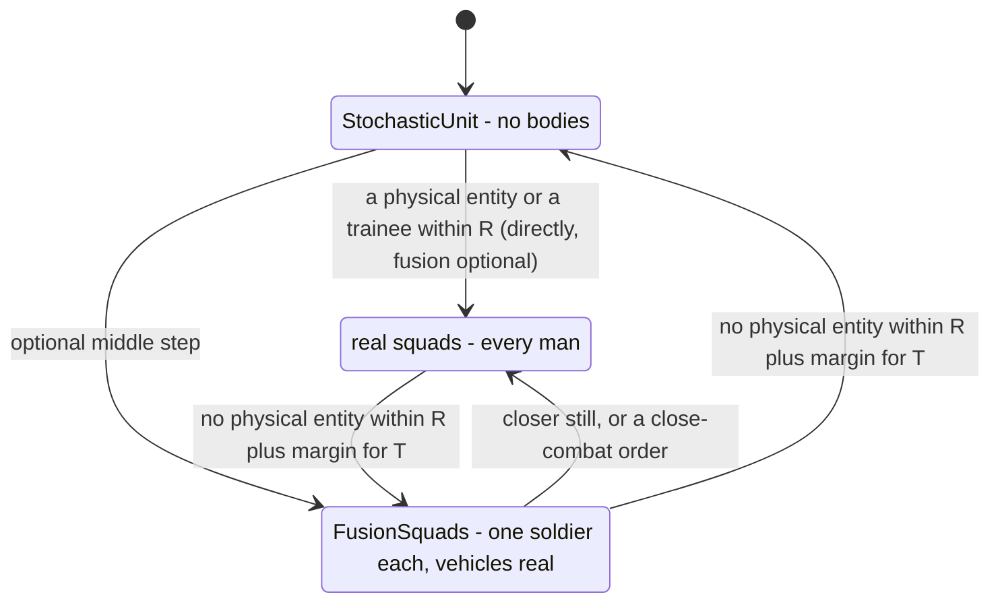
*What it shows: the switch is ONE level at a time, and FusionSquad is the natural middle step — a stochastic platoon becomes three FusionSquads
and its REAL vehicles, long before every man is created.*

| measured / designed | basis |
|---|---|
| the order resolver keys ONLY on the entity's DIS type | `OrderResolver.Resolve(table, dis, order, …)` (`Hrot/Engine/Hrot.Core/Tkb/OrderResolver.cs:33`) ⇒ a resolution baked into the TYPE (D-1's TKB 307) cannot change at run time without changing the entity's type |
| a unit's children are described by its TKB composite (slots), created explicitly today | `NedTkbCatalog.cs:973-992` (`AutoCreateChildren = false`), macros write each man (`city_battle_macros.py:24-38`) |
| entities can be created and destroyed mid-run (macro insertion, creation requests); recordings and seek carry them | `MacroInsertion.cs:23-45`, `CreateEntityRequestSystem.cs:475-480` |
| S-1 / S-7 put the unit's whole state on the unit | §10, §12 |

| # | binds NOW — cheap (lean) | why |
|---|---|---|
| ⭐ **X-1** | **the UNIT entity persists across every resolution; its resolution is a run-time FIELD (`AggregateUnit.Resolution`), and the order routing tries `<Resolution><Class><Order>` first** (`FusionInfantrySquadAttack`, then `InfantrySquadAttack`) — the TKB type only gives the DEFAULT resolution. ⚠ **This adjusts approved D-1**: its class `AggregateInfantrySquad` / TKB 307 becomes a preset, not the routing key | a resolution in the TYPE cannot switch without replacing the entity, which would break its identity, its subordinate links and its reports |
| ⭐ **X-2** | **the unit keeps its CURRENT ORDER (name + params)**, not only the behaviour it resolved to — on a switch it RE-RESOLVES the same order under the new resolution (a stochastic platoon's attack becomes the real `PlatoonAttack` ordering its new squads) | D-1's order-aware bookkeeping already records the order on the commander's side; the receiver keeping its own is the same field |
| ⭐ **X-3** | **children come from the TKB composite with STABLE keys `<unit>/<slot>`** — the same unit disaggregated twice gives the same children | identity continuity for reports, recordings, replay and the after-action review |
| **X-4** | the mapping rules, written once: men left ⇒ which slots live (deterministic order: the MG crew and the leader last), health / ammo split by slot, positions inside the frontage by the existing formation / post planners, stress from suppression; back: sums and the centroid | consistent both ways; S-5 keeps the expected losses equal |
| **X-5** | switch one level at a time, before contact, with hysteresis; never while engaged | the standard answers to thrashing and discontinuity |
| ⏳ not now | building the switch, the triggers, the cost per switch (a platoon is ~30 creations — measure when built) | — |

## 14. Movement of a StochasticUnit — its shape and composition against the terrain *(✅ M-1…M-4 APPROVED 2026-11-15 — R-4255; 🔒 user, `2026-11-14`: "what about movement of stochastical units? it will need likely a very specialized motion model counting with unit structure and size vs terrain.")*

**The proven solution:** aggregate movement plans on the road / cross-country network, moves at the SLOWEST element's speed × a terrain factor ×
posture, and carries a FORMATION: a road column (length = vehicles × spacing — its tail arrives later and is exposed along the road) or a
deployed line (frontage × depth). Trafficability comes from the composition (wheeled vehicles never through woods), not from a body.

| what exists (measured) | where |
|---|---|
| one route planner over the navmesh, the road graph, or both spliced (`Hybrid`) | `Navigation/RoutePlanner.cs:73-106` |
| two navmesh layers (infantry 60° / 0.4 m step; vehicle 20° / 0.3 m) and per-mover AREA prices (woods: wheeled forbidden, tracked dear) | `RecastNavmeshBaker.cs:68-89`, `NavDoorways.cs:132` (`DoorAwareQueryFilter`) |
| the hull guard, avoidance and the walker assume ONE body | `HullClearance.cs`, `CarKinematicsSystem.cs` |

| # | lean | why |
|---|---|---|
| **M-1** | plan with the EXISTING planner: mounted ⇒ the vehicle layer + roads (`Hybrid`); dismounted ⇒ the infantry layer; the area prices from the unit's holdings (any wheeled system mounted ⇒ woods forbidden) | one route planner for every mover (shared, not duplicated) |
| **M-2** | speed = the slowest holding's speed × the area's terrain factor × posture × suppression — the factors derived from the same TKB numbers (S-5, S-8) | one calibration |
| ⭐ **M-3** | **binds NOW**: the unit's state gains `Formation` (column / line / assault), `Depth`, `Heading`; in a column the unit is a SEGMENT of its path (the head moves, the tail follows `Depth` behind) — its exposure (a burst on the road) and its arrival time come from it | adding recorded fields later is a migration; the segment is what makes a column real |
| **M-4** | a dedicated, deterministic PATH FOLLOWER for the unit's point (no hull guard, no avoidance; congestion and bridges later from the road graph) — ⛔ not the body kinematics | the hull guard and the walker are wrong for a 300 m column |

## 15. Sensors of a StochasticUnit — detection as a probability *(✅ N-1…N-5 APPROVED 2026-11-15 — R-4255; 🔒 user, `2026-11-14`: "similarly the sensors for those unit would need to work differently")*

**The proven solution:** detection per observer–target pair per step as a probability: line of sight (sampled across both footprints), range,
the target's SIGNATURE (its size, vehicles, and activity: moving or firing raises it), the observer's sensors (optics, thermal), vegetation and
weather / night; glimpses ACCUMULATE into a contact.

| # | lean | why |
|---|---|---|
| **N-1** | per step (~1–2 s): candidate pairs from a spatial grid; line of sight checked between a few sample points of each footprint through the EXISTING terrain query (on the Muscle, R-2037); Pd from range × signature × the observer's sensor holdings × the woods grid (UTM T-2) × the weather / night modifiers perception already has; seeded per observer and step (S-3) | the same terrain and modifiers as the physical sensors — one model of the world |
| **N-2** | a detection writes the SAME squad contact pool ⇒ SPOT / CONTACT, the picture and every commander above unchanged | the reports seam |
| **N-3** | a stochastic observer MAY detect physical entities (one way — it only reads them); physical sensors do not see a stochastic unit (S-4 until de-aggregation) | observing is cheap and safe; being seen needs a body |
| ⭐ **N-4** | **binds NOW**: the unit's state gains `Activity` (moving / firing — the signature) and the holdings' slots carry SENSOR systems (optics, thermal, radar) beside weapons | the signature and the observer quality are inputs N-1 cannot invent later |

| **N-5** ✅ | detection ACCUMULATES: a small fixed table of detection levels per observer–target pair; each step adds the step's chance; a contact is reported when the level crosses a threshold and fades when the target is out of sight long enough | single draws make detection jumpy; constructive models accumulate |

## 16. Placing the men on de-aggregation — a squad holding a building, a battalion holding a village *(✅ P-3…P-5 APPROVED as revised 2026-11-15 — R-4255; 🔒 user, `2026-11-14`: "de-aggregation in case the stochatical to physicsl. imagine squad unit holds a building for example - it wuld need to place the soldies somehow reasonably. imagine a battalion holding a village etc")*

| measured | where |
|---|---|
| the squad's defence PLAN needs live men (it starts from the first live man, posts are handed out per man) and runs over SEVERAL ticks (the window survey is an asynchronous world query) | `SquadDefendBehavior.cs:491-520, :577` |
| ⭐ it takes AUTHORED fighting positions FIRST — and when every live man holds one, the terrain is not asked at all | D-2f / DA-5 / DA-46 (`SquadDefendBehavior.cs:496-503`) |
| a man reaches Set the moment he is within `PostRadius` of his post | `Manned`, `:868-881` |
| a unit may START in a saved state (stance, aimed weapon) — "at load it starts IN it" | Initial State S2 (R-4137), `WeaponPosture` |
| the company's defence hands each platoon a BLOCK; the platoon's hands each squad its positions | City Battle §6a (`CompanyDefend` KPlan), `PlatoonDefend` |

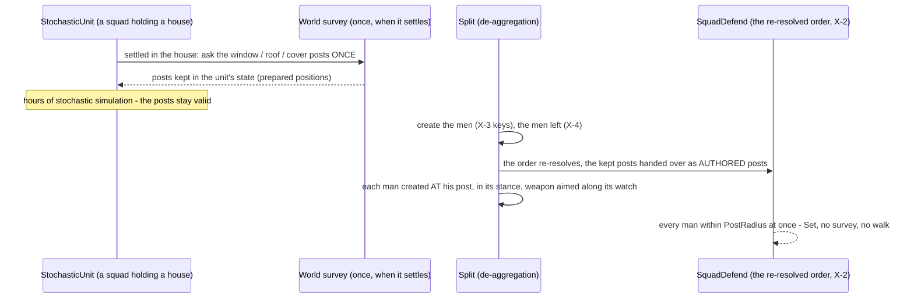
*What it shows: the expensive, asynchronous part (the survey) runs ONCE when the unit settles, not at the split — so the split is instant and the
men appear where the real squad would have put them, through the planner's EXISTING authored-posts path.*

| # | lean | why |
|---|---|---|
| ⛔ **P-1** *(SUPERSEDED by §16a — the user: a unit can split anywhere, also right after entering a house; prepared posts only move the cost)* | ~~binds NOW~~: a stochastic unit that SETTLES on a position (its defend order) asks the posts ONCE through the existing survey and KEEPS them in its state (prepared positions, fixed capacity); the scenario's authored fighting positions fill it too | the planner's authored path is the only instant one — the posts must exist BEFORE the split |
| ⛔ **P-2** *(SUPERSEDED by §16a D-P4)* | on a split each man is created AT his post (the post's stance, the weapon aimed along its watch — the Initial State seam), and the order re-resolves (X-2) with the kept posts as `Authored` ⇒ Set at once | no walk, no survey at the moment it matters |
| ⭐ **P-3** | **binds NOW — the battalion holding a village**: every stochastic unit above the leaf keeps an ALLOCATION per child slot — the child's area (block / building), its holdings share, its kept posts — even while the children do not exist (it is what the company's KPlan and the platoon's plan would have handed out) | a PARTIAL split (only the company next to the trainees) is then "create THAT child from its row"; the rest of the battalion stays stochastic |
| **P-4** | the allocation is made by the SAME planners the real units use (company blocks, platoon positions), run when the unit settles, not invented by the stochastic model | one model of where units stand (the shared-and-unified rule) |
| **P-5** | time in position is state (`Prepared`: hasty → prepared → fortified) — it sets the men's cover and stance on the split | a squad that held the house for an hour is dug in; one that just arrived is not |

## 16a. De-aggregation is a PROCESS — top-down planning, bottom-up materialisation, one handover *(✅ D-P1…D-P7 APPROVED as adjusted 2026-11-15 — R-4255; 🔒 user, `2026-11-14`: "when can stochastic unit get prepared positions? it can be deaggregated at any time, at any location, also moving into the house during the exercise and deaggregate only if enemy comes close … This is no different from getting the position on deaggregation time, i.e. nothing prepared. Deaggregation needs to be a process as it takes time (asking where to deply members, memberc need to de-aggregate as well, i.e. whole deaggregation cascade etc.)")*

**The proven solution:** disaggregation has a LEAD TIME — the trigger fires early enough (a predictive radius: the time the process needs × the
closing speed) that the entities exist before contact; meanwhile the aggregate keeps being simulated, and the handover happens in one step.

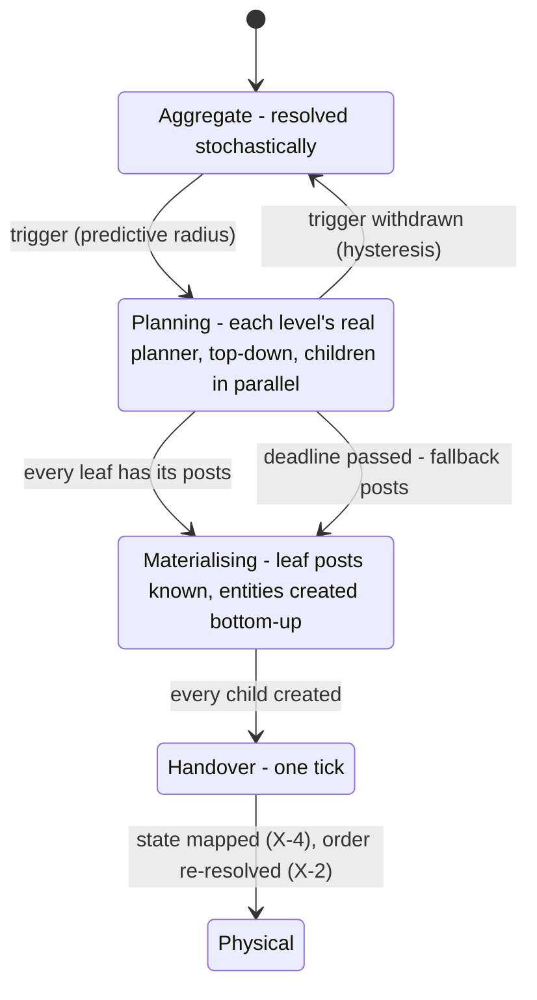
*What it shows: the stochastic unit keeps fighting and being detected through Planning and Materialising — the world does not freeze while it
splits; only the Handover is a single step, and a deadline bounds the whole process.*

| # | lean | why |
|---|---|---|
| **D-P1** | the TRIGGER is predictive: a physical entity (or a trainee) whose time to reach the unit is below the process's budget (measured per echelon when built) — not a fixed distance | the entities must exist before contact |
| ⭐ **D-P2** | **PLAN top-down with the REAL planners**: the battalion's allocation → each company's block plan → each platoon's positions → each squad's posts (the window / roof / cover survey, asynchronous over ticks); children at one level plan in PARALLEL; the unit keeps a `Splitting` stage (recorded — a seek mid-split restores it) | one model of where units stand (P-4); the asynchronous survey is why it is a process |
| ⭐ **D-P3** | **binds NOW — the planners PLAN FOR A COUNT FROM AN ORIGIN**: measured, the squad's defence plan starts from its first LIVE man and hands posts out per man (`SquadDefendBehavior.cs:491-520, :577`) ⇒ split it into PLAN (count, origin, area → posts) and ASSIGN (posts → bodies); the same for the platoon and company plans (⏳ their inputs not yet measured) | the only way to plan before the men exist; it also lets a REAL unit plan a defence before it arrives |
| **D-P4** | MATERIALISE bottom-up once a leaf's posts are known: its men created AT their posts (stance, weapon aimed along the watch — the Initial State seam) and held until the handover; the losses meanwhile decide HOW MANY are created (X-4 maps the state at the handover, not at the trigger) | nobody walks into position under fire; the latest strength counts |
| **D-P5** | a DEADLINE bounds the process: a leaf still without posts gets FALLBACK posts (the formation's slots spread across the unit's frontage) | a split never stalls when contact comes early |
| **D-P6** | the HANDOVER is one tick per unit, serial (the parallel rule: creation and the state mapping as follow-ups): the stochastic resolution stops, the children start, the order re-resolves (X-2) | no tick in which both resolutions fight |
| **D-P7** | a deep split (battalion straight to men in one house) runs the SAME cascade, level by level, quickly — no special path; re-aggregation is the reverse and simpler (sum, then remove) | one mechanism |
| ⚠ *note, CE-8307 (`2026-11-17`, [DESIGN_Split_One_Level.md](DESIGN_Split_One_Level.md) §2 claim 12a, §10)* | **as built, D-P2 is NOT top-down**: a parent creates its children at FALLBACK posts, and each child plans its own posts (D-P3, the squad planner — the only one that exists) once it exists and holds its parent's order (R-8397, a 10 s deadline). A FORCED split (C-7) builds the whole subtree held and hands every level over in one tick (R-8393) | — |
| ⏳ to measure when built | the platoon / company planners' inputs (D-P3); the process time per echelon (D-P1); how created-but-held entities are kept out of the world until the handover (the entity lifecycle's Constructing state is the candidate) | — |

## 16b. Who decides the resolution, when, to what level — and when it is worth it *(✅ R-1…R-7 APPROVED as adjusted 2026-11-15 — R-4255; 🔒 user, `2026-11-14`: "how the de-aggregation would be realized (would it be an action called by SOP or something?) and how triggered (on user request, on contact, or other trigger - who defines and parametrizes). when to re-aggregate, under what condition, is that something automatable? to what aggregation level? in what situation it could make sense? let's think through those before any acceptance")*

**The proven solution:** resolution is a FIDELITY decision of the simulation (level of detail), not a tactical decision of the unit: a
manager compares each unit against a policy — where the FOCUS is (the trainees, the physical forces, the camera), which AREAS must be detailed,
the PERFORMANCE budget — and requests splits and merges; operators can override. Units do not "choose" to become men, and their tactics must not
depend on it.

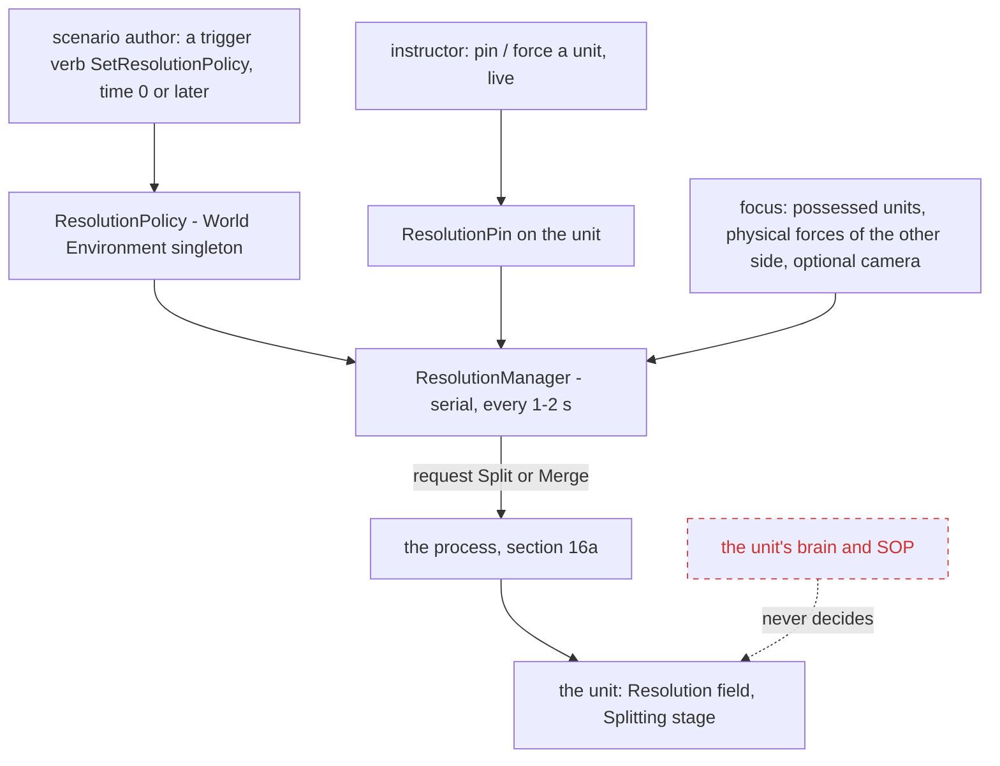
*What it shows: ONE manager owns every resolution change; authors set its policy through the same trigger-verb path the lethality settings
use (`SetSkillAmplifier` → the World Environment, City Battle §4b), instructors pin units, and the unit's brain never takes part — so a split is
invisible to its tactics and its commanders.*

**How it is realised and triggered**

| | lean | why |
|---|---|---|
| **who executes** | a `ResolutionManager` system (serial pass, every 1–2 s of sim time) — ⛔ NOT an SOP row or an action of the unit | a fidelity choice is the simulation's; an SOP would make tactics depend on resolution and give every unit a vote |
| **the policy (data)** | a `ResolutionPolicy` in the World Environment: distance BANDS per resolution (e.g. physical < 400 m from focus, fusion < 1.5 km, stochastic beyond), the predictive lead time (D-P1), the merge margin and quiet time, detail AREAS (a village the exercise is about: always physical), a performance budget | one place, saved with the scenario |
| **who sets it** | the scenario author: a trigger verb `SetResolutionPolicy` (time 0, or later — e.g. "phase 2: the town becomes a detail area") — the same path as `SetSkillAmplifier`; engine defaults otherwise | the existing authoring pattern |
| **live override** | the instructor: pin a unit (never merge / always physical) or force a split / merge — a `ResolutionPin` on the unit, through the command path the editor and the HTTP API already use | a trainer's need: "make that company real now" |
| **focus** | possessed units (`PossessedBy`), physical forces of another side, optionally the active camera / film director (interest score, CE-7018) | where detail is SEEN or FOUGHT |

**When to re-aggregate (automatable — yes)**

| condition (ALL must hold) | why |
|---|---|
| no focus entity inside the band + a margin, for T (e.g. 60 s) | hysteresis — no flip-flop |
| out of contact for T (no shot, no near miss, no detection of a physical enemy) | never merge mid-fight (X-5) |
| ⭐ UNOBSERVED: no physical sensor currently sees any of its members | men never vanish in front of a trainee or a camera |
| not in a detail area, not pinned | the author's and the instructor's word win |
| not mid-play where the state cannot be summed (clearing a building, embarking, a casualty being carried) | the mapping back must be honest |

| **to what level** | lean |
|---|---|
| merge BOTTOM-UP, one level at a time: men → FusionSquad → the StochasticUnit of the lowest echelon whose children are ALL mergeable | a company with one platoon still near the trainees stays split at that platoon |
| the TARGET level comes from the band the unit is in (near → physical, middle → fusion, far → stochastic) | the same bands as the split — symmetric |

**When it makes sense — and when not**

| situation | use |
|---|---|
| ⭐ a large exercise with few trainees: the brigade around them stochastic, the company they fight physical | the main case — detail where it is seen and fought |
| course-of-action analysis, faster than real time: everything stochastic; an analyst splits ONE engagement to inspect it | detail on demand |
| a showcase or a film: the camera's interest drives the detail | the director decides where the men exist |
| a performance governor: merge the quietest units when the frame budget is exceeded | keeps the run real-time |
| ⛔ a small close-combat exercise (a platoon in a village) | everything physical — the policy simply never aggregates |
| ⛔ replay | it shows what was RECORDED; resolution is not changed in replay |

### 16c. The rulings of `2026-11-15` — the leans above as ADJUSTED by §17.1 *(user, one group at a time — R-4255)*

| group | as approved |
|---|---|
| §16 P-3 | every stochastic unit above the leaf keeps an ALLOCATION per child slot: its area (block / building group), its holdings share, its per-slot rows — made when the unit's ORDER is resolved, not at the split |
| §16 P-4 | the areas come from the geometric part of the real planners (company blocks, platoon positions) at order time; the POSTS at the split (SV-5); if a real planner's area step needs live men, the stochastic version computes areas from frontage / depth — measured first |
| §16 P-5 | time in position (hasty → prepared → fortified) is state; it sets the cover factor in stochastic combat (§18) and the men's cover and stance at a split |
| §16a D-P1 | the trigger band is widened by a lead = the process's measured budget per echelon (incl. creation latency, SV-6) × the fastest approaching enemy's speed (fixed bands, SV-9) |
| §16a D-P2…D-P7 | as written, with: the planned-posts component (SV-5), the Held participant (SV-6), the full live roster trimmed at the handover and removed on a withdrawn trigger (SV-7), plays restart from the current situation and a split is refused on an UNTYPED order (SV-10) — ⇒ **prerequisite: the platoons' squad orders routed (CE-4612 step ⑥)** — instructor orders at once (SV-14) |
| §16b R-1…R-7 | one serial `ResolutionManager` (every 1–2 s); the policy an unmanaged World Environment component set by `SetResolutionPolicy`, detail areas = marked area entities (SV-15); focus = possessed units + physical forces of another side (+ optional camera); FIXED bands (SV-9); instructor > author > automatic (SV-14); automatic merge needs no focus within band + margin for the quiet time, out of contact, not in a detail area, not pinned, not mid-play, AND ⭐ UNOBSERVED by any physical sensor (kept for AUTOMATIC merges only — the user's override applies to instructor orders); the governor documented, not built (SV-8) |

## 18. Combat between stochastic units — the attrition step *(✅ C-1…C-8 APPROVED 2026-11-15 — R-4256; ⭐ REVISED by the §21 review, ✅ approved 2026-11-15 — R-4257; the first-approved text is in HISTORY at the bottom)*

**The proven solution:** a heterogeneous Lanchester exchange resolved per (firing system type × target class) pairing from a killer–victim table
(the ATCAL / JTLS family) — ⭐ and, as in that practice, the table is GENERATED from the higher-resolution model, not hand-derived (RV-15).

| measured — what the physical resolution really does | where |
|---|---|
| damage is an EXPECTED value, no dice: `DamagePerHit × PenetrationChance(pen, facing armour)` × the body-zone factor (head ×4, arm ×0.4, leg ×0.5) into `Health`; a frontal rifle hit on a man = 12.5 of 25 | `ArmorModel.cs:119-127`, `DamageCalculationSystem.cs:73-105`, `BodyZones.cs:292-295`, `NedTkbCatalog.cs:86-87` |
| P(hit) from the spread: `DispersionMils` × moving × under fire (σ × 2 for 5 s) × the SHOOTER's stance × proficiency; a mount with no dispersion hits at any range (13 of 34) | `HitModel.cs:24-25, :46-62, :118-121` |
| `RateOfFire` is the CYCLIC rate, used only as the gap between rounds inside a burst; the sustained rate comes from behaviour (bursts, aim, reload, peeking) | `AimAndFireExecutor.cs:336`, `FirePacing.cs:16-18` |
| stress per man: `StressModel` — the hit man +0.25, friends within 15 m +0.2, a near miss (3 m) +0.08 (half in cover); calms 0.03 / s, ×2 in cover, ×2 leader near, ×2 after 30 s quiet; broken ⇒ not standing | `Stress.cs:25-53`, `StressSystem.cs:98-103`, `CombatConstants.cs:84` |
| the person area per stance (a burst's casualties) | `AreaEffect.cs:24-26`, `AreaEffectSystem.cs:580` |
| ⛔ physical combat has no dice and `SimRng` has no run seed ⇒ every run of a scenario is the same run | `HitModel.cs:13`, `SimRng.cs:66-74` |
| ⛔ `AreaEffectSystem` skips every `IsHidden` entity, and every `UnitEntity` is hidden | `AreaEffectSystem.cs:175`, `PhysicalPresence.cs:26-29` |

| # | ruling | why |
|---|---|---|
| **C-1** | ⭐ ONE **killer–victim table** per (weapon type × target class), the target class = TKB platform type × an aspect mix (front / side / rear shares). Each entry: P(hit) per range band · the expected damage per hit (`ArmorModel` × the mean zone factor; for vehicles K-kill and M-kill outcomes) · the **EFFECTIVE aimed rate** per weapon × posture (⛔ never `RateOfFire`) · a **suitability** score. ⭐ **GENERATED OFFLINE** by a harness that runs the physical engagement models (small arms in closed form from `HitModel` + `ArmorModel`; guided missiles, HE against men and no-dispersion mounts by running them; rates measured from physical rails), committed as a data asset, loaded once. Factors that are not derived (cover, the target's posture) are labelled CALIBRATED | RV-1, RV-15 — the same numbers by construction |
| **C-2** | the step, every 1 s of sim time, as **TWO per-entity phases**, each writing only itself: **A (per firer)** split its live systems' effective fire over its contacts in range by suitability (B-4's base-of-fire share included), spend its own ammunition per slot, write its `FireAllocation`; **B (per victim)** read every enemy `FireAllocation` naming it (declared tick-start reads — last step's), × its cover (posture, P-5's prepared level) × the firer's suppression ⇒ the expected hits λ per slot class; draw (C-3) | RV-4 — no double count, ammunition spent, the parallel rule kept |
| **C-3** | the DRAW: per exposed slot p = 1 − exp(−λ / n), seeded (S-3, run seed C-8); each hit lands on a slot chosen by a seeded draw weighted by EXPOSURE *(⭐ as built: + the focus share and broken men to ground — calibrated by C-8, R-8005, §23.4)*; it applies the expected damage to that slot's HEALTH; a slot below its incapacitation threshold is down. Wounds stay in the slot table and survive a split. A destroyed vehicle slot's crew: decided with C-1's vehicle outcomes (⛔ no physical counterpart measured) | RV-2, RV-16 |
| **C-4** | SUPPRESSION: the unit's `SuppressedShare` = incoming rounds per exposed man over the last 5 s ⇒ that share of its slots is under fire (σ × 2, the effective rate cut) | RV-12 — the near-miss law, one model |
| **C-5** | MORALE: stress PER SLOT with the `StressModel` constants (the hit slot +Hit, the rest +FriendDown, near-miss share +0.08 / half in cover; calming as `StressSystem`); a broken slot is not standing ⇒ the unit falls back and routs by the SAME `CombatEffective` rule as a physical squad (RV-5's branch), reported as TaskFailed (FallingBack is retired) | RV-12, RV-13 |
| **C-6** | INDIRECT fire and drones: a **stochastic sink inside the serial `AreaEffectSystem`** — the burst's lethal area ∩ the unit's footprint (M-3) × the density of men × the person area per posture ⇒ hits to slots (C-3) + suppression; it runs after phase B | RV-8 |
| **C-7** | ⛔ no direct fire between a stochastic unit and a PHYSICAL entity (S-4). The policy checks band ≥ the largest enemy weapon range + the lead time; a physical weapon with the unit in range FORCES D-P5's fallback handover at once; until ST-5, an order whose target is physical is refused (B-9) | RV-9 |
| **C-8** | CALIBRATION: a recorded **run seed** mixed into `SimRng` (both resolutions vary by seed); a LADDER — 9 v 9 in the open at 100 / 200 / 300 m → + the MG → a defended building → + IFV / ATGM; metrics: the loss-exchange ratio and the time to 50 % losses; ≥ 30 seeds per rung per resolution; PASS = the stochastic mean inside the physical 95 % CI ± 15 %. ⚠ If the physical spread over seeds is ~0, the band is ± 15 % of the physical value | RV-3 |

## 19. What a stochastic unit does with an order *(✅ B-1…B-7 APPROVED 2026-11-15 — R-4256; ⭐ REVISED by §21, approved — R-4257)*

| # | ruling | why |
|---|---|---|
| **B-1** | ⭐ ONE generic play per order KIND for every echelon — `StochasticUnitMove`, `…Defend`, `…Attack`, `…BreakContact` — chosen through the (class, resolution, order) table (SV-2); ⭐ the same table also resolves the **SOP**: one `StochasticUnitSop` (under fire ⇒ BreakContact, suppressed ⇒ Hold), so the physical squad SOP's plays never run on a memberless unit | RV-7 |
| **B-2** | **Move / March**: the route (M-1) — requested, waited for over several ticks, re-requested when dropped (the solver runs at 10 Hz, ≤ 256 per tick) —, the path follower (M-4), the formation (M-3); Set on arrival | RV-17 |
| **B-3** | **Defend / Hold**: occupy the area, allocate the children's areas (P-3), the prepared level grows (P-5); ⭐ **PROGRESS Set once the area is occupied** (commanders wait for it); it never ends by itself | RV-13 |
| **B-4** | **Attack** on `Objective1..N`: approach in line; the base-of-fire share fires (C-2 phase A) while the rest closes; within the assault distance the assault modifiers apply; ⭐ **PhaseLine per objective**; success when the defender is below its break threshold or falls back ⇒ ObjectiveSecure; failure when the attacker breaks ⇒ TaskFailed; suppression established before the close (CE-2436 A-8) is a factor | RV-13 |
| **B-5** | **BreakContact**: move away to a safe area, suppression decaying; Set on arrival | — |
| **B-6** | **ClearBuilding** = Attack on the building's area · **Embark / Dismount** = the mounted / dismounted POSTURE (S-9) when its holdings have the vehicles, else refused · **Recover** = refused | — |
| **B-7** | REPORTS through the existing staff: SITREP from `UnitStrength` (RV-5's branch), SPOT / CONTACT from its contacts (N-2), PROGRESS Set / TaskFailed / PhaseLine / ObjectiveSecure from the play, REQUESTs from the staff off the shared contact pool; ⛔ FallingBack is retired | RV-5, RV-13 |
| **B-8** | ⭐ the orders §19 had missed: **Bound, FireAndMovement** = the Attack play's approach phase · **SupportByFire** (behaviors, CE-2436) = Attack without closing (the base-of-fire share only) · **Strike, ObserveFire** = refused (batteries and observers stay physical). ⭐ **ANY refused order reports PROGRESS TaskFailed to the commander** — fixed GENERICALLY in `TacticalIntentResolutionSystem` (today a commander's minted request is refused to `Guid.Empty` and the commander waits to its deadline, `:143-147`) | RV-6 — benefits every unit, not only stochastic ones |
| **B-9** | until ST-5, an order whose target or objective is a PHYSICAL entity (a physical objective's defenders, a physical vehicle to embark) is refused ⇒ TaskFailed | RV-9 |

⭐ X-2's "the unit keeps its current order" is DERIVED, never stored: `CurrentOrder` comes from `BehaviorState` (`CurrentOrders.cs:41-53`) and the
params from the recorded `BehaviorStartRecord.JsonParams` (`BehaviorStartRecord.cs:26-40`) — a split re-resolves from those (RV-17).

## 20. Slices — the build order *(✅ APPROVED 2026-11-15 — R-4256; ⭐ REVISED by §21, approved — R-4257)*

⭐ Every slice: its own rail red-proved by a compiling mutation; `HROT_PARALLEL_SIM=1` + `HROT_READ_CHECK=1` + `HROT_WORLD_GUARD=1`; every new type
read across units declared (`BrainReads` / `IStableReads`); `stepped-hash.py --threads 1,4,8`; 0 B per steady frame (R-2084); invariant output.

| slice | builds | ⭐ done when | needs |
|---|---|---|---|
| **ST-0** | ① `UnitStrength.Of`, `CombatEffective.IsInTheFight` / `IsStanding`, the staff's `AmmoOf` and `ObjectiveCensus` answer an `AggregateUnit` from its slot table (RV-5); ② `AggregateUnit` + the slot table + `UnitHoldings` with **EVERY recorded field of §14–§19 declared now** (SV-12) — a fixed slot capacity per echelon, each recorded struct ≤ 1024 B (header + slot chunks, RV-11); ③ their replication descriptors + translators (RV-10); ④ the (class, resolution, order) table incl. the SOP (B-1); ⑤ the refused-order TaskFailed (B-8); ⑥ the run seed in `SimRng` (C-8); ⑦ CE-4612 step ⑥ — the commanders' orders ROUTED — ⭐ by the **behaviors** lane after CE-2436 merges: re-inventory the `Assign` sites, decide one neutral params DTO per kind FIRST | a stochastic platoon under a physical company reads Green in the SITREP and counts in an objective; a Defend order resolves to its play; a refused Strike reaches the commander as TaskFailed; the unit shows on a second node; a recording round-trips | CE-4612 ①–⑤ (built) |
| **ST-1** | movement (M-1…M-4) + `StochasticUnitMove` (B-2) + the 2-D footprint drawing (⛔ no 3-D: a unit is hidden) | arrival time within ± 10 % of M-2's prediction; a dropped route re-requested | ST-0 |
| **ST-2** | sensors (N-1…N-5) feeding the contact pool (N-2) + `StochasticUnitSop` | the detection probability against range matches N-1's curve; under fire the unit breaks contact | ST-1 |
| **ST-3** | the table GENERATOR harness + combat C-1…C-7 (the two phases, the draw, suppression, morale, the `AreaEffectSystem` sink) + Defend / Attack / BreakContact plays + B-8 + reports | ⭐ the C-8 ladder passes | ST-2 |
| **ST-4** | a stochastic battalion against a stochastic battalion | it runs to an end; the census and the SITREPs agree with the slot tables; deterministic at 1 / 4 / 8 threads | ST-3 |
| **ST-5** | the resolution manager + policy (§16b) + de-aggregation (§16a) + re-aggregation, the Held participant, the planners' plan / assign split (D-P3), C-7's forced handover | a split then a merge keeps every identity; a physical weapon in range forces the handover | ST-4 |

## 22. UML — the classes, one step, and who runs what *(⭐ R-4257; drawn after the §21 inventory: existing boxes carry their file)*

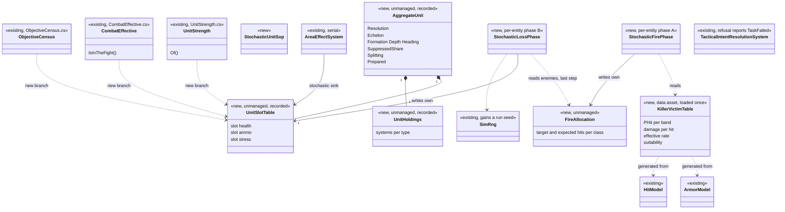
*What it shows that prose hid: the four existing readers that today walk member BODIES all gain one branch onto the slot table (RV-5); the
table is GENERATED from the existing hit and armour models rather than re-derived (RV-1, RV-2, RV-15); and only the two phases and the area sink
write the slot table — each writing its own unit.*

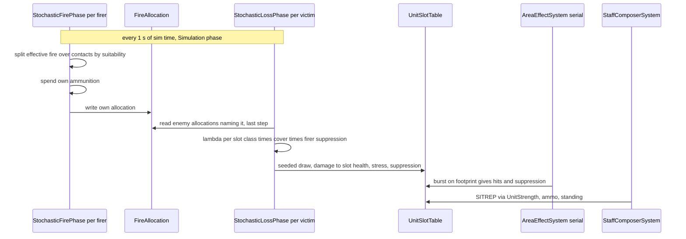
*What it shows: the firer never writes the victim — the allocation is the hand-off, read a step later — which is why the step keeps the parallel
rule (RV-4); the area sink runs serially after phase B.*

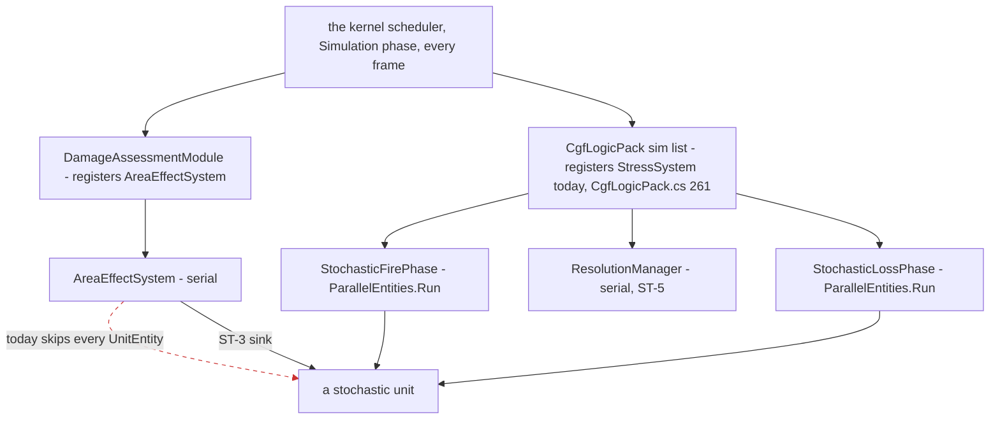
*What it shows: both phases ride the module that already runs the stress phase on every CGF node (so every host that simulates soldiers runs
them by construction); the red edge is today's dead path — the area effect never reaches a unit until ST-3's sink.*

## 23. Dispatch — three EXPERIMENTAL lanes, the contract fixed upfront *(✅ R-4276, `2026-11-16`)*

🔒 User, verbatim: *"approved, write the handoffs for the three exp lanes"* — on the coordinator's lean: three branches `exp/agg-backend`,
`exp/agg-behaviors`, `exp/agg-ui` off `coordinator`, working beside the animals and minefield lanes, ⛔ never merged back until the user says so.

### 23.1 The id blocks *(measured free on every lane, `2026-11-16`)*

| space | agg-backend | agg-behaviors | agg-ui |
|---|---|---|---|
| tracker `CE-` / rulings `R-` | `CE-8000`…`CE-8299` · `R-8000`…`R-8299` | `CE-8300`…`CE-8599` · `R-8300`…`R-8599` | `CE-8600`…`CE-8999` · `R-8600`…`R-8999` |
| component ids | the contract 281–284 + 285–289 | ⭐ **119, 138, 139** *(moved `2026-11-16`: terrain took 324–326 for the minefields first — R-4276 amended)* | 327–329 |
| DDS descriptor ordinals | the contract 220–222 + 223–229 | 230–234 | 235–239 |

### 23.2 The contract every agg lane builds against *(agg-backend DECLARES; its FIRST commit publishes the layouts in `NOTE_AggBackend_To_Agg_Contract.md`)*

| name | id / ordinal | shape (§22) |
|---|---|---|
| `AggregateUnit` | 281 / `dtAggregateUnit` 220 | `Resolution` (byte: 1 Physical, 2 Fusion, 3 Stochastic) · `Echelon` · formation (`Width`, `Depth`, `Heading`) · `SuppressedShare` · `Splitting` · `Prepared` — EVERY recorded field of §14–§19 declared now (SV-12) |
| `UnitSlotTable` | 282 / `dtUnitSlotTable` 221 | a header (unit, chunk) + fixed slots (health, ammo, stress, class) — ≤ 1024 B, chunked (RV-11) |
| `UnitHoldings` | 283 / `dtUnitHoldings` 222 | systems per TKB platform type (count, operational) |
| `FireAllocation` | 284 / — (node-local, recorded) | per target: expected hits per class (phase A → phase B) |
| the routing table | — | (class, resolution, order) → behaviour (SV-2, B-1), the SOP row included |
| readers | — | `UnitStrength.Of`, `CombatEffective.IsInTheFight` / `IsStanding`, the staff's `AmmoOf`, `ObjectiveCensus` answer an `AggregateUnit` from its slot table (RV-5) |

### 23.3 The slices per lane *(the §20 order; a lane may run ahead on stand-ins with the §23.2 names)*

| slice | agg-backend (engine) | agg-behaviors | agg-ui |
|---|---|---|---|
| **ST-0** | ② the components + ③ descriptors / translators (the shared pack) + ④ the routing table + ⑤ refused order ⇒ TaskFailed + ⑥ the run seed in `SimRng` | ① the four readers' slot-table branch + ⑦ CE-4612 step ⑥ (the commanders' orders ROUTED: re-inventory the `Assign` sites, one neutral params DTO per kind FIRST) | the mockup (R-4143); a unit's RESOLUTION in the unit form; the SITREP / strength / ammo rows read a stochastic unit |
| **ST-1** | M-1…M-4: plan with the existing planner from the holdings, the speed model, the unit's deterministic path follower | `StochasticUnitMove` (B-2): orders → the follower; a dropped route re-requested | the 2-D FOOTPRINT (width × depth × heading, the unit symbol) — ⛔ no 3-D, the unit is hidden |
| **ST-2** | N-1…N-5: the spatial grid, LOS between footprint samples (the Muscle), Pd, accumulating levels, the contact pool write | `StochasticUnitSop` (break contact under fire) | the detection levels as a debug overlay |
| **ST-3** ⚠ after minefield MS-T1 merges into `coordinator` (the armour BOTTOM facing) | the killer–victim table GENERATOR (from `ArmorModel` / `HitModel`), the two phases (per-entity A and B), the `AreaEffectSystem` sink | Defend / Attack / BreakContact plays, B-8, the reports | slot-table health / suppression / morale in the unit's details; losses on the 2-D map |
| **ST-4** | determinism at 1 / 4 / 8 threads | the battalion-vs-battalion scenario, its named checks | the scenario's map picture |
| **ST-5** | the resolution manager, de-aggregation (children from the TKB composite, stable `<unit>/<slot>` keys), re-aggregation, the Held participant, C-7's forced handover | the policy (§16b), the planners' plan / assign split (D-P3) | the user's de- / re-aggregate request and the process's progress |

### 23.4 As-built — exp/agg-backend *(folded by the lane, obligation ⑤; status and gates in [`STATUS_AggBackend.md`](../../blueprints/batches/STATUS_AggBackend.md))*

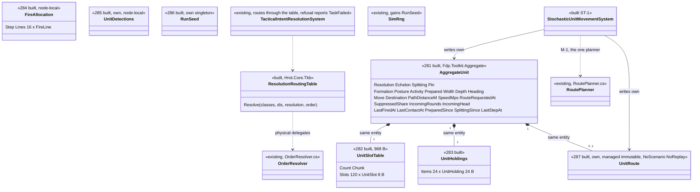
*What the picture shows that the §22 diagram did not: every table sits on the UNIT entity (no chunk entities — R-8000), so each step writes
only its own entity; the routing table wraps the existing resolver instead of replacing it; and the follower plans with the one existing
planner.*

| deviation from §22 / §23.2 | why | lane decision |
|---|---|---|
| a slot is 8 B (`Half` health / stress); ONE table holds a company (120); `Chunk` stays 0 | a chunk on another entity would be a cross-entity write in phase B | R-8000 |
| `UnitDetections` (285), `RunSeed` (286), `UnitRoute` (287) added from the lane's own ids | N-5's per-pair levels recorded before the first recording (RV-11); C-8's seed; M-4's route (derivable, so NoReplay) | — |
| stochastic with no routing row ⇒ refused; fusion with no row ⇒ the physical rule | RV-7 (no physical play on a memberless unit); X-1 | R-8001 |
| `FireLine.Hits` carries the FIRER's suppression already | phase B then reads no firer state | R-8002 |
| the run seed is process-wide (`SimRng.RunSeed`); 0 = the historical numbers | `FromSim` is static with ~30 callers; no golden moves | R-8003 |
| the refusal's TaskFailed rides the receiver's own outbox (`ReportQueue`, the staff's delay) | the one report path (CC-5) | — |
| ST-2's sensing writes the observer's OWN squad pool directly (N-2) and `SquadPerceptionMergeSystem` skips a stochastic unit | the merge recomputes the pool from members; a memberless unit's would be wiped every dwell | — |
| ST-2's draw is the step's EXPECTED chance accumulated (no dice) | N-5 accumulates; deterministic at any thread count without a seed | — |
| ⛔ ~~N-3 not in the first increment~~ — SUPERSEDED round 3 ↓ | | |
| ⭐ N-3 (round 3): physical bodies gathered serially (position, side, √(one man's / a vehicle's share) as the signature, no footprint — one sample point); the activity factors (N-4) apply to units only; a dead body leaves the pool; `UnitDetections.Capacity` (32) bounds what one observer tracks — men beyond it are not paired | the parallel phase reads no physical component; one accumulation for both kinds | CE-8018 |
| ST-3: phase A writes ONLY `FireAllocation`; phase B spends the firer's own ammunition from its own lines (`FireLine.Source`, the former pad byte) | A then reads the targets as stable reads and writes one component; B writes only itself | — |
| ST-3: phase B reads the enemy lines of THIS step (A ran first in the same frame), not last step's | the same determinism; one step less of delay | — |
| ST-3: the run seed reaches the draw from the world's `RunSeed` singleton, else the process seed — passed explicitly | a phase never writes the static (and tests run in parallel) | R-8003 |
| ⛔ ST-3: no host loads the killer–victim table yet; the C-8 ladder needs the physical runs | the TKB adapter + the measured rows are a separate job | CE-8008, CE-8009 |
| ⭐ ST-3 units (CE-8019): the table's damage on MEN is in SLOT health — the physical hit (a body's HP) × `SlotFullHealth` ÷ the soldier's `MaxHealth` (`TargetNumbers.BodyScale`); before, a hit was 4× too lethal (found by the C-8 ladder) | one damage model, two scales — the conversion is X-4's | CE-8019 |
| ⛔ ~~ST-3: 100 m BANDS — a weapon's last band holds its whole reach~~ — SUPERSEDED round 4: **25 m bands** (R-8010) — at 100 m the rifle's 200 m and 300 m shared its last band and fought alike, where the physical squads took twice as long at the far range | | CE-8009 |
| ⛔ ~~C-3 / C-4 calibrated (R-8005, first fit): broken men to ground ×0.5, firing at 0.6~~ — SUPERSEDED round 4: that fit was made against a curve of wounded men BLEEDING OUT; re-fitted below | | CE-8009 |
| ⭐ C-3 TAKES THE PHYSICAL MAN'S BODY (R-8010, round 4) — one source, `BodyZones` + `Gen.Injury`: ① a man's row through his ZONES' armour (`KillerVictimTkb.SoldierZones`; the "Soldier" profile's vest, front 5 on the torso) · ② each hit draws ONE zone by the physical shares (head 0.1 · torso 0.4 · arms 0.2 · legs 0.3; `KillerVictimTable.ManZoneShare / ManZoneFactor`) · ③ a man below his `IncapacitatedBelow` (0.3 of the slot) is out of the fight (`ManOutBelow`) · ④ a PERSONAL weapon fires at the MEASURED 0.4 rounds a second (`MeasuredPersonalRoundsPerSecond`, RV-1); a held system keeps its derived pacing until measured (CE-8008) | 📐 all four measured on the live physical rung (debug API): the mean damage took a 25-HP rifleman out with every hit (≈ 2 physically); a torso hit at 5 mm through the vest is halved; the closed form (no magazine ⇒ one round per 0.8 s aim, 1.25 / s) was 3× the physical 0.37–0.46 | CE-8009 |
| ⭐ R-8005 RE-FITTED (round 4): `FocusShare` 0.3; `BrokenExposure` = `BrokenFireShare` = 1.0 — rung 1 supports no going to ground and no slowed fire; the switches stay for rung 2 (the MG), where suppression must show | a sweep of all three with the measured rate against 30 seeds: first loss 2.7 / 3.6 / 4.4 s vs physical 2.4 / 3.2 / 4.2 | CE-8009 |
| ⭐ THE LADDER MEASURES "OUT OF THE FIGHT", NOT DEATH: a man is DOWN when INCAPACITATED (health below `IncapacitatedBelow` × Max — 30 %); rung 1 is 9 v 9 STANDARD riflemen (`Infantry_Rifleman`: 500 m eye, 25 HP, vest) at 100 / 200 / **275** m (R-8009) | ⛔ the first checks counted health below 2 %, which timed the wounded bleeding out (120 s) after a fight over by ~20 s; ⛔ the urban soldier sees only 150 m (CE-8020); ⛔ 300 m is the rifle's exact reach — the abreast men stood just beyond it | CE-8009 |
| ⭐ C-8's AGGREGATION (R-8011): the loss-exchange ratio over seeds is the RATIO OF TOTALS (all Red down ÷ all Blue down; the physical CI by a seeded bootstrap); the stochastic side runs 300 seeds, the physical 30. ⭐ Rung 1 PASSES on all nine metrics (STATUS §5) | the mean of per-run ratios explodes when one side loses nobody; a 30-seed stochastic mean carried its own sampling noise (22 / 30 Red wins by chance) | CE-8009 |
| ⭐ §16a MERGE HYSTERESIS (F-23, R-4286): a split unit merges only with the enemy beyond the SPLIT TRIGGER + `MergeMargin` (band 400 + lead 200 + margin 200 = 800 m) and after `QuietSeconds` (30) unobserved with no man in contact | ⛔ the merge line was band + margin (500 m), inside the trigger (600 m): an enemy parked between them flipped the unit every ~63 s | CE-8023 |
| ⭐ F-20 (R-4286) — the naked eye's reach (the soldier's VisionRange; 150 m for the urban soldier) lies INSIDE the split band (600 m): an eye-only unit is split before it could see a body. **Intended** — splitting early is the safe direction (the physical men are the truth) | decided by the user, no change | — |
| ⭐ F-22 (R-4286): a split child is named `<unit>/<composite slot>`; ⭐ F-19 (R-4286): a stochastic unit stands on the terrain (the follower sets z = the ground, placed or moving) | checks, goldens and the UI name the men; a line of sight from z 0 started underground | CE-8024, CE-8025 |
| ⭐ DP3-B (R-4286, `DESIGN_DP3_Planned_Posts.md`): `PlannedPosts` (138) is declared here; `Planning` waits for `Ready` or `DeadlineSeconds` ONLY for a unit that has one (the planner adds it), then each man is materialised AT his planned post | a unit with no planner keeps the immediate split, so nothing waits for a planner that is not built | CE-8026 |
| ⭐ N-1 CAPPED (R-8006, for the user's review): the naked eye (an observer whose best sensor is the eye) sees no further than the personal soldiers' TKB `VisionRange` (`KillerVictimTkb.SoldierEyeReach`, resolved serially once per database); the R50 curve applies inside | one source with `VisualPerception`'s hard limit — before, the 400 m eye fought at 200 / 300 m where the physical squads never saw each other. ⚠ 150 m in the open is itself suspect (CE-8020) | CE-8009, CE-8020 |
| ST-3: the BOTTOM row (a mine under the hull) — P(hit) 1, the belly from the TKB's `ArmorBottom` (MS-T1), 0 ⇒ the rear exactly as `ArmorModel.ArmourFor(Facing.Bottom)`; a belly blast M-kills even without penetrating | one belly rule with the physical model | CE-8017 |
| C-6: the sink takes the footprint as a circle of the same area (frontage × max(depth, 20 m)); a casualty in the lethal circle is DOWN, wounds below it folded into `LethalShare` | the overlap in closed form; one calibrated share | CE-8010 |
| the unit phases (sensing, A, B) are `ICoarseJob`s, 2 units a batch | a battalion's 18 units were one batch of 32 — ST-4's red-proof found it | CE-8011 |
| ST-5: the manager decides by the nearest PHYSICAL enemy against fixed bands (SV-9) — the policy is a `Policy` seam (agg-behaviors') | the policy is the other lane's half | CE-8013 |
| ⭐ ST-5 UNOBSERVED (§16b): an AUTOMATIC merge waits while any child is ACQUIRED (`SensorContactList`, the physical sensors' own track state) by a sensor of another force; the quiet time starts when he is lost; the instructor's `PinStochastic` skips it | the physical sensors' own state — no second visibility model | CE-8013 ④ |
| ST-5: Planning uses the FALLBACK posts at once (D-P5) | the real planners' plan / assign split (D-P3) is agg-behaviors' | CE-8013 |
| ⭐ ST-5 HELD (SV-6): `HeldChildParticipant`, composed by `EntityCreationPack` beside the obstacle bake (rule + participant together), registered per ENTITY (`EntityLifecycleModule.RegisterEntityRequirement` — a new ELM seam; a template rule would make every soldier of the type wait), unbounded; a held child stays Constructing (invisible to default queries) until `Held = 0`; a cancelled child's wait is abandoned (`AbandonConstruction`); a seek re-opens it and the same rule holds it. Released children leave through the lifecycle's teardown (`BusResolutionSwitch.Lifecycle`, lazy — the pack is built after the CGF pack) | SV-6: Constructing with a timeout DESTROYS; ⭐ the child counts (`UnitSplits.Live`) are Constructing + Active, never TearDown | CE-8013 ②⑥ |
| ⭐ ST-5 ammunition (X-4): the handover scales each of the soldier's mounts to the slot's share of what he was spawned with (the remainder to the last mount); the merge sums his mounts back (−1 = no weapon state ⇒ the slot keeps its count) | the soldier's own `WeaponState`s are the truth; no second ammo model | CE-8013 ③ |
| ST-5 wiring: `ResolutionManagerSystem` is in `CgfLogicPack` (every CGF node, the owner only) with `ChildType = StochasticUnitFill.ChildType` | the composite's leaves are the one key (fill, split, merge) | CE-8013 ① |
| ST-5: in Physical, `SplittingSince` is when the unit last became merge-ELIGIBLE (the quiet clock) | one recorded field instead of a new one (SV-12) | — |
| CE-8016 (F-9): an authored stochastic unit gets its slots + holdings at SPAWN from the TKB composite (`StochasticUnitFill`, Hrot.Core — the composite lives there): the nested composite flattened to leaves in declaration order; a man → a slot (role from the designation, else his first mount's category; his basic load), a vehicle / system → a holding grouped by type; `CompositeSlot` = leaf index + 1, inverted by `ChildType` (CE-8013 ①); the first soldier per role feeds `KillerVictimTkb.PersonalSoldiers` | SV-3: the SAME composite the physical units are built from — no second roster; once, the owner only | CE-8016 |
| CE-8015: `AggregateUnit`'s six authored fields are attribute-vocabulary rows (ids 281–286, `Aggregate.*`); `Splitting` stays read-only | the generic unit form + the patch path to the wire through the existing descriptor map | CE-8015 |
| ⛔ ~~ST-1's follower plans with THAT node's navmesh / roads only (a split cluster's brain node has none ⇒ roads, else the straight leg)~~ — SUPERSEDED round 3 ↓ | | |
| ⭐ CE-8005 (round 3): a node with no navmesh asks the SOLVER over the path-request topic (B-2: requested, waited for over several ticks — 5 s, then the local plan); the Brain-only CGF node now composes the path-request pair WITH its trajectory pool (it had none ⇒ the pool-gated pair was never composed there) | the ONE solver path every brain uses; no second planner on the brain | CE-8005 |
| ⭐ CE-8005 RESOLVED (R-8007, for the user's review): a stochastic unit's POSITION is owned by its BRAIN, as every unit entity's is — a unit template has no vehicle / flight / weapon-system parameters, so the Muscle group never applies to it (`HrotOwnershipGroups.cs:191`, `HasKinematics`; `NedTkbBuilder.DefineVehicle` adds only the master descriptor) and a physical squad's body-less commander is placed by its OWNER too (`UnitCentroidSystem`, CE-2125). The follower stays on the brain; its route comes from the solver over the path-request topic (the row above) — the designed brain → solver path, not a workaround. ⭐ The C-6 sink moved to the OWNER (R-171, "damage is applied where the health is"): `StochasticAreaEffectSystem` (CGF pack) reads every detonation — local or replicated, the ingress runs on every node (CE-1148) — and applies it to the units this node owns (`StochasticAreaSink.Apply(ownedOnly)`), seeded by the burst (point + munition); `AreaEffectSystem` no longer touches a unit | ⛔ the first reading ("the brain writes the Muscle's SimTransform") was a premise nobody had measured — the Muscle never owns a unit entity's position; moving the follower there would have needed unit templates in the Muscle group, which also moves every PHYSICAL unit's centroid | CE-8005 |

### 23.5 agg-behaviors — ST-0 ⑦: the commanders' orders ROUTED *(exp/agg-behaviors, `2026-11-16`; build-state: BUILDING — increment 1 BUILT; lane decisions R-8300…R-8304 "for the user's review")*

**INVENTORY** *(`scripts/cbm.sh search_graph name_pattern ".*(UnitStrength|CombatEffective|ObjectiveCensus|AmmoOf|CommandOrders|OrderKinds|CurrentOrders).*"` — 8 rows, the index stale (no `UnitStrength`), re-indexed; + grep `CommandOrders.Assign(` outside tests — **23 sites in 14 files**; ⚠ coverage not checkable through the CLI)*

| site | sends (play · DTO fields) | receiver | kind | routed? |
|---|---|---|---|---|
| `CompanyBehaviors.cs:902` (CompanyDefend counter-attack) | `PlatoonAttack` · Position, Speed | platoon | Attack | ⏳ increment 2 (R-8303) |
| `CompanyBehaviors.cs:909` | `PlatoonDefend` · Position, Speed, FallBackTo, ShootAndMoveSeconds, Left, Right | platoon | Defend | ⭐ yes |
| `CompanyBehaviors.cs:442` (CompanyAttack `OrderFor`) | `PlatoonAttack` (Position, SearchRadius, Speed) · `PlatoonDefend` · `PlatoonSupportByFire` · `VehicleSupportByFire` · `DroneTeam` | platoon / vehicle / drone team | Attack · Defend · SupportByFire · — | ⭐ the `PlatoonDefend` arm; the rest ⏳ |
| `PlatoonDefendBehavior.cs:413, :420` | `BreakContact` · To, Speed | squad | BreakContact | ⭐ yes |
| `PlatoonDefendBehavior.cs:427` | `SquadDefend` · Position, SearchRadius, Speed, ShootAndMoveSeconds | squad | Defend | ⭐ yes |
| `PlatoonAttackBehavior.cs:584` (`OrderFor`) | `ClearBuilding` · `FireAndMovement` · `BreakContact` · `SupportByFire` · `SquadDefend` · `BoundingOverwatch` | squad | ClearBuilding · FireAndMovement · BreakContact · — · Defend · Bound | ⭐ BreakContact, Defend; the rest ⏳ increment 2 |
| `PlatoonAttackBehavior.cs:916` | `SquadRecover` · Casualty, To, PutDown, Speed | squad | Recover | ⏳ increment 2 |
| `SupportCommandBehavior.cs:141` (`ReinforceOrder`) | `CompanyDefend` / `PlatoonDefend` / `SquadDefend` by echelon · Position (+ Threat, SearchRadius) | any unit | Defend | ⭐ yes — the echelon switch becomes the receiver's own resolution |
| `UrbanMovementBehavior.cs:180` | `SquadMarch` · Objective, … | squad | March | ⏳ increment 2 |
| `PlatoonConvoyBehavior.cs:320` | `SquadDefend` · `SquadRecover` · `SquadEmbark` (+ `:311` already an `Order`) | squad | Defend · Recover · Embark | ⭐ the `SquadDefend` arm |
| `SupportByFireBehavior.cs:238` | `SupportByFire` · Position, Speed, CooldownSeconds | squad | — | ⏳ increment 2 |
| `SquadManeuverRunner.cs:689` (`Publish`, the command nodes) · `SquadShelterFromAir :70` | a drill's behaviour | the squad's MEN (bodies) | — | ⛔ keep — a body, never stochastic |
| `PlatoonConvoyBehavior.cs:282, :285` · `DroneOperator :105, :108` · `DroneTeam :76, :86` · `SupportCommand :112` · `SwarmRaid :111` · `GreyZoneDash :128` | vehicle / drone / bike / helicopter tasks | platforms (bodies) | — | ⛔ keep — platforms stay physical (B-8: Strike / ObserveFire refused to a stochastic unit) |

**Claims** *(the decision rests on)*

| claim | code — how it IS | design — how it was MEANT |
|---|---|---|
| an `Order.<K>` intent is resolved by the RECEIVER (O2), refused when nothing fulfils it | ✅ `TacticalIntentResolutionSystem.cs:139-150` | ✅ Orders §2, rule O2 |
| params are read STRICTLY — an unknown key refuses the start | ✅ `BehaviorParamsValidation.cs:18-36`, called by the ingress `BehaviorIngressSystem.cs:908, :989` | ✅ CE-2377 |
| a neutral DTO per kind already exists for Move · Attack · Hold · Strike · ObserveFire (`[Order(K)]`) | ✅ `Orders/OrderDtos.cs` | ✅ Orders §1 O1 |
| `AttackOrder` REQUIRES a `Target` entity — a commander's platoon attack on a POSITION has none | ✅ `OrderDtos.cs:46-52` (`[Required] Target`, CE-2148) | ⛔ searched Orders §1–§15 and this design: no ruling on a position-objective Attack ⇒ R-8303 |
| a concrete play declares its kind (`Fulfils`) | ✅ 14 plays, e.g. `SquadDefendBehavior.cs:318`, `PlatoonDefendBehavior.cs:203`, `CompanyBehaviors.cs:763` | ✅ R-2089 |
| `SubordinateOrders.Entry` is replicated — adding a field changes its wire shape | ✅ `SubordinateOrders.cs:24-25` ("same name and wire shape") | ✅ CLAUDE.md new-components rule |
| the (class, resolution, order) table is agg-backend's (ST-0 ④); the name rule `<Class><K>` finds no `InfantrySquadDefend` | ✅ `OrderResolver.cs:58` | ✅ §17.1 SV-2, §23.3 |

| # | lane decision *(for the user's review)* | would change it |
|---|---|---|
| **R-8300** | ⭐ the NEUTRAL params DTO of kind K = an `[Order(K)]` struct in `Hrot.AI.Behaviors/Orders` (the commander's vocabulary, the menu's form); ⭐ **every play that fulfils K (its `Fulfils`, or its DTO's `[Order]`) must READ it strictly** — its params DTO holds each neutral field with the same JSON name and type; a field a play does not use is accepted and documented as unused at that echelon. A rail walks every (fulfilling play × its kind's neutral DTO) pair and refuses a mismatch. **Increment 1: `DefendOrder` { Position, SearchRadius, Speed, ShootAndMoveSeconds, Left, Right, FallBackTo, Threat } and `BreakContactOrder` { To, Speed }** — the union of what the commanders send today | a play that cannot honestly accept a neutral field (its meaning differs) ⇒ that kind gets two DTOs and the user decides |
| **R-8301** | a routed order RECORDS its intent (`Order.<K>`) and its JSON in `SubordinateOrders.Entry.Behavior` / `.Json` — so `Stands` / `Gave` / `StillRunning` keep recognising an unchanged re-send (CE-2304: a re-send restarts a posted defender); ⭐ `SubordinateOrders.Release` turns an `Order.` entry into the UNNAMED clear `Order` sends today — ⛔ no new field (the entry is replicated) | the release needing the resolved play's name (two commanders' orders on one member) |
| **R-8302** | the physical rows of agg-backend's routing table, proposed (a NOTE, never built here): (InfantrySquad, Physical, Defend) → `SquadDefend` · (InfantryPlatoon, Physical, Defend) → `PlatoonDefend` · (InfantryCompany, Physical, Defend) → `CompanyDefend` · (InfantrySquad, Physical, BreakContact) → `BreakContact` — i.e. each concrete play's `Fulfils` IS its row; the table can be BUILT from `Fulfils` + the play's echelon class, never hand-listed | agg-backend's table shape |
| **R-8303** | ⏳ increment 2 (after the table lands): Attack on a POSITION (`AttackOrder` gains an optional `Position` — Target OR Position required), March, Recover, Bound, FireAndMovement, ClearBuilding, Embark, and a new `OrderKind.SupportByFire` (B-8 names it) | the user preferring a separate "AttackPosition" kind |
| **R-8304** | ⭐ a site FLIPS from `Assign(<play>)` to `Order(<K>)` only once the table resolves K for every class it sends to — until then increment 1 ships the DTOs and the rail (the plays accept the neutral DTOs; the commanders already SERIALISE them) and the flip is one line per site | the table landing with a different resolve API |
| **R-8305** | ⭐ the commander chooses in ONE place: `CommandOrders.Route(world, commander, member, OrderKind kind, physicalPlay, neutralJson, newOrder)` — the member is stochastic (`AggregateUnits.IsStochastic`) ⇒ `Order(kind)` (recorded `Order.<K>`, R-8301); else `Assign(physicalPlay)` with the SAME neutral json (R-8300 proves the physical plays read it). `CommandOrders.KeyFor(world, member, kind, physicalPlay)` answers the matching record key for the sites' `StillRunning` / `Gave`. A site whose order has no neutral DTO yet keeps `Assign` (kind 0) | a site needing a play-specific field the neutral DTO lacks |
| **R-8306** | ⭐ `StochasticUnitDefend` raises `AggregateUnit.Prepared` with time in position (P-5): Hasty at once, Prepared after 10 min, Fortified after 60 min of SIM time; `PreparedSince` stamped at occupation. A lane decision for the user's review — the numbers are the doctrine's rough times for a hasty / prepared / fortified position | the user's own times |

⭐ **`CE-4686` ④ (backend, `2026-11-24`): the kind Bound got its neutral DTO** — `BoundOrder { Position, SupportPoint, Speed }`, read by `PlatoonBound`,
`BoundingOverwatch` and (by `Position`) the stochastic generic attack — 📄 `docs/DESIGN_Orders_Params_Entity_Classes.md` §16. ⚠ R-8303's remaining kinds (March, Recover, FireAndMovement, ClearBuilding, Embark) still have none.

**✅ INCREMENT 1 BUILT** *(`2026-11-16`, R-8300 + R-8301 only — no site flipped, R-8304 stands)* — the UML below is as built, with these as-built rows:

| what | where |
|---|---|
| `DefendOrder` · `BreakContactOrder` (`[Order]`, no gesture; fields = the plays' own types) | `Orders/OrderDtos.cs:138` · `:179` |
| ⭐ deviation D-1: `Left` / `Right` are `Fdp.Core.Bearing` (what `PlatoonDefendParamsJsonDto` already holds, a bare number in JSON), not `float` — the commanders' `dto.Left = (Bearing)…` serialise identically | `OrderDtos.cs:138` |
| the plays accept the neutral fields (documented *unused at this echelon*; no behaviour changed) | `SquadDefendParamsJsonDto` (Left, Right, FallBackTo, Threat) · `PlatoonDefendParamsJsonDto` (Threat) · `CompanyDefendParamsJsonDto` (SearchRadius, Left, Right, FallBackTo); `BreakContactParamsJsonDto` already held To + Speed |
| the CONTRACT RAIL — ⭐ walks ALL kinds with a neutral DTO (7 kinds, 26 plays: all green, so not restricted to Defend / BreakContact); entity-link fields stay default (no literal) | `BehaviorParamsValidationTests.R8300_…` |
| R-8301: `CommandOrders.Order` records `Order.<K>` + json; `Release` unnamed for an `Order.` entry; `SubordinateOrders.OrderIntentPrefix` (= `OrderAttribute.IntentPrefix`, pinned by the rail) | `CommandNodes.cs:41` · `SubordinateOrders.cs:50, :98` · `SquadManeuverTests.R8301_…` (+ the existing `CE2141_AMemberThatIsAUnit…` now exercises the release path) |
| ⭐ the order MENU does not offer them yet: `OrderMenu.OfferedFor` keeps only orders the `<Class><Order>` name rule resolves (`OrderMenu.cs:274`), and no `InfantrySquadDefend` / `…BreakContact` exists — they appear when the routing table resolves them | `OrderMenu.cs:267-275` |
| ⚠ side effects of the two `[Order]` DTOs (they join `OrderMenu.Orders`): `OrderMenu` action ids are by NAME order, so every order sorting after `BreakContact` (Hold 401→403, Move 402→404, …) moved — the two menu goldens (`Goldens/menus.golden.txt`, `menus.station.golden.txt`) regenerated, 8 lines each, ids only · `MapMenuActions.OrderShortcuts` declares letters `D` (Defend) / `B` (BreakContact) (rail `K2_OrderLettersAreDeclaredAndDistinct` demands one per order) | `OrderMenu.cs:111-124` · `MapMenuActions.cs:217-222` |

**✅ THE FLIP + THE PLAY BUILT** *(`2026-11-16`, R-8305, R-8306, ST-0 ③ — agg-backend's routing table is merged)*

| what | where |
|---|---|
| `CommandOrders.Route` / `KeyFor` (R-8305) | `CommandNodes.cs:57` · `:67` |
| sites flipped to `Route` (the neutral DTO built; the physical play reads it — R-8300's rail) | `CompanyBehaviors.cs:913-914` (CompanyDefend → PlatoonDefend) · `:444-445` (CompanyAttack `OrderFor`, the Defend arm) · `PlatoonDefendBehavior.cs:414, :421` (BreakContact), `:428` (SquadDefend) · `PlatoonAttackBehavior.cs:586-587` (`OrderFor`: Defend, BreakContact) · `SupportCommandBehavior.cs:141` (`ReinforceOrder`: all three echelons) · `PlatoonConvoyBehavior.cs:318-321` (the secure arm) |
| ⚠ physical behaviour unchanged: the same fields and values; the JSON is `DefendOrder`-shaped (zero fields now written, e.g. `MinRange` / `Squads` omitted — each play's zero = its default). The company-attack `Defend` helper's arc (`halfArc`, `MaxRange`) is 0 at every caller, so `MaxRange` — which `DefendOrder` does not hold — is never lost | rails: the CE2304 re-send rail, CompanyDefend / PlatoonDefend / PlatoonAttack / CompanyAttack / SupportCommand / Convoy suites green |
| `StochasticUnitDefend` — the generic Defend play (occupies at once, **movement is ST-1**; reports Set; Prepared Hasty → Prepared 600 s → Fortified 3600 s of sim time; never ends) | `StochasticUnitDefendBehavior.cs` (registered by its attribute; the routing row `(Unit, Stochastic, Defend)` resolves it) |
| ⭐ **D-2 (deviation, found by the acceptance rail):** the staff composer served only units WITH a `UnitRoster` (query and `Sends`), so a roster-less stochastic unit never flushed its outbox — no SITREP, no PROGRESS Set, and agg-backend's refusal `TaskFailed` queued but never sent. `StaffComposerSystem` now also walks `AggregateUnit` units without a roster (`_stochastic`, `Sends`), its casevac compose skips a roster-less unit, and it declares `AggregateUnit` / `UnitSlotTable` as stable reads | `StaffSystems.cs:111-132, :185` |
| the brain phase declares `AggregateUnit` / `UnitSlotTable` as stable reads (a commander's strength readers read a stochastic member's) | `AiBrainReads.cs:Declare` |
| **R-8306** (Prepared times) is a lane decision for the user's review | §23.5 table |
| ⛔ **Finding to agg-backend:** `UnitSlot` has no ammo capacity (`Ammo` a count; `UnitHoldings.Ammo` a pool) ⇒ a stochastic unit's SITREP ammo colour stays UNKNOWN; a capacity field (or a per-echelon basic load constant) is needed | STATUS_AggBehaviors §5 |

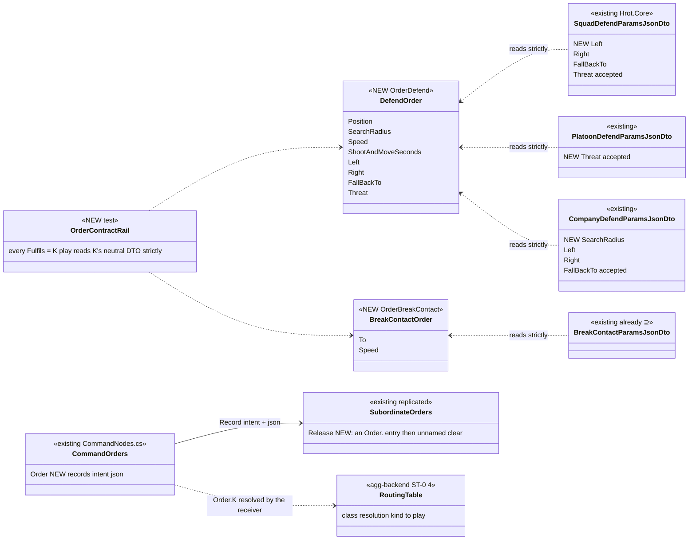
*What it shows: nothing new decides anything — the neutral DTO is a CONTRACT the existing plays already almost meet (the rail makes the "almost"
visible), and the routing itself is agg-backend's table; the commander only stops naming the play.*

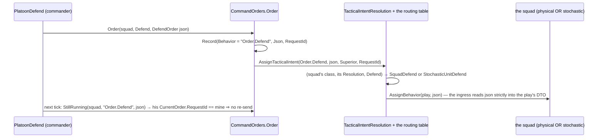
*What it shows: the receiver's RESOLUTION enters at exactly one point (the table) — the commander's code is the same for a physical and a
stochastic squad, which is the whole point of step ⑥.*

**✅ ST-1 / ST-2 BUILT** *(`2026-11-16`; lane decisions R-8307 … R-8311 "for the user's review")*

| # | lane decision | would change it |
|---|---|---|
| **R-8307** | `StochasticUnitMove` orders the unit through `UnitMoves.Order` as a COLUMN (depth = `ColumnDepth`); `StochasticUnitDefend` moves FIRST when farther than `ArrivalRadiusMetres` = 30 m (a platoon's frontage) from its position, as a LINE (depth `LineDepthMetres` = 20 m, the least `StochasticAreaSink` takes), and occupies on arrival (Set, Prepared from that moment); a Defend already there occupies at once | the user's radius / line depth |
| **R-8308** | a dropped route (`RouteFailed`) is re-requested at most `MaxRouteRetries` = 3 times, the next drop ⇒ PROGRESS TaskFailed and Failure. A unit found `Stopped`, or sent elsewhere by another play (a reaction paused this one), is re-ordered WITHOUT counting — that is how a paused order resumes | a different retry budget |
| **R-8309** | `StochasticUnitBreakContact`: `To` when given; else 300 m directly away from the nearest contact of the unit's OWN squad pool; else directly BEHIND its heading — the contract carries the rounds that arrived, never a firer position | agg-backend adding a last-fire direction to `AggregateUnit` |
| **R-8310** | `StochasticUnitSop`, two rows: ① UNDER FIRE (a non-zero bucket among the ring's 3 newest steps or the head's pending bucket — the area sink writes there) AND `CurrentOrders.Of(unit).Kind != Defend` ⇒ React `StochasticUnitBreakContact` (UnderFire urgency); ② `SuppressedShare ≥ 0.5` ⇒ React `StochasticUnitHold` (Contact urgency, so it cannot stop a retreat already running) — a new tiny play: stops the unit while suppressed, Success when the share falls | the share / seconds |
| **R-8311** | the SOP seam is the ingress, not the translator: `BehaviorIngressSystem` substitutes a TEMPLATE-DEFAULT SOP (origin Sop) with the table's `Sop` row for a stochastic unit, through `StochasticSopRouting.Resolver` — set by the host (`CgfLogicPack`, which every brain host builds, = `TacticalIntentResolutionSystem.SopFor`; a forwarding rail pins it). The translator runs before `AggregateUnit` need exist on the entity; the ingress starts every SOP and sees the unit as it is. An explicit SOP assignment is never replaced | a unit whose resolution flips AFTER spawn (a merge) — see finding F-5 |

**As built — ST-1 / ST-2**

| what | where | deviation |
|---|---|---|
| the shared drive step (order once, watch, re-request, `Stopped`/elsewhere ⇒ re-order) | `Brains/StochasticUnitMovePlays.cs` `StochasticUnitMoves.Step` / `Drive` / `Deactivate_Drive` | — |
| `StochasticUnitMove` (Params `MoveOrder`, Fulfils Move) | same file `StochasticUnitMoveBehavior` | — |
| `StochasticUnitBreakContact` (Params `BreakContactOrder`) | same file `StochasticUnitBreakContactBehavior.AwayFromContact` | R-8309 fallback behind the heading |
| `StochasticUnitHold` (no params, no kind) | same file `StochasticUnitHoldBehavior` | a 5th play the brief did not list: a SOP acts only by React, so "hold" needs one |
| `StochasticUnitDefend` approach | `Brains/StochasticUnitDefendBehavior.cs` `Hold`, `Deactivate_Hold` | the immediate teleport is gone (kept only for a unit with no `AggregateUnit`) |
| `StochasticUnitSop` | `Brains/StochasticUnitSop.cs` | — |
| the seam | `Behavior/StochasticSopRouting.cs` · `BehaviorIngressSystem.ApplySopEvents` · `TacticalIntentResolutionSystem.SopFor` · `CgfLogicPack` ctor | translator → ingress (R-8311) |
| rails | `SquadManeuverTests.AggregateMoves.cs` (11) + the ST-0 acceptance now runs the follower (its defence point is 75 m off) | — |

**✅ R-8300 … R-8311 are APPROVED by the user** *(NOTE_Coordinator_To_All_Lanes_Decisions_Approved.md)*.

**✅ ST-3 BUILT** *(`2026-11-16`; lane decisions R-8312 … R-8318 "for the user's review")*

| # | lane decision | would change it |
|---|---|---|
| **R-8312** | the assault distance of `StochasticUnitAttack` = 100 m: the line approach ends there (PhaseLine), the Assault formation closes from it | the C-8 ladder (the stand-off the combat model wants) |
| **R-8313** | the default search radius round the objective = 75 m; `AttackOrder.SearchRadius` overrides | the user's radius |
| **R-8314** | an ammunition colour for a stochastic unit = `UnitAmmunition.TryShare`, capacity = `StochasticAmmoWeight` (1000 rounds) × the share; the same Green / Amber thresholds as a roster; Unknown only when TryShare is false (closes finding F-1) | agg-backend giving the slot a real capacity |
| **R-8315** | `CommandOrders.Route` gains a TWO-payload overload (kind, neutralJson, physicalPlay, physicalJson; revises R-8305): the physical path stays byte-identical where its JSON differs from the neutral one (SquadMarch, PlatoonSupportByFire); Defend / BreakContact keep the one-payload form. Flipped sites: CompanyDefend counter-attack, CompanyAttack arms, PlatoonAttack arms, SupportByFireBehavior squads, UrbanMovement SquadMarch (kind March, `MoveOrder` — closes F-6). Recover and the platform sites stay Assign | a site whose two payloads converge |
| **R-8316** | `AttackOrder` gains `Position`, `SearchRadius`, `Speed`, `HoldBack`; "Target OR Position" is `[RequiredAnyOf]` (`OrderMenu.MissingIn` / `PickOf` extended; the map menu still picks the entity); `OrderKind.SupportByFire` added. The physical attack plays accept the new fields strictly and do not use them — the CE2079 rail lists them as accepted-unused for physical plays only | a physical play reading a position attack |
| **R-8317** | the SOP's UNDER-FIRE row spares an Attack as it spares a Defend (`StochasticUnitSop.HoldsItsGround`): else every attacker breaks contact at the first round; the attack fails the order itself when the unit breaks | an attack that should be broken off by the SOP |
| **R-8318** | success is judged only once AT the objective, with no STANDING stochastic enemy within the search radius among the ordered target and the unit's own REPORTED contacts; failure when the attacker itself is no longer standing | judging on the whole contact pool |

**As built — ST-3**

| what | where | deviation |
|---|---|---|
| `StochasticUnitAttack` (Params `AttackOrder`, Fulfils Attack; HoldBack = support by fire) | `Brains/StochasticUnitAttackBehavior.cs` | — |
| line depth for Line / Assault steps | `Brains/StochasticUnitMovePlays.cs` `Step` | — |
| the two-payload Route, `StillRoutedRunning`, `GaveRouted` | `Brains/CommandNodes.cs` | — |
| neutral Attack DTO + `[RequiredAnyOf]` | `Orders/OrderDtos.cs`, `OrderAttribute.cs`, `Common/Orders/OrderMenu.cs`, the Editor debug API + schema extractor | — |
| AmmoOf for a stochastic unit | `StaffSystems.cs` `StaffComposerSystem.Rounds` (+ `UnitHoldings` a declared stable read) | — |
| SPOT of a wiped-out stochastic enemy | `Perception/ThreatDanger.cs` `IsOutOfTheFight` stochastic arm | found by building the rail |
| F-8 | agg-backend's phase A fires every live system at every reported contact in range, moving or not: no base-of-fire share input, so "fires while approaching" is automatic and HoldBack changes only the movement | — |
| acceptance | `SquadManeuverTests.AggregateAttack.cs`: a DIRECT order (not company-routed) from the commander over a stochastic defender; routing rails use the Company / Platoon fixtures | ⛔ HISTORY: "the company-routed acceptance is not built" — ✅ built `2026-11-17` (CE-8305), next row |
| acceptance, company-routed *(CE-8305, `2026-11-17`)* | `ST3_Acceptance_APhysicalCompanyAttack_OverAStochasticAndAPhysicalPlatoon_EachRunsItsOwnPlay_NoneCrossed` (same file): a physical `CompanyAttack` over one stochastic and one physical platoon, each member's orders through its OWN receiver's `TacticalIntentResolutionSystem`, both role layouts — ① stochastic BASE OF FIRE: `Order.SupportByFire` HoldBack on the 250 m support point (R-8341), runs `StochasticUnitAttack`, walks onto it, its own Set orders the physical assault, which runs `PlatoonAttack`; ② stochastic ASSAULT: the physical base of fire runs `PlatoonSupportByFire`, its Set orders the stochastic `Order.Attack` (no HoldBack, on the objective), which runs `StochasticUnitAttack`. None crossed: neither the orders nor the running behaviour (`BehaviorState.ActiveBehaviorHash`, every frame) | — |

### 23.5c agg-behaviors — ST-5 as built: the policy (§16b), F-5, and D-P3 STOPPED *(`2026-11-16`; lane decisions R-8326…R-8330 "for the user's review")*

| what | where | deviation |
|---|---|---|
| `ResolutionPolicy` (id **119**, unmanaged, default data policy = saved + recorded, 32 B + 8 `EntityLink` — ⭐ CE-8304 / R-8380 below; ⛔ was 8 `EntityRef` and two `float` seconds) on the World Environment: the six `ResolutionBands` numbers, `FrameBudgetMs` (SV-8, dormant), up to 8 detail areas (SV-15) | `Fdp.Toolkits/Aggregate/ResolutionPolicy.cs`, registered in `HrotSharedComponentRegistry` | — |
| `ResolutionPolicies.BandsOf(repo)` = the component's bands, else `ResolutionBands.Default` | same file | — |
| `SetResolutionPolicy` verb (`[SharedAiAction]`, partial: a number left 0 keeps the rest; `area` adds, `clearAreas` forgets; serial write on the LIVE component via `RuleAfterPhase`) | `Brains/Objectives/Verbs/ResolutionVerbs.cs` | — |
| the manager's `Policy = ResolutionPolicies.BandsOf` | `CgfLogicPack.cs` (⭐ cross-lane one-liner, agg-backend's constructor site) | said in the commit |
| F-5: `UnitSopResolutionSystem` — a stateless 1 Hz check; a unit whose SOP is still the TEMPLATE's (origin Sop) is re-assigned the routing table's `Sop` row when stochastic, its template `DefaultSop` when physical | `Hrot.CGF/Systems/UnitSopResolutionSystem.cs`, registered after the manager | behaviors-side owner, no agg-backend change (R-8327) |
| **C (D-P3 plan / assign split) — STOPPED, R-8330** | — | see below |

| id | decision | would change it |
|---|---|---|
| **R-8326** | a policy field <= 0 means the SV-9 default (an authored file with only some numbers is complete; "none" = a tiny positive value); the verb's 0 = keep. Detail areas are stored but the manager does not read them yet (`ResolutionBands` has no field): a note to agg-backend | the manager reading `AreaAt(i)` |
| **R-8327** | F-5 is a behaviors-side stateless system, not a hook in the manager: §16b says the manager never knows SOPs, and the desired SOP is a pure function of the resolution, so nothing to record or replay | a manager event the SOP owner could subscribe to |
| **R-8328** | `ResolutionPolicies.BandsOf` allocates one query per manager step (1 Hz), not per frame | a per-frame caller |
| **R-8329** | component id **138** (`PlannedPosts`) stays reserved, unused; 139 free | — |
| **R-8330** | D-P3 NOT built: `SquadDefendBehavior.Plan` is an async state machine over a commander's child EQS sensors (`SquadManeuverRunner.AskTerrainAll` hangs the ask on `ctx.Commander`, measured FROM `FirstLive` man) with the roster-driven `AnyWithoutPost` / `PickAll` interleaved after each ask (windows, frames, roof, cover, fan, coverage — 1137 lines). A memberless stochastic unit has no roster, no commander cognitive state and no body to measure from, and the manager's Planning stage is one synchronous step with no wait. A split without changing the physical defence needs the asks re-parameterised over (count, origin, area) AND a manager wait for the plan — a design of its own | a design for the asks over a unit entity + a manager Planning wait; then PlannedPosts (138) and `UnitSplits.FallbackPosts` preference |

**✅ CE-8304 — the S0 type rails on `ResolutionPolicy`** *(`2026-11-17`, user-approved item; lane decision R-8380 "for the user's review")*

| what | where | why |
|---|---|---|
| `QuietSeconds` / `DeadlineSeconds` are `SimDuration` (component AND the verb's params) | `ResolutionPolicy.cs` · `ResolutionVerbs.cs` | S0 `S0_EverySecondsTimeoutCooldownMember_IsNotABareFloat`; the `ResolutionBands` precedent (agg-backend `b0d53162e`). Memory and JSON are a float's, so a file / a trigger's JSON reads the same |
| `Area0…7` are `EntityLink` (`LinkAt(i)` as authored, `AreaAt(i)` = its `.Ref`); `AddArea(EntityLink)` dedupes by the live entity, else the authored form | `ResolutionPolicy.cs` | S0 `S9Prime_NoSavedComponentHoldsAnEntityId…` failed on 8 `EntityRef`s: a saved file would hold network ids (S9′) |
| the verb keeps the area AS AUTHORED; a bare id is stored as the target's `EntityGuid` (`ResolutionVerbs.Authored`, read in the serial after-phase) | `ResolutionVerbs.cs` | so a policy set live and then saved names its village by GUID, which the loader's `RefResolve` walk resolves |
| the component rail's decision list `AuthoredInAComponent` (`ResolutionPolicy.Area0…7`, each with its author) + a staleness rail | `S0ComponentTypesRailTests.cs` (⭐ cross-lane: the S0 rail's file) | SR-140 as amended by S9′ allows a person-authored `EntityLink` in a component (`RoutePlan…HoldUnit`), but the member walk still flagged one at the top level; a per-member decision, never a silencer |
| no version bump | — | no scenario / recipe authors `ResolutionPolicy` (grep: 0 files); the recorder fingerprints each layout (`ComponentLayoutHasher`); not on the wire |

| # | lane decision *(for the user's review)* | would change it |
|---|---|---|
| **R-8380** | the detail areas are AUTHORED references (`EntityLink`, SR-140 / S9′ (a)) — a person names a village (SV-15) — not code-written ones behind a GUID-keyed translator; a bare id given to the verb is stored as the target's GUID | the manager (agg-backend) writing areas itself — then `EntityRef` + a translator |

### 23.5d agg-behaviors — F-14 and F-15 measured: a defender fires at what is in REACH; the stochastic base of fire closes too far *(`2026-11-16`; lane decisions R-8338…R-8341 "for the user's review"; CE-8302 BUILT `2026-11-17`)*

**Measured** *(probe scenarios on HEAD `81dcdbbd0` and on F-14's own commit `ea0ea16ee` — the same verdicts on both, so the merges since changed nothing; each probe removed after)*

| probe *(authored 8-rifleman squad under a physical `CompanyDefend`, an unarmed Red platoon 300 m north)* | fires? |
|---|---|
| Defend `Position` = the squad's own spot (300 m) · no `Position` (the play holds where it is) · a FILLED squad · no `Threat` | ✅ at 1.25 s |
| Defend `Position` = the company's spot, **100 m back (400 m from the contact)** | ⛔ never in 60 s — the squad walks back and holds there |
| five squads HOLDING at 290 / 310 / 330 / 360 / 400 m, each from its own target | all REPORT the contact at 1.25 s; ⭐ only the **290 m** one fires |

**Claims** *(the verdict rests on)*

| claim | code — how it IS | design — how it was MEANT |
|---|---|---|
| phase A gives a line only for P(hit) > 0, and P(hit) is 0 past the weapon's `MaxRange` | ✅ `StochasticCombat.cs:191` (`Line`) · `KillerVictimTable.cs:36` (`PHitAt`) | ✅ §14 C-2 (fire by suitability × P(hit) at range) |
| the rifleman's `MaxRange` is the TKB weapon's `Range` = **300 m** (M4) | ✅ `KillerVictimTkb.cs:71` · `NedTkbCatalog.cs:51, :523` | ✅ C-8 (the killer–victim numbers come from the TKB) |
| `CompanyDefend` puts a lone subordinate ON the company's `Position` (a one-member line) | ✅ `CompanyBehaviors.cs:832` | ✅ City Battle §3a (the company's blocks across its frontage) |
| `StochasticUnitDefend` holds its ordered position; it does not close on a contact | ✅ `StochasticUnitDefendBehavior.Hold` | ✅ §23.5 R-8306 / B-1 (Defend = occupy and hold) |
| the base of fire's neutral order is `AttackOrder { Position = the reported posts, HoldBack }` and HoldBack holds at the ASSAULT distance (100 m) of that position | ✅ `CompanyBehaviors.cs:512` · `StochasticUnitAttackBehavior.cs:127` (phase 3) · `AssaultDistanceMetres` | ⚠ §19 **B-8**: *"SupportByFire = Attack without closing"* — 100 m from the posts IS closing (inside the assault distance B-4 gives the assault modifiers). No distance is ruled: searched the aggregate designs + `docs/` + `.dev/` (`grep HoldBack / SupportStandOff / base of fire`), none for a stochastic one. The physical base of fire stands at `SupportAt`, **250 m** short (`CompanyAttackBehavior.SupportStandOffMetres`; `search_graph .*(SupportStandOff\|HoldBack\|SupportByFire\|AssaultDistance).*` returned only `PlatoonAttackBehavior.SupportStandOffMetres`, total 1 — the index under-reports, ⚠ coverage not checkable through the CLI) |
| the assault is ordered only once the base of fire reports Set; the reserve only at the deadline (×1) | ✅ `CompanyBehaviors.cs:589` (`SupportSet`) · `:535` · `:466` | ✅ CE-7005 tempo |

| # | lane decision *(for the user's review)* | would change it |
|---|---|---|
| **R-8338** | ⭐ **F-14 is NOT a defect.** A defending stochastic unit fires at every reported contact inside its weapons' reach and at none beyond it; F-14's squad had been ordered to a position 400 m from the contact, past its riflemen's 300 m. A defender does not leave its ordered position to engage (it holds — as `SquadDefend` does). No code changed | the user wanting a defender to close on a contact it sees but cannot reach |
| **R-8339** | `agg-defend-fires` pins it: the defender sees the attacker at 500 m long before it can hit it, holds its fire while the attacker is beyond 300 m, fires within seconds once it is inside, and never leaves its spot | — |
| **R-8340** | ⭐ **F-15 is a DIFFERENT cause, in our code.** In `agg-battalion-fight` the company that runs `StochasticUnitAttack` (Blue Company 2, roster slot 1) is the BASE OF FIRE, not the assault: its HoldBack holds 100 m from the posts, i.e. on the enemy line, so it walks into both Red front companies and is destroyed (~328 → 335 s) before it can report Set ⇒ the assault (Blue Company 1, slot 0) is never ordered (measured: no behaviour at all for 450 s) and the reserve (Blue Company 3, at the 400 m stand-off, out of reach) waits for the 900 s deadline. ⚠ The scenario's rows call Company 2 "the assault company" — wrong label, right behaviour. ⏳ Filed **CE-8302**: hold the stochastic base of fire at a SUPPORT stand-off (lean: the physical `SupportStandOffMetres` 250 m — inside the rifle's 300 m), then relabel and re-capture `agg-battalion-fight` | the user preferring the base of fire to close (then the scenario is right as is) |

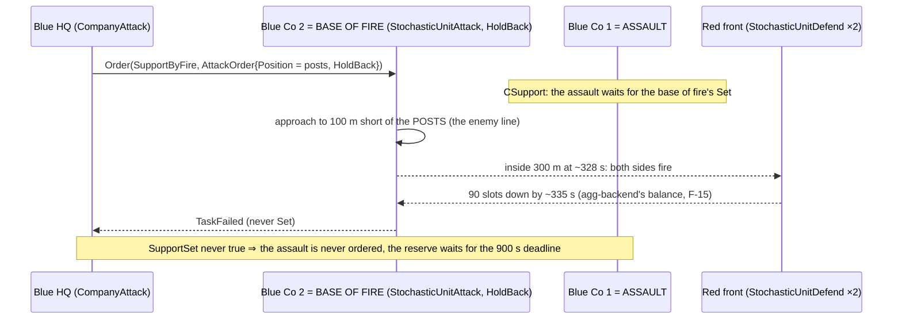
*What the picture shows that the prose hid: the base of fire's hold point is measured from the TARGET, so "never closes" still ends on the enemy line — and the assault's only trigger is a Set that a destroyed unit never sends.*

**✅ CE-8302 BUILT** *(`2026-11-17`, R-8341 — supersedes R-8340's "⏳ filed"; the sequence above is the PRE-fix state, ⛔ history)*

| # | lane decision *(for the user's review)* | would change it |
|---|---|---|
| **R-8341** | ⭐ **ONE owner of where support by fire stands: the COMMANDER.** `HoldBack` + a `Position` now means "stand ON this position" (the play's `HoldOn`: the approach ends on the objective, Set on arrival, no PhaseLine), and all three HoldBack sites send the SAME point their physical base of fire is sent to — so both resolutions stand in one place by construction: `CompanyAttack` → `SupportAt` (250 m short, or A-9's covered building) · `PlatoonAttack` → its `SupportAt` (120 m) · `PlatoonSupportByFire` → each squad's own `at`. A HoldBack on a TARGET entity alone keeps the assault distance. The posts were never the play's to aim — phase A fires at whatever is in reach (F-8) | — |
| rejected | a `StandOff` metres field on `AttackOrder` — a new neutral field every Attack-fulfilling play must accept (R-8300 rail, 26 plays), and a second copy of each commander's stand-off | — |
| rejected | the play reading the `SupportByFire` kind and holding a fixed 250 m — one number for every echelon (the platoon's is 120 m): a second owner of the geometry | — |

| as built | where |
|---|---|
| `StochasticAttackParams.HoldOn` (set by `Resolve` when HoldBack and a Position); phase 0 / approach / PhaseLine honour it | `StochasticUnitAttackBehavior.cs` |
| the three sites | `CompanyBehaviors.cs` `NeutralOf` (SupportByFire arm) · `PlatoonAttackBehavior.cs` `SupportByFire` · `SupportByFireBehavior.cs` (`PlatoonSupportByFire`'s order loop); the R-8315 helper `SupportByFireBehavior.PostsCentre` deleted (its only caller) |
| `AttackOrder.HoldBack` doc: with a Position, that is WHERE the unit stands | `Orders/OrderDtos.cs` |
| rail `ST3_HoldBack_StandsOnItsSupportPosition_FiresThere_NeverClosesAndNeverEnds` (renamed from `…ApproachesToTheAssaultDistance…`): HoldBack on a point 250 m short of the enemy ⇒ Set there (±25 m), no PhaseLine, never closer for 180 s, firing and hitting, never ends. Red-proved: `HoldOn` ignored ⇒ `InRange` red. The three routing rails now assert the support point (company 250 m, platoon 120 m, the PlatoonSupportByFire squad within its spread) | `SquadManeuverTests.AggregateAttack.cs` |
| ⭐ **`agg-battalion-fight` measured after the fix: the outcome is UNCHANGED (golden SAME before the relabel).** The base of fire now heads for x 450 (250 m from Red), but Red's two front companies open fire at ~290 m (x ≈ 410, 328 s) and destroy it by 335 s — still on its way in, so it never reports Set and the assault is still never ordered. That is the stand-off sitting inside the defender's rifle reach plus agg-backend's lethality (F-15 / CE-8009), ⛔ not tuned here. The scenario's rows are RELABELLED: Company 2 = the base of fire, Company 1 = the assault (never committed) | §23.6c row; `scripts/gen-agg-scenarios.py` |

### 23.5e agg-behaviors — X-2 as built: a unit keeps its order across a split / merge *(`2026-11-17`, CE-8306; R-8353 … R-8371)*

⭐ **The as-built lives in [`DESIGN_X2_Order_Reresolution.md`](DESIGN_X2_Order_Reresolution.md) §11** (the decision, the UML, the deviations) — this is a pointer, not a copy.
In one line: F-5's system, renamed `UnitResolutionFitSystem`, re-issues a SQUAD's order (the same id, `IsResume`) with the play the routing table gives at its new
resolution — after its men are rostered by agg-backend's `Handover` (`CmdAssignSubordinate`), with its planned posts as D-2f `Posts` (DP3-D ②); a merge projects
the params onto the stochastic play and removes the roster; an automatic switch waits while the order has no play at the target (`SwitchBlocked`); the
physical fallback rows let a physical squad take `Order.Defend` / `Order.BreakContact` (F-X2-2). Platoons / companies: ⛔ SUPERSEDED — built by CE-8307 (§23.5f).

### 23.5f agg-behaviors — the split goes ONE level (X-5 / D-P7): a platoon splits into stochastic squads *(`2026-11-17`, CE-8307; R-8382 … R-8399)*

⭐ **The as-built lives in [`DESIGN_Split_One_Level.md`](DESIGN_Split_One_Level.md) §11** (the decision, the UML, the review's fold §10) — a pointer, not a copy.
In one line: a split creates the composite's DIRECT subordinates (`BusResolutionSwitch.Composition` from `StochasticUnitFill.Composition`) — a platoon its
3 stochastic squads, each carrying its share of the slot table, which the same manager then splits into men by their own bands; a FORCED split (C-7)
builds the whole subtree held and hands every level over in one tick; the merge goes leaves first; a split platoon / company re-resolves its order to its
own play (`PlatoonDefend` / `PlatoonAttack` / … , the relay `UnitRelayMove` / `UnitRelayBreakContact` for a kind it has no play for). ⭐ Closes F-X2-1.
⚠ The as-built D-P2 is not top-down (§16a note). Findings F-SOL-1 (holdings never materialised), F-SOL-3 (`UnitCompositionDto` unread), F-SOL-4
(a hold-back attack has no echelon play), F-SOL-5 (no cluster-tier run).

### 23.6 ⏳ The FEATURE-TEST SCENARIOS *(coordinator, `2026-11-16`, R-4277 — leans for the user; dispatched with the regression suite's handoffs, not before)*

🔒 User, verbatim: *"i think there should be a lot of feature testing scenarios for the aggregated entities, not sure if covered already"* —
📐 measured: NOT covered. The three `exp/agg-*` branches hold no aggregate scenario; §23.3 asked for ONE (ST-4's battalion fight).

⭐ Each is a regression test (R-4277): a What / Judge `description`, `checks.json` expect rows, a golden (editor tier); the nightly cluster tier
runs the same rows. ⭐ **Lean: agg-behaviors authors them** (it owns ST-4's scenario and the plays); a red that is an engine defect goes to
agg-backend. ⭐ A slice is DONE when ITS rows pass.

| slice | scenario (`scenarios/demos/aggregates/…`) | the Judge lines (each an `expect` row) |
|---|---|---|
| ST-0 | `agg-platoon-under-company` ✅ BUILT | a stochastic platoon under a physical company reads Green in the company's SITREP · counts in the objective's census · a Defend order resolves to its play |
| ST-0 | `agg-refused-order` ✅ BUILT | an order the table has no row for (Strike) reaches the commander as TaskFailed, and nothing else happens |
| ST-0 | `agg-recorded` ✅ BUILT | a run recorded and replayed shows the same slot table at every keyframe |
| ST-1 | `agg-march-open` ✅ BUILT | a dismounted platoon marches 2 km as a column; arrives within ± 10 % of M-2's predicted time |
| ST-1 | `agg-march-mounted` ✅ BUILT | a mounted company keeps to roads, never enters a wood, arrives in its window |
| ST-1 | `agg-route-dropped` ✅ BUILT | the route is cut mid-march: re-requested at most 3 times, then TaskFailed |
| ST-2 | `agg-detect-by-range` ✅ BUILT | an observer and a target at 3 ranges: a contact appears inside N-1's window at the near ranges, never beyond the sensors' reach |
| ST-2 | `agg-sees-physical` ✅ BUILT (§23.6c: optics at 700 m) | a stochastic observer reports a PHYSICAL squad (SPOT up the chain); the physical squad never contacts the stochastic unit |
| ST-2 | `agg-break-contact` ✅ BUILT | fired on while not defending: the unit breaks contact ~300 m away from the nearest contact |
| ST-3 | `agg-platoon-duel` ✅ BUILT (no C-8 band applies — §23.6h, R-8381) | two stochastic platoons fight: losses on both sides inside the C-8 band; suppression rises; the weaker side breaks |
| ST-3 | `agg-shelled-unit` ✅ BUILT | a mortar mission on a stochastic unit: the area sink gives hits and suppression; the unit is never hit by a round that missed its footprint |
| ST-3 | `agg-prepared-defence` ✅ BUILT | an attacker against a defender in position 10 min (Prepared) and 60 min (Fortified): the defender's losses fall in that order |
| ST-3 | `agg-out-of-ammo` ✅ BUILT | a unit fires until its derived ammunition is spent, then stops firing and reports it |
| ST-4 | `agg-battalion-fight` ✅ BUILT | a battalion against a battalion runs to an end; the census and every SITREP agree with the slot tables |
| ST-5 | `agg-split-on-contact` ✅ BUILT (§23.6d) | a physical patrol closes in: the unit de-aggregates into soldiers and vehicles with stable `<unit>/<slot>` keys, in sensible positions |
| ST-5 | `agg-squad-holds-house` ✅ BUILT as built — fallback posts, D-P3 STOPPED (§23.6d) | a squad holding a house splits into men at its window and door posts (§16) |
| ST-5 | `agg-merge-back` ✅ BUILT (§23.6d) | after contact ends the men merge back; the slot table keeps every loss and every identity |
| ST-5 | `agg-forced-handover` ✅ BUILT (§23.6d) | a physical weapon in range forces the handover (C-7) before any stochastic step fights it |
| mixed | `agg-mixed-company-attack` ✅ BUILT | a physical company with one stochastic platoon attacks: every order reaches the right kind of unit; the attack completes |

#### 23.6a As built — agg-behaviors, the nine of ST-0 … ST-2 *(`2026-11-16`; each in `scenarios/demos/aggregates/<name>/`, written by [`scripts/gen-agg-scenarios.py`](../../../scripts/gen-agg-scenarios.py))*

| scenario | terrain | result (`scripts/scenario-regression.sh <name>`, editor tier) | where it departs from the Judge line above, and why |
|---|---|---|---|
| `agg-platoon-under-company` | demo-city | ✅ 5 / 5 rows (+ golden) | the platoon is the company's ONLY subordinate (a physical platoon in the area would pad the census with its 8 men); the census row reads the HoldArea objective's `State` = `Achieved` (needs 20 men, the platoon has 30) |
| `agg-refused-order` | demo-city | ✅ 3 / 3 (+ golden) | **Strike to a stochastic ARTILLERY BATTERY** (type 304), not a rifle platoon: the scenario `Order` verb resolves the order against the PHYSICAL table first and a rifle unit has no Strike; the battery's physical `ArtilleryUnitStrike` lets the event exist, the stochastic table refuses it, the company's `CommandReportHistory` holds `Progress`, subtype 12 (TaskFailed) |
| `agg-recorded` | basic-desert | ✅ 2 / 2 + the review check `--verify-review-at 30`: *review same, return exact, after same* | two stochastic platoons 200 m apart fight (their slot tables change); the replay equality is the editor tier's review harness (§10-3 of the regression design), not a `checks.json` row |
| `agg-march-open` | berlin | ✅ 3 / 3 — the tail arrived at **1590.25 s**, predicted **1588.9 s** (= (2000 + 145 m column) / (1.5 × 0.9 m/s)); window ± 10 % = 1430 … 1748 s | no golden (`golden: false`: a 1760 s run, 9 min wall) |
| `agg-march-mounted` | test-town | ✅ 4 / 4 (no golden: F-13) — the route is the road graph's *Hybrid* planner, 381 m along the roads, never within 45 m of the wood's halves; arrived at 44 s, predicted 43.9 s | a **mounted platoon**, not a company: no TKB composite carries a company's vehicles, so 8 wheeled HMMWV holdings are authored (the fill keeps authored holdings). The wood row was red-proved by sending the unit INTO the wood (both `never` rows broke) |
| `agg-route-dropped` | berlin | ✅ 7 / 7 (+ golden); red-proved with the cuts removed (the re-request rows fail) | an infantry unit always finds a route over open ground, so the cut is a `do`-set of `AggregateUnit.Move = RouteFailed` four times (10 / 20 / 30 / 40 s): three re-requests (the head's distance restarts), the fourth ends the order — the unit stays `RouteFailed`, the company hears TaskFailed |
| `agg-detect-by-range` ⛔ *(superseded by §23.6c)* | berlin | ✅ 3 / 3 (+ golden) — contacts at 1.25 s (150 m, predicted 2 steps) and 7.25 s (700 m, predicted 8), none at 2500 m | three observer/target pairs 7 km apart (every observer sees every target inside 6 km — a firing pair is visible at 2 km); read from `UnitDetections.Pairs.0.Reported`; the observers carry an authored `SquadCognitiveState` (F-11) |
| `agg-sees-physical` ⛔ *(superseded by §23.6c)* | basic-desert | 🔴 1 / 3 — filed as **F-10** (N-3 is not built: a stochastic observer never targets a physical unit) | the third row (*the physical squad never contacts the stochastic unit*) holds; the other two turn green when agg-backend builds N-3 |
| `agg-break-contact` | berlin | ✅ 6 / 6 (+ golden) — the SOP orders BreakContact at 1.25 s, the destination is 300 m south of where it stood (away from the contact), it arrives at 259 s | the squad stands with no order; the Red squad defends 200 m north and fires |

#### 23.6b As built — agg-behaviors, the six of ST-3 / ST-4 / mixed *(`2026-11-16`, R-8321 … R-8325; same generator, same folder)*

| scenario | terrain | result (`scripts/scenario-regression.sh <name>`, editor tier) | where it departs from the Judge line above, and why |
|---|---|---|---|
| `agg-platoon-duel` | basic-desert | ✅ 6 / 6 (+ golden, SAME on a fresh run) — Blue platoon (30) vs Red squad (10 slots) 300 m apart, both defending: a Blue slot down at 1.25 s, eight Red slots down by 3.25 s, Red suppressed > 0.5 and four slots at the break level, Blue never breaks | ⛔ **"losses inside the C-8 band" is NOT judged**: the band needs the physical runs (agg-backend CE-8009, not built) and no band is invented (R-8321); losses on both sides, suppression and who breaks first are |
| `agg-shelled-unit` | indirect-fire-range | ✅ 5 / 5 (+ golden) — a physical battery (three M109, `ArtilleryUnitStrike`, 6 rounds, as `ua-indirect-fire`) on a stochastic platoon: bursts on the aim point, all slots of the platoon in the open down at 33.75 s, suppressed; a second platoon 600 m away is NEVER hit (no slot below 24.9, never suppressed) | "never hit by a round that missed its footprint" = the clear platoon's slots stay whole (health 25) and `SuppressedShare` stays 0, the whole run |
| `agg-prepared-defence` | berlin | ✅ 3 / 3 (+ golden) — two identical fights 7 km apart, a Blue COMPANY (90) against a 30-man defender: Prepared loses 6 men by 90 s, Fortified 5 (never 6) | ⛔ the levels are **authored** (`AggregateUnit.Prepared`), not earned: StochasticUnitDefend climbs Hasty → Prepared → Fortified by sim time (600 s / 3600 s, R-8306), a 3700 s run; the cover factor is read from the component (0.45 / 0.25); the play's ladder is its own rail's (R-8322). The margin is one man — deterministic, but thin |
| `agg-out-of-ammo` ⛔ *(superseded by §23.6c)* | berlin | ✅ 5 / 5 (+ golden) — first round at 1.25 s, every slot empty at 6.25 s, no firing line at the end, SITREP ammunition Red at 3.25 s and **Black at 18.25 s** | an AUTHORED slot table (8 riflemen, 12 rounds) so the load is spent in seconds; the Red platoon is authored with 0 rounds (cannot shoot back); a spare filled squad far away teaches the engine the riflemen's personal weapon; the company attacks (asks the SITREPs) (R-8323) |
| `agg-battalion-fight` ⛔ *(superseded by §23.6c)* | berlin | ✅ 20 / 20 (+ golden, SAME) — Blue HQ `CompanyAttack` over three 90-man stochastic companies, Red HQ `CompanyDefend` over three, 600 m apart. Census: 270 = 3 x 90 slot-table men for each HQ (Achieved at 1.25-1.5 s); Red's three run `StochasticUnitDefend`, the assault company `StochasticUnitAttack`; the assault company is destroyed within 7 s of contact (~335 s), its HQ hears TaskFailed and reads it Black, the rest read Green with no slot down; no physical play on any of the six | ⛔ the gap is 600 m, not ~2 km: at 1.35 m/s 2 km is 19 min of sim per run, 17 min of wall (measured once, same result). **The end is "the assault company is lost"**, not ObjectiveSecure and not a side broken: the base-of-fire company only Sets and the reserve never engages (finding F-15). Companies are ordered by the HQs' plays (the HQ must ask the SITREPs: nothing else does) (R-8324) |
| `agg-mixed-company-attack` | demo-city | ✅ 9 / 9 (no golden: 26 entities, physical squads) — `CompanyAttack` over a STOCHASTIC platoon + two PHYSICAL ones: the stochastic runs `StochasticUnitAttack` (from 59.5 s), the physicals `PlatoonSupportByFire` and `PlatoonDefend` (10.25 s), never crossed; the stochastic platoon reaches Objective 1 (180.5 s) and its HoldArea (25 men: only its 30 slot-table men can meet it) reads Achieved (190.5 s) | the company gives the assault to the FIRST platoon on its roster, the base of fire to the second and holds the third; the stochastic platoon is created first, so **`PlatoonAttack` is not exercised** here (R-8325). No enemy: F-10 (a stochastic observer cannot target a physical unit) and ST-5 (a physical weapon cannot hit a stochastic one) would make a fight judge the engine, not the routing |

| # | lane decision (for the user's review) | would change it |
|---|---|---|
| **R-8321** | the duel encodes only what is checkable without CE-8009: losses on both sides, suppression, the weaker side breaking first; the C-8 band row waits | CE-8009 built: add the band from its runs |
| **R-8322** | prepared-defence authors the levels (no play): a play-driven version needs a 3700 s run | a faster sim-time ladder, or a scenario clock verb |
| **R-8323** | out-of-ammo authors the slot table (8 x 12 rounds) and an unarmed target; a TKB basic load is not spent in a scenario's time | a per-unit ammunition scale in the spawn fill |
| **R-8324** | the battalion is two HQs with plays over three stochastic companies each, 600 m apart, 450 s; the end judged is "the assault company is lost" | the base-of-fire / reserve companies engaging (F-15) |
| **R-8325** | the mixed scenario has no enemy and a stochastic platoon first on the roster | ST-5 + N-3 built: add the fight |

⭐ **Grammar added (R-8320, [`DESIGN_Scenario_Regression.md`](../../DESIGN_Scenario_Regression.md) §3):** a `field` cue's path may carry ONE `*` part (`UnitSlotTable.Slots.*.Health`) with `"elements": n` (at least n of the array's elements satisfy the comparison) and `"where": {…}` filtering the elements first — a slot table's unused slots are all zeros. Rail `ScenarioChecksTests.R8320_…` (red-proved twice: `elements` ignored, `where` ignored).

⭐ The four of ST-5 are built — §23.6d.

#### 23.6c As built — the four scenarios re-authored after agg-backend's round 3 *(`2026-11-16`, merge `a6ba7cf86`; R-8331 … R-8334; ⭐ supersedes the matching rows of §23.6a / §23.6b)*

⭐ Each red was bisected in a scratch worktree (one agg-backend commit reverted at a time on `a6ba7cf86`); the findings are in
[`NOTE_AggBehaviors_To_AggBackend.md`](../../blueprints/batches/NOTE_AggBehaviors_To_AggBackend.md) (F-19 … F-21).

| scenario | moved by | as re-authored | why it still tests the Judge line |
|---|---|---|---|
| `agg-detect-by-range` | CE-8009 R-8006 (`5d8a30150`): the naked eye stops at the men's TKB `VisionRange`, 150 m | ✅ near **100 m by eye** (2 steps), mid **2100 m through OPTICS** (an authored `Sensor: Optics` holding, R50 1200 m: 8 steps), far 2500 m by eye never; each contact also lands in the observer's OWN pool (no authored pool: CE-8021); every unit DEFENDS in place (order-less, the near pair's SOPs broke contact and the movers repeated only to ~2 cm between fresh runs — the F-13 jitter) | the curve's window is still read at two ranges (one with 8 steps); the eye cap itself is not pinned (CE-8020 calls 150 m a TKB defect) (**R-8331**) |
| `agg-battalion-fight` | CE-8009 R-8005: focused hits, broken men still fire at 0.6 · ⭐ `2026-11-17` relabelled (CE-8302, §23.5d): the company that dies is the BASE OF FIRE (Company 2), the assault (Company 1) is never committed | ✅ Red's SITREP rows judged by BAND: company 3 Green ↔ fewer than 10 of 90 down; companies 1 and 2 Amber ↔ at least 10 down and never 28 | ⭐ "every SITREP agrees with the slot table" is now asserted as the SAME band on both sides — the old rows read `Subordinates.0` / `.2` as companies 1 / 3, but the Red HQ's roster lists them 3, 2, 1 (the only Green row is the only company under 10 down) (**R-8332**) |
| `agg-out-of-ammo` | CE-8021 (`6d9634b56`): the order-less target now has a contact pool, so OUR `StochasticUnitSop` sends it back (BreakContact) out of the riflemen's reach | ✅ the Red target DEFENDS in place (`StochasticUnitDefend`) — the SOP spares a defender | the squad still fires until every round is spent (6.25 s) and the SITREP reads Black (18.25 s) — the test is about the shooter, not the target (**R-8333**) |
| `agg-sees-physical` | N-3 built (CE-8018) — ✅ works | ✅ the observer carries OPTICS and stands **700 m** off on **flat berlin**; reported at 9.25 s, SPOT at 12.25 s, never split | 250 m by eye on basic-desert cannot pass: the manager splits the observer inside 600 m (F-20) and its line runs into the ground (F-19) (**R-8334**) |

| # | lane decision (for the user's review) | would change it |
|---|---|---|
| **R-8331** | detect-by-range reads N-1's window by eye at 100 m and through optics at 2100 m; the eye cap is not pinned | CE-8020 (the soldier's open-ground eye) |
| **R-8332** | a SITREP-agrees row is a BAND pair (the colour and the slot count landing in the same Green / Amber band), never a fixed loss count | a SITREP that carries the subordinate's name (then no roster-order reading) |
| **R-8333** | out-of-ammo's target defends in place | — |
| **R-8334** | sees-physical: optics at 700 m on berlin, unpinned (the production path) | F-19 / F-20 answered: then the eye-only, uneven-ground version |

#### 23.6d As built — the four of ST-5 *(`2026-11-16`, R-8335 … R-8337; same generator, same folder; the manager is agg-backend's CE-8012 / CE-8013 with our policy seam CE-8300)*

| scenario | terrain | result (`scripts/scenario-regression.sh <name>`, editor tier; golden captured and SAME on a fresh run) | where it departs from the Judge line, and why |
|---|---|---|---|
| `agg-split-on-contact` | berlin | ✅ 66 / 66 (wall 77 s) — a stochastic platoon (30) defending, a physical patrol marching in from 700 m: stochastic while the patrol is beyond 600 m; Planning 67.25 s, Materialising 68.25 s, Physical 69.25 s; each of the 30 men (ids 1008–1037) carries `uuid5(<platoon>, child:<slot>)` and stands within 20 m of the platoon at the handover | a rifle platoon has no vehicles — the "and vehicles" half is not exercised; "sensible positions" = the FALLBACK rows (D-P3 stopped); the author's policy sets `mergeMargin: 250` (F-23) |
| `agg-squad-holds-house` | cqb-village | ✅ 42 / 42 (wall 25 s) — a stochastic squad (10) holding the house "OBJ" (125, 161), a physical squad 480 m off: Physical at 2.25 s; its 10 men (ids 1030–1039), each with its stable key, stand on ONE line across the squad's heading through the house's centre (y 161 ± 1 m), within 12 m of it, at the handover | ⛔ **judged AS BUILT**: no window / door posts — D-P3 is STOPPED (R-8330), so the men stand on `UnitSplits.FallbackPosts`; the window rows replace the line rows when D-P3 lands. The men then move on their own (their soldiers' SOP), so the positions are read AT the handover (anchor `split`) |
| `agg-merge-back` | berlin | ✅ 63 / 63 (wall 164 s) — a platoon with an AUTHORED table (3 dead, 2 hurt) splits at 2.25 s (27 men: the dead are not created); the patrol walks away; merged at 179.25 s; the table keeps every loss (3 down and never a 4th, 27 up and never 28, the 2 hurt at 12.5); the instructor's `PinPhysical` (a do-set at 250 s) re-splits at 252.25 s and the SAME 27 keys come back (ids 1036–1062) | the policy (`SetResolutionPolicy` at 1 s: quiet 20 s, margin 250 m) keeps the run short and puts the merge past the split trigger (F-23). ⚠ a few whole men come back slightly hurt (≥ 13 of 25; source not traced) — the rows judge losses, not exact health |
| `agg-forced-handover` | berlin | ✅ 6 / 6 (wall 30 s) — two platoons 7 km apart: a physical squad 250 m from the first (C-7) — Physical at 1.25 s, the Planning stage never seen, no stochastic fire line and no slot hurt; the control (450 m) shows Planning at 0.25 s and hands over at 2.25 s | "before any stochastic step fights it" is encoded as no stochastic fire line / no slot hurt while stochastic: the stochastic phases target only stochastic units, so a physical enemy is never fought stochastically anyway |

⭐ **Grammar added (R-8335, [`DESIGN_Scenario_Regression.md`](../../DESIGN_Scenario_Regression.md) §3):** a `field` cue's `who` may be a NETWORK ID — a split's children carry no name (finding F-22). Rail `ScenarioChecksTests.R8335_…` (red-proved).

| # | lane decision (for the user's review) | would change it |
|---|---|---|
| **R-8335** (the grammar stays; the scenarios now use names, R-8349) | the children are addressed by network id (measured per scenario, deterministic in a fresh run); each id's `EntityGuid` is checked against SV-4's `uuid5(<unit>, child:<composite slot>)` — so a re-keyed or missing man fails | F-22 answered (a child name): then by name |
| **R-8336** ⛔ SUPERSEDED by R-8350 (§23.6g) | split-on-contact and merge-back set `mergeMargin: 250` by the author's policy — the default merge distance (500 m) lies inside the split trigger (600 m) and a unit flip-flops every ~63 s (F-23) | F-23 fixed in the manager: the policy line goes |
| **R-8337** ⛔ SUPERSEDED by R-8351 (§23.6g) | agg-squad-holds-house judges the FALLBACK line (as built), its `$doc` says the window / door posts wait for D-P3 | D-P3 built |

#### 23.6e As built — `agg-defend-fires` (F-14, R-8339) *(`2026-11-16`; same generator, same folder)*

| scenario | terrain | result | why it tests the Judge line |
|---|---|---|---|
| `agg-defend-fires` | berlin | ✅ 8 / 8 (+ golden) — a physical company `CompanyDefend` over one FILLED stochastic squad on its position; a stochastic Red squad attacks from 500 m. Blue reports it at 2.25 s; Red crosses y 500 (300 m) at 211.75 s; Blue's first fire line 212.25 s, a Red slot down 212.25 s; Blue never fires before, never moves, never breaks contact | the anchor `in reach` is the attacker's centre 300 m off (the M4's `MaxRange`), so the scenario reads both halves of R-8338: no fire beyond reach, fire within 5 s inside it |

#### 23.6f Re-run after agg-backend's CE-8009 / CE-8008 / CE-8005 round *(`2026-11-17`, merge `b0a82eeda`; R-8342 … R-8345; ⭐ supersedes the matching rows of §23.6b / §23.6c)*

⭐ All 20 re-run in fresh processes. **17 green as they stood; 3 red, every one a row tied to the OLD loss numbers** — agg-backend's `834ccc854` (personal weapons at the measured 0.4 rounds a man a second, was 1.25) and `0f387280a` (a hit through the body's zones and armour; incapacitated = out). ⛔ No engine regression found, so no new finding; no bisect needed (the three moved exactly where the slower, zone-drawn fire predicts).

| scenario | what moved | as re-authored | why it still tests the Judge line |
|---|---|---|---|
| `agg-prepared-defence` | the ORDER-LESS defenders' SOP broke contact at the first fire (our `StochasticUnitSop`, CE-8021 pool) before a man was down — no loss on either defender in 300 s | ⭐ both defenders DEFEND in place; ⭐ **R-8342 (behaviour change):** `StochasticUnitDefend` occupying WHERE IT STANDS keeps an already better prepared level (an authored Prepared / Fortified position) — before, occupation stamped Hasty and erased it. Rows: the Prepared defender has lost half its men (15) by 70 s (measured 65.25 s); the Fortified one has not (73.25 s); the Fortified keeps its level | the cover factor separates them at the half-strength line; the first men fall within a second on both, so a small count cannot (**R-8343**) |
| `agg-platoon-duel` | the 30-man platoon loses NO man in 180 s now (hit at 3.25 s, never down); Red's 10 are down by 14.25 s | row 1 = "a Blue man is HIT" (health < 24.9) instead of "a slot is down" | the fire still reaches both sides, the weaker side still breaks first (**R-8344**) |
| `agg-battalion-fight` | Red companies 1 and 2 lose 5–9 each (Green), not ≥ 10 (Amber) | Red 1 / 2 rows = Green at the HQ, at least 5 down, never 10 (the Green band); company 3 unchanged | the SITREP-agrees-with-the-slot-table pair stays a BAND pair (R-8332) (**R-8345**). ⭐ The base of fire still never reports Set (down 5 at 329 s, all 90 at 346 s, on its way to its 250 m position), so the assault is still never ordered |
| `agg-out-of-ammo` | ✅ green; every slot empty at 12.25 s (was 6.25 s — the slower rate) | `$doc` times updated | — |

Goldens: re-captured where they moved and every row passed (each SAME on a second fresh process) — see STATUS for the list.

| # | lane decision (for the user's review) | would change it |
|---|---|---|
| **R-8342** | an in-place Defend keeps an authored prepared level; a unit that moves into a new position starts Hasty (⚠ a unit LEAVING a prepared position keeps its old level until it arrives — as before, not changed here) | the user wanting a level to reset on any new Defend order |
| **R-8343** | prepared-defence judged at the half-strength line by 70 s | a loss band from the C-8 ladder |
| **R-8344** | the duel's Blue row is "hit", not "down" | — |
| **R-8345** | the battalion's Red 1 / 2 rows read Green with 5–9 down | agg-backend's balance moving again |

#### 23.6g Re-run after agg-backend's R-4286 round — DP3 live, F-22 names, F-23 hysteresis, F-19 terrain z *(`2026-11-17`, merge `6e4e3f1c0` of `b0d53162e`; R-8349 … R-8352; ⭐ supersedes the matching rows of §23.6b / §23.6d)*

⭐ All 20 agg scenarios + the four defend scenarios (`sq-defend-house` 3/3, `pc-defend-house` 7/7, `bc-house-defended` 4/4, `ts-three-defenders` 9/9 golden SAME) re-run in fresh processes after a restore + rebuild. **No engine regression; DP3 works end to end** ([`DESIGN_DP3_Planned_Posts.md`](DESIGN_DP3_Planned_Posts.md) §9a).

| scenario | what moved | as re-authored | why it still tests the Judge line |
|---|---|---|---|
| `agg-squad-holds-house` | ⭐ the men are no longer on the fallback line: 5 of the 10 old line rows red, every man inside the house | ⭐ rows judge the REAL posts (**R-8351**, supersedes R-8337): `PlannedPosts.Ready` = 1 and `Count` = 10 before the men exist; at the handover (2.25 s) ALL men inside OBJ's footprint (x 115–125, y 153–161), ≥ 5 at z ≥ 2.5, ≥ 5 on the enemy-facing north wall; all still inside at 20 s. 22 / 22 | the Judge line "the men materialise at sensible positions (windows, doors) in the house" is now judged directly; the fallback line fails four of these rows |
| `agg-split-on-contact` | names; the policy workaround unneeded | children by NAME (**R-8349**); the `mergeMargin 250` policy removed (**R-8350**); a new row: with the patrol parked 200 m off the platoon NEVER merges back (F-23: contact + 800 m line). 67 / 67, times unchanged (Planning 67.25 s, Physical 69.25 s) — a platoon is not planned for (D-P3 plans a squad), so the manager does not wait | the merge hysteresis is now judged on the DEFAULT bands |
| `agg-merge-back` | with the old content (patrol 450 m, margin 250 ⇒ merge line 850 m) the merge never came before 240 s | no policy (**R-8350**); the patrol starts 550 m off; merged at 209.25 s (the patrol past 800 m and 30 s quiet); a new row: the patrol is NEVER inside 800 m after the merge; the pin moves to 250 s (second split 252.25 s); runFor 280. 64 / 64 | the round trip (losses kept, the same 27 keys) is unchanged; the merge is judged against F-23's line |
| `agg-forced-handover` | names only (golden) | golden re-captured | — |
| `agg-platoon-duel` · `agg-recorded` | ⛔ Blue never hit / no Blue slot down: F-19 stands the units on the terrain, and Blue's spot (300, 200) on basic-desert is a 10 m ridge (crest 10.x at y 210); Red's line (eye 2 m → Blue's point 1 m above ground) passes under the crest, Blue's line (11 m down to Red) clears it — **Red never fired** (measured, `FireAllocation.Count`) | both moved to FLAT ground (measured z 0 for y 260–600): duel Blue (300,300) / Red (300,600), recorded Blue (300,300) / Red (300,500) (**R-8352**). Duel 6 / 6 with the same times as before (hit 3.25 s, Red 8 down 11.25 s, 4 broken 7.25 s); recorded 2 / 2 | the scenarios were authored for flat ground (F-19's "underground z" was hiding the ridge); the terrain itself is now part of the model — not a defect (a crest hides a unit from a lower observer) |
| `agg-shelled-unit` | Red Platoon Clear's z (−3.6 m, the ground) | golden re-captured | — |
| the other 12 | — | unchanged, goldens SAME (march-open / march-mounted / mixed have none) | — |

| # | lane decision (for the user's review) | would change it |
|---|---|---|
| **R-8349** | split children are addressed by NAME `<unit>/<composite slot>` (F-22), listed in `later`; the network-id grammar (R-8335) stays valid, unused here | — |
| **R-8350** | split-on-contact and merge-back run on the DEFAULT bands; merge-back's patrol starts 550 m off (inside the 600 m trigger) so the walk to 800 m stays short (wall ~220 s) | agg-backend moving the bands again |
| **R-8351** | holds-house judges the men's POSITIONS (inside the footprint, upper storey, enemy-facing wall), not `PlannedPosts`' flags — a fixed buffer is not in the entity dump (measured) | the dump exposing fixed buffers: then a "window flag" row |
| **R-8352** | duel / recorded moved off basic-desert's ridge to flat ground | the user wanting the ridge (then: the rows say Red cannot see Blue) |

⚠ Observation for agg-backend (NOTE, F-24): `UnitSensing.Footprint` (`UnitSensing.cs:321-327`) puts the side samples at the CENTRE's z — on a slope a sample floats or is buried (Blue's east sample on the ridge: z 9.05 where the ground is ~5). Not what failed here.

#### 23.6h `agg-platoon-duel`'s "losses inside the C-8 band" row — NO band applies *(`2026-11-17`, R-8381; closes R-8321's wait)*

| claim | source | verdict |
|---|---|---|
| CE-8009's rung 1 passes and bands 9 v 9 standard riflemen in the open at 100 / 200 / 275 m (total down, loss-exchange ratio, time to 50 %) | `STATUS_AggBackend.md` §5 (round 4) · R-8005 · R-8009 · R-8011 | ✅ the only band the ladder has |
| the duel is Blue 30 slots v Red 10 slots at **300 m** | `scripts/gen-agg-scenarios.py` `agg_platoon_duel` | another force ratio (3 : 1), and 300 m is the M4's exact reach, which R-8009 keeps OUT of the rung |
| rung 2 (the MG) and above | `STATUS_AggBackend.md` R-8005 "would change it" | ⛔ not built |

| # | lane decision *(for the user's review)* | would change it |
|---|---|---|
| **R-8381** | ⭐ no C-8 band row in `agg-platoon-duel`: no rung measures this geometry, and a band is never invented; the `$doc` and the description say so. The duel's six rows stand | a ladder rung at an unequal force ratio or at 300 m — then add its band; or the user wanting the duel re-shaped to rung 1's 9 v 9 at 275 m (a different scenario) |

Re-run `2026-11-17` (fresh process): 6 / 6, the same times, golden SAME — not re-captured (only the description / `$doc` text moved).

#### 23.6i X-2's scenarios — a squad keeps its order across a split / merge *(`2026-11-17`, CE-8306, R-8371; same generator, same folder; [DESIGN_X2 §11](DESIGN_X2_Order_Reresolution.md))*

| scenario | rows | what it judges |
|---|---|---|
| `agg-split-keeps-order` *(new)* | 6/6, golden SAME | SquadDefend within 3 s of the handover (2.25 s), never the stochastic play after; `UnitRoster.Count` 10; every man a subordinate, slot 1's the SquadLeader |
| `agg-merge-keeps-order` *(new — `agg-merge-back` is a platoon, X2-I)* | 6/6, golden SAME | SquadDefend after the split; the merge at 209.25 s; StochasticUnitDefend within 3 s, never SquadDefend after; no `UnitRoster` left |
| `agg-commanded-split` *(new)* | 5/5, golden SAME | PlatoonDefend orders the stochastic squad by kind; after the split SquadDefend, never the stochastic play again |
| `agg-squad-holds-house` *(re-judged)* | golden re-captured, SAME | + SquadDefend within 3 s of the handover; + every man still inside 3 s after it (he starts ON his planned post). ⚠ the "20 s, every man inside" row moved to "within 5 m of the north wall": under fire (Red's first round 8.55 s) SquadDefend displaces men 1–4 m out of the north wall — F-X2-6; before X-2 the men ran no play at all, so the old row passed on inert men. ⛔ SUPERSEDED: that row as written in §23.6g |

⚠ **PROGRESS Set is not expressible** — the squad's `ReportOutbox` / `CommandReportHistory` are not in the entity dump (measured: every path fails) ⇒ a grammar gap, judged instead by the men not leaving their posts.

### 23.7 agg-behaviors — ST-0 ①: the four readers answer a memberless unit *(build-state: BUILT — see the as-built rows at the end)*

**INVENTORY** *(graph: `search_graph name_pattern ".*(UnitStrength|CombatEffective|ObjectiveCensus|AmmoOf).*"` + grep — the four readers RV-5 names, each a roster walk)*

| reader | where | today, for a unit with NO roster | the branch (checked BEFORE the roster walk) |
|---|---|---|---|
| `UnitStrength.Of` | `FDP/Toolkits/Fdp.Toolkits/Squad/UnitStrength.cs` | ⛔ `default` (Unknown) — and inside a PARENT's `Sum` a roster-less unit member counts as **1 present man** | ⭐ stochastic ⇒ Present = live slots (standing: live AND not broken), Authorized = the slot count, Known; ⭐ the parent's `Sum` takes the same numbers for a stochastic member (a stochastic platoon under a physical company adds its men, not 1) |
| `CombatEffective.IsInTheFight` / `IsStanding` / `FightingMembers` / `StandingMembers` | `FDP/Toolkits/Fdp.Toolkits/Squad/CombatEffective.cs` | ⛔ `true` ("composition unknown") — a wiped-out stochastic unit stays in the fight | ⭐ stochastic ⇒ live (standing) slots ≥ `MinEffective(slot count)` — the SAME rule as a roster |
| `StaffComposerSystem.AmmoOf` / `RoundsOf` (and `StrengthOf`'s roster guard) | `FDP/Toolkits/Fdp.Toolkits/Squad/Command/StaffSystems.cs` | ⛔ Unknown (no `WeaponAmmo` bodies); `StrengthOf` returned Unknown for a roster-less unit | ⭐ `StrengthOf` lets a stochastic unit through to `UnitStrength`; ⛔ **`AmmoOf` stays UNKNOWN for a stochastic unit: the contract has no per-slot ammo capacity** (`UnitSlot.Ammo` is a count, `UnitHoldings.Ammo` a pool) — a finding to agg-backend, nothing invented |
| `ObjectiveCensus.MenInside` | `Hrot/Subsystems/Hrot.AI.Behaviors/Brains/Objectives/ObjectiveCensus.cs` | ⛔ 0 (no bodies) | ⭐ stochastic ⇒ its Present men count when the unit's position (its footprint centre, `SimTransform`) is inside the area — also for a stochastic unit under a physical subject's roster; the footprint ∩ area share is ST-3's |

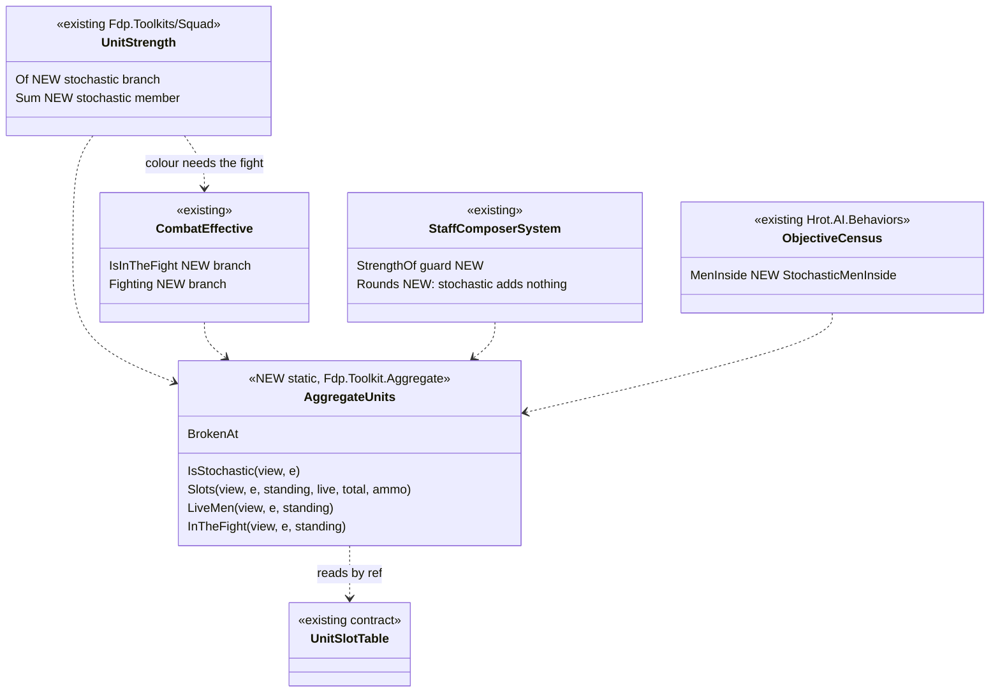
*What it shows: ONE predicate and ONE slot walk; the four readers never touch the table themselves, and nothing else changes — the roster walks stay for physical units.*

⭐ **As built** — `AggregateUnits` lives in `Fdp.Toolkit.Aggregate` (not `Squad`, as first drawn): it reads only the contract's components, and `Squad` already depends on this namespace — one direction. `BrokenAt` = `max(TemperamentOf.TrainedNerve, Stresses.BreakFloor)` (0.75): the physical rule's break level for a man of the default nerve (a slot has no per-man nerve) — not a new number. Rails: `SquadManeuverTests.ST0_*` (strength, colour, fight, standing, roster sum, ammo unknown, 0 B) and `ScenarioRulesTests.ST0_TheCensus_…`.

## 21. ⛔ The review of §18–§20 — `2026-11-15` *(three independent reviewers: combat model, engine fit, behaviours and chain; every load-bearing claim re-checked by the coordinator — ✔)* — ✅ ALL APPROVED, user `2026-11-15`: *"Approved"* — RV-1…RV-17 APPROVED (R-4257), folded into §18–§20 and §22

⭐ 33 raw findings, merged into 17. ✔ = re-measured by the coordinator at the line cited.

| # | sev | the defect | evidence | ⭐ lean |
|---|---|---|---|---|
| RV-1 | ⛔ BLOCKER | C-1's "rate from `RateOfFire`" is the CYCLIC rate (M4 700 rpm); physical fire uses it only as the gap inside a burst — 9 rifles would wipe a squad in one step | ✔ `AimAndFireExecutor.cs:336` (60 / RateOfFire) · `NedTkbCatalog.cs` | an EFFECTIVE aimed rate per weapon × posture, measured from physical rails (a TKB field later); never `RateOfFire` |
| RV-2 | ⛔ BLOCKER | P(kill│hit) is not a TKB number: physical damage is an EXPECTED value by armour facing × body zone into `Health`; a frontal rifle hit does 12.5 of 25. Drawing whole kills also loses wounds the slot table holds | ✔ `ArmorModel.cs:119-127` · `DamageCalculationSystem.cs:73-105` | draw HITS, give them to slots, apply `ArmorModel.HitDamage` × the mean zone factor to the slot's health; down below the threshold — the same numbers by construction, wounds survive a split |
| RV-3 | ⛔ BLOCKER | C-8 has no metric, band or run count; physical combat has "no dice" and `SimRng` has no run seed ⇒ every run is the same run (also kills §10's Monte-Carlo use); `cc-battalion` is not a platoon-vs-company fight | ✔ `HitModel.cs:13` · ✔ `SimRng.cs:66-74` | a recorded RUN SEED mixed into `SimRng`; a calibration LADDER (9 v 9 open at 100/200/300 m → + MG → a defended building → + IFV/ATGM); metrics loss-exchange ratio + time to 50 % losses; ≥ 30 seeds each; pass = stochastic mean inside the physical 95 % CI ± 15 % |
| RV-4 | ⛔ BLOCKER | the victim-pulls step counts a firer at full volume against every victim and nobody spends the firer's ammunition; `WeaponChoice` scores one target ENTITY, it cannot split over classes | `WeaponChoice.cs:22-45` · physical path `HitResolutionSystem` → serial `DamageSystem` | TWO per-entity phases, each writing only itself: A — each firer splits its fire over its contacts (suitability column in the C-1 table), spends its ammo, writes `FireAllocation`; B — each victim reads the enemies' allocations (declared tick-start reads) and draws its own losses and suppression |
| RV-5 | ⛔ BLOCKER | a memberless unit reads Unknown (no roster) or Black (empty roster): `UnitStrength.Of`, `CombatEffective.IsInTheFight` / `IsStanding`, the staff's `AmmoOf` and `ObjectiveCensus` all walk member bodies — §19 B-7 "unchanged" is false; the branch was designed in the deferred FusionSquad (R-D4) and never built | ✔ `UnitStrength.cs:44-58` · ✔ `ObjectiveCensus.cs:24-37` · `StaffSystems.cs:103-111` | ST-0: each of these answers an `AggregateUnit` from its slot table (Present, ammo, standing); the census counts Present men at the footprint |
| RV-6 | ⛔ BLOCKER | §19 omits order kinds commanders really send: Bound and FireAndMovement (PlatoonAttack's squads), Strike, ObserveFire, and behaviors' new SupportByFire; an unresolvable order is refused and, for a commander's minted request, the refusal goes to `Guid.Empty` — the commander waits to its deadline | ✔ `OrderKind.cs` (13 kinds) · ✔ `TacticalIntentResolutionSystem.cs:143-147` | B-8: Bound / FireAndMovement = the Attack play's approach; SupportByFire = Attack without closing (the base-of-fire share); Strike / ObserveFire refused (batteries and observers stay physical); ⭐ ANY refused order makes the receiver report PROGRESS TaskFailed |
| RV-7 | ⛔ BLOCKER | §19 forgets the SOP: a stochastic unit keeps `InfantrySquad` ⇒ `BasicSquadSop`, whose reactions (`ReactToContact`, `SquadShelterFromAir`) are physical plays that fail with no men — reachable from ST-2, when contacts arrive | ✔ `BasicSquadSop.cs:183-191` | the SV-2 table also resolves the SOP by (class, resolution): one `StochasticUnitSop` — under fire BreakContact, suppressed Hold; built in ST-2 |
| RV-8 | SHOULD | C-6 "point fire through the existing paths" never reaches a unit: `AreaEffectSystem` skips `IsHidden`, and every `UnitEntity` is hidden | ✔ `AreaEffectSystem.cs:175` · ✔ `PhysicalPresence.cs:26-29` | a stochastic sink in the serial `AreaEffectSystem` (burst ∩ footprint → slot health + suppression), its order against the attrition phases stated; ST-3 |
| RV-9 | SHOULD | physical ↔ stochastic window: before the handover a physical weapon (mount range to 4000 m, beyond the 400 m band) can neither see nor hit the unit, and in ST-1…ST-4 a stochastic Attack on a physical objective walks in untouched | `PhysicalPresence.cs:27` · SV-9 · C-7 | the policy checks band ≥ the largest enemy weapon range + lead time; a physical weapon with the unit in range forces D-P5's fallback handover at once; until ST-5 an order whose target is physical is refused (TaskFailed) |
| RV-10 | SHOULD | nothing replicates the new state; a display node shows no footprint, strength or SITREP | `Replication/Map/*Translators.cs` (opt-in per component) | ST-0: descriptors + egress/ingress translators for `AggregateUnit` and the slot table |
| RV-11 | SHOULD | the recorded layout is not complete before the first recording (SV-12): stress, last-fire time, `Prepared`, the `Splitting` stage, the per-pair detection levels arrive slice by slice; and `EntityCommandBuffer` refuses a component over 1024 B, which a company's slot table can pass | ✔ `EntityCommandBuffer.cs:39` · `SchemaValidator` | ST-0 declares every field from §14–§19; a fixed slot capacity per echelon, each recorded struct ≤ 1024 B (header + slot chunks) |
| RV-12 | SHOULD | C-4/C-5 merge two mechanisms and use the wrong constants: near-miss `UnderFire` (σ ×2 for 5 s) and stress (calms 0.03/s, ×2 in cover / leader near / 30 s quiet); "+0.25 per man lost" is the HIT man's constant (survivors get 0.2 within 15 m); D-7's squad nerve is unbuilt | `HitModel.cs:24-49` · `StressSystem.cs:98-103` · `Stress.cs:25-53` | two unit states: a suppressed share (rounds per exposed man, last 5 s) and stress PER SLOT with the `StressModel` constants; a broken slot is not standing ⇒ the same rout rule as physical |
| RV-13 | SHOULD | reports: B-3 Defend never sends Set (commanders wait for it); FallingBack is retired; PhaseLine per objective, REQUEST and LACE are missing | `SquadDefendBehavior.cs:880` · `CompanyBehaviors.cs:813` · `PlatoonAttackBehavior.cs:411` | B-3 reports Set when the area is occupied; B-4 takes Objective1..N and reports PhaseLine each; falling back ends as BreakContact Set or TaskFailed; REQUESTs from the staff off the contact pool (after RV-5) |
| RV-14 | SHOULD | slices: no acceptance per slice; ST-4's manager requests splits nothing performs until ST-5; ST-0's step ⑥ (route the commanders' `Assign` sites) is cross-lane, its "18 sites" is stale, and routing a kind needs a neutral params DTO per kind | `CommandNodes.cs:89-98` · `OrderKind.cs:21-23` | one rail per slice + the parallel checks (ST-1 arrival vs M-2's prediction · ST-2 detection vs range · ST-3 the RV-3 ladder · ST-5 split → merge, identity kept); the manager moves into ST-5; step ⑥ is the behaviors lane's, re-inventoried after AU-7, the params DTOs decided first |
| RV-15 | SHOULD | the closed form P(hit) × P(kill) cannot cover guided missiles (hit from the flight sim), the 13/34 mounts with no dispersion (HitChance = 1 at any range), or HE against men (an area effect); "light / heavy armour" drops facing, accumulated health and mobility kills | `HitModel.cs:118-121` · `MissileDto` · `WarheadDto` | generate the table OFFLINE by running the physical engagement models in a harness (the higher-resolution-model practice); closed form for small arms only; target class = platform type × aspect mix, K- and M-kill outcomes |
| RV-16 | SHOULD | the draw is unspecified: a binomial with p = expected / n exceeds 1; the fixed loss order (MG crew and leader last) keeps firepower longer than physical targeting | C-3 · X-4 | p = 1 − exp(−λ / n); the falling slot drawn by seeded draw weighted by exposure |
| RV-17 | NIT | hygiene: STATUS block stale (says §14–§16b "NOT accepted", rides the FusionSquad); §10 table and X-1 string-keyed names superseded by SV-2 but unmarked; SV-11 typo; X-2 should DERIVE the order (`BehaviorStartRecord`), not store it; routes arrive over ticks (10 Hz, 256 per tick); drawing is 2-D only; new cross-unit reads declared in `BrainReads`; cover / posture factors are "calibrated", not "derived"; B-4 needs a base-of-fire term in C-2; wrong `AreaEffectSystem` line cited | `CurrentOrders.cs:41-53` · `PathfindingBatchData.cs:52` | ✅ fixed in the ruling commit |

⭐ **What the reviewers found sound:** simultaneous fire (each writes only itself from last step's state) fits the parallel rule · `HitModel.HitChance` and `ArmorModel` give P(hit) and penetration for small arms · N-3 is true by construction · the route planner takes a request from a bodyless unit · a unit's own `SimTransform` is not overwritten by `UnitCentroidSystem` · ST-0's "CE-4612 ①–⑤ built" is correct · no hot-path allocation is implied.

## 17. ⛔ The critical review — `2026-11-14` *(the multi-resolution reviewer; ✔ re-read by the coordinator)* — ✅ ALL RULED by the user one by one (R-4252); §17.1 the rulings

| # | finding | evidence | ⭐ lean |
|---|---|---|---|
| **SV-1** | **a dead man comes back** — the state keeps COUNTS (`Men`, holdings); X-4 rebuilds the men by a fixed rule ⇒ private slot 3, killed at 10:02, lives again after a merge and a new split (contradicts the recording and the AAR) | §13 X-4 | ⭐ **binds NOW**: a fixed PER-SLOT table on the unit (alive / dead, health, ammo); `Men` is derived from it (one owner); a FusionSquad decides deterministically WHICH slot each lost man was |
| **SV-2** ✔ | **the routing name collides** — `BehaviourName = className + orderName` (`OrderResolver.cs:58`); `Fusion` + `InfantrySquad` = `FusionInfantrySquad…`, the same string as a class named `FusionInfantrySquad` (TKB 307) ⇒ the TYPE keeps deciding after a switch; the inverse `ClassOfBehaviour` (used by `BehaviorFit`, `TaskPicker`) cannot split a resolution prefix; all four `Resolve` callers pass only a DIS type | `OrderResolver.cs:56-66`, `TacticalIntentResolutionSystem.cs:142`, `CommandVerbs.cs:108`, `OrderMenu.cs:270` | ⭐ **adjusts X-1**: a resolution-NEUTRAL type and class for any unit that can switch; the resolution an explicit PARAMETER of `Resolve` / `BehaviorFit` (a table, not string concatenation); TKB 307 is NOT a class |
| **SV-3** | the children come from the wrong composite — 307 lists one FusionSoldier | §13 X-3 | the unit's composite lists the PHYSICAL slots; the fusion soldier is a per-resolution stand-in, not a slot |
| **SV-4** ✔ | **identity of created men** — the engine already derives a child's identity `child:{InstanceId}` from the parent (`CreateEntityRequestSystem.cs:540, :654-659`) ⇒ X-3's `<unit>/<slot>` is a duplicate mechanism; a TRANSIENT entity gets no identity; a non-transient one is saved into the scenario (a reload doubles the unit) | `MacroInsertion.cs:33-40` | ⭐ **adjusts X-3**: reuse the `child:` derivation + a "run-time child" flag (stable identity, never saved) |
| **SV-5** | planning while stochastic has no home — one active behaviour per brain; the plan's state lives in the running play's params; it reads each man's proficiency and role | `SquadDefendBehavior.cs:491-578` | D-P3's PLAN takes roles / tier from the holdings and writes a unit COMPONENT (the P-3 allocation) the physical play reads as authored posts — bind that OUTPUT shape, not the planners |
| **SV-6** | "Constructing" is the wrong holding tool — it activates on the module acks and a bounded timeout DESTROYS (a 30 s hold kills the men); construction reopens on a seek | `EntityLifecycleModule.cs:370-380, :472-482, :595-605` | a "Held" participant that acks at the handover (unbounded); creation latency measured into D-P1's budget |
| **SV-7** | stale between materialising and the handover — losses shrink the count after the men exist; no exit when the trigger is withdrawn | §16a | create the FULL roster, kill / remove the surplus at the handover; a Materialising → Aggregate edge that removes the held men |
| **SV-8** | the performance governor is WALL-clock ⇒ splits differ per machine, the stepped hash diverges | CLAUDE.md F-3 | a budget in sim terms (entities, steps) or a recorded operator decision |
| **SV-9** | **trainees see men appear** — a tank's optics reach 2–3 km: an empty village, one fusion man at 1.4 km, nine men at 400 m; a drone 3 km away sees nothing | §16b bands | bands from the focus entity's SENSOR footprint (optics range, camera frustum); the split ("observable") and merge ("unobserved") tests from the same model |
| **SV-10** | a switch restarts the play from Start (plan, survey, phase 1); only `Order.*` orders can be re-resolved | §13 X-2 | the play PHASE in the X-4 mapping; a unit under a concrete-name order cannot switch |
| **SV-11** | two owners of the men count (`UnitHoldings` and `AggregateUnit.Men`); the component is named "Squad" though S-6 makes it any echelon | §12 | ⭐ **binds NOW**: one owner (SV-1's slot table); rename `AggregateSquad` → `AggregateUnit` before it is recorded |
| **SV-12** | some "binds now" items may be premature (M-3, N-4 fields nothing writes yet; P-3's shape with the planners' inputs unmeasured); "a later field is a migration" was never measured | §14, §15, §16 | ⏳ MEASURE what the recorder does when an unmanaged struct grows; if it tolerates it, defer M-3 / N-4 / P-3 |
| **SV-13** | network and display timing — the creating node owns the men; the `Resolution` field and the men's activation reach a display node at different times (both or neither shown for a few frames) | `DefaultEntityCreationRequestProcessor :358-360` | the display keys off the men being ACTIVE; name the creating node and the men's ownership groups |
| **SV-14** | an instructor pin vs the policy (a forced split while engaged; a forced merge in front of a trainee) has no precedence rule | §16b | instructor > author > automatic, with a refusal reason through `InteractionOutcomes.Refused` (`TacticalIntentResolutionSystem.cs:150`) |
| **SV-15** | the policy is list-shaped, not a small setting like `SetSkillAmplifier` (`SkillVerbs.cs:41-65`); recorded components are unmanaged | §16b | an unmanaged policy struct; detail areas as references to area entities, fixed capacity |

### 17.1 The rulings *(user, `2026-11-14`, one by one — R-4252; they override the rows they name above)*

| # | ruled |
|---|---|
| SV-1 ✅ | a fixed PER-SLOT table on the unit (alive / dead, health, ammo) — the single truth; Present derived; a FusionSquad decides deterministically WHICH slot each lost man was, names it in that loss's `ManDownedEvent`; the dead stay dead across splits |
| SV-2 ✅ | a unit that can switch keeps ONE resolution-neutral type and class (`InfantrySquad`); the resolution is an explicit INPUT to the resolver and the fit check, looked up in a (class, resolution, order) → behaviour TABLE — never string concatenation; the FusionSquad TKB type is a PRESET, not a class (adjusts X-1, D-1) |
| SV-3 ✅ | the unit's composite lists the PHYSICAL slots; the fusion soldier is a per-resolution stand-in chosen by the SV-2 table, never a slot |
| SV-4 ✅ | soldiers created by a split: transient requests (⇒ the existing `ScenarioIgnoreTag`, never saved) carrying an EXPLICIT identity `EntityGuidDerivation.Derive(unit, "child:<slot>")` — kept by the creation system (`CreateEntityRequestSystem.cs:363-375`); no new flag (adjusts X-3) |
| SV-5 ✅ | the planner's OUTPUT bound now: a unit component of planned posts per slot (position, window, watch, stance); the physical defence reads it as AUTHORED posts (D-2f); the planning step takes count / origin / area + roles and tier from the slot table, runs as its own step during Planning; the per-planner split is built with the stochastic slice |
| SV-6 ✅ | a "Held" lifecycle participant acknowledges a created soldier only at the handover, registered unbounded; creation latency measured per echelon into the lead time |
| SV-7 ✅ | the full roster of live slots is created and held; the latest slot table applies at the handover (slots that died meanwhile removed that tick); a Materialising → Aggregate edge removes the held soldiers when the trigger is withdrawn — logged, never seen |
| SV-8 ✅ | the performance GOVERNOR stays DOCUMENTED, NOT implemented (🔒 user: *"keep it documented, as unimplemented addition, do not implement"*); if ever built: a deterministic cap (at most N physical soldiers), never frame time |
| SV-9 ✅ | FIXED distance bands now (🔒 user: *"use B now, keep the A as future improvement (our terrains are small now, smaller than any sensor range - entities will be almost always physical)"*); bands from the focus's sensor footprint documented as the future improvement |
| SV-10 ✅ | on a switch the re-resolved play restarts from the CURRENT situation (most plays plan from where the unit is; the defence takes SV-5's posts); phase mapping only where a play proves it needs it; a unit under an UNTYPED order cannot switch (refused with the reason) |
| SV-11 ✅ | the component is **`AggregateUnit`** (not "Squad"); Present derived from the slot table, never stored twice |
| SV-12 ✅ | ✔ measured: a recording refuses playback when a recorded component's layout changed (`FlightRecorder/SchemaValidator.cs`); only JSON documents migrate ⇒ the bound fields STAY, and a RULE: every field the stochastic slice may need exists in `AggregateUnit` before the FusionSquad ships recordings — a later addition is a deliberate, versioned break |
| SV-13 ✅ | the AI node creates the soldiers; the normal per-type ownership split (no special case); displays follow ENTITY ACTIVITY, never the resolution field (🔒 user: *"nothing special needed"*) |
| SV-14 ✅ | 🔒 user: *"ignore that trainee see the expansion. on instructor order winds always"* — an instructor's pin / split / merge is carried out AT ONCE (observed or in contact), logged; the author's policy ranks above the automatic manager |
| SV-15 ✅ | the policy is an unmanaged fixed-size component on the World Environment (bands, lead time, merge margin, quiet time, the dormant cap) set by `SetResolutionPolicy`; detail areas are ordinary AREA entities marked "detail area" |

## ⛔ HISTORY — §18–§20 as first approved (R-4256), before the §21 review revised them (R-4257) — ⛔ do not quote

### 18. Combat between stochastic units — the attrition step *(✅ C-1…C-8 APPROVED 2026-11-15 — R-4256)*

**The proven solution:** a heterogeneous Lanchester exchange resolved per (firing system type × target class) pairing from a killer–victim table
built from weapon data (the ATCAL / JTLS family): each step, each firer's expected kills = its live systems × rate × P(hit) × P(kill | hit),
modified by range, the target's posture and cover, the firer's suppression; fire volume also SUPPRESSES; losses and suppression drive morale.

| measured — the numbers the table comes from | where |
|---|---|
| a rifle round does 25 = one man's health | `NedTkbCatalog.cs:87`, `NedTkbBuilder.cs:279` |
| P(hit) from the hit model's spread: `DispersionMils` × moving × under fire (σ × 2 for 5 s) × stance × proficiency | `HitModel.cs:24-25, :46-62` |
| P(kill / damage) vs armour: `ArmorModel.HitDamage(pen, dmg, armour)` | `ArmorModel.cs` |
| rate: 60 / `RateOfFire` (+ `FirePacing`) | `AimAndFireExecutor.cs:315, :335` |
| a near miss within 3 m suppresses; stress +0.08 per near miss (half in cover), +0.25 per hit; 30 s quiet, then −0.03 / s | `CombatConstants.cs:84`, `StressSystem.cs:26, :35, :39, :45` |
| a burst's casualties by the person area per stance | `AreaEffectSystem.cs:530-547` |

| # | lean | why |
|---|---|---|
| **C-1** | ⭐ ONE **killer–victim table**, computed ONCE at load from the TKB (every weapon type × target class: men by posture, light armour, heavy armour): P(hit) per range band from the hit model's spread and the target's presented size; P(kill \| hit) from `ArmorModel` and the damage per man; the rate from `RateOfFire` | one calibration with the physical resolution (S-5, S-8) — the SAME numbers, integrated instead of simulated round by round |
| **C-2** | the step: every 1 s of sim time, per unit, its OWN losses = Σ over the enemy units that have it as a contact (N-5) and are in range: their live systems × rate × P(hit) × P(kill) × the target's cover (posture, P-5's prepared level) × the firer's suppression factor; the firers split their fire over the target's classes by suitability (the `WeaponChoice` scores) | the parallel rule: each unit writes only itself, from last step's enemy states (declared reads) |
| **C-3** | losses DRAWN, not fractional: a seeded binomial per slot class (S-3), applied to the per-slot table in its deterministic loss order (SV-1); a dead vehicle slot drops its crew's men too | the dead stay dead and identity holds across a later split |
| **C-4** | SUPPRESSION from fire volume: incoming rounds per exposed man per step raise the unit's suppression (the near-miss law: +0.08, half in cover); it cuts the unit's own rate and P(hit) (σ × 2 while suppressed); decays after 30 s quiet at 0.03 / s | the same law the soldiers live by (one model) |
| **C-5** | MORALE: the unit's stress from losses (+0.25 per man lost, scaled by the unit's size) and suppression; at the squad nerve thresholds (D-7, CE-7015) it falls back, at break it routs — reported through the same SITREP / FallingBack | the commanders above react as to real units |
| **C-6** | INDIRECT fire and drones on a stochastic unit: a burst's casualties = its lethal area ∩ the unit's footprint (M-3) × the density of men there × the person area per posture; plus suppression; mortars, artillery, air and drone strikes all land through the existing point-fire paths | they already fire at a POINT (S-4's compatible half) |
| **C-7** | ⛔ no direct fire between a stochastic unit and a PHYSICAL entity (S-4) — it splits first (§16a) | the multi-resolution boundary |
| **C-8** | the calibration TEST: the same engagement (a platoon defending a block against a company) resolved stochastically and physically (`cc-battalion`'s numbers) — the stochastic losses within an agreed band of the physical runs' mean | S-5 made checkable |

### 19. What a stochastic unit does with an order *(✅ B-1…B-7 APPROVED 2026-11-15 — R-4256)*

| # | lean | why |
|---|---|---|
| **B-1** | ⭐ ONE generic play per order KIND for every echelon — `StochasticUnitMove`, `…Defend`, `…Attack`, `…BreakContact` — chosen through the (class, resolution, order) table (SV-2); its behaviour is parameterised by the unit's holdings and echelon, not written per echelon | a stochastic company and a stochastic platoon attack the same way at their own size |
| **B-2** | **Move / March**: the route (M-1), the path follower (M-4), the formation (column on roads, line off road, M-3); Set on arrival | — |
| **B-3** | **Defend / Hold**: occupy the area, allocate the children's areas (P-3), the prepared level grows (P-5); it never ends by itself (like `SquadDefend`) | — |
| **B-4** | **Attack**: approach in line; the share of the holdings that is the base of fire fires on the objective's unit (C-2) while the rest closes; within the assault distance the exchange gets the assault modifiers (the attacker exposed, the defender's prepared level); success when the defender's strength is below its break threshold or it falls back ⇒ the attacker occupies and reports ObjectiveSecure; failure when the attacker breaks (C-5) ⇒ TaskFailed. The modern assault's rules apply as factors: suppression established before the close (CE-2436's A-8) | the assault-under-fire design, integrated |
| **B-5** | **BreakContact**: move away from the threat to a safe area, the suppression decaying; Set on arrival | — |
| **B-6** | **ClearBuilding** = Attack on the building's area · **Embark / Dismount** = the mounted / dismounted POSTURE (S-9) when its holdings have the vehicles, else refused · **Recover** = refused (no individual wounded) | the order set stays complete without plays that have no aggregate meaning |
| **B-7** | REPORTS through the existing staff: SITREP from `UnitStrength`, SPOT / CONTACT from its contacts (N-2), PROGRESS Set / TaskFailed / ObjectiveSecure / FallingBack from the play | the commanders above see a unit like any other |

### 20. Slices — the build order *(✅ APPROVED 2026-11-15 — R-4256; user: "yes, approved, run the review")*

| slice | builds | needs |
|---|---|---|
| **ST-0** | the prerequisites: the platoons' orders ROUTED (CE-4612 step ⑥), the (class, resolution, order) table (SV-2), `AggregateUnit` + the per-slot table + the holdings (SV-1, SV-11, S-7) | CE-4612 ①–⑤ (built) |
| **ST-1** | movement (M-1…M-4) + `StochasticUnitMove` (B-2) + the 2-D drawing of a unit's footprint | ST-0 |
| **ST-2** | sensors (N-1…N-5) feeding the contact pool (N-2) | ST-1 |
| **ST-3** | combat (C-1…C-6) + Defend / Attack / BreakContact plays (B-3…B-6) + reports (B-7) + the calibration test (C-8) | ST-2 |
| **ST-4** | the resolution manager + policy (§16b), a stochastic battalion slice vs a stochastic battalion | ST-3 |
| **ST-5** | de-aggregation (§16a) + re-aggregation, the Held participant, the planners' plan / assign split (D-P3) | ST-4 |

