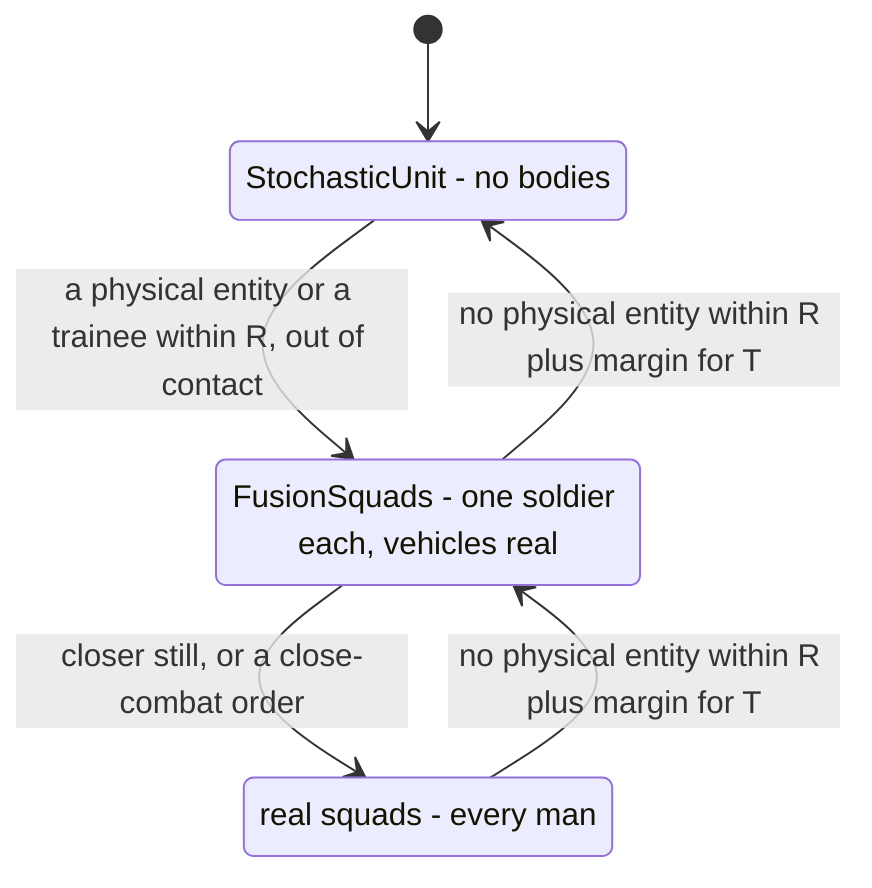
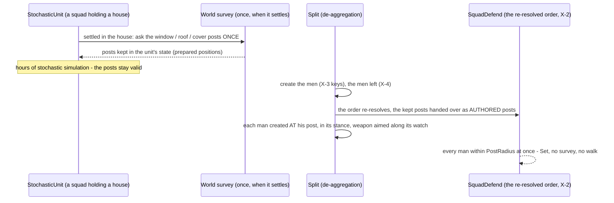
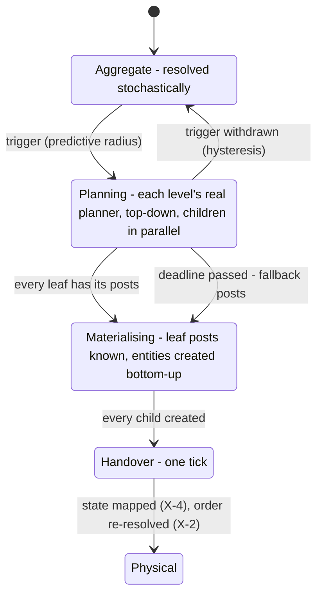
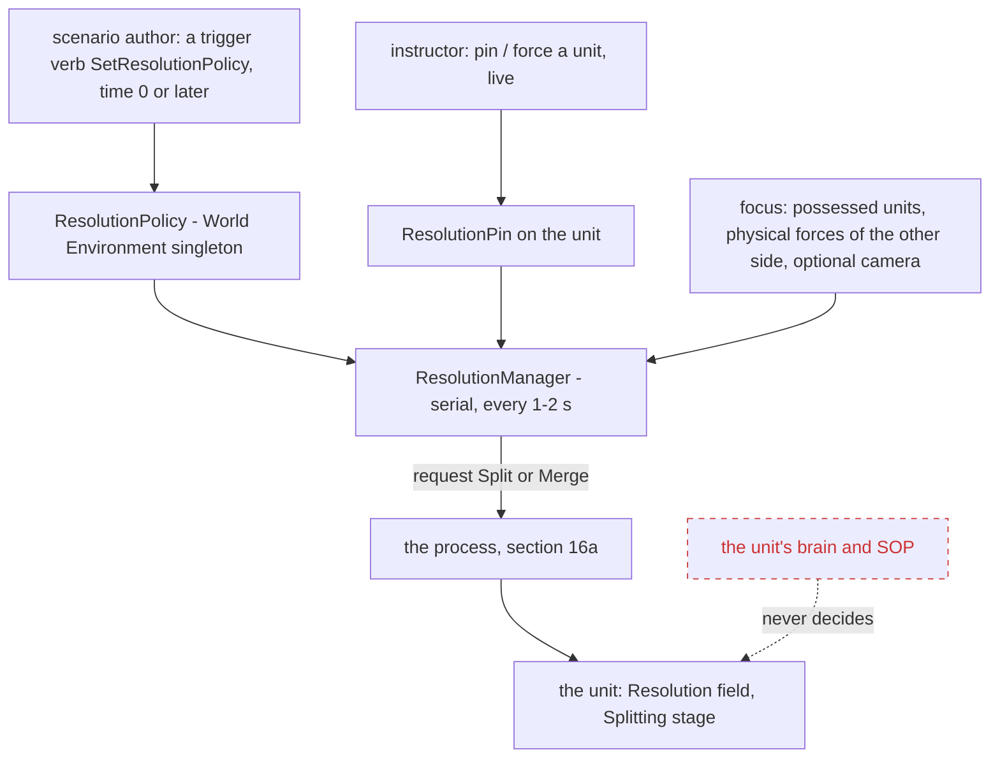

<!--STATUS
state: LIVE
build-state: DESIGN — ⛔ the critical review (§17) found 15 gaps, two of them ADJUST approved X-1 / X-3 (SV-2, SV-4) and two BIND NOW (SV-1, SV-11); leans for the user · the FUTURE half of the aggregate programme; approved: S-1…S-5 (R-4248), S-6…S-9 (R-4249), X-1…X-5 (R-4250); leans NOT accepted: M-1…M-4 (§14), N-1…N-4 (§15), P-3…P-5 (§16), D-P1…D-P7 (§16a), the resolution policy (§16b); not built — its "binds NOW" items ride the FusionSquad's slices (DESIGN_Aggregate_Squad.md §7)
updated: 2026-11-14 (split out of DESIGN_Aggregate_Squad.md — coordinator; section numbers kept, the ledger cites them)
current-answer: the whole file — §10 scope and use cases · §12 vehicles (combined-arms units) · §13 de-aggregation (what binds now) · §14 movement · §15 sensors · §16 placing the men · §16a de-aggregation as a process · §16b who decides the resolution
stale-below: §16 P-1 / P-2 (superseded by §16a, marked inline)
known-rot: none
known-conflict: none
related-designs:
  - DESIGN_Aggregate_Squad.md — OWNS the FusionSquad (one FusionSoldier carries the squad) — the resolution built first, and the unit state, order routing and child keys this design's "binds now" items put there
  - MEASURED_Aggregate_Squad_Seams.md — OWNS the measurements (the no-member squad's weak points W-1…W-11 are this design's checklist; the calibration numbers S-5 uses)
  - ../group-maneuvers/DESIGN_Defend_And_Attack_Position.md — OWNS SquadDefend's plan (D-2f authored posts) that §16a D-P3 splits into plan-for-count + assign
  - ../group-maneuvers/DESIGN_City_Battle_Showcase.md — §4b the World Environment settings precedent §16b's policy follows
  - ../../DESIGN_Orders_Params_Entity_Classes.md — OWNS the order routing X-1 extends with the run-time resolution
  - ../../DESIGN_Terrain_Import_UTM.md — §9.6 T-2 the woods grid N-1's detection reads
-->

# DESIGN — stochastic units and the choice of resolution *(the future half of the aggregate programme)*

🔒 User, `2026-11-14`: *"leave the doors open to the idea of fully aggregated squads that are having no real member with no real weapons, where
the fight is just simulated with probabilistic calculations"* · *"can we think a bit more about the stochastic squad version? … i want to have
clear idea about the split/use cases, as this might still form the design in some way and better thinking now than struggling later."*

The names (R-4247, R-4249): the umbrella is the **aggregate unit**; the **FusionSquad** carries its squad in one fighter
([DESIGN_Aggregate_Squad.md](DESIGN_Aggregate_Squad.md)); the **StochasticUnit** (any echelon) has no member and is resolved by probability.

## 10. The StochasticUnit (was "StochasticSquad", renamed S-6) — scope, use cases, and what binds NOW *(leans; 🔒 user, `2026-11-14`: "can we think a bit more about the stochastic squad version? … that one is likely not compatible with physical individual entities like vehicles. better fitted for higher level constructive simulation where everything is stochastical. i want to have clear idea about the split/use cases, as this might still form the design in some way")*

**The proven solution:** constructive simulators at brigade level and up resolve a unit as a point with state (strength, ammo, posture,
suppression, readiness) at a fixed step: DETECTION as a probability (range, terrain / line of sight, posture, the target's size and activity),
ATTRITION as a Lanchester-type exchange (losses = enemy firepower × kill factors × cover × suppression, from weapon data), MOVEMENT along roads /
the navmesh by posture and terrain. No rounds, no bodies — thousands of units, faster than real time, Monte Carlo repeats.

| a StochasticSquad meets … | fits? | why (measured) |
|---|---|---|
| other stochastic units | ✅ | the classic case |
| the commanders above (platoon → battalion) | ✅ unchanged | reports + `SquadMen` (D-2); orders by class (D-1: `StochasticInfantrySquad<Order>`) |
| mortars, artillery, air strikes | ✅ easy | they fire at a POINT (HQ, battery, aircraft paths) ⇒ a burst = a casualty fraction: its radius ∩ the unit's frontage × cover |
| objectives, census, reports, replay | ✅ | all through the unit's state |
| tanks, IFVs, real soldiers, FusionSoldiers in DIRECT fire | ⚠ the hard boundary | they see bodies and fire rounds; it has neither — the standard answer is DISAGGREGATION (become a FusionSquad when a physical entity comes near) |

| resolution | used for |
|---|---|
| real squad | close combat, trainees, possession, film, buildings |
| **FusionSquad** | battalion battles WITH real vehicles, fires, drones, air; the command-chain test; the showcase cheaper |
| **StochasticSquad** | brigade and up; course-of-action analysis; repeated faster-than-real-time runs; a background war far from the trainees |

| # | binds NOW (lean) | why |
|---|---|---|
| **S-1** | the UNIT holds the squad's WHOLE state — men, suppression, ammo per weapon type, the weapon inventory, posture, frontage (extends D-2); while a resolution runs it is the truth and writes the unit's copy every tick | cheap now; the only thing that makes a later resolution switch possible |
| **S-2** | resolution SWITCHING (by distance / contact) kept possible, NOT built | with S-1 a switch is "instantiate from the unit's state"; its known traps (flip-flop ⇒ hysteresis, switch only out of contact; jumps in losses ⇒ one calibration, S-5) are designed when a use case asks |
| **S-3** | stochastic dice are deterministic — seeded per unit per step, a fixed resolution step, each unit writes only itself | the parallel rule; equal at 1 / 4 / 8 threads |
| **S-4** | the first StochasticSquad meets only stochastic units and point-fire assets; direct fire with physical entities waits for the disaggregation boundary | the multi-resolution problem is the expensive one |
| **S-5** | ONE calibration: the FusionSquad's live exchanges and the measured drill times (§6 of the measurements) set the stochastic tables | the two resolutions agree, so a switch does not jump |

## 12. Vehicles in the stochastic mode — combined-arms units, not single vehicles *(✅ S-6…S-9 APPROVED, user `2026-11-14`: "approved!" — R-4249; 🔒 user, `2026-11-14`: "in the stochastic mode, how would we handle the vehicles? no individual vehicles, but stochastic higher level constructs (an aggregated stochastic unit representing some stochastic squad AND vehicles?)")*

**The proven solution:** a constructive unit is a HOLDING of men and systems by type (a mechanised platoon ≈ 30 men + 4 IFVs as ONE unit);
attrition is resolved per PAIRING of firing system type × target type (a killer–victim table: rifles → men, an ATGM → IFVs, a 25 mm → both);
movement follows the unit's state (mounted: road speed; dismounted: walking; the slowest part limits it). The leaf of a stochastic force is
usually the platoon or the company, because the vehicles belong there.

| # | lean | why |
|---|---|---|
| **S-6** | the stochastic resolution is a unit of ANY echelon — squad, platoon, company; its subunits do not exist (it is the leaf), and the commander above it runs unchanged because it reports like that echelon ⇒ the name is **StochasticUnit** (a "StochasticSquad" is its squad case; R-4247's FusionSquad unchanged) | vehicles belong to platoons; the command chain above any leaf is unchanged (reports + `SquadMen`-style strength) |
| **S-7** | ⭐ **binds NOW**: the unit's state is a `UnitHoldings` table — men + SYSTEM TYPES (rifles, MGs, ATGMs, IFVs, tanks, mortars), each with count, readiness and ammo — instead of a squad-only `UnitHoldings`; the FusionSquad v1 fills only its infantry weapons | renaming before it is built and replicated costs nothing; after, a migration |
| **S-8** | the killer–victim factors are DERIVED from the same TKB weapon data the fusion and real resolutions use (penetration vs armour through `ArmorModel`, dispersion, rate of fire) — an ATGM's chance against an IFV is ONE number in every resolution | S-5's single calibration, extended to vehicles |
| **S-9** | mounted / dismounted is the unit's POSTURE (speed, exposure, which systems fire) | the mounted infantry fight's essence, without seats |

## 13. De-aggregation — a StochasticUnit becomes physical units for precise combat *(✅ X-1…X-5 APPROVED, user `2026-11-14` — R-4250; 🔒 user, `2026-11-14`: "let's think about the de-aggregation of stochastical unit into physical units for more precise combat simulation. is that something we could achive? maybe it would further form our existing design which is cheap now")*

**The proven solution** (multi-resolution modelling — aggregate / entity federations): a unit is DISAGGREGATED when a trigger fires (a physical
entity or a trainee comes within range, or an engagement with one is imminent) and RE-AGGREGATED when it is out of contact for a while. The known
problems and their standard answers: **state mapping** (instantiate the entities from the unit's state; sum them back) · **thrashing** (hysteresis:
a wider radius and a minimum time to re-aggregate) · **discontinuity** (switch BEFORE contact, never mid-engagement; one calibration so the
expected losses agree) · **chain** (one level at a time) · **identity** (the same unit and the same children every time, so reports, recordings
and the after-action review stay continuous).

*What it shows: the switch is ONE level at a time, and FusionSquad is the natural middle step — a stochastic platoon becomes three FusionSquads
and its REAL vehicles, long before every man is created.*

| measured / designed | basis |
|---|---|
| the order resolver keys ONLY on the entity's DIS type | `OrderResolver.Resolve(table, dis, order, …)` (`Hrot/Engine/Hrot.Core/Tkb/OrderResolver.cs:33`) ⇒ a resolution baked into the TYPE (D-1's TKB 307) cannot change at run time without changing the entity's type |
| a unit's children are described by its TKB composite (slots), created explicitly today | `NedTkbCatalog.cs:973-992` (`AutoCreateChildren = false`), macros write each man (`city_battle_macros.py:24-38`) |
| entities can be created and destroyed mid-run (macro insertion, creation requests); recordings and seek carry them | `MacroInsertion.cs:23-45`, `CreateEntityRequestSystem.cs:475-480` |
| S-1 / S-7 put the unit's whole state on the unit | §10, §12 |

| # | binds NOW — cheap (lean) | why |
|---|---|---|
| ⭐ **X-1** | **the UNIT entity persists across every resolution; its resolution is a run-time FIELD (`AggregateSquad.Resolution`), and the order routing tries `<Resolution><Class><Order>` first** (`FusionInfantrySquadAttack`, then `InfantrySquadAttack`) — the TKB type only gives the DEFAULT resolution. ⚠ **This adjusts approved D-1**: its class `AggregateInfantrySquad` / TKB 307 becomes a preset, not the routing key | a resolution in the TYPE cannot switch without replacing the entity, which would break its identity, its subordinate links and its reports |
| ⭐ **X-2** | **the unit keeps its CURRENT ORDER (name + params)**, not only the behaviour it resolved to — on a switch it RE-RESOLVES the same order under the new resolution (a stochastic platoon's attack becomes the real `PlatoonAttack` ordering its new squads) | D-1's order-aware bookkeeping already records the order on the commander's side; the receiver keeping its own is the same field |
| ⭐ **X-3** | **children come from the TKB composite with STABLE keys `<unit>/<slot>`** — the same unit disaggregated twice gives the same children | identity continuity for reports, recordings, replay and the after-action review |
| **X-4** | the mapping rules, written once: men left ⇒ which slots live (deterministic order: the MG crew and the leader last), health / ammo split by slot, positions inside the frontage by the existing formation / post planners, stress from suppression; back: sums and the centroid | consistent both ways; S-5 keeps the expected losses equal |
| **X-5** | switch one level at a time, before contact, with hysteresis; never while engaged | the standard answers to thrashing and discontinuity |
| ⏳ not now | building the switch, the triggers, the cost per switch (a platoon is ~30 creations — measure when built) | — |

## 14. Movement of a StochasticUnit — its shape and composition against the terrain *(leans; 🔒 user, `2026-11-14`: "what about movement of stochastical units? it will need likely a very specialized motion model counting with unit structure and size vs terrain.")*

**The proven solution:** aggregate movement plans on the road / cross-country network, moves at the SLOWEST element's speed × a terrain factor ×
posture, and carries a FORMATION: a road column (length = vehicles × spacing — its tail arrives later and is exposed along the road) or a
deployed line (frontage × depth). Trafficability comes from the composition (wheeled vehicles never through woods), not from a body.

| what exists (measured) | where |
|---|---|
| one route planner over the navmesh, the road graph, or both spliced (`Hybrid`) | `Navigation/RoutePlanner.cs:73-106` |
| two navmesh layers (infantry 60° / 0.4 m step; vehicle 20° / 0.3 m) and per-mover AREA prices (woods: wheeled forbidden, tracked dear) | `RecastNavmeshBaker.cs:68-89`, `NavDoorways.cs:132` (`DoorAwareQueryFilter`) |
| the hull guard, avoidance and the walker assume ONE body | `HullClearance.cs`, `CarKinematicsSystem.cs` |

| # | lean | why |
|---|---|---|
| **M-1** | plan with the EXISTING planner: mounted ⇒ the vehicle layer + roads (`Hybrid`); dismounted ⇒ the infantry layer; the area prices from the unit's holdings (any wheeled system mounted ⇒ woods forbidden) | one route planner for every mover (shared, not duplicated) |
| **M-2** | speed = the slowest holding's speed × the area's terrain factor × posture × suppression — the factors derived from the same TKB numbers (S-5, S-8) | one calibration |
| ⭐ **M-3** | **binds NOW**: the unit's state gains `Formation` (column / line / assault), `Depth`, `Heading`; in a column the unit is a SEGMENT of its path (the head moves, the tail follows `Depth` behind) — its exposure (a burst on the road) and its arrival time come from it | adding recorded fields later is a migration; the segment is what makes a column real |
| **M-4** | a dedicated, deterministic PATH FOLLOWER for the unit's point (no hull guard, no avoidance; congestion and bridges later from the road graph) — ⛔ not the body kinematics | the hull guard and the walker are wrong for a 300 m column |

## 15. Sensors of a StochasticUnit — detection as a probability *(leans; 🔒 user, `2026-11-14`: "similarly the sensors for those unit would need to work differently")*

**The proven solution:** detection per observer–target pair per step as a probability: line of sight (sampled across both footprints), range,
the target's SIGNATURE (its size, vehicles, and activity: moving or firing raises it), the observer's sensors (optics, thermal), vegetation and
weather / night; glimpses ACCUMULATE into a contact.

| # | lean | why |
|---|---|---|
| **N-1** | per step (~1–2 s): candidate pairs from a spatial grid; line of sight checked between a few sample points of each footprint through the EXISTING terrain query (on the Muscle, R-2037); Pd from range × signature × the observer's sensor holdings × the woods grid (UTM T-2) × the weather / night modifiers perception already has; seeded per observer and step (S-3) | the same terrain and modifiers as the physical sensors — one model of the world |
| **N-2** | a detection writes the SAME squad contact pool ⇒ SPOT / CONTACT, the picture and every commander above unchanged | the reports seam |
| **N-3** | a stochastic observer MAY detect physical entities (one way — it only reads them); physical sensors do not see a stochastic unit (S-4 until de-aggregation) | observing is cheap and safe; being seen needs a body |
| ⭐ **N-4** | **binds NOW**: the unit's state gains `Activity` (moving / firing — the signature) and the holdings' slots carry SENSOR systems (optics, thermal, radar) beside weapons | the signature and the observer quality are inputs N-1 cannot invent later |

## 16. Placing the men on de-aggregation — a squad holding a building, a battalion holding a village *(leans; 🔒 user, `2026-11-14`: "de-aggregation in case the stochatical to physicsl. imagine squad unit holds a building for example - it wuld need to place the soldies somehow reasonably. imagine a battalion holding a village etc")*

| measured | where |
|---|---|
| the squad's defence PLAN needs live men (it starts from the first live man, posts are handed out per man) and runs over SEVERAL ticks (the window survey is an asynchronous world query) | `SquadDefendBehavior.cs:491-520, :577` |
| ⭐ it takes AUTHORED fighting positions FIRST — and when every live man holds one, the terrain is not asked at all | D-2f / DA-5 / DA-46 (`SquadDefendBehavior.cs:496-503`) |
| a man reaches Set the moment he is within `PostRadius` of his post | `Manned`, `:868-881` |
| a unit may START in a saved state (stance, aimed weapon) — "at load it starts IN it" | Initial State S2 (R-4137), `WeaponPosture` |
| the company's defence hands each platoon a BLOCK; the platoon's hands each squad its positions | City Battle §6a (`CompanyDefend` KPlan), `PlatoonDefend` |

*What it shows: the expensive, asynchronous part (the survey) runs ONCE when the unit settles, not at the split — so the split is instant and the
men appear where the real squad would have put them, through the planner's EXISTING authored-posts path.*

| # | lean | why |
|---|---|---|
| ⛔ **P-1** *(SUPERSEDED by §16a — the user: a unit can split anywhere, also right after entering a house; prepared posts only move the cost)* | ~~binds NOW~~: a stochastic unit that SETTLES on a position (its defend order) asks the posts ONCE through the existing survey and KEEPS them in its state (prepared positions, fixed capacity); the scenario's authored fighting positions fill it too | the planner's authored path is the only instant one — the posts must exist BEFORE the split |
| ⛔ **P-2** *(SUPERSEDED by §16a D-P4)* | on a split each man is created AT his post (the post's stance, the weapon aimed along its watch — the Initial State seam), and the order re-resolves (X-2) with the kept posts as `Authored` ⇒ Set at once | no walk, no survey at the moment it matters |
| ⭐ **P-3** | **binds NOW — the battalion holding a village**: every stochastic unit above the leaf keeps an ALLOCATION per child slot — the child's area (block / building), its holdings share, its kept posts — even while the children do not exist (it is what the company's KPlan and the platoon's plan would have handed out) | a PARTIAL split (only the company next to the trainees) is then "create THAT child from its row"; the rest of the battalion stays stochastic |
| **P-4** | the allocation is made by the SAME planners the real units use (company blocks, platoon positions), run when the unit settles, not invented by the stochastic model | one model of where units stand (the shared-and-unified rule) |
| **P-5** | time in position is state (`Prepared`: hasty → prepared → fortified) — it sets the men's cover and stance on the split | a squad that held the house for an hour is dug in; one that just arrived is not |

## 16a. De-aggregation is a PROCESS — top-down planning, bottom-up materialisation, one handover *(leans; 🔒 user, `2026-11-14`: "when can stochastic unit get prepared positions? it can be deaggregated at any time, at any location, also moving into the house during the exercise and deaggregate only if enemy comes close … This is no different from getting the position on deaggregation time, i.e. nothing prepared. Deaggregation needs to be a process as it takes time (asking where to deply members, memberc need to de-aggregate as well, i.e. whole deaggregation cascade etc.)")*

**The proven solution:** disaggregation has a LEAD TIME — the trigger fires early enough (a predictive radius: the time the process needs × the
closing speed) that the entities exist before contact; meanwhile the aggregate keeps being simulated, and the handover happens in one step.

*What it shows: the stochastic unit keeps fighting and being detected through Planning and Materialising — the world does not freeze while it
splits; only the Handover is a single step, and a deadline bounds the whole process.*

| # | lean | why |
|---|---|---|
| **D-P1** | the TRIGGER is predictive: a physical entity (or a trainee) whose time to reach the unit is below the process's budget (measured per echelon when built) — not a fixed distance | the entities must exist before contact |
| ⭐ **D-P2** | **PLAN top-down with the REAL planners**: the battalion's allocation → each company's block plan → each platoon's positions → each squad's posts (the window / roof / cover survey, asynchronous over ticks); children at one level plan in PARALLEL; the unit keeps a `Splitting` stage (recorded — a seek mid-split restores it) | one model of where units stand (P-4); the asynchronous survey is why it is a process |
| ⭐ **D-P3** | **binds NOW — the planners PLAN FOR A COUNT FROM AN ORIGIN**: measured, the squad's defence plan starts from its first LIVE man and hands posts out per man (`SquadDefendBehavior.cs:491-520, :577`) ⇒ split it into PLAN (count, origin, area → posts) and ASSIGN (posts → bodies); the same for the platoon and company plans (⏳ their inputs not yet measured) | the only way to plan before the men exist; it also lets a REAL unit plan a defence before it arrives |
| **D-P4** | MATERIALISE bottom-up once a leaf's posts are known: its men created AT their posts (stance, weapon aimed along the watch — the Initial State seam) and held until the handover; the losses meanwhile decide HOW MANY are created (X-4 maps the state at the handover, not at the trigger) | nobody walks into position under fire; the latest strength counts |
| **D-P5** | a DEADLINE bounds the process: a leaf still without posts gets FALLBACK posts (the formation's slots spread across the unit's frontage) | a split never stalls when contact comes early |
| **D-P6** | the HANDOVER is one tick per unit, serial (the parallel rule: creation and the state mapping as follow-ups): the stochastic resolution stops, the children start, the order re-resolves (X-2) | no tick in which both resolutions fight |
| **D-P7** | a deep split (battalion straight to men in one house) runs the SAME cascade, level by level, quickly — no special path; re-aggregation is the reverse and simpler (sum, then remove) | one mechanism |
| ⏳ to measure when built | the platoon / company planners' inputs (D-P3); the process time per echelon (D-P1); how created-but-held entities are kept out of the world until the handover (the entity lifecycle's Constructing state is the candidate) | — |

## 16b. Who decides the resolution, when, to what level — and when it is worth it *(leans, NOT accepted; 🔒 user, `2026-11-14`: "how the de-aggregation would be realized (would it be an action called by SOP or something?) and how triggered (on user request, on contact, or other trigger - who defines and parametrizes). when to re-aggregate, under what condition, is that something automatable? to what aggregation level? in what situation it could make sense? let's think through those before any acceptance")*

**The proven solution:** resolution is a FIDELITY decision of the simulation (level of detail), not a tactical decision of the unit: a
manager compares each unit against a policy — where the FOCUS is (the trainees, the physical forces, the camera), which AREAS must be detailed,
the PERFORMANCE budget — and requests splits and merges; operators can override. Units do not "choose" to become men, and their tactics must not
depend on it.

*What it shows: ONE manager owns every resolution change; authors set its policy through the same trigger-verb path the lethality settings
use (`SetSkillAmplifier` → the World Environment, City Battle §4b), instructors pin units, and the unit's brain never takes part — so a split is
invisible to its tactics and its commanders.*

**How it is realised and triggered**

| | lean | why |
|---|---|---|
| **who executes** | a `ResolutionManager` system (serial pass, every 1–2 s of sim time) — ⛔ NOT an SOP row or an action of the unit | a fidelity choice is the simulation's; an SOP would make tactics depend on resolution and give every unit a vote |
| **the policy (data)** | a `ResolutionPolicy` in the World Environment: distance BANDS per resolution (e.g. physical < 400 m from focus, fusion < 1.5 km, stochastic beyond), the predictive lead time (D-P1), the merge margin and quiet time, detail AREAS (a village the exercise is about: always physical), a performance budget | one place, saved with the scenario |
| **who sets it** | the scenario author: a trigger verb `SetResolutionPolicy` (time 0, or later — e.g. "phase 2: the town becomes a detail area") — the same path as `SetSkillAmplifier`; engine defaults otherwise | the existing authoring pattern |
| **live override** | the instructor: pin a unit (never merge / always physical) or force a split / merge — a `ResolutionPin` on the unit, through the command path the editor and the HTTP API already use | a trainer's need: "make that company real now" |
| **focus** | possessed units (`PossessedBy`), physical forces of another side, optionally the active camera / film director (interest score, CE-7018) | where detail is SEEN or FOUGHT |

**When to re-aggregate (automatable — yes)**

| condition (ALL must hold) | why |
|---|---|
| no focus entity inside the band + a margin, for T (e.g. 60 s) | hysteresis — no flip-flop |
| out of contact for T (no shot, no near miss, no detection of a physical enemy) | never merge mid-fight (X-5) |
| ⭐ UNOBSERVED: no physical sensor currently sees any of its members | men never vanish in front of a trainee or a camera |
| not in a detail area, not pinned | the author's and the instructor's word win |
| not mid-play where the state cannot be summed (clearing a building, embarking, a casualty being carried) | the mapping back must be honest |

| **to what level** | lean |
|---|---|
| merge BOTTOM-UP, one level at a time: men → FusionSquad → the StochasticUnit of the lowest echelon whose children are ALL mergeable | a company with one platoon still near the trainees stays split at that platoon |
| the TARGET level comes from the band the unit is in (near → physical, middle → fusion, far → stochastic) | the same bands as the split — symmetric |

**When it makes sense — and when not**

| situation | use |
|---|---|
| ⭐ a large exercise with few trainees: the brigade around them stochastic, the company they fight physical | the main case — detail where it is seen and fought |
| course-of-action analysis, faster than real time: everything stochastic; an analyst splits ONE engagement to inspect it | detail on demand |
| a showcase or a film: the camera's interest drives the detail | the director decides where the men exist |
| a performance governor: merge the quietest units when the frame budget is exceeded | keeps the run real-time |
| ⛔ a small close-combat exercise (a platoon in a village) | everything physical — the policy simply never aggregates |
| ⛔ replay | it shows what was RECORDED; resolution is not changed in replay |

## 17. ⛔ The critical review — `2026-11-14` *(the multi-resolution reviewer; ✔ re-read by the coordinator)*

| # | finding | evidence | ⭐ lean |
|---|---|---|---|
| **SV-1** | **a dead man comes back** — the state keeps COUNTS (`Men`, holdings); X-4 rebuilds the men by a fixed rule ⇒ private slot 3, killed at 10:02, lives again after a merge and a new split (contradicts the recording and the AAR) | §13 X-4 | ⭐ **binds NOW**: a fixed PER-SLOT table on the unit (alive / dead, health, ammo); `Men` is derived from it (one owner); a FusionSquad decides deterministically WHICH slot each lost man was |
| **SV-2** ✔ | **the routing name collides** — `BehaviourName = className + orderName` (`OrderResolver.cs:58`); `Fusion` + `InfantrySquad` = `FusionInfantrySquad…`, the same string as a class named `FusionInfantrySquad` (TKB 307) ⇒ the TYPE keeps deciding after a switch; the inverse `ClassOfBehaviour` (used by `BehaviorFit`, `TaskPicker`) cannot split a resolution prefix; all four `Resolve` callers pass only a DIS type | `OrderResolver.cs:56-66`, `TacticalIntentResolutionSystem.cs:142`, `CommandVerbs.cs:108`, `OrderMenu.cs:270` | ⭐ **adjusts X-1**: a resolution-NEUTRAL type and class for any unit that can switch; the resolution an explicit PARAMETER of `Resolve` / `BehaviorFit` (a table, not string concatenation); TKB 307 is NOT a class |
| **SV-3** | the children come from the wrong composite — 307 lists one FusionSoldier | §13 X-3 | the unit's composite lists the PHYSICAL slots; the fusion soldier is a per-resolution stand-in, not a slot |
| **SV-4** ✔ | **identity of created men** — the engine already derives a child's identity `child:{InstanceId}` from the parent (`CreateEntityRequestSystem.cs:540, :654-659`) ⇒ X-3's `<unit>/<slot>` is a duplicate mechanism; a TRANSIENT entity gets no identity; a non-transient one is saved into the scenario (a reload doubles the unit) | `MacroInsertion.cs:33-40` | ⭐ **adjusts X-3**: reuse the `child:` derivation + a "run-time child" flag (stable identity, never saved) |
| **SV-5** | planning while stochastic has no home — one active behaviour per brain; the plan's state lives in the running play's params; it reads each man's proficiency and role | `SquadDefendBehavior.cs:491-578` | D-P3's PLAN takes roles / tier from the holdings and writes a unit COMPONENT (the P-3 allocation) the physical play reads as authored posts — bind that OUTPUT shape, not the planners |
| **SV-6** | "Constructing" is the wrong holding tool — it activates on the module acks and a bounded timeout DESTROYS (a 30 s hold kills the men); construction reopens on a seek | `EntityLifecycleModule.cs:370-380, :472-482, :595-605` | a "Held" participant that acks at the handover (unbounded); creation latency measured into D-P1's budget |
| **SV-7** | stale between materialising and the handover — losses shrink the count after the men exist; no exit when the trigger is withdrawn | §16a | create the FULL roster, kill / remove the surplus at the handover; a Materialising → Aggregate edge that removes the held men |
| **SV-8** | the performance governor is WALL-clock ⇒ splits differ per machine, the stepped hash diverges | CLAUDE.md F-3 | a budget in sim terms (entities, steps) or a recorded operator decision |
| **SV-9** | **trainees see men appear** — a tank's optics reach 2–3 km: an empty village, one fusion man at 1.4 km, nine men at 400 m; a drone 3 km away sees nothing | §16b bands | bands from the focus entity's SENSOR footprint (optics range, camera frustum); the split ("observable") and merge ("unobserved") tests from the same model |
| **SV-10** | a switch restarts the play from Start (plan, survey, phase 1); only `Order.*` orders can be re-resolved | §13 X-2 | the play PHASE in the X-4 mapping; a unit under a concrete-name order cannot switch |
| **SV-11** | two owners of the men count (`UnitHoldings` and `AggregateSquad.Men`); the component is named "Squad" though S-6 makes it any echelon | §12 | ⭐ **binds NOW**: one owner (SV-1's slot table); rename `AggregateSquad` → `AggregateUnit` before it is recorded |
| **SV-12** | some "binds now" items may be premature (M-3, N-4 fields nothing writes yet; P-3's shape with the planners' inputs unmeasured); "a later field is a migration" was never measured | §14, §15, §16 | ⏳ MEASURE what the recorder does when an unmanaged struct grows; if it tolerates it, defer M-3 / N-4 / P-3 |
| **SV-13** | network and display timing — the creating node owns the men; the `Resolution` field and the men's activation reach a display node at different times (both or neither shown for a few frames) | `DefaultEntityCreationRequestProcessor :358-360` | the display keys off the men being ACTIVE; name the creating node and the men's ownership groups |
| **SV-14** | an instructor pin vs the policy (a forced split while engaged; a forced merge in front of a trainee) has no precedence rule | §16b | instructor > author > automatic, with a refusal reason through `InteractionOutcomes.Refused` (`TacticalIntentResolutionSystem.cs:150`) |
| **SV-15** | the policy is list-shaped, not a small setting like `SetSkillAmplifier` (`SkillVerbs.cs:41-65`); recorded components are unmanaged | §16b | an unmanaged policy struct; detail areas as references to area entities, fixed capacity |
