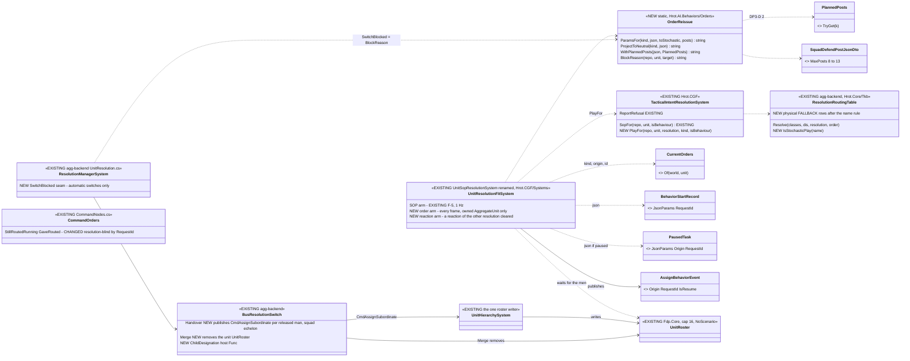
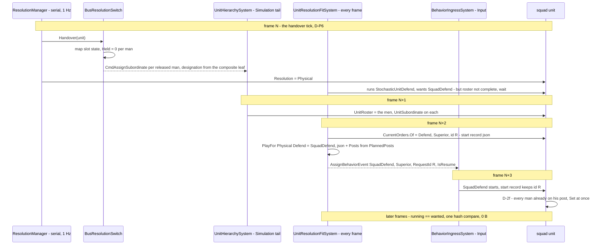
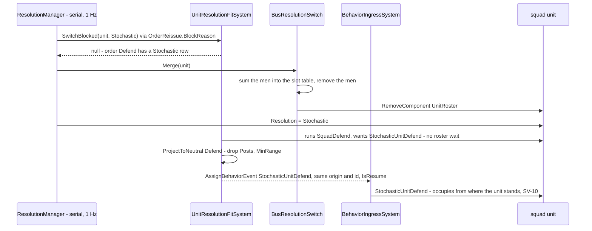
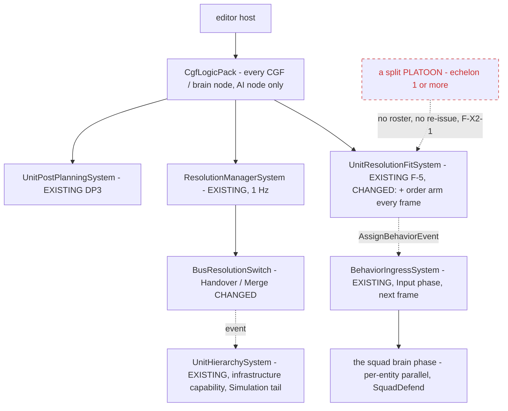

<!--STATUS
state: LIVE
build-state: READY-TO-BUILD (2026-11-17, agg-behaviors; lane decisions R-8353 … R-8363 "for the user's review"; cross-lane edits to agg-backend files named in §9)
updated: 2026-11-17 (first version — design only, nothing built)
current-answer: §0 the decision · §2 the claim table · §3–§6 the UML · §7 the sub-questions with leans · §8 slices and acceptance · §9 cross-lane edits · §10 findings
stale-below: nothing.
known-rot: none.
known-conflict: DESIGN_Stochastic_Units_And_Resolution.md §13 X-1 / X-3 / D-P7 say a split goes ONE LEVEL at a time; the as-built split FLATTENS the composite to men (StochasticUnitFill.Leaves) — this design scopes X-2 to the squad echelon and files the conflict (§10 F-X2-1), it does not resolve it
related-designs:
  - DESIGN_Stochastic_Units_And_Resolution.md — OWNS X-2 (§13), the split process D-P1…D-P7 (§16a, D-P6 the handover), SV-10 (§17.1: restart from the current situation; an untyped order cannot switch), the manager and switch as built (§23.4) and our routing (§23.5–§23.5c, F-5); this file answers X-2 only
  - DESIGN_DP3_Planned_Posts.md — OWNS the planned posts (PlannedPosts 138) and DP3-D ②, which §7 X2-F here builds (the re-resolved Defend carries them as D-2f Posts, MaxPosts 8 → 13)
-->

# X-2 — a unit keeps its order when it switches resolution *(agg-behaviors, `2026-11-17`)*

🔒 User, `2026-11-17`: *"Yes, I agree, including the X too"* — X-2 is agg-behaviors'. The ask (§13 X-2, SV-10, RV-17): when a stochastic unit
splits into men, or men merge back, the unit goes on doing what it was ordered to do — under the play that fits its new resolution.
Links: [main design](https://github.com/pjanec/HROT/blob/exp/agg-behaviors/docs/designs/aggregate-units/DESIGN_Stochastic_Units_And_Resolution.md) ·
[DP3](https://github.com/pjanec/HROT/blob/exp/agg-behaviors/docs/designs/aggregate-units/DESIGN_DP3_Planned_Posts.md).

## 0. The decision *(under a page)*

**Decision.** A RECONCILER, not an event handler: our F-5 system (`UnitSopResolutionSystem`, renamed `UnitResolutionFitSystem`) gains an
ORDER arm. Every frame, for each owned `AggregateUnit`, it compares the play the unit RUNS with the play its CURRENT order resolves to at its
CURRENT resolution (the one routing table, `ResolutionRoutingTable`); equal ⇒ nothing (one hash compare, 0 B). Different ⇒ it re-issues the SAME
order — kind from `CurrentOrders.Of` (RV-17), params from `BehaviorStartRecord` / `PausedTask`, the SAME origin and `RequestId` — as one
`AssignBehaviorEvent { IsResume = true }`. A physical squad is re-issued only once its men are in its `UnitRoster`. The ROSTER is formed by
agg-backend's `Handover` (one `CmdAssignSubordinate` per released man — the one hierarchy path, `UnitHierarchySystem`) and dropped by its `Merge`
(the unit's `UnitRoster` removed). The order restarts from the current situation (SV-10); a SquadDefend restarts with the planned posts as D-2f
`Posts` (DP3-D ②) so the men are Set at once. Commanders stop re-sending across a switch (their checks match by `RequestId`, either form).

**Rejected** *(one line each)*
- a hook in agg-backend's `Handover` that re-issues the order — §16b: the manager never knows tactics; and the roster it needs is formed one frame LATER (the hierarchy is an event), so a same-tick hook would start the play on an empty roster.
- a "switched" event from the manager to subscribe to — a second record of a fact `AggregateUnit.Resolution` already holds; an event is lost on a seek, a reconciler re-derives (F-5's R-8327 argument).
- leaving it to the COMMANDER's re-send — only commanded units have one; an operator's or an authored order has none; and the re-send carries no planned posts and a NEW id (restarting the defenders, CE-2304).
- writing `UnitRoster` directly in `Handover` — a second implementation of `UnitHierarchySystem`'s assign (wire marking, squad state, capacity) beside the one that exists.
- re-issuing through `AssignTacticalIntentEvent` (`Order.<K>`) — the table would resolve it the same, but the station's request would be answered twice (`ReplyTo`, `BehaviorIngressSystem.cs:399`); `IsResume` exists for exactly "a restarted order keeps its id; answered already" (`:559`).
- phase mapping of a play's progress across the switch — SV-10 ruled it out unless a play proves it needs it; none does yet.
- re-resolving platoons and companies now — the split flattens them to men (30 > `UnitRoster.Capacity` 16, and `PlatoonDefend` orders squads, not men); needs the one-level split first (§10 F-X2-1).

**Design docs checked**
- `DESIGN_Stochastic_Units_And_Resolution.md` §13 X-2, §16a D-P6, §17.1 SV-10, §19 (RV-17), §23.4, §23.5–§23.5c — applies: owns the requirement; ⚠ its X-5 / D-P7 "one level at a time" is not what the split does (§10).
- `DESIGN_DP3_Planned_Posts.md` §6 DP3-D, §9 — applies: X2-F builds DP3-D ②.
- `docs/DESIGN_Orders_Params_Entity_Classes.md` §15 (R-2088 derived `CurrentOrder`, R-2089 a play's kind, R-2090 one `RequestId`) — applies and DECIDES what is re-issued and how it is recognised.
- `docs/DESIGN_Decision_Layer.md` §4.1 / §4.9a (the gate, reactions pause a task) — applies: decides X2-E (a re-issued order ends the old resolution's reaction).
- `.dev/_DONE/commander-subordinates/DESIGN.md` §5.2 (`UnitHierarchySystem`, the one roster writer) — applies: decides X2-B (the roster through `CmdAssignSubordinate`).
- `docs/designs/group-maneuvers/DESIGN_Command_Chain_Example.md` §7a CC-D / CE-2304 (a re-send restarts a posted defender) — applies: decides X2-H.
- `DESIGN_Aggregate_Squad.md` (FusionSquad) — does not apply: deferred (R-4253); no fusion row is touched.

## 1. INVENTORY *(graph AND grep; `scripts/cbm.sh`, project `home-user-HROT`)*

⚠ **The graph is STALE for this area** — it predates the aggregate code: `search_graph name_pattern=".*(ResolutionManager|BusResolutionSwitch|UnitSopResolution|UnitPostPlanning|CurrentOrders|UnitHierarchy).*"`
returned only `.dev` sections and `UnitHierarchySystemTests`; a re-index (`index_repository`) **aborted** twice (*"files changed while the run was in flight"* — the
builder is working). ⇒ every row below is grep-confirmed, and every absence claim is grep-only. ⚠ Coverage could not be checked (`check_index_coverage` is not in the CLI).

| query | total | what it found that matters |
|---|---|---|
| `search_graph ".*Roster.*" Class` | 8 | `UnitRoster` (Fdp.Core, the commander's list, cap 16, NoScenario, "derived from the bottom-up `UnitSubordinate` records"), `SquadRoster` (Map3D view), `NodeRoster` (orchestrator) — ⭐ no aggregate roster |
| `search_graph ".*Handover.*" Class` | 4 | `BrainHandOverSystem` (brain OWNER handover — unrelated), `TrafficHandover` — the split's `Handover` is a method (grep: `UnitResolution.cs:408`) |
| `search_graph ".*BehaviorStart.*"` · `".*SubordinateOrder.*"` Class | 1 · 2 | `BehaviorStartRecord` (name, json, instance, `RequestId`); `SubordinateOrders` (the commander's record, brain-local) |
| `search_graph ".*Resolution.*" Class` | 17 | `TacticalIntentResolutionSystem` … ⛔ no `ResolutionManagerSystem` (stale) |
| `search_graph ".*(ReResol\|Reissue\|Reresol).*" Class` | 1 | `RoslynClrSignatureResolver` — ⭐ nothing re-resolves an order |
| `search_code "new CmdAssignSubordinate"` | 42 grep matches | publishers: `OneManCommand`, `EntityInfoIngressTranslator` ×3, `UpdateEntityAttributeRequestSystem`, `Edits`, `VehicleCommandSystem` — ⭐ the one roster writer is `UnitHierarchySystem` (grep `UnitRoster.Add(`: no production caller) |
| `search_code "IsResume = true"` | 1 | `BehaviorIngressSystem` (`:559`, a paused order restarted keeps its id) |
| grep `AggregateChild` (production) | 6 files | `UnitResolution.cs`, `PlannedPosts.cs`, `HeldChildren.cs`, `SplitProgress.cs`, `HeldManGizmo.cs`, `HrotSharedComponentRegistry` — ⭐ no behaviour code reads it; the children join no roster |
| grep `KeyFor(\|StillRoutedRunning(\|GaveRouted(` | 6 sites | `CompanyBehaviors.cs:445, :932, :939` · `PlatoonAttackBehavior.cs:586` · `UrbanMovementBehavior.cs:183` · `PlatoonConvoyBehavior.cs:318` — the commander checks that see the member's resolution |
| grep `beh.Register("InfantrySquad…` (generated registrar) | 3 | `InfantrySquadAttack` · `InfantrySquadHold` · `InfantrySquadMove` — ⭐ NO `InfantrySquadDefend` / `…BreakContact` |
| grep `Fulfils = ` | 23 plays | Defend: `SquadDefend` · `PlatoonDefend` · `CompanyDefend` · `StochasticUnitDefend`; BreakContact: `BreakContact` · `StochasticUnitBreakContact`; … |

## 2. The claim table

| # | the lean rests on | code — how it IS | design — how it was MEANT |
|---|---|---|---|
| 1 | nothing re-issues an order on a switch; `Handover` maps only health / stress / ammo | ✅ `UnitResolution.cs:408-429` | ✅ X-2 / SV-10 / RV-17 say it should (§13, §17.1, §19) |
| 2 | a unit's order is DERIVED: kind from the running (or paused) play, id from the start record (or paused task) | ✅ `CurrentOrders.cs:41-53`, `BehaviorStartRecord.cs:26-40`, `PausedTask.cs` (JsonParams, Origin, RequestId) | ✅ R-2088, RV-17 |
| 3 | the switch writes `Resolution` in the manager, serially, 1 Hz; the F-5 system runs after it in the same frame | ✅ `UnitResolution.cs:279-284, :301-305`; `CgfLogicPack.cs:293-305` | ✅ §16b, R-8327 |
| 4 | the ingress runs in `Input`, before every `Simulation` system ⇒ an assign published in frame N is applied before the reconciler runs in N+1 (no double start) | ✅ `BehaviorIngressSystem.cs:39` | ⛔ searched, no design states the frame order — rail S2-c pins "one start per switch" |
| 5 | the roster is written ONLY by `UnitHierarchySystem` from `CmdAssignSubordinate`; it runs at the tail of `Simulation` | ✅ `UnitHierarchySystem.cs:146-210`, `CgfLogicPack.cs:73-77` (CE-221: declared last) | ✅ commander-subordinates §5.2; `UnitRoster` doc ("only `UnitHierarchySystem` maintains the roster") |
| 6 | a destroyed subordinate leaves the roster through the `DestructionOrder` cascade — which only the LIFECYCLE path publishes | ✅ `UnitHierarchySystem.cs:53-89`; `EntityLifecycleModule.cs:327-345`; `BusResolutionSwitch.Remove` destroys in place without `Lifecycle` (`UnitResolution.cs:361-367`) | ⛔ searched, none |
| 7 | a stochastic unit that still HAS a `UnitRoster` (even Count 0) is skipped by the staff composer's stochastic arm ⇒ no SITREP / Set / TaskFailed | ✅ `StaffSystems.cs:126-129` | ✅ §23.5 D-2 |
| 8 | the routing table at Physical is the `<Class><Order>` name rule: a squad resolves Move / Attack / Hold, but **Defend and BreakContact are REFUSED** | ✅ `ResolutionRouting.cs:13`, `OrderResolver.cs`; registrar has no `InfantrySquadDefend` | ✅ R-8302 (APPROVED) proposed physical rows "built from `Fulfils` + the echelon class" — never built |
| 9 | the stochastic plays read the neutral DTO; every physical play of kind K reads K's neutral DTO strictly | ✅ R-8300 rail `BehaviorParamsValidationTests.R8300_…` (7 kinds, 26 plays) | ✅ R-8300 — ⚠ the REVERSE is not guaranteed: a physical play's JSON (`SquadDefend` with `Posts`, `MinRange`) is refused by `DefendOrder`'s strict read ⇒ the merge must PROJECT |
| 10 | a commander's routed check compares the RECORD's key with the key for the member's CURRENT resolution ⇒ after a switch it differs and the commander re-sends with a NEW id | ✅ `CommandNodes.cs:160-186` (`GaveRouted`, `StillRoutedRunning`), `IdFor :189` (time-keyed) | ✅ CE-2304 (a re-send restarts a posted defender — the defect to avoid) |
| 11 | a re-issued order with `IsResume` keeps its id and is not answered again; an order outranks a running reaction and drops the paused task | ✅ `BehaviorIngressSystem.cs:389-400, :331-337`; `PausedTask` doc ("dropped when an order replaces … the reaction") | ✅ Decision Layer §4.1 |
| 12 | the split FLATTENS a nested composite to men — a platoon splits into 30 men, not 3 squads | ✅ `StochasticUnitFill.cs:31-50` (`Leaves`), `BusResolutionSwitch.Materialise :369-398`; `agg-split-on-contact` splits a 30-man platoon | ⛔ CONFLICTS with X-5 / D-P7 "one level at a time" (§13, §16a) — F-X2-1 |
| 13 | the squad's blackboard (`SquadDefendParams.Authored`, `MaxPosts` 8) is RECORDED: it lives in `BlueprintBlackboard{256…16384}`, `[DataPolicy(NoScenario)]` = recorded; the component LAYOUT does not change when the block grows | ✅ `BlueprintBlackboard16384.cs:15-17`, `SquadDefendBehavior.cs:28-57, :285-298`; `RootParamsAccess.cs:392` refuses a slot smaller than the block | ✅ SV-12 (a later change is a deliberate, versioned break) — ⚠ the replay of an OLD recording mid-`SquadDefend` is NOT measured (S5 measures it) |
| 14 | `TkbChildSlot.Designation` is per composite slot; `StochasticUnitFill.Leaves` keeps it per leaf | ✅ `TkbCompositionDef.cs:5-20`, `StochasticUnitFill.cs:28-50` | ✅ X-3 / SV-3 (the same composite, the same children) |
| 15 | **the proven solution** for this problem class (multi-resolution hand-off): the disaggregated entities join the unit's ORBAT and the entity-level C2 RE-PLANS the unit's CURRENT TASK from the CURRENT state; the hand-off carries mission + state, never the plan's internals. The implementation pattern for "state X changed ⇒ behaviour must fit" is a RECONCILE loop (desired vs actual, idempotent) | adopt: the roster (X2-B) + re-issue the order (X2-C) + restart (X2-E) · adopt the reconciler (F-5 already is one) · reject: internals hand-off (SV-10) | ✅ §13 "the proven solution" (state mapping, identity), SV-10 |

## 3. Classes

*What it shows that prose hid: ONE new type (`OrderReissue`, pure functions) — everything else is an arm on an existing owner. The play is chosen by
the SAME table that routes a commander's `Order.<K>`; the roster by the SAME system that writes every roster; the order by the SAME derivation
`CurrentOrders` gives everyone. agg-backend's boxes change in three small places, none of which learns about tactics.*

## 4. Sequence — the split (Stochastic → Physical), a squad holding a house

*What it shows: the re-issue waits two frames for the roster — the hierarchy is an EVENT, so no same-tick hook could have started the play with
its men; the order keeps its id, so the commander (CommandOrders, X2-H) sees the same order and does not re-send.*

## 5. Sequence — the merge (Physical → Stochastic)

*What it shows: the merge needs no wait (the stochastic play has no men) but needs a PROJECTION — R-8300 guarantees physical ⊇ neutral, not the
reverse, so the physical JSON fed back raw would be refused by the strict read. The roster goes in the same tick, or the staff composer stops
serving the unit (claim 7).*

## 6. Modules — who runs it each frame

*What it shows: the order arm rides the registration site that already carries the manager and F-5 (`CgfLogicPack.cs:293-305`), so every host that
splits also re-resolves — by construction (the editor builds the same pack). The hierarchy is a separate capability declared LAST, which is why the
roster lands a frame after the handover. ⚠ The dashed edge: a platoon split is NOT reached by this design — its men are not its squads (§10).*

## 7. The sub-questions — each with a lean *(lane decisions R-8353 … R-8363, for the user's review)*

| # | question | ⭐ lean | blast radius | would change it |
|---|---|---|---|---|
| **X2-A** · **R-8353** | who owns the re-resolution | **ours, a reconciler**: F-5's system (renamed `UnitResolutionFitSystem` — a Roslyn rename) gains the order arm, every frame over owned `AggregateUnit` units; wanted = `TacticalIntentResolutionSystem.PlayFor(unit, Effective resolution, kind)` (beside `SopFor`, the same table); running ≠ wanted ⇒ re-issue. A PHYSICAL unit is re-issued only when every live released child (`AggregateChild.Unit == unit`, `Held == 0`) is in its `UnitRoster`. Steady state: one hash compare per unit, 0 B (R-2084) | `Hrot.CGF/Systems` (rename + one arm), `TacticalIntentResolutionSystem` (`PlayFor`), `CgfLogicPack` (the registration line) | the user preferring an explicit switch event from the manager (then F-5 moves too) |
| **X2-B** · **R-8354** | the roster at handover / merge | **agg-backend's switch, through the one hierarchy path**: `Handover` publishes `CmdAssignSubordinate { man, unit, designation }` per released child — squad echelon only (`AggregateUnit.Echelon == 0`, ≤ 13 ≤ `UnitRoster.Capacity`); the designation from a host Func `ChildDesignation` (= `StochasticUnitFill.Leaves[slot − 1].Designation`, wired in `CgfLogicPack` beside `ChildType`), `FireTeam.None` (no behaviour reads it — grep). `Merge` removes the unit's `UnitRoster` after removing the men (the men's side goes with them; claim 7 is why the component itself must go) | agg-backend: `UnitResolution.cs` `Handover` (+5 lines), `Merge` (+1), one init property; `CgfLogicPack` one line | the user ruling the hierarchy a TACTICS concept the manager must not touch ⇒ then a behaviors-side system observing `Held == 0` children publishes the same event (stateless, same timing) |
| **X2-C** · **R-8355** | what is re-issued | **the same ORDER**: kind = `CurrentOrders.Of(unit).Kind`; origin and `RequestId` kept (R-2090: one id); params = `BehaviorStartRecord.JsonParams` (or `PausedTask.JsonParams` when paused). Split: the json as it is (the stochastic play read the neutral DTO; R-8300 says the physical one reads it). Merge: `OrderReissue.ProjectToNeutral` — relaxed read into the kind's `[Order]` DTO, re-serialise (drops `Posts`, `MinRange` …). Published as `AssignBehaviorEvent { BehaviorName = PlayFor(…), Origin, RequestId, IsResume = true }` — the ingress gate, no second answer to a station | `Hrot.AI.Behaviors/Orders/OrderReissue.cs` (new, pure); the arm | a kind whose neutral DTO a physical play cannot read honestly (R-8300's "would change") |
| **X2-C2** · **R-8356** | the physical play for a squad's Defend / BreakContact (claim 8: the table REFUSES them at Physical) | **R-8302, as approved**: agg-backend's table accepts PHYSICAL rows as a FALLBACK consulted only when the name rule finds nothing (so nothing that resolves today changes): `(InfantrySquad, Physical, Defend) → SquadDefend` · `(InfantrySquad, Physical, BreakContact) → BreakContact`. A rail derives the expected rows from `Fulfils` + the class and refuses a row the name rule already resolves | agg-backend: `ResolutionRouting.cs` (the physical-row throw relaxed, a fallback branch); side effect: an operator's `Order.Defend` to a physical squad starts `SquadDefend` instead of being refused (a fix) | the user wanting physical rows to WIN over the name rule (then `InfantrySquadHold` vs `SquadHold` must be decided too) |
| **X2-D** · **R-8357** | the merge direction, and SV-10's "untyped order cannot switch" | the stochastic play gets the order by X2-C. ⭐ The gate: a seam `SwitchBlocked: Func<repo, unit, target, string?>` on the manager (init, default none — like `Policy`), = `OrderReissue.BlockReason`: an order with **no kind**, or whose kind has **no row at the target resolution** (Recover, Embark, Strike …) ⇒ an AUTOMATIC switch waits (logged once per reason change at Debug). ⭐ The instructor's pin wins (SV-14): the switch goes, the order is cleared and its commander hears TaskFailed (`ReportRefusal`) | agg-backend: `Decide` (2 guarded returns) + the property; ours: `BlockReason`, the wiring | the user wanting SV-10 to bind the pin too |
| **X2-E** · **R-8358** | an order mid-way, a reaction running | **restart from the current situation** (SV-10): the re-issued play starts fresh with the order's params — Move / Attack plan from where the unit stands, Defend takes the planned posts (X2-F). A PAUSED order is re-issued too: the order outranks the reaction (claim 11), which ends — the new resolution's SOP re-judges. A REACTION with no order whose play belongs to the OTHER resolution (`ResolutionRoutingTable.IsStochasticPlay(name)` ≠ the unit's) is CLEARED at origin Reaction; `StochasticUnitHold` joins `ResolutionRoutingTable.Plays` so the catalogue is complete | the arm; `ResolutionRouting.cs` `Plays.Hold` + `IsStochasticPlay` (agg-backend file) | a play that proves it needs phase mapping (SV-10 allows it then) |
| **X2-F** · **R-8359** | DP3-D ② — the posts, and `MaxPosts` 8 → 13 | when the wanted play is `SquadDefend` and the unit's `PlannedPosts.TryGet` gives posts: the json gains `Posts` (each posted entry: point, watch — zero ⇒ none, `Window`) — D-2f hands them to the nearest men, who stand on them ⇒ Set at once, no ask. `MaxPosts` 8 → 13 (= `PlannedPosts.Capacity`). ⭐ **Measured (claim 13): the blackboard IS recorded, as bytes inside `BlueprintBlackboard*`; the component layout does not change ⇒ `SchemaValidator` does NOT refuse old recordings.** ⚠ An OLD recording sought mid-`SquadDefend` holds a slot sized for 8 posts: `RootParamsAccess.TryGetBlockFor` refuses a too-small slot (`:392`) — whether every read goes through that guard is NOT measured ⇒ S5 measures it with a rail; either way it is declared a versioned change under SV-12 | `Hrot.Core` `SquadDefendParamsJsonDto.cs:66`; `SquadDefendParams` grows 125 B (5 × (6 floats + 1 byte)) ⇒ the squad's occurrence store may move up a tier (`RootParamsCost`) — the tier rails decide | the S5 rail showing a mis-read on seek ⇒ keep 8 and let men 9–13 survey (one ask, no break) |
| **X2-G** · **R-8360** | parallel-phase safety | **everything is SERIAL**: the reconciler and the manager are serial `Simulation` systems (not phases); their only writes are EVENTS (`AssignBehaviorEvent`, `ClearBehaviorEvent`, `CmdAssignSubordinate`) and the manager's `RemoveComponent<UnitRoster>` on the unit it owns (D-P6: creation, mapping and roster as serial follow-ups). The brain phase only READS the roster (already declared). Machine checks: the rails under `HROT_PARALLEL_SIM=1 HROT_READ_CHECK=1 HROT_WORLD_GUARD=1`; `stepped-hash.py --threads 1,4,8` on `agg-split-keeps-order` | none beyond the rails | a phase that writes the roster (none today) |
| **X2-H** · **R-8361** | a commander re-sends across the switch (claim 10) | `CommandOrders.StillRoutedRunning` / `GaveRouted` become **resolution-blind**: the entry matches when its key + json equal EITHER routed form (`Order.<K>` + neutral, or the physical play + its json) — and, for `StillRoutedRunning`, the member's current `RequestId` equals the entry's (kept by X2-C). The two `KeyFor` sites (`CompanyBehaviors.cs:939`, `PlatoonConvoyBehavior.cs:318`) move to the routed helpers | `CommandNodes.cs` (2 helpers), 2 sites; the CE-2304 rail extended | — |
| **X2-I** · **R-8362** | the echelon scope | **squad echelon only.** A split platoon / company keeps today's behaviour (no roster, the stochastic play left running) until the split is one level at a time (F-X2-1, filed to agg-backend); then the same reconciler re-resolves it with `(InfantryPlatoon, Physical, Defend) → PlatoonDefend` rows and new `InfantryPlatoon` / `InfantryCompany` classes (DIS echelon 4 / 5, `UnitDis.cs:19-29`) | none now | the user wanting platoons in this slice (then F-X2-1 first — agg-backend's work) |
| **X2-J** · **R-8363** | the kind comes back from the PLAY | the many-to-one stochastic rows lose the original kind: March / Dash → Move, Hold → Defend, ClearBuilding / Bound / FireAndMovement / SupportByFire → Attack (the play's `Fulfils`, R-2089). Accepted and documented: the re-resolved play is the row's representative kind | none | the user wanting the exact kind back ⇒ record the order's intent on `BehaviorStartRecord` (a recorded managed record ⇒ an SV-12 change) |

⭐ **Physical behaviour unchanged** where no switch happens: the order arm acts only when a unit's play does not fit its resolution; the routing
fallback rows act only where the name rule finds nothing; the commander helpers accept MORE matches, never fewer.

## 8. Slices and acceptance *(R-4277: the scenarios are the verdict)*

| # | lane | builds | ⭐ passes when |
|---|---|---|---|
| **S1** | agg-backend *(or agg-behaviors, named cross-lane)* | X2-B: `Handover` → `CmdAssignSubordinate`, `ChildDesignation`; `Merge` → `UnitRoster` removed. X2-D: `SwitchBlocked`. X2-C2 / X2-E: the physical fallback rows, `Plays.Hold`, `IsStochasticPlay` | `UnitResolutionRails` (Fdp.Toolkits.Tests): a squad's handover publishes one assign per live man with his leaf designation; a platoon's publishes none; a merge leaves no `UnitRoster`; a blocked automatic merge waits, a pinned one goes. `ResolutionRoutingTableTests`: a physical row is a fallback (the name rule still wins), Defend / BreakContact resolve for `InfantrySquad`; a row the name rule resolves is a data error. Each red-proved by one compiling mutation |
| **S2** | agg-behaviors | X2-A / X2-C / X2-E: the rename (Roslyn), the order and reaction arms, `PlayFor`, `OrderReissue` (minus posts) | `SquadManeuverTests.ResolutionSop.cs` (F-5's suite, T-1) green unchanged + new: **a** split squad under an operator's Defend runs `SquadDefend` with the same `RequestId`; **b** it waits for the roster (the mutation "no wait" ⇒ the play starts with 0 men); **c** ONE start per switch (count `BehaviorStartRecord.InstanceId` changes); **d** a merged squad runs `StochasticUnitDefend` from a projected json (the mutation "no projection" ⇒ refused); **e** a paused order is re-issued, the old reaction ends; **f** a stochastic reaction alone is cleared on a physical unit; **g** a steady frame allocates 0 B (200 frames) |
| **S3** | agg-behaviors | X2-H: the resolution-blind commander helpers, the two sites | the CE-2304 re-send rail + new: a `PlatoonDefend` over a stochastic squad that splits gives ONE order (no re-send after the switch); the Company / Platoon / Convoy / Urban suites green |
| **S4** | agg-behaviors | X2-F: `Posts` from `PlannedPosts`, `MaxPosts` 13 | `SquadManeuverTests.PlannedPosts.cs` + new: the re-resolved SquadDefend carries one post per posted entry; with every man on a post it reports Set with no window ask (the mutation "no Posts" ⇒ an ask is issued); the physical defence suites (`CE2275_*` … DP3 §7 list) 318 / 0 unchanged |
| **S5** | agg-behaviors | the recording measurement of X2-F | a rail records a running `SquadDefend` with an 8-post block, then seeks it with the 13-post build: the read is REFUSED (guarded), never mis-read — else X2-F falls back to 8 (its "would change") |

**Feature-test scenarios** (`scripts/gen-agg-scenarios.py`, `scenarios/demos/aggregates/<name>/`; each `description` says *What* / *Judge*, its
`checks.json` the same as `expect` rows + a golden):

| scenario | what | ⭐ the expect rows |
|---|---|---|
| **agg-split-keeps-order** *(new)* | a stochastic squad of 10 under an authored Defend in the open; a physical patrol closes to the split band | task `SquadDefend` on the squad within 3 s of the handover · never `StochasticUnitDefend` after handover + 3 s · `UnitRoster.Count` = 10 · every man `UnitSubordinate.Commander` = the squad · PROGRESS Set reported |
| **agg-merge-keeps-order** *(new; or `agg-merge-back` re-judged — the builder picks the cheaper, says which)* | the split squad's enemy leaves; it merges | task `StochasticUnitDefend` after the merge · no `UnitRoster` on the squad · a SITREP after the merge (the stochastic staff arm, claim 7) |
| **agg-squad-holds-house** *(re-judged)* | as built (DP3 §9a) — now the men are Set at once | + task `SquadDefend` after the handover · PROGRESS Set within 3 s of the handover · the men still on the planned posts at 20 s (the existing rows) |
| **agg-commanded-split** *(new)* | a physical platoon (`PlatoonDefend`) over a stochastic squad that splits | the squad runs `SquadDefend` · the platoon's journal shows ONE order to it (no re-send after the switch) |
| `agg-split-on-contact` · `agg-forced-handover` · `agg-merge-back` *(platoons)* | unchanged (X2-I) | golden SAME |

Parallel rule (X2-G): the S2–S4 rails under `HROT_PARALLEL_SIM=1 HROT_READ_CHECK=1 HROT_WORLD_GUARD=1`; `stepped-hash.py --threads 1,4,8 --scenario agg-split-keeps-order` — STATE EQUAL.

## 9. Cross-lane edits *(named, per the lane protocol — the builder says them in each commit)*

| file | lane that owns it | the edit |
|---|---|---|
| `FDP/Toolkits/Fdp.Toolkits/Aggregate/UnitResolution.cs` | agg-backend | `BusResolutionSwitch.Handover` publishes `CmdAssignSubordinate` (squad echelon); `ChildDesignation` init property; `Merge` removes `UnitRoster`; `ResolutionManagerSystem.SwitchBlocked` init property + 2 guarded returns in `Decide` (automatic only) |
| `Hrot/Engine/Hrot.Core/Tkb/ResolutionRouting.cs` | agg-backend | physical FALLBACK rows (the throw relaxed for Physical, consulted after `OrderResolver`); `Plays.Hold`; `IsStochasticPlay` |
| `Hrot/Subsystems/Hrot.CGF/CgfLogicPack.cs` | shared (agg-backend's constructor site) | `ChildDesignation = …`, `SwitchBlocked = OrderReissue.BlockReason`, the renamed fit system |
| `Hrot/Engine/Hrot.Core/MapDefinitions/Behavior/SquadDefendParamsJsonDto.cs` | behaviors (the defence) | `MaxPosts` 8 → 13 |

## 10. Findings *(measured while designing)*

| # | finding | where it goes |
|---|---|---|
| **F-X2-1** | ⛔ **the split FLATTENS the composite**: a stochastic platoon splits straight into its 30 men (`StochasticUnitFill.Leaves`), not into 3 squads — contrary to X-5 / D-P7 (*"one level at a time"*). Its men exceed `UnitRoster.Capacity` (16) and `PlatoonDefend` orders squads, so no roster or order can be handed to a split platoon | to agg-backend (a one-level split: a platoon's children are stochastic SQUADS, each splitting by its own trigger) — X2-I waits on it |
| **F-X2-2** | ⛔ **at Physical the routing table refuses Defend and BreakContact for a squad** (no `InfantrySquadDefend`): today it never matters because commanders `Assign` physical plays by name (R-8305), but any `Order.Defend` to a physical squad — an operator's included — is refused | X2-C2 (R-8302's rows) |
| **F-X2-3** | ⚠ a commander's routed check re-sends after its member switches (a new id ⇒ the defenders restart, CE-2304) | X2-H |
| **F-X2-4** | ⚠ once a split forms a roster, a merge that left the unit's `UnitRoster` behind (even at Count 0 — the `DestructionOrder` cascade empties it, never removes it) would silently drop the unit from the staff composer's stochastic arm (no SITREP / Set / TaskFailed) | X2-B |
