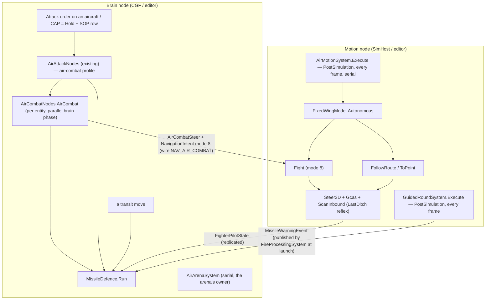
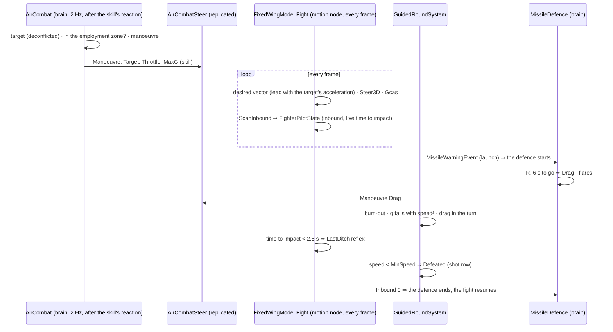
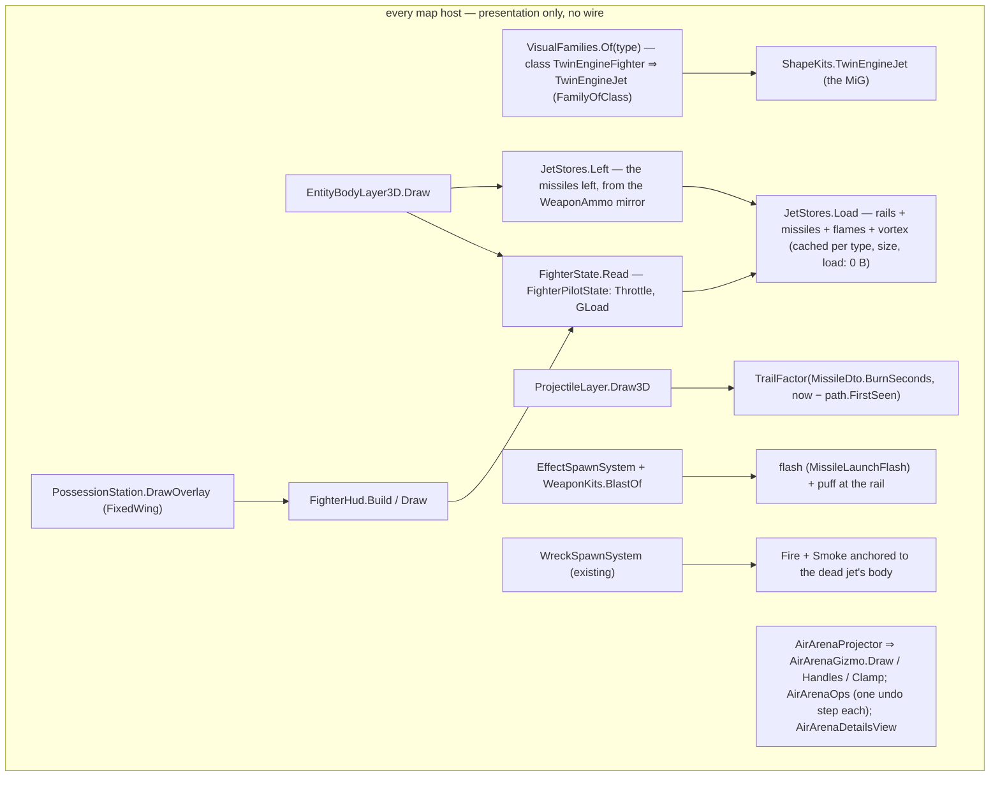
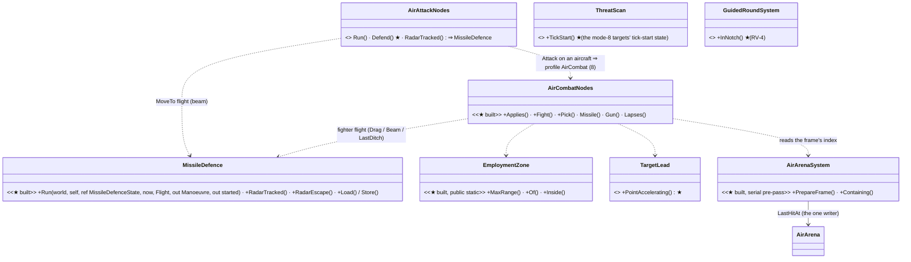
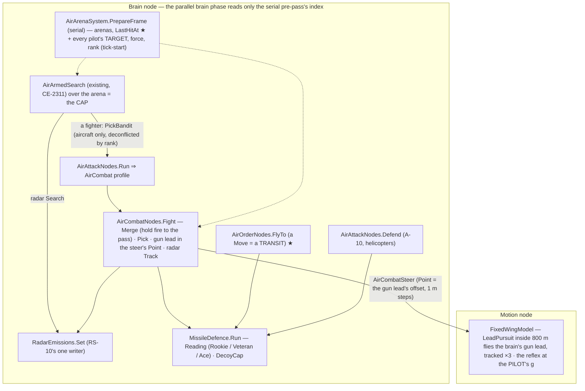
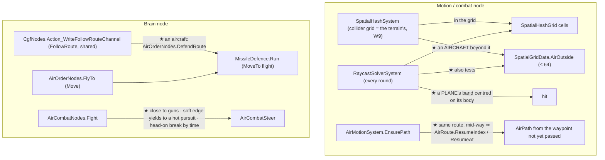

<!--STATUS
state: LIVE
updated: 2026-11-17
build-state: BUILDING (S0 + S1 built §8a; S2 §8b + §8c; S3 / S4 built §8c; the closing fights, skill on the defence, the CAP, a transit's defence §8d — scenarios in STATUS) — READY-TO-BUILD — AC-1…AC-15 ✅ APPROVED (R-4283), amended by the review §9 RV-1…RV-21 ✅ APPROVED and FOLDED into §3–§8 (R-4284) `2026-11-16`; handoffs: HANDOFF_Coordinator_To_Air_Combat.md (air lane), HANDOFF_Coordinator_To_Ui_Air_Combat_Visuals.md (ui)
current-answer: §0 the ask · §1 inventory · §2 the proven pattern · §3 decisions · §4 UML · §5 the numbers · §6 scenarios · §7 ids · §8 slices · §9 the review (its fixes are folded; kept as the record)
stale-below: none
known-rot: none (the review's corrections are folded)
known-conflict: Air Operations §5 (the route: a height above the ground on every 20 m sample) — AC-1 replaces it for cruise legs; §5 keeps it for low flight
related-designs:
  - ../devices/DESIGN_Simulated_Devices.md — simulated devices: the pilot station device and its HUD
  - ../../DESIGN_Entity_Control.md — OWNS the pilot station: possessing a fighter (the mouse-aim manual pilot, §8f) and the HUD ui extends (§4d)
  - ../../DESIGN_Map_3D_Mode.md — OWNS the visual families and shape kits (§6n): the MiG's `TwinEngineFighter` body and the jet's stores
  - ../../DESIGN_Visual_Effects.md — OWNS the effects: muzzle flash, missile smoke, the new afterburner / vortex / falling-smoke effects
  - ../../DESIGN_Thermal_And_Acoustic_Sensing.md — OWNS how aircraft are seen and heard (the vision range S0 measures)
  - ../../DESIGN_Scenario_Regression.md — OWNS the checks grammar §3 the air lane extends (`Defeated`, the shot's range, `far`) and the feature / demo golden rule §5
  - ../../DESIGN_Parallel_Simulation.md — OWNS the per-entity rule the brain behaviour obeys (§18.5–§18.8) and the read declarations
  - ../../DESIGN_Orders_Params_Entity_Classes.md — OWNS the entity classes and the `<Class><Order>` lookup the new `TwinEngineFighter` class enters (R-278)
  - DESIGN_Air_Operations.md — OWNS the aircraft route (§5), the flight models (§6), the attack behaviour and its missile evasion (§7e, unified here by AC-9), the air targets (§7c: the lead, the hull hit)
  - DESIGN_Radar_SAM.md — OWNS the radar sensor (RS-2), the published radar emission and the radar warning (RS-10, RS-6), the salvo fields (RS-4) a fighter's radar and radar missile reuse
  - ../vehicle-tactics/DESIGN_Missiles_And_Ammo.md — OWNS guidance, seekers, the proximity fuze and decoys (§3c); AC-6 adds the motor and the g limit to its round
  - ../weapons/DRAFT_Weapon_Malfunctions_And_Physical_Devices.md — OWNS weapon malfunctions (CE-4644): the gun jam is THEIRS, not a lapse here (AC-12)
  - ../fun/BACKLOG_Fun_Ideas.md — F-25 / CE-4643 (WWI air combat) reuses the pilot and the behaviour of this design with biplane numbers
-->

# DESIGN — air combat: jets, missiles, cannons, missile defence, ground safety, the show

🔒 **User, `2026-11-16`:** *"Design the air dogfight now, for jets, with missiles and cannons, as well as evasive maneuvers for air to air missiles
including sam missiles which shouldnt be difficult becuse the missile navigation is simple and likely easy to dodge. With feature testing scenarios
and without following the terrain but avoiding crashing to terrain - the ai autopilot need to know the aircraft limits and pull up soo enough. some
'too immersed in combat' or other auxiliary induced failures might be added if the combat turns to be too equal and boring (it is a show in the
first place so the attacks need to happen above the terrain not many kilometers away...)"* · earlier the same day: *"the aircraft now follow the
terrain height instead of keeping absolute height most of the time."*

## 0. The ask, in five parts

| # | part | where |
|---|---|---|
| A | jets fight each other: missiles (IR and radar) and cannons | AC-2…AC-8 |
| B | they dodge missiles, air-to-air AND surface-to-air | AC-6, AC-9 |
| C | no terrain following; the autopilot knows its limits and never flies into the ground | AC-1, AC-4 |
| D | the fight stays over the map, close enough to watch | AC-10, AC-11 |
| E | a stalemate is broken by human-like lapses | AC-12 |

## 1. INVENTORY *(measured `2026-11-16`)*

Queries: `search_graph name_pattern=".*(Guided|Missile|Seeker|Countermeasure|Decoy|FixedWing|AirMotion|AirAttack|AirRoute|Dogfight|Intercept|Fighter|Gcas|TargetLead).*" label=Class` ⇒ 26 production classes,
**none for air-to-air, a fighter pilot or ground collision**; `label=Interface` ⇒ 0 relevant. Grep of `docs/` + `.dev/` (dogfight · air-to-air ·
GCAS · ground collision · AIM-9 · AIM-120 · interceptor) ⇒ only F-25 / CE-4643 (WWI, fun backlog). ⚠ Index coverage cannot be checked through
the CLI.

| exists | what it gives | file |
|---|---|---|
| `FixedWingModel` | AI: follow an `AirPath`, fly to a point (2-D yaw turn at max bank + a clamped climb), straight and level; the mouse-aim manual pilot; the dead fall | `Fdp.Toolkits/Motion/FixedWingModel.cs:34-190` |
| `AirRoute.Compile` | ⚠ re-samples height above the ground every 20 m ⇒ **the terrain following the user saw** | `Motion/AirRoute.cs:97-104` |
| `MotionFrame.Ground(x, y)` | the terrain height on the motion node | `Motion/IMotionModel.cs:24` |
| `NavigationMode` | 0…7 (`Traffic` = 7) — ⭐ 8 is free | `Navigation/NavigationComponents.cs:20-60` |
| `GuidedRoundSystem` | lead-pursuit homing (`TargetLead.Point`), **constant speed**, a turn rate per missile (`MissileDto.TurnRateDegPerSec`, CE-2222; 30°/s when unset), seeker cone, proximity fuze, decoy seduction | `Combat/Systems/GuidedRoundSystem.cs:183-283` |
| `TargetLead` | the ONE predictor (rounds, missiles, gun runs) | `Combat/TargetLead.cs:14-45` |
| `Countermeasures.Release` · `CountermeasureSystem` | one flare / chaff per dispenser interval; seduction in the cone | `Combat/Countermeasures.cs:83`, `Systems/CountermeasureSystem.cs:23` |
| `MissileWarning` (+ sensing) | bearing, seeker, time to impact on the target's brain | `Combat/Components/AirDefenceComponents.cs:50` |
| `RadarEmission` · `RadarWarning` · radar sensor | a radar that radiates, a target warned "searched / tracked"; aircraft-only candidates | `Perception/Radar/RadarComponents.cs:36,81`; Radar SAM RS-2, RS-10 |
| `AirAttackNodes` evade stage | warning ⇒ stop firing, 4 decoys, beam the missile (2-D MoveTo), come round — ⚠ inside the ATTACK behaviour only | `Hrot.AI.Behaviors/Brains/AirAttackBehaviors.cs` §7e |
| gun pass | `ForwardFire` — a fixed gun fired at the led point inside its window | `AirAttackBehaviors.cs:1093` |
| `FireProcessingSystem.LedAtAircraft` · hull hit · fall | a round at an aircraft is led; it meets the hull; a dead aircraft falls and crashes | Air Ops §7c-i (AT1–AT3) |
| F-16C (401) | ⚠ a body, signatures, RCS 3 m² — **no flight, no weapons, no brain** | `NedTkbCatalog.cs:1286,1325,1333` |
| A-10C (405) | the one flying plane: cruise 150 / stall 60 / top 200 m/s, 60° bank, GAU-8 | `NedTkbCatalog.cs:1620` |
| air-to-air missiles · fighter cannon · a second fighter type | ⛔ none (munitions: GAU-8 6023/6024, Stinger 6030, Igla 6031, radar SAM 6050) | `MunitionTkbCatalog.cs` |

### 1a. Step 0 — the four measurements *(`air` lane, `2026-11-17`; graph + grep; ⚠ index coverage cannot be checked through the CLI)*

| # | question | answer | basis |
|---|---|---|---|
| ① | the ids | **components 128 · 160 · 277 · 278 · 279** (R-10000 — the ONLY five ids no lane declares or uses: a full scan of every `[ComponentId]`, every `*Ids` constant of type int / ushort / byte and every literal on coordinator, behaviors, backend, ui, terrain, convoy and the three `exp/agg-*`; the 0–511 space is otherwise FULL) · **ordinals 216 · 217 · 218 (+ 219 spare)** (R-10001 — every `EDescriptorType`, `DescriptorOrdinal` literal and `TimeDescriptorType` on the same branches: in use … 196, 201–203, 205–206, 220–222; the convoy lane takes 198–200 + 207 upwards) · **MiG DIS 1.2.222.1.200**, class `TwinEngineFighter` = `1.2.*.1.200` (R-10002; the `LandAnimal` 200+ precedent for a HROT subcategory) · **`WeaponCategory.AirToAir` = 13** (12 was the last, on every branch) | `GlobalComponentIds.cs` header; `AllDescriptors.cs`; `TimeDescriptorType.cs:5-9`; `EntityClassTable.cs:233`; `TurretSuiteDto.cs:49-75` |
| ② | `Ground(x, y)` beyond the map edge | **continuous and finite**: the height at the nearest edge point + low procedural hills (≤ 25 m, faded in over 300 m) — GCAS needs nothing special there; `ac-map-edge` is the rail | `TerrainWorld.cs:147-156` (`GroundHeightOf`), `BeyondGround.cs:19-21` |
| ③ | the vision range at which a unit sees a jet | **the OBSERVER's own range, not the target's size**: `VisualPerception.Optics` reads the observer's `SensorCapability.Visual.Range` (= its TKB `SensorRange`), × binoculars / scope, × light and fog — the A-10 and a MANPADS 5 km, the AH-64 6 km. ⇒ the jets get `SensorRange` 8 km (≥ the 6 km shot cap, AC-11) | `VisualPerception.cs:61-101`; `NedTkbBuilder.cs:356-362`; `NedTkbCatalog.cs:330` |
| ④ | does the radar sensor (RS-2) run on an AIRCRAFT emitter? | **yes, unchanged**: it runs on any carrier whose TKB lists a radar (`RadarRange > 0`) while its `RadarEmission` is On; the candidates exclude only its own force and itself — nothing ground-specific. ⚠ the clutter floor (15 m) applies to the TARGET, so a jet looking down never sees a target below 15 m AGL | `RadarPerception.cs:66-120`; `NedTkbBuilder.cs:365` |

## 2. The proven pattern, and what we take

**How combat flight simulations do it:** a **layered AI pilot** — a tactical layer picks the fight (engage, defend, separate), a manoeuvre layer
picks the basic fighter manoeuvre (lead / pure / lag pursuit, break, extend, high and low yo-yo, defensive spiral), and an **autopilot** flies
it within the aircraft's limits (g, corner speed, energy). Ground safety is **Auto-GCAS** (F-16, in service since 2014): it predicts the
recovery path at the aircraft's g and takes the stick at the last safe moment. Missile defence is **drag** (turn away until the missile runs out
of energy), **beam / notch** (put it on the 3 or 9 o'clock — a radar seeker loses a target with no closing speed against the ground clutter; ⚠ no such model existed — RV-4 adds one rule) and the **last-ditch break** (max g across its path
inside ~2 s, when it cannot follow), with flares / chaff.

| piece | adopt? | the reason here |
|---|---|---|
| tactical layer on the brain, the manoeuvre flown on the motion node | ✅ adopt | today the brain re-issues a 2-D point every ~0.5 s (`AirAttackNodes`, `SteerPeriod`); a manoeuvre needs every-frame 3-D steering at the aircraft's own position, which lives on the motion node |
| an energy model (g limit, corner speed, thrust, drag) | ✅ adapt — 4 numbers, not aerodynamics | a dogfight IS energy; without it a turn costs nothing and nobody ever wins |
| Auto-GCAS | ✅ adopt | the user asked exactly for it; one prediction, all AI flight modes |
| proportional navigation for missiles | ⛔ reject | the lead pursuit at a turn limit already hits (CE-2187 rails); the user WANTS dodgeable missiles; adding a motor and a g limit (AC-6) makes the drag and the break work for the right reason |
| beyond-visual-range doctrine (shots at 40 km) | ⛔ reject (show rule AC-11) | the user: *"not many kilometers away"* |

## 3. Decisions — ✅ approved `2026-11-16` (R-4283), ⭐ AS AMENDED by the review §9 (R-4284)

| # | decision | why | rejected — one line |
|---|---|---|---|
| **AC-1** | **cruise is a fixed altitude per leg**: a route leg / point move flies at `max(ground under the leg) + the ordered height`, constant along the leg; the climb or descent to it **starts early by its climb time** (RV-5); terrain following stays ONLY for low flight (ordered height < 100 m: attack run-ins, helicopters, drones) | the user's report; real aircraft hold an altitude; clearance is kept by taking the highest ground | keep per-sample AGL (the bobbing) · absolute Z from the waypoint (the draw tool writes Z 0, CE-2172) |
| **AC-2** | ONE new motion mode, `NavigationMode.AirCombat = 8` — ⭐ **added to the wire enum `ENavigationMode` and to BOTH `MapMode` switches** (today an unknown mode becomes `NAV_NONE`, RV-6); the brain's choice in ONE replicated `AirCombatSteer` (**brain** ownership group); the motion node flies it every frame (`FixedWingModel.Fight`) and answers in ONE replicated `FighterPilotState` (**muscle** group). The brain writer follows `OperatorControlBehavior.ManualControl` (mode, bump `IntentId`, then the replicated drive) | the manoeuvre is geometry against the target's live position; the motion node holds both | the brain re-issuing `MoveTo` points (laggy, 2-D, no g) · a new motion model (one per locomotion class) |
| **AC-3** | the autopilot steers a **3-D velocity vector** with its **own attitude** (the quaternion in `SimTransform.Rotation`, never read back as Euler angles; no ±25° pitch clamp, no `ClimbMps` cap in this mode — RV-5): it rolls (fighter 240°/s) to put the lift onto the desired direction and pulls at most the skill's g (≤ `MaxG`, and the speed-limited g below corner speed); bank = acos(1/n); speed by `AccelMps2` (the thrust, R-3007 — no second thrust field, RV-13) − drag(g) − g·sin(climb), never below stall. ONE integrator, `Steer3D` | one rule gives every manoeuvre | per-manoeuvre scripted paths |
| **AC-4** | **GCAS in every AI fixed-wing mode** (route, point, air combat): each frame `Steer3D` SIMULATES the recovery (0.3 s reaction, roll to wings level, pull the type's `MaxG`) over the terrain under that curved path for up to 10 s of climb; if it would pass below the floor it takes over until climbing and above the floor; a ridge the climb cannot clear ⇒ it turns away. **Floor = min(150 m, the ordered / profile height − 20 m), never below 8 m** (a 50 m gun run, RS-6's 10 m radar escape keep working, RV-5); in a fight, the arena floor. `FighterPilotState.GcasCount` / `MinAgl` | the user: *"knows the aircraft limits and pulls up soon enough"*; the SAME integrator as the flight, so the prediction matches the aircraft | a minimum-altitude clamp · a straight-line look-ahead (misses the curve and the roll) · GCAS for the manual pilot (R-3007) |
| **AC-5** | the **manoeuvre set**: `Manoeuvre` enum — None 0 · Merge 1 · LeadPursuit 2 · PurePursuit 3 · LagPursuit 4 · Break 5 · Extend 6 · Climb 7 · Beam 8 · Drag 9 · LastDitch 10 · ReturnToArena 11 · Disengage 12 · Rejoin 13; each is a desired vector + throttle (AC-3) | the standard set | a free-form planner |
| **AC-6** | **missiles that can be beaten** (RV-1): `MissileDto` + `BurnSeconds`, `MaxG`, `DragPerS`, `MinSpeedMps`, `SteerLagS`; the round boosts from the launcher's speed to `SpeedMps` over the burn, then loses `DragPerS` (more while turning); its available g = `MaxG·(v / SpeedMps)²` (it gets LESS agile as it slows); its steering follows the lead through a first-order lag (0.4 s); below `MinSpeedMps` it is DEFEATED — it expires, and its shot row says `Defeated`. `GuidedRound` keeps a separate current speed (`SpeedMps` still feeds the lead and the dive maths). `MaxG` 0 ⇒ the existing `TurnRateDegPerSec` (CE-2222) — ATGMs unchanged. The SAMs (Stinger, Igla, radar SAM) get numbers too. ⭐ **The radar notch** (RV-4): a radar seeker loses the target while its closing speed < 50 m/s AND it is below 300 m above the ground | dodging must work by geometry and energy, and must sometimes fail | a scripted miss chance · proportional navigation |
| **AC-7** | **the jets**: the F-16C (401) gets flight, weapons, a radar, armour and a brain; a new **MiG-29 class (409)**, DIS `1.2.*.1.` with a HROT subcategory (the recon drone's `1.2.*.50.2` precedent), class **`TwinEngineFighter`**, faction from the scenario. They DIFFER (RV-8): the MiG has the better instantaneous turn and nose authority, the F-16 the better sustained turn — the catalogue table §5a | two different jets make a fight that someone wins | a mirrored F-16 (identical jets circle forever, RV-8) |
| **AC-8** | **the weapons**: IR missile (AIM-9X / R-73 class), radar missile (AIM-120 / R-77 class, chaff only in the end-game, RS-3), the gun. ⭐ **A shot only inside the weapon employment zone** (RV-10): the max range and the no-escape range against the target's present speed and aspect, from a cheap step-simulation of the motor model (`TargetLead.FlightTime` through it, at the 2 Hz decision, allocation-free); ⭐ **the gun lead adds the target's acceleration** (½·a·t²), fires ≤ 500 m with the nose within 2° of that lead. One missile at a time per target, wait for the outcome. ⛔ **No shot whose line or burst radius holds a friendly** (RV-11). A NEW air-to-air weapon category for the missile mounts — ⛔ never `Sam` (it trips the ground-AA SOP row) | public figures; the zone makes a shot mean something | salvos of 4 · shots at max range |
| **AC-9** | **ONE missile defence for every aircraft** (RV-2, RV-3, RV-14): a **`MissileDefenceState` component** (brain, recorded) and `MissileDefence.Run` (behaviors), called by `AirCombat`, `AirAttack` (its evade stage and the RS-6 radar escape folded in) and a transit move. **Started by a LAUNCH only** — a radar "tracked" warning only biases the manoeuvre. It reads the LIVE threat from `FighterPilotState` (below), not the launch snapshot. **IR far (> 4 s to go) ⇒ Drag; IR near ⇒ Beam + flares (§7e E4 kept); radar ⇒ Beam / notch + chaff in the end-game.** TWO outputs: a `Manoeuvre` for a fixed-wing in mode 8, a MoveTo point for rotorcraft and transit (today's beam). ⭐ **`LastDitch` is a REFLEX on the motion node**: inside 2.5 s to impact it breaks across the missile's path whatever the brain asked. The defence ends when no round is inbound | one concept, one implementation; the motion node is the only place that SEES the missile live | a second evasion in the fighter · the launch snapshot (stale, overwritten by a second missile) |
| **AC-9a** | **the live threat** (RV-2): each frame the motion node scans the guided rounds whose target is this aircraft (a small set; allocation-free) and writes into `FighterPilotState`: `Inbound` count, the nearest's bearing, seeker, closure and live time to impact, `LastDitchAt`, `Defeated` count. `MissileWarning` stays the launch EVENT (it starts the defence) | the brain cannot see a round (not replicated) | replicating every missile to the brain |
| **AC-10** | **the arena**: an authored, replicated `AirArena` entity (centre, radius, floor, ceiling, `MaxShotRangeM`, `StalemateSeconds`, `LastHitAt`); fighters fight inside it; ⭐ **a SOFT edge** (RV-9): the pull back grows with the distance outside; the missile defence and a disengage override it; the start is a `Merge` through the centre at corner speed + 20 % | the show's stage | a hard wall (turns a dragging jet back into the missile) · no arena |
| **AC-11** | **show rules on the arena**: no missile beyond `MaxShotRangeM` (default 6 km) even inside the employment zone; the arena floor and ceiling | every shot within view | real ranges |
| **AC-12** | **skill and lapses** — `Skill` enum Rookie 0 · Veteran 1 · Ace 2 sets (RV-8) **reaction time** (1.5 · 0.7 · 0.3 s), **the g it will pull** (6.5 · 8 · 9), **decision quality** (Rookie: level turns and pure pursuit, shoots at max range; Veteran: lag / lead, shoots inside 0.8 × max; Ace: the vertical, one- vs two-circle by energy, shoots inside the no-escape range) **and the lapse rate**. Past `StalemateSeconds` (90 s) with no hit in the arena, each pilot draws a lapse per second (per-entity `SimRng`, deterministic): `Lapse` enum None 0 · Fixation 1 (holds a gun track until GCAS at a third of the floor) · LateWarning 2 (+2 s reaction to a launch) · EnergyBleed 3 (a slow turn under corner speed, 10 s) · GLoc 4 (after > 8 g for 5 s: no control 3 s, wings level). ⛔ The gun jam is CE-4644's malfunction | the user: *"'too immersed in combat' … if the combat turns to be too equal"*; skill makes fights unequal by design, lapses break the rest | a director that writes other pilots (breaks the per-entity rule) · random deaths |
| **AC-13** | **the behaviour, inside R-2015's one order set** (RV-12): an **Attack order on an AIRCRAFT** picks the air-combat profile of the ONE `AirAttack` entry, which delegates to `AirCombatNodes` (one stateful behaviour); **CAP = a Hold over the arena + the fighter SOP row** (an air contact ⇒ engage). No new orders, no order ids. The behaviour: target = a hostile aircraft seen or radar-tracked in the arena, ⭐ **deconflicted** — wingmen take different targets through the group's shared contacts; the manoeuvre from the geometry each decision (2 Hz, after the skill's reaction); the weapon (AC-8); the defence (AC-9); lapses (AC-12); **after a kill** the next target, else `Rejoin` the leader or Hold over the arena; **winchester** (no weapons) or damaged < 50 % or alone against two with no missiles ⇒ `Disengage` (out of the arena); it switches its own radar On (RS-10's one writer) — ⭐ an AIRCRAFT emitter is exempt from RS-6's dive and RS-7's spot report (RV-3) | R-2015 kept; one behaviour, the existing order and SOP machinery | CAP / Intercept orders and a separate behaviour (contradicts R-2015) |
| **AC-13a** | **jets that touch both crash** (the existing body contact, `DroneImpactSystem`) (RV-11) | — | — |
| **AC-14** | **who builds** — a new **`air` lane** (branch `air` off `coordinator`; CE / R block 10000–10999) builds the motion, the missiles, the catalogue rows, the wire, the checks-grammar items and the behaviour, cross-lane into motion, combat, catalogue, network, scenario harness and behaviours, said in each commit | one owner keeps the pilot and the behaviour in step | three lanes on one loop |
| **AC-15** | **the visuals are ui's** (RS-9's split): the air lane declares the ids, the class and placeholder look rows; ui builds §4d — ⛔ mockups first (R-4143), the frame rails check them (R-4146) | ui owns `ShapeKit`, the effects and the fidelity rule | the air lane in `ShapeKit` |

## 4. UML *(as amended, R-4284)*

### 4a. Classes

```mermaid
classDiagram
  class FixedWingModel { <<existing, grows>> +Autonomous() · +Fight(frame, steer, params) ★ · -Steer3D(frame, desired, g) ★ · -Gcas(frame, floor) ★ · -ScanInbound(frame) ★ }
  class AirRoute { <<existing, grows>> ★ a leg's height = max ground + ordered height, climb started early (AC-1) }
  class AirCombatSteer { <<★ component, brain group, replicated>> Manoeuvre · Target · Throttle · FloorAgl · MaxG · Arena }
  class FighterPilotState { <<★ component, muscle group, replicated>> GLoad · Throttle · GcasActive · GcasCount · MinAgl · Inbound · ThreatBearingDeg · ThreatSeeker · ThreatClosureMps · ThreatTtiS · LastDitchAt · Defeated }
  class AirCombatState { <<★ component, brain, recorded>> Target · Manoeuvre · Skill · Lapse · LapseUntil · NextDecision · Kills · Shots }
  class MissileDefenceState { <<★ component, brain, recorded>> Phase · Seeker · StartedAt · Decoys · Resume }
  class AirArena { <<★ component, authored, replicated>> Centre · Radius · Floor · Ceiling · MaxShotRangeM · StalemateSeconds · LastHitAt }
  class FlightParamsDto { <<existing, grows>> +MaxG · +CornerSpeedMps · +DragK · +RollRateDeg · AccelMps2 = thrust }
  class MissileDto { <<existing, grows>> +BurnSeconds · +MaxG · +DragPerS · +MinSpeedMps · +SteerLagS }
  class GuidedRound { <<existing, grows>> +Speed (current) · +BurnUntil · +MaxG · +DragPerS · +MinSpeed · +SteerLagS · +SteerDir }
  class GuidedRoundSystem { <<existing, grows>> boost / coast · g by speed² · lag · notch · slow ⇒ Defeated }
  class AirAttackNodes { <<existing, grows>> Attack on an aircraft ⇒ the AirCombat profile · evade + radar escape ⇒ MissileDefence }
  class AirCombatNodes { <<★ behaviour>> +AirCombat() · -PickTarget() · -PickManoeuvre() · -InZone() · -Lapse() }
  class MissileDefence { <<★ extracted>> +Run(world, self, ref MissileDefenceState) Manoeuvre or MoveTo point }
  class AirArenaSystem { <<★ the arena's one writer>> LastHitAt }
  class TargetLead { <<existing, grows>> +Point() · +PointAccelerating() ★ }
  class Countermeasures { <<existing>> +Release() }
  class RadarEmissions { <<existing>> +Set() the one writer }
  AirAttackNodes ..> AirCombatNodes : the air-combat profile
  AirAttackNodes ..> MissileDefence
  AirCombatNodes ..> MissileDefence
  AirCombatNodes --> AirCombatSteer : writes (own)
  AirCombatNodes --> AirCombatState : writes (own)
  AirCombatNodes ..> RadarEmissions : own radar On
  AirCombatNodes ..> FighterPilotState : reads (g, energy)
  AirCombatNodes ..> AirArena : reads
  MissileDefence --> MissileDefenceState : writes (own)
  MissileDefence ..> FighterPilotState : reads the live threat
  MissileDefence ..> Countermeasures
  AirArenaSystem --> AirArena : writes
  FixedWingModel ..> AirCombatSteer : reads
  FixedWingModel --> FighterPilotState : writes (own)
  FixedWingModel ..> GuidedRound : reads (inbound, tick-start)
  FixedWingModel ..> TargetLead
  FixedWingModel ..> FlightParamsDto
  FixedWingModel ..> AirRoute
  GuidedRoundSystem ..> MissileDto
  GuidedRoundSystem --> GuidedRound
```

*What the picture shows that prose hid: the brain and the motion node exchange exactly TWO replicated components — the order down
(`AirCombatSteer`), the state and the live threat up (`FighterPilotState`); the defence is one component shared by every behaviour that flies.*

### 4b. Who runs it, and who calls it each frame

*What the picture shows that prose hid: mode 8 crosses the wire — the one edge that was silently dropped (RV-6); GCAS sits under both the
combat and the route modes; the live threat flows UP from the motion node, the launch event only starts the defence.*

### 4c. A dogfight tick, and a missile defeated

### 4d. The looks — what exists, what ui adds *(measured `2026-11-16`)*

| piece | today | ui adds (AC-15) |
|---|---|---|
| the F-16 body | ✅ `ShapeKits.Jet` (`ShapeKit.cs:401`) — F-16 proportions: fuselage, nose, canopy, swept wings, tailplanes, ONE swept fin, nozzle, gear; the F-16's DIS 1.2.*.1 maps to `VisualFamily.Jet` (`VisualFamily.cs:102`, class `Fighter` `EntityClassTable.cs:203`) | nothing for the body |
| the MiG-29 body (409) | ⛔ would draw as the same F-16 shape | a twin-fin variant (two canted fins, two nozzles, intakes under the wings), keyed by a class `TwinEngineFighter` (more specific than `Fighter`, the `AttackAircraft` precedent `VisualFamily.cs:108`) — so the sides look different |
| missiles and the gun pod on the jet | ⛔ none on the jet; ✅ the precedent: the A-10's bombs on pylons, shown by rounds left (`EntityBodyLayer3D.cs:483,1534`) | wingtip and underwing rails with the missiles still carried (IR outboard, radar inboard), one disappears per shot — the same rounds-left rule |
| the missile in flight | ✅ `MunitionShape.Missile` + smoke trail (Stinger, radar SAM) | the four AAM look rows; the trail only while the motor burns (`BurnSeconds`, AC-6) — a missile that coasts is seen to coast |
| afterburner, vortex trails, gun | ⛔ no afterburner / contrail; ✅ a muzzle flash for any non-bomb mount (`EffectSystems.cs:177`); ✅ retractable gear hidden in the air (`EntityBodyLayer3D.cs:1840`) | an afterburner at full throttle and wingtip vortex trails above 6 g, both from the replicated `FighterPilotState` (`Throttle`, `GLoad`); the gun only needs its effect-set and tracer rows |
| the missile's burn | — | the smoke trail only while the motor burns: derived from the round's AGE against its `MissileDto.BurnSeconds` (no wire) |
| a shot-down jet, the launch | ⛔ none | smoke and fire on a dead jet as it falls; a launch-off-the-rail flash and smoke |
| the arena | ⛔ none | an authoring gizmo (centre, radius, floor, ceiling) and its 2-D / 3-D drawing (a faint ring and the floor) |
| the possessing player's fighter HUD | the mouse-aim pilot + a speed / height / heading HUD exist (Entity Control §8f) | a fighter HUD: gun pipper at the led point, missile lock / in-zone cue, radar warning, g; ⛔ the player flies the manual pilot — mode 8 is AI only |
| flares | ✅ decoys drawn (CE-2188) | nothing |

⛔ **Mockups first** (R-4143): the MiG, the jet with stores, the HUD, the arena — house style over `scripts/mockup_kit.py`, committed beside this design.

⭐ **The mockups (ui, `2026-11-17`, `scripts/gen-air-combat-mockup.py`):** [the MiG beside the F-16](air-combat-body.svg) · [the missiles on the rails, full and after two shots](air-combat-stores.svg) · [the fighter HUD](air-combat-hud.svg) · [the arena, its gizmo and form](air-combat-arena.svg). Each names its scope; context is drawn unchanged (R-4151).

*Why ui and not the air lane: the body is chosen by the class chain, so the air lane's only visual act is naming the class — exactly the radar SAM's split (§2a there).*

### 4e. ⭐ AS-BUILT — the looks (ui, `2026-11-17`; the mockups of §4d are the acceptance, the rails below measure them)

*What the picture shows that prose hid: nothing here crosses the wire — every look is derived on each host from state that already replicates (the ammunition mirror, the round's age, the health crossing, `FighterPilotState`, `AirArena`). ✅ Re-bound `2026-11-17` to the air lane's merged contract: no stand-in remains but the HUD's zone.*

| piece | as built | deviation from the §4d mockup / what waits |
|---|---|---|
| the MiG body | `VisualFamily.TwinEngineJet` (appended), `ShapeKits.TwinEngineJet`, box 17.3 × 11.4 × 4.7 m, `KitPart.RollDegrees` (new, last parameter) for the canted fins; class bound in `VisualFamilies.FamilyOfClass["TwinEngineFighter"]`; the real type 409 (box 17.32 × 11.36 × 4.73 m from its `BodyGeometryDto`, gear hidden in the air by the TKB's contact points) | the kit's gear is drawn in the air as the F-16's is (existing kit behaviour; the mockup omits gear) |
| stores | `JetStores`: pylons always, one missile per round left of the mount whose AMMUNITION is an air-to-air missile (IR AIM-9X / R-73, radar AIM-120 / R-77 — `MunitionTkbCatalog` constants), the left rail first | the F-16 draws none until the air lane gives it missile mounts |
| AAM in flight | the smoke trail from the round's AGE (`RoundPath.FirstSeen`, first seen on this host) against the round's `MissileDto.BurnSeconds` (IR 5 s, radar 8 s; `ProjectileLayer.BurnOf`), a 0.8 s linger, then NONE; the launch: `EffectTkbCatalog.ApplyAirMissileEffects` + `WeaponKits.BlastOf` ⇒ `Launch` for a jet's missile mount | the four AAM look rows and the two guns' tracer rows are tuned (`MunitionTkbCatalog.BuiltInLooks`); a round first seen mid-flight (a late joiner) shows its trail from then |
| afterburner · vortex · fall | flames (amber cones, one per nozzle) from `FighterPilotState.Throttle ≥ 0.9` (the contract's); wingtip tubes 40 m back from `GLoad ≥ 6`; a dead jet burns by the EXISTING W3 wreck fire + smoke anchored to its body (rail: they follow it down), its afterburner out | the vortex is a straight stateless tube, not the curved vapour of the path; a curved smoke trail behind a falling jet is a follow-up |
| the arena | `AirArenaGizmo.Draw` (2-D: dashed ring + 6 % fill; 3-D: floor ring, ceiling ring, ticks, spokes), `Handles` (centre, radius, floor, ceiling: position, hit test, drag), `Clamp` (the ONE validation the form shares), through `AirArenaProjector` over the real `AirArena` (`NotAUnit` keeps it from drawing as a box), `AirArenaOps` (one undo step each), `AirArenaDetailsView` (registered beside the minefield's) | no TKB type exists for an arena, so the picker cannot place one — scenarios author it (decision R-1060); the handles' mouse DRAG (a pointer hook into the map's input chain) is not wired; the form's pixel layout is not frame-measured |
| the fighter HUD | `FighterHud.Build` (pure) / `Draw`: the pipper = `TargetLead.Point`, SEARCH / IN ZONE / LOCK, the warning from the existing `RadarWarning` and `MissileWarning`, g from `FighterPilotState`; anchors measured in the frame rail | the zone is a range band (500 m … `AirArena.DefaultMaxShotRangeM`) and the lock a 15° cone (`ZoneStandIn`) — the air lane has no employment zone yet (S3) |

**Prior state superseded:** §4d's table said "nothing for the body" of a MiG would be a new F-16 — now `TwinEngineJet`; the "gun only needs its effect-set and tracer rows" line stands (nothing built here).

## 5. The numbers *(public figures, rounded; the builder tunes and records each as a lane decision)*

### 5a. The jets

| | F-16C (401) | MiG-29 class (409) |
|---|---|---|
| speed | stall 70 · corner 170 · cruise 220 · top 400 m/s | stall 70 · corner 160 · cruise 220 · top 380 m/s |
| turn | `MaxG` 9; sustained 6.5 g at 220 m/s (radius at corner 9 g: 0.33 km) | `MaxG` 9.5, better nose authority (roll 270°/s); sustained 5.5 g |
| roll · thrust (`AccelMps2`) | 240°/s · 12 | 270°/s · 13 |
| health · armour faces (front · side · rear · top) | 400 · 4 · 4 · 2 · 2 | 450 · 5 · 5 · 2 · 2 |
| eye · radar | measured at step 0 (the vision range for a jet) · radar 40 km real, the arena caps shots | same |
| weapons | M61 20 mm (500 rounds, fixed, 2° cone) · 2 IR + 2 radar missiles on rails · 30 flares + 30 chaff (dispensers are weapons, BS-1 §5.4c) | GSh-30-1 30 mm (150 rounds) · 2 IR + 2 radar · 30 + 30 |
| other | ejection seat (the A-10's, `NedTkbCatalog.cs:1670`) · RCS 3 m² (exists) · `Heard(JetRange)` (exists) · a brain (AT4: health needs one) | the same rows written NEW: RCS 4 m², `Heard(JetRange)`, a body with gear, the hostile symbol; faction from the scenario |

### 5b. The missiles

| | IR (AIM-9X / R-73) | radar (AIM-120 / R-77) | radar SAM (6050) · Stinger · Igla |
|---|---|---|---|
| top speed · burn | 850 m/s · 5 s | 1 100 m/s · 8 s | 800 · 700 · 570 m/s · 4 · 2 · 2 s |
| `MaxG` (falls with speed²) | 40 | 35 | 30 · 20 · 18 |
| after burn-out · defeated below | −40 m/s per s · 300 m/s | −30 · 350 | −40 · −60 · −60 · 300 · 250 · 250 |
| steering lag · fuze | 0.4 s · 8 m | 0.4 s · 12 m | 0.4 s · as built |
| seeker | cone 90°, flare rejection 0.6 | cone 60°, chaff end-game (RS-3), the notch | as built + the notch (radar) |

⭐⭐ **AS HARDENED — R-10018** (🔒 user, `2026-11-17`: *"Harden as you lean."*; earlier: *"i need a hit unless aircraft does evading maneuver or fires chaff"*;
the bands: undefended ≈ 90 %, a late reaction 40–60 %, a timely defence 10–25 %). Inside the SAME model (AC-6, R-4283 — lead pursuit with energy):

| change | IR AAM | radar AAM | radar SAM | Stinger | Igla |
|---|---|---|---|---|---|
| `MaxG` (still × (v / SpeedMps)²) | 40 → **50** | 35 → **44** | 30 → **38** | 20 → **25** | 18 → **23** |
| flare / chaff rejection | 0.6 → **0.82** | 0.9 (kept) | 0.9 (kept) | 0.6 → **0.82** | 0.4 → **0.7** |
| the lead | ⭐ on the round's CURRENT speed (`GuidedRoundSystem.Steer`, a motor round), not its burn-out speed — the same lead pursuit with a true input | ← | ← | ← | ← |
| kept | `SteerLagS` 0.4 · `DragPerS` · `MinSpeedMps` · burn · fuze | | | | |

📐 **Measured** (the Monte-Carlo rail, 300 seeded IR shots, 1.2–3 km, any aspect; the defence now also drops the flares the system drops, one seeded
draw each — `CountermeasureSystem.Seduce`'s rule): **timely 73 (24 %) · late 124 (41 %) · undefended 281 (94 %)**. Why these knobs (a sweep, `2026-11-17`):
`DragPerS` and `MinSpeedMps` barely move a 1.2–3 km shot (the round arrives before it slows); a shorter lag kills the DEFENDED as surely as the
undefended (lag 0.05: timely 78 %, none 85 %); the lead on the burn-out speed was why half of the straight-flying targets were MISSED; with it fixed,
the maneuver alone leaves a timely defence at ~45–55 % — the decoys' rejection sets the defended bands.

⛔ **SUPERSEDED** (the §5b round below, as first built): `MaxG` 40 / 35 / 30 / 20 / 18, flare rejection 0.6 / 0.6 / 0.4, the lead on `SpeedMps` —
measured (R-10007, 300 shots, no flares in the rail): **timely 5 % · late 13 % · undefended 50 %** — far too dodgeable.

📐 **Why a dodge can work and can fail** (as amended, RV-1): at 2.5 s to go a 9 g break moves the jet ≈ 275 m off the predicted point; a 40 g
round at full speed can follow ≈ 1 200 m — but only at full speed, and only after its 0.4 s lag. A round that has coasted to 400 m/s has
`40·(400/850)²` ≈ 9 g left — no more than the jet. ⇒ an early drag (bleed its speed) or a well-timed break (inside its lag) beats it; a late
reaction does not. ⭐ **The acceptance is measured, not argued**: a seeded rail of 100 shots per profile states the hit-rate band.

## 6. Feature-test scenarios *(R-4277; ⭐ feature scenarios carry a golden; ⭐ the dogfights carry expect rows ONLY — they are demos in Scenario Regression §5's sense)*

Checks-grammar items the air lane adds first (RV-15; cross-lane into the scenario harness, said): ⭐ a `Defeated` shot outcome, ⭐ the shot
row's RANGE, ⭐ a `far` cue (`{"on":"far","who","from","m"}`, usable under `never`). Flares are `shot by X where ammo contains "Flare"` with `n`.

| slice | scenario | what happens | expect rows (machine) |
|---|---|---|---|
| S1 | `ac-cruise-altitude` | an F-16 flies a 3-leg route at 300 m over hills | per leg (anchored on the leg): two `field SimTransform.Position.Z` rows (≥ alt − 15, ≤ alt + 15) · `never field FighterPilotState.GcasCount > 0` |
| S1 | `ac-gcas-ridge` | ordered to 50 m toward a 200 m ridge; a second in a 30° dive from 2 000 m | `field GcasCount >= 1` (both) · `never health == 0` · `field MinAgl >= 8` at end |
| S1 | `ac-gcas-inverted` | inverted, 60° nose-down at 400 m/s from 3 000 m | `field GcasCount >= 1` · `never health == 0` |
| S1 | `ac-gcas-steep-ridge` | at 150 m toward a ridge rising faster than it can climb | it turns away: `never health == 0` · `field GcasCount >= 1` |
| S1 | `ac-map-edge` | a route that leaves the terrain and returns | `never field GcasCount > 0` · `never health == 0` (step 0 measures what the ground reads there) |
| S2 | `ac-ir-defeated` | a MiG fires one IR missile at a Veteran F-16 from 3 km behind | `shot by Fulcrum hit` never · ≥ 2 `shot by Viper where ammo contains "Flare"` · `shot by Fulcrum` outcome `Defeated` |
| S2 | `ac-ir-hits-late` | the same shot, `LateWarning` forced | `health Viper < max` before 15 s — ⭐ the defence is what saves it |
| S2 | `ac-radar-chaff-beam` | a radar missile at an F-16 at 150 m above the ground | `field MissileDefenceState.Phase == Beam` · ≥ 1 chaff shot · outcome `Defeated` |
| S2 | `ac-two-missiles` | two IR missiles 2 s apart | `field FighterPilotState.Inbound == 2` · both shot rows end (`hit` or `Defeated`) · the defence runs until `Inbound == 0` |
| S2 | `ac-sam-dodge` | an F-16 in transit over a radar SAM (114) and a Stinger team | `shot by *Sam` ≥ 1 · `field MissileDefenceState.Phase == Beam` · ≥ 1 SAM `Defeated` · F-16 alive at 120 s (seeded) |
| S2 | `ac-attack-evades` | the A-10 gun run under a Stinger (§7e through `MissileDefence`) | 4 flares · `MissileDefenceState.Phase == Beam` (IR near) · it comes round; ⚠ its golden is RE-RECORDED (state moved) |
| S3 | `ac-guns-drone` | an F-16 on a recon drone (407) flying straight | `shot by Viper at Drone hit` before 60 s · `health Drone == 0` before 90 s |
| S3 | `ac-guns-turning` | the F-16 behind a MiG in a 5 g turn | `shot by Viper at Fulcrum hit` before 120 s (the accelerating lead) |
| S3 | `ac-head-on-shot` | the jets merge head-on at 12 km | the first missile `shot` at ≤ 6 km (`range`), inside the zone |
| S3 | `ac-dogfight-1v1` | F-16 vs MiG, both Veteran, lapses on | `near Viper Fulcrum 1500` before 60 s · `never far … arena + 1000` · a shot before 120 s · one `health == 0` before 300 s |
| S3 | `ac-winchester` | an F-16 with one missile and no gun ammunition | after its shot: `field AirCombatState.Manoeuvre == Disengage` · `far Viper arena` before 120 s |
| S4 | `ac-dogfight-2v2` | two pairs, an Ace and a Rookie a side | ≥ 4 missile shots · ≥ 1 gun hit · ≥ 4 flares · ≥ 2 kills before 600 s · `never` a shot with range > `MaxShotRangeM` · `never` a friendly hit · the two wingmen hold different targets at the first shot |
| S4 | `ac-skill-decides` | an Ace vs a Rookie, lapses OFF, 5 seeds | the Ace wins in ≥ 4 of 5 (one expect per seed) |
| S4 | `ac-stalemate-lapse` | two Aces, `StalemateSeconds` 30 | `field AirCombatState.Lapse != None` before 120 s · a kill or a crash before 240 s |

⭐ **Rails** (not scenarios): the missile Monte-Carlo (100 seeded shots per profile, the hit-rate band; a late reaction worse); the wire
round-trip of mode 8; GCAS against a terrain function (inverted, vertical, steep ridge); the zone maths; no allocation in a steady fight frame.

## 7. Ids *(⛔ permanent once built)*

| what | id |
|---|---|
| aircraft type MiG-29 class | **409** (max in use 408, measured on every lane) |
| munitions AIM-9X, AIM-120, R-73, R-77 class, M61 20 mm HEI, GSh-30-1 30 mm HEI | **6060…6065** (max in use 6053) |
| `NavigationMode.AirCombat` / wire `NAV_AIR_COMBAT` | **8** in both enums |
| `Manoeuvre`, `Lapse`, `Skill`, `MissileDefenceState.Phase` | §3 AC-5, AC-12, AC-9 |
| ⭐ **component ids ×5** (`AirCombatSteer`, `FighterPilotState`, `AirCombatState`, `MissileDefenceState`, `AirArena`) | **the air lane's own block, measured at step 0** (R-4284): a FULL scan of every `[ComponentId]` and every id constant on every lane branch, tests included — ⛔ not a grep of `= N;` literals (163 is reserved, 277–279 are `NavFakeIds`', 476–495 is full, tests hold 487/488/492/493); declared in `GlobalComponentIds`' header like R-4276 |
| ⭐ **DDS ordinals ×4** (`AirCombatSteer`, `FighterPilotState`, `AirArena` + 1 spare) | **measured at step 0** across every `DescriptorOrdinal` (the time translators hold 201–206; agg 220–239; convoy's three, see the convoy note) |
| the MiG's DIS subcategory · the air-to-air weapon category value | measured at step 0 |
| CE / R block | **10000–10999** (the `air` lane) |

## 8. Slices *(each ends with its scenarios passing in `scripts/scenario-regression.sh`)*

| slice | items | scenarios · ⭐ the existing suites it moves (RV-16) |
|---|---|---|
| **S0 measure** — ⛔ STOP rule (R-106): an item whose premise fails is reported, the rest go on | the ids (§7); `Ground(x, y)` beyond the map edge; the vision range at which a pilot sees a jet; whether the radar sensor (RS-2) runs on an aircraft emitter | — |
| **S1 the autopilot** | AC-1, AC-3, AC-4 (`Steer3D`, GCAS in every AI mode), the F-16 flight numbers | 5 S1 scenarios · `FixedWingModelTests` (the per-sample AGL rails re-pinned), `RotorcraftModelTests` unchanged, `ua-air-attack` re-golden |
| **S2 missiles that can be beaten** | AC-6 (+ the notch), AC-9 / AC-9a (`MissileDefence`, the live threat, the reflex), the grammar items | 6 S2 scenarios · the Monte-Carlo rail · `GuidedRoundSystemTests`, `AirAttackNodesTests`, `sam-site` (its 20–40 % chaff band re-measured), `ua-air-defence` |
| **S3 the fighters** | AC-2 (+ wire), AC-5, AC-7 (catalogue §5a), AC-8, AC-13 / AC-13a | 5 S3 scenarios · the wire round-trip rail |
| **S4 the show** | AC-10, AC-11, AC-12 | 3 S4 scenarios |
| **ui, in parallel from S3** | §4d, mockups first | its frame rails (R-4146) |

Machine checks on every behaviour slice: `HROT_PARALLEL_SIM=1` + `HROT_READ_CHECK=1` (the brain's reads of `FighterPilotState` and `AirArena`
declared in `BrainReads.Declare`), the world guard, and `stepped-hash.py --threads 1,4,8` on `ac-dogfight-2v2` (parallel safety, not the
verdict). The motion node is serial (`AirMotionSystem`), so the fight reads the target's and the rounds' TICK-START state, never this
frame's half-moved one. ⛔ No allocation and no LINQ in `Fight`, `Steer3D`, `Gcas`, `ScanInbound` (a rail: 0 bytes in a steady frame).

### 8a. ✅ As built — S0 and S1 *(the `air` lane, `2026-11-17`; `STATUS_Air_Combat.md`)*

| item | as built | deviation — argued |
|---|---|---|
| ids (§7) | components 128 · 160 · 277 · 278 · 279; ordinals 216–218; MiG DIS 1.2.222.1.200; `AirToAir` 13 (§1a) | — |
| §4a `FighterPilotState` | + `SpeedMps` (the brain's energy), `GcasTurn`, `GcasHeadingDeg` (the recovery GCAS chose — motion-node local, not on the wire) | R-10003 |
| §4a `AirCombatSteer` | + `Lapse` (the motion node flies a G-LOC wings level and a fixation's lowered floor) · ⭐ SAVED with a scenario | R-10003 · R-10004: an authored steer is the motion node's feature-test seam — S1's GCAS scenarios dive before the behaviour (S3) exists |
| AC-1 | `AirRoute.Compile(…, climbSlope)` — a leg whose ends are both ordered ≥ 100 m flies ONE altitude (the highest of its samples = the highest ground + the order); then every point is raised to the next point's height less the climb over the gap (climbs start EARLY) and to the previous point's less the descent (descents start LATE). The fixed-wing route passes slope = climb rate ÷ cruise; helicopters pass 0 (unchanged) | ⚠ R-10005: AC-1 said "the climb OR DESCENT starts early" — an early descent would leave the previous leg's clearance over its highest ground |
| AC-3 `Steer3D` | `Motion/AirCombat/Steer3D.cs` — velocity + quaternion; roll at the type's rate onto the wanted lift; ⭐ GRAVITY FIRST: past the g limit the turn gets what is left once the lift holds the aircraft up (so a max-g level turn banks acos(1/n) and does not spiral down); speed = thrust·throttle − thrust·(v/top)² − DragK·(n²−1) − g·sin(climb), floored at stall. The F-16 sustains 6.5 g at 220 m/s, the MiG 5.5 g (`FlightParamsDto.MaxG / CornerSpeedMps / DragK / RollRateDeg`, §5a) | R-10006: "gravity first" is the coordinated-turn convention the AC-3 text implies (bank = acos(1/n)) but did not state |
| AC-4 GCAS | `Gcas` (same file): 0.3 s holding the line, then wings level and the type's `MaxG` into a 30° climb, stepped at 0.1 s for 10 s through `Steer3D` over `Ground(x, y)`; below the floor ⇒ it takes the stick; it lets go after ≥ 1.5 s, climbing, above the floor, with a recovery clearing the floor by 100 m (R-10008 — measured on `ac-gcas-ridge`: released at the floor, the kinematic point order dived straight back at the ridge and the second recovery came too late); a route plane then REJOINS its path (it flies at a point 1 km ahead of the nearest path point until within 30 m — ⛔ never the old snap, measured as a 7 km/s velocity spike); a straight recovery that fails ⇒ the better of the ±120° climbing turns. Floor `Gcas.FloorFor(ordered)` = clamp(ordered − 20, 8, 150); route = the leg's height, point = the point's, mode 8 = `AirCombatSteer.FloorAgl` (÷3 under a fixation), none = 150. A body higher than 10 s of its own speed + 500 m skips the simulation. In route mode the route's place advances while GCAS holds | — |
| mode 8 | `FixedWingModel.Fight` flies every `Manoeuvre` (pursuits with the lead / lag seconds 0.8 / 1.5, break, extend, climb, merge / return / disengage at the point, rejoin 200 m behind and 150 m beside the leader, drag / beam / last-ditch off `FighterPilotState`'s threat bearing). ⚠ The target is read at its CURRENT position — the tick-start cache (RV-6) lands with the behaviour (S3) | the cache is S3's: no mode-8 target is another fighter before S3 |
| the jets | F-16 / MiG: flight (§5a), health 400 / 450, armour 4·4·2·2 / 5·5·2·2, eyes 8 km (§1a ③), a brain, a 30 + 30 dispenser, an ejection seat | weapons and radar are S3's |
| rails | `FixedWingModelTests`: `AC3_TheF16_Sustains6p5gAt220…`, `AC3_ALoop_PassesTheVertical…`, `AC4_GCAS_RecoversAnInverted60DegreeDive`, `AC4_GCAS_TurnsAwayFromARidgeTooSteepToClimb`, `AC4_AGunRunAt50m_DoesNotTripGcas`, `AC1_ACruiseLeg_HoldsOneAltitude…`, `AC3_ASteadyFightFrame_AllocatesNothing` (0 B) | — |
| scenarios | the `air-range` terrain and the five S1 scenarios, written by `scripts/gen-air-combat-scenarios.py` from ONE height function (the engine's grid sample and `BeyondGround` ported exactly), so a check's altitude cannot drift from its ground. The grid is 2 × 2 km at 100 m (hills, a 200 m ridge along x 500 south of y 400, a 1:1.8 wall to a 720 m plateau north of y 600) — beyond its edge the engine continues the edge height + low hills, so the ridge and the plateau run on | R-10009: 2 km, not 24 or 8 — measured, a larger grid's first load (its navmesh bake) does not finish inside the regression's 30 s |
| ⭐ a point order is watched by its OWN flight first (R-10010) | `ToPoint` is kinematic and levels at its height by itself, so GCAS runs its recovery check only when the order's own flight (on along its heading, its height moving to the point's at the climb rate, 10 s) would pass below the floor; a point ON the ground leaves the 8 m floor | measured: the 150 m default for a ground point, then the recovery check on a 50 m pass, stopped `ua-air-attack`'s A-10 gun run (the column lead lived; it passes on the base) |
| ⚠ GCAS is a STRAIGHT-AHEAD predictor | measured on `ac-map-edge`'s first layout: a route's U-turn 100 m short of the plateau's wall tripped GCAS — the recovery straight ahead would have met the wall the turn was avoiding. ⭐ This is how Auto-GCAS works (it predicts from the present flight path); the scenario's route moved 1 km south of the wall | a finding, not a defect |

### 8b. 🟡 As built — S2, the first half *(the `air` lane, `2026-11-17`)*

| item | as built | deviation — argued |
|---|---|---|
| AC-6 the motor | `GuidedRound` + `SpeedNow`, `BurnLeftS`, `BoostMps2`, `MaxG`, `DragPerS`, `MinSpeedMps`, `SteerLagS`, `SteerDir`, `LoadG`; `GuidedRoundSystem.Motor` — boost from the LAUNCHER's speed (≥ a tube's 30 m/s) to `SpeedMps` over the burn, then coast losing `DragPerS·(1 + n/MaxG)`; g = `MaxG·(v/SpeedMps)²`; the steering follows the lead (still on `SpeedMps`, as AC-6 says) through a first-order lag; coasting below `MinSpeedMps` ⇒ the round expires and its shot row ends `ShotOutcome.Defeated` (appended). `MaxG` 0 ⇒ the old constant-speed round (ATGMs unchanged) | — |
| §5b numbers | the four AAMs (contract) + the SAMs: Stinger 2 s / 20 g / −60 / 250, Igla 2 s / 18 g / −60 / 250, radar SAM 4 s / 30 g / −40 / 300, all a 0.4 s lag | — |
| ⭐ the acceptance (RV-1) | `GuidedRoundSystemTests.AC6_MonteCarlo_…`: 300 seeded IR shots, 1.2–3 km, ANY aspect, at an F-16 that drags (> 4 s to go), beams (inside) and breaks (inside 2.5 s): 📐 measured **timely (0.7 s, a Veteran) 16 / 300 = 5 % · LateWarning (2.7 s) 38 = 13 % · no defence 150 = 50 %**; stated bands 6…30 · 25…60 · 120…180 | ⛔ SUPERSEDED by R-10018 (§5b: the user hardened it — timely 24 %, late 41 %, none 94 %, flares in the rail). Was: ⚠ R-10007: the design's EXAMPLE band ("30–60 % against a Veteran") is NOT what the §5b round gives — with its 0.4 s lag and the lead on the burn-out speed it is beaten ~19 times in 20 by a timely defence. The numbers were kept (the handoff: no guidance tuning beyond the design); the user decides whether the missile should be harder (a shorter lag, the lead on the current speed) |
| AC-9a the live threat | `Motion/AirCombat/ThreatScan.cs` — once per tick the motion node gathers the homing rounds (tick-start positions, per-thread buffers, no steady allocation); each fixed-wing writes the rounds aimed at it into `FighterPilotState` (`Inbound`, the nearest-in-time's compass bearing, seeker, closure, live time to impact); `GuidedRoundSystem` counts a defeated round into its target's `Defeated` | — |
| AC-9 the reflex | `FixedWingModel.Autonomous`, before any mode: inside `ThreatScan.LastDitchS` (2.5 s) the jet breaks level ACROSS the missile's line at its full g, whatever the brain asked; GCAS already holding keeps the stick; a G-LOC'd pilot does nothing; `LastDitchAt` stamped on entry | — |
| AC-8 the suites (S3's catalogue half) | F-16 / MiG: mount 0 the gun (M61 500 rds 6 000/min · GSh-30-1 150 rds 1 800/min, fixed 2° cone), mount 1 the IR rail pair (AIM-9X / R-73, `AirToAir`), mount 2 the radar pair (AIM-120 / R-77), the dispenser last; a 40 km radar | the order ui's `JetStores` draws (IR outboard, radar inboard) |
| ~~not yet~~ | ⛔ SUPERSEDED by §8c (the second half) | — |

### 8c. As built — S2 (second half), S3 and S4 *(the `air` lane, `2026-11-17`; verdicts in `STATUS_Air_Combat.md`)*

*What the picture shows that prose hid: the brain reads the arena through a SERIAL index (never a query in the parallel phase); the zone is one public
static that the brain AND the HUD read; the air attack and the dogfight share the defence through one `Run` with two flight shapes.*

| item | as built | deviation — argued |
|---|---|---|
| AC-9 `MissileDefence` | `Brains/MissileDefence.cs`. Start: a `MissileWarning` newer than the last answered, seen after `Flight.ReactionS` (skill + a LateWarning's 2 s), its missile still in the air (live count, else the snapshot window). Live (`FighterPilotState`): seeker, time to impact, bearing; ends when `Inbound == 0` past a 1 s grace (fighter) / 4 s (MoveTo). Fighter: IR > 4 s ⇒ Drag, else Beam; the motion node's reflex (`LastDitchAt` < 1.5 s ago) ⇒ LastDitch. MoveTo flight: ALWAYS the beam break (§7e E4 — a helicopter has no energy to drag with). Decoys: none while dragging; flares near; chaff only inside `ChaffEndGameS`; cap 4 + 2 per extra inbound. `MissileDefenceState.DecoysTotal` (appended) counts them for the checks | R-10011: a decoy writes no shot row (`FireProcessingSystem.cs:111` skips a dispenser), so `shot … where ammo contains "Flare"` (§6) cannot be said — the checks read `DecoysTotal` |
| `AirAttackNodes` folded in | its evade (NewWarning / BeginEvade / Evade) is now `Defend` → `MissileDefence.Run`; the radar escape's body and `RadarTracked` live in `MissileDefence`; ⭐ RV-3: a radar carried by an AIRCRAFT does not trigger RS-6 (`RadarTracked`) nor RS-7 (`EmitterLocatingSystem` skips aircraft emitters) | the A-10's evade now ends on the live count, not the snapshot window (a golden may move — STATUS) |
| AC-6 the notch (RV-4) | `GuidedRoundSystem.InNotch`: a radar seeker does not see a target whose speed along the line of sight is < 50 m/s while it is < 300 m above the ground | it was missing from §8b's motor |
| grammar (RV-15) | `far` / `close` verifier cues (`who`, `from` a unit (3-D) or `point` (horizontal), `m`); the shot row's `range` (muzzle → aim at launch) in `GET /combat/shots`; `Defeated` (§8b) via `where: {"outcome": "Defeated"}` | R-10012: `close` added beside `far` (the 1v1's "near Viper Fulcrum 1500": the take's `near` takes a point only, and the take grammar is ui's) |
| AC-13 the behaviour | `AirAttackProfile.AirCombat = 8`: `AirAttackNodes.Run` hands an Attack whose target is an aircraft, flown by a fixed-wing with an `AirToAir` mount, to `AirCombatNodes.Fight`; mode 8 entered once (a new `IntentId`); state in `AirCombatState` (mounts found once, the decision clock, the missile's action, the target's sampled acceleration); `AirCombatSteer` written only on change. Manoeuvres (`Pick`): defensive (its nose on me, mine not on it, < 3 km) ⇒ Break (an Ace with energy: Climb); Rookie ⇒ PurePursuit; > 4 km ⇒ PurePursuit; an overshoot (< 800 m, closing > 60 m/s) ⇒ LagPursuit; an Ace slow and off-nose ⇒ Extend; else Lead (< 45° off) / Pure. Kill ⇒ Success (B14: the attack on an entity ends); winchester or < 50 % health ⇒ Disengage 6 km out, then Success | R-10014: no next-target pick after a kill and no deconfliction search — the order names the bandit (a scenario's orders deconflict); the CAP (Hold + the fighter SOP row) is NOT built — ⏳ |
| AC-8 weapons | missiles through the weapon channel's `AimAndFire` (the named mount, 1 round — its friendly-line and ROE holds apply, RV-11); IR within 3 km else radar; only inside the seeker's half-cone (IR 45°, radar 30°), inside `EmploymentZone.Inside` (Rookie the max, Veteran 0.8 × max, Ace the no-escape range), never beyond the arena's `MaxShotRangeM`; one at a time per target: after HIS shot a pilot waits for the target's live `Inbound` to clear (≤ 25 s). Gun: ≤ 500 m, the nose within 2° of `TargetLead.PointAccelerating` (the target's acceleration sampled every 0.25 s), a 20-round `FireAtPoint` burst re-aimed every tick | — |
| RV-6 tick-start | `ThreatScan.Begin` also gathers every `AirCombatSteer.Target`'s tick-start position and velocity; `FixedWingModel.TargetState` reads them first | — |
| AC-10 / AC-11 / AC-12 | `AirArenaSystem` (serial pre-pass in `BrainPhase.PrepareToolkitFrame`): indexes the arenas, stamps `LastHitAt` when a fighter in one loses health. The brain: floor and shot cap from the arena; the soft edge = `ReturnToArena` (toward the centre) while outside the radius (the defence and a disengage override it); the start = `Merge` through the centre while > 4 km from the bandit. Lapses: a forced one holds; past `StalemateSeconds` with no hit, one draw a second (`SimRng.FromSim(index, salt, second)`; Rookie 5 %, Veteran 3 %, Ace 2 %) among Fixation (gun track, a third of the floor) · LateWarning (+2 s) · EnergyBleed (throttle 0.3), 10 s each; G-LOC after 5 s above 8 g, 3 s | R-10015: the "pull back grows with the distance outside" is a manoeuvre switch at the radius, not a blend (the defence overrides it — RV-9's actual hazard) |
| the arena's type | TKB **8840** "Air Arena" (a map graphic), R-10013 | — |

### 8d. As built — the fights close, skill decides, the CAP, a transit's defence *(the `air` lane, `2026-11-17`, CE-10005; verdicts in `STATUS_Air_Combat.md`)*

*What the picture shows that prose hid: every cross-pilot question (who fights which bandit, my rank) is answered by the SERIAL pre-pass, so the CAP's
deconfliction adds no cross-entity read to the parallel phase; and the one `MissileDefence` now has THREE callers — the fight, the attack and the transit.*

| item | as built | deviation — argued |
|---|---|---|
| AC-12 skill on the DEFENCE (R-10019) | `MissileDefence.Flight.Read` (`Reading` Rookie · Veteran · Ace) and `DecoyCap`: a Rookie never drags and drops 2 decoys per missile (`RookieDecoys`; +1 per extra inbound), and flies the beam as a LEVEL `Break` at a point 2 km across the missile's line (the steer's target cleared); an Ace DRAGS any seeker while it is > 4 s out; a Veteran keeps AC-9 (IR far ⇒ drag, else beam). The reaction (AC-12) still gates the start; the motion node's reflex pulls the steer's skill g (`AirCombatSteer.MaxG`), never more | 📐 diagnosed on `ac-skill-decides`: the Ace was lost at 21.5 s to the Rookie's second radar shot (head-on 6 km shots, both beamed; a beam at 2 km height gives no notch). AC-9 named radar ⇒ beam for every pilot; the Ace's drag of a far radar shot is AC-12's "decision quality" applied to the defence |
| AC-10 the MERGE (R-10020) | the start: both pilots fly through the arena's centre, `MergeOffsetM` 300 m to their RIGHT (left-to-left, 600 m apart — AC-13a), at corner × `MergeSpeedFactor` 1.2 (throttle 0.3 above it, else 1), and HOLD FIRE until the pass (`Passed`: the bandit behind the wing line or inside 1 km); the merge flies in from outside the arena (the soft edge waits for it) | 📐 the 1v1 never closed: both fired radar missiles head-on at 6 km at 4.4 s and both died at 12 s; and the merge never started — a fighter 4.03 km from the centre was OUTSIDE the 4 km radius, so `ReturnToArena` (weapons free) won. "Hold fire until the pass" is what a merge IS (the fight's start); AC-11's 6 km default is untouched |
| AC-8 the gun (R-10024) | a LeadPursuit inside `GunLeadRangeM` (800 m) flies the brain's gun lead (`TargetLead.PointAccelerating`) carried as an OFFSET from the bandit in `AirCombatSteer.Point` (rounded to 1 m — the replicated steer changes only when the lead moves) and tracks it `GunTrackBoost` (2) × harder; the gun's 2° cone is judged on the NOSE (velocity + `AoaDegPerG` 0.6° × g toward the lift — the angle of attack), not the flight path | 📐 `ac-guns-turning`: the 0.8 s pursuit lead held the flight path a steady ~6° behind the gun's lead of a 5 g target and the gun never fired; after: 27 gun hits in 60 s |
| AC-13 CAP (R-10022) | ⭐ the EXISTING `AirArmedSearch` (CE-2311: fly to an area, pick from its own memory, attack until destroyed, pick again) over the arena IS the CAP: a FIGHTER's pick (`DroneTargets.PickBandit`) takes only hostile AIRCRAFT, never one a friendly pilot already fights unless nothing else is left, and spreads same-tick picks by RANK (the k-th pilot by entity index takes the k-th free bandit); a higher-ranked pilot on a lower-ranked one's bandit yields it when another is free. `AirArenaSystem` (serial pre-pass) indexes every pilot's target / force / rank (dead pilots excluded). ⭐ The fighter's radar (AC-13: "it switches its own radar On") was MISSING — now Search on CAP, Track in the fight (`AirCombatNodes.Radar`, `RadarEmitterClass.Unknown`, no wire change) | the design's "Hold + a fighter SOP row" is NOT built: the seam law — a search-and-engage order already existed and is the aircraft's; a second CAP mechanism would duplicate it (ruling 9). R-10014's "no next-target pick" is SUPERSEDED for the CAP (the search picks again after a kill); a directly ordered Attack still ends on the kill (B14) |
| AC-9 a TRANSIT's defence (R-10023) | `AirOrderNodes.FlyTo` (the Move order, every aircraft's transit) calls `MissileDefence.Run` with a MoveTo flight; while it runs the move waits, then is re-issued from where the aircraft is. A PLANE's beam break (transit and the attack's) flies no lower than `EvadeHeightAglPlane` 150 m above the ground under it | 📐 `ac-attack-evades`: the A-10's break "at its height" off a 16 m gun-run pass flew into the hills; a route (FollowRoute) transit is NOT wired (no scenario needs it) |
| the serial brains' pre-pass (R-10027) | `BrainTickSystem` runs `BrainPhase.Prepare` on the SERIAL path too (it ran only in `RunParallel`) | 📐 the `--mode all` cluster (serial) never built the arena index: no merge, no floor, no shot cap, no stalemate clock |
| the first decision / after a kill (R-10028) | the fight's first decision waits until both replicated motions are known (straight on, weapons safe); a kill sets the steer to HOLD over the arena (`ReturnToArena` at its centre — AC-13's "else Hold over the arena"), with no arena straight and level | 📐 cluster: no velocity on the first ticks ⇒ no head-on merge; the winner chased the falling wreck into GCAS at 9 g; flown straight instead, the 1v1's winner left 10 km of the start |
| scenarios ON the 2 km range (finding) | the ground's EYES see only inside the perception grid, which `SpatialGridFit` fits to the terrain's bounds — the 2 × 2 km `air-range` (R-10009) ⇒ every air-defence scenario puts its SAMs inside it | widening the bounds re-bakes the navmesh over them (`TerrainBake` tiles by bounds) — R-10009's load-time cost |

**Prior state superseded:** §8c's "the brain … switches its own radar On" was claimed by AC-13 and §4a but NOT built (now built); R-10014's "no
next-target pick" holds only for a directly ordered Attack.

### 8e. As built — the gun pass, a route transit's defence *(the `air` lane, `2026-11-17`, CE-10006; verdicts in `STATUS_Air_Combat.md`)*

*What the picture shows that prose hid: the gun never had a target to hit — the collider grid follows the 2 km terrain, the fight was outside it; and the
route's defence needs BOTH halves — the brain breaks off, the motion node must resume the same route mid-way rather than fly it again.*

| item | as built | deviation — argued |
|---|---|---|
| AC-8 the gun HIT (R-10029) | ⭐ the root cause was not the pilot: `ac-dogfight-2v2`'s 233 gun rounds passed a median 2.6 m (0.3–5 m) from the bandit's centre and every one Expired — the fight was outside the collider grid (±1 050 m, the air-range's bounds). `SpatialHashSystem` keeps AIRCRAFT beyond the grid aside (`SpatialGridData.AirOutside`) and `RaycastSolverSystem` tests them; a PLANE's hit band is centred on its body (it ran from the centre up) | W9 says an entity off its terrain is an authoring error — true for ground units, not for aircraft (an arena is 4 km in radius over a 2 km range, R-10009). Rejected: a larger terrain (the navmesh bake / prefill, R-10009, CE-3428) |
| AC-8 the pilot at the gun (R-10029) | between `GunRangeM + 200` and 1.5 km (`CloseToGunsMaxM`) with the bandit holding or opening the range (closing < 50 m/s) the pursuit goes to full power (close to guns — a GUN manoeuvre: applied at 2–3 km it re-shaped the 1v1's missile exchange and the 1v1 lost its kill); the soft edge yields to a hot pursuit (bandit < 2 km, < 30° off the nose) while < 1 km outside (AC-10: the pull grows with the distance); nose to nose (each within 30° of the other) the pilot breaks RIGHT 2 s before the two would meet, held while they close (AC-13a) | 📐 probe: an Ace sat 650–1 150 m astern of a dragging bandit at 0.85 throttle and the range opened; with close-to-guns the Aces collided head-on twice (262–380 m/s closing, the 250 m lag-off < 1 s) |
| AC-9 a ROUTE transit's defence (R-10030) | `FollowRoute` (the shared route action) calls `AirOrderNodes.DefendRoute` first — an AIRCRAFT runs the one `MissileDefence` with a MoveTo flight (the beam break; a plane ≥ 150 m AGL, a helicopter at its evade height); the route re-activates when it ends and `AirMotionSystem.EnsurePath` RESUMES the same route at the first waypoint not yet passed (`AirRoute.ResumeIndex` / `ResumeAt`; a loop is rotated; stops keep their route numbering) | a re-issued route used to compile from the body through EVERY waypoint — it would fly back to the first. ⚠ The resume keys on "same route entity + version, follower mid-way": an aircraft re-ordered onto the route it is flying also resumes (it does not restart) |

**Prior state superseded:** §8d's "a route (FollowRoute) transit is NOT wired" (R-10023) — wired now; R-10025's "⚠ still 0 gun HITS" — the cause was the
collider grid, not the shot cap or the pilots. ⚠ With rounds able to hit beyond the range, `ac-ir-defeated`'s "no MiG round hits the F-16 in 30 s" went red on the MiG's GUN (11 of 147 at 16–18 s, closing to 410 m while the F-16 beams): the row now names the MISSILE (its intent).

## 9. ⛔ The review — `2026-11-16` *(🔒 user: "Approved. Please do an independent review and find gaps and flaws."; three independent reviewers: engine fit (EF), realism and AI (RL), corpus / catalogue / handoff (CP); ✔ = re-measured by the coordinator)* — ✅ APPROVED and FOLDED into §3–§8 `2026-11-16` (R-4284; 🔒 user: *"approved, fold it in and write the handoffs"*)

| # | finding (sources) | ⭐ proposed fix — lean |
|---|---|---|
| **RV-1** 🔴 | **missiles would almost always hit**: a 40 g round re-solves the lead every frame and turns onto it with no lag, so a 9 g break (≈ 275 m in 2.5 s) never beats ≈ 1 225 m of missile reach; and a fixed `MaxG` makes a slowing missile MORE agile (26°/s ⇒ 75°/s) (RL-1, RL-2) | the round gets an autopilot LAG (τ 0.4 s) and its available g falls with speed: `g = MaxG·(v / v_burnout)²`; `MaxG` > 0 derives the turn, else the existing `TurnRateDegPerSec` (CE-2222) stands (EF-6, CP-4); a separate CURRENT speed field (`SpeedMps` feeds the lead and the dive maths); a defeated round expires. ⭐ **Acceptance: a seeded Monte-Carlo rail — 100 shots per profile, hit rate inside a stated band (e.g. 30–60 % against a Veteran), and a late reaction measurably worse** |
| **RV-2** 🔴 | **no LIVE threat**: `MissileWarning` is one snapshot at launch, time to impact = distance ÷ launch speed, the last launch overwrites the first, nothing clears it (`FireProcessingSystem.cs:414-424` ✔, `AirDefenceComponents.cs:50` ✔); `GuidedRound` is not replicated, so the brain cannot see the missile (RL-3, CP-5, EF-3) | the MOTION node (which holds the rounds) computes the live incoming set each frame — rounds whose target is this aircraft: count, the nearest's bearing, closure and live time to impact — into the replicated `FighterPilotState`; ⭐ **`LastDitch` is a REFLEX on the motion node** (inside 2.5 s it breaks across the missile's path whatever the brain said); the brain decides drag / beam / flares from the live fields; the warning clears when no round is inbound |
| **RV-3** 🔴 | **a TRACKED radar warning would freeze every dogfight** — both fighters track each other all the time; and a fighter's radar would trip RS-6 (the 10 m dive), RS-7 (an "air defence" spot report) and nothing switches it On (RL-5, CP-1) | in `AirCombat` only a LAUNCH starts the defence; tracked only biases the manoeuvre; `AirCombat` switches its radar On (RS-10's one writer); RS-6's dive and RS-7's report apply to GROUND emitters only (an aircraft emitter is exempt) |
| **RV-4** | **beaming has no notch** — no Doppler / clutter model exists (RL-4) | ⭐ add one rule to the radar seeker: it loses track while the target's closing speed is < 50 m/s AND the target is below 300 m above the ground (look-down clutter); chaff seduction stays RS-3's. ⛔ else drop the claim — lean ADD (the beam is what the user will watch against the radar SAM) |
| **RV-5** 🔴 | **GCAS and the plane model cannot do it as written**: the pose clamps pitch ±25° and climb to `ClimbMps`, the attitude is read back as Euler angles (gimbal at ±90°), roll is 60°/s (3 s to roll out of inverted), the prediction ignores the roll and the curve, the 150 m floor fires on every built gun run (50 m) and radar escape (10 m) (RL-6, RL-12, RL-14, CP-2, EF-4) | the fight mode keeps its OWN velocity and attitude (a quaternion on `FighterPilotState`) — no Euler readback, no ±25° clamp; ONE integrator (`Steer3D`) flies the fight AND simulates the recovery (roll included, fighter roll 240°/s) for GCAS; floor = min(150 m, the ordered / profile height − 20 m, never below 8 m); a ridge the climb cannot clear ⇒ turn away; a leg's climb starts early by its climb time. Route mode keeps its model but gets GCAS through the same integrator |
| **RV-6** 🔴 | **mode 8 dies on the wire**: unknown modes map to `NAV_NONE` both ways, the wire enum stops at 7 (`NavigationIntentEgressTranslator` `MapMode` ✔) ⇒ on a cluster the fighter flies straight; the motion-node state the brain needs (g, energy) is never sent; no ownership groups named (EF-1, EF-2, EF-9) | `NAV_AIR_COMBAT = 8` in the wire enum and BOTH `MapMode`s + a round-trip rail; `AirCombatSteer` in the **brain** group, `FighterPilotState` in the **muscle** group, both replicated; the brain's reads declared in `BrainReads.Declare`; the fight reads the target's TICK-START position (`AirMotionSystem` is serial — some targets have already moved this frame); the brain writer follows `OperatorControlBehavior.ManualControl` (mode, `IntentId`, then the replicated drive) |
| **RV-7** 🔴 | **the ids are wrong**: 163 is reserved (`HrotComponentIds.cs:55` ✔), 277–279 sit in `NavFakeIds`' block 262–279 ✔, R-2056's coordinator / new-lane block 476–495 is FULL (487, 488, 492, 493 used by tests ✔); ordinals 205–206 are the time translators' (`TimeDescriptorType.cs:8-9` ✔, the same `DescriptorOrdinal` space the cleanup matches) (EF-7, CP-12) | ⭐ **a user ruling for an air component block** (as R-4276 / R-4282 did), measured by a full registry scan, not a grep of literals; ordinals ≥ 207 and outside 220–239 (agg), measured the same way; ⚠ **side finding: the convoy lane's reserved ordinals 198–203 overlap the time translators' 201–203** — a note to convoy |
| **RV-8** | **two identical jets circle forever**; skill changes only the lapse rate, so lapses become the only way to die (RL-7) | skill sets reaction time (Ace 0.3 s · Veteran 0.7 · Rookie 1.5), the g it will pull (9 · 8 · 6.5) and the manoeuvre quality (one- / two-circle, vertical); the types differ: MiG better instantaneous turn and nose authority, F-16 better sustained turn (target 6.5 g sustained at 220 m/s); thrust and drag tuned to it |
| **RV-9** | **the arena edge turns a dragging jet back into the missile** — extending at 400 m/s crosses 4 km in 10 s (RL-8) | soft edge: the pull back grows with the distance outside; the missile defence and a disengage override it |
| **RV-10** | **no weapon employment zone**: rear shots near 6 km are wasted, head-on ones always reach; the gun lead ignores the target's turn (9 g ⇒ 28 m off at 800 m) (RL-9, RL-10) | before a shot, the max range and the no-escape range from the speed profile (`TargetLead.FlightTime` through the motor model); the gun lead adds the target's acceleration (½·a·t²) and fires ≤ 500 m |
| **RV-11** | **missing pieces**: 2v2 targeting deconfliction, fratricide, jet-to-jet collision, out of weapons, after a kill, disengage, the merge's energy, the AAM fuze radius (RL-11) | wingmen pick different targets (the group's shared contacts); no shot whose line or fuze radius holds a friendly; two jets that touch both crash (the existing body contact); winchester ⇒ leave the arena; a kill ⇒ next target or rejoin; disengage when damaged / alone against two; merge at corner speed + 20 %; AAM fuze 8 m (IR) / 12 m (radar) |
| **RV-12** | **AC-13's CAP / Intercept orders and a separate behaviour contradict R-2015** (*"ONE order set for every aircraft … ONE AirAttack behaviour whose profile is picked"*) (CP-3) | ⭐ keep R-2015: an **Attack on an AIRCRAFT** resolves to the air-combat behaviour; CAP = a Hold over the arena + the fighter's SOP row (air contact ⇒ engage); no new orders, no new order ids |
| **RV-13** | **duplicate fields**: AC-3's `ThrustMps2` = `FlightParamsDto.AccelMps2` (R-3007); `MaxG` unrelated to `MaxBankDeg` (CP-4, EF-10) | `AccelMps2` is the thrust; in the fight mode the bank follows the g (bank = acos(1/n)), `MaxBankDeg` stays the route mode's limit |
| **RV-14** | **`MissileDefence` returning a manoeuvre fits neither the attack behaviour nor helicopters**; its state lives in `AirAttackState`, the radar escape is a separate stage; AC-9's IR ⇒ Drag contradicts §7e E4 (beam) (EF-5, CP-6) | a `MissileDefenceState` struct; TWO outputs — a manoeuvre (fixed wing, mode 8) or a MoveTo point (rotorcraft, transit, today's beam); the radar escape folded in; IR far (> 4 s) ⇒ drag, IR near ⇒ beam + flares (E4 kept), radar ⇒ beam / notch; the attack goldens re-recorded and said |
| **RV-15** | **§6 rows the checks grammar cannot say**: flares (no `Countermeasures` component), "missile defeated" (no outcome), "or", "never beyond the arena", "never a shot beyond X", ±15 m per leg, `Manoeuvre` on a jet in transit (EF-8, CP-10, RL-15) | grammar items: a `ShotOutcome.Defeated`, the shot row's RANGE, a `far` cue (or `near` with `never`); flares = `shot … where ammo contains "Flare"`, `n:2`; altitude = two `field` rows per leg with anchors; transit reads `MissileDefenceState`. ⭐ New scenarios: radar AAM vs chaff + beam, head-on shot, two missiles at once, GCAS from an inverted / vertical dive at 400 m/s, a ridge steeper than the climb, the map edge, a gun kill on a turning target, out of weapons, Rookie vs Ace with lapses OFF (skill alone decides). ⭐ Dogfights carry expect rows only, no golden (the demo rule, §5 of Scenario Regression) |
| **RV-16** | **built scenarios and suites will move, none named** (CP-6) | per slice: S1 — `FixedWingModelTests`, `ua-air-attack` re-golden; S2 — `GuidedRoundSystemTests`, `AirAttackNodesTests`, `sam-site` (its 20–40 % chaff band re-measured), `ua-air-defence` |
| **RV-17** | **the F-16 / MiG catalogue is underspecified** (no health, armour, sensors, radar, ejection, mount categories — `Sam = 11` would trip the ground-AA row; the MiG's class key cannot be a country) (CP-7, CP-8) | §5 gets a per-type table (health, armour faces, eye and sensor range, radar range, ejection seat, gun cone and muzzle, each mount's category — a NEW air-to-air category, not `Sam`); the MiG is DIS `1.2.*.1.` with a HROT subcategory (the recon drone's 1.2.*.50.2 precedent), class `TwinEngineFighter`, faction from the scenario |
| **RV-18** | **visuals incomplete** — a muzzle flash already exists; the arena needs authoring and drawing; no fighter HUD for a possessing player; no falling-smoke, no launch-off-rail; the burn trail and afterburner need a source; no mockup (R-4143) (CP-9) | ui: the arena gizmo and its 2-D/3-D drawing; the fighter HUD (pipper, lock, radar warning, g) over the existing mouse-aim pilot (a player flies manual; mode 8 is AI only); smoke from a dead jet; the burn derived from the round's age (no wire); the afterburner from `FighterPilotState`'s throttle; ⛔ mockups first |
| **RV-19** | **neighbours not linked** — Entity Control (the station, HUD), Map 3D (families), Visual Effects, Thermal & Acoustic (aircraft seen and heard), Orders / Entity Classes, Scenario Regression, Parallel Simulation (CP-11) | add to `related-designs`, both ways |
| **RV-20** | arithmetic (RL-13, CP-12, EF-10) | F-16 at 150 m/s, 9 g: radius 0.26 km; corner 170 m/s; IR at 300 m/s: 75°/s; Stinger 700 m/s; §4b: the warning is published by `FireProcessingSystem`, not `GuidedRoundSystem` |
| **RV-21** | **not handoff-ready**: AC-14's either / or, no enum values, the three open measurements are prose, no per-slice acceptance (CP-13) | the air lane (AC-14 approved); the `Manoeuvre` and `Lapse` enums listed; step 0 = the three measurements with a STOP rule (R-106); acceptance per slice = its scenarios + the named suites |

*Verified correct by the reviewers:* `NavigationMode` 8 free in the engine enum; type 409 and munitions 6060–6065 free; `MotionFrame.Ground`; the per-sample terrain following; `TargetLead.Point` the one predictor; the F-16's body, signatures and RCS; the A-10's numbers; all four new components can be unmanaged.
