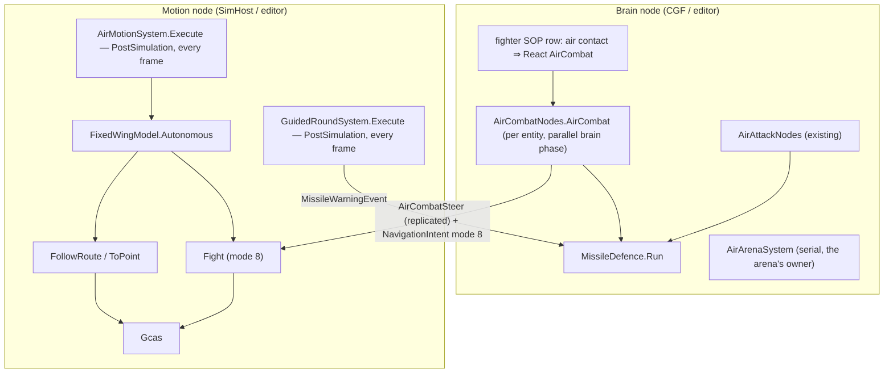
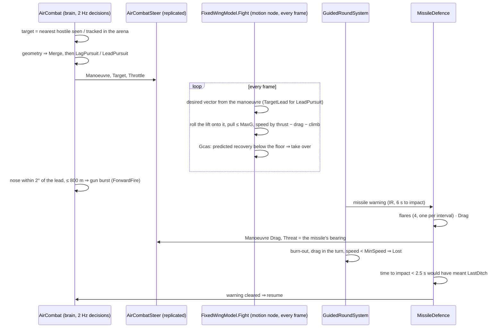

<!--STATUS
state: LIVE
updated: 2026-11-16
build-state: DESIGN — AC-1…AC-15 ✅ APPROVED `2026-11-16` (R-4283); ⭐ the review §9 (RV-1…RV-21) proposes the fixes — ⛔ NOT approved, not yet folded into §3–§8; no handoff until it is
current-answer: §0 the ask · §1 inventory · §2 the proven pattern · §3 decisions · §4 UML · §5 the numbers · §6 scenarios · §7 ids · §8 slices · ⭐ §9 the review (where §9 and §3–§8 disagree, §9's proposal is pending the user)
stale-below: none
known-rot: §7's component ids 163 (reserved) and 277–279 (NavFakeIds block) and ordinals 205–206 (time translators) are WRONG — §9 RV-7; §1's "one turn rate" — missiles already carry their own (CE-2222); §5's 0.5 km is a diameter (radius 0.26 km), Stinger is 700 m/s
known-conflict: Air Operations §5 (the route: a height above the ground on every 20 m sample) — AC-1 replaces it for cruise legs; §5 keeps it for low flight
related-designs:
  - DESIGN_Air_Operations.md — OWNS the aircraft route (§5), the flight models (§6), the attack behaviour and its missile evasion (§7e, unified here by AC-9), the air targets (§7c: the lead, the hull hit)
  - DESIGN_Radar_SAM.md — OWNS the radar sensor (RS-2), the published radar emission and the radar warning (RS-10, RS-6), the salvo fields (RS-4) a fighter's radar and radar missile reuse
  - ../vehicle-tactics/DESIGN_Missiles_And_Ammo.md — OWNS guidance, seekers, the proximity fuze and decoys (§3c); AC-6 adds the motor and the g limit to its round
  - ../weapons/DRAFT_Weapon_Malfunctions_And_Physical_Devices.md — OWNS weapon malfunctions (CE-4644): the gun jam is THEIRS, not a lapse here (AC-12)
  - ../fun/BACKLOG_Fun_Ideas.md — F-25 / CE-4643 (WWI air combat) reuses the pilot and the behaviour of this design with biplane numbers
-->

# DESIGN — air combat: jets, missiles, cannons, missile defence, ground safety, the show

🔒 **User, `2026-11-16`:** *"Design the air dogfight now, for jets, with missiles and cannons, as well as evasive maneuvers for air to air missiles
including sam missiles which shouldnt be difficult becuse the missile navigation is simple and likely easy to dodge. With feature testing scenarios
and without following the terrain but avoiding crashing to terrain - the ai autopilot need to know the aircraft limits and pull up soo enough. some
'too immersed in combat' or other auxiliary induced failures might be added if the combat turns to be too equal and boring (it is a show in the
first place so the attacks need to happen above the terrain not many kilometers away...)"* · earlier the same day: *"the aircraft now follow the
terrain height instead of keeping absolute height most of the time."*

## 0. The ask, in five parts

| # | part | where |
|---|---|---|
| A | jets fight each other: missiles (IR and radar) and cannons | AC-2…AC-8 |
| B | they dodge missiles, air-to-air AND surface-to-air | AC-6, AC-9 |
| C | no terrain following; the autopilot knows its limits and never flies into the ground | AC-1, AC-4 |
| D | the fight stays over the map, close enough to watch | AC-10, AC-11 |
| E | a stalemate is broken by human-like lapses | AC-12 |

## 1. INVENTORY *(measured `2026-11-16`)*

Queries: `search_graph name_pattern=".*(Guided|Missile|Seeker|Countermeasure|Decoy|FixedWing|AirMotion|AirAttack|AirRoute|Dogfight|Intercept|Fighter|Gcas|TargetLead).*" label=Class` ⇒ 26 production classes,
**none for air-to-air, a fighter pilot or ground collision**; `label=Interface` ⇒ 0 relevant. Grep of `docs/` + `.dev/` (dogfight · air-to-air ·
GCAS · ground collision · AIM-9 · AIM-120 · interceptor) ⇒ only F-25 / CE-4643 (WWI, fun backlog). ⚠ Index coverage cannot be checked through
the CLI.

| exists | what it gives | file |
|---|---|---|
| `FixedWingModel` | AI: follow an `AirPath`, fly to a point (2-D yaw turn at max bank + a clamped climb), straight and level; the mouse-aim manual pilot; the dead fall | `Fdp.Toolkits/Motion/FixedWingModel.cs:34-190` |
| `AirRoute.Compile` | ⚠ re-samples height above the ground every 20 m ⇒ **the terrain following the user saw** | `Motion/AirRoute.cs:97-104` |
| `MotionFrame.Ground(x, y)` | the terrain height on the motion node | `Motion/IMotionModel.cs:24` |
| `NavigationMode` | 0…7 (`Traffic` = 7) — ⭐ 8 is free | `Navigation/NavigationComponents.cs:20-60` |
| `GuidedRoundSystem` | lead-pursuit homing (`TargetLead.Point`), **constant speed**, one turn rate (30°/s default), seeker cone, proximity fuze, decoy seduction | `Combat/Systems/GuidedRoundSystem.cs:183-283` |
| `TargetLead` | the ONE predictor (rounds, missiles, gun runs) | `Combat/TargetLead.cs:14-45` |
| `Countermeasures.Release` · `CountermeasureSystem` | one flare / chaff per dispenser interval; seduction in the cone | `Combat/Countermeasures.cs:83`, `Systems/CountermeasureSystem.cs:23` |
| `MissileWarning` (+ sensing) | bearing, seeker, time to impact on the target's brain | `Combat/Components/AirDefenceComponents.cs:50` |
| `RadarEmission` · `RadarWarning` · radar sensor | a radar that radiates, a target warned "searched / tracked"; aircraft-only candidates | `Perception/Radar/RadarComponents.cs:36,81`; Radar SAM RS-2, RS-10 |
| `AirAttackNodes` evade stage | warning ⇒ stop firing, 4 decoys, beam the missile (2-D MoveTo), come round — ⚠ inside the ATTACK behaviour only | `Hrot.AI.Behaviors/Brains/AirAttackBehaviors.cs` §7e |
| gun pass | `ForwardFire` — a fixed gun fired at the led point inside its window | `AirAttackBehaviors.cs:1093` |
| `FireProcessingSystem.LedAtAircraft` · hull hit · fall | a round at an aircraft is led; it meets the hull; a dead aircraft falls and crashes | Air Ops §7c-i (AT1–AT3) |
| F-16C (401) | ⚠ a body, signatures, RCS 3 m² — **no flight, no weapons, no brain** | `NedTkbCatalog.cs:1286,1325,1333` |
| A-10C (405) | the one flying plane: cruise 150 / stall 60 / top 200 m/s, 60° bank, GAU-8 | `NedTkbCatalog.cs:1620` |
| air-to-air missiles · fighter cannon · a second fighter type | ⛔ none (munitions: GAU-8 6023/6024, Stinger 6030, Igla 6031, radar SAM 6050) | `MunitionTkbCatalog.cs` |

## 2. The proven pattern, and what we take

**How combat flight simulations do it:** a **layered AI pilot** — a tactical layer picks the fight (engage, defend, separate), a manoeuvre layer
picks the basic fighter manoeuvre (lead / pure / lag pursuit, break, extend, high and low yo-yo, defensive spiral), and an **autopilot** flies
it within the aircraft's limits (g, corner speed, energy). Ground safety is **Auto-GCAS** (F-16, in service since 2014): it predicts the
recovery path at the aircraft's g and takes the stick at the last safe moment. Missile defence is **drag** (turn away until the missile runs out
of energy), **beam / notch** (put it on the 3 or 9 o'clock — kills a radar seeker's Doppler) and the **last-ditch break** (max g across its path
inside ~2 s, when it cannot follow), with flares / chaff.

| piece | adopt? | the reason here |
|---|---|---|
| tactical layer on the brain, the manoeuvre flown on the motion node | ✅ adopt | today the brain re-issues a 2-D point every ~0.5 s (`AirAttackNodes`, `SteerPeriod`); a manoeuvre needs every-frame 3-D steering at the aircraft's own position, which lives on the motion node |
| an energy model (g limit, corner speed, thrust, drag) | ✅ adapt — 4 numbers, not aerodynamics | a dogfight IS energy; without it a turn costs nothing and nobody ever wins |
| Auto-GCAS | ✅ adopt | the user asked exactly for it; one prediction, all AI flight modes |
| proportional navigation for missiles | ⛔ reject | the lead pursuit at a turn limit already hits (CE-2187 rails); the user WANTS dodgeable missiles; adding a motor and a g limit (AC-6) makes the drag and the break work for the right reason |
| beyond-visual-range doctrine (shots at 40 km) | ⛔ reject (show rule AC-11) | the user: *"not many kilometers away"* |

## 3. Decisions — ✅ approved `2026-11-16` (R-4283)

| # | decision — ⭐ lean | why | rejected — one line |
|---|---|---|---|
| **AC-1** | **cruise is a fixed altitude per leg**: a route leg / point move flies at `max(ground under the leg) + the ordered height`, constant along the leg (one climb or descent at the leg's start); terrain following stays ONLY for low flight (ordered height < 100 m: attack run-ins, helicopters, drones) | the user's report; real aircraft hold an altitude; clearance is kept by taking the highest ground | keep per-sample AGL (the bobbing) · absolute Z from the waypoint (the draw tool writes Z 0, CE-2172) |
| **AC-2** | ONE new motion mode, `NavigationMode.AirCombat = 8`, with the brain's choice in ONE new replicated component `AirCombatSteer` (manoeuvre, target, threat, throttle, show limits); the **motion node flies it every frame** (`FixedWingModel.Fight`) | the manoeuvre is geometry against the target's live position; the motion node holds both | the brain re-issuing `MoveTo` points (laggy, 2-D, no g) · a new motion model (one model per locomotion class, `MotionModelTable`) |
| **AC-3** | the autopilot steers a **3-D velocity vector**: it rolls to put the lift onto the desired direction and pulls at most `MaxG` (and the speed-limited g below corner speed); speed changes by thrust − drag(g) − g·sin(climb); never below stall | one rule gives every manoeuvre — a pursuit, a break, a loop, a climb are just different desired vectors | per-manoeuvre scripted paths (dozens of special cases) |
| **AC-4** | **GCAS in every AI fixed-wing mode** (route, point, air combat): each frame predict the recovery (roll level + pull `MaxG` from the current climb angle, after a 0.3 s reaction) over the terrain ahead (the highest ground under the next `recovery time + 2 s` of track); if it would pass below `FloorAgl` (default 150 m; 60 m on an attack run) it takes over until climbing and above the floor; a counter on `FighterPilotState` | the user: *"knows the aircraft limits and pulls up soon enough"*; the prediction uses the SAME g as AC-3 | a minimum-altitude clamp (an aircraft diving at 250 m/s cannot stop in one frame) · GCAS for the manual pilot (R-3007: a hand-flown plane may hit a hill) |
| **AC-5** | the **manoeuvre set** (the brain picks, the autopilot flies): `LeadPursuit` (guns: nose on the led point), `PurePursuit` (missile lock), `LagPursuit` (close without overshooting), `Break` (max g away from the threat's nose), `Extend` (unload, full throttle, away), `Climb` (trade speed for height), `Beam` (threat at 90°, descending), `Drag` (threat at the tail), `LastDitch` (max g across the missile's path), `ReturnToArena`, `Merge` (head-on toward the target, offset 300 m) | the standard set; each is a desired vector + throttle (AC-3) | a free-form planner (untestable) |
| **AC-6** | **missiles get energy and a g limit** — `MissileDto` + `BurnSeconds`, `MaxG`, `DragPerS` (speed loss per second after burn-out, more while turning), `MinSpeedMps` (below it the seeker is lost — "defeated"); turn rate = MaxG·g / speed. 0 everywhere ⇒ today's constant-speed round (ATGMs unchanged). The SAMs (Stinger, Igla, radar SAM) get numbers too | the user: dodging must work; in reality a missile is defeated by running it out of energy or out-turning it near the end; both need these two numbers | a scripted miss chance (no geometry, nothing to watch) · proportional navigation (§2) |
| **AC-7** | **the jets**: the F-16C (401) gets flight, weapons, a radar and a brain; a new **MiG-29 class (409)** for the other side; both cruise 220 m/s, corner 150 m/s, 9 g; flares + chaff; a gun (M61 20 mm / GSh-30-1 30 mm), 2 IR + 2 radar missiles | the opponents a show needs; F-16 already has a body and signatures | a mirrored F-16 for both sides (same silhouette, the viewer cannot tell sides) |
| **AC-8** | **the weapons**: IR missile (AIM-9X / R-73 class: 0.3–8 km, 90° off-boresight cone, flare rejection 0.6) · radar missile (AIM-120 / R-77 class: 1–15 km real, clamped by AC-11, radar seeker, chaff only in the end-game — RS-3) · the gun (≤ 800 m, the led point, `ForwardFire`). Shot rule: one missile at a time per target, wait for the outcome; guns when inside 800 m and the nose within 2° of the lead | numbers from public figures, rounded; the shot rule keeps a fight long enough to watch | salvos of 4 (the fight ends in one pass) |
| **AC-9** | **ONE missile defence for every aircraft**, extracted from `AirAttackNodes`' evade stage into `MissileDefence` (behaviors): warned (missile warning, or a radar TRACKED warning) ⇒ countermeasures by seeker (E2/E3 kept) ⇒ `Beam` (radar) or `Drag` (IR, far) ⇒ `LastDitch` when time to impact < 2.5 s ⇒ resume. Air combat, attack runs AND transit call it (closes the RS-6 / §7e "a move does not react" row) | *"one implementation per concept"*; the SAM and the AAM are the same problem to the aircraft | a second evasion inside the fighter behaviour (two copies drift) |
| **AC-10** | **the arena**: an authored `AirArena` entity (centre, radius, floor, ceiling) the fighters of a scenario fight inside; outside the radius a pilot flies `ReturnToArena` before anything except `LastDitch`; the start is a `Merge` through the centre | the user: *"the attacks need to happen above the terrain"*; an arena is the show's stage | clamping positions (unphysical) · no arena (they drift 20 km away, measured habit of extend / chase) |
| **AC-11** | **show rules on the arena**: `MaxShotRangeM` (default 6 km) — no missile beyond it; `MinFightAltitude` / ceiling | keeps every shot within view | real BVR ranges (the fight is over before it is visible) |
| **AC-12** | **lapses** — each pilot has a `Skill` (Rookie / Veteran / Ace); the arena counts **stalemate seconds** (no hit by anyone in it); past `StalemateSeconds` (default 90 s) each pilot draws a lapse per second with a chance rising with the stalemate and falling with skill (per-entity `SimRng`, deterministic): **Fixation** (on a gun track it holds the pull-out until GCAS at a third of the floor — may hit the ground), **LateWarning** (reacts to a missile 2 s late), **EnergyBleed** (stays in a slow turn under corner speed 10 s), **GLoc** (after > 8 g for 5 s, no control for 3 s, wings level). ⛔ the gun jam is a MALFUNCTION — CE-4644's, not a lapse | the user: *"'too immersed in combat' or other auxiliary induced failures … if the combat turns to be too equal"*; skill makes it unequal by design, lapses break the rest | a director that writes another pilot's state (breaks the per-entity rule) · random deaths (nothing to watch) |
| **AC-13** | **the behaviour** `AirCombat` (one library behaviour, stateful): pick the target (nearest hostile aircraft seen or radar-tracked inside the arena), pick the manoeuvre each 0.5 s from the geometry (aspect, range, energy, threat), pick the weapon (AC-8), call `MissileDefence` (AC-9), apply lapses (AC-12). Orders: **CAP** (patrol a point, engage what enters) and **Intercept** (a named target); a fighter's SOP reacts to an air contact with `AirCombat` | the brain decides, the motion node flies (AC-2); one behaviour, the existing order and SOP machinery | one behaviour per manoeuvre (the transitions ARE the fight) |
| **AC-14** | **who builds** — one new `air` lane (CE / R block 10000–10999) builds the motion, the missiles, the catalogue rows and the behaviour, cross-lane into motion, combat, catalogue and behaviours, said in each commit; ⭐ **the looks go to ui as usual (AC-15)**; ⚠ if no air lane: backend (AC-1…AC-4, AC-6, AC-7 catalogue), behaviors (AC-5 picking, AC-8…AC-13) | one owner keeps the pilot and the behaviour in step (they share the manoeuvre enum) | three lanes on one loop (three handoffs, three merges for one feature) |
| **AC-15** | ⭐ **the visuals are ui's** (as with the radar SAM, RS-9): the air lane declares the ids and placeholder rows (the MiG's TKB type and DIS class, a placeholder `MunitionVisualDto` per new munition); ui builds what §4d lists | ui owns `ShapeKit`, the effects and the mockup-fidelity rule (R-4138); the 3-D map is keyed by the class name, so the two halves meet on ONE key and never on a model path | the air lane building the looks (a second lane in `ShapeKit` / effects; the mockup and fidelity discipline lives in ui) |

## 4. UML

### 4a. Classes

```mermaid
classDiagram
  class FixedWingModel { <<existing, grows>> +Autonomous() · +Fight(frame, steer, params) ★ · +Gcas(frame, params, floor) ★ · -Steer3D(frame, desired, g) ★ }
  class AirRoute { <<existing, grows>> +Compile() · ★ a leg's height = max ground + ordered height (AC-1) }
  class AirCombatSteer { <<★ new, replicated, brain writes>> Manoeuvre · Target · Threat · Throttle · FloorAgl · Arena }
  class FighterPilotState { <<★ new, motion node writes, recorded>> GLoad · Energy · GcasActive · GcasCount · MinAgl · LastDitchAt }
  class AirCombatState { <<★ new, brain, recorded>> Target · Manoeuvre · Skill · Lapse · LapseUntil · Kills · Shots }
  class AirArena { <<★ new, authored>> Centre · Radius · Floor · Ceiling · MaxShotRangeM · StalemateSeconds · LastHitAt }
  class FlightParamsDto { <<existing, grows>> +MaxG · +CornerSpeedMps · +ThrustMps2 · +DragK }
  class MissileDto { <<existing, grows>> +BurnSeconds · +MaxG · +DragPerS · +MinSpeedMps }
  class GuidedRound { <<existing, grows>> +BurnUntil · +MaxG · +DragPerS · +MinSpeed }
  class GuidedRoundSystem { <<existing, grows>> speed profile · turn = MaxG·g / v · slow ⇒ Lost }
  class AirCombatNodes { <<★ new behaviour>> +AirCombat() · -PickTarget() · -PickManoeuvre() · -PickWeapon() · -Lapse() }
  class MissileDefence { <<★ extracted from AirAttackNodes evade>> +Warned(self) · +Run(ref state) Manoeuvre }
  class AirAttackNodes { <<existing>> evade stage ⇒ calls MissileDefence }
  class AirArenaSystem { <<★ new, the arena's one writer>> LastHitAt from the hits inside it }
  class TargetLead { <<existing>> +Point() }
  class Countermeasures { <<existing>> +Release() }
  class RadarWarning { <<existing>> Level Tracked }
  class MissileWarning { <<existing>> TimeToImpactS · Seeker }
  AirCombatNodes --> AirCombatSteer : writes (own entity)
  AirCombatNodes --> AirCombatState : writes (own entity)
  AirCombatNodes ..> MissileDefence
  AirAttackNodes ..> MissileDefence
  MissileDefence ..> MissileWarning
  MissileDefence ..> RadarWarning
  MissileDefence ..> Countermeasures
  AirCombatNodes ..> AirArena : reads
  AirArenaSystem --> AirArena : writes
  FixedWingModel ..> AirCombatSteer : reads
  FixedWingModel --> FighterPilotState : writes (own entity)
  FixedWingModel ..> TargetLead
  FixedWingModel ..> FlightParamsDto
  FixedWingModel ..> AirRoute
  GuidedRoundSystem ..> MissileDto
  GuidedRoundSystem --> GuidedRound
```

*What the picture shows that prose hid: there is no new motion model and no second evasion — the fighter is ONE new mode of the existing
plane model plus ONE extracted defence that the attack behaviour already needed; the brain and the motion node share exactly one replicated
component, `AirCombatSteer`.*

### 4b. Who runs it, and who calls it each frame

*What the picture shows that prose hid: GCAS sits UNDER both the combat mode and the route modes, so the transit and the attack runs get it too;
and the arena has ONE writer on the brain node — no pilot ever writes another pilot or the arena.*

### 4c. A dogfight tick, and a missile defeated

### 4d. The looks — what exists, what ui adds *(measured `2026-11-16`)*

| piece | today | ui adds (AC-15) |
|---|---|---|
| the F-16 body | ✅ `ShapeKits.Jet` (`ShapeKit.cs:401`) — F-16 proportions: fuselage, nose, canopy, swept wings, tailplanes, ONE swept fin, nozzle, gear; the F-16's DIS 1.2.*.1 maps to `VisualFamily.Jet` (`VisualFamily.cs:102`, class `Fighter` `EntityClassTable.cs:203`) | nothing for the body |
| the MiG-29 body (409) | ⛔ would draw as the same F-16 shape | a twin-fin variant (two canted fins, two nozzles, intakes under the wings), keyed by a class `TwinEngineFighter` (more specific than `Fighter`, the `AttackAircraft` precedent `VisualFamily.cs:108`) — so the sides look different |
| missiles and the gun pod on the jet | ⛔ none on the jet; ✅ the precedent: the A-10's bombs on pylons, shown by rounds left (`EntityBodyLayer3D.cs:483,1534`) | wingtip and underwing rails with the missiles still carried (IR outboard, radar inboard), one disappears per shot — the same rounds-left rule |
| the missile in flight | ✅ `MunitionShape.Missile` + smoke trail (Stinger, radar SAM) | the four AAM look rows; the trail only while the motor burns (`BurnSeconds`, AC-6) — a missile that coasts is seen to coast |
| afterburner, contrails, gun | ⛔ none (no `afterburner` / `contrail` in `Hrot.Presentation`) | an afterburner flame at full throttle (from the replicated speed rising / the steer's throttle), wingtip vortex trails above 6 g, the cannon's muzzle flash and tracers (tracer rows exist for the GAU-8) |
| flares | ✅ decoys drawn (CE-2188) | nothing |

*Why ui and not the air lane: the body is chosen by the class chain, so the air lane's only visual act is naming the class — exactly the radar SAM's split (§2a there).*

## 5. The numbers *(public figures, rounded; the builder records each as a lane decision)*

| | F-16C (401) | MiG-29 class (409) | IR missile (AIM-9X / R-73) | radar missile (AIM-120 / R-77) | radar SAM (6050) · Stinger · Igla |
|---|---|---|---|---|---|
| speed | cruise 220, corner 150, top 400 m/s | same | boost to 850 m/s, burn 5 s | 1100 m/s, burn 8 s | 800 · 650 · 570 m/s, burn 4 · 2 · 2 s |
| g | 9 | 9 | 40 (⇒ 26°/s at 850 m/s, 70°/s at 300) | 35 | 30 · 20 · 18 |
| after burn-out | — | — | −40 m/s per s, +more turning | −30 m/s per s | −40 · −60 · −60 m/s per s |
| defeated below | — | — | 300 m/s | 350 m/s | 300 · 250 · 250 m/s |
| other | 2 IR + 2 radar missiles, M61 20 mm 500 rounds, 30 flares + 30 chaff | GSh-30-1 30 mm 150 rounds, same missiles' counterparts | cone 90°, flare rejection 0.6 | cone 60°, chaff end-game (RS-3) | as built |

📐 **Why a dodge works, in two numbers:** at 850 m/s and 40 g the IR missile turns 26°/s — a radius of 1.9 km; an F-16 at corner speed and 9 g
turns 34°/s — 0.5 km. ⇒ a hard turn across its path in the last 2 s puts the aircraft outside what it can follow, and a drag (turn away) makes
it chase until it falls under 300 m/s. ⇒ the outcome depends on WHEN the pilot reacts — which is exactly what lapses (AC-12) and skill change.

## 6. Feature-test scenarios *(R-4277 — each: `description` What / Judge, `checks.json` expect rows, a golden)*

| scenario | what happens | expect rows (machine) |
|---|---|---|
| **`ac-cruise-altitude`** | an F-16 flies a 3-leg route at 300 m over hills | `field Viper SimTransform.Position.Z` within ±15 m of each leg's altitude after the climb · `never field FighterPilotState.GcasCount > 0` |
| **`ac-gcas-ridge`** | an F-16 ordered to 50 m toward a 200 m ridge, and one in a 30° dive at 2000 m | `field FighterPilotState.GcasCount >= 1` (both) · `never health Viper == 0` · `field FighterPilotState.MinAgl >= 30` at end |
| **`ac-guns-drone`** | an F-16 on a recon drone (407) flying straight | `shot by Viper at Drone hit` before 60 s · `health Drone == 0` before 90 s |
| **`ac-ir-defeated`** | a MiG fires one IR missile at an F-16 (flares, Veteran) from 3 km behind | `field Viper Countermeasures` ≥ 2 flares released · `field FighterPilotState.LastDitchAt > 0` or the missile `Lost` · `never health Viper < 100%` |
| **`ac-ir-hits-late`** | the same shot, the F-16 with `LateWarning` forced | `health Viper < max` before 15 s — ⭐ proves the defence is what saves it |
| **`ac-sam-dodge`** | an F-16 crossing a radar SAM site (114) and a Stinger team at 3 km | the SAM fires ≥ 1 (`shot by *Sam`) · the F-16 flies `Beam` (`field AirCombatState.Manoeuvre == Beam` or the defence's state) · ≥ 1 SAM defeated · the F-16 alive at 120 s (seeded) |
| **`ac-attack-evades`** | the existing A-10 gun run under a Stinger — the §7e evasion through `MissileDefence` | the §7e rail's cues, unchanged (4 flares, beam, comes round) |
| **`ac-dogfight-1v1`** | F-16 vs MiG, both Veteran, an arena of 4 km over the map | `near Viper Fulcrum 1500` before 60 s (the merge) · `never` either beyond arena radius + 1 km · `shot` (gun or missile) before 120 s · one `health == 0` before 300 s |
| **`ac-dogfight-2v2`** | the sky show: two pairs, one Ace, one Rookie a side | ≥ 4 missile shots · ≥ 1 gun hit · ≥ 4 flare releases · ≥ 2 kills before 600 s · `never` a shot from beyond `MaxShotRangeM` |
| **`ac-stalemate-lapse`** | two Aces, `StalemateSeconds` 30 | `field AirCombatState.Lapse != None` (any) before 120 s · a kill or a crash before 240 s |

⚠ A crash and a kill both read `Health 0`; the rows tell them apart by `FighterPilotState.GcasCount` / a `shot … hit` before it.

## 7. Ids *(measured free on coordinator, behaviors, backend, ui, terrain, convoy, exp/agg-* `2026-11-16`; ⛔ permanent once built)*

| what | id |
|---|---|
| aircraft type MiG-29 class | **409** (`TkbEntityTypes`, max in use 408) |
| munitions: AIM-9X class, AIM-120 class, R-73 class, R-77 class, M61 20 mm HEI, GSh-30-1 30 mm HEI | **6060…6065** (in use up to 6053) |
| components: `AirCombatSteer`, `FighterPilotState`, `AirCombatState`, `AirArena` | **163, 277, 278, 279** (holes; 281–289 taken by agg) |
| DDS ordinals: `AirCombatSteer`, `AirArena` (+ 2 spare) | **204–207** (convoy holds 198–203) |
| `NavigationMode.AirCombat` | **8** |
| CE / R block (if the air lane is approved) | **10000–10999** |

## 8. Slices *(the order; each ends with its scenarios passing)*

⭐ **ui, in parallel from S3** (AC-15, §4d): the MiG twin-fin body, the carried missiles, the AAM looks, the afterburner, vortex trails and the gun flash — its own handoff, keyed on the ids in §7; the frame rails render each next to its mockup (R-4138, R-4146).

| slice | items | scenarios |
|---|---|---|
| **S1 the autopilot** | AC-1 (leg altitude), AC-3 (3-D steer + energy), AC-4 (GCAS in every AI mode), F-16 flight numbers | `ac-cruise-altitude`, `ac-gcas-ridge` |
| **S2 missiles that can be beaten** | AC-6 (motor, g, drag, defeat) on every SAM and AAM; AC-9 `MissileDefence` extracted, transit reacts | `ac-ir-defeated`, `ac-ir-hits-late`, `ac-sam-dodge`, `ac-attack-evades` |
| **S3 the fighters** | AC-2 mode 8 + `AirCombatSteer`, AC-5 manoeuvres, AC-7 jets, AC-8 weapons, AC-13 behaviour + CAP / Intercept | `ac-guns-drone`, `ac-dogfight-1v1` |
| **S4 the show** | AC-10 arena, AC-11 show rules, AC-12 skill + lapses | `ac-dogfight-2v2`, `ac-stalemate-lapse` |

Machine checks on every behaviour slice: `HROT_PARALLEL_SIM=1` + `HROT_READ_CHECK=1` (the pilot reads the target's and the missile's position —
declared tick-start reads), the world guard, and `stepped-hash.py --threads 1,4,8` on `ac-dogfight-2v2` (parallel safety, not the verdict).

⚠ **Measured by the builder first** (unknown today): the terrain height `Ground(x, y)` beyond the map's edge (RS-2a says aircraft fly there — GCAS
must not read a cliff at the edge); the vision range at which a pilot sees a jet (else the radar cues the fight); whether `RadarPerception`
runs on a non-vehicle emitter (the fighter's radar).

## 9. ⛔ The review — `2026-11-16` *(🔒 user: "Approved. Please do an independent review and find gaps and flaws."; three independent reviewers: engine fit (EF), realism and AI (RL), corpus / catalogue / handoff (CP); ✔ = re-measured by the coordinator)* — ⛔ the fixes are PROPOSALS, not approved

| # | finding (sources) | ⭐ proposed fix — lean |
|---|---|---|
| **RV-1** 🔴 | **missiles would almost always hit**: a 40 g round re-solves the lead every frame and turns onto it with no lag, so a 9 g break (≈ 275 m in 2.5 s) never beats ≈ 1 225 m of missile reach; and a fixed `MaxG` makes a slowing missile MORE agile (26°/s ⇒ 75°/s) (RL-1, RL-2) | the round gets an autopilot LAG (τ 0.4 s) and its available g falls with speed: `g = MaxG·(v / v_burnout)²`; `MaxG` > 0 derives the turn, else the existing `TurnRateDegPerSec` (CE-2222) stands (EF-6, CP-4); a separate CURRENT speed field (`SpeedMps` feeds the lead and the dive maths); a defeated round expires. ⭐ **Acceptance: a seeded Monte-Carlo rail — 100 shots per profile, hit rate inside a stated band (e.g. 30–60 % against a Veteran), and a late reaction measurably worse** |
| **RV-2** 🔴 | **no LIVE threat**: `MissileWarning` is one snapshot at launch, time to impact = distance ÷ launch speed, the last launch overwrites the first, nothing clears it (`FireProcessingSystem.cs:414-424` ✔, `AirDefenceComponents.cs:50` ✔); `GuidedRound` is not replicated, so the brain cannot see the missile (RL-3, CP-5, EF-3) | the MOTION node (which holds the rounds) computes the live incoming set each frame — rounds whose target is this aircraft: count, the nearest's bearing, closure and live time to impact — into the replicated `FighterPilotState`; ⭐ **`LastDitch` is a REFLEX on the motion node** (inside 2.5 s it breaks across the missile's path whatever the brain said); the brain decides drag / beam / flares from the live fields; the warning clears when no round is inbound |
| **RV-3** 🔴 | **a TRACKED radar warning would freeze every dogfight** — both fighters track each other all the time; and a fighter's radar would trip RS-6 (the 10 m dive), RS-7 (an "air defence" spot report) and nothing switches it On (RL-5, CP-1) | in `AirCombat` only a LAUNCH starts the defence; tracked only biases the manoeuvre; `AirCombat` switches its radar On (RS-10's one writer); RS-6's dive and RS-7's report apply to GROUND emitters only (an aircraft emitter is exempt) |
| **RV-4** | **beaming has no notch** — no Doppler / clutter model exists (RL-4) | ⭐ add one rule to the radar seeker: it loses track while the target's closing speed is < 50 m/s AND the target is below 300 m above the ground (look-down clutter); chaff seduction stays RS-3's. ⛔ else drop the claim — lean ADD (the beam is what the user will watch against the radar SAM) |
| **RV-5** 🔴 | **GCAS and the plane model cannot do it as written**: the pose clamps pitch ±25° and climb to `ClimbMps`, the attitude is read back as Euler angles (gimbal at ±90°), roll is 60°/s (3 s to roll out of inverted), the prediction ignores the roll and the curve, the 150 m floor fires on every built gun run (50 m) and radar escape (10 m) (RL-6, RL-12, RL-14, CP-2, EF-4) | the fight mode keeps its OWN velocity and attitude (a quaternion on `FighterPilotState`) — no Euler readback, no ±25° clamp; ONE integrator (`Steer3D`) flies the fight AND simulates the recovery (roll included, fighter roll 240°/s) for GCAS; floor = min(150 m, the ordered / profile height − 20 m, never below 8 m); a ridge the climb cannot clear ⇒ turn away; a leg's climb starts early by its climb time. Route mode keeps its model but gets GCAS through the same integrator |
| **RV-6** 🔴 | **mode 8 dies on the wire**: unknown modes map to `NAV_NONE` both ways, the wire enum stops at 7 (`NavigationIntentEgressTranslator` `MapMode` ✔) ⇒ on a cluster the fighter flies straight; the motion-node state the brain needs (g, energy) is never sent; no ownership groups named (EF-1, EF-2, EF-9) | `NAV_AIR_COMBAT = 8` in the wire enum and BOTH `MapMode`s + a round-trip rail; `AirCombatSteer` in the **brain** group, `FighterPilotState` in the **muscle** group, both replicated; the brain's reads declared in `BrainReads.Declare`; the fight reads the target's TICK-START position (`AirMotionSystem` is serial — some targets have already moved this frame); the brain writer follows `OperatorControlBehavior.ManualControl` (mode, `IntentId`, then the replicated drive) |
| **RV-7** 🔴 | **the ids are wrong**: 163 is reserved (`HrotComponentIds.cs:55` ✔), 277–279 sit in `NavFakeIds`' block 262–279 ✔, R-2056's coordinator / new-lane block 476–495 is FULL (487, 488, 492, 493 used by tests ✔); ordinals 205–206 are the time translators' (`TimeDescriptorType.cs:8-9` ✔, the same `DescriptorOrdinal` space the cleanup matches) (EF-7, CP-12) | ⭐ **a user ruling for an air component block** (as R-4276 / R-4282 did), measured by a full registry scan, not a grep of literals; ordinals ≥ 207 and outside 220–239 (agg), measured the same way; ⚠ **side finding: the convoy lane's reserved ordinals 198–203 overlap the time translators' 201–203** — a note to convoy |
| **RV-8** | **two identical jets circle forever**; skill changes only the lapse rate, so lapses become the only way to die (RL-7) | skill sets reaction time (Ace 0.3 s · Veteran 0.7 · Rookie 1.5), the g it will pull (9 · 8 · 6.5) and the manoeuvre quality (one- / two-circle, vertical); the types differ: MiG better instantaneous turn and nose authority, F-16 better sustained turn (target 6.5 g sustained at 220 m/s); thrust and drag tuned to it |
| **RV-9** | **the arena edge turns a dragging jet back into the missile** — extending at 400 m/s crosses 4 km in 10 s (RL-8) | soft edge: the pull back grows with the distance outside; the missile defence and a disengage override it |
| **RV-10** | **no weapon employment zone**: rear shots near 6 km are wasted, head-on ones always reach; the gun lead ignores the target's turn (9 g ⇒ 28 m off at 800 m) (RL-9, RL-10) | before a shot, the max range and the no-escape range from the speed profile (`TargetLead.FlightTime` through the motor model); the gun lead adds the target's acceleration (½·a·t²) and fires ≤ 500 m |
| **RV-11** | **missing pieces**: 2v2 targeting deconfliction, fratricide, jet-to-jet collision, out of weapons, after a kill, disengage, the merge's energy, the AAM fuze radius (RL-11) | wingmen pick different targets (the group's shared contacts); no shot whose line or fuze radius holds a friendly; two jets that touch both crash (the existing body contact); winchester ⇒ leave the arena; a kill ⇒ next target or rejoin; disengage when damaged / alone against two; merge at corner speed + 20 %; AAM fuze 8 m (IR) / 12 m (radar) |
| **RV-12** | **AC-13's CAP / Intercept orders and a separate behaviour contradict R-2015** (*"ONE order set for every aircraft … ONE AirAttack behaviour whose profile is picked"*) (CP-3) | ⭐ keep R-2015: an **Attack on an AIRCRAFT** resolves to the air-combat behaviour; CAP = a Hold over the arena + the fighter's SOP row (air contact ⇒ engage); no new orders, no new order ids |
| **RV-13** | **duplicate fields**: AC-3's `ThrustMps2` = `FlightParamsDto.AccelMps2` (R-3007); `MaxG` unrelated to `MaxBankDeg` (CP-4, EF-10) | `AccelMps2` is the thrust; in the fight mode the bank follows the g (bank = acos(1/n)), `MaxBankDeg` stays the route mode's limit |
| **RV-14** | **`MissileDefence` returning a manoeuvre fits neither the attack behaviour nor helicopters**; its state lives in `AirAttackState`, the radar escape is a separate stage; AC-9's IR ⇒ Drag contradicts §7e E4 (beam) (EF-5, CP-6) | a `MissileDefenceState` struct; TWO outputs — a manoeuvre (fixed wing, mode 8) or a MoveTo point (rotorcraft, transit, today's beam); the radar escape folded in; IR far (> 4 s) ⇒ drag, IR near ⇒ beam + flares (E4 kept), radar ⇒ beam / notch; the attack goldens re-recorded and said |
| **RV-15** | **§6 rows the checks grammar cannot say**: flares (no `Countermeasures` component), "missile defeated" (no outcome), "or", "never beyond the arena", "never a shot beyond X", ±15 m per leg, `Manoeuvre` on a jet in transit (EF-8, CP-10, RL-15) | grammar items: a `ShotOutcome.Defeated`, the shot row's RANGE, a `far` cue (or `near` with `never`); flares = `shot … where ammo contains "Flare"`, `n:2`; altitude = two `field` rows per leg with anchors; transit reads `MissileDefenceState`. ⭐ New scenarios: radar AAM vs chaff + beam, head-on shot, two missiles at once, GCAS from an inverted / vertical dive at 400 m/s, a ridge steeper than the climb, the map edge, a gun kill on a turning target, out of weapons, Rookie vs Ace with lapses OFF (skill alone decides). ⭐ Dogfights carry expect rows only, no golden (the demo rule, §5 of Scenario Regression) |
| **RV-16** | **built scenarios and suites will move, none named** (CP-6) | per slice: S1 — `FixedWingModelTests`, `ua-air-attack` re-golden; S2 — `GuidedRoundSystemTests`, `AirAttackNodesTests`, `sam-site` (its 20–40 % chaff band re-measured), `ua-air-defence` |
| **RV-17** | **the F-16 / MiG catalogue is underspecified** (no health, armour, sensors, radar, ejection, mount categories — `Sam = 11` would trip the ground-AA row; the MiG's class key cannot be a country) (CP-7, CP-8) | §5 gets a per-type table (health, armour faces, eye and sensor range, radar range, ejection seat, gun cone and muzzle, each mount's category — a NEW air-to-air category, not `Sam`); the MiG is DIS `1.2.*.1.` with a HROT subcategory (the recon drone's 1.2.*.50.2 precedent), class `TwinEngineFighter`, faction from the scenario |
| **RV-18** | **visuals incomplete** — a muzzle flash already exists; the arena needs authoring and drawing; no fighter HUD for a possessing player; no falling-smoke, no launch-off-rail; the burn trail and afterburner need a source; no mockup (R-4143) (CP-9) | ui: the arena gizmo and its 2-D/3-D drawing; the fighter HUD (pipper, lock, radar warning, g) over the existing mouse-aim pilot (a player flies manual; mode 8 is AI only); smoke from a dead jet; the burn derived from the round's age (no wire); the afterburner from `FighterPilotState`'s throttle; ⛔ mockups first |
| **RV-19** | **neighbours not linked** — Entity Control (the station, HUD), Map 3D (families), Visual Effects, Thermal & Acoustic (aircraft seen and heard), Orders / Entity Classes, Scenario Regression, Parallel Simulation (CP-11) | add to `related-designs`, both ways |
| **RV-20** | arithmetic (RL-13, CP-12, EF-10) | F-16 at 150 m/s, 9 g: radius 0.26 km; corner 170 m/s; IR at 300 m/s: 75°/s; Stinger 700 m/s; §4b: the warning is published by `FireProcessingSystem`, not `GuidedRoundSystem` |
| **RV-21** | **not handoff-ready**: AC-14's either / or, no enum values, the three open measurements are prose, no per-slice acceptance (CP-13) | the air lane (AC-14 approved); the `Manoeuvre` and `Lapse` enums listed; step 0 = the three measurements with a STOP rule (R-106); acceptance per slice = its scenarios + the named suites |

*Verified correct by the reviewers:* `NavigationMode` 8 free in the engine enum; type 409 and munitions 6060–6065 free; `MotionFrame.Ground`; the per-sample terrain following; `TargetLead.Point` the one predictor; the F-16's body, signatures and RCS; the A-10's numbers; all four new components can be unmanaged.
