<!--STATUS
state: LIVE
updated: 2026-10-14
build-state: BUILDING — 🔒 user, 2026-10-14: A1–A9 "Approved" (with the laser out of slice 1), B1–B11 "Approved" (R-2015). Backend slices 1, 2, 4, the backend half of 6 and 6a's F1–F4 (§7a) BUILT 2026-10-14 (as-built §5a, §5b, §6a, §6b, §8a); behaviors: slice 3's first half (SquadEmbark, LoadCasualty) and slice 5's order set (Strike, AirPlatformMove) BUILT (§9a); the rest of 3 and 5, the ui half of 1, and the rest of 6 remain
current-answer: §2 the picture (modules), §3 classes, §4 sequences, §5 the aircraft route (as-built §5a slice 1, §5b slice 2), §6a the plane as built, §6b the pilots as built, §8a the bomb as built, §6 flight models, §7 orders and the one attack behaviour, §8 the bomb, §9 the air assault and the rescue round trip (as-built §9a), §10 decisions, §11 slices and rails — §1 is the measured ground.
stale-below: nothing.
known-rot: none.
known-conflict: DESIGN_FPV_Drone.md §2 draws FpvAttackNodes as its own behaviour — SUPERSEDED by B5 (the FPV attack is AirAttack's Dive profile); its Muscle half stands.
related-designs:
  - docs/DESIGN_Dead_Reckoning.md — OWNS how a node knows another node's motion (R6: a brain reads ReplicatedMotion, never SimVelocity)
  - docs/designs/indirect-fire/DESIGN_Indirect_Fire.md — OWNS mortars and artillery: Strike fulfilled by a battery or a self-propelled gun (IF-D adds the fire-mission fields)
  - docs/designs/weapons/DESIGN_Weapon_Systems.md — OWNS the UH-60 (404) door stations and the minigun / door-gun weapon systems the DoorGunOrbit profile fires (R-2016)
  - docs/designs/motion-models/DESIGN_Motion_Domains.md — OWNS IMotionModel, MotionModelTable, the Air module and R-3005 (one Muscle role); this file adds FixedWingModel (MD-H's "fail loudly" row) and grows RotorcraftModel
  - docs/designs/vehicle-tactics/DESIGN_FPV_Drone.md — OWNS the drone's Muscle half (impact, sound, broadphase); its Brain half becomes AirAttack's Dive profile here (B5)
  - docs/designs/vehicle-tactics/DESIGN_Missiles_And_Ammo.md — OWNS guided rounds (GuidedRoundSystem), loadouts and the weapon brain's ammo choice; this file adds the free-fall bomb and the Release profile beside them
  - docs/designs/routes-1/ROUTES1-DESIGN.md — OWNS RoutePlan / RouteWaypoint (Cartesian, ≤ 100 km) and their wire form MapRoute; this file adds waypoint kinds, height above ground and holds (§5)
  - docs/designs/navig-2/Navigation_Design_v2_0.md — OWNS NavigationIntent / NavigationStatus; this file adds the route reference on the intent (CE-2171) and air phases on the status
  - docs/DESIGN_Entity_Control.md — OWNS possession (R-270, R-271 (backend)); M-4 "pilot stick deferred" is answered here by the simple pilot models (§6)
  - docs/DESIGN_Orders_Params_Entity_Classes.md — OWNS orders and class resolution (R-273, R-278); this file adds the Strike order and the AirPlatform behaviours
  - docs/designs/group-maneuvers/DESIGN_Squad_Tactics.md — OWNS SquadDismount (§5a) and the squad SOP; this file adds SquadEmbark and the carrier rows (§9)
  - docs/DESIGN_Entity_Interactions.md — OWNS embarkation, seats and the person carrier (§7); the doors-off UH-60 (404) is its carrier
  - docs/DESIGN_Body_Geometry_And_Ground_Contact.md — OWNS RestingPose (landing on the gear); the helicopter's touchdown uses it
  - docs/DESIGN_Weapon_Layers.md — OWNS the three weapon layers (R-261); the bomb release is a weapon-brain profile
  - docs/DESIGN_Map_3D_Mode.md — §6m draws riders in the doors-off Black Hawk's doors and the jump down
  - docs/DESIGN_Operations_Behaviour_Catalogue.md — AIR-1 (precision strike) and AIR-2/3 are first built here
-->

# Air operations — aircraft routes, take-off and landing, one attack behaviour, the bomb, the air assault

🔒 **User, `2026-10-14`:** *"the motion model and behavior of aircraft, including some kind of air attacks … patterns … for airplanes and
also for helicopters … controllable from the first person shooter mode"* · *"JTAC instructed fighter drops a guided bomb on a given spot …
correct direction and correct speed"* → A1–A9 *"Approved"*, then: *"not necessary for the player to actively aim the laser … just about
showing the effect of aircraft incoming and dropping a bomb on given place"* · *"follow a predefined waypoint-based trajectory, something like
aircraft route"* · *"the motion dynamics might be faked just to look believable … AI driven aircraft might be simplified, not the same as what
the human pilot would use … controllable by non-expert person"* · *"different type of aircraft attacks … by parameters of one attack behavior
… for the real-time strategy mode, we need the order type of behavior to be the same for all the aircraft"* · *"automatic landing and takeoff
maneuvers for helicopters … part of the aircraft route"* · *"a helicopter incoming full of soldiers … land on a designated point … soldiers
disembark and … follow given orders"* · *"a rescue mission where the squad … returns back and embarks the helicopter, and the helicopter takes
off and flies away"* → B1–B11 *"Approved"*.

## 1. What exists — measured `2026-10-14`

| fact | code | design |
|---|---|---|
| a route is an entity (`RoutePlan`): waypoints with `Position` (Z carried), `TargetSpeed`, `ExtensionJson`; saved; on the wire as `MapRoute` (lat/lon/alt) | `RoutePlan.cs:14-87`, `MapDescriptors.cs:108-142`, `RoutePlanTranslator.cs:37-129` | Routes §113 (Cartesian, ≤ 100 km) |
| following a route = a LOCAL trajectory pool id the Brain waits for; the id never crosses the wire; the pool is built only on the Muscle | `CgfNodes.cs:318-331`, `SimHostCoreLogicPack.cs:121`, `SimDescriptors.cs` (no field) | — ⇒ **CE-2171** (confirmed on a split cluster `2026-10-14`, with a second cause: the route plan never reached SimHost — §5a) |
| the route draw tool writes altitude 0; the edit gizmo treats `Position.Z` as north | `ScenarioSpawnAdapter.cs:414`, `RouteWaypointGizmo.cs:19-21` | R-182 (Z-up) ⇒ **CE-2172** |
| `CornerRounding.Round` rounds a polyline to a turn radius (no navmesh ⇒ any shift allowed), XY arcs, Z interpolated | `CornerRounding.cs:40-70,161-163` | R-3006 |
| air motion: `RotorcraftModel` (point mass, instant velocity, straight at one 3-D point, Z-yaw only); `FixedWing` throws | `RotorcraftModel.cs:25-101`, `IMotionModel.cs:57-63` | Motion Domains MD-H |
| `NavigationStatus` (Muscle → Brain, on the wire) carries `Result`, `ProgressS`, a `Phase` byte | `SimDescriptors.cs:376-410` | Navigation v2 |
| `FlightState` (Airborne) is not replicated | none under `Hrot/Network` | — |
| every aircraft resolves orders through the class `AirPlatform` (helicopters, fighters, attack aircraft below it) | `EntityClassTable.cs:119-156` | R-278 (behaviors) |
| orders: Move (a point), Attack (an entity), Hold | `OrderKind.cs:9-17`, `OrderDtos.cs` | orders design D1 |
| rounds start at muzzle speed along the aim line — never the shooter's velocity; gravity only for Arc rounds; no drag | `FireProcessingSystem.cs:156`, `BallisticsSystem.cs:129-131` | — |
| the doors-off Black Hawk (404): `Gen.Carrier` Open, 8 door seats; the plain UH-60 (400) carries nobody | `BdcTkbCatalog.cs:376-382`, `TkbEntityTypes.cs:56-57` | Map 3-D §6m (CE-1083) |
| a squad dismounts by `SquadDismount` (SOP row: under fire AND aboard); a reaction pauses the task, which resumes after it | `SquadDismountBehavior.cs`, `BasicInfantrySopTests` | Squad Tactics §5a |
| `CarryCasualty` takes ANY man who is down, by network id; `TryEmbark` seats an incapacitated man in a vehicle (no injury check for a vehicle) | `EmbarkBehaviors.cs:83-105`, `Embarkation.cs:99-122` | Entity Interactions §7.4 |
| a mission phase is `{ BehaviorId, Trigger, TriggerParam }` — no per-phase params | `MissionComponents.cs:42-60` | CE-456 |
| a BTree hosts library behaviours with their own params (hosted-subtree binding) | CE-439, S5a/S5b | Unified Behaviour Run |

### INVENTORY — the queries run

| query | total | the set |
|---|---|---|
| `search_graph .*(Rotorcraft\|FixedWing\|Aircraft\|Flight\|Airframe\|Helicopter\|AirMotion).*` (Class) | 16 (6 production) | `AirMotionSystem`, `AirMotionModule`, `FlightParams`, `FlightParamsDto`, `FlightState`, `FlightTkbTranslator`, `RotorcraftModel` (+ tests, flight recorder) |
| `search_graph .*(Ballistic\|Bomb\|Projectile\|Guided\|Missile\|Trajectory\|Release).*` (Class) | 51 | `BallisticAim`, `BallisticsSystem`, `BallisticProjectile`, `GuidedRound`, `GuidedRoundSystem`, `GuidedWeaponProfile`, `MissileDto`, `CustomTrajectory`, `TrajectoryPoolManager`, `RouteTrajectoryCache`, `RouteTrajectorySyncSystem` (rest: tests, examples, presentation) — **no bomb** |
| `search_graph .*(Jtac\|FireSupport\|CallForFire\|Strike\|Designation\|Laser\|Orbit\|Loiter).*` (Class) | 5 | order designations only (`OrderDesignations`, overlay, mapper) — **no strike, no air tasking** |
| corpus sweep (`docs/`, `.dev/`) for CAS / JTAC / bomb / strafe / gun run / helicopter attack / loiter | 0 designs | catalogue AIR-1…AIR-4 lines only |

⇒ reused: the route entity, corner rounding, `IMotionModel` + the Air module, the order resolver and the `AirPlatform` class, the weapon
brain, `BallisticsSystem`'s gravity, the warhead library, embarkation, `SquadDismount`, `CarryCasualty`, hosted behaviours. New: the items
drawn ★ below.

## 2. Who runs it

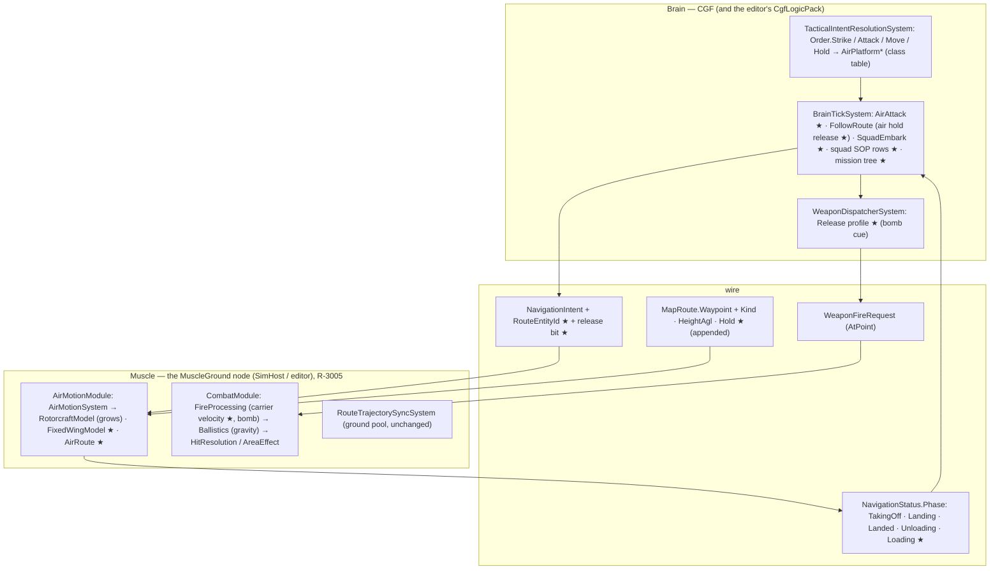

*What the picture shows that prose hid: the route is followed WHOLE on the Muscle (where the route entity, the terrain and the body are),
and only three things cross the wire — the route reference and a release bit going down, the air phase coming up. The Brain never
flies the aircraft point by point, so landing and take-off timing never depend on network latency. Every box marked ★ runs in a pack
that already executes each frame (`SimHostCoreLogicPack` registers `AirMotionModule` and `CombatModule`; `CgfLogicPack` runs the brain
and the weapon dispatcher) — no group that nobody ticks.*

## 3. Classes

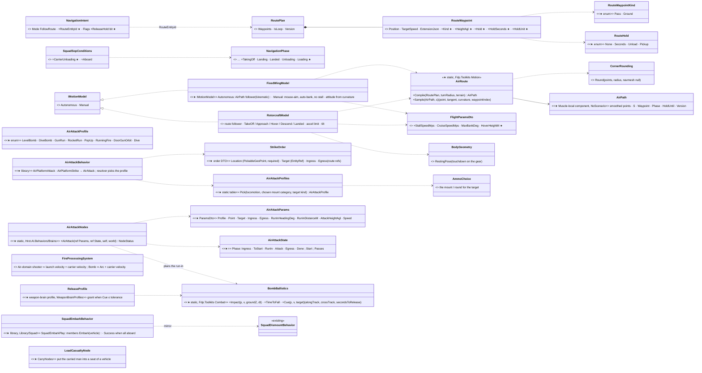

*What the picture shows that prose hid: there is ONE path type (`AirPath`, compiled from the route entity by `AirRoute` reusing the
road-path `CornerRounding`) and BOTH flight models follow it — a helicopter and a plane differ only in their turning radius, their hover
and their attitude. The attack behaviour is one node whose PROFILE is picked by a table over things that already exist (the aircraft's
locomotion, the weapon `AmmoChoice` picks, the target), so the strategy-mode order stays the same for every aircraft.*

## 4. Sequences

### 4a. A strike on a point (slice 1: a plain bomb, released exactly)

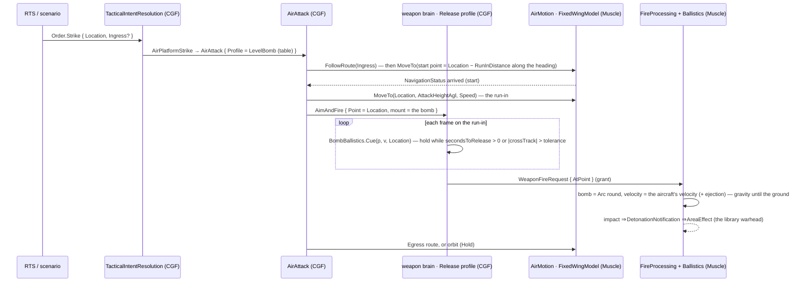

*The AI's release is exact because the predictor steps the same gravity the flight uses (`BallisticsSystem`), so slice 1 needs no
guidance. A guided bomb arrives with the player's bombing (§8).*

### 4b. A helicopter route with a landing and a take-off

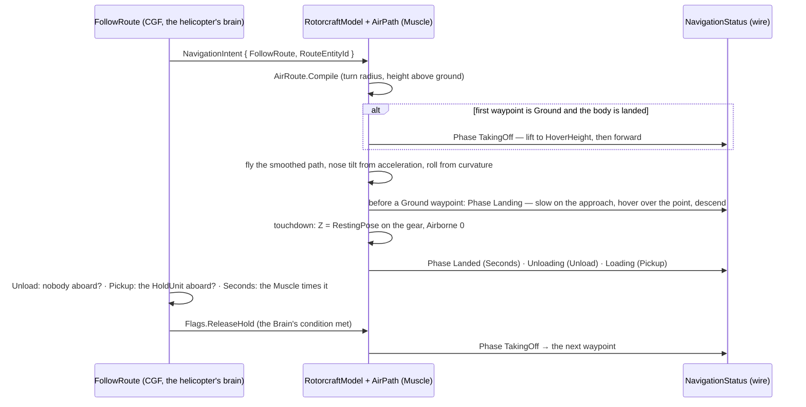

### 4c. The air assault and the rescue round trip

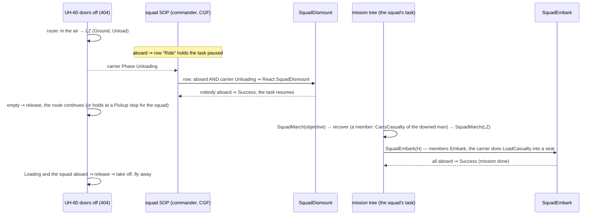

*Insert-only is the first five rows; the round trip adds the last five. The follow-up order is simply the squad's task — no special
air-assault order.*

## 5. The aircraft route (B1, B7)

| rule | why |
|---|---|
| the route is the existing `RoutePlan` entity; a waypoint gains `Kind { Pass, Ground }`, `HeightAgl` (> 0 ⇒ a flyer holds that height above the terrain; 0 ⇒ `Position.Z` as today), `Hold { None, Seconds, Unload, Pickup }`, `HoldSeconds`, `HoldUnit` (network id) | B1: one route type; a ground unit ignores the new fields |
| the wire: the fields are APPENDED to `MapRoute.Waypoint` (R-169, reported); the scenario save writes them (`RoutePlanTranslator`) | the route is already replicated; the Muscle must have the kinds to land |
| `NavigationIntent` gains `RouteEntityId` (the route's network id, appended); `FollowRoute` writes it; the Muscle compiles its own path (air) or pool id (ground) | ⭐ fixes CE-2171 for ground units too; the local pool id stays local |
| `AirRoute.Compile`: the waypoints → horizontal arcs of the aircraft's turn radius (`CornerRounding.Round`, navmesh null) → heights sampled above the terrain (`GroundHeightAt`) at each point, blended linearly along the path | B2: a smooth path the AI follows exactly; the existing rounding, no second smoother |
| a **Ground** waypoint: the helicopter lands on it (Landing → touchdown on `RestingPose` → Landed / Unloading / Loading) and takes off when the hold ends; a route that STARTS on a Ground waypoint with the body landed takes off first | B7: the user's "if it starts on the ground … take off; ends on the ground … land" |
| holds: **Seconds** is timed by the Muscle; **Unload** (nobody aboard) and **Pickup** (`HoldUnit`'s members aboard) are judged by the helicopter's Brain (it knows rosters), which sets `Flags.ReleaseHold` | the Muscle has no rosters; one bit on an existing field |
| a fixed-wing aircraft ignores Ground waypoints in v1 (warning) and orbits the last point (B9) | no runways yet |
| the editor (ui, CE-2172): the gizmo fixed to Z-up, plus per-waypoint height, kind and hold | the route tools cannot set a height today |

### 5a. As-built — slice 1 (E2, `2026-10-14`)

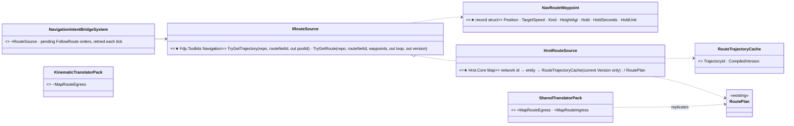

*What the picture shows that prose hid: the Muscle resolves the route through a seam, because `Fdp.Toolkits` (the bridge) cannot
reference `RoutePlan` (Hrot.Core) — and the plan only reaches the Muscle because the MapRoute pair now sits in the pack EVERY role runs.*

| as built | why / deviation |
|---|---|
| ⭐ **deviation:** the waypoint enums (`RouteWaypointKind`, `RouteHold`) and an `IRouteSource` seam live in `Fdp.Toolkits` (`Navigation/RouteSource.cs`); Hrot.Core implements it (`HrotRouteSource`), SimHost injects it (`SimHostCoreLogicPack`) | the bridge and the slice-2 air follower are in `Fdp.Toolkits`, which cannot see `RoutePlan`; the seam keeps the route model in Hrot.Core |
| the brain's `FollowRoute` writes `RouteEntityId` and no longer waits for a local pool id when it has one (`Action_WriteFollowRouteChannel`) | the pool id is LOCAL; an in-process host (no route network id) keeps the old path |
| the bridge uses ITS OWN pool id for `RouteEntityId`, only from a cache compiled at the plan's current `Version`; until then the order is PENDING and retried each tick (cleared on time travel) | the route can arrive after the order (separate topics) |
| ⭐⭐ **CE-2171 had a SECOND cause, confirmed on a split cluster:** `MapRouteEgressTranslator` was only in `KinematicTranslatorPack` (Muscle) — a scenario route is created and owned by CGF, so SimHost never got the plan. Both MapRoute translators moved into `SharedTranslatorPack` | 📄 ROUTES1 §6 always said "SimHost + IG"; the `MapVisualOverlay` pair made the same move |
| wire (R-169): `MapRoute.Waypoint` + `Kind`, `HeightAgl`, `Hold`, `HoldSeconds`, `HoldUnit` (appended); `NavigationIntent` + `RouteEntityId` (appended). The save writes the air fields only when set (enums as strings) | old scenarios and old samples read as Pass / no hold |
| rails: `RoutePlanTranslatorTests.B1_TheAirFields_RoundTrip_AndAPlainWaypointKeepsTheDefaults` · `MapRouteTranslatorTests.B1_TheAirFields_CrossTheWire_OutAndIn` · `NavigationIntentEgressTranslatorTests.CE2171_AFollowRoute_PublishesTheRouteEntity` · ⭐ `EntityOrdersAcrossNodesTests.CE2171_AFollowRoute_OnASplitCluster_DrivesTheRoute` (CGF brain, SimHost body, a scenario route) | the integration rail is the CE-2171 confirmation: red at the base, green after |

### 5b. As-built — slice 2, the helicopter (E3, `2026-10-14`)

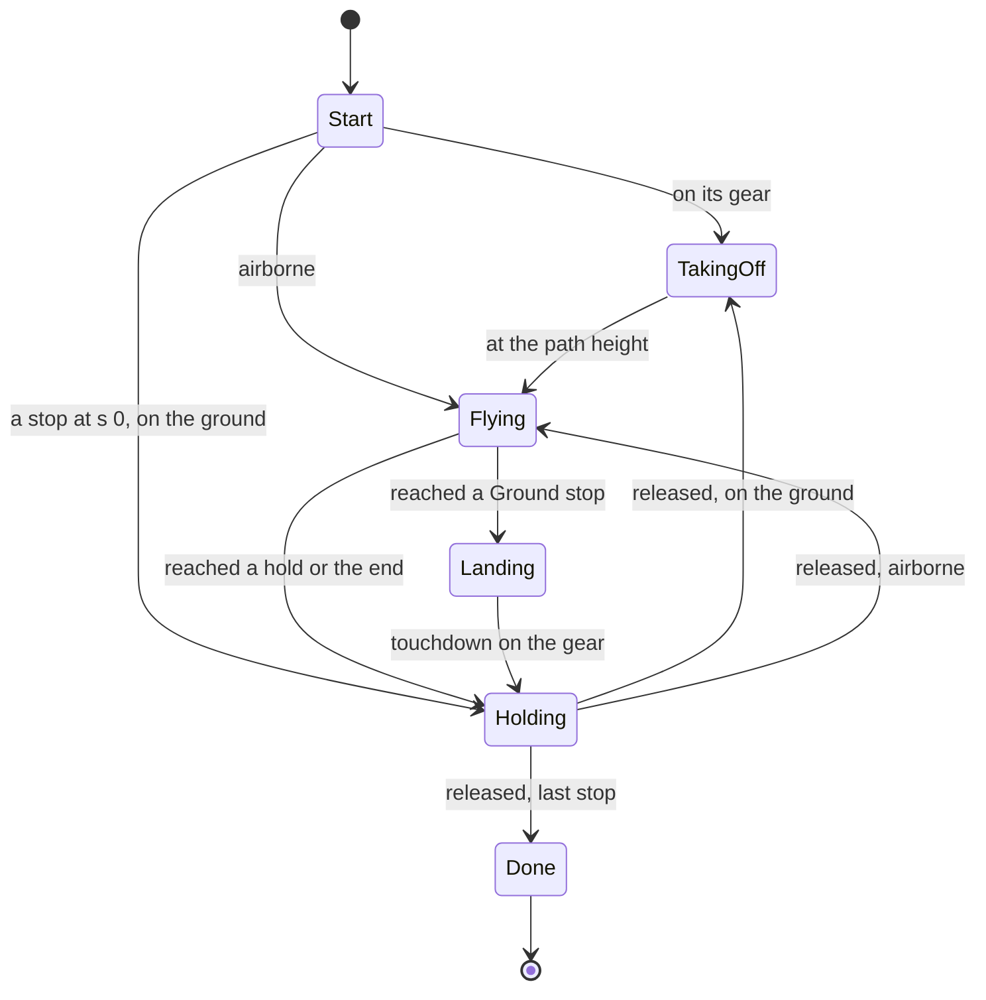

*What the picture shows that prose hid: there is ONE place a route stops (Holding) — a landing is only the way into it, and a take-off
only the way out. Every hold kind (Seconds, Unload, Pickup, none) leaves the same way, so the end of the route is just the last hold.*

| as built | why / deviation |
|---|---|
| `AirMotionSystem.RouteSource` (the E2 `IRouteSource`, one `HrotRouteSource` shared with the ground bridge in `SimHostCoreLogicPack`) compiles the body's `AirPath` (managed, `GlobalComponentIds.AirPath = 378`, Transient) when the order, the route or its version changes — from where the body is, with an approach leg when it is > 1 m from the first waypoint | the design drew `AirRoute.Compile(RoutePlan, …)`; `Fdp.Toolkits` cannot see `RoutePlan`, so it reads the seam's `NavRouteWaypoint`s |
| ⭐ **deviation:** `CornerRounding.Round(…, shiftOut: false)` — a plain fillet tangent to the original legs, passing a corner at R·(1/cos(φ/2) − 1) | the shift (C3) is a ground clearance rule, and with it the leg between two rounded corners KINKS (measured: curvature 0.0225 at a junction for R 60 m). Ground callers keep the default |
| ⭐ **deviation:** a Pass waypoint with `HeightAgl` 0 flies at `Position.Z` but never below the hover height over the ground; a Ground waypoint's approach is at the hover height | the draw tool writes Z 0 (CE-2172): "as today" would fly the route along the ground |
| straight legs sampled every 20 m so the height follows the terrain (`MotionFrame.Terrain`, `WorldQuery.Of`); the follower's climb is capped at `ClimbMps` | — |
| speed: ±3 m/s² along the path (braking ≤ 6), slowed to √(2·a·d) for the next stop and to √(g·tan 30° / κ) for the tightest curve within its braking distance | B2 "eased, no instant velocity" |
| attitude: pitch = −atan(a/g), roll = −atan(v²κ/g) (left turn ⇒ left side down), each ≤ 20° / 30°, eased at 40°/s, drawn through `BodyGeometry.Rotation` | B3 |
| touchdown: Z and attitude from `BodyGeometry.RestingPose` on the gear, `Airborne = 0`; a live body WITH gear on the ground takes off again (a point move climbs straight to the hover height first; manual takes off on Vertical > 0 and sets down on its gear); a body WITHOUT gear that is down stays down (the spent drone) | `Airborne` was the drone's "spent" flag; gear separates the two meanings |
| `DroneImpactSystem` skips a flyer in TakingOff / Landing / Landed / Unloading / Loading | a landing meets the ground and the men waiting beside it on purpose |
| `NavigationIntent.ReleaseHold` = `Flags` bit 2: a LEVEL, consumed once per hold — after a release the next hold needs the bit cleared and set again | the Brain may leave it set; a stale release must not skip the next pickup |
| `NavigationPhase` + `TakingOff 5 · Landing 6 · Landed 7 · Unloading 8 · Loading 9` (appended; the wire carries a byte) | the SOP rows (slice 3) read them |
| `FlightParamsDto` + `HoverHeightM` (30) · `TurnRadiusM` (0 ⇒ top speed / turn rate); the doors-off UH-60 (404): `Gen.Locomotion` Rotorcraft + `Gen.Flight` (70 m/s, climb 8, hover 30 m, turns 60 m) | the plain UH-60 (400) stays a static body |
| rails: `RotorcraftModelTests.B7_ARouteFromTheGround_TakesOff_FliesAndLands_OnItsGear` · `B7_AGroundWaypoint_HoldsUntilReleased_ThenTakesOff` · `B2_TheSmoothedPath_PassesEveryWaypoint_WithinTheTurnRadius` (all three red with the follower off) · `NedTkbBuilderCombatTests.B7_TheDoorsOffBlackHawk_FliesRoutes_OnItsGear` | — |
| ⚠ not built here: a route change mid-flight restarts the follower from where the body is (the hold state is not carried over); the brain's release (slice 3, behaviors) | — |

## 6. Flight models (A1, A8, A9, B2, B3)

| model | Autonomous (AI) — "faked to look believable" | Manual (player) — "controllable by a non-expert" |
|---|---|---|
| **RotorcraftModel** (grows) | follows `AirPath`; speed eases with an acceleration limit (no instant velocity); nose pitch ∝ −acceleration, roll ∝ curvature × speed²; the take-off / approach / hover / descend / touchdown phases (§5) | today's controls + hover hold when the keys are released + the same tilt drawn |
| **FixedWingModel** ★ | follows `AirPath` kinematically at `CruiseSpeed` (≥ stall); bank = atan(v²·κ / g) eased by a roll rate; pitch = the path's climb angle; overflies a point (never stops) | **mouse-aim**: the plane turns toward the camera's look — the model banks itself (coordinated), levels out when centred, cannot stall (speed ≥ `StallSpeed`), throttle on W/S; on the existing `ManualDrive` fields (Yaw = look heading, Vertical = desired pitch, Forward = throttle), no wire change |

| rule | why |
|---|---|
| the AI and the player use DIFFERENT controllers on one body state (`SimTransform`, `SimVelocity`, `FlightState`) | B2/B3: the user allowed them to differ; a hand-over (possess / release) keeps the pose |
| the attitude is in `SimTransform.Rotation` (yaw · pitch · roll) | the 3-D map and the IGs draw what the body says — a banking plane looks like one |
| turning radius: plane `v² / (g·tan MaxBank)` (150 m/s at 60° ≈ 1.3 km); helicopter a fixed `TurnRadiusM` (~60 m) | the route's arcs and the run-in geometry use the same number |
| the first plane type is an **attack aircraft** (A-10 / Su-25 class, ~150 m/s), not the F-16 | map scale: an F-16 needs several km to turn |
| the station: a `ControlScheme.FixedWing`; the camera follows the body's attitude (both flyers); the HUD per scheme (speed, height, heading; bomb cue later) | Entity Control M-4 answered; the camera today is yaw-only (`PossessionStation.cs:262-269`) |

### 6a. As-built — the plane (E4, `2026-10-14`)

| as built | why / deviation |
|---|---|
| `FixedWingModel` (MD-H's row in `MotionModelTable`, no longer "fail loudly"): a route = the SAME `AirPath` a helicopter flies, compiled at cruise² / (g·tan max bank) (`FlightParams.TurnRadius`), flown kinematically at the route's / the intent's / the cruise speed clamped to [stall, top] and eased ±5 m/s²; roll −atan(v²κ/g) ≤ max bank, eased at 60°/s; pitch = its climb (capped by `ClimbMps`) | A1 / B2 |
| the end of a route: a left-hand circle of the turn radius beside the last point, entered with the frame's leftover travel (Arrived, still flying) · a point (`MoveTo`): turn to it at the steepest bank, circle it once there · no order: straight and level | B9: planes never stop |
| a Ground waypoint or a hold on a plane's route is flown over / ignored, with a warning, when `AirMotionSystem` compiles the path | B9 (v1: no runways) |
| ~~`Manual` = straight and level at cruise until slice 6~~ ⛔ SUPERSEDED by §6b (E5 built the mouse-aim pilot) | — |
| `FlightParamsDto` + `StallSpeedMps` · `CruiseSpeedMps` · `MaxBankDeg`; the attack plane **405 "A-10C Thunderbolt II"**: FixedWing, cruise 150 / stall 60 / top 200 m/s, bank 60° (≈ 1.3 km turns), routes 300 m over the ground, 600 hp, four Mk-82 on a `Bomb` mount, gear for the 3-D map | §6 "an attack aircraft, not the F-16" |
| rails: `FixedWingModelTests.A1_APlane_FliesItsRoute_BanksInTheTurns_AndNeverStalls` · `B9_AGroundWaypoint_IsFlownOver_NotLandedOn` · `A1_APlane_ToldAPoint_TurnsToIt_AndCirclesIt` · `NedTkbBuilderCombatTests.A1_TheAttackPlane_IsAFixedWing_WithFourBombs`; `RotorcraftModelTests.CE2168_*` re-pinned (FixedWing is moved now, Surface still fails loudly) | ⚠ the speed floor is checked on displacement per frame to 1 %: a turning frame's chord across a 15°-sampled arc is that much shorter than the distance flown |

### 6b. As-built — the pilots, backend half of slice 6 (E5, `2026-10-14`)

| as built | why / deviation |
|---|---|
| `FixedWingModel.Manual` — **mouse-aim** on the existing `ManualDrive` axes (no wire change): `Yaw` = the absolute heading looked along · `Vertical` ∈ [−1, 1] × the climb angle (≤ 25°, and ≤ asin(climb rate / speed)), the nose eased at 20°/s · `Forward` = the throttle, **HELD** (R-3007): + speeds it up toward top, − slows it toward stall, at the type's acceleration × the push; 0 keeps the speed it has | B3: a non-expert flies the plane by looking where to go; ~~0 ⇒ cruise, ±1 ⇒ top / stall~~ ⛔ SUPERSEDED (three speeds only from W/S keys) |
| the turn is **coordinated**: the pilot asks for a turn rate of (heading error ÷ 1.5 s), up to the steepest bank; the bank is eased at 60°/s, and the yaw follows the bank (g·tan bank / v); the wings level as the error closes, and the yaw never passes the look | "the model banks itself, levels out when centred" |
| it cannot stall: the speed is clamped to [stall, top] whatever the throttle and the nose say | B3 |
| **a crash is not a warhead** (R-3007): `DroneImpactSystem` bursts mount 0 only for a flyer with `Gen.Flight DetonatesOnImpact` (the FPV drone); any other aircraft that meets the ground or a body is destroyed and comes to rest. No ground floor: a hand-flown plane can still fly into a hill | ~~the A-10 bursts its Mk-82 rack on a crash~~ ⛔ SUPERSEDED — found reporting E5, decided by the user |
| `RotorcraftModel.Manual` — today's direct axes (Forward / Lateral × top speed, `Yaw` absolute, `Vertical` × climb) **plus the tilt a route draws**: the nose down ∝ forward speed (≤ 20°), rolled ∝ strafe (≤ 30°) and into the turn (atan(v·ω/g)), eased at 40°/s, drawn from the body's actual speed. ⭐ **R-3007:** the axes ask for a velocity the body reaches at its type's `Gen.Flight AccelMps2` (FPV drone 15, UH-60 3; 0 ⇒ 3); keys released ⇒ it brakes to a hover and holds it there (no drift) and levels. The same rate eases a route's speed and a point move (braking √(2·a·d) for the point) | B3 "today's controls + hover hold + the same tilt"; ~~no acceleration limit (instant velocity)~~ ⛔ SUPERSEDED — a drone and a UH-60 cannot share one response |
| 🔒 **User, `2026-10-14`** on the E5 findings: *"Accepting your lean for the aircraft crash. Accepting adding the MK82 bomb."* — then, on the acceleration and the throttle: *"keep json, accel yes, throttle yes"* (R-3007, `CE-3202`) | the decisions folded into the rows above |
| `RotorcraftModel.TiltOf(q)` — the pitch and roll of a `BodyGeometry.Rotation`, shared with `FixedWingModel` (its roll reading is corrected for pitch: left.Z = sin roll · cos pitch) | one reader of the attitude |
| rails: `FixedWingModelTests.B3_TheMouseAimPilot_TurnsToTheLook_BanksItself_AndLevelsOut` · `B3_ThrottleBack_AndNoseUp_NeverStalls` · `RotorcraftModelTests.B3_AHelicopter_UnderManualDrive_TiltsAsItFlies_AndHoldsItsHover` · R-3007: `R3007_ADroneAndAHelicopter_ChangeSpeed_AtTheirOwnAcceleration` · `FixedWingModelTests.R3007_TheThrottle_IsHeld_AnySpeedBetweenStallAndTop` · `DroneImpactSystemTests.R3007_AnAircraftThatIsNotAMunition_Crashes_WithoutABurst` | the station half (`ControlScheme.FixedWing`, camera attitude, HUD) is ui's |

## 7. Orders and the one attack behaviour (B4, B5)

| order (one set for every aircraft) | resolves to (`AirPlatform<Order>`, R-278) | what it does |
|---|---|---|
| **Move** (point) | `AirPlatformMove` | fly there at the type's cruise height; arrive = hold there (orbit / hover) |
| **Follow route** (existing `FollowRoute`) | unchanged name, air arm | §5 |
| **Hold** | `AirPlatformHold` | a plane orbits where it is; a helicopter hovers |
| **Attack** (entity) | `AirPlatformAttack` → `AirAttack` | the profile from the table, the target tracked |
| **Strike** ★ (point; optional target entity, ingress, egress) | `AirPlatformStrike` → `AirAttack` | the profile from the table, the point fixed |

`AirAttackProfiles.Pick(locomotion, the mount AmmoChoice picks for the target, target kind)`:

| aircraft | best mount for the target | profile |
|---|---|---|
| plane | Bomb | **LevelBomb** (slice 1) · DiveBomb (an unguided bomb vs a small target, later) |
| plane | Gun · Rockets | GunRun · RocketRun |
| helicopter | Atgm, target armour | PopUp (the V4 exposure cycle, vertical: hide low, climb to sight, fire, sink) |
| helicopter | Rockets · Gun (fixed) | RunningFire |
| helicopter | a side-traversing turret | DoorGunOrbit |
| drone (FPV) | its warhead | Dive (FPV §3's sequence; B5) |

| rule | why |
|---|---|
| a params DTO (`AirAttackParams`) carries the profile and every number; an asset or a scenario overrides any of them, including the profile (R-3001); 0 / NaN = automatic | the user: "by parameters of one attack behavior"; RTS sends only the order |
| **Strike** is a new order kind (`OrderKind.Strike`, `[Order(Gesture = GroundClick)]`), the first after Move / Attack / Hold | Attack takes an entity (`OrderDtos.cs:46-54`); mortars / artillery can fulfil Strike later (catalogue AIR-1 / SQD-9) |
| the run-in: start point = the target − `RunInDistanceM` along `RunInHeadingDeg` (automatic: from the aircraft's bearing); `RunInDistanceM` ≥ 2 turn radii | A2: the heading comes from geometry, not from the movement order |
| weapons: the behaviour flies, the weapon brain fires (R-261) — the gun / rocket runs fire when the target is in the nose cone and in range; the bomb by the Release profile (§8) | one weapon path for the AI and the player |
| FPV §2's `FpvAttackNodes` / `FpvAttackState` are NOT built; the drone's attack is the Dive profile with the same phases (Route → Search → Pursue → Dive) and `DroneTargetDecision` as its target pick | B5: one air-attack loop |

### 7a. The air weapons — slice 6a (backend, [handoff](../../blueprints/batches/HANDOFF_Behaviors_To_Backend_Air_Weapons.md))

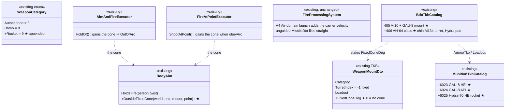

*What the picture shows that the prose hid: nothing new flies — the cone is a HOLD in the two executors the AI already fires through,
and the rocket and the shell ride the existing A4 launch (`FireProcessingSystem` is not touched).*

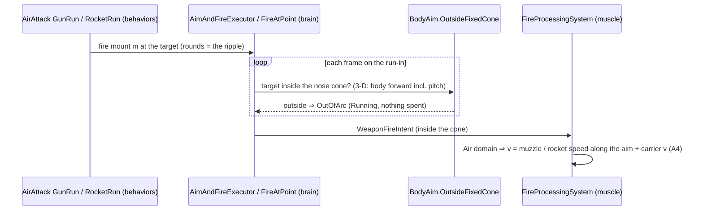

| who calls it each frame | |
|---|---|
| `AimAndFireExecutor` / `FireAtPointExecutor` | the weapon channel's dispatcher on the **brain** (CGF; one world in `--mode editor`) — the same path every AI shot takes |
| `FireProcessingSystem` | the **muscle** (SimHost — the node whose role composes combat), from the replicated `WeaponFireIntent` |

| decision (backend, inside the approved slice 6a) | rejected — one line |
|---|---|
| **AW-1** a fixed mount's arc is `WeaponMountDto.FixedConeDeg` (0 = none): the half-angle around the **unit body's 3-D forward** (pitch included — a plane dives its gun onto the target); outside it the AI's aimed and at-point rounds are held `OutOfArc` (Running, nothing spent); the operator is never held (M-2: he points the aircraft) | a ±5° `TurretDto` — a part entity and a `WeaponTask` that slews a gun that cannot slew · `BodyAim.HoldsFire` widened to vehicles — its twist is a person's |
| **AW-2** the A-10's GAU-8 = ONE mount, `Autocannon`, a two-round loadout: **6023 HEI** (the library's `30mm HE` — area burst for soft targets) and **6024 API** (the library's `30mm APFSDS` — the nearest penetrator); `AmmoChoice` picks per target (M8) | two mounts (the brain would pick a gun, not a round) |
| **AW-3** `WeaponCategory.Rocket = 9`, appended: the per-shot profile; NOT fired per press — a held trigger keeps firing at the cooldown, so the player's ripple is the hold and the AI's is the action's round count | a rocket as `Autocannon` (no profile can tell a pod from a gun) · per press (one rocket per click) |
| **AW-4** **6025 Hydra-70 HE**: an unguided `MissileDto` (700 m/s, 6 s) with the warhead of a NEW library entry `70mm rocket HE` (he, 70 mm, 4.5 kg warhead, 1.04 kg explosive — public M151 figures); the scatter is the mount's `DispersionMils` | a hand-typed `WarheadDto` (a second source of blast / fragment numbers) — the Mk-82 precedent (CE-3201) |
| **AW-5** **406 AH-64-class** (`Heli_AH64`): DIS 1.2.225.20 (attack helicopter) so the air classes resolve; Rotorcraft flight like 404; mount 0 a chin **M134** on turret 0 (traverse ±110°, elevation −60…+11°), mount 1 the **Hydra pod** (fixed forward, cone 8°) | a 30 mm M230 chin gun — the handoff asks for the minigun the demo shows |
| **F4** ⭐ the passenger list widens to **12** seats (🔒 user, `2026-10-14`: *"extend the wire capacity … No problem extending"* — the list is sent only on change) so 404 keeps 8 riders and gains 2 door stations + 2 door gunners | ~~4 of the 8 seats become door stations~~ (404 would carry 4 riders) |

⭐ **As built (backend, `2026-10-14`) — AW-1…AW-5 exactly as above.** Rails: `AimAndFireExecutorTests.F1_AFixedForwardMount_FiresOnlyInsideItsNoseCone`
· `FireProcessingSystemTests.F3_FromTheAir_TheShellAndTheRocket_KeepTheCarriersVelocity_TheRocketFliesUnguided_ARippleScatters` ·
`NedTkbBuilderCombatTests.F1_TheAttackPlane_CarriesTheRackAndAFixedForwardGau8_HeiAndAPenetrator` · `…F2_TheAttackHelicopter_HasAChinMinigunTurret_AndAFixedRocketPod`
· `…F2_B7_TheAttackHelicopter_FliesARoute_FromItsGear_ToItsGear`. Also: the cone holds the AI's BLIND rounds too (`FireBlind`), and the
possession HUD names a `Bomb` and `Rocket` mount. The rack stays mount 0 of 405, so `AirAttackProfiles.Pick` (LevelBomb) is unchanged.
⭐ **F4 as built:** the passenger list is 12 wide ([Entity Interactions §7.4](../../DESIGN_Entity_Interactions.md)); 404's seats 8–11 are
per side a door gunner (rifleman) and a `Door` station with an M134 operated by him — the DoorGunOrbit profile's two guns; its 8 riders
are unchanged. Rail `CreateEntityRequestSystemTests.F4_APlacedDoorsOffBlackHawk_HoldsTwoM134s_AndTwoDoorGunners_ItsRidersSeatsStayFree`.

## 8. The bomb (A3, A4, A6, B6)

| rule | why |
|---|---|
| a bomb is a munition (Mk-82 class, 500 lb, id 6022) whose warhead is `Indirect` + area (its own entry in the warhead library — as built §8a, `CE-3201`; ~~copied from the nearest entry~~) and a mount category `Bomb` | the Arc path already applies gravity and lands area warheads (`BallisticsSystem.cs:129-206`) |
| `FireProcessingSystem`: a shooter in the **Air domain** launches with its own velocity added (a bomb: the carrier's velocity + 1 m/s down; a gun / rocket: + its muzzle speed) | A4: ground shooters unchanged (no combat number moves) |
| `BombBallistics.Impact / Cue` step the SAME gravity at the SAME `dt` as `BallisticsSystem` (no drag) ⇒ the predicted impact is the real one | A3: one predictor; drag later keeps them identical |
| the weapon brain's **Release** profile: the grant waits while `secondsToRelease > 0` or the cross-track miss > the tolerance (10 m); then one bomb per pass | A6 / R-261: the behaviour flies, the weapon releases — the same for a player who holds the trigger |
| slice 1: unguided, exact AI release. Later: a GPS bomb = a new `GuidanceKind.Coordinate` in `GuidedRoundSystem` (predict the impact each frame, push sideways ≤ 1.5 g against the miss, gravity kept) — for the player's imprecise release; the laser (the designator as the round's "gunner") later still | the user: the laser is out of the first slice |

### 8a. As-built — the bomb and the release (E4, `2026-10-14`)

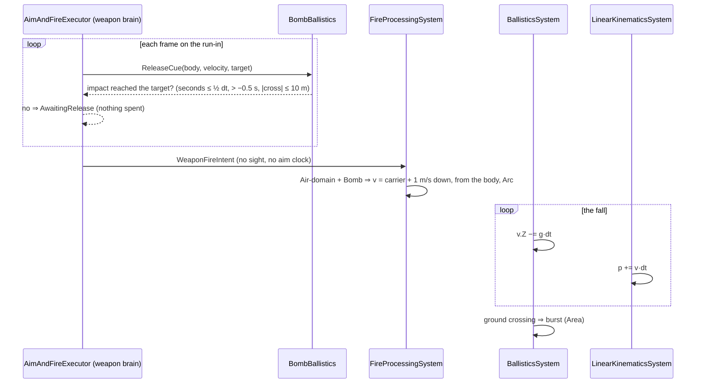

*What the picture shows that prose hid: the predictor and the flight are the same two steps in the same order (gravity, then the move)
— that is the whole reason the predicted impact IS the flown one; and the release gate sits in the weapon brain, before the fire path
that every other weapon uses.*

| as built | why / deviation |
|---|---|
| `WeaponCategory.Bomb = 8`; munition **6022 "Mk-82 bomb"**: the library's own **`Mk-82 bomb`** entry (`ammo.json`: `he`, 273 mm, 227 kg, 94 kg TNT-equivalent, `indirect`) — blast lethal ≈ 9.1 m, injury ≈ 27 m, fragments reach ≈ 143 m | ~~the library's `120mm mortar HE` (3 kg)~~ ⛔ SUPERSEDED — `CE-3201`, R-3007 *"Accepting adding the MK82 bomb"*; the reference library stays embedded JSON (*"keep json"*) |
| `FireProcessingSystem`: an **Air-domain** shooter (`Locomotions.InAir`) — a Bomb leaves FROM THE BODY at the carrier's velocity + 1 m/s down (`BombBallistics.Launch`) and falls (Arc); any other round adds the carrier's velocity. A ground shooter is unchanged (A4, rail) | A4 |
| `BombBallistics.Impact / Cue / ReleaseNow` step gravity then the move at the sim's dt, exactly `BallisticsSystem` → `LinearKinematicsSystem` (the SimHost's order) | A3: rail flies a real bomb through `BallisticsSystem`: the burst lands within the burst stand-off of the prediction |
| the **Release** profile = the per-shot path (`WeaponBrainProfiles.For(Bomb)`), held by `AimAndFireExecutor.HoldOf` → `ActionReason.AwaitingRelease` (appended; aimed, not amber) until the cue; then released with no seen-now gate, no aim clock, no body twist, no friendly-line check. Release window: seconds ≤ ½ dt and > −0.5 s (a missed pass does not drop late), cross-track ≤ 10 m. One bomb per pass = the action's round count (or its cooldown). `FiresPerPress(Bomb)` = true | A6; ⚠ deviation: the window is half a second, not one frame, so a brain ticking slower than the sim still releases |
| rails: `BombBallisticsTests.A3_ThePredictedImpact_IsTheFlownImpact` (2 cases) · `A6_TheCue_SaysNow_WhenTheImpactReachesTheTarget` · `FireProcessingSystemTests.A4_AnAircraftsBomb_KeepsItsVelocity_AGroundShotDoesNot` · `AimAndFireExecutorTests.A6_TheReleaseProfile_WaitsForTheCue` | — |
| ⚠ not built here: `FireAtPointExecutor` (a strike on a POINT) has no release gate yet — the behaviour lane's `AirAttack` LevelBomb (slice 5) decides which executor it drives; the gate is one call (`ReleaseCue`'s `BombBallistics.ReleaseNow`) | reported to behaviors |

## 9. The air assault and the rescue round trip (B8, B10, B11)

| piece | rule | basis |
|---|---|---|
| the carrier | the doors-off UH-60 (404, 8 open seats) | built by ui (CE-1083) |
| riding | squad SOP row **Ride**: a member aboard ⇒ a reaction that holds (keeps the task paused); placed after the dismount row | the existing pause / resume of a reaction |
| getting out | squad SOP row: a member aboard AND the carrier's phase `Unloading` ⇒ React `SquadDismount` (existing) | Squad §5a; `Unloading`, not "landed", so a squad that has just boarded at a `Pickup` stop is not dismounted again |
| the follow-up | the squad's ordinary task (an order or the mission tree) resumes when the reaction ends | the user: "follow given orders … after disembarking" |
| boarding | ★ `SquadEmbark` (library, the mirror of `SquadDismount`): each member `Embark(vehicle)`; Success when all are aboard; Failure on a timeout | B10 |
| the casualty | a member carries the downed man (`CarryCasualty`, existing — any man down); at the vehicle ★ `LoadCasualty` puts him into a seat (`TryEmbark` seats an incapacitated man in a vehicle), so nobody boards while carrying | measured: a carrier boarding would nest the casualty |
| the mission | ★ an authored mission tree (BTree asset): Sequence { SquadMarch(objective) · SquadRecover(casualty) · SquadMarch(LZ) · SquadEmbark(helicopter) }, each step with its own params | B11: mission phases carry no per-step params (`MissionComponents.cs:42-60`) |
| the wait | the LZ waypoint: Hold `Pickup`, `HoldUnit` = the squad ⇒ the helicopter's brain releases when the squad's members (and the loaded casualty) are aboard | B10 |
| seats | 5 soldiers + 1 casualty ≤ 8 | the wire's 8 (`InteractionComponents.cs:16`) |

`SquadRecover` = the squad casualty-care play (Squad Tactics §7.4) pointed at a named casualty; ⚠ that the play accepts a non-member is
measured at build (the rule it calls, `CarryCasualty`, does).

### 9a. As-built `2026-10-14` — slice 3, first half (behaviors): `SquadEmbark` and `LoadCasualty`

| design said | built | why |
|---|---|---|
| ★ `SquadEmbark` (library, mirror of `SquadDismount`) | ✅ `SquadEmbarkBehavior` + `SquadEmbarkPlay` over `SquadEmbarkManeuver` (ManeuverKind **13**, one phase `In`, roles Boarding / Loading); `SquadEmbarkParamsJsonDto { vehicle, timeoutSeconds (0 ⇒ 60), speed }`; `MemberOrderKind.Embark = 6` with `MemberOrder.Target` = the vehicle; `SquadManeuverRunner.Board` | Success = every live member aboard THAT vehicle and carrying nobody (`AboardIt`; a unit member: all its members); Failure = the vehicle gone or the timeout |
| who gets what | a soldier → `Embark`; a soldier carrying a man → `LoadCasualty`; a unit member → `SquadEmbark` | the runner decides by `Embarkation.LoadOf`, so the play has one order kind |
| ★ `LoadCasualty` | ✅ the shared node `CarryNodes.LoadCasualty` (walk to the boarding point carrying → `PutDown` (action 10) → board HIM: action 1 with the new `EmbarkParams.Passenger`) + the library behaviour `LoadCasualty` = Sequence { `LoadCasualty`, `Embark` (self) } | ⚠ cross-lane, additive: `EmbarkParams.Passenger` (Fdp.Toolkits, appended; Null ⇒ the runner itself, so every existing caller is unchanged); the range is checked from the boarding man, the command names him |
| rails | `SquadManeuverTests.CE2173_SquadEmbark_EveryMemberIsToldToBoard_DoneWhenAllAreAboardThatVehicle` · `CE2173_SquadEmbark_ACarrierLoadsHisCasualtyFirst_AStragglerTimesOut_AGoneVehicleFails` · `EmbarkNodesTests.CE2173_LoadCasualty_PutsTheCarriedManDown_AndSeatsHimInTheVehicle` · `CuratedBehaviorRegistrarTests.SR_R2` (+2 names) | red-proved by 4 mutants: "aboard any vehicle", the carrier given plain Embark, the man not named as the passenger, the put-down skipped |

⭐ **Slice 5, first part — the order set (behaviors, `2026-10-14`):** `OrderKind.Strike = 4` + `StrikeOrder { Location (required), Target }`
(no RTS gesture — a ground click stays a Move); `AirPlatformMove` (every `AirPlatform`: the shared node `AirOrderNodes.FlyTo` issues ONE
3-D MoveTo to the point at `HeightAgl` above the ground — default 120 m — with a stated Z, then reports the move). 📐 Found: before it an
aircraft's Move resolved to `PlatformMove`, which moves ON THE SURFACE — a helicopter flew down to the ground point. Rails
`AirOrderNodesTests.B4_FlyTo_*`, `TacticalIntentResolutionSystemTests.B4_EveryAircraftsMove_*` (red before), `OrderVocabularyTests` (Strike
has one DTO), SR_R2 +1 — 3 mutants red. ⏸ `AirPlatformAttack` / `AirPlatformStrike` arrive with `AirAttack` (needs E4); a Strike to an
aircraft is refused until then. `AirPlatformHold` waits for the plane (a helicopter's `PlatformHold` already hovers).

### 9b. As-built `2026-10-14` — slice 3, second half (behaviors): riding, unloading, the hold release

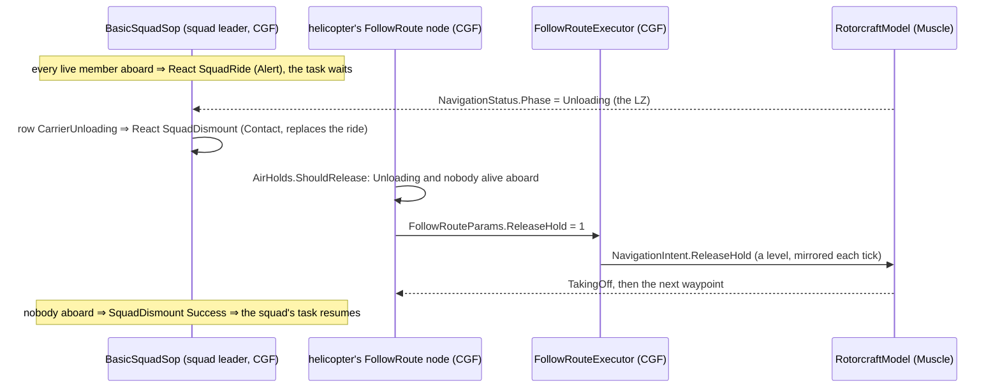

*What the picture shows that prose hid: the release is decided by the HELICOPTER's brain from what it can see (its own passengers, the
route's `HoldUnit`), never by the squad — so the squad and the aircraft need no channel between them; and the bit is a LEVEL the executor
mirrors every tick, which is what lets the motion side re-arm for the next stop.*

| as built | why / deviation |
|---|---|
| ★ SOP rows (`BasicSquadSop`), in order: ① **`CarrierUnloading`** ⇒ React `SquadDismount` (Contact) · ② the existing under-fire-mounted row, now only for a carrier **on the ground and not at a Pickup** · ③ **`Riding`** ⇒ React ★ `SquadRide` (Alert) — then the old rows | ③ sits above the contact rows: a squad shot at in the air rides on. ② gated: 📐 before it the row dismounted a squad from a FLYING helicopter (`Embarkation.Disembark` has no airborne gate) |
| `Riding` = EVERY live member aboard a vehicle | ⛔ "any member" would pause the boarding when the first man is in |
| ★ `SquadRide` (library, Commander, no params): orders nobody, Running while `Riding`, Success the moment somebody is out | a reaction the task waits behind; the Unloading row (more urgent) replaces it |
| ★ `AirHolds` (`Hrot.AI.Behaviors`): `ShouldRelease` (Unloading ⇒ nobody alive aboard; Loading ⇒ every live member of the nearest Pickup waypoint's `HoldUnit` aboard THIS aircraft, `SquadEmbarkBehavior.AllAboard`; a Pickup naming no unit, or one this node cannot find, holds) · `OnTheGround` (a ground vehicle; an aircraft in `Landed` / `Unloading` / `Loading`, or within 1.5 m of the terrain with no landing phase) | the brain owns the rosters; the Muscle owns the landing |
| ⚠ cross-lane (`Fdp.Toolkits`, backend's E4 report left it to us): `FireAtPointExecutor` holds a BOMB for the release cue (`AimAndFireExecutor.ReleaseCue` gained a point overload) and skips the person's body-turn rule for it — a strike on a PLACE now releases as exactly as the aimed path | the `AirAttack` LevelBomb drives `FireAtPoint` |
| ⚠ cross-lane, additive (`Fdp.Toolkits`): `FollowRouteParams.ReleaseHold` (appended byte, 24 ≤ 32 bytes) · `FollowRouteExecutor` mirrors it onto `NavigationIntent.ReleaseHold` every tick (only a change is written) | the node writes the channel, the executor the intent (BS1-T020); no wire change — the bit is backend's E3 `Flags` bit 2 |
| rails: `SquadManeuverTests.CE2173_BasicSquadSop_ASquadInAFlyingHelicopter_RidesThroughFire_AndDismountsWhenItUnloads` · `CE2173_BasicSquadSop_BoardingIsNotPausedByTheFirstManIn_AndAtAPickupTheSquadStaysAboard` · `CE2173_TheHelicoptersBrain_ReleasesAnUnloadWhenEmpty_AndAPickupWhenItsUnitIsAboard` · `FollowRouteExecutorTests.CE2173_TheBrainsHoldRelease_ReachesTheIntent_AsALevel` · `BTreeCallShapeTests` (+2 NoParams rows) · `SR_R2` (+`SquadRide`) · and the bomb on a POINT: `AimAndFireExecutorTests.CE2173_ABombAtAPoint_WaitsForTheReleaseCue` | red-proved by 5 mutants: the dismount without the on-the-ground gate, Riding as "any member", a Pickup released on anybody aboard, the release mirrored only on entry, the FireAtPoint release gate off |

Still open in slice 3: `SquadRecover`, the rescue mission tree, and the two scenarios (`ua-air-assault`, `ua-air-rescue`).

### 9c. As-built `2026-10-14` — slice 5, the strike (behaviors): `AirAttack` LevelBomb and `AirPlatformStrike`

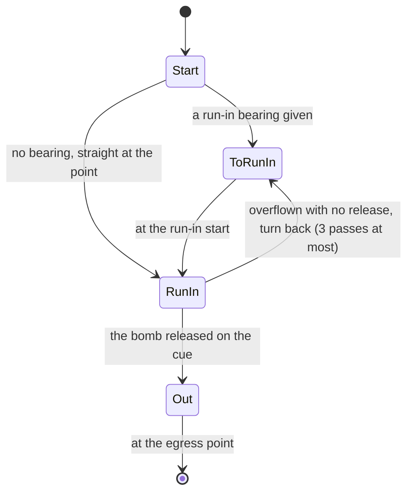

*What the picture shows that prose hid: the release is not a state of the attack — the run-in only keeps the plane on the line and keeps
the weapon's `FireAtPoint` asking; the weapon brain decides the moment (§8a). A missed pass is just a way back into the run-in.*

| as built | why / deviation |
|---|---|
| ★ `AirAttackNodes.Run` (`AirAttackParams` + `AirAttackState`, a stateful shared action) — one attack, the profile a parameter; only `LevelBomb` built | B4 / B5 |
| ★ `AirAttackProfiles.Pick`: a FixedWing with a `Bomb` mount ⇒ LevelBomb (that mount); anything else ⇒ no profile — the attack FAILS at once, logged | ⚠ deviation from "a helicopter gets PopUp / RunningFire": those profiles are slice 6; failing loudly beats flying somewhere and doing nothing |
| ⭐⭐ the run-in steers at a point **4 km BEYOND the target** on the line from the plane through it (re-aimed every 0.5 s until 2.5 km out, then frozen), at the pass height (300 m) above the ground at the target | 📐 measured on the as-built `FixedWingModel.ToPoint`: a point move counts as arrived within `max(arrival radius, turn radius)` and then CIRCLES — an A-10's turn radius (~1.3 km) is longer than its bomb's throw (~1.2 km from 300 m at 150 m/s), so steering AT the target would turn the plane before the release |
| the weapon is driven through `FireAtPointNodes.FireAtPoint` (one round, the bomb mount) — the release gate is in `FireAtPointExecutor` (§9b) | one weapon path for a point (A6, R-261) |
| ★ `AirPlatformStrike` (resolved from `StrikeOrder`: the `Target`'s position when it names a live entity, else the `Location` on the ground there) — every `AirPlatform` | B4, R-278 |
| ⏸ not built: `AirPlatformAttack` (Attack on an entity) — waits for the helicopter profiles (slice 6), or a helicopter's Attack would fail where today it fires · `AirPlatformHold` (a plane's orbit) | — |
| the demo **`ua-air-strike`** (`scenarios/ua-air-strike`, check `run_air_strike` in `scripts/utility-demo-check.py`): an A-10 ordered `AirPlatformStrike` on a technical from 3.8 km — one bomb on it (≤ 25 m), a technical 125 m away untouched, the plane flies on out | ⏳ authored; the first live run FAILED, root-caused `2026-10-15` (next row) |
| ⛔→✅ **the first live run never released** (`2026-10-14`): the plane flew straight across the target at 300 m, its ammunition untouched. 📐 **Cause:** the release cue runs on the BRAIN node, and it read `SimVelocity`. There the plane's motion is SimHost's, so dead reckoning skips it (`DeadReckoningSyncSystem`: `driveFromNetwork = !roleHasMuscle && !roleHasBrain` ⇒ ghosts only) and the zero `SimVelocity` `SpatialCoreTkbTranslator` gives every entity is never refreshed; the live velocity arrives only in `NetworkVelocity` (`GeoSpatialIngressTranslator`). A standing plane has an infinite time to release ⇒ never. The unit rails missed it because a test world owns its motion. ⭐ **Fix:** `ReplicatedMotion.Of` — motion this node owns ⇒ `SimTransform` / `SimVelocity`; otherwise the newest network sample projected to now (`ReplicatedMotion.Project`, the one formula dead reckoning now also calls); `AimAndFireExecutor.ReleaseCue` reads it, so the aimed and the point bomb paths both release. Rail `AimAndFireExecutorTests.CE2173_TheReleaseCue_OnTheBrainNode_ReadsTheReplicatedMotion` (samples every 6th frame, a zero `SimVelocity`; red with the old cue). ⚠ Same shape elsewhere: `VehicleCover`'s *standing* test reads `SimVelocity` too — on a brain node every vehicle reads as standing (noted, not changed). | ✅ fixed in code; the live re-run is next |
| rails: `AirAttackNodesTests.B6_ALevelBombRun_HitsThePoint` (the plane flown by a stand-in, the real `FireAtPointExecutor`: one bomb, at 300 m, its predicted impact within 15 m of the point, then out) · `B4_TheProfile_IsPickedFromTheAircraftAndItsWeapons` · `TacticalIntentResolutionSystemTests.B4_EveryAircraftsStrike_ResolvesTo_AirPlatformStrike_ALandVehicleHasNone` · `SR_R2` (+`AirPlatformStrike`) | red-proved by 3 mutants: steering at the target, no profile picked, the behaviour not registered — ⚠ the first version of the bomb rail let "steer at the target" SURVIVE (its stand-in plane arrived at 20 m); the stand-in now flies a point as `FixedWingModel.ToPoint` does (arrived within the turn radius, then circles) |

## 10. Decisions — 🔒 APPROVED `2026-10-14` (R-2015)

| id | decision | rejected |
|---|---|---|
| **A1** | plane: a bank-to-turn point mass in the Air module | full flight dynamics · the helicopter model with a minimum speed |
| **A2** | the run-in heading is geometry the behaviour lays out | an arrival heading on the movement order |
| **A3** | bomb: gravity, no drag; one predictor stepping the flight's own gravity | a closed form that drifts once drag exists |
| **A4** | only Air-domain shooters add their velocity to a launch | every shooter (moves ground numbers) |
| **A5** | guided bombs are guidance kinds in `GuidedRoundSystem` (GPS slice later; laser later still) | a second steering system |
| **A6** | the weapon brain releases (Release profile), the same for AI and player | the behaviour releases (breaks R-261) |
| **A7** | JTAC: ⛔ **not in slice 1** (user) — later: a designator type, Strike with clearance, the laser as the round's "gunner" | — |
| **A8** | player plane: mouse-aim on the existing `ManualDrive` fields | new stick axes on the wire |
| **A9** | helicopter: acceleration and tilt; pop-up reuses the V4 exposure cycle | a separate helicopter combat behaviour |
| **B1** | the existing route entity + waypoint kinds + height above ground + holds; followed whole on the Muscle; the intent carries the route | the Brain feeding points one by one · a separate air-route type |
| **B2** | AI flight: follow the pre-smoothed path exactly; attitude derived from the curve | simulated dynamics for the AI |
| **B3** | player flight: simple — mouse-aim plane that cannot stall; helicopter + hover hold | stick-and-rudder |
| **B4** | one order set for every aircraft; one new **Strike** order; one `AirAttack` whose resolver picks the profile | a behaviour per pattern as orders · Attack taking a point |
| **B5** | the FPV attack is AirAttack's Dive profile | a separate drone attack behaviour |
| **B6** | the first bomb is unguided with an exact AI release | GPS guidance now |
| **B7** | take-off and landing by the motion model from the waypoint kinds, touchdown on the gear | the behaviour flies the landing |
| **B8** | the air assault is squad SOP rows (ride; dismount when the carrier is Unloading); the follow-up is the squad's task | the helicopter ejects everyone · a special air-assault order |
| **B9** | planes do not land in v1 (start airborne, orbit the route's end) | runways and taxiing |
| **B10** | `SquadEmbark` drill; the LZ holds until the named unit is aboard | the helicopter loads the squad · a timed hold |
| **B11** | the rescue is an authored mission tree | a hard-coded rescue behaviour |

## 11. Slices and rails — in the features' own suites

| # | lane | slice | rails |
|---|---|---|---|
| **1** | backend | waypoint fields (ECS, save, wire) · `NavigationIntent.RouteEntityId` · ground `FollowRoute` resolves its pool on the Muscle (CE-2171) | `RoutePlanTranslatorTests` (the new fields round-trip) · `MapRoute*TranslatorTests` · a `--mode all` FollowRoute run (CE-2171 confirmed, then green) |
| **1** | ui | the route gizmo Z-up + height / kind / hold per waypoint (CE-2172) | the gizmo's own suite |
| **2** | backend | `AirRoute` + `AirPath`; `RotorcraftModel` route follower, acceleration, tilt, take-off / landing / holds, `NavigationPhase` air values, `ReleaseHold` | `RotorcraftModelTests`: `B7_ARouteFromTheGround_TakesOff_FliesAndLands_OnItsGear` · `B7_AGroundWaypoint_HoldsUntilReleased_ThenTakesOff` · `B2_TheSmoothedPath_PassesEveryWaypoint_WithinTheTurnRadius` |
| **3** | behaviors | squad SOP Ride / dismount-on-Unloading rows · `SquadEmbark` · `LoadCasualty` · the helicopter brain's hold release · scenarios **`ua-air-assault`** (insert) and **`ua-air-rescue`** (round trip) | `SquadManeuverTests` (embark drill, timeout) · `BasicSquadSopTests` (ride, dismount on Unloading, no re-dismount at a Pickup) · live in `SquadTacticsScenarioTests` |
| **4** | backend | `FixedWingModel` (Autonomous) + an attack-plane type · Air-domain launch velocity · the Mk-82 munition + `Bomb` category · `BombBallistics` · the Release profile | `FixedWingModelTests` · `FireProcessingSystemTests.A4_AnAircraftsBomb_KeepsItsVelocity_AGroundShotDoesNot` · `BombBallisticsTests.A3_ThePredictedImpact_IsTheFlownImpact` · `AimAndFireExecutorTests.A6_TheReleaseProfile_WaitsForTheCue` |
| **5** | behaviors | `OrderKind.Strike` + `StrikeOrder` · `AirPlatformMove / Hold / Attack / Strike` · `AirAttackProfiles` · `AirAttack` (LevelBomb first) · scenario **`ua-air-strike`** | `OrderVocabularyTests` (Strike has one DTO) · `TacticalIntentResolutionSystemTests.B4_EveryAircraft_ResolvesStrike_ToAirPlatformStrike` · `AirAttackNodesTests.B6_ALevelBombRun_HitsThePoint` |
| **6** | backend + ui · behaviors | the pilot models + `ControlScheme.FixedWing` + the camera attitude + HUD · then GunRun / RocketRun / PopUp / RunningFire / Dive (FPV) | per profile, in `AirAttackNodesTests`; possession in `PossessionTests` |
| **6a** | backend | 🔒 *"Approved"* (`2026-10-14`) — the air weapons the profiles need ([handoff](../../blueprints/batches/HANDOFF_Behaviors_To_Backend_Air_Weapons.md)): a GAU-8-class 30 mm cannon on the A-10 (fixed forward) · an attack-helicopter type (AH-1 / AH-64 class) with a 70 mm rocket pod and a chin minigun · a Hydra-70-class UNGUIDED rocket · the doors-off UH-60's door stations start with an M134 and a door gunner (Weapon Systems W-I) | the catalogue suites; ⭐ `A4`'s Air-domain launch keeps the rocket's and the shell's carrier velocity |
| **6b** | behaviors | ★ the showcase demo **`ua-air-attack`**, five vignettes side by side: ① the A-10 level-bombs a point (slice 5) · ② the A-10 gun-runs a vehicle column · ③ the attack helicopter rocket-runs a position · ④ it fires its minigun on the move (RunningFire) · ⑤ the doors-off UH-60 orbits a target while its door gunners fire the M134s — a door gunner shot ⇒ his gun falls silent | the demo's live rail; `ua-air-strike` stays the small first proof of the bomb |

Slices 2 and 4 can run side by side on backend; slice 3 needs 1–2; slice 5 needs 4.
