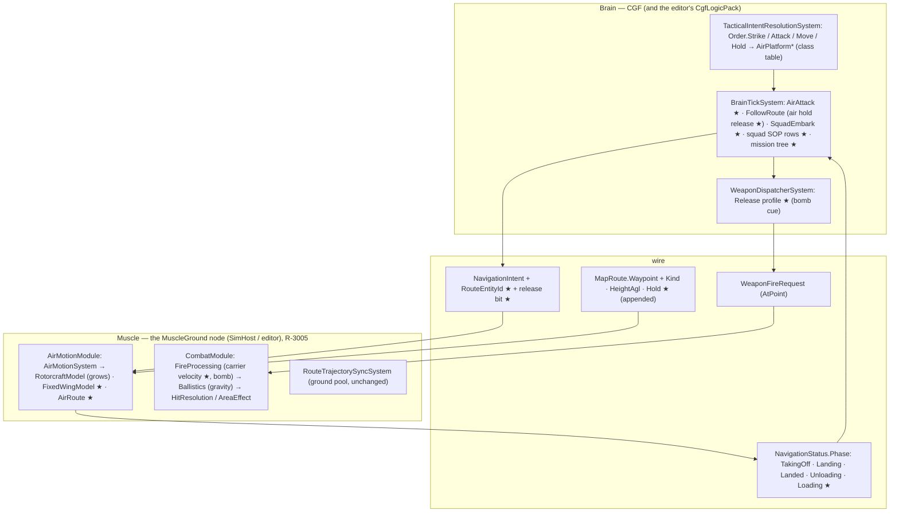
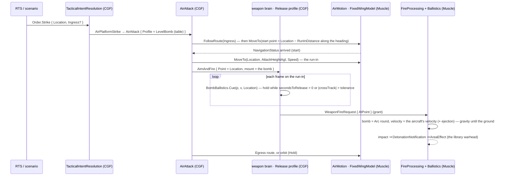
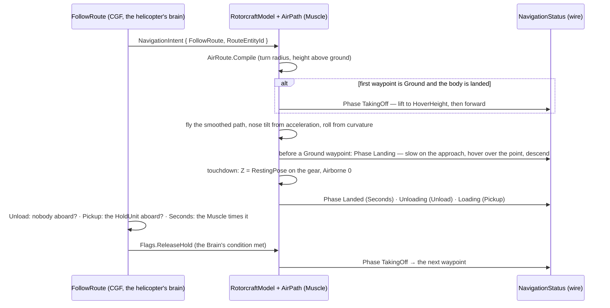
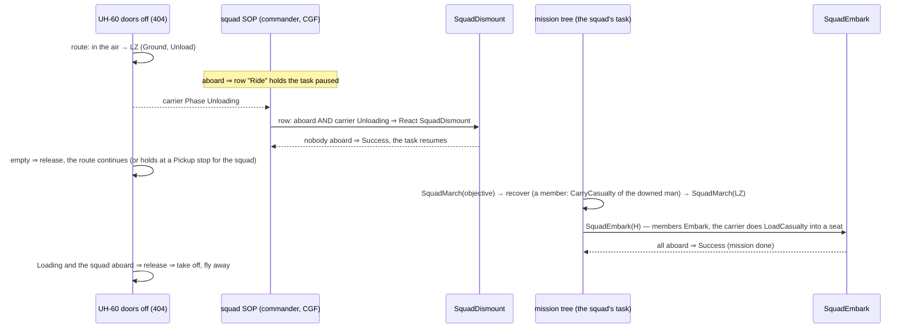

<!--STATUS
state: LIVE
updated: 2026-10-14
build-state: BUILDING (slice 3 first half built, §9a) — 🔒 user, 2026-10-14: A1–A9 "Approved" (with the laser out of slice 1), B1–B11 "Approved" (R-2015)
current-answer: §2 the picture (modules), §3 classes, §4 sequences, §5 the aircraft route, §6 flight models, §7 orders and the one attack behaviour, §8 the bomb, §9 the air assault and the rescue round trip, §10 decisions, §11 slices and rails — §1 is the measured ground.
stale-below: nothing.
known-rot: none.
known-conflict: DESIGN_FPV_Drone.md §2 draws FpvAttackNodes as its own behaviour — SUPERSEDED by B5 (the FPV attack is AirAttack's Dive profile); its Muscle half stands.
related-designs:
  - docs/designs/motion-models/DESIGN_Motion_Domains.md — OWNS IMotionModel, MotionModelTable, the Air module and R-3005 (one Muscle role); this file adds FixedWingModel (MD-H's "fail loudly" row) and grows RotorcraftModel
  - docs/designs/vehicle-tactics/DESIGN_FPV_Drone.md — OWNS the drone's Muscle half (impact, sound, broadphase); its Brain half becomes AirAttack's Dive profile here (B5)
  - docs/designs/vehicle-tactics/DESIGN_Missiles_And_Ammo.md — OWNS guided rounds (GuidedRoundSystem), loadouts and the weapon brain's ammo choice; this file adds the free-fall bomb and the Release profile beside them
  - docs/designs/routes-1/ROUTES1-DESIGN.md — OWNS RoutePlan / RouteWaypoint (Cartesian, ≤ 100 km) and their wire form MapRoute; this file adds waypoint kinds, height above ground and holds (§5)
  - docs/designs/navig-2/Navigation_Design_v2_0.md — OWNS NavigationIntent / NavigationStatus; this file adds the route reference on the intent (CE-2171) and air phases on the status
  - docs/DESIGN_Entity_Control.md — OWNS possession (R-270, R-271 (backend)); M-4 "pilot stick deferred" is answered here by the simple pilot models (§6)
  - docs/DESIGN_Orders_Params_Entity_Classes.md — OWNS orders and class resolution (R-273, R-278); this file adds the Strike order and the AirPlatform behaviours
  - docs/designs/group-maneuvers/DESIGN_Squad_Tactics.md — OWNS SquadDismount (§5a) and the squad SOP; this file adds SquadEmbark and the carrier rows (§9)
  - docs/DESIGN_Entity_Interactions.md — OWNS embarkation, seats and the person carrier (§7); the doors-off UH-60 (404) is its carrier
  - docs/DESIGN_Body_Geometry_And_Ground_Contact.md — OWNS RestingPose (landing on the gear); the helicopter's touchdown uses it
  - docs/DESIGN_Weapon_Layers.md — OWNS the three weapon layers (R-261); the bomb release is a weapon-brain profile
  - docs/DESIGN_Map_3D_Mode.md — §6m draws riders in the doors-off Black Hawk's doors and the jump down
  - docs/DESIGN_Operations_Behaviour_Catalogue.md — AIR-1 (precision strike) and AIR-2/3 are first built here
-->

# Air operations — aircraft routes, take-off and landing, one attack behaviour, the bomb, the air assault

🔒 **User, `2026-10-14`:** *"the motion model and behavior of aircraft, including some kind of air attacks … patterns … for airplanes and
also for helicopters … controllable from the first person shooter mode"* · *"JTAC instructed fighter drops a guided bomb on a given spot …
correct direction and correct speed"* → A1–A9 *"Approved"*, then: *"not necessary for the player to actively aim the laser … just about
showing the effect of aircraft incoming and dropping a bomb on given place"* · *"follow a predefined waypoint-based trajectory, something like
aircraft route"* · *"the motion dynamics might be faked just to look believable … AI driven aircraft might be simplified, not the same as what
the human pilot would use … controllable by non-expert person"* · *"different type of aircraft attacks … by parameters of one attack behavior
… for the real-time strategy mode, we need the order type of behavior to be the same for all the aircraft"* · *"automatic landing and takeoff
maneuvers for helicopters … part of the aircraft route"* · *"a helicopter incoming full of soldiers … land on a designated point … soldiers
disembark and … follow given orders"* · *"a rescue mission where the squad … returns back and embarks the helicopter, and the helicopter takes
off and flies away"* → B1–B11 *"Approved"*.

## 1. What exists — measured `2026-10-14`

| fact | code | design |
|---|---|---|
| a route is an entity (`RoutePlan`): waypoints with `Position` (Z carried), `TargetSpeed`, `ExtensionJson`; saved; on the wire as `MapRoute` (lat/lon/alt) | `RoutePlan.cs:14-87`, `MapDescriptors.cs:108-142`, `RoutePlanTranslator.cs:37-129` | Routes §113 (Cartesian, ≤ 100 km) |
| following a route = a LOCAL trajectory pool id the Brain waits for; the id never crosses the wire; the pool is built only on the Muscle | `CgfNodes.cs:318-331`, `SimHostCoreLogicPack.cs:121`, `SimDescriptors.cs` (no field) | — ⇒ **CE-2171** (confirmed on a split cluster `2026-10-14`, with a second cause: the route plan never reached SimHost — §5a) |
| the route draw tool writes altitude 0; the edit gizmo treats `Position.Z` as north | `ScenarioSpawnAdapter.cs:414`, `RouteWaypointGizmo.cs:19-21` | R-182 (Z-up) ⇒ **CE-2172** |
| `CornerRounding.Round` rounds a polyline to a turn radius (no navmesh ⇒ any shift allowed), XY arcs, Z interpolated | `CornerRounding.cs:40-70,161-163` | R-3006 |
| air motion: `RotorcraftModel` (point mass, instant velocity, straight at one 3-D point, Z-yaw only); `FixedWing` throws | `RotorcraftModel.cs:25-101`, `IMotionModel.cs:57-63` | Motion Domains MD-H |
| `NavigationStatus` (Muscle → Brain, on the wire) carries `Result`, `ProgressS`, a `Phase` byte | `SimDescriptors.cs:376-410` | Navigation v2 |
| `FlightState` (Airborne) is not replicated | none under `Hrot/Network` | — |
| every aircraft resolves orders through the class `AirPlatform` (helicopters, fighters, attack aircraft below it) | `EntityClassTable.cs:119-156` | R-278 (behaviors) |
| orders: Move (a point), Attack (an entity), Hold | `OrderKind.cs:9-17`, `OrderDtos.cs` | orders design D1 |
| rounds start at muzzle speed along the aim line — never the shooter's velocity; gravity only for Arc rounds; no drag | `FireProcessingSystem.cs:156`, `BallisticsSystem.cs:129-131` | — |
| the doors-off Black Hawk (404): `Gen.Carrier` Open, 8 door seats; the plain UH-60 (400) carries nobody | `BdcTkbCatalog.cs:376-382`, `TkbEntityTypes.cs:56-57` | Map 3-D §6m (CE-1083) |
| a squad dismounts by `SquadDismount` (SOP row: under fire AND aboard); a reaction pauses the task, which resumes after it | `SquadDismountBehavior.cs`, `BasicInfantrySopTests` | Squad Tactics §5a |
| `CarryCasualty` takes ANY man who is down, by network id; `TryEmbark` seats an incapacitated man in a vehicle (no injury check for a vehicle) | `EmbarkBehaviors.cs:83-105`, `Embarkation.cs:99-122` | Entity Interactions §7.4 |
| a mission phase is `{ BehaviorId, Trigger, TriggerParam }` — no per-phase params | `MissionComponents.cs:42-60` | CE-456 |
| a BTree hosts library behaviours with their own params (hosted-subtree binding) | CE-439, S5a/S5b | Unified Behaviour Run |

### INVENTORY — the queries run

| query | total | the set |
|---|---|---|
| `search_graph .*(Rotorcraft\|FixedWing\|Aircraft\|Flight\|Airframe\|Helicopter\|AirMotion).*` (Class) | 16 (6 production) | `AirMotionSystem`, `AirMotionModule`, `FlightParams`, `FlightParamsDto`, `FlightState`, `FlightTkbTranslator`, `RotorcraftModel` (+ tests, flight recorder) |
| `search_graph .*(Ballistic\|Bomb\|Projectile\|Guided\|Missile\|Trajectory\|Release).*` (Class) | 51 | `BallisticAim`, `BallisticsSystem`, `BallisticProjectile`, `GuidedRound`, `GuidedRoundSystem`, `GuidedWeaponProfile`, `MissileDto`, `CustomTrajectory`, `TrajectoryPoolManager`, `RouteTrajectoryCache`, `RouteTrajectorySyncSystem` (rest: tests, examples, presentation) — **no bomb** |
| `search_graph .*(Jtac\|FireSupport\|CallForFire\|Strike\|Designation\|Laser\|Orbit\|Loiter).*` (Class) | 5 | order designations only (`OrderDesignations`, overlay, mapper) — **no strike, no air tasking** |
| corpus sweep (`docs/`, `.dev/`) for CAS / JTAC / bomb / strafe / gun run / helicopter attack / loiter | 0 designs | catalogue AIR-1…AIR-4 lines only |

⇒ reused: the route entity, corner rounding, `IMotionModel` + the Air module, the order resolver and the `AirPlatform` class, the weapon
brain, `BallisticsSystem`'s gravity, the warhead library, embarkation, `SquadDismount`, `CarryCasualty`, hosted behaviours. New: the items
drawn ★ below.

## 2. Who runs it

*What the picture shows that prose hid: the route is followed WHOLE on the Muscle (where the route entity, the terrain and the body are),
and only three things cross the wire — the route reference and a release bit going down, the air phase coming up. The Brain never
flies the aircraft point by point, so landing and take-off timing never depend on network latency. Every box marked ★ runs in a pack
that already executes each frame (`SimHostCoreLogicPack` registers `AirMotionModule` and `CombatModule`; `CgfLogicPack` runs the brain
and the weapon dispatcher) — no group that nobody ticks.*

## 3. Classes

*What the picture shows that prose hid: there is ONE path type (`AirPath`, compiled from the route entity by `AirRoute` reusing the
road-path `CornerRounding`) and BOTH flight models follow it — a helicopter and a plane differ only in their turning radius, their hover
and their attitude. The attack behaviour is one node whose PROFILE is picked by a table over things that already exist (the aircraft's
locomotion, the weapon `AmmoChoice` picks, the target), so the strategy-mode order stays the same for every aircraft.*

## 4. Sequences

### 4a. A strike on a point (slice 1: a plain bomb, released exactly)

*The AI's release is exact because the predictor steps the same gravity the flight uses (`BallisticsSystem`), so slice 1 needs no
guidance. A guided bomb arrives with the player's bombing (§8).*

### 4b. A helicopter route with a landing and a take-off

### 4c. The air assault and the rescue round trip

*Insert-only is the first five rows; the round trip adds the last five. The follow-up order is simply the squad's task — no special
air-assault order.*

## 5. The aircraft route (B1, B7)

| rule | why |
|---|---|
| the route is the existing `RoutePlan` entity; a waypoint gains `Kind { Pass, Ground }`, `HeightAgl` (> 0 ⇒ a flyer holds that height above the terrain; 0 ⇒ `Position.Z` as today), `Hold { None, Seconds, Unload, Pickup }`, `HoldSeconds`, `HoldUnit` (network id) | B1: one route type; a ground unit ignores the new fields |
| the wire: the fields are APPENDED to `MapRoute.Waypoint` (R-169, reported); the scenario save writes them (`RoutePlanTranslator`) | the route is already replicated; the Muscle must have the kinds to land |
| `NavigationIntent` gains `RouteEntityId` (the route's network id, appended); `FollowRoute` writes it; the Muscle compiles its own path (air) or pool id (ground) | ⭐ fixes CE-2171 for ground units too; the local pool id stays local |
| `AirRoute.Compile`: the waypoints → horizontal arcs of the aircraft's turn radius (`CornerRounding.Round`, navmesh null) → heights sampled above the terrain (`GroundHeightAt`) at each point, blended linearly along the path | B2: a smooth path the AI follows exactly; the existing rounding, no second smoother |
| a **Ground** waypoint: the helicopter lands on it (Landing → touchdown on `RestingPose` → Landed / Unloading / Loading) and takes off when the hold ends; a route that STARTS on a Ground waypoint with the body landed takes off first | B7: the user's "if it starts on the ground … take off; ends on the ground … land" |
| holds: **Seconds** is timed by the Muscle; **Unload** (nobody aboard) and **Pickup** (`HoldUnit`'s members aboard) are judged by the helicopter's Brain (it knows rosters), which sets `Flags.ReleaseHold` | the Muscle has no rosters; one bit on an existing field |
| a fixed-wing aircraft ignores Ground waypoints in v1 (warning) and orbits the last point (B9) | no runways yet |
| the editor (ui, CE-2172): the gizmo fixed to Z-up, plus per-waypoint height, kind and hold | the route tools cannot set a height today |

### 5a. As-built — slice 1 (E2, `2026-10-14`)

*What the picture shows that prose hid: the Muscle resolves the route through a seam, because `Fdp.Toolkits` (the bridge) cannot
reference `RoutePlan` (Hrot.Core) — and the plan only reaches the Muscle because the MapRoute pair now sits in the pack EVERY role runs.*

| as built | why / deviation |
|---|---|
| ⭐ **deviation:** the waypoint enums (`RouteWaypointKind`, `RouteHold`) and an `IRouteSource` seam live in `Fdp.Toolkits` (`Navigation/RouteSource.cs`); Hrot.Core implements it (`HrotRouteSource`), SimHost injects it (`SimHostCoreLogicPack`) | the bridge and the slice-2 air follower are in `Fdp.Toolkits`, which cannot see `RoutePlan`; the seam keeps the route model in Hrot.Core |
| the brain's `FollowRoute` writes `RouteEntityId` and no longer waits for a local pool id when it has one (`Action_WriteFollowRouteChannel`) | the pool id is LOCAL; an in-process host (no route network id) keeps the old path |
| the bridge uses ITS OWN pool id for `RouteEntityId`, only from a cache compiled at the plan's current `Version`; until then the order is PENDING and retried each tick (cleared on time travel) | the route can arrive after the order (separate topics) |
| ⭐⭐ **CE-2171 had a SECOND cause, confirmed on a split cluster:** `MapRouteEgressTranslator` was only in `KinematicTranslatorPack` (Muscle) — a scenario route is created and owned by CGF, so SimHost never got the plan. Both MapRoute translators moved into `SharedTranslatorPack` | 📄 ROUTES1 §6 always said "SimHost + IG"; the `MapVisualOverlay` pair made the same move |
| wire (R-169): `MapRoute.Waypoint` + `Kind`, `HeightAgl`, `Hold`, `HoldSeconds`, `HoldUnit` (appended); `NavigationIntent` + `RouteEntityId` (appended). The save writes the air fields only when set (enums as strings) | old scenarios and old samples read as Pass / no hold |
| rails: `RoutePlanTranslatorTests.B1_TheAirFields_RoundTrip_AndAPlainWaypointKeepsTheDefaults` · `MapRouteTranslatorTests.B1_TheAirFields_CrossTheWire_OutAndIn` · `NavigationIntentEgressTranslatorTests.CE2171_AFollowRoute_PublishesTheRouteEntity` · ⭐ `EntityOrdersAcrossNodesTests.CE2171_AFollowRoute_OnASplitCluster_DrivesTheRoute` (CGF brain, SimHost body, a scenario route) | the integration rail is the CE-2171 confirmation: red at the base, green after |

## 6. Flight models (A1, A8, A9, B2, B3)

| model | Autonomous (AI) — "faked to look believable" | Manual (player) — "controllable by a non-expert" |
|---|---|---|
| **RotorcraftModel** (grows) | follows `AirPath`; speed eases with an acceleration limit (no instant velocity); nose pitch ∝ −acceleration, roll ∝ curvature × speed²; the take-off / approach / hover / descend / touchdown phases (§5) | today's controls + hover hold when the keys are released + the same tilt drawn |
| **FixedWingModel** ★ | follows `AirPath` kinematically at `CruiseSpeed` (≥ stall); bank = atan(v²·κ / g) eased by a roll rate; pitch = the path's climb angle; overflies a point (never stops) | **mouse-aim**: the plane turns toward the camera's look — the model banks itself (coordinated), levels out when centred, cannot stall (speed ≥ `StallSpeed`), throttle on W/S; on the existing `ManualDrive` fields (Yaw = look heading, Vertical = desired pitch, Forward = throttle), no wire change |

| rule | why |
|---|---|
| the AI and the player use DIFFERENT controllers on one body state (`SimTransform`, `SimVelocity`, `FlightState`) | B2/B3: the user allowed them to differ; a hand-over (possess / release) keeps the pose |
| the attitude is in `SimTransform.Rotation` (yaw · pitch · roll) | the 3-D map and the IGs draw what the body says — a banking plane looks like one |
| turning radius: plane `v² / (g·tan MaxBank)` (150 m/s at 60° ≈ 1.3 km); helicopter a fixed `TurnRadiusM` (~60 m) | the route's arcs and the run-in geometry use the same number |
| the first plane type is an **attack aircraft** (A-10 / Su-25 class, ~150 m/s), not the F-16 | map scale: an F-16 needs several km to turn |
| the station: a `ControlScheme.FixedWing`; the camera follows the body's attitude (both flyers); the HUD per scheme (speed, height, heading; bomb cue later) | Entity Control M-4 answered; the camera today is yaw-only (`PossessionStation.cs:262-269`) |

## 7. Orders and the one attack behaviour (B4, B5)

| order (one set for every aircraft) | resolves to (`AirPlatform<Order>`, R-278) | what it does |
|---|---|---|
| **Move** (point) | `AirPlatformMove` | fly there at the type's cruise height; arrive = hold there (orbit / hover) |
| **Follow route** (existing `FollowRoute`) | unchanged name, air arm | §5 |
| **Hold** | `AirPlatformHold` | a plane orbits where it is; a helicopter hovers |
| **Attack** (entity) | `AirPlatformAttack` → `AirAttack` | the profile from the table, the target tracked |
| **Strike** ★ (point; optional target entity, ingress, egress) | `AirPlatformStrike` → `AirAttack` | the profile from the table, the point fixed |

`AirAttackProfiles.Pick(locomotion, the mount AmmoChoice picks for the target, target kind)`:

| aircraft | best mount for the target | profile |
|---|---|---|
| plane | Bomb | **LevelBomb** (slice 1) · DiveBomb (an unguided bomb vs a small target, later) |
| plane | Gun · Rockets | GunRun · RocketRun |
| helicopter | Atgm, target armour | PopUp (the V4 exposure cycle, vertical: hide low, climb to sight, fire, sink) |
| helicopter | Rockets · Gun (fixed) | RunningFire |
| helicopter | a side-traversing turret | DoorGunOrbit |
| drone (FPV) | its warhead | Dive (FPV §3's sequence; B5) |

| rule | why |
|---|---|
| a params DTO (`AirAttackParams`) carries the profile and every number; an asset or a scenario overrides any of them, including the profile (R-3001); 0 / NaN = automatic | the user: "by parameters of one attack behavior"; RTS sends only the order |
| **Strike** is a new order kind (`OrderKind.Strike`, `[Order(Gesture = GroundClick)]`), the first after Move / Attack / Hold | Attack takes an entity (`OrderDtos.cs:46-54`); mortars / artillery can fulfil Strike later (catalogue AIR-1 / SQD-9) |
| the run-in: start point = the target − `RunInDistanceM` along `RunInHeadingDeg` (automatic: from the aircraft's bearing); `RunInDistanceM` ≥ 2 turn radii | A2: the heading comes from geometry, not from the movement order |
| weapons: the behaviour flies, the weapon brain fires (R-261) — the gun / rocket runs fire when the target is in the nose cone and in range; the bomb by the Release profile (§8) | one weapon path for the AI and the player |
| FPV §2's `FpvAttackNodes` / `FpvAttackState` are NOT built; the drone's attack is the Dive profile with the same phases (Route → Search → Pursue → Dive) and `DroneTargetDecision` as its target pick | B5: one air-attack loop |

## 8. The bomb (A3, A4, A6, B6)

| rule | why |
|---|---|
| a bomb is a munition (Mk-82 class, 500 lb, id 6022) whose warhead is `Indirect` + area (copied from the warhead library's nearest entry) and a mount category `Bomb` | the Arc path already applies gravity and lands area warheads (`BallisticsSystem.cs:129-206`) |
| `FireProcessingSystem`: a shooter in the **Air domain** launches with its own velocity added (a bomb: the carrier's velocity + 1 m/s down; a gun / rocket: + its muzzle speed) | A4: ground shooters unchanged (no combat number moves) |
| `BombBallistics.Impact / Cue` step the SAME gravity at the SAME `dt` as `BallisticsSystem` (no drag) ⇒ the predicted impact is the real one | A3: one predictor; drag later keeps them identical |
| the weapon brain's **Release** profile: the grant waits while `secondsToRelease > 0` or the cross-track miss > the tolerance (10 m); then one bomb per pass | A6 / R-261: the behaviour flies, the weapon releases — the same for a player who holds the trigger |
| slice 1: unguided, exact AI release. Later: a GPS bomb = a new `GuidanceKind.Coordinate` in `GuidedRoundSystem` (predict the impact each frame, push sideways ≤ 1.5 g against the miss, gravity kept) — for the player's imprecise release; the laser (the designator as the round's "gunner") later still | the user: the laser is out of the first slice |

## 9. The air assault and the rescue round trip (B8, B10, B11)

| piece | rule | basis |
|---|---|---|
| the carrier | the doors-off UH-60 (404, 8 open seats) | built by ui (CE-1083) |
| riding | squad SOP row **Ride**: a member aboard ⇒ a reaction that holds (keeps the task paused); placed after the dismount row | the existing pause / resume of a reaction |
| getting out | squad SOP row: a member aboard AND the carrier's phase `Unloading` ⇒ React `SquadDismount` (existing) | Squad §5a; `Unloading`, not "landed", so a squad that has just boarded at a `Pickup` stop is not dismounted again |
| the follow-up | the squad's ordinary task (an order or the mission tree) resumes when the reaction ends | the user: "follow given orders … after disembarking" |
| boarding | ★ `SquadEmbark` (library, the mirror of `SquadDismount`): each member `Embark(vehicle)`; Success when all are aboard; Failure on a timeout | B10 |
| the casualty | a member carries the downed man (`CarryCasualty`, existing — any man down); at the vehicle ★ `LoadCasualty` puts him into a seat (`TryEmbark` seats an incapacitated man in a vehicle), so nobody boards while carrying | measured: a carrier boarding would nest the casualty |
| the mission | ★ an authored mission tree (BTree asset): Sequence { SquadMarch(objective) · SquadRecover(casualty) · SquadMarch(LZ) · SquadEmbark(helicopter) }, each step with its own params | B11: mission phases carry no per-step params (`MissionComponents.cs:42-60`) |
| the wait | the LZ waypoint: Hold `Pickup`, `HoldUnit` = the squad ⇒ the helicopter's brain releases when the squad's members (and the loaded casualty) are aboard | B10 |
| seats | 5 soldiers + 1 casualty ≤ 8 | the wire's 8 (`InteractionComponents.cs:16`) |

`SquadRecover` = the squad casualty-care play (Squad Tactics §7.4) pointed at a named casualty; ⚠ that the play accepts a non-member is
measured at build (the rule it calls, `CarryCasualty`, does).

### 9a. As-built `2026-10-14` — slice 3, first half (behaviors): `SquadEmbark` and `LoadCasualty`

| design said | built | why |
|---|---|---|
| ★ `SquadEmbark` (library, mirror of `SquadDismount`) | ✅ `SquadEmbarkBehavior` + `SquadEmbarkPlay` over `SquadEmbarkManeuver` (ManeuverKind **13**, one phase `In`, roles Boarding / Loading); `SquadEmbarkParamsJsonDto { vehicle, timeoutSeconds (0 ⇒ 60), speed }`; `MemberOrderKind.Embark = 6` with `MemberOrder.Target` = the vehicle; `SquadManeuverRunner.Board` | Success = every live member aboard THAT vehicle and carrying nobody (`AboardIt`; a unit member: all its members); Failure = the vehicle gone or the timeout |
| who gets what | a soldier → `Embark`; a soldier carrying a man → `LoadCasualty`; a unit member → `SquadEmbark` | the runner decides by `Embarkation.LoadOf`, so the play has one order kind |
| ★ `LoadCasualty` | ✅ the shared node `CarryNodes.LoadCasualty` (walk to the boarding point carrying → `PutDown` (action 10) → board HIM: action 1 with the new `EmbarkParams.Passenger`) + the library behaviour `LoadCasualty` = Sequence { `LoadCasualty`, `Embark` (self) } | ⚠ cross-lane, additive: `EmbarkParams.Passenger` (Fdp.Toolkits, appended; Null ⇒ the runner itself, so every existing caller is unchanged); the range is checked from the boarding man, the command names him |
| rails | `SquadManeuverTests.CE2173_SquadEmbark_EveryMemberIsToldToBoard_DoneWhenAllAreAboardThatVehicle` · `CE2173_SquadEmbark_ACarrierLoadsHisCasualtyFirst_AStragglerTimesOut_AGoneVehicleFails` · `EmbarkNodesTests.CE2173_LoadCasualty_PutsTheCarriedManDown_AndSeatsHimInTheVehicle` · `CuratedBehaviorRegistrarTests.SR_R2` (+2 names) | red-proved by 4 mutants: "aboard any vehicle", the carrier given plain Embark, the man not named as the passenger, the put-down skipped |

⭐ **Slice 5, first part — the order set (behaviors, `2026-10-14`):** `OrderKind.Strike = 4` + `StrikeOrder { Location (required), Target }`
(no RTS gesture — a ground click stays a Move); `AirPlatformMove` (every `AirPlatform`: the shared node `AirOrderNodes.FlyTo` issues ONE
3-D MoveTo to the point at `HeightAgl` above the ground — default 120 m — with a stated Z, then reports the move). 📐 Found: before it an
aircraft's Move resolved to `PlatformMove`, which moves ON THE SURFACE — a helicopter flew down to the ground point. Rails
`AirOrderNodesTests.B4_FlyTo_*`, `TacticalIntentResolutionSystemTests.B4_EveryAircraftsMove_*` (red before), `OrderVocabularyTests` (Strike
has one DTO), SR_R2 +1 — 3 mutants red. ⏸ `AirPlatformAttack` / `AirPlatformStrike` arrive with `AirAttack` (needs E4); a Strike to an
aircraft is refused until then. `AirPlatformHold` waits for the plane (a helicopter's `PlatformHold` already hovers).

Still open in slice 3 (they need backend's E2 / E3): the squad SOP's Ride and dismount-on-`Unloading` rows, the helicopter brain's hold
release, the mission tree, `SquadRecover`, and the two scenarios.

## 10. Decisions — 🔒 APPROVED `2026-10-14` (R-2015)

| id | decision | rejected |
|---|---|---|
| **A1** | plane: a bank-to-turn point mass in the Air module | full flight dynamics · the helicopter model with a minimum speed |
| **A2** | the run-in heading is geometry the behaviour lays out | an arrival heading on the movement order |
| **A3** | bomb: gravity, no drag; one predictor stepping the flight's own gravity | a closed form that drifts once drag exists |
| **A4** | only Air-domain shooters add their velocity to a launch | every shooter (moves ground numbers) |
| **A5** | guided bombs are guidance kinds in `GuidedRoundSystem` (GPS slice later; laser later still) | a second steering system |
| **A6** | the weapon brain releases (Release profile), the same for AI and player | the behaviour releases (breaks R-261) |
| **A7** | JTAC: ⛔ **not in slice 1** (user) — later: a designator type, Strike with clearance, the laser as the round's "gunner" | — |
| **A8** | player plane: mouse-aim on the existing `ManualDrive` fields | new stick axes on the wire |
| **A9** | helicopter: acceleration and tilt; pop-up reuses the V4 exposure cycle | a separate helicopter combat behaviour |
| **B1** | the existing route entity + waypoint kinds + height above ground + holds; followed whole on the Muscle; the intent carries the route | the Brain feeding points one by one · a separate air-route type |
| **B2** | AI flight: follow the pre-smoothed path exactly; attitude derived from the curve | simulated dynamics for the AI |
| **B3** | player flight: simple — mouse-aim plane that cannot stall; helicopter + hover hold | stick-and-rudder |
| **B4** | one order set for every aircraft; one new **Strike** order; one `AirAttack` whose resolver picks the profile | a behaviour per pattern as orders · Attack taking a point |
| **B5** | the FPV attack is AirAttack's Dive profile | a separate drone attack behaviour |
| **B6** | the first bomb is unguided with an exact AI release | GPS guidance now |
| **B7** | take-off and landing by the motion model from the waypoint kinds, touchdown on the gear | the behaviour flies the landing |
| **B8** | the air assault is squad SOP rows (ride; dismount when the carrier is Unloading); the follow-up is the squad's task | the helicopter ejects everyone · a special air-assault order |
| **B9** | planes do not land in v1 (start airborne, orbit the route's end) | runways and taxiing |
| **B10** | `SquadEmbark` drill; the LZ holds until the named unit is aboard | the helicopter loads the squad · a timed hold |
| **B11** | the rescue is an authored mission tree | a hard-coded rescue behaviour |

## 11. Slices and rails — in the features' own suites

| # | lane | slice | rails |
|---|---|---|---|
| **1** | backend | waypoint fields (ECS, save, wire) · `NavigationIntent.RouteEntityId` · ground `FollowRoute` resolves its pool on the Muscle (CE-2171) | `RoutePlanTranslatorTests` (the new fields round-trip) · `MapRoute*TranslatorTests` · a `--mode all` FollowRoute run (CE-2171 confirmed, then green) |
| **1** | ui | the route gizmo Z-up + height / kind / hold per waypoint (CE-2172) | the gizmo's own suite |
| **2** | backend | `AirRoute` + `AirPath`; `RotorcraftModel` route follower, acceleration, tilt, take-off / landing / holds, `NavigationPhase` air values, `ReleaseHold` | `RotorcraftModelTests`: `B7_ARouteFromTheGround_TakesOff_FliesAndLands_OnItsGear` · `B7_AGroundWaypoint_HoldsUntilReleased_ThenTakesOff` · `B2_TheSmoothedPath_PassesEveryWaypoint_WithinTheTurnRadius` |
| **3** | behaviors | squad SOP Ride / dismount-on-Unloading rows · `SquadEmbark` · `LoadCasualty` · the helicopter brain's hold release · scenarios **`ua-air-assault`** (insert) and **`ua-air-rescue`** (round trip) | `SquadManeuverTests` (embark drill, timeout) · `BasicSquadSopTests` (ride, dismount on Unloading, no re-dismount at a Pickup) · live in `SquadTacticsScenarioTests` |
| **4** | backend | `FixedWingModel` (Autonomous) + an attack-plane type · Air-domain launch velocity · the Mk-82 munition + `Bomb` category · `BombBallistics` · the Release profile | `FixedWingModelTests` · `FireProcessingSystemTests.A4_AnAircraftsBomb_KeepsItsVelocity_AGroundShotDoesNot` · `BombBallisticsTests.A3_ThePredictedImpact_IsTheFlownImpact` · `AimAndFireExecutorTests.A6_TheReleaseProfile_WaitsForTheCue` |
| **5** | behaviors | `OrderKind.Strike` + `StrikeOrder` · `AirPlatformMove / Hold / Attack / Strike` · `AirAttackProfiles` · `AirAttack` (LevelBomb first) · scenario **`ua-air-strike`** | `OrderVocabularyTests` (Strike has one DTO) · `TacticalIntentResolutionSystemTests.B4_EveryAircraft_ResolvesStrike_ToAirPlatformStrike` · `AirAttackNodesTests.B6_ALevelBombRun_HitsThePoint` |
| **6** | backend + ui · behaviors | the pilot models + `ControlScheme.FixedWing` + the camera attitude + HUD · then GunRun / RocketRun / PopUp / RunningFire / Dive (FPV) | per profile, in `AirAttackNodesTests`; possession in `PossessionTests` |

Slices 2 and 4 can run side by side on backend; slice 3 needs 1–2; slice 5 needs 4.
