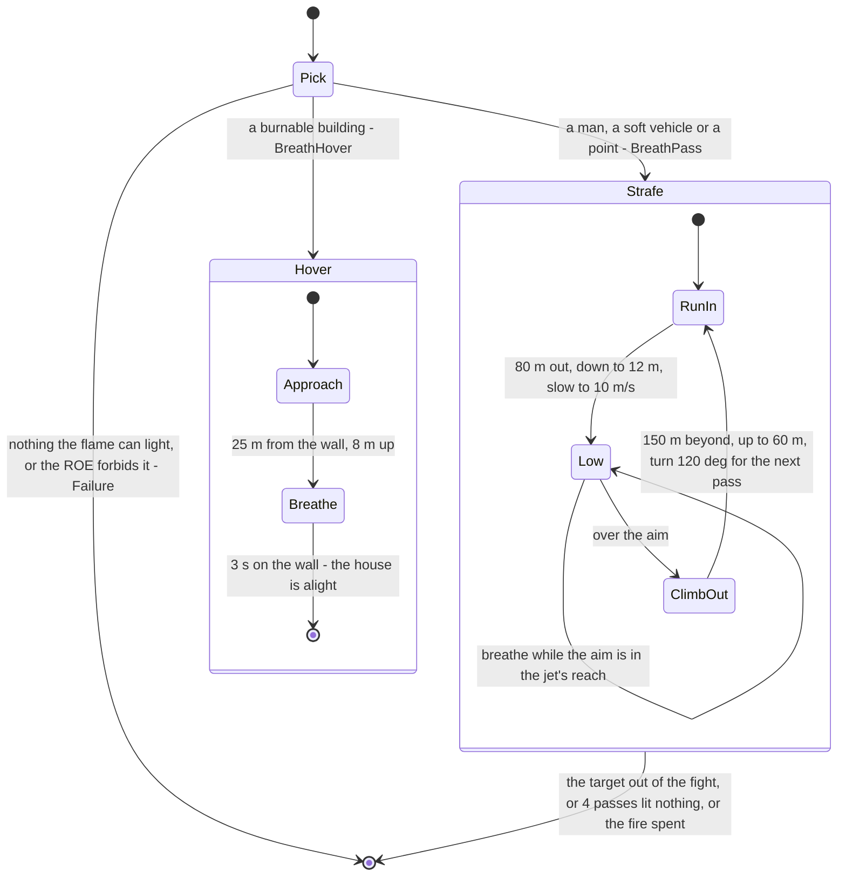
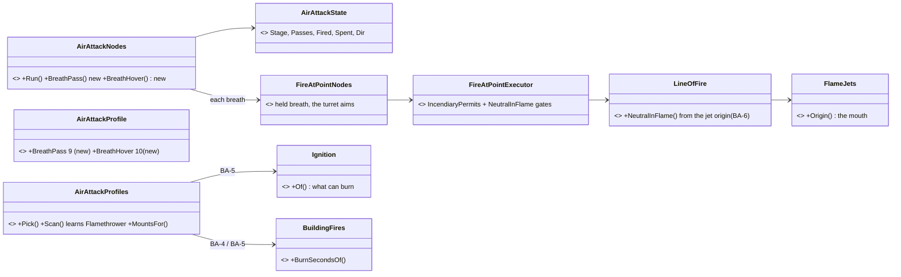
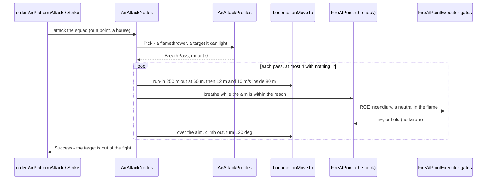
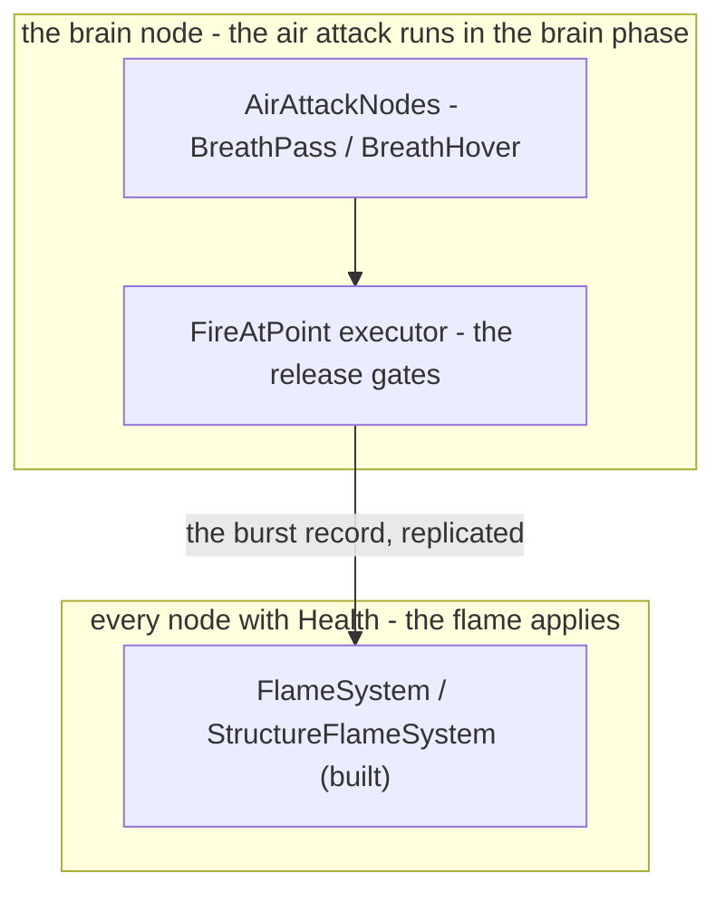

<!--STATUS
state: LIVE — ✅ BUILT 2026-11-19 (exp/agg-backend, on the user's go-ahead R-8012: "continue on the attack pattern … including the behavior part")
updated: 2026-11-19
build-state: BUILT — BA-S1, BA-S2, BA-S3, BA-9 the flame helicopter (§7 as built)
current-answer: §7 as built (where it differs from §2–§5, §7 wins) · §2 decisions BA-1…BA-10 · §3 UML · §5 slices and scenarios
stale-below: none
known-rot: §5 BA-10 "built by behaviors" — built by exp/agg-backend at the user's request (R-8012); §4's "80 m out" is now "80 m + the let-down distance" (§7)
known-conflict: DESIGN_Dragon.md DR-8 named one profile, `BreathPass`; this design splits it into a strafing pass and a hover for buildings (BA-1) — DR-8 points here
related-designs:
  - ../fun/DESIGN_Dragon.md — OWNS the dragon (R-3112); its D-2 slice is this design's build; DR-8 was the starting point
  - DESIGN_Air_Operations.md — OWNS the air attack this adds two profiles to (§7 orders, §9d RunningFire, §9f DoorGunOrbit, §7e the missile evasion, §7b W3 the excluded mounts)
  - ../weapons/DESIGN_Flame_Weapons.md — OWNS the flame (FlameJets, Ignition, F-9 the Protocol III hold, F-3 a building's 2 s); this decides only how a FLYER delivers it
-->
# DESIGN — the breath attack: how a dragon (or a flame helicopter) attacks on its own *(backend, `2026-11-19`, CE-3490)*

> 🔒 **User, `2026-11-19`:** *"record a task that we need to design the attack pattern for the dragon and helicopter with dragon breath for autonomous
> attack."* · *"go ahead with the CE-3490 design"*

## 0. The picture

*What the picture shows that prose hid:* the strafe **flies over** its target — unlike RunningFire, which breaks off 400 m short, because the breath
reaches 50 m; and a pass that lights nothing is not a failure until the fourth.

## 1. INVENTORY *(measured `2026-11-19`)*

Queries: `search_graph name_pattern=.*(AirAttack|Breath|Strafe|Flame).*` label Class → 5 (`AirAttackNodes`, `AirAttackParams`, `AirAttackProfiles`,
`AirAttackState`; ⚠ the flame classes were missing — the graph predates them; grep found them); corpus grep for *strafe / hover fire / breath*
in `docs/` and `.dev/` → no breath or strafe design (Air Ops §1 records the same for CAS). ⚠ `check_index_coverage` is not available through the CLI.

| piece | exists | where |
|---|---|---|
| the air attack: stages, passes, the window, the egress, an entity's point refreshed | ✅ | `AirAttackNodes.Run` (`AirAttackBehaviors.cs:301-1185`), `AirAttackState` (`:88`) |
| the profile pick from the aircraft's weapons and the target kind | ✅ | `AirAttackProfiles.Pick` (`:158-188`); `Scan` sees bombs, rockets, guns — ⛔ never `Flamethrower` (`:244-250`) |
| mounts passed over: dry, or endangering others (W3) | ✅ | `excluded` = `ws.Spent \| Endangering(...)` (`:995`) |
| a hover over a point, then home | ✅ | `HoverDrop` (`:1148`), `HoverOver` |
| the release gates on every `FireAtPoint`: the ROE's incendiary rule, Protocol III for a flame | ✅ | `FireAtPointExecutor.cs:308` (`IncendiaryPermits` ⇒ `HoldIncendiary`), `:324` (`NeutralInFlame`) |
| ⚠ `NeutralInFlame` measures from the body's CENTRE, in 2-D | ⚠ ~9 m short on a dragon | `LineOfFire.cs:55-66` (found building D-1) |
| what the flame can light | ✅ | `Ignition.Of` — person, soft vehicle; an aircraft or an armoured hull never; a building by `BuildingFires.BurnSecondsOf` |
| the missile evasion of any air attack | ✅ | Air Ops §7e (`ws.EvadeUntil`) |
| where the jet leaves | ✅ | `FlameJets.Origin` — the mouth (D-1, DR-5) |

## 2. Decisions — each with a lean *(for the user's approval)*

⭐ **The proven solution for this problem class:** a close-range area weapon on a flyer is delivered by a **low strafing pass along the target**
— attack-helicopter *running fire* doctrine (keep moving, don't hover in the threat), and the pattern games use for flying fire-breathers (a
breath sweep on a low pass, then climb and come round). A **hover** is the exception, for a target a pass cannot hold the jet on long enough —
a wall that needs 2 s of flame. ⭐ We adopt both, each with its measured reason below.

| # | question | ⭐ lean | rejected — the one fact that killed it |
|---|---|---|---|
| **BA-1** | how many patterns | ⭐ **two profiles**: `BreathPass` (strafe — people, soft vehicles, a point) and `BreathHover` (a burnable building) | one hover-only pattern — it stands still inside every rifle's range; RunningFire reused — it flies at 60 m and breaks off 400 m short, the breath reaches 50 m |
| **BA-2** | the pass | ⭐ run in from 250 m at 60 m above ground; **80 m out drop to 12 m and slow to 10 m/s**; breathe (a held `FireAtPoint` on the target, the neck turret aiming) while the aim is inside the jet's reach (its warhead's `FlameRangeM`, from the mouth); **fly over** it; 150 m beyond climb to 60 m and come back on a bearing **120° round** from the last (never the same line twice) | a fixed run-in line — the second pass would meet the fire the first one woke |
| **BA-3** | which line through a group | ⭐ for a point (a Strike): along the long axis of the hostile men it remembers within 30 m of the point (a line of men burns in one pass); none ⇒ straight from where it is | the nearest man's bearing — a pass through one man where five stand in a row |
| **BA-4** | the hover | ⭐ a building strike (`StrikeTargetKind.Building`) or a burnable building at the point: hover **25 m off its nearest burnable wall, 8 m up**, breathe at the wall **3 s** (F-3's 2 s + a margin), then home — `HoverDrop`'s shape | strafing a house — at 10 m/s the jet holds one wall ~1.5 s, under F-3's 2 s |
| **BA-5** | what it breathes on | ⭐ only what the flame can light — `Ignition.Of` (a man, a soft vehicle) and a building with `BurnSeconds > 0`; an armoured or air target ⇒ the flame mount is passed over (`excluded`) ⇒ the other weapons' profile, or no profile ⇒ the attack fails, logged | breathing on a tank — the one ignition rule says it never burns: wasted passes under its gun |
| **BA-6** | ROE and civilians | ⭐ **unchanged gates, one fix**: every breath goes through `FireAtPoint`, which holds it on the ROE's incendiary rule and on a neutral anywhere in the flame (F-9); ⭐ `NeutralInFlame` moves to the jet's **origin** (`FlameJets.Origin`, the mouth) and its 3-D aim, so the hold covers the reach the jet really has; a ROE forbidding incendiaries puts the flame mount in `excluded` at the pick. A held breath is no failure: the pass flies on and counts toward BA-2's four | a dragon-only civilian rule — the flame already has the one (F-9, R-3111) |
| **BA-7** | under fire | ⭐ the existing missile evasion (§7e) — nothing new; between passes it is at 60 m and moving | a "hit ⇒ break off" rule — no measured need (the dragon is 1 500 health, 10 mm), and it would make every pass abortable by one rifle |
| **BA-8** | who flies it | ⭐ **any rotorcraft whose mounts include a flamethrower**: `Scan` learns `Flamethrower`; flame only ⇒ BA-1's two; a mixed loadout (a flame helicopter with a gun) ⇒ the breath for what BA-5 lets it light, `RunningFire` with its other weapons for the rest | per-type code — the pick is by capability, as every air profile |
| **BA-9** | a product "flame helicopter" | ⭐ **not now** — the rails prove BA-8 with a test type; a product type only if you want one (a question below) — ⚠ **SUPERSEDED: built, user `2026-11-19` "Sure i want flame heli" (§7, R-8013)** | — |
| **BA-10** | where it is built | ⭐ behaviors (the air behaviours' owner): the two profiles, `Scan` / `Pick`; backend: BA-6's origin fix in the shared combat code | — |

## 3. UML

*What it shows:* nothing new outside the air attack except one call inside `NeutralInFlame`; the two profiles reuse its stages, its pass
count, its window and its `excluded` mask.

*What it shows:* the attack and the release gates run where the brain runs; the flame itself is already applied where Health and the building
records live (FL-1…FL-4) — the profile needs no new system, so no host can lack it.

## 4. The numbers *(starter — the scenarios tune them)*

| | value | from |
|---|---|---|
| run-in | 250 m out, 60 m above ground | above small-arms' best band, inside the turn radius ×8 |
| breath height · speed | 12 m · 10 m/s from 80 m out | 12 m puts a 50 m slant at ~48 m ahead with the neck 14° down; ~5 s with the aim in reach ⇒ a man (0.3 s) and a car (1.5 s) light |
| climb-out | 150 m beyond, to 60 m; next bearing +120° | |
| passes | at most 4 lighting nothing | RunningFire's 3, +1 for the held breaths |
| hover | 25 m off the wall, 8 m up, 3 s | F-3 2 s + 1 s |

## 5. Slices and scenarios *(R-4277: each scenario's checks.json rows written with the build)*

| slice | lane | builds | scenario — what it proves |
|---|---|---|---|
| **BA-S1** | backend | BA-6: `NeutralInFlame` from `FlameJets.Origin`, 3-D | rail: a neutral 45 m ahead of a dragon's mouth holds the breath (red before: measured from the centre) |
| **BA-S2** | behaviors | BA-1…BA-5, BA-8: the two profiles, `Scan` / `Pick` | `dr-dragon-attack` — an `AirPlatformAttack` on a squad in the open: the dragon passes low, the men burn and die, it climbs to ≥ 50 m between passes, the attack ends in Success; a squad 200 m off never hurt · `dr-dragon-village` — a Strike (Building) on a timber house: it hovers, the house burns; a Strike on the brick house fails at once, the dragon never breathes |
| **BA-S3** | behaviors | BA-6 live | `dr-dragon-holds` — a civilian stands among a squad: the dragon passes and never breathes on that group, the civilian never hurt; the same squad without him burns (control) · a ROE forbidding incendiaries ⇒ the attack fails, logged |
| ⏸ | — | BA-9 | a flame-helicopter scenario only with a product type |

## 6. What would change the leans

- **BA-1 / BA-4:** if you want dragons to LAND and breathe from the ground (the films do), that is a third profile — the landing exists (a route's
  Ground waypoint), the breath from the ground works (D-1's `dr-dragon-breath`); ⏸ v2 unless you want it now.
- **BA-7:** if a dragon should flee when badly hurt, that is a health-fraction rule on the air attack for every aircraft, not a dragon rule.

## 7. As built *(exp/agg-backend, `2026-11-19`; where it differs from §2–§5, ⭐ this wins)*

| piece | as built |
|---|---|
| BA-6 the hold | `LineOfFire.NeutralInFlame(world, shooter, mountIndex, mount, ammo, aim)` judges THE jet `FlameSystem` burns with: from `ShotOrigin.From` (the mouth, else the eye) along the 3-D line to the aim, each neutral by `FlameCone.Contains` at his middle (+1 m), never the shooter's own riders; walked on the shared body grid along the jet's flat shadow. ⚠ **wider than the design's "origin fix"**: the old 2-D line-and-spread is gone, so the hold and the burn are ONE rule. The mount index is now a required argument at its three callers (`AimAndFireExecutor` ×2, `FireAtPointExecutor`); the entity form aims at the target's middle, as `FlameJets` does |
| BA-1 / BA-8 the pick | `AirAttackProfile.BreathPass = 9`, `BreathHover = 10`; `AirAttackProfiles.Scan` learns `Flamethrower`; a rotorcraft whose flame is not excluded picks the breath first (a building strike ⇒ the hover, anything else ⇒ the pass), else its other weapons' profile |
| BA-5 / BA-6 at the pick | `AirAttackProfiles.Unlightable(world, aircraft, target, point, kind)` — the flame mounts the ROE forbids or that cannot light the target (`Ignition.Of` = None; a building strike with no burnable building at the point, `BuildingFires.BurnableAt` within 15 m; any other heavy point) — joins `excluded` in `Choose`, with its own log line |
| BA-2 the pass | stages ToStart → In (60 m) → Low (12 m, 10 m/s) → Out (150 m beyond, 60 m) → next line +120°. ⭐ **the low leg starts at 80 m + the LET-DOWN distance** (`LetDownDistance`: the larger of the braking distance from its speed at its `AccelMps2` and the ground covered descending to 12 m at its `ClimbMps`, 8 m/s when unstated) — 📐 rail-measured: started at 80 m flat it was still 28 m up at its first breath. Already on the line ≥ 125 m out ⇒ straight in. The breath is a `FireAtPoint` of 100 fuel shots at 0.1 s, re-aimed each tick, stopped when the aim leaves the reach from the mouth or when it is overflown; a pass that left no fuel shot counts toward the four |
| BA-3 the line | the principal axis of the live, identified hostiles in the flyer's own `TargetMemory` within 30 m of the aim (fewer than two, or a knot under 1 m spread ⇒ straight in). ⭐ **re-picked once on the run-in** (`RepickLine`, `AirAttackState.GroupLine`): 📐 dr-dragon-attack — the memory is empty on the attack's first tick, so the first line crossed the row and burnt one man; now the run restarts on the group's line the first time it sees one (kept when within 20°). ⚠ **a dragon perceives only with an `Sop`** (as every ground unit in a scenario): without one its `TargetMemory` stays empty and BA-3 falls back to straight in |
| the end of a strafe | an entity attack whose target is out of the fight mid-pass flies its climb-out to the end and THEN succeeds (`ClimbOut`) — 📐 dr-dragon-attack: ended at once, the dragon froze 41 m up over the dead man (the behaviour's end drops its move) |
| BA-4 the hover | `BuildingFires.NearestBurnableWall` (new, beside `BurnableAt`) gives the wall point, its outward normal and mid height; the station is 25 m out, 8 m above the ground; ⭐ **reached through a LEAD point 40 m further out**, so the flyer arrives facing the wall (its neck turns ±70°); 30 fuel shots (3 s) at the wall; then home (`ws.Home`). A breath held 30 s with nothing fired fails, logged |
| ⭐ BA-9 the flame helicopter (R-8013) | `TkbEntityTypes.Heli_AH64Flame` = **412** "AH-64 (flame)": the AH-64 airframe — ONE definition, `NedTkbCatalog.DefineAttackHelicopter(builder, type, name, chin, specific)`, shared with 406 so the two differ only in the chin weapon — with a **chin flame projector** (mount 0, turret 0, the flame TANK's fuel `TkbTankFlameFuel` 6070: 60 m, 5°; 600 shots at 10/s; a nozzle 0.8 m past the turret) and the **Hydra-70 pod kept** (mount 1) and the dispenser; DIS 1.2.225.20.0.1 (the AH-64's, specific 1), so the look draws an AH-64 and the air orders resolve. ⇒ BA-8 on a product type: the breath on what burns, RunningFire's rockets on armour. Rail `NedTkbBuilderCombatTests.CE3490_TheFlameHelicopter_*`; scenario `scenarios/demos/air/ah-flame-attack` |
| state | `AirAttackState` gains `HoverAt`, `WallAim`, `BreathSince`, `GroupLine` (appended) |
| ⭐ found by the parallel checks | `dr-dragon-village` under `HROT_READ_CHECK=1` THREW: the air attack's missile defence asks the ground height (`WorldQuery.Of` → `DoorStates.Of`), which reads the building, window, crater, felled-tree and minefield-knowledge records of OTHER entities — undeclared. ⚠ latent for ANY brain asking the ground height or a sight line near scenario-placed terrain objects (no air scenario had one). ✅ the five declared as tick-start reads beside `DoorState` in the toolkit's `BrainReads` (each written only by its own system, the weapon phase or ingress); all three scenarios then pass under the checks |
| BA-7 | unchanged missile / radar evasion; `ComeRound` restarts a breath profile with `StartBreath` |
| rails | `FlameSystemTests.CE3490_TheBreathHold_CoversTheJetFromTheMouth_InThreeD` · `AirAttackNodesTests.CE3490_*` ×4 (the pick, the strafe, the line through a row, the hover) · `AimAndFireExecutorTests.CE3486_*` re-aimed at chest height (a jet aimed at the ground 20 m out is under the ground at 35 m — the old 2-D hold said otherwise) |
| scenarios | `scenarios/fun/dragons/` (generated by `scripts/gen-dragon-attack-scenarios.py`): ✅ **`dr-dragon-attack`** 7/7 — down to 12 m and breathing at 27 s, two squad men burn at 28 s, Squad Man 1 dies at 37 s, back above 50 m at 38.5 s, the far men never hurt · ✅ **`dr-dragon-village`** 6/6 — hovers off the timber house, breathes at 15.75 s, the man inside burns (18 s) and dies (27 s); the Brick Dragon never breathes · ✅ **`dr-dragon-holds`** 5/5 — the civilian 1.5 m beside the held row is never hurt; the control row's first man dies at 37 s; the ROE-forbidden dragon never breathes. ⚠ **BA-S3 as built is weaker than §5's wording** "never breathes on that group": the hold IS the burn cone, so a civilian beside the target holds the breath only while he is inside the flame it would throw — close in the cone is narrower than his offset and the breath on the target is released (he is still never hurt). The live probe showed exactly that with the civilian 6 m aside · the existing `dr-dragon-breath`, `dr-dragon-flight` and the five `fl-*` scenarios still pass with the new hold |

