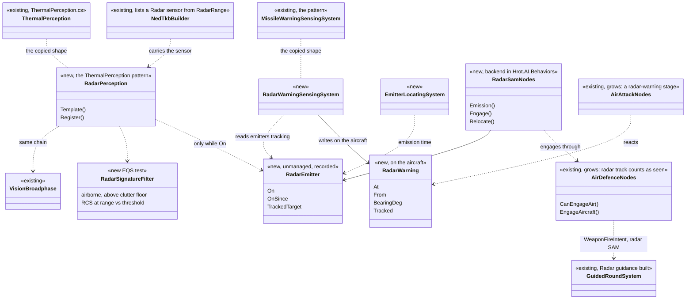
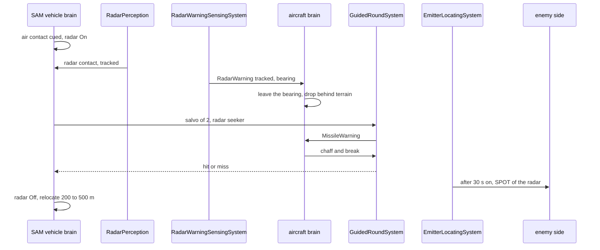
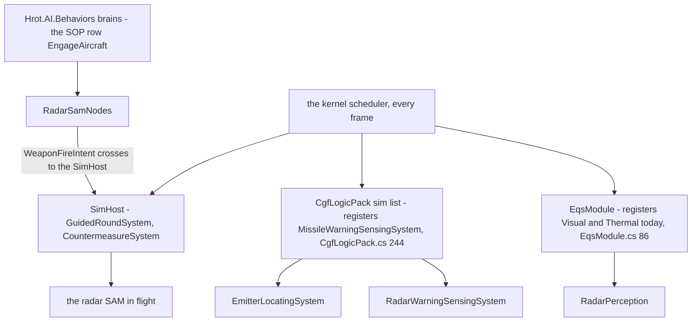

<!--STATUS
state: LIVE
updated: 2026-11-15
build-state: ⏳ REVIEWED (§6, 5 blockers) — awaiting rulings, handoffs ON HOLD; was READY-TO-BUILD — 🔒 user, 2026-11-15: RS-1…RS-9 approved ("Single track with missile and radar together for simplicity, otherwise approved everything to be built by backend. The UI lane can provide the visuals for the carrier and launcher and the missile and the effect of launch.") — R-4258; backend builds §5 B-1…B-6 (CE-4617), ui builds §5 U-1…U-3 (CE-4618); CE-7020 is the programme row
current-answer: the whole file — §1 inventory · §2 decisions · §3 UML · §4 the engagement in time · §5 slices and acceptance
stale-below: nothing
known-rot: none
known-conflict: none
related-designs:
  - DESIGN_Air_Operations.md — OWNS the air defence frame (§7d AD1–AD6: this is AD6), the aircraft's missile warning and evasion (§7e), ground air defence `AirDefenceNodes` (§7f) this extends
  - ../vehicle-tactics/DESIGN_Missiles_And_Ammo.md — OWNS guidance, the seekers, the proximity fuze, chaff seduction (§3c) the SAM's missile uses
  - ../../DESIGN_Thermal_And_Acoustic_Sensing.md — OWNS the sensor pattern copied here (§6 F: vision's chain + a signature filter) and the carriage trap (§8.7)
  - ../group-maneuvers/DESIGN_City_Battle_Showcase.md — the consumer: AD6 / CE-7010, the air gate's heaviest threat
  - ../group-maneuvers/DESIGN_Assault_Under_Fire.md — OWNS "reported posts" and the drone / mortar strikes on them that RS-7's emitter report feeds; and the counter-drone rules RS-8 leans on
  - ../weapons/DESIGN_Weapon_Systems.md — OWNS the MANPADS / ZU-23-2 weapon systems (§5c), the pattern for the SAM launcher mount
  - ../../DESIGN_Visual_Effects.md — OWNS launch / motor effects the ui half extends
-->

# DESIGN — the radar SAM: one vehicle, radar and missiles together (CE-7020, Air Ops AD6)

🔒 User, `2026-11-13`: *"we have no modern anti-aircraft air defense like some missile launcher. With the appropriate radar sensor can we think
about it"* · `2026-11-15`: *"Lets think more about the air defense - sam site (truck with missiles and radar)"* · *"Single track with missile and
radar together for simplicity, otherwise approved everything to be built by backend. The UI lane can provide the visuals for the carrier and
launcher and the missile and the effect of launch."*

**The proven pattern** (NASAMS, IRIS-T SLM, Tor / Pantsir class short-range air defence): search → track → identify → envelope check → salvo of
two → guide → kill assessment → relocate. ⭐ The modern lesson (Ukraine): a radar that radiates is FOUND and struck — it radiates in bursts and
moves after it fires. ⇒ every piece below is adopted for a measured reason (§2), never because it is standard.

## 1. INVENTORY *(measured `2026-11-15`; graph: `search_graph name_pattern=".*(Radar|AirDefen|AirSense|Emitter|Emission|SensorSystem|Sensing).*" label=Class` ⇒ 67, no radar class; + grep; index coverage could not be checked through the CLI)*

| exists | where | used as |
|---|---|---|
| a RADAR-seeker missile: homes inside its cone, leads a seen target, chaff seduces it — ⚠ *"no munition uses it yet"* | `MissileDto.cs` (`GuidanceKind.Radar = 4`), `GuidedRoundSystem.cs:212-218`, `CountermeasureSystem.cs:89`, `FireProcessingSystem.cs:396` | RS-3's missile, unchanged |
| proximity fuze, `TargetDomain` Air / Ground, `Category = Sam` mounts | Air Ops AD1 / AD2; `NedTkbCatalog.cs:490-497` (Stinger, Igla) | the launcher mount's pattern |
| the missile warning on the aircraft's brain, and its evasion (chaff for a radar seeker, flares for IR, the break) | `MissileWarningSensingSystem` (registered `CgfLogicPack.cs:244`), `AirAttackBehaviors.cs:654`, Air Ops §7e | RS-6's radar warning copies it |
| ground air defence: `CanEngageAir` (a SAM launcher whose missile may fire at Air), `EngageAircraft` stands and fires at the newest aircraft it SEES | `AirDefenceBehaviors.cs:24-152` | ⚠ it fires only at what `SightNow.Sees` — the EYES; RS-4 adds the radar track |
| ⛔ a radar SENSOR that runs: the kind is registered and the TKB has a `RadarSensorDto` (Range, FOV only) — nothing computes what a radar sees | `SensorKindRegistry.cs:110`, `SensorEntryDto.cs:99-103` | RS-2 builds it |
| ⭐ the pattern for it: thermal = vision's chain (`VisionBroadphase` range / FOV, the host's `ILosStrategy`) + `SignatureFilterTest` | `ThermalPerception.cs:19`, registered `EqsModule.cs:86` | RS-2 copies it |
| the carriage: a `SimCombatDef.ThermalRange > 0` makes `NedTkbBuilder` LIST sensors (visual from the receptor, acoustic, thermal) | `NedTkbBuilder.cs:360-372`, `SimCombatDef.cs:168` | RS-2's `RadarRange` the same way — ⚠ the trap in §8.7 of the thermal design (an extra sensor child changed `ua-hill-attack`; mechanism unfound) |
| targets: UH-60, AH-64, A-10, F-16, C-130; FPV, recon, bomber drones | `NedTkbCatalog.cs` | RS-2's signatures per type |
| "reported posts" and the drone / mortar strikes on them | Assault Under Fire A-4…A-6 | RS-7's emitter report feeds them |
| ⛔ anything that locates an emitter, an anti-radiation weapon | grep: none | RS-7 (no ARM — RS-7's why) |

## 2. Decisions *(✅ approved `2026-11-15`, R-4258)*

| # | decision | why — and what was rejected |
|---|---|---|
| **RS-1** | ⭐ **ONE vehicle carries the search-and-track radar AND the missiles** (a wheeled truck carrier; a tracked chassis is a one-line catalogue change); **4 ready missiles, no reload** in this build; the radar on a mast that turns | 🔒 user: *"single … together for simplicity"*. ⛔ Rejected: a separate radar vehicle + launchers (needs shared tracks between vehicles — unmeasured — and a site unit) |
| **RS-2** | ⭐ **`RadarPerception`** = vision's chain with the radar's range and FOV (360°) and the host's line of sight (so a helicopter behind a ridge is hidden) + a `RadarSignatureFilter`: only AIRBORNE targets, above a ground-clutter floor (default 15 m above ground), whose radar signature at that range reaches the sensor's threshold (range ∝ RCS^¼ — the radar equation); **only while the radar is ON**. Signatures per type in the TKB (defaults: jet 5 m², transport 40, helicopter 10, recon / bomber drone 0.05, FPV 0.01). Carried by `SimCombatDef.RadarRange` like thermal | ✅ thermal proved the shape (§1). ⛔ Rejected: a separate radar system (a second sensor path) |
| **RS-3** | the missile: a **radar-seeker SAM** munition (`GuidanceKind.Radar`, `TargetDomain = Air`, proximity fuze, its chaff rejection), on a `Category = Sam` launcher mount of the vehicle; envelope defaults 0.5–8 km, up to 5 km altitude (whole map — the user: ranges do not matter on our terrains) | ✅ guidance, lead, fuze and chaff are BUILT for exactly this. ⛔ Rejected first: command guidance (radar must track to impact) — a later option |
| **RS-4** | the **engagement**: radar ON ⇒ search ⇒ a radar contact is TRACKED ⇒ identified by side ⇒ in the envelope ⇒ **launch a salvo** (2 at a manned aircraft, 1 at a recon / bomber drone; second round 2 s after the first) ⇒ watch the outcome ⇒ re-engage while missiles are left. `CanEngageAir` / `EngageAircraft` gain the radar track as a valid "seen" — one air-defence path, not two | one implementation (ruling 9); the existing SOP row keeps gating it |
| **RS-5** | **emission control**: radar OFF by default; ON when cued — any air contact in the vehicle's memory (its eyes, its ears, a friendly report) or an order; stays on while tracking + 20 s; **after a launch, or 60 s of continuous emission, it relocates** 200–500 m to a covered spot (radar off while moving). A weapons state param: Free / Tight (engage only aircraft that are attacking) / Hold | the modern survival rule; makes RS-6 and RS-7 matter |
| **RS-6** | the **radar warning**: an aircraft tracked by an emitting radar gets `RadarWarning` (bearing, searching or tracked) on its brain through the same sensor-change path as the missile warning; its reaction (Air Ops §7e's attack node): leave the radar's bearing and drop behind terrain, and resume when the warning clears | the aircraft's real counter; the existing evasion grows one stage |
| **RS-7** | **emitter located**: after 30 s of continuous emission the OPPOSING side gets a SPOT of the radar at its position ± an error that shrinks with time (200 m → 50 m) — a reported post, so the assault design's drone and mortar strikes can hit it. ⛔ No anti-radiation missile | the modern way radars die; reuses the strikes on reported posts. ⚠ who RECEIVES a side-wide SPOT is unmeasured — backend measures and picks the existing report path first |
| **RS-8** | **drones**: the radar sees them at the short range their signature allows; **no missile at an FPV** (the guns, MGs and the squad's shotgun handle FPVs — Assault Under Fire A-10) | cost logic; one counter-drone rule |
| **RS-9** | **who builds**: backend builds all of it — the sensor, signatures, the missile, the vehicle type, the engagement, emission control, the warning and the aircraft's reaction, the emitter report (cross-lane edits into `Hrot.AI.Behaviors` allowed and said); **ui** builds the visuals: the carrier, the launcher and the radar mast (turning when ON), the missile, the launch effect | 🔒 user |

## 3. UML

*What it shows that prose hid: there is ONE new sensor and ONE new behaviour node; every other box is an existing path that grows a branch —
the engagement goes through `AirDefenceNodes` (no second air-defence path), the warning copies the missile warning, the sensor copies thermal.
`RadarEmitter` is the one new piece of state, and three readers hang off it (the sensor, the warning, the locator).*

*What it shows: the aircraft is warned TWICE — by the radar lock and then by the missile — and the site pays for every second it radiates (the
SPOT), which is why it relocates after it fires.*

*What it shows: every new system rides a module that already runs on every node that simulates soldiers and aircraft (perception with
thermal, the warnings with the missile warning), so no host can lack it — and the missile's flight needs nothing new on the SimHost.*

## 4. The engagement in time *(defaults; backend may tune, recording each as a lane decision)*

| t | the SAM | the aircraft |
|---|---|---|
| 0 | radar OFF, an observer reports a helicopter | — |
| +1 s | radar ON, searching | RadarWarning (searching) |
| +2…4 s | tracked, identified, in the envelope | RadarWarning (tracked) ⇒ starts leaving the bearing |
| +4 s | missile 1; +6 s missile 2 | MissileWarning ⇒ chaff + break |
| +10…20 s | hit / miss | hit, or survives behind terrain |
| +20 s after the last track | radar OFF, relocates | warning clears ⇒ resumes |
| +30 s of emission | the enemy side has a SPOT of it | — |

## 5. Slices and acceptance

| # | lane | builds | ⭐ done when (a rail each, red-proved) |
|---|---|---|---|
| **B-1** | backend | `RadarPerception` + `RadarSignatureFilter` + signatures per type + `RadarRange` carriage + `RadarEmitter` | the radar sees a UH-60 at 6 km in the open, NOT behind a ridge, NOT at 10 m above ground; an FPV only inside ~1 km; nothing while Off; ⚠ measure the thermal §8.7 trap on the carrier (an extra sensor child) and report it |
| **B-2** | backend | the radar SAM munition + launcher mount + the vehicle type (radar + 4 missiles, a placeholder model until U-1) | a launched round downs a UH-60 flying straight at 4 km; chaff + a break defeats it in some seeded share |
| **B-3** | backend | `RadarSamNodes` (emission, engage through `AirDefenceNodes`, relocate), weapons state, the drone policy | cued ⇒ On ⇒ salvo of 2 at a helicopter, 1 at a bomber drone, 0 at an FPV; after a launch it relocates and the radar is Off while moving |
| **B-4** | backend | `RadarWarning` + its sensing system + the aircraft's reaction stage in `AirAttackNodes` (cross-lane, said) | the warning reaches the aircraft before the first launch; the attack resumes when it clears |
| **B-5** | backend | `EmitterLocatingSystem` + the SPOT to the opposing side | after 30 s On, a SPOT within 200 m reaches the opposing side's report path; none while Off |
| **B-6** | backend | a test scenario `sam-site`: one SAM vehicle defending an area against an AH-64 attack run and a bomber drone | three runs of three: radar cued, warning, salvo, outcome, relocation in the log; deterministic at 1 / 4 / 8 threads |
| **U-1** | ui | the carrier, launcher and radar mast models (the mast turns while `RadarEmitter.On`) | drawn on the 2-D map symbol and in 3-D; the frame rail under `xvfb-run -a` |
| **U-2** | ui | the missile model + the launch effect (canister flash, smoke, motor trail) through the existing effect sets | the launch shows on the frame of the shot |
| **U-3** | ui | ⏸ optional: the radar's coverage on the map when selected (On / Off colour) | — |

⭐ Every backend slice: `HROT_PARALLEL_SIM=1` + `HROT_READ_CHECK=1` + `HROT_WORLD_GUARD=1`; `stepped-hash.py --threads 1,4,8` on `sam-site`;
0 B per steady frame (R-2084); invariant number output (R-4221); the new component unmanaged and fixed before its first recording.

## 6. ⛔ The review — `2026-11-15` *(🔒 user: "Pls make the usual review first"; three independent reviewers: realism, engine fit, aircraft side + visuals; ✔ = re-measured by the coordinator)* — ⏳ AWAITING RULINGS

⭐ 30 raw findings merged into 17. The design is NOT buildable as drawn until RV-1…RV-5 are ruled.

| # | sev | the defect | evidence | ⭐ lean |
|---|---|---|---|---|
| RV-1 | ⛔ BLOCKER | a radar-only track can NEVER fire: the fire executor itself holds fire (and the lock clock) unless the target is seen VISUALLY — RS-4 patched only the node | ✔ `ThreatDanger.cs:309` (`SightNow.Sees` = Visual only) · ✔ `AimAndFireExecutor.cs:181, :579` · `AirDefenceBehaviors.cs:62` | ONE fire-control rule: "seen by this mount" = Visual, OR Radar when the mount's loaded munition is `GuidanceKind.Radar` — used at all three sites; `SightNow` itself untouched (~30 callers, an MG must not fire at radar-only contacts); B-3's rail fires with NO visual track |
| RV-2 | ⛔ BLOCKER | the salvo of two 2 s apart cannot happen: a `Sam` mount runs the Guided profile, ONE round in flight, the next held for the whole estimated flight (~12 s) | ✔ `WeaponBrainProfiles.cs:45, :62` · `AimAndFireExecutor.cs:558, :597` | TKB mount fields `RoundsInFlight` (2) and `SalvoIntervalS` (2), honoured by the profile; the brain passes the salvo size (2 / 1 / 0) |
| RV-3 | ⛔ BLOCKER | the radar would not see the aircraft in a battle: vision keeps the NEAREST 32 enemies of any kind BEFORE any filter, so ground units crowd the far helicopter out; and walking 8 km in 50 m cells is ~100k cells per radar per tick | ✔ `VisionBroadphase.cs:28, :115-121` · `ThermalPerception.cs:32` | the radar's own candidate generator walks AIRCRAFT only (a small airborne list), then line of sight and the signature filter; rail: an aircraft far out plus 100 enemy ground units near — still tracked; 0 B per frame |
| RV-4 | ⛔ BLOCKER | on a split cluster perception runs on the SimHost, where the brain's `RadarEmitter` does not exist — "only while On" cannot be read there | `EqsInfrastructureCapability.cs:108` · `UnitSensors.cs:136-143` (`SetEnabled`, crosses the wire, R-187) | radar ON / OFF = the radar sensor child's EXISTING enabled flag (`UnitSensors.SetEnabled`); `RadarEmitter` stays brain-side bookkeeping; the visuals read the same replicated flag (backend confirms it reaches a display node, else puts the bit on an already-replicated descriptor) |
| RV-5 | ⛔ BLOCKER | the acceptance distances (6 km, 4 km) do not exist on our maps: every air scenario runs on `basic-desert` / `test-town`, perception and hits cover ~1 km | tracker CE-2193 / CE-2194 · `scenarios/demos/air/*` | the TKB keeps realistic ranges (they cover the whole map); every rail is stated at MAP scale (seen at ~700 m in the open, hidden behind a ridge, an FPV only close in); `sam-site` on a terrain WITH relief — backend names it |
| RV-6 | SHOULD | the missile is unspecified where it matters: a fixed seeker cone loses a crossing jet (lead ≈ 21° at 250 / 700 m/s), and a round with no flight time lives 2 s | `GuidedRoundSystem.cs:175-182, :212` · `BallisticsSystem.cs:156-162` | seeker cone ≥ 60°, 700–900 m/s, flight ≥ 18 s, launcher elevation 0–85°; rail: an F-16 crossing at 250 m/s is hit |
| RV-7 | SHOULD | chaff wins almost always: one seduction draw per chaff at ANY range from launch; the aircraft drops 4 per warning and re-breaks on the second missile; no rejection is set (0 ⇒ the first chaff always works) | `CountermeasureSystem.cs:89-109` · `AirAttackBehaviors.cs:333, :691` | `ChaffRejection` 0.9; seduction only in the end-game (inside 1.5 km or 3 s to go) — radar rounds only, IR flares unchanged; target: chaff + break defeats 20–40 % (seeded rail) |
| RV-8 | SHOULD | the radar warning as drawn writes onto ANOTHER node's aircraft; "searching" cannot be known (an untracked aircraft is unknown to the SAM) | `MissileWarningSensingSystem.cs:17, :41` · `AirDefenceTranslators.cs` | copy the missile warning EXACTLY: the SAM's brain publishes `RadarWarningEvent { aircraft }` from its radar tracks → DDS topic + translators → a serial system writes `RadarWarning` on the aircraft's node; component ids + registries listed in B-4; "tracked" only |
| RV-9 | SHOULD | the aircraft's reaction has no mechanism: the break flies at 25 m (above the 15 m clutter floor), it is timed by a missile's time to impact, "clears" is undefined, and 3 aborted passes = "driven off" so the Apache never fires | `AirAttackBehaviors.cs:337, :663-704` | trigger = tracked only; escape = off the radar's bearing AND down to ~10 m above ground (below the floor) or a masking point; clears after 8 s with no tracked warning; a radar abort does NOT count toward the 3; scope = the attack profiles — aircraft in transit and drones do not react (filed as a row) |
| RV-10 | SHOULD | who owns emission and relocation is unnamed: `EngageAircraft` "never moves" and ends 10 s after the last contact; RS-5 contradicts itself on when to relocate; the radar's own track would re-cue it | `BasicVehicleSop.cs:47-57` · `AirDefenceBehaviors.cs:42, :96-99` | a `RadarSamEngage` behaviour from a NEW SOP row ahead of the air row on a radar carrier, firing through RV-1's one rule; its deactivator switches the radar off; relocate after the salvo's outcome or 20 s after the last track, whichever first; cue on NON-radar contacts only |
| RV-11 | SHOULD | an empty launcher keeps winning the air row; the weapon choice would pick the SAM at an FPV | `AirDefenceWeapons.cs:23-49` · `AmmoChoice.cs:47-58` | `CanEngageAir` checks ammunition left; a radar SAM mount refuses an FPV in the weapon choice; with nothing usable the vehicle falls through to `ShelterFromAir` |
| RV-12 | SHOULD | the solver has no TKB, so the signature filter cannot read RCS; no reference RCS is stated | `EqsModule.cs` (`InjectTkb`) | an unmanaged `RadarSignature` component stamped at spawn from the TKB, registered with the solver like `ThermalState`; `RadarRange` stated against a 10 m² reference |
| RV-13 | SHOULD | the carriage REPLACES the sensor list: a `RadarRange` branch beside thermal would drop the other sensors | `NedTkbBuilder.cs:351-372` | one list: eyes, ears, thermal if any, radar; measure the thermal §8.7 trap on `sam-site` |
| RV-14 | SHOULD | ⭐ **the emitter report (the user's question: "sent to the highest level commander entity?") — YES, and the path exists; the consumer does not act on it yet**: a `SquadReportNotification` SPOT (`Equipment = AirDefence`, `Radius` = the error, synthetic, a sender of that side) reaches the commander and `StaffInboxSystem` folds it into its `CommandPicture` (`ReportInjection.Inject` needs a superior, so publish directly to the side's top commander — the one with no parent). ⚠ `SupportCommand` strikes a reported air defence ONLY while answering a fire-support request near it | ✔ `SupportCommandBehavior.cs:85-99` · `StaffSystems.cs:556, :580, :307` | send it to the side's highest commander; `SupportCommand` gains one rule: a FRESH air-defence element is struck by a free strike plane, bomber drone or battery (SEAD first). Backend builds it (behaviour, cross-lane, said) |
| RV-15 | SHOULD | the visuals seam is wrong: 3-D bodies come from the DIS type / class → `VisualFamily` → a `ShapeKit`, never an asset key; only turret 0 articulates; the missile's look and trail are a `MunitionVisualDto`, the flash an ammunition `Effect.Set` | `VisualFamily.cs:85-99` · `TurretPoseSource.cs:24-44` · `MunitionTkbCatalog.cs:446-478` | B-2 fixes the DIS type and class, puts the launcher on turret 0 (the canisters elevate with it) and adds placeholder look / effect rows; U-1 builds the family / kit + a second, time-driven spinning mast part keyed on RV-4's flag; U-2 tunes the look rows and the effect set (cross-lane into `MunitionTkbCatalog`, said) |
| RV-16 | NIT | B-6 passes on nothing named | Air Ops §9h | named checks: cue, warning before the first launch, salvo per target type, radar off while relocating, the SPOT at the top commander; fixed seeds; the hit / miss may vary |
| RV-17 | NIT | line of sight from the hull's sight height, not the mast; add `RadarEmitter` with its final value (D-31) | `NedTkbBuilder.cs:356` | a mast sight height on the type; add-with-value |

⭐ **Found sound:** aircraft are in the perception grid with 3-D line of sight; the radar kind is registered and its contacts reach memory tagged Radar; `AirThreat` is raised by any sense; the turn rate (~37 g) and the proximity fuze are right for helicopters; the missile warning already fires for radar rounds; IFF by side is inherited; visual-only readers correctly ignore radar contacts; subordinates already relay air-defence elements upward.
