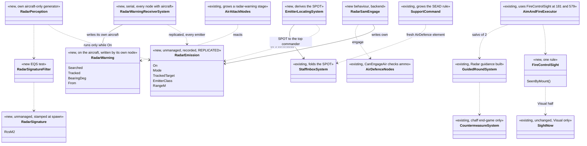
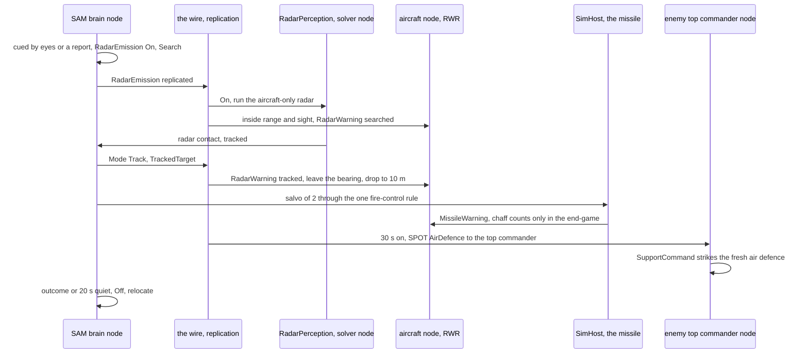
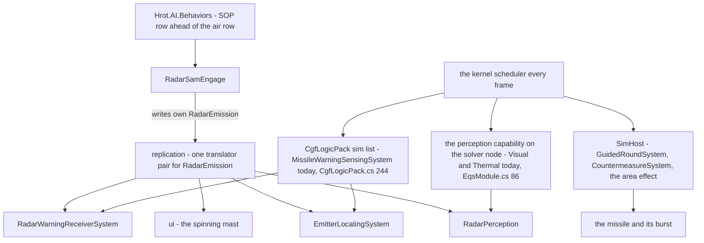
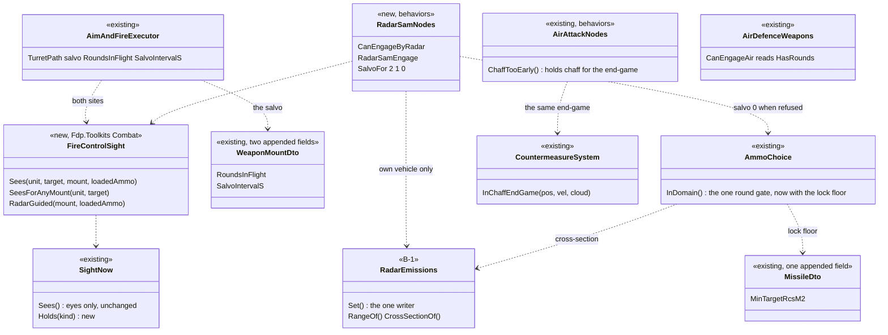

<!--STATUS
state: LIVE
updated: 2026-11-17
build-state: BUILT (2026-11-15; B-1…B-6 — §7 as-built; sam-site 3/3, deterministic at 1/4/8 threads) — was READY-TO-BUILD — RS-1…RS-9 (R-4258) amended by the §6 review RV-1…RV-17 and the user's two changes (R-4259: aircraft beyond the terrain, radiation published — RS-2a, RS-10); backend builds §5 B-1…B-6 (CE-4617), ui U-1…U-3 (CE-4618); CE-7020 is the programme row
current-answer: §1 inventory · §2 decisions (as amended) · §3 UML · §4 the engagement in time · §5 slices and acceptance · §6 the review · ⭐ §7 AS-BUILT (where the build deviated, §7 wins)
stale-below: § HISTORY at the bottom (§2–§5 as first approved)
known-rot: §2a's missile id 6047 — taken (the 60 mm mortar smoke, CE-7025); as built 6050 (§7)
known-conflict: none
related-designs:
  - DESIGN_Air_Combat.md — OWNS air-to-air combat and the aircraft's ONE MissileDefence (AC-9: RS-6's reaction is folded into it) and the missile energy (AC-6) the radar SAM's round gets
  - DESIGN_Air_Operations.md — OWNS the air defence frame (§7d AD1–AD6: this is AD6), the aircraft's missile warning and evasion (§7e), ground air defence `AirDefenceNodes` (§7f) this extends
  - ../vehicle-tactics/DESIGN_Missiles_And_Ammo.md — OWNS guidance, the seekers, the proximity fuze, chaff seduction (§3c) the SAM's missile uses
  - ../../DESIGN_Thermal_And_Acoustic_Sensing.md — OWNS the sensor pattern copied here (§6 F: vision's chain + a signature filter) and the carriage trap (§8.7)
  - ../group-maneuvers/DESIGN_City_Battle_Showcase.md — the consumer: AD6 / CE-7010, the air gate's heaviest threat
  - ../group-maneuvers/DESIGN_Assault_Under_Fire.md — OWNS "reported posts" and the drone / mortar strikes on them that RS-7's emitter report feeds; and the counter-drone rules RS-8 leans on
  - ../weapons/DESIGN_Weapon_Systems.md — OWNS the MANPADS / ZU-23-2 weapon systems (§5c), the pattern for the SAM launcher mount
  - ../../DESIGN_Visual_Effects.md — OWNS launch / motor effects the ui half extends
-->

# DESIGN — the radar SAM: one vehicle, radar and missiles together (CE-7020, Air Ops AD6)

🔒 User, `2026-11-13`: *"we have no modern anti-aircraft air defense like some missile launcher. With the appropriate radar sensor can we think
about it"* · `2026-11-15`: *"Lets think more about the air defense - sam site (truck with missiles and radar)"* · *"Single track with missile and
radar together for simplicity, otherwise approved everything to be built by backend. The UI lane can provide the visuals for the carrier and
launcher and the missile and the effect of launch."*

🔒 The rulings, verbatim: R-4258 *"Single track with missile and radar together for simplicity"* · R-4259 *"Radar radiation needs to be published/replicated so other entities and on machines can detect that"*

**The proven pattern** (NASAMS, IRIS-T SLM, Tor / Pantsir class short-range air defence): search → track → identify → envelope check → salvo of
two → guide → kill assessment → relocate. ⭐ The modern lesson (Ukraine): a radar that radiates is FOUND and struck — it radiates in bursts and
moves after it fires. ⇒ every piece below is adopted for a measured reason (§2), never because it is standard.

## 1. INVENTORY *(measured `2026-11-15`; graph: `search_graph name_pattern=".*(Radar|AirDefen|AirSense|Emitter|Emission|SensorSystem|Sensing).*" label=Class` ⇒ 67, no radar class; + grep; index coverage could not be checked through the CLI)*

| exists | where | used as |
|---|---|---|
| a RADAR-seeker missile: homes inside its cone, leads a seen target, chaff seduces it — ⚠ *"no munition uses it yet"* | `MissileDto.cs` (`GuidanceKind.Radar = 4`), `GuidedRoundSystem.cs:212-218`, `CountermeasureSystem.cs:89`, `FireProcessingSystem.cs:396` | RS-3's missile, unchanged |
| proximity fuze, `TargetDomain` Air / Ground, `Category = Sam` mounts | Air Ops AD1 / AD2; `NedTkbCatalog.cs:490-497` (Stinger, Igla) | the launcher mount's pattern |
| the missile warning on the aircraft's brain, and its evasion (chaff for a radar seeker, flares for IR, the break) | `MissileWarningSensingSystem` (registered `CgfLogicPack.cs:244`), `AirAttackBehaviors.cs:654`, Air Ops §7e | RS-6's radar warning copies it |
| ground air defence: `CanEngageAir` (a SAM launcher whose missile may fire at Air), `EngageAircraft` stands and fires at the newest aircraft it SEES | `AirDefenceBehaviors.cs:24-152` | ⚠ it fires only at what `SightNow.Sees` — the EYES; RS-4 adds the radar track |
| ⛔ a radar SENSOR that runs: the kind is registered and the TKB has a `RadarSensorDto` (Range, FOV only) — nothing computes what a radar sees | `SensorKindRegistry.cs:110`, `SensorEntryDto.cs:99-103` | RS-2 builds it |
| ⭐ the pattern for it: thermal = vision's chain (`VisionBroadphase` range / FOV, the host's `ILosStrategy`) + `SignatureFilterTest` | `ThermalPerception.cs:19`, registered `EqsModule.cs:86` | RS-2 copies it |
| the carriage: a `SimCombatDef.ThermalRange > 0` makes `NedTkbBuilder` LIST sensors (visual from the receptor, acoustic, thermal) | `NedTkbBuilder.cs:360-372`, `SimCombatDef.cs:168` | RS-2's `RadarRange` the same way — ⚠ the trap in §8.7 of the thermal design (an extra sensor child changed `ua-hill-attack`; mechanism unfound) |
| targets: UH-60, AH-64, A-10, F-16, C-130; FPV, recon, bomber drones | `NedTkbCatalog.cs` | RS-2's signatures per type |
| "reported posts" and the drone / mortar strikes on them | Assault Under Fire A-4…A-6 | RS-7's emitter report feeds them |
| ⛔ anything that locates an emitter, an anti-radiation weapon | grep: none | RS-7 (no ARM — RS-7's why) |

## 2. Decisions *(✅ RS-1…RS-9 approved `2026-11-15` (R-4258), ⭐ AMENDED by the §6 review — RV-1…RV-17 approved with the user's two changes (R-4259); the first text is in HISTORY at the bottom)*

🔒 User, `2026-11-15`: *"Approved. Our maps size does not matter for aircraft they can fly even outside of a terrain. Radar radiation needs to be
published/replicated so other entities and on machines can detect that."*

| # | decision | why — and what was rejected |
|---|---|---|
| **RS-1** | ⭐ ONE vehicle carries the search-and-track radar AND the missiles (a wheeled truck; a tracked chassis is one catalogue line); **4 ready missiles, no reload**; the launcher on **turret 0** (the canisters elevate with it, 0–85°), the radar on a mast; the radar's eye at MAST height (RV-17) | 🔒 user: *"single … together"* |
| **RS-2** | ⭐ **`RadarPerception`** with its OWN candidate generator that walks **AIRCRAFT ONLY** (a small airborne list — never vision's nearest-32 cap, never the terrain-fitted grid), then line of sight and a `RadarSignatureFilter` (airborne, above the clutter floor 15 m, signature at range ≥ the threshold: range ∝ RCS^¼ against a 10 m² reference). It runs only while the vehicle's **`RadarEmission`** (RS-10) is On. RCS from an unmanaged **`RadarSignature`** component stamped at spawn from the TKB and registered with the solver like `ThermalState`. Carriage: ONE sensor list (eyes, ears, thermal if any, radar) | RV-3, RV-12, RV-13 — ⛔ rejected: reusing vision's broadphase (ground units crowd the aircraft out; ~100k cells per tick) |
| **RS-2a** | ⭐⭐ **AIRCRAFT OUTSIDE THE TERRAIN** (🔒 user): the whole kill chain works for an aircraft beyond the map's edge — the radar sees it (the aircraft-only generator needs no grid), line of sight beyond the terrain is clear (backend measures), the missile flies and its proximity fuze is target-based (`GuidedRoundSystem.cs:152-163` ✔), ⚠ and the burst's FRAGMENTS must reach it — the burst goes through the area effect, which finds its victims through a grid (backend measures and fixes where an aircraft off the grid is not hurt). Realistic ranges stay in the TKB (8 km) | RV-5, as changed by the user — ⛔ the reviewers' "rails at map scale" is withdrawn for aircraft |
| **RS-3** | the **radar-seeker SAM**: `GuidanceKind.Radar`, `TargetDomain = Air`, proximity fuze, **seeker cone ≥ 60°, 700–900 m/s, flight ≥ 18 s**; **`ChaffRejection` 0.9 and chaff seduces only in the END-GAME** (inside 1.5 km or 3 s to go; radar rounds only — IR flares unchanged); envelope 0.5–8 km, ≤ 5 km altitude | RV-6, RV-7 — ⛔ as first written the jet escapes the cone and chaff always wins |
| **RS-4** | the **engagement**: ONE fire-control rule — *"seen by this mount"* = Visual, OR Radar when the mount's loaded munition is `GuidanceKind.Radar` — used by `AirSense.FireAt` and both `AimAndFireExecutor` sites (the shot and the lock clock); `SightNow` itself unchanged. **Salvo**: TKB mount fields `RoundsInFlight` (2) and `SalvoIntervalS` (2) honoured by the guided profile; the brain passes the salvo size — 2 at a manned aircraft, 1 at a recon / bomber drone, 0 at an FPV | RV-1, RV-2 — ⛔ an MG must never fire at a radar-only contact |
| **RS-5** | the **behaviour**: `RadarSamEngage`, reacted from a NEW SOP row ahead of the air row on a radar carrier; cued by a NON-radar air contact (eyes, ears, a friendly report) or an order; radar On while tracking; **relocates after the salvo's outcome or 20 s after the last track, whichever is first**, 200–500 m to cover, radar Off while moving; its deactivator switches the radar Off. Weapons state: Free / Tight / Hold. `CanEngageAir` checks ammunition left; the SAM mount refuses an FPV in the weapon choice; with nothing usable the vehicle falls through to `ShelterFromAir` | RV-10, RV-11 |
| **RS-6** | the **aircraft's reaction** to RS-10's radar warning: triggered by **tracked** only; escape = off the radar's bearing AND down to ~10 m above ground (below the clutter floor) or a masking point; clears after 8 s with no tracked warning; a radar abort does NOT count toward the 3 passes; scope = the attack profiles (gun run, rockets, running fire, bomb run, door-gun orbit). ⏸ transit and drones do not react — a row is filed | RV-9 |
| **RS-7** | the **emitter located → the side's HIGHEST commander** (🔒 user: *"could be sent to the highest level commander entity?"*): derived from RS-10 — after 30 s of continuous emission a `SquadReportNotification` SPOT (`Equipment = AirDefence`, `Radius` = the error 200 m → 50 m, synthetic, a sender of that side) goes to the opposing side's top commander (no parent); `StaffInboxSystem` folds it into its `CommandPicture`. ⭐ `SupportCommand` gains ONE rule: a FRESH air-defence element is struck by a free strike plane, bomber drone or battery (SEAD first) — today it strikes one only while answering a fire-support request near it (`SupportCommandBehavior.cs:85-99` ✔) | RV-14 |
| **RS-8** | drones: the radar sees them at the short range their signature allows; no missile at an FPV (RS-4, RS-5) | — |
| **RS-9** | **who builds**: backend builds all of RS-1…RS-10 incl. the behaviours (cross-lane into `Hrot.AI.Behaviors`, said) and the placeholder look rows (DIS type and class, a placeholder `MunitionVisualDto` and effect set); **ui** builds the vehicle's visual family / shape kit, a second time-driven spinning mast part keyed on `RadarEmission.On`, the missile look and the launch effect (cross-lane into `MunitionTkbCatalog`, said) | RV-15 — ⛔ there is no asset key to bind; 3-D bodies come from the DIS type → `VisualFamily` → a `ShapeKit` |
| **RS-10** | ⭐⭐ **RADAR RADIATION IS PUBLISHED** (🔒 user: *"needs to be published/replicated so other entities and on machines can detect that"*): one unmanaged, recorded, **replicated** `RadarEmission` on the emitting vehicle — `On`, `Mode` (Search / Track), `TrackedTarget`, the emitter's class and range — written ONLY by its owner (added with its final value, D-31). It is the ONE owner of "is the radar radiating": the radar sensor runs off it (RS-2), the visuals spin the mast off it (RS-9), and **every node DERIVES its detections from it**: an aircraft's radar warning receiver (inside the emitter's range and line of sight ⇒ *searched*; `TrackedTarget` = me ⇒ *tracked*) writes the aircraft's OWN `RadarWarning` on the aircraft's node; the side's direction finding gives RS-7's SPOT. Any later passive receiver (an EW vehicle, an ESM sensor) reads the same component | ⭐ the thermal design's own rule (§3a): *derive where the sensor solves from published inputs* — and its stated exception, *"a source NOT observable from published data … then that one input gets published"*: radiation is exactly that. ⛔ Rejected: the sensor's enabled flag (not visible to other entities) and a warning EVENT from the SAM (RV-8 — it only covers the tracked case and one receiver) |

### 2a. The fixed ids — ONE entity type for both lanes *(coordinator, `2026-11-15`; 🔒 user: "Does the ui handoff specify what entity type to assign the visuals to?" — it did not)*

📐 Measured free on every lane (`coordinator`, `behaviors`, `backend`, `ui`, `terrain`): vehicle id 114, munition id ~~6047~~ ⇒ 6050 (6047 is the 60 mm smoke, CE-7025 — §7), DIS land category 28,
the class and family names. ⛔ Permanent wire values once built — never reuse or renumber.

| what | the value | where it is declared | owner |
|---|---|---|---|
| the vehicle's TKB entity type | **`TkbEntityTypes.AirDefence_RadarSam = 114`** — "Radar SAM vehicle" (one type; the side comes from the scenario's faction) | `Hrot/Engine/Hrot.Core/MapDefinitions/TkbEntityTypes.cs` (next to `Ew_DroneJammer = 113`) | backend B-2 |
| its DIS type | **Kind 1 · Domain 1 (land) · Category 28** (SISO: *Air Defense / Missile Defense Unit Equipment*) · Subcategory 1 | `NedTkbCatalog.cs` (`WithDisType`, as `Ew_DroneJammer` at `:838`) | backend B-2 |
| its entity class | **`"AirDefenceVehicle"`** = `1.1.*.28` | `Hrot/Engine/Hrot.Core/Tkb/EntityClassTable.cs` (beside `"Bulldozer"` at `:170`) | backend B-2 |
| its 3-D family | **`VisualFamily.AirDefenceVehicle`**, keyed by the class name in `FamilyOfClass` | `Hrot/Engine/Hrot.Presentation/Map3D/VisualFamily.cs` (beside `["Bulldozer"]` at `:78`) + its `ShapeKit` | **ui** U-1 |
| the missile | ⛔ ~~6047~~ (taken: `Tkb60mmMortarSmoke`, CE-7025) ⇒ ⭐ **`MunitionTkbCatalog.TkbRadarSamMissile = 6050`** (§7) | `MunitionTkbCatalog.cs` | backend B-2 (placeholder look row) · ui U-2 tunes the look |
| the launcher | ⭐ the vehicle's OWN turret-0 mount — **no separate weapon-system entity** (unlike the ZU-23 technical's 615) | the type's combat mounts | backend B-2 |

*Why one class and one family:* `VisualFamily.Of` picks the 3-D body from the DIS class chain (`VisualFamily.cs:93-99`), so the class name is the
ONE key both lanes share — backend declares it, ui maps it. ⛔ No asset key, no model path (never read by the presentation).

## 3. UML *(as amended, R-4259)*


*What it shows that prose hid: `RadarEmission` is the ONE published fact and every consumer — the radar's own sensor, the aircraft's warning
receiver, the enemy's direction finding, the mast's spin — DERIVES from it on its own node; nobody writes another node's entity. And the sight
rule changes in ONE new place (`FireControlSight`), so `SightNow`'s ~30 other callers keep "seen = eyes".*


*What it shows: one replicated component drives three different machines' reactions — the warning, the radar itself and the enemy's SPOT —
which is why radiation has a cost the moment it starts, on every node at once.*


*What it shows: the ONE new wire item is `RadarEmission`'s translator pair, and four consumers on four kinds of node hang off it; every system
rides a module that already runs on the nodes where its inputs live.*

## 4. The engagement in time *(defaults; backend tunes, recording each as a lane decision)*

| t | the SAM | the aircraft | the enemy's top commander |
|---|---|---|---|
| 0 | radar Off; an observer reports a helicopter | — | — |
| +1 s | `RadarEmission` On, Search | RWR: searched | — |
| +2…4 s | tracked, identified, in the envelope; Mode Track | RWR: tracked ⇒ leaves the bearing, drops to ~10 m | — |
| +4 s / +6 s | missiles 1 and 2 | MissileWarning ⇒ chaff (end-game only) + break | — |
| +10…25 s | the outcome | hit, or survives below the floor / behind terrain | — |
| outcome or 20 s quiet | Off, relocates 200–500 m | the warning clears after 8 s ⇒ resumes | — |
| +30 s continuous | — | — | a SPOT (AirDefence, ±200 → 50 m) ⇒ `SupportCommand` strikes it |

## 5. Slices and acceptance *(as amended)*

| # | lane | builds | ⭐ done when (a rail each, red-proved) |
|---|---|---|---|
| **B-1** | backend | `RadarEmission` (replicated) + `RadarSignature` + `RadarPerception` (aircraft-only generator) + `RadarSignatureFilter` + the one-list carriage | sees a UH-60 at 6 km in the open, ⭐ AND one BEYOND the terrain's edge, NOT behind a ridge, NOT at 10 m above ground; an FPV only close in; nothing while Off; tracked with 100 enemy ground units near; `RadarEmission` arrives on a second node; 0 B per frame; the thermal §8.7 trap measured |
| **B-2** | backend | the SAM munition (RS-3) + the turret-0 launcher mount with `RoundsInFlight` / `SalvoIntervalS` + the vehicle type (DIS type and class) + placeholder look rows + chaff's end-game gate | two launches 2 s apart; a UH-60 downed at 4 km; an F-16 crossing at 250 m/s hit; ⭐ an aircraft OFF the terrain hurt by the burst; chaff + break defeats 20–40 % (seeded) |
| **B-3** | backend | `FireControlSight` (RS-4) at its three sites + `RadarSamEngage` + its SOP row + ammunition / FPV gates | launches with NO visual track; an MG on the same scene does NOT fire at the radar-only contact; 2 / 1 / 0 salvo per target type; Off while relocating; empty ⇒ shelters |
| **B-4** | backend | `RadarWarningReceiverSystem` + `RadarWarning` + the aircraft's stage in `AirAttackNodes`; a row for transit / drone evasion | searched then tracked arrive before the first launch; the Apache drops below the floor and resumes; a radar abort is not a counted pass |
| **B-5** | backend | `EmitterLocatingSystem` + the SPOT to the top commander + `SupportCommand`'s SEAD rule | after 30 s On the top commander's picture holds an AirDefence element within 200 m and a strike is ordered on it; none while Off |
| **B-6** | backend | `sam-site`: one SAM vehicle on a terrain with relief, an AH-64 attack run (starting inside coverage), a bomber drone, a jet approaching from beyond the terrain | three runs: the named checks — cue, searched, tracked, warning before the first launch, salvo per target type, Off while relocating, the SPOT at the top commander; fixed seeds, the hit / miss may vary; deterministic at 1 / 4 / 8 threads |
| **U-1** | ui | the vehicle's visual family / shape kit, the launcher on turret 0, the mast spinning while the replicated `RadarEmission.On` | 2-D symbol and 3-D, on a separate display node too; a frame rail under `xvfb-run -a` |
|  | | ⭐ **AS-BUILT `2026-11-15` (ui, CE-4618) — U-1 DONE** — family `VisualFamily.AirDefenceVehicle` bound to backend's class (`FamilyOfClass["AirDefenceVehicle"]`, type 114) + `ShapeKits.AirDefenceVehicle` (8 × 8 truck, cab, 4 canisters on the turret-0 turntable, a hull mast with a spinning antenna = `PartRole.RadarAntenna` + `MotionPose.Antenna`), the spin driven by ONE read, `RadarActivity.IsOn` → `RadarEmissions.IsOn`. ⭐ **The kit was fitted to backend's `TurretDto`** (axis −1.5, trunnion −1.1, z 2.6 on the TKB's 9.1 × 2.8 × 4.2 box) — ⛔ SUPERSEDED: the first build asked backend for pivot −2.4 / trunnion −3.0 / z 3.0 on 9.8 × 3.0 × 4.4. Also the rounds left: the four canisters carry front covers that go in the fire order top-left, top-right, bottom-left, bottom-right as the replicated `WeaponAmmo` (mount 0) counts down (`LauncherLoad`). 2-D: the TKB's `SHGPUCDM` + the class chain. Thumbnail in the atlas. Display node: by construction, no cluster rail. Rail `AirDefenceVehicleModelRail`; details [DESIGN_Map_3D_Mode.md §6al.1](../../DESIGN_Map_3D_Mode.md) |
| **U-2** | ui | the missile look (`MunitionVisualDto`, smoke trail) + the launch effect set (flash) | the launch shows on the frame of the shot |
|  | | ⭐ **AS-BUILT `2026-11-15` (ui, CE-4618) — U-2 DONE** — missile **6050** (⛔ not 6047): slim 3.0 × 0.17 m `Missile` shape, light grey-green, smoke trail (cross-lane `MunitionTkbCatalog.cs`); launch = `Effect.Set` on 6050 (new flash type 7173 at the muzzle) + `FiringBlast.Launch` spawning smoke 7174 at the shot's origin; ⭐ backend's `MuzzleOffset` moved from (1.0, 0, 0.4) to **(2.8, 0, 0.3)** so the round and its flash leave the canister's MOUTH (cross-lane `NedTkbCatalog.RadarSam`). The frame rail fires mount 0 and asserts flash + smoke + missile in that frame |
| **U-3** | ui | ⏸ optional: the radar's coverage on the map when selected, On / Off colour | — |

⭐ Every backend slice: `HROT_PARALLEL_SIM=1` + `HROT_READ_CHECK=1` + `HROT_WORLD_GUARD=1`; `stepped-hash.py --threads 1,4,8` on `sam-site`;
0 B per steady frame (R-2084); invariant number output (R-4221); every new component unmanaged and fixed before its first recording.

## 6. ⛔ The review — `2026-11-15` *(🔒 user: "Pls make the usual review first"; three independent reviewers: realism, engine fit, aircraft side + visuals; ✔ = re-measured by the coordinator)* — ✅ APPROVED `2026-11-15` (R-4259) with two changes by the user: RV-5 (aircraft fly beyond the terrain — RS-2a) and RV-4 / RV-8 (radiation is published — RS-10); folded into §2–§5

⭐ 30 raw findings merged into 17. The design is NOT buildable as drawn until RV-1…RV-5 are ruled.

| # | sev | the defect | evidence | ⭐ lean |
|---|---|---|---|---|
| RV-1 | ⛔ BLOCKER | a radar-only track can NEVER fire: the fire executor itself holds fire (and the lock clock) unless the target is seen VISUALLY — RS-4 patched only the node | ✔ `ThreatDanger.cs:309` (`SightNow.Sees` = Visual only) · ✔ `AimAndFireExecutor.cs:181, :579` · `AirDefenceBehaviors.cs:62` | ONE fire-control rule: "seen by this mount" = Visual, OR Radar when the mount's loaded munition is `GuidanceKind.Radar` — used at all three sites; `SightNow` itself untouched (~30 callers, an MG must not fire at radar-only contacts); B-3's rail fires with NO visual track |
| RV-2 | ⛔ BLOCKER | the salvo of two 2 s apart cannot happen: a `Sam` mount runs the Guided profile, ONE round in flight, the next held for the whole estimated flight (~12 s) | ✔ `WeaponBrainProfiles.cs:45, :62` · `AimAndFireExecutor.cs:558, :597` | TKB mount fields `RoundsInFlight` (2) and `SalvoIntervalS` (2), honoured by the profile; the brain passes the salvo size (2 / 1 / 0) |
| RV-3 | ⛔ BLOCKER | the radar would not see the aircraft in a battle: vision keeps the NEAREST 32 enemies of any kind BEFORE any filter, so ground units crowd the far helicopter out; and walking 8 km in 50 m cells is ~100k cells per radar per tick | ✔ `VisionBroadphase.cs:28, :115-121` · `ThermalPerception.cs:32` | the radar's own candidate generator walks AIRCRAFT only (a small airborne list), then line of sight and the signature filter; rail: an aircraft far out plus 100 enemy ground units near — still tracked; 0 B per frame |
| RV-4 | ⛔ BLOCKER | on a split cluster perception runs on the SimHost, where the brain's `RadarEmitter` does not exist — "only while On" cannot be read there | `EqsInfrastructureCapability.cs:108` · `UnitSensors.cs:136-143` (`SetEnabled`, crosses the wire, R-187) | radar ON / OFF = the radar sensor child's EXISTING enabled flag (`UnitSensors.SetEnabled`); `RadarEmitter` stays brain-side bookkeeping; the visuals read the same replicated flag (backend confirms it reaches a display node, else puts the bit on an already-replicated descriptor) |
| RV-5 | ⛔ BLOCKER | the acceptance distances (6 km, 4 km) do not exist on our maps: every air scenario runs on `basic-desert` / `test-town`, perception and hits cover ~1 km | tracker CE-2193 / CE-2194 · `scenarios/demos/air/*` | the TKB keeps realistic ranges (they cover the whole map); every rail is stated at MAP scale (seen at ~700 m in the open, hidden behind a ridge, an FPV only close in); `sam-site` on a terrain WITH relief — backend names it |
| RV-6 | SHOULD | the missile is unspecified where it matters: a fixed seeker cone loses a crossing jet (lead ≈ 21° at 250 / 700 m/s), and a round with no flight time lives 2 s | `GuidedRoundSystem.cs:175-182, :212` · `BallisticsSystem.cs:156-162` | seeker cone ≥ 60°, 700–900 m/s, flight ≥ 18 s, launcher elevation 0–85°; rail: an F-16 crossing at 250 m/s is hit |
| RV-7 | SHOULD | chaff wins almost always: one seduction draw per chaff at ANY range from launch; the aircraft drops 4 per warning and re-breaks on the second missile; no rejection is set (0 ⇒ the first chaff always works) | `CountermeasureSystem.cs:89-109` · `AirAttackBehaviors.cs:333, :691` | `ChaffRejection` 0.9; seduction only in the end-game (inside 1.5 km or 3 s to go) — radar rounds only, IR flares unchanged; target: chaff + break defeats 20–40 % (seeded rail) |
| RV-8 | SHOULD | the radar warning as drawn writes onto ANOTHER node's aircraft; "searching" cannot be known (an untracked aircraft is unknown to the SAM) | `MissileWarningSensingSystem.cs:17, :41` · `AirDefenceTranslators.cs` | copy the missile warning EXACTLY: the SAM's brain publishes `RadarWarningEvent { aircraft }` from its radar tracks → DDS topic + translators → a serial system writes `RadarWarning` on the aircraft's node; component ids + registries listed in B-4; "tracked" only |
| RV-9 | SHOULD | the aircraft's reaction has no mechanism: the break flies at 25 m (above the 15 m clutter floor), it is timed by a missile's time to impact, "clears" is undefined, and 3 aborted passes = "driven off" so the Apache never fires | `AirAttackBehaviors.cs:337, :663-704` | trigger = tracked only; escape = off the radar's bearing AND down to ~10 m above ground (below the floor) or a masking point; clears after 8 s with no tracked warning; a radar abort does NOT count toward the 3; scope = the attack profiles — aircraft in transit and drones do not react (filed as a row) |
| RV-10 | SHOULD | who owns emission and relocation is unnamed: `EngageAircraft` "never moves" and ends 10 s after the last contact; RS-5 contradicts itself on when to relocate; the radar's own track would re-cue it | `BasicVehicleSop.cs:47-57` · `AirDefenceBehaviors.cs:42, :96-99` | a `RadarSamEngage` behaviour from a NEW SOP row ahead of the air row on a radar carrier, firing through RV-1's one rule; its deactivator switches the radar off; relocate after the salvo's outcome or 20 s after the last track, whichever first; cue on NON-radar contacts only |
| RV-11 | SHOULD | an empty launcher keeps winning the air row; the weapon choice would pick the SAM at an FPV | `AirDefenceWeapons.cs:23-49` · `AmmoChoice.cs:47-58` | `CanEngageAir` checks ammunition left; a radar SAM mount refuses an FPV in the weapon choice; with nothing usable the vehicle falls through to `ShelterFromAir` |
| RV-12 | SHOULD | the solver has no TKB, so the signature filter cannot read RCS; no reference RCS is stated | `EqsModule.cs` (`InjectTkb`) | an unmanaged `RadarSignature` component stamped at spawn from the TKB, registered with the solver like `ThermalState`; `RadarRange` stated against a 10 m² reference |
| RV-13 | SHOULD | the carriage REPLACES the sensor list: a `RadarRange` branch beside thermal would drop the other sensors | `NedTkbBuilder.cs:351-372` | one list: eyes, ears, thermal if any, radar; measure the thermal §8.7 trap on `sam-site` |
| RV-14 | SHOULD | ⭐ **the emitter report (the user's question: "sent to the highest level commander entity?") — YES, and the path exists; the consumer does not act on it yet**: a `SquadReportNotification` SPOT (`Equipment = AirDefence`, `Radius` = the error, synthetic, a sender of that side) reaches the commander and `StaffInboxSystem` folds it into its `CommandPicture` (`ReportInjection.Inject` needs a superior, so publish directly to the side's top commander — the one with no parent). ⚠ `SupportCommand` strikes a reported air defence ONLY while answering a fire-support request near it | ✔ `SupportCommandBehavior.cs:85-99` · `StaffSystems.cs:556, :580, :307` | send it to the side's highest commander; `SupportCommand` gains one rule: a FRESH air-defence element is struck by a free strike plane, bomber drone or battery (SEAD first). Backend builds it (behaviour, cross-lane, said) |
| RV-15 | SHOULD | the visuals seam is wrong: 3-D bodies come from the DIS type / class → `VisualFamily` → a `ShapeKit`, never an asset key; only turret 0 articulates; the missile's look and trail are a `MunitionVisualDto`, the flash an ammunition `Effect.Set` | `VisualFamily.cs:85-99` · `TurretPoseSource.cs:24-44` · `MunitionTkbCatalog.cs:446-478` | B-2 fixes the DIS type and class, puts the launcher on turret 0 (the canisters elevate with it) and adds placeholder look / effect rows; U-1 builds the family / kit + a second, time-driven spinning mast part keyed on RV-4's flag; U-2 tunes the look rows and the effect set (cross-lane into `MunitionTkbCatalog`, said) |
| RV-16 | NIT | B-6 passes on nothing named | Air Ops §9h | named checks: cue, warning before the first launch, salvo per target type, radar off while relocating, the SPOT at the top commander; fixed seeds; the hit / miss may vary |
| RV-17 | NIT | line of sight from the hull's sight height, not the mast; add `RadarEmitter` with its final value (D-31) | `NedTkbBuilder.cs:356` | a mast sight height on the type; add-with-value |

⭐ **Found sound:** aircraft are in the perception grid with 3-D line of sight; the radar kind is registered and its contacts reach memory tagged Radar; `AirThreat` is raised by any sense; the turn rate (~37 g) and the proximity fuze are right for helicopters; the missile warning already fires for radar rounds; IFF by side is inherited; visual-only readers correctly ignore radar contacts; subordinates already relay air-defence elements upward.

## 7. ⭐ AS-BUILT *(backend, CE-4617 — B-1…B-3 `2026-11-15`; the status report: `docs/blueprints/batches/STATUS_Backend_Radar_SAM.md`)*


*What it shows that §3 did not: the FPV refusal is no type list — it is the missile's seeker LOCK FLOOR read by the ONE round gate every weapon
choice passes (`AmmoChoice.InDomain`); and chaff's end-game is ONE rule read twice — by the round (`InChaffEndGame`) and by the aircraft that
waits for it (`ChaffTooEarly`).*

| where the build deviated from §2–§5 | as built | why |
|---|---|---|
| §2a the missile id 6047 | ⭐ **6050** | 6047–6049 are the mortar smoke bombs on every lane (CE-7025); the ids note said *"keep yours and say so"* |
| RS-5 *"the SAM mount refuses an FPV in the weapon choice"* | the missile's **`MinTargetRcsM2` 0.03 m²** in `AmmoChoice.InDomain` (FPV 0.01 refused, recon 0.05 taken) | a property of the seeker, in the one gate — no list of drone types to keep |
| RS-4 salvo 2 / 1 / 0 by target type | drone = SISO DIS air category **50** (unmanned) ⇒ 1, else 2; 0 = refused by the gate | the standard's own field |
| RS-5 *"200–500 m to cover"* | **350 m straight away from the last aircraft** at 8 m/s, given up after 90 s; ⏸ no cover search | the EQS cover query is a separate cost; filed with the B-6 report |
| RS-3 chaff only in the end-game | the round's gate **and** the aircraft holding its chaff for it (`ChaffTooEarly`, from the warning's time to go) | a cloud dropped at the launch (where the aircraft dropped it) would always be wasted — the defeat rate would be ~0, not 20–40 % |
| ⭐ RV-7's band, re-measured `2026-11-17` (air lane CE-10006, R-10031) | the seeded rail `CountermeasureSystemTests.CE4617_FourChaffInTheEndGame_*`: **105 of 300 = 35 %** defeated by four end-game chaff (band 20–40 %, analytic 1 − 0.9⁴ = 34 %) — unchanged by the air lane's R-10018 (chaff rejection 0.9 kept; only `MaxG` 30 → 38 and the lead on the round's current speed). ⚠ The SCENARIO cannot state a band: `sam-site`'s preview variants do not reseed (variants 1 and 2 identical) and its checks carry no hit rate ("a hit or a miss may vary"). 📐 Its radar-SAM rounds: 2 on a first load, 4 on a reload — **0 hit**, 5 ended `Defeated` (coasted below the minimum speed: the stand-off A-10 and the beam), 1 burst on the ground | the band belongs to the seeded rail (the design's own "seeded rail" wording); the scenario's rows stand unchanged |
| RS-4 `AirSense.FireAt` | `FireControlSight.SeesForAnyMount` (eyes, or the radar when ANY own mount fires a radar-guided round); the executor still asks per mount | the node runs before the weapon brain picks the mount |
| RS-6 / RV-8 the warning | `RadarWarningReceiverSystem` writes the aircraft's own `RadarWarning` (499, derived, not replicated) on its brain node from the replicated emissions — searched AND tracked (RV-8's event form REJECTED by R-4259's RS-10, as §2 says) | — |
| RS-6 the escape | `AirAttackNodes`: tracked ⇒ off the bearing (half beam, half away), 10 m AGL for every attack profile, clears 8 s after the track, the pass not counted — the missile break's come-round shared (`ComeRound(countPass)`) | one come-round for both escapes |
| RS-7 the emitter located | `EmitterLocatingSystem` in `Fdp.Toolkit.Squad.Command` (the CGF pack, before the staff), raised on the top commander's brain node; the SPOT is synthetic, sent "from" the commander's first subordinate (the inbox folds only a report with a sender) | no fake sender row in the picture |
| RS-7 SEAD | `SupportCommand.Sead` at the head of the tick: plane → battery → armed drone, no request needed, one order per 5 s | an order reaches a unit's brain a frame later — "busy" alone ordered twice |
| B-6 `sam-site` | on **city-battle** (its hill — the showcase's "hill AA"); the jet is the A-10 (no F-16 scenario exists); an FPV loiters near to keep the radar on past 30 s (shoot-and-scoot otherwise beats the direction finding — measured: 23 s on, then off). ⛔ **`2026-11-26` (CE-4701): the FPV beats only `QuietSeconds`, not RV-10's `OutcomeSeconds` (18 s after the salvo) — a salvo before ~12.3 s ends the emission under 30 s and no SPOT comes; measured salvo 8.27 s ⇒ On 0.25→27 s, 101→127 s, no SPOT. ✅ **Fixed by STAGING (CE-4701, user "build both backend fixes"): the SAM fires the moment its radar tracks (inside its 8 km reach, the A-10's range did not delay it — measured 7.1 km), so the A-10 now starts 9.2 km beyond the west edge, OUTSIDE the radar: salvo 23.37 s, SPOT 30.25 s, Off 41.5 s ⇒ 7/7.** RS-7 (30 s continuous) and RV-10 (relocate 18 s after the outcome) unchanged | the design named no terrain; RV-5's "relief" |
| RS-10 "radiating" | `RadarEmissions.Radiates` = on AND the vehicle in the fight — the one rule the sensor, the warning receiver and the direction finding read | `sam-site`: a SAM destroyed while tracking kept its last "Track" |
| RS-5 *"cued by a NON-radar contact"* | the row's fresh air sense (any sense); the radar's own contacts exist only while it radiates and it is off between engagements | no per-sense air sense exists; relocation outlasts the 3 s freshness |

## ⛔ HISTORY — §2–§5 as first approved (R-4258), before the §6 review amended them (R-4259) — ⛔ do not quote

## 2. Decisions *(✅ approved `2026-11-15`, R-4258)*

| # | decision | why — and what was rejected |
|---|---|---|
| **RS-1** | ⭐ **ONE vehicle carries the search-and-track radar AND the missiles** (a wheeled truck carrier; a tracked chassis is a one-line catalogue change); **4 ready missiles, no reload** in this build; the radar on a mast that turns | 🔒 user: *"single … together for simplicity"*. ⛔ Rejected: a separate radar vehicle + launchers (needs shared tracks between vehicles — unmeasured — and a site unit) |
| **RS-2** | ⭐ **`RadarPerception`** = vision's chain with the radar's range and FOV (360°) and the host's line of sight (so a helicopter behind a ridge is hidden) + a `RadarSignatureFilter`: only AIRBORNE targets, above a ground-clutter floor (default 15 m above ground), whose radar signature at that range reaches the sensor's threshold (range ∝ RCS^¼ — the radar equation); **only while the radar is ON**. Signatures per type in the TKB (defaults: jet 5 m², transport 40, helicopter 10, recon / bomber drone 0.05, FPV 0.01). Carried by `SimCombatDef.RadarRange` like thermal | ✅ thermal proved the shape (§1). ⛔ Rejected: a separate radar system (a second sensor path) |
| **RS-3** | the missile: a **radar-seeker SAM** munition (`GuidanceKind.Radar`, `TargetDomain = Air`, proximity fuze, its chaff rejection), on a `Category = Sam` launcher mount of the vehicle; envelope defaults 0.5–8 km, up to 5 km altitude (whole map — the user: ranges do not matter on our terrains) | ✅ guidance, lead, fuze and chaff are BUILT for exactly this. ⛔ Rejected first: command guidance (radar must track to impact) — a later option |
| **RS-4** | the **engagement**: radar ON ⇒ search ⇒ a radar contact is TRACKED ⇒ identified by side ⇒ in the envelope ⇒ **launch a salvo** (2 at a manned aircraft, 1 at a recon / bomber drone; second round 2 s after the first) ⇒ watch the outcome ⇒ re-engage while missiles are left. `CanEngageAir` / `EngageAircraft` gain the radar track as a valid "seen" — one air-defence path, not two | one implementation (ruling 9); the existing SOP row keeps gating it |
| **RS-5** | **emission control**: radar OFF by default; ON when cued — any air contact in the vehicle's memory (its eyes, its ears, a friendly report) or an order; stays on while tracking + 20 s; **after a launch, or 60 s of continuous emission, it relocates** 200–500 m to a covered spot (radar off while moving). A weapons state param: Free / Tight (engage only aircraft that are attacking) / Hold | the modern survival rule; makes RS-6 and RS-7 matter |
| **RS-6** | the **radar warning**: an aircraft tracked by an emitting radar gets `RadarWarning` (bearing, searching or tracked) on its brain through the same sensor-change path as the missile warning; its reaction (Air Ops §7e's attack node): leave the radar's bearing and drop behind terrain, and resume when the warning clears | the aircraft's real counter; the existing evasion grows one stage |
| **RS-7** | **emitter located**: after 30 s of continuous emission the OPPOSING side gets a SPOT of the radar at its position ± an error that shrinks with time (200 m → 50 m) — a reported post, so the assault design's drone and mortar strikes can hit it. ⛔ No anti-radiation missile | the modern way radars die; reuses the strikes on reported posts. ⚠ who RECEIVES a side-wide SPOT is unmeasured — backend measures and picks the existing report path first |
| **RS-8** | **drones**: the radar sees them at the short range their signature allows; **no missile at an FPV** (the guns, MGs and the squad's shotgun handle FPVs — Assault Under Fire A-10) | cost logic; one counter-drone rule |
| **RS-9** | **who builds**: backend builds all of it — the sensor, signatures, the missile, the vehicle type, the engagement, emission control, the warning and the aircraft's reaction, the emitter report (cross-lane edits into `Hrot.AI.Behaviors` allowed and said); **ui** builds the visuals: the carrier, the launcher and the radar mast (turning when ON), the missile, the launch effect | 🔒 user |

### 3. UML

```text
classDiagram
  class RadarPerception {
    <<new, the ThermalPerception pattern>>
    Template()
    Register()
  }
  class RadarSignatureFilter {
    <<new EQS test>>
    airborne, above clutter floor
    RCS at range vs threshold
  }
  class RadarEmitter {
    <<new, unmanaged, recorded>>
    On
    OnSince
    TrackedTarget
  }
  class RadarWarning {
    <<new, on the aircraft>>
    At
    From
    BearingDeg
    Tracked
  }
  class RadarWarningSensingSystem {
    <<new>>
  }
  class EmitterLocatingSystem {
    <<new>>
  }
  class RadarSamNodes {
    <<new, backend in Hrot.AI.Behaviors>>
    Emission()
    Engage()
    Relocate()
  }
  class ThermalPerception {
    <<existing, ThermalPerception.cs>>
  }
  class VisionBroadphase {
    <<existing>>
  }
  class AirDefenceNodes {
    <<existing, grows: radar track counts as seen>>
    CanEngageAir()
    EngageAircraft()
  }
  class AirAttackNodes {
    <<existing, grows: a radar-warning stage>>
  }
  class GuidedRoundSystem {
    <<existing, Radar guidance built>>
  }
  class MissileWarningSensingSystem {
    <<existing, the pattern>>
  }
  class NedTkbBuilder {
    <<existing, lists a Radar sensor from RadarRange>>
  }
  RadarPerception ..> VisionBroadphase : same chain
  RadarPerception ..> RadarSignatureFilter
  RadarPerception ..> RadarEmitter : only while On
  ThermalPerception .. RadarPerception : the copied shape
  RadarSamNodes --> RadarEmitter : writes own
  RadarSamNodes ..> AirDefenceNodes : engages through
  AirDefenceNodes ..> GuidedRoundSystem : WeaponFireIntent, radar SAM
  RadarWarningSensingSystem ..> RadarEmitter : reads emitters tracking
  RadarWarningSensingSystem --> RadarWarning : writes on the aircraft
  MissileWarningSensingSystem .. RadarWarningSensingSystem : the copied shape
  AirAttackNodes ..> RadarWarning : reacts
  EmitterLocatingSystem ..> RadarEmitter : emission time
  NedTkbBuilder ..> RadarPerception : carries the sensor
```
*What it shows that prose hid: there is ONE new sensor and ONE new behaviour node; every other box is an existing path that grows a branch —
the engagement goes through `AirDefenceNodes` (no second air-defence path), the warning copies the missile warning, the sensor copies thermal.
`RadarEmitter` is the one new piece of state, and three readers hang off it (the sensor, the warning, the locator).*

```text
sequenceDiagram
  participant V as SAM vehicle brain
  participant R as RadarPerception
  participant W as RadarWarningSensingSystem
  participant A as aircraft brain
  participant M as GuidedRoundSystem
  participant L as EmitterLocatingSystem
  participant E as enemy side
  V->>V: air contact cued, radar On
  R->>V: radar contact, tracked
  W->>A: RadarWarning tracked, bearing
  A->>A: leave the bearing, drop behind terrain
  V->>M: salvo of 2, radar seeker
  M->>A: MissileWarning
  A->>M: chaff and break
  M-->>V: hit or miss
  L->>E: after 30 s on, SPOT of the radar
  V->>V: radar Off, relocate 200 to 500 m
```
*What it shows: the aircraft is warned TWICE — by the radar lock and then by the missile — and the site pays for every second it radiates (the
SPOT), which is why it relocates after it fires.*

```text
graph TD
  EQS[EqsModule - registers Visual and Thermal today, EqsModule.cs 86] --> RP[RadarPerception]
  CGF[CgfLogicPack sim list - registers MissileWarningSensingSystem, CgfLogicPack.cs 244] --> RW[RadarWarningSensingSystem]
  CGF --> EL[EmitterLocatingSystem]
  BEH[Hrot.AI.Behaviors brains - the SOP row EngageAircraft] --> RS[RadarSamNodes]
  SIM[SimHost - GuidedRoundSystem, CountermeasureSystem] --> MIS[the radar SAM in flight]
  SCH[the kernel scheduler, every frame] --> EQS
  SCH --> CGF
  SCH --> SIM
  RS -->|WeaponFireIntent crosses to the SimHost| SIM
```
*What it shows: every new system rides a module that already runs on every node that simulates soldiers and aircraft (perception with
thermal, the warnings with the missile warning), so no host can lack it — and the missile's flight needs nothing new on the SimHost.*

### 4. The engagement in time *(defaults; backend may tune, recording each as a lane decision)*

| t | the SAM | the aircraft |
|---|---|---|
| 0 | radar OFF, an observer reports a helicopter | — |
| +1 s | radar ON, searching | RadarWarning (searching) |
| +2…4 s | tracked, identified, in the envelope | RadarWarning (tracked) ⇒ starts leaving the bearing |
| +4 s | missile 1; +6 s missile 2 | MissileWarning ⇒ chaff + break |
| +10…20 s | hit / miss | hit, or survives behind terrain |
| +20 s after the last track | radar OFF, relocates | warning clears ⇒ resumes |
| +30 s of emission | the enemy side has a SPOT of it | — |

### 5. Slices and acceptance

| # | lane | builds | ⭐ done when (a rail each, red-proved) |
|---|---|---|---|
| **B-1** | backend | `RadarPerception` + `RadarSignatureFilter` + signatures per type + `RadarRange` carriage + `RadarEmitter` | the radar sees a UH-60 at 6 km in the open, NOT behind a ridge, NOT at 10 m above ground; an FPV only inside ~1 km; nothing while Off; ⚠ measure the thermal §8.7 trap on the carrier (an extra sensor child) and report it |
| **B-2** | backend | the radar SAM munition + launcher mount + the vehicle type (radar + 4 missiles, a placeholder model until U-1) | a launched round downs a UH-60 flying straight at 4 km; chaff + a break defeats it in some seeded share |
| **B-3** | backend | `RadarSamNodes` (emission, engage through `AirDefenceNodes`, relocate), weapons state, the drone policy | cued ⇒ On ⇒ salvo of 2 at a helicopter, 1 at a bomber drone, 0 at an FPV; after a launch it relocates and the radar is Off while moving |
| **B-4** | backend | `RadarWarning` + its sensing system + the aircraft's reaction stage in `AirAttackNodes` (cross-lane, said) | the warning reaches the aircraft before the first launch; the attack resumes when it clears |
| **B-5** | backend | `EmitterLocatingSystem` + the SPOT to the opposing side | after 30 s On, a SPOT within 200 m reaches the opposing side's report path; none while Off |
| **B-6** | backend | a test scenario `sam-site`: one SAM vehicle defending an area against an AH-64 attack run and a bomber drone | three runs of three: radar cued, warning, salvo, outcome, relocation in the log; deterministic at 1 / 4 / 8 threads |
| **U-1** | ui | the carrier, launcher and radar mast models (the mast turns while `RadarEmitter.On`) | drawn on the 2-D map symbol and in 3-D; the frame rail under `xvfb-run -a` |
| **U-2** | ui | the missile model + the launch effect (canister flash, smoke, motor trail) through the existing effect sets | the launch shows on the frame of the shot |
| **U-3** | ui | ⏸ optional: the radar's coverage on the map when selected (On / Off colour) | — |

⭐ Every backend slice: `HROT_PARALLEL_SIM=1` + `HROT_READ_CHECK=1` + `HROT_WORLD_GUARD=1`; `stepped-hash.py --threads 1,4,8` on `sam-site`;
0 B per steady frame (R-2084); invariant number output (R-4221); the new component unmanaged and fixed before its first recording.

