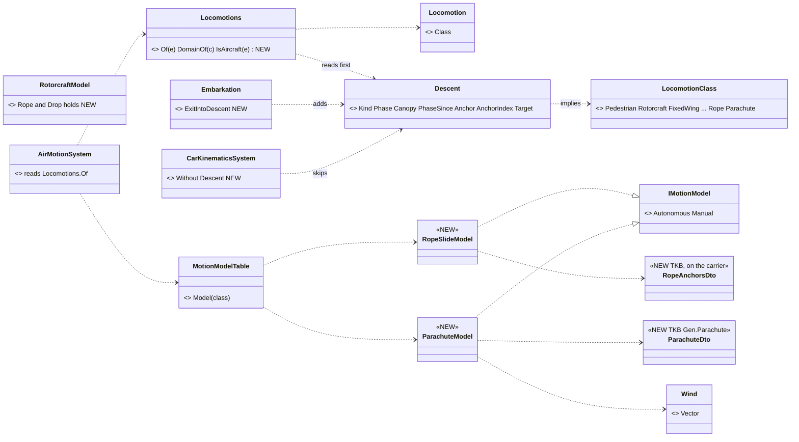
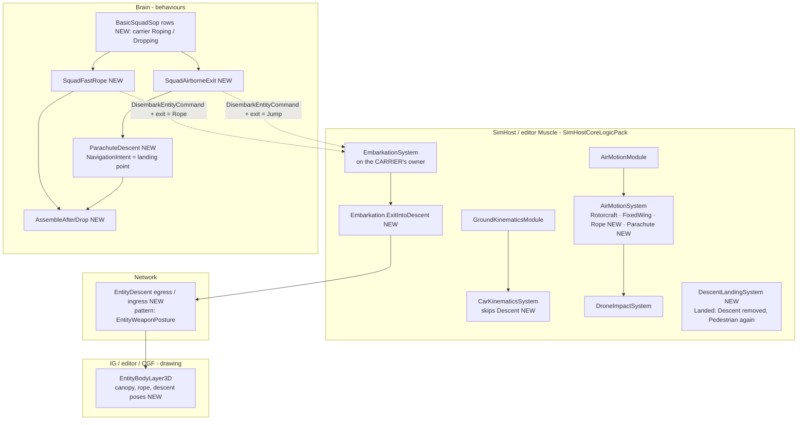
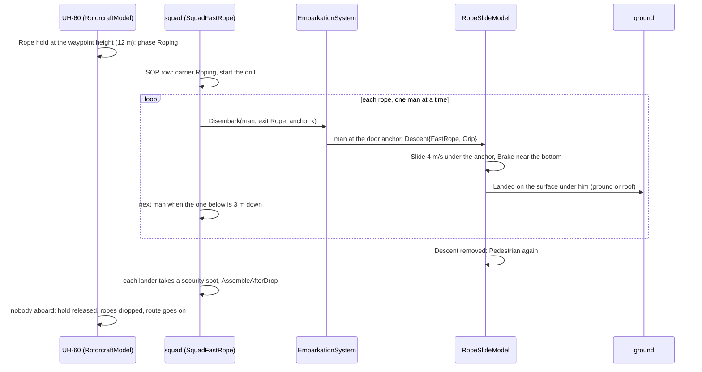
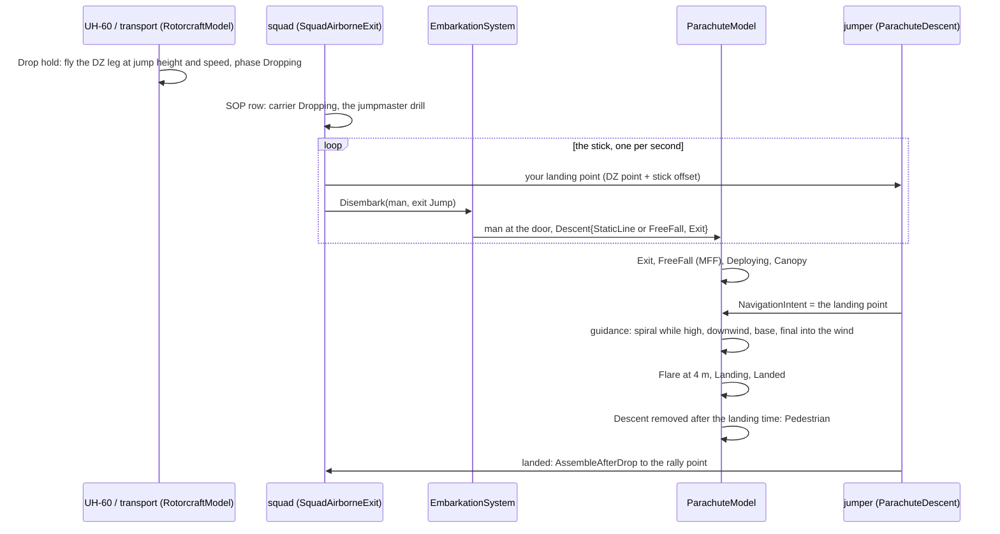
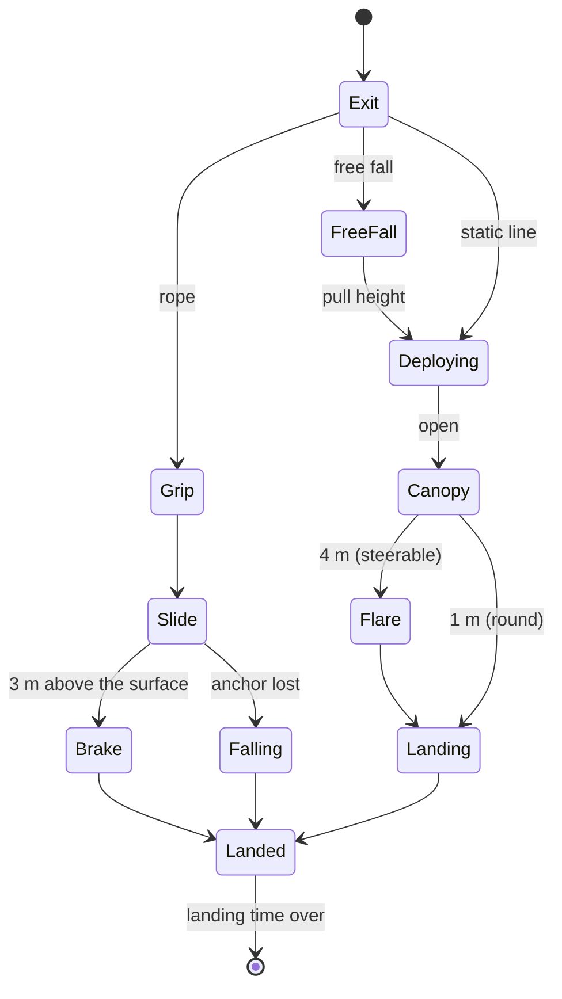

<!--STATUS
state: LIVE
updated: 2026-10-15
build-state: DESIGN — slice 1 READY-TO-BUILD once the user approves §3 (D-1…D-9); slices 2–3 DESIGN
current-answer: §1 the diagrams, §3 the decisions, §5 the descent models, §7 slice 1 (fast-rope AND parachute, per lane).
stale-below: nothing.
known-rot: none.
known-conflict: DESIGN_Map_3D_Mode.md §6m C-4 rejects "a jump in the simulation" — this design keeps that for a short hop (≤ 3 m) and
  SIMULATES a rope or parachute descent (D-8); the ui lane amends §6m when slice 1 lands.
related-designs:
  - docs/designs/motion-models/DESIGN_Motion_Domains.md — owns LocomotionClass, IMotionModel, MotionModelTable and the domain modules; this adds two classes (Rope, Parachute) and two models
  - docs/designs/air-attack/DESIGN_Air_Operations.md — owns the helicopter's route, holds and phases (B1, B8 air assault = SOP rows, §7c a killed aircraft); this adds the Rope / Drop holds and the Roping / Dropping phases
  - docs/DESIGN_Entity_Interactions.md — §7 owns embarkation (Embarkation, EmbarkationSystem, the dismount point); this adds the DOOR exit into a descent
  - docs/designs/group-maneuvers/DESIGN_Squad_Tactics.md — owns the squad drills (SquadDismount, ISquadPlay, BasicSquadSop rows); this adds SquadFastRope, SquadAirborneExit, AssembleAfterDrop
  - docs/DESIGN_Map_3D_Mode.md — owns the 3-D drawing (§6m carriage kinds, §6n weapon drawings); this adds the rope, the canopy and the descent poses
  - docs/DESIGN_Dead_Reckoning.md — owns the replicated transform; the canopy's bank rides its pitch / roll (§9, P3)
-->

# Airborne insertion — fast-rope and parachute (and later the ejecting pilot)

🔒 **User, `2026-10-15`:** *"I need them to jump out of the helicopter and fly to a given place on the ground. also the pilot of a malfunctioning
fighter jet … simple movement model for a descending paratrooper so he can navigate and finally hit the landing spot, with spiraling, proper tilts
when turning … maybe we could also add a special forces descending from a hovering helicopter on a rope"* → *"ok write the design but put both
rope and parachuting to slice one"*.

## 0. INVENTORY — what exists (codebase-memory graph, re-indexed `2026-10-15`, 231 427 nodes; + grep)

| query | total | finding |
|---|---|---|
| `search_graph` Class / Struct / Enum `.*(parachut\|paratroop\|airborne\|eject\|freefall\|rappel\|fastrope\|abseil\|canopy).*` | **0 / 0 / 0** | nothing to reuse or duplicate |
| `search_graph` Class `.*(Parachut\|Eject\|Rope\|Fall).*` | 56 | none relevant: `EjectPassengersExecutor` (unload a vehicle), `ShapeKit.DeathFall` (drawing) |
| `search_graph` `.*(MotionModel\|LocomotionClass).*` | 7 | `IMotionModel`, `MotionModelTable`, `LocomotionClass` — **the seam** (`FDP/Toolkits/Fdp.Toolkits/Motion/IMotionModel.cs`) |
| `trace_path` inbound `MotionModelTable.Model` | 4 | one production caller: `AirMotionSystem.Execute` (the rest tests) |
| design corpus (`docs/` 956 md, `.dev/` 2 939 md), by topic | — | ⛔ **searched, no design or ruling** for paratroopers, parachutes, ejection, CSAR, fast-rope, rappel |
| ⚠ `check_index_coverage` | — | not available through the CLI this session (the MCP server was down) — every absence above is grep-corroborated |

| fact the design rests on | code — how it IS | design basis — how it was MEANT |
|---|---|---|
| the air module picks a model PER BODY per frame from its class | ✅ `AirMotionSystem.cs:31-46` | ✅ Motion Domains MD-C *"a new mover is a new model + a table row"* |
| `Locomotion` is NOT replicated — every node writes it from the type | ✅ `Locomotion.cs:22-31` (`NoScenario`, `LocomotionTkbTranslator` on every node) | ✅ MD-A |
| ⚠ the ground mover would move and ground-clamp a descending man | ✅ `CarKinematicsSystem.cs:80-89` (no air skip), `:465` (clamp) | ✅ MD-G *"each model owns its Z"* ⇒ a gap |
| a dismount stands the man BESIDE the hull at the HULL's height | ✅ `Embarkation.cs:337-353` | ✅ Air Ops §9b *"Disembark has no airborne gate"* |
| a helicopter already HOVERS at an air waypoint with an Unload hold | ✅ `RotorcraftModel.cs:193-217`, `AirRoute.IsStop` | ✅ Air Ops B1 / §4c |
| ⇒ today a hover-unload at 15 m TELEPORTS the squad down (the next ground step clamps) | ✅ the two rows above | ⛔ unintended — §7 B-3 refuses it |
| ⚠ a body whose class is air is an AIR TARGET (SAM ammo, shelter-from-air) | ✅ `AmmoChoice.cs:47-54`, `AirContacts.cs:19`, `ShelterFromAirNodes.cs:153` | ⛔ searched, no ruling ⇒ D-4 |
| no wind exists | ✅ grep `Wind` in `FDP/Toolkits`, `Hrot/Engine`, `Hrot/Subsystems`: none | ⛔ none ⇒ D-6 |
| air assault = squad SOP rows + route holds, no special order | ✅ `SquadSopConditions.CarrierUnloading` (`SquadDismountBehavior.cs:158`) | ✅ Air Ops B8 (R-2015) |
| a killed aircraft's riders die with it | ✅ embarkation I-2c | ✅ Air Ops §7c (R-2021) ⇒ ejection must come BEFORE the kill (slice 2) |

## 1. The diagrams

*Caption:* the **descent component is the one truth** — present ⇒ a descent model moves the body, on every node the same (it replicates; the
type's `Locomotion` does not). Nothing new schedules anything: `AirMotionSystem` already loops the owned air bodies; the ground mover only learns to
skip them, exactly as it skips a carried passenger (`Without<IsEmbarkedTag>`).

*Caption:* who runs it each frame. Both movers live in the SAME PostSimulation pack on the node that owns the soldier's position
(`WithOwned<SimTransform>`), so a descent moves on exactly one node; every other node draws it from the replicated `Descent` + transform. ⚠
the exit runs on the CARRIER's owner (R-224) — the open CE-3059 (the passenger's position written on the wrong node) applies here too.

*Caption:* one phase machine for both kinds, kept in `Descent.Phase` — the animation reads it (D-5). `Falling` is the anchor (the helicopter)
killed mid-rope: gravity, then fall damage (§5.3).

## 2. How the real thing works (public figures, rounded — the TKB defaults)

| | fast-rope | static line, round canopy (T-11 class) | military free fall, ram-air (MC-4 class) |
|---|---|---|---|
| from | hover 10–20 m (UH-60 30–60 ft; ropes 60–90 ft), a rope per door | 250–450 m AGL, helicopter ~ 35 m/s (70 kt) | HALO exit up to 7 600 m with oxygen; HAHO opens high and glides 30+ km |
| exit | both doors at once, one man per rope; the next when the one below is ~3 m down | the stick one per ~1 s, alternate doors | a team, 1–2 s apart |
| descent | slide 3–5 m/s, brake near the bottom | opens in ~4 s / ~60 m; sinks ~5.5 m/s; drifts with the wind | free fall ~55 m/s (belly), pull ~1 100 m AGL; under canopy sink 4–5 m/s, forward 10–13 m/s (glide ~3:1); a banked turn sinks faster (a spiral 10+ m/s) |
| steering | none (the anchor) | slips of ~1–2 m/s | toggles: turn, brake (half brakes slow and flatten) |
| landing | on whatever is below (a roof included) | parachute landing fall (PLF); the stick spreads 50–200 m | downwind → base → final into the wind; flare at ~4 m; stands up within ~10 m |
| after | clear the rope, 360° security, assault; ropes cut; the helicopter leaves or orbits (DoorGunOrbit) | out of the harness (~30–60 s, vulnerable), rally at the assembly point | the same, faster (~10 s) |
| total | 8–10 men in ~10–15 s | a squad over ~10 s of flight | — |

## 3. Decisions (leans for approval)

| # | decision | lean | rejected — one line each |
|---|---|---|---|
| **D-1** | where the descent lives | a NEW replicated component **`Descent`** (Kind, Phase, Canopy, PhaseSince, Anchor + index, Target); present ⇒ the body's class is `Rope` / `Parachute` through `Locomotions.Of` (read FIRST, before the type's `Locomotion`) | mutate `Locomotion.Class` — it is not replicated, so other nodes would disagree on what he is |
| **D-2** | who moves him | two new classes + models behind the existing seam: **`RopeSlideModel`** (Rope = 8), **`ParachuteModel`** (Parachute = 9), both Air domain, scheduled by the existing `AirMotionSystem` | one descent model with modes — two unrelated parameter sets; a new descent system — duplicates `AirMotionSystem`'s loop |
| **D-3** | the ground mover | `CarKinematicsSystem` gains `.Without<Descent>()` (the `IsEmbarkedTag` precedent) | a domain check inside the mover — the query is the house style and costs nothing |
| **D-4** | can he be shot | **yes by guns, never by SAMs**: a NEW `Locomotions.IsAircraft(e)` = air domain and not a descent class, used by `AmmoChoice` and `AirContacts` (no one shelters from a paratrooper) | air-domain = aircraft — a Stinger would lock a man under a canopy |
| **D-5** | the animation state | `Descent.Phase` (§1 state diagram) is the animation key; the canopy's **bank is the body's roll** in `SimTransform.Rotation` (P3 put pitch / roll on the wire) | a bank field in the descriptor — two homes for one angle |
| **D-6** | wind | a scenario-wide constant **`Wind`** singleton (direction, speed; absent = calm), read by the parachute model and the release-point rule | no wind — drops look too clean and "land into the wind" means nothing |
| **D-7** | how the helicopter carries it | two new route holds on an AIR waypoint: **`Rope`** (hover at the waypoint height, phase `Roping`, released when nobody aboard — `Unload`'s rule) and **`Drop`** (fly the DZ leg at the waypoint's height and speed, phase `Dropping`, released when nobody aboard); SOP rows react to the phase (Air Ops B8) | a special air-assault order — B8 rejected it |
| **D-8** | the CE-1084 ruling (C-4: a jump-down is drawn, not simulated) | keep it for a hop ≤ 3 m (landed / low hover); **simulate** a rope or parachute descent; an `Unload` hover above 3 m is REFUSED (warned) — no more teleport | simulate every dismount — a 1 m step needs no model |
| **D-9** | slicing | **slice 1 = fast-rope AND parachute** (user); slice 2 = the ejecting pilot + evade; slice 3 = rappel, rope extraction (SPIES), fixed-wing transport drops | — |

## 4. TKB

| descriptor | on | fields (defaults from §2) |
|---|---|---|
| **`Gen.Parachute`** (`ParachuteDto`) | a jumper type (Paratrooper, SF operator, slice 2 Pilot) | `Canopy` (Round · RamAir), `SinkMps`, `ForwardMps`, `TurnRateDeg`, `MaxBankDeg`, `BrakeSinkFactor`, `FlareHeightM`, `OpenSeconds`, `PullHeightM` (free fall), `LandingSeconds` (harness off) |
| **`RopeAnchors`** on `Gen.Carrier` | a helicopter type (UH-60: one per door; CH-47 later: the ramp) | anchor places (x, y, z), `RopeLengthM`, `SlideMps`, `BrakeHeightM`; each seat → its anchor |
| new types | — | **Paratrooper** (round canopy, rifle), **SF operator** (ram-air, fast-rope trained, carbine), later **Pilot** (slice 2) |

## 5. The descent models (Muscle, pure arithmetic beside the seam)

### 5.1 `RopeSlideModel`
Each frame: the anchor's WORLD point (the helicopter's transform × the anchor place) gives x, y; z falls at `SlideMps` (eased in over 0.3 s),
slowing to 1 m/s below `BrakeHeightM`; the surface under the anchor (`IWorldQuery.SurfaceZ` — the ground or a roof) ends it ⇒ `Landed`. The
anchor dead or out of the hold ⇒ `Falling` (§5.3). Yaw = facing the helicopter's side.

### 5.2 `ParachuteModel`
State: heading ψ, bank φ, forward speed V, sink w (all from the body's transform + velocity and `Descent`). Inputs from the guidance: turn
u ∈ [−1, 1], brake b ∈ [0, 1].

| quantity | rule |
|---|---|
| turn rate | ψ̇ = u · `TurnRateDeg` |
| bank (the tilt) | φ → atan(V · ψ̇ / g), lagged 0.5 s, clamped `MaxBankDeg` |
| forward | V = `ForwardMps` · (1 − 0.6 b) (round: ≈ 0, slips only) |
| sink | w = `SinkMps` / cos φ^1.5 · (1 − 0.5 b) — a banked turn sinks faster (the spiral) and brakes flatten it |
| flare | below `FlareHeightM`: b → 1 over 1 s ⇒ w ≈ 1 m/s, V small |
| drift | position += (V along ψ + `Wind`) · dt; z −= w · dt |
| free fall | before the pull: w → 55 m/s (drag), V tracking ≤ 15 m/s toward the target |

**Guidance (ram-air), each frame toward the landing point P (the `NavigationIntent` target):**
1. **too high** (height above the pattern entry 300 m > what a straight glide to P burns) ⇒ **spiral** over P: hold a circle of ~60 m at
   u = ±0.7 — the bank and the faster sink come from §5.2;
2. **pattern** (≤ 300 m): downwind leg beside P, base, then **final into the wind** aimed at P with the glide ratio (V − wind) / w, brakes as
   the trim (too high ⇒ brakes, too low ⇒ none);
3. **flare** at `FlareHeightM` ⇒ landed. **Round canopy:** face into the wind and slip toward P; it lands where the drift takes it (so the
   release point, §6, is the real aim).

### 5.3 Landing and falls
`Landed` holds `LandingSeconds` (the PLF / harness — he cannot move or fire), then `Descent` is removed and he is a Pedestrian at that spot.
A `Falling` man (the anchor lost, a canopy that never opened — not modelled in slice 1) hits at his speed: > 10 m/s kills, 6–10 m/s
incapacitates (the existing injury path).

## 6. Behaviours (Brain)

| behaviour / drill | does | reuses |
|---|---|---|
| route `Rope` / `Drop` holds (D-7) | the helicopter hovers / flies the DZ leg and reports `Roping` / `Dropping` | `RotorcraftModel` holds, `AirHolds` release rules |
| SOP rows | carrier `Roping` ⇒ `SquadFastRope`; carrier `Dropping` ⇒ `SquadAirborneExit` | `BasicSquadSop`, `SquadSopConditions` (as `CarrierUnloading`) |
| **`SquadFastRope`** (ISquadPlay) | alternate the ropes; the next man when the one below is 3 m down; each lander to a security spot round the rope point (360°) | `SquadManeuverRunner`, `SquadDismount`'s positions |
| **`SquadAirborneExit`** (ISquadPlay — the jumpmaster) | the stick in seat order, one per second, alternating doors; each man's landing point = the order's DZ point + his offset along the track (a line for a stick, a cluster for a free-fall team) | the same runner |
| **release point** (pure helper) | where along the DZ leg to start the stick: upwind of P by the drift during descent (round: w, height, `Wind`; ram-air: within glide reach) | `Wind` (D-6) |
| **`ParachuteDescent`** (individual) | writes the landing point as his `NavigationIntent`; nothing else — the model steers | `NavigationIntent` (Autonomous) |
| **`AssembleAfterDrop`** (squad) | rally at the assembly point (the order's, else the DZ centre); the leader counts heads; the squad resumes its mission | group machinery (orders, formation) |

## 7. Slices

### Slice 1 — fast-rope AND parachute (user: both at once)

| # | lane | item | acceptance |
|---|---|---|---|
| **B-1** | backend | `Descent` component + `EntityDescent` descriptor (egress / ingress, the `EntityWeaponPosture` pattern) + `Locomotions.Of` reads it first | ★ a man with `Descent{Parachute}` reports class Parachute on every node |
| **B-2** | backend | `LocomotionClass.Rope / Parachute`, `RopeSlideModel`, `ParachuteModel` (§5), `MotionModelTable` rows; `CarKinematicsSystem.Without<Descent>` | ★ rope: 12 m in ~3.5 s, x,y under the anchor; ★ ram-air from 1 000 m lands within 10 m of P in calm and in 5 m/s wind; ★ round lands within its drift; ★ bank = atan(V ψ̇ / g) ± 2°; ★ a spiral sinks faster than a straight glide |
| **B-3** | backend | `RouteHold.Rope / Drop`, `NavigationPhase.Roping / Dropping` in `RotorcraftModel`; an `Unload` hover above 3 m refused (warned) | ★ the UH-60 hovers at 12 m while anyone is aboard on a Rope hold, then goes on |
| **B-4** | backend | `Embarkation.ExitIntoDescent(passenger, exit kind, anchor)`: leave at the DOOR (seat place / anchor) at its height, add `Descent{Exit}` — via `DisembarkEntityCommand`'s new exit field | ★ a roped man starts at the door, not beside the hull |
| **B-5** | backend | TKB: `Gen.Parachute`, `RopeAnchors` (UH-60 404 + 400), types Paratrooper, SF operator; `Wind` singleton (scenario) | the catalogue suites; ★ the release-point helper's rail |
| **B-6** | backend | `Locomotions.IsAircraft` used by `AmmoChoice` / `AirContacts` (D-4); fall damage (§5.3) | ★ a Stinger never selects a parachutist; a rifle does |
| **H-1** | behaviors | SOP rows + `SquadFastRope`, `SquadAirborneExit` (jumpmaster), `ParachuteDescent`, `AssembleAfterDrop`, the release point | ★ 8 men down two ropes in ≤ 15 s and in a 360° ring; ★ a stick of 8 from 400 m lands along the DZ and assembles |
| **H-2** | behaviors | demo `ua-airborne`: ① SF fast-rope onto a rooftop, the helicopter then orbits ② a static-line stick onto a DZ ③ a free-fall team spirals down onto a point | live, PASS per vignette |
| **U-1** | ui | the 3-D drawing: the rope from the anchor to the surface (dropped after the hold); round and ram-air canopies with lines, banked with the body; poses per phase (exit tuck, free-fall arch, under canopy hands on toggles, flare, PLF roll, rope slide); amend §6m C-4 (D-8) | frame rails + screenshots per phase |

### Slice 2 — the ejecting pilot (DESIGN)
The jet's crew is the type itself, so ejection **spawns a Pilot entity** (the existing entity-creation path) at the canopy BEFORE the kill (R-2021):
`Descent{Ejection}` — the rocket seat (apex 50–100 m above, seat away at 1–2 s, round canopy by ~3 s, sink 6–7 m/s); trigger: health below a
threshold or a damage state (the "malfunction"); then **`EvadeAndSignal`** (out of the harness, hide, move away from the enemy, a beacon) feeding
the planned rescue (Air Ops §4c / §9, `SquadRecover`, `ua-air-rescue`). Drawing: the seat, the rocket flame, the canopy.

### Slice 3 — later
Rappel (harness, 1–2 m/s, can stop; down a wall to a window), rope extraction (SPIES / FRIES: hooked on, flown away), fixed-wing transport
drops (a C-130 type), varying wind, a canopy that fails (reserve).
