<!--STATUS
state: LIVE
updated: 2026-10-16
build-state: BUILDING — H-1/H-3 BUILT 2026-10-16 (as-built §6.7, live pending); B-1…B-4 BUILT 2026-10-16 (as-built §7a), B-5 BUILT but the scenario wind (§7b D-13, open), B-6 BUILT (§7c), B-7…B-9 BUILT (§7d) — §3 APPROVED 2026-10-15 (R-1003); slice 3 DESIGN
current-answer: §1 the diagrams, §3 the decisions (approved), §5 the descent models, §6.1–§6.6 the drills' design (H-1/H-3, behaviors), §7 the slices per lane, §7a the as-built of B-1…B-4 and §7b of B-5 (win over §1/§5 where they differ), §8 the three demos, §9 hit by part during a descent.
stale-below: nothing.
known-rot: none.
known-conflict: DESIGN_Map_3D_Mode.md §6m C-4 rejects "a jump in the simulation" — this design keeps that for a short hop (≤ 3 m) and
  SIMULATES a rope or parachute descent (D-8); the ui lane amends §6m when slice 1 lands.
related-designs:
  - docs/OVERVIEW_Rules_And_Demos.md — the INDEX of the rules and demos built across the behaviour designs (rule → what implements it → demo); this design OWNS the rows that cite it
  - docs/designs/weather/DESIGN_Weather_And_Time.md — OWNS the weather: supersedes §7d D-13 (the wind reaches every node on the replicated World Environment); the parachute reads its wind PROFILE
  - docs/designs/motion-models/DESIGN_Motion_Domains.md — owns LocomotionClass, IMotionModel, MotionModelTable and the domain modules; this adds two classes (Rope, Parachute) and two models
  - docs/designs/air-attack/DESIGN_Air_Operations.md — owns the helicopter's route, holds and phases (B1, B8 air assault = SOP rows, §7c a killed aircraft); this adds the Rope / Drop holds and the Roping / Dropping phases
  - docs/DESIGN_Entity_Interactions.md — §7 owns embarkation (Embarkation, EmbarkationSystem, the dismount point); this adds the DOOR exit into a descent
  - docs/designs/group-maneuvers/DESIGN_Squad_Tactics.md — owns the squad drills (SquadDismount, ISquadPlay, BasicSquadSop rows); this adds SquadFastRope, SquadAirborneExit, AssembleAfterDrop
  - docs/DESIGN_Map_3D_Mode.md — owns the 3-D drawing (§6m carriage kinds, §6n weapon drawings); this adds the rope, the canopy and the descent poses
  - docs/DESIGN_Dead_Reckoning.md — owns the replicated transform; the canopy's bank rides its pitch / roll (§9, P3)
  - docs/designs/hit-location/DESIGN_Body_Parts_And_Hit_Location.md — OWNS hit-by-part (R-3010: PersonBody / VehicleBody generated from the drawing, PartDamage, HitMarks); §9 here says how a descending man, the canopy and the rope meet it
-->

# Airborne insertion — fast-rope and parachute (and later the ejecting pilot)

🔒 **User, `2026-10-15`:** *"I need them to jump out of the helicopter and fly to a given place on the ground. also the pilot of a malfunctioning
fighter jet … simple movement model for a descending paratrooper so he can navigate and finally hit the landing spot, with spiraling, proper tilts
when turning … maybe we could also add a special forces descending from a hovering helicopter on a rope"* → *"ok write the design but put both
rope and parachuting to slice one"*. ✅ **Approved `2026-10-15` (R-1003):** *"approved. i will need a demo scenario for a squad of paratrooper
jumping out of helicopter and regrouping on the ground … a squad sliding down to building roof using rope from a helicopter then needs to come
and hover above the building and fly away when all men are safely on the roof … and a demo of a catapulting pilot"* (§8).

## 0. INVENTORY — what exists (codebase-memory graph, re-indexed `2026-10-15`, 231 427 nodes; + grep)

| query | total | finding |
|---|---|---|
| `search_graph` Class / Struct / Enum `.*(parachut\|paratroop\|airborne\|eject\|freefall\|rappel\|fastrope\|abseil\|canopy).*` | **0 / 0 / 0** | nothing to reuse or duplicate |
| `search_graph` Class `.*(Parachut\|Eject\|Rope\|Fall).*` | 56 | none relevant: `EjectPassengersExecutor` (unload a vehicle), `ShapeKit.DeathFall` (drawing) |
| `search_graph` `.*(MotionModel\|LocomotionClass).*` | 7 | `IMotionModel`, `MotionModelTable`, `LocomotionClass` — **the seam** (`FDP/Toolkits/Fdp.Toolkits/Motion/IMotionModel.cs`) |
| `trace_path` inbound `MotionModelTable.Model` | 4 | one production caller: `AirMotionSystem.Execute` (the rest tests) |
| design corpus (`docs/` 956 md, `.dev/` 2 939 md), by topic | — | ⛔ **searched, no design or ruling** for paratroopers, parachutes, ejection, CSAR, fast-rope, rappel |
| ⚠ `check_index_coverage` | — | not available through the CLI this session (the MCP server was down) — every absence above is grep-corroborated |

| fact the design rests on | code — how it IS | design basis — how it was MEANT |
|---|---|---|
| the air module picks a model PER BODY per frame from its class | ✅ `AirMotionSystem.cs:31-46` | ✅ Motion Domains MD-C *"a new mover is a new model + a table row"* |
| `Locomotion` is NOT replicated — every node writes it from the type | ✅ `Locomotion.cs:22-31` (`NoScenario`, `LocomotionTkbTranslator` on every node) | ✅ MD-A |
| ⚠ the ground mover would move and ground-clamp a descending man | ✅ `CarKinematicsSystem.cs:80-89` (no air skip), `:465` (clamp) | ✅ MD-G *"each model owns its Z"* ⇒ a gap |
| a dismount stands the man BESIDE the hull at the HULL's height | ✅ `Embarkation.cs:337-353` | ✅ Air Ops §9b *"Disembark has no airborne gate"* |
| a helicopter already HOVERS at an air waypoint with an Unload hold | ✅ `RotorcraftModel.cs:193-217`, `AirRoute.IsStop` | ✅ Air Ops B1 / §4c |
| ⇒ today a hover-unload at 15 m TELEPORTS the squad down (the next ground step clamps) | ✅ the two rows above | ⛔ unintended — §7 B-3 refuses it |
| ⚠ a body whose class is air is an AIR TARGET (SAM ammo, shelter-from-air) | ✅ `AmmoChoice.cs:47-54`, `AirContacts.cs:19`, `ShelterFromAirNodes.cs:153` | ⛔ searched, no ruling ⇒ D-4 |
| no wind exists | ✅ grep `Wind` in `FDP/Toolkits`, `Hrot/Engine`, `Hrot/Subsystems`: none | ⛔ none ⇒ D-6 |
| air assault = squad SOP rows + route holds, no special order | ✅ `SquadSopConditions.CarrierUnloading` (`SquadDismountBehavior.cs:158`) | ✅ Air Ops B8 (R-2015) |
| a killed aircraft's riders die with it | ✅ embarkation I-2c | ✅ Air Ops §7c (R-2021) ⇒ ejection must come BEFORE the kill (slice 2) |

## 1. The diagrams

*Caption:* the **descent component is the one truth** — present ⇒ a descent model moves the body, on every node the same (it replicates; the
type's `Locomotion` does not). Nothing new schedules anything: `AirMotionSystem` already loops the owned air bodies; the ground mover only learns to
skip them, exactly as it skips a carried passenger (`Without<IsEmbarkedTag>`).

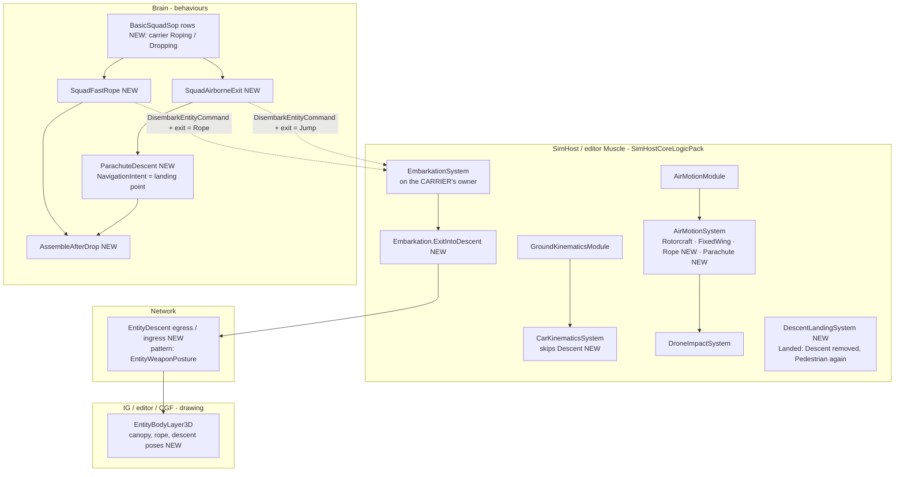

*Caption:* who runs it each frame. Both movers live in the SAME PostSimulation pack on the node that owns the soldier's position
(`WithOwned<SimTransform>`), so a descent moves on exactly one node; every other node draws it from the replicated `Descent` + transform. ⚠
the exit runs on the CARRIER's owner (R-224) — the open CE-3059 (the passenger's position written on the wrong node) applies here too.

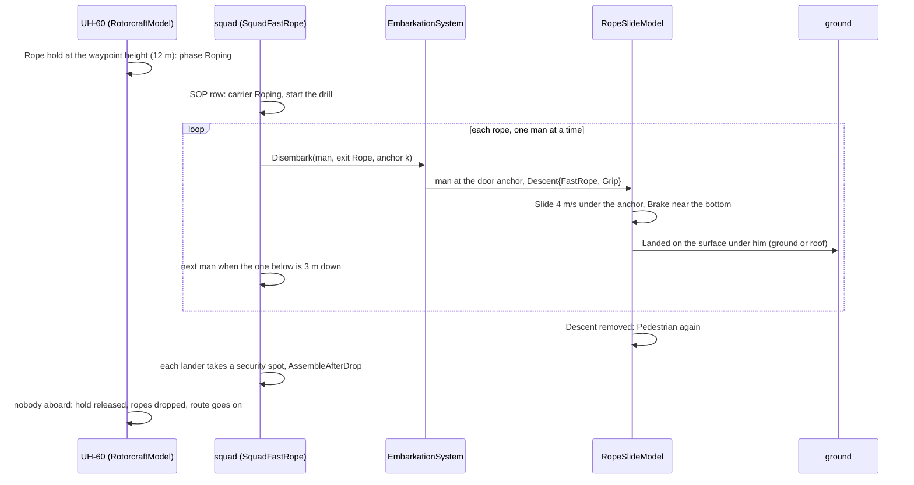

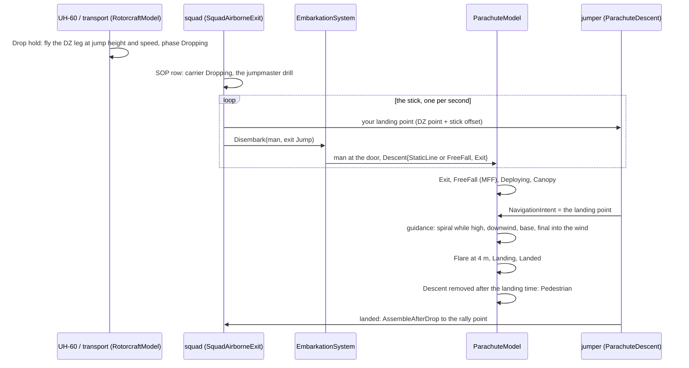

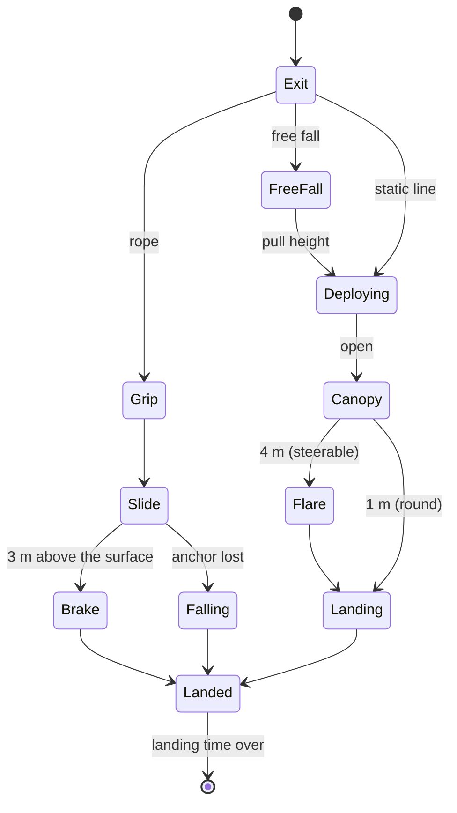

*Caption:* one phase machine for both kinds, kept in `Descent.Phase` — the animation reads it (D-5). `Falling` is the anchor (the helicopter)
killed mid-rope: gravity, then fall damage (§5.3).

## 2. How the real thing works (public figures, rounded — the TKB defaults)

| | fast-rope | static line, round canopy (T-11 class) | military free fall, ram-air (MC-4 class) |
|---|---|---|---|
| from | hover 10–20 m (UH-60 30–60 ft; ropes 60–90 ft), a rope per door | 250–450 m AGL, helicopter ~ 35 m/s (70 kt) | HALO exit up to 7 600 m with oxygen; HAHO opens high and glides 30+ km |
| exit | both doors at once, one man per rope; the next when the one below is ~3 m down | the stick one per ~1 s, alternate doors | a team, 1–2 s apart |
| descent | slide 3–5 m/s, brake near the bottom | opens in ~4 s / ~60 m; sinks ~5.5 m/s; drifts with the wind | free fall ~55 m/s (belly), pull ~1 100 m AGL; under canopy sink 4–5 m/s, forward 10–13 m/s (glide ~3:1); a banked turn sinks faster (a spiral 10+ m/s) |
| steering | none (the anchor) | slips of ~1–2 m/s | toggles: turn, brake (half brakes slow and flatten) |
| landing | on whatever is below (a roof included) | parachute landing fall (PLF); the stick spreads 50–200 m | downwind → base → final into the wind; flare at ~4 m; stands up within ~10 m |
| after | clear the rope, 360° security, assault; ropes cut; the helicopter leaves or orbits (DoorGunOrbit) | out of the harness (~30–60 s, vulnerable), rally at the assembly point | the same, faster (~10 s) |
| total | 8–10 men in ~10–15 s | a squad over ~10 s of flight | — |

## 3. Decisions — ✅ APPROVED `2026-10-15` (R-1003), as written

| # | decision | lean | rejected — one line each |
|---|---|---|---|
| **D-1** | where the descent lives | a NEW replicated component **`Descent`** (Kind, Phase, Canopy, PhaseSince, Anchor + index, Target); present ⇒ the body's class is `Rope` / `Parachute` through `Locomotions.Of` (read FIRST, before the type's `Locomotion`) | mutate `Locomotion.Class` — it is not replicated, so other nodes would disagree on what he is |
| **D-2** | who moves him | two new classes + models behind the existing seam: **`RopeSlideModel`** (Rope = 8), **`ParachuteModel`** (Parachute = 9), both Air domain, scheduled by the existing `AirMotionSystem` | one descent model with modes — two unrelated parameter sets; a new descent system — duplicates `AirMotionSystem`'s loop |
| **D-3** | the ground mover | `CarKinematicsSystem` gains `.Without<Descent>()` (the `IsEmbarkedTag` precedent) | a domain check inside the mover — the query is the house style and costs nothing |
| **D-4** | can he be shot | **yes by guns, never by SAMs**: a NEW `Locomotions.IsAircraft(e)` = air domain and not a descent class, used by `AmmoChoice` and `AirContacts` (no one shelters from a paratrooper) | air-domain = aircraft — a Stinger would lock a man under a canopy |
| **D-5** | the animation state | `Descent.Phase` (§1 state diagram) is the animation key; the canopy's **bank is the body's roll** in `SimTransform.Rotation` (P3 put pitch / roll on the wire) | a bank field in the descriptor — two homes for one angle |
| **D-6** ⛔ SUPERSEDED `2026-10-16` by [Weather and Time](../weather/DESIGN_Weather_And_Time.md) W-5 (CE-3216): the singleton is retired; the parachute and the release point read `WeatherField.WindAt` (regional, a profile with height; a world with no weather is calm, as here). ~~was:~~ | wind | a scenario-wide constant **`Wind`** singleton (direction, speed; absent = calm), read by the parachute model and the release-point rule | no wind — drops look too clean and "land into the wind" means nothing |
| **D-7** | how the helicopter carries it | two new route holds on an AIR waypoint: **`Rope`** (hover at the waypoint height, phase `Roping`, released when nobody aboard — `Unload`'s rule) and **`Drop`** (fly the DZ leg at the waypoint's height and speed, phase `Dropping`, released when nobody aboard); SOP rows react to the phase (Air Ops B8) | a special air-assault order — B8 rejected it |
| **D-8** | the CE-1084 ruling (C-4: a jump-down is drawn, not simulated) | keep it for a hop ≤ 3 m (landed / low hover); **simulate** a rope or parachute descent; an `Unload` hover above 3 m is REFUSED (warned) — no more teleport | simulate every dismount — a 1 m step needs no model |
| **D-9** | slicing | **slice 1 = fast-rope AND parachute** (user); slice 2 = the ejecting pilot + evade; slice 3 = rappel, rope extraction (SPIES), fixed-wing transport drops | — |

## 4. TKB

| descriptor | on | fields (defaults from §2) |
|---|---|---|
| **`Gen.Parachute`** (`ParachuteDto`) | a jumper type (Paratrooper, SF operator, slice 2 Pilot) | `Canopy` (Round · RamAir), `SinkMps`, `ForwardMps`, `TurnRateDeg`, `MaxBankDeg`, `BrakeSinkFactor`, `FlareHeightM`, `OpenSeconds`, `PullHeightM` (free fall), `LandingSeconds` (harness off) |
| **`RopeAnchors`** on `Gen.Carrier` | a helicopter type (UH-60: one per door; CH-47 later: the ramp) | anchor places (x, y, z), `RopeLengthM`, `SlideMps`, `BrakeHeightM`; each seat → its anchor |
| new types | — | **Paratrooper** (round canopy, rifle), **SF operator** (ram-air, fast-rope trained, carbine), later **Pilot** (slice 2) |

## 5. The descent models (Muscle, pure arithmetic beside the seam)

### 5.1 `RopeSlideModel`
Each frame: the anchor's WORLD point (the helicopter's transform × the anchor place) gives x, y; z falls at `SlideMps` (eased in over 0.3 s),
slowing to 1 m/s below `BrakeHeightM` *(⚠ as-built §7a: a RAMP from the slide speed down to 1 m/s at the surface — a flat 1 m/s over 3 m alone
takes 3 s and misses B-2's "12 m in ~3.5 s")*; the surface under the anchor (`IWorldQuery.SurfaceZ` — the ground or a roof) ends it ⇒ `Landed`. The
anchor dead or out of the hold ⇒ `Falling` (§5.3). Yaw = facing the helicopter's side.

### 5.2 `ParachuteModel`
State: heading ψ, bank φ, forward speed V, sink w (all from the body's transform + velocity and `Descent`). Inputs from the guidance: turn
u ∈ [−1, 1], brake b ∈ [0, 1].

| quantity | rule |
|---|---|
| turn rate | ψ̇ = u · `TurnRateDeg` |
| bank (the tilt) | φ → atan(V · ψ̇ / g), lagged 0.5 s, clamped `MaxBankDeg` |
| forward | V = `ForwardMps` · (1 − 0.6 b) (round: ≈ 0, slips only) |
| sink | w = `SinkMps` / cos φ^1.5 · (1 − 0.5 b) — a banked turn sinks faster (the spiral) and brakes flatten it |
| flare | below `FlareHeightM`: b → 1 over 1 s ⇒ w ≈ 1 m/s, V small |
| drift | position += (V along ψ + `Wind`) · dt; z −= w · dt |
| free fall | before the pull: w → 55 m/s (drag), V tracking ≤ 15 m/s toward the target |

**Guidance (ram-air), each frame toward the landing point P (the `NavigationIntent` target):**
1. **too high** (height above the pattern entry 300 m > what a straight glide to P burns) ⇒ **spiral** over P: hold a circle of ~60 m at
   u = ±0.7 — the bank and the faster sink come from §5.2;
2. **pattern** (≤ 300 m): downwind leg beside P, base, then **final into the wind** aimed at P with the glide ratio (V − wind) / w, brakes as
   the trim (too high ⇒ brakes, too low ⇒ none);
3. **flare** at `FlareHeightM` ⇒ landed. **Round canopy:** face into the wind and slip toward P; it lands where the drift takes it (so the
   release point, §6, is the real aim).

### 5.3 Landing and falls
`Landed` holds `LandingSeconds` (the PLF / harness — he cannot move or fire), then `Descent` is removed and he is a Pedestrian at that spot.
A `Falling` man (the anchor lost, a canopy that never opened — not modelled in slice 1) hits at his speed: > 10 m/s kills, 6–10 m/s
incapacitates (the existing injury path).

## 6. Behaviours (Brain)

| behaviour / drill | does | reuses |
|---|---|---|
| route `Rope` / `Drop` holds (D-7) | the helicopter hovers / flies the DZ leg and reports `Roping` / `Dropping` | `RotorcraftModel` holds, `AirHolds` release rules |
| SOP rows | carrier `Roping` ⇒ `SquadFastRope`; carrier `Dropping` ⇒ `SquadAirborneExit` | `BasicSquadSop`, `SquadSopConditions` (as `CarrierUnloading`) |
| **`SquadFastRope`** (ISquadPlay) | alternate the ropes; the next man when the one below is 3 m down; each lander to a security spot round the rope point (360°) | `SquadManeuverRunner`, `SquadDismount`'s positions |
| **`SquadAirborneExit`** (ISquadPlay — the jumpmaster) | the stick in seat order, one per second, alternating doors; each man's landing point = the order's DZ point + his offset along the track (a line for a stick, a cluster for a free-fall team) | the same runner |
| **release point** (pure helper) | where along the DZ leg to start the stick: upwind of P by the drift during descent (round: w, height, `Wind`; ram-air: within glide reach) | `Wind` (D-6) |
| **`ParachuteDescent`** (individual) | writes the landing point as his `NavigationIntent`; nothing else — the model steers | `NavigationIntent` (Autonomous) |
| **`AssembleAfterDrop`** (squad) | rally at the assembly point (the order's, else the DZ centre); the leader counts heads; the squad resumes its mission | group machinery (orders, formation) |

⚠ The table above is the approved sketch (R-1003). §6.1–§6.6 below is the design detail (H-1, H-3 — behaviors, `2026-10-16`) and wins where
they differ: ⛔ the `ParachuteDescent` row is SUPERSEDED by D-18 (the landing point rides the exit decision).

### 6.0 INVENTORY (codebase-memory CLI, re-indexed `2026-10-16`; + grep)

| query | total | what it found that this design builds on |
|---|---|---|
| `search_graph name_pattern=.*Descent.*` | 65 | `Descent` (+ `Target`, replicated by `EntityDescent` — `TargetX/Y/Z`), `DescentRules` (`DoorPoint`, `HighestSurface`, `TryAnchor`), `Descents.Start`, `DescentLandingSystem`, `ReleasePoint` (in `DescentModels.cs`) |
| `.*AirHold.*` | 3 | `AirHolds` — `CarrierOf`, `AnyOnRopes`, `ShouldRelease` (the Rope hold waits for the last man `Landed`) |
| `.*Dismount.*` | 33 | `SquadDismountPlay : ISquadPlay`, `SquadDismountManeuver` (kind 10), `SquadManeuverRunner.Dismount`, `SquadSopConditions.CarrierUnloading` |
| `.*Eject.*` | 69 | `BehaviorConstants.ActionIdEject` (11), `EjectionDto`, the report's `EjectExecutor`; `ActionIdEjectPassengers` (unrelated) |
| `.*Parachut.*` | 13 | `ParachuteModel` (`Of`, `Defaults`), `ParachuteDto`, `LocomotionClass.Parachute`, `NedTkbBuilder.WithParachute` |
| `^NavigationIntent$`, `^LocomotionMoveTo$`, `^DisembarkExecutor$`, `^DisembarkNodeParams$` | 2 / 1 / 1 / 1 | the move path a jumper's landing point might have taken (D-18 rejects it), and the exit path it takes instead |
| grep `Descent` in `Fdp.Toolkits/Navigation/` | **0** | ⛔ no ground-navigation system skips a descent — `NavigationIntentBridgeSystem` registers any `PathToPoint` with the infantry crowd (D-18) |
| grep `DefaultBehaviorHash =` / `DefaultSop =` in production | **0 / 0** | ⚠ a SPAWNED unit's first behaviour from its type is plumbed (`BehaviorTkbTranslator`) but used by no type yet (D-23) |
| `ManeuverKind = ` in `Squad/Maneuvers` | 14 | kinds 1…14 taken ⇒ the new drills take **15, 16, 17** |

### 6.1 Classes

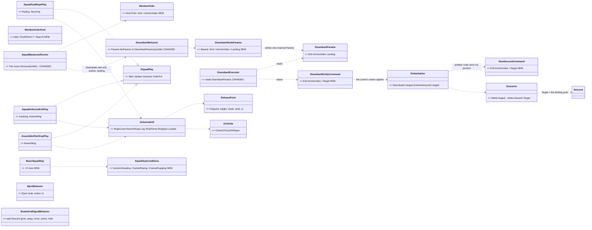

*Caption:* what the picture shows that the §6 table hid — the jumper's landing point has **one writer, set once, at the jumpmaster's
decision**, and it rides the SAME path the exit kind already rides (order → `Disembark` → channel params → command → `Descents.Start`), so
the Muscle that owns his position writes `Descent.Target`. Every NEW field is APPENDED (R-169). No new system: three plays over the
existing runner and one helper class.

### 6.2 Who runs it each frame

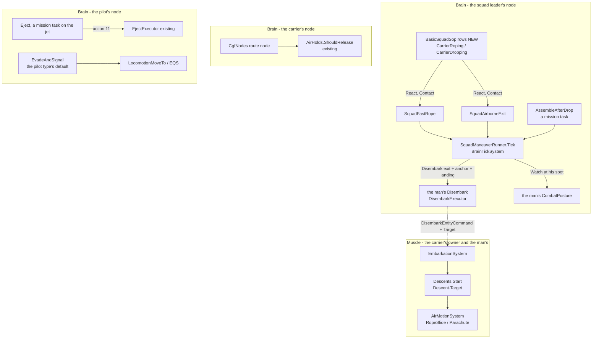

*Caption:* every drill is ticked by the existing `BrainTickSystem` through `SquadManeuverRunner.Tick` — no new system; the only
cross-node edge is the existing interaction transport. ⚠ The pilot is SPAWNED, so nothing scenario-authored gives him a behaviour — his
TYPE must (D-23).

### 6.3 The fast rope

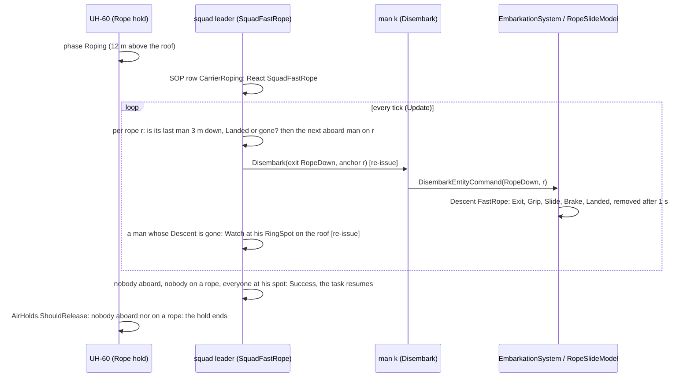

### 6.4 The stick

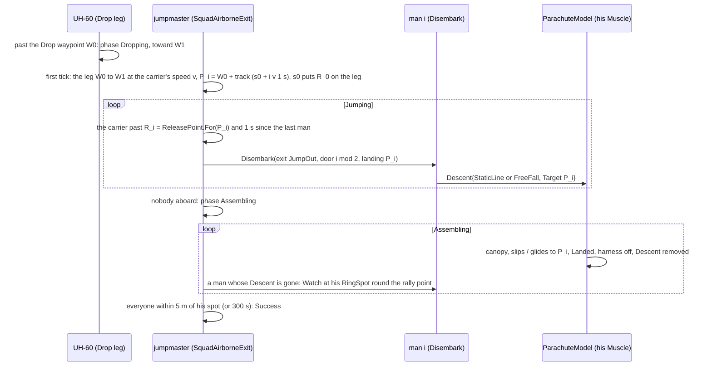

### 6.5 Decisions (behaviors, `2026-10-16`)

| # | decision | lean (built) | rejected — one line each |
|---|---|---|---|
| **D-18** | how a jumper's landing point reaches his parachute | **on the exit decision**: `MemberOrder.Point` → `DisembarkParamsJsonDto.Landing` → `DisembarkParams` → `DisembarkEntityCommand.Target` → `StartDescentCommand.Target` → `Descents.Start` writes `Descent.Target` (replicated) | `ParachuteDescent` writing `NavigationIntent` — a `PathToPoint` on a man in the air is registered with the infantry crowd (`NavigationIntentBridgeSystem`, no Descent filter, §6.0) · the Brain writing `Descent.Target` — it is Muscle state (B-4) |
| **D-19** | pacing (the next man on a rope; one jumper per second) | the play's PARAMS hold per-member state (`fixed` arrays — the `BatteryFireParams` precedent); `Update` sets `Reissue` when a man's turn comes or he lands; a man waiting aboard or coming down gets **`MemberOrderKind.Stay`** (nothing is published — he keeps what he does) | a CombatPosture for a man aboard / on a rope — it would pull him out of his ride and is meaningless in the air · one Disembark to every man at once (SquadDismount) — no pacing |
| **D-20** | the security ring on a roof | `AirborneDrill.RingSpot(centre, k, n)`: radius 5 m, shrunk to 3 m then 1.5 m until `HighestSurface` at the spot AND at the midpoint is the centre's surface ± 0.5 m (a man is never sent off the ledge — CE-3145); a spot that never fits is the centre | the dismount column (`DismountPoint`) — beside a hull, not on a roof · an EQS query — one per man, slower, and the roof test is the whole requirement |
| **D-21** | where the stick lands | the DZ is the Drop LEG as B-3 built it (the Drop waypoint W0 to the next waypoint W1; no W1 ⇒ the carrier's heading): landing points one second of flight apart along it, the first placed so its release point is already on the leg; a free-fall team (ram-air) lands in a 5 m ring round the leg's first point instead | an authored DZ point on the order — the SOP's React row carries no params, and the route already says where the leg is |
| **D-22** | `AssembleAfterDrop` | the LAST PHASE of both drills (one helper, `RingSpot` round the rally point = the stick's middle landing point / the rope point) AND a standalone squad behaviour (kind 17, a mission task: the rally point as its param) | a third SOP row — "landed and not yet assembled" has no squad edge to key on |
| **D-23** | how the spawned pilot gets `EvadeAndSignal` | the pilot TYPE (206)'s behaviour profile names it — whichever of `DefaultSop` / `DefaultBehaviorHash` the ingress honours on a SPAWNED entity (⛔ unmeasured — both are plumbed, neither is used yet; measured at build) | an SOP row in the infantry `BasicSop` — every soldier would carry a pilot's drill |
| **D-24** | `Eject` | a library behaviour for an AIRCRAFT: one node starting interaction action 11 (`EjectExecutor`) and forwarding its answer; the timer is the mission's (`TimerElapsed` on the task) | the node raising `EjectRequestEvent` itself — the executor already does, on the Brain (backend D-14) |
| **D-25** | `EvadeAndSignal` | waits while he has a `Descent` (and the harness time); then a point 120 m from the nearest REMEMBERED live enemy (straight away from him; none ⇒ where he is) through the plain move, then `FindSafeRetreatPoint` (existing, hidden from every known threat) round it, then prone and hold (Running for ever). The beacon / rescue stays Air Ops §4c / §9 | a new EQS template — the existing retreat template already hides from every known threat |

### 6.6 The rails (★ = the handoff's acceptance)

| rail | proves |
|---|---|
| ★ `SquadFastRope`: 8 men, 2 ropes — never two on one rope closer than 3 m, all Landed ≤ 15 s, each at a distinct ring spot ON the roof | H-1 rope |
| `RingSpot` on a 10 × 10 m roof never lands off it; on open ground it is the 5 m ring | D-20 |
| ★ `SquadAirborneExit`: a stick of 8 from 400 m — one per second, alternate doors, each `Descent.Target` = his point along the leg, then assembled | H-1 stick |
| the exit plumbing: `Disembark{JumpOut, door 1, landing P}` ⇒ `DisembarkEntityCommand.Target = P` ⇒ `Descent.Target = P` (one node and across the transport's codecs) | D-18 |
| `CarrierRoping` / `CarrierDropping` true only for a member aboard a carrier in that phase | the SOP rows |
| ★ `EvadeAndSignal`: the landed pilot ends ≥ 100 m from the nearest known enemy, prone, still Running | H-3 |
| `Eject` starts action 11 once and answers Success when the executor does | H-3 |

### 6.7 As-built — H-1, H-3 (`2026-10-16`, behaviors) — wins over §6.1–§6.6 where they differ

| built | where | ★ rail (red-proved by a mutant) |
|---|---|---|
| the exit plumbing (D-18): `MemberOrder.Exit/AnchorIndex`, `DisembarkParamsJsonDto` (the library `Disembark` now takes it — `{}` still steps out), `DisembarkNodeParams` → `DisembarkParams` (channel) → `DisembarkEntityCommand.Target` → `StartDescentCommand.Target` → `Descents.Start` → `Descent.Target`; both interaction payloads APPEND `TargetX/Y/Z` | `EmbarkNodes`, `DisembarkExecutor`, `Embarkation`, `DescentModels`, `InteractionTransport` | `EmbarkNodesTests.CE1118_Disembark_*` (the executor dropping the exit ⇒ red) · `InteractionTransportTests.B4_*` · `EmbarkationTests.B4_AJumper_*` |
| `MemberOrderKind.Stay = 8` — nothing published (D-19) | `SquadManeuverRunner` | through the drills' rails |
| `SquadFastRopePlay` (kind 15), `SquadAirborneExitPlay` (16), `AssembleAfterDropPlay` (17) + `AirborneDrill` (`RopeClear`, `RingSpot`, `DropLeg`, `RopeCount`) | `AirborneDrillBehaviors.cs`, `Squad/Maneuvers/AirborneManeuvers.cs` | `SquadManeuverTests.CE1118_*` (5): the rope pace (the aboard check and the 3 m gap each ⇒ red), the stick at its release points (⇒ red), the roof ring, assembly, the two SOP rows (⇒ red) |
| the SOP rows `CarrierRoping` ⇒ `SquadFastRope`, `CarrierDropping` ⇒ `SquadAirborneExit` (Contact, above the ride row) | `BasicSquadSop.btree.json`, `SquadSopConditions` | `CE1118_BasicSquadSop_ARopeHoldFastRopes_ADropLegJumps` |
| `Eject` (one node, action 11) and `EvadeAndSignal` (wait for the ground → `GetAway` → the existing `FallBack` → the existing `HoldProne`) | `EjectAndEvadeBehaviors.cs` | `EmbarkNodesTests.CE1118_Eject_*`, `CE1118_EvadeAndSignal_*` (away toward the enemy ⇒ red) |
| ⭐ **D-23 as measured**: the pilot type 206 gets `DefaultSop = "PilotSop"` (a new library SOP: on the ground ⇒ React `EvadeAndSignal`) — `BehaviorTkbTranslator` starts a type's `DefaultSop` by NAME; `DefaultBehaviorHash` needs a registry hash a TKB cannot know | `PilotSop.btree.json`, `BdcTkbBuilder.WithBehavior(defaultSop)`, `BdcTkbCatalog` (Pilot) | goldens: corpus 35 → 36, purely additive |
| ⭐ **found and fixed (CE-2207)**: a stop's release counted the CREW — the doors-off UH-60's two door gunners (seats 8–11) held every Unload / Drop / Rope stop for ever; `AirHolds.AnyLiveAboard` now counts `SeatRole.Passenger` seats only | `AirHolds.cs` | `B3_TheHelicoptersBrain_*` (every passenger counted ⇒ red) |

| deviation from §6.1–§6.6, and why | |
|---|---|
| `ParachuteDescent` is not a behaviour — D-18 left it nothing to do (the point is set at the exit) | §6 table row superseded |
| the jumpmaster's 1 s gap is a FLOOR (0.8 × the interval), the release points set the pace — they are one interval of flight apart by construction; a strict 1 s gap drifted the stick one tick later per man | `SquadAirborneExitBehavior.MinGapShare` |
| the plays keep ONE shell phase (+ Aborted); "jumping → assembling" is the per-member state in the play's params, not a shell phase | the phase table adds nothing the per-member state does not say |
| `DisembarkParamsJsonDto.Exit` is a byte (0 / 1 / 2), not a named enum — ⚠ R-2005 asks for enums by name in JSON; a follow-up if it is authored by hand | — |
| ~~⚠ not yet measured live: a man WALKING on a roof~~ ✅ measured `2026-10-16` — see the live table below | §8 |

| ⭐ live, `--mode all` (`scripts/utility-demo-check.py <demo> --launch`) | result | what the run had to fix first |
|---|---|---|
| **`ua-fast-rope-roof`** | ✅ **PASS** — 8 down two ropes in **7.6 s**, 8 ring spots ON the 12 m roof (radius ≈ 5 m, none on the ground, none within 1 m), the UH-60 left at 31.3 s after the last landing at 25.8 s | ① a scenario route entity needs `TkbIdentity 8802` AND a `SimTransform` — without the transform `MapRouteEgressTranslator` never publishes its `RoutePlan`, so SimHost had no route and the helicopter sat in `AwaitingPath` (**CE-2209** — ✅ fixed `2026-10-16`, backend: the translator never read the transform; the filter is gone, a route needs only `TkbIdentity 8802` + its `RoutePlan`) · ② ⭐⭐ **CE-2208**: the Brain's hold release (a `Flags` bit on the same command) never crossed the wire — `NavigationIntentEgressTranslator` keyed on `IntentId` alone, so EVERY Unload / Pickup / Rope / Drop release was dead on a split cluster; fixed (fingerprint `(IntentId, Flags)`) |
| **`ua-airborne-drop`** | ✅ **PASS** — a stick of 8 from 400 m at 35 m/s, one man at a time (exit gaps 0.78–0.85 s: the `MinGapShare` floor of 0.8 × the 1 s interval paces it — the release points come up no slower), every man down 7.8–10.5 m from his planned point, the squad assembled within 13 m of the stick's middle after 56 s of walking, the UH-60 flew on empty | the checker only: a man's exit time is his descent's `PhaseSince` (a ~2 s poll could not resolve the stick), and the walk is WAITED for — a round canopy holds a man 40 s on the ground (`LandingSeconds`, out of the harness) before the stick's ends walk ~140 m at 3 m/s |
| **`ua-eject`** | ⛔ **BLOCKED on CE-2210 (backend)** — the A-10 follows its mission route (FollowRoute task → `TimerElapsed 40` → `Eject`), ejects at sim 40 s, one Pilot (206) spawns and the jet goes down (health 0). ⛔ The pilot never flies: on CGF he keeps `Descent{Ejection, Exit}` at z ≈ 0; SimHost (which moves him after the `DeferredTakeOwnership` grant) has no `Descent` at all ⇒ no canopy, and `PilotSop` never sees him on the ground | the scenario's route entity needed the same `TkbIdentity` + `SimTransform` as the others (CE-2209) |
| ⭐ walking on a roof | ✅ the ring spots are reached and held at roof height (z = 12) — pedestrian navigation holds the roof | — |
| the seat presets beside a scenario's own passengers | ✅ the UH-60's StartWith crew (2 × Rifleman + 2 × M134, seats 8–11) and the scenario's 8 riders (seats 0–7) coexist; only the riders count for the hold (CE-2207) | — |

## 7. Slices

### Slice 1 — fast-rope AND parachute (user: both at once)

| # | lane | item | acceptance |
|---|---|---|---|
| **B-1** | backend | `Descent` component + `EntityDescent` descriptor (egress / ingress, the `EntityWeaponPosture` pattern) + `Locomotions.Of` reads it first | ★ a man with `Descent{Parachute}` reports class Parachute on every node |
| **B-2** | backend | `LocomotionClass.Rope / Parachute`, `RopeSlideModel`, `ParachuteModel` (§5), `MotionModelTable` rows; `CarKinematicsSystem.Without<Descent>` | ★ rope: 12 m in ~3.5 s, x,y under the anchor; ★ ram-air from 1 000 m lands within 10 m of P in calm and in 5 m/s wind; ★ round lands within its drift; ★ bank = atan(V ψ̇ / g) ± 2°; ★ a spiral sinks faster than a straight glide |
| **B-3** | backend | `RouteHold.Rope / Drop`, `NavigationPhase.Roping / Dropping` in `RotorcraftModel`; an `Unload` hover above 3 m refused (warned). ⭐ **A `Rope` hold's height is above the HIGHEST SURFACE under the waypoint** (a roof — `IWorldQuery.SurfacesAt`), not the ground (`AirRoute.cs:229` measures `HeightAgl` from the ground: over a 12 m building a 12 m hover is AT the roof); refused when that height exceeds the rope. ⭐ **It is released when nobody is aboard AND nobody is on its ropes** (no live `Descent` anchored to it short of `Landed`) — `Unload`'s rule alone would fly off with men hanging (they leave the passenger list at the door) | ★ the UH-60 hovers 12 m above a roof; ★ it leaves only after the last man is `Landed`; ★ a Rope hold over a 30 m-high hover on a 20 m rope is refused |
| **B-4** | backend | `Embarkation.ExitIntoDescent(passenger, exit kind, anchor)`: leave at the DOOR (seat place / anchor) at its height, add `Descent{Exit}` — via `DisembarkEntityCommand`'s new exit field | ★ a roped man starts at the door, not beside the hull |
| **B-5** | backend | TKB: `Gen.Parachute`, `RopeAnchors` (UH-60 404 + 400), types Paratrooper, SF operator; `Wind` singleton (scenario) | the catalogue suites; ★ the release-point helper's rail |
| **B-6** | backend | `Locomotions.IsAircraft` used by `AmmoChoice` / `AirContacts` (D-4); fall damage (§5.3) | ★ a Stinger never selects a parachutist; a rifle does |
| **H-1** | behaviors | SOP rows + `SquadFastRope`, `SquadAirborneExit` (jumpmaster), `ParachuteDescent`, `AssembleAfterDrop`, the release point | ★ 8 men down two ropes in ≤ 15 s and in a 360° ring; ★ a stick of 8 from 400 m lands along the DZ and assembles |
| **H-2** | behaviors | demo `ua-airborne`: ① SF fast-rope onto a rooftop, the helicopter then orbits ② a static-line stick onto a DZ ③ a free-fall team spirals down onto a point | live, PASS per vignette |
| **U-1** | ui | the 3-D drawing: the rope from the anchor to the surface (dropped after the hold); round and ram-air canopies with lines, banked with the body; poses per phase (exit tuck, free-fall arch, under canopy hands on toggles, flare, PLF roll, rope slide); amend §6m C-4 (D-8) | frame rails + screenshots per phase ✅ **BUILT `2026-10-16` (ui)** — [Map 3D §6w](../../DESIGN_Map_3D_Mode.md): `DescentDraw` + seven `BlockFigure` descent poses, canopies in the body frame, ropes from `DescentRules.TryAnchor`, cut ropes; C-4 amended |

### 7a. As-built — B-1…B-4 (`2026-10-16`, backend)

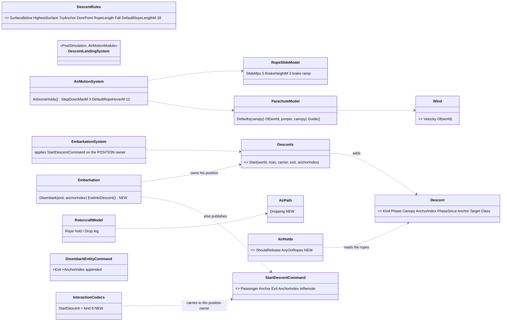

*Caption:* what the picture shows that §1 did not — the **second interaction** (`StartDescentCommand`) that closes CE-3059 for a descent: the
carrier's owner decides the exit, but only the man's POSITION owner may add the `Descent` (a Muscle-group component whose egress is gated
on that ownership).

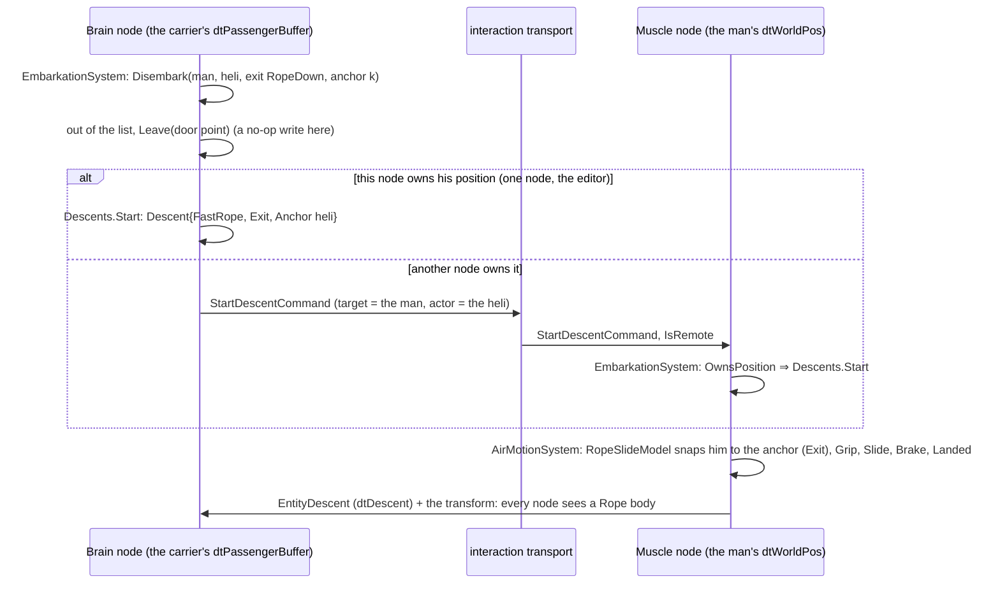

*Caption:* the message that crosses is the DECISION, not a position — the Muscle re-derives the door point from the same carrier and anchor
index, so there is one rule for where the door is (`DescentRules.DoorPoint`) and no second copy of the column rule CE-3059 warned against.

| deviation from §1 / §5 / §7, and why | where |
|---|---|
| ⭐ **CE-3059 resolved for a descent** by a new interaction kind `StartDescent = 8` (`StartDescentCommand`, event 3204, payload `{Exit, AnchorIndex}`) applied by the man's POSITION owner; one node applies it at once. ⚠ The plain step-out dismount is unchanged — CE-3059 stays open for it | `Embarkation.ExitIntoDescent`, `InteractionCodecs.StartDescent` |
| ⭐ an Unload **or Pickup** hover > 3 m above the ground is refused as a hover and **lands** instead (warned) — Pickup added: boarding a 30 m hover is the same teleport upwards | `AirMotionSystem.AirborneHolds` |
| ⭐ a Rope waypoint's `HeightAgl` counts above the ROOF (the highest surface); unstated ⇒ **12 m**; the rope unstated on the type ⇒ **18 m** (60 ft); refused ⇒ flown through (hold dropped, warned) | same; `DescentRules.RopeLength` |
| ⭐ a Drop waypoint is **flown through** at speed (not a stop); `Dropping` runs until the Brain releases it or the next REAL stop; a route ending on its DZ hovers there still `Dropping` | `RotorcraftModel.FollowRoute`, `AirRoute.IsFlownThrough`, `AirPath.Dropping` |
| the rope: `SlideMps` **5** (§2: 3–5) and a brake **ramp** (§5.1 above) — 12 m in ~3.5 s | `RopeSlideModel` |
| `Wind` needed a component id (**393**) — a singleton lookup on an id-less type THROWS, so every parachute frame would have crashed | `GlobalComponentIds.Wind` |
| IDL forbids two enumerators of one name in a module (case-insensitive): `DescentPhase.FreeFalling`, `CanopyKind.NoCanopy`, `ExitKind.StepOut / RopeDown / JumpOut` | `Descent.cs` |
| a jump is a free fall under a ram-air canopy, a static line under a round one — by the man's `Gen.Parachute` (none ⇒ round) | `Descents.Start` |
| ★ (ui steer) a man with a `Descent` is still `IsPerson` — it keys on `VehicleParams`, never on `Locomotions.Of` — and a round through his torso under a canopy hits Torso | `RaycastSolverSystemTests.B1_AManUnderACanopy_IsStillAPerson…` |

### 7b. As-built — B-5 (`2026-10-16`, backend)

| built | where | note |
|---|---|---|
| types **204 Paratrooper** (round canopy) · **205 SF operator** (ram-air), the rifleman's body / M4 / injury / person carrier / brain + `Gen.Parachute` | `BdcTkbCatalog.Jumper`, `NedTkbBuilder.WithParachute` | every canopy figure is `ParachuteModel.Defaults` (§2) — nothing invented per type. DIS 3.1.225.1 like the rifleman: SISO-REF-010 v37 sorts US lifeforms by the WEAPON carried, not by role |
| fast ropes on the **doors-off UH-60 (404)**: one over each cabin door (`RopeAnchors` (1.5, ±1.6, 0.4) — outboard of the door guns), 60 ft (18.3 m) | `BdcTkbCatalog.DoorSeats` | ⚠ the arm's place is estimated from the drawn fuselage. ⛔ **Not on the plain UH-60 (400)**: it has no `Gen.Carrier` and no flight — Air Ops keeps it "a static body" — so ropes there would be dead data |
| the **release point** — `ReleasePoint.For(point, height, chute, wind, carrierVelocity)`: upwind by the drift under the canopy (round) or of the fall before the pull (ram-air), short by the door throw `(v − wind)·OpenSeconds/3` | `DescentModels.cs` | ★ a static-line jumper leaving a 35 m/s helicopter 400 m up in a 4 m/s crosswind lands within 30 m of the DZ point |
| ⏳ **the scenario's wind — NOT BUILT, a decision for the user (D-13 below)** | — | absent = calm, which every model and the release point already handle; the three demos (§8) need no wind |

### 7c. As-built — B-6 (`2026-10-16`, backend)

| built | where | ★ rail |
|---|---|---|
| a man coming down is no target for a GUIDED round of either domain (a Stinger never locks him, a Javelin never picks him); a gun's round (Either) still is | `AmmoChoice.InDomain` | `AmmoChoiceTests.B6_*` |
| an air contact (what one shelters from, what cues a SAM) and a missile warning are for an AIRCRAFT (`Locomotions.IsAircraft`) — a descent is not one | `AirContacts.IsAir`, `FireProcessingSystem` (the warning) | the B-1 class rail (`IsAircraft` false for both descents) |
| ⭐ the lead aim stays on `InAir` — leading a falling man is right | `FireProcessingSystem` (`TargetLead`) | — |
| a FALL hurts (§5.3): ≤ 6 m/s nothing (a canopy lands at ≤ 5.5), 6–10 m/s 75 % of his health (from full ⇒ under the injury's 0.3 ⇒ incapacitated), > 10 m/s all of it — a whole-body `DamageAssessedEvent` (no part: a zone multiplier would bend the thresholds), applied by his Health owner | `DescentRules.Fall` → `Impact` | `DescentModelsTests.B6_AFall_*` (1.5 m / 3.5 m / 20 m) |

### 7d. B-7…B-9, the ejecting pilot — BUILT `2026-10-16` as drawn (backend)

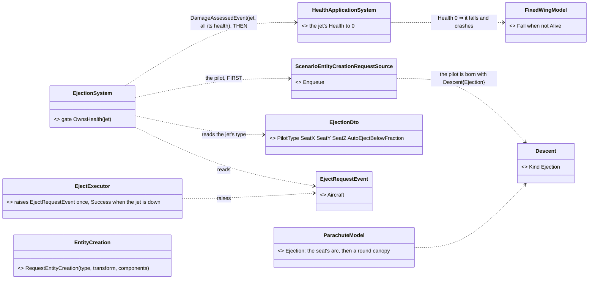

*Caption:* what the picture shows that prose hid — **two writers, one order, one node**: the pilot is a CREATION and the jet's end is a
DAMAGE, both raised by `EjectionSystem` on the node that owns the jet's `Health` (the node that may kill it), in that order — so the pilot is
never a rider who dies with it (R-2021). Nothing new moves anything: the pilot's descent is the existing parachute model's.

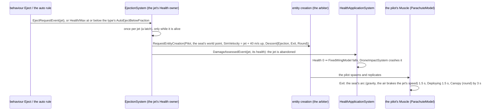

| decision | lean | rejected — one line each |
|---|---|---|
| **D-14** who ejects | `EjectionSystem` in the Interactions capability (every node, gated on `OwnsHealth`), reading `EjectRequestEvent` and the auto rule | the executor spawning by itself — it runs on the Brain of the JET, which need not own its Health; two triggers would be two spawn sites |
| **D-15** the pilot's start | spawned with the jet's velocity PLUS the rocket (40 m/s up) as its `SimVelocity`; `Descent{Ejection}` in its initial components, no anchor | an anchor on the jet — the jet is being abandoned, and `Descent.Anchor` is a node-local handle |
| **D-16** the type's figures | `Gen.Ejection` on the jet (pilot type, seat place, auto-eject fraction); the pilot type **206** carries `Gen.Parachute` round with `OpenSeconds` 1.5 (canopy by ~3 s, §7 B-7) | figures in code — every aircraft differs |
| **D-17** once | a latch in `EjectionSystem` plus "only while alive" (the abandoned jet is at Health 0) | a replicated flag — only the Health owner ever ejects, so a local latch is enough |

| as built | where | ★ rail |
|---|---|---|
| `Gen.Ejection` (`EjectionDto`), `EjectRequestEvent` (3205), `EjectExecutor` (interaction action **11**, on the Brain in `CgfLogicPack`) | Fdp.Toolkits | `EjectionSystemTests.B9_TheEjectAction_*` |
| `EjectionSystem` in the Interactions capability (every node; gated on `OwnsHealth`), the per-type `Gen.Ejection` cached | `Hrot.Common/EntityCreation/EjectionSystem.cs` | `B8_AnOrderedEjection_*` (the seat's world point, the velocity + 40 m/s, `Descent{Ejection}`, all the jet's health as damage, once) · `B9_TheCrewEjectsOnItsOwn_*` · `B8_ANodeNotOwning…` |
| the seat's arc in `ParachuteModel` (`Exit` when `Ejection`): gravity, the air braking the aircraft's speed off him (1.5 / s), 1.5 s, then the canopy | `DescentModels.cs` | `DescentModelsTests.B7_*` — canopy open at ~3 s, ≥ 50 m above, the apex 50–100 m (★ §7 B-7) |
| the **Pilot (206)** — a `Jumper` with a round canopy opening in 1.5 s; the **A-10 (405)** ejects him from 4.5 m ahead of the CG, 1.2 m up, on its own at 20 % health | `BdcTkbCatalog` | `NedTkbBuilderCombatTests.B7_*` |
| ⚠ figures estimated, not published | the rocket's 40 m/s, the seat's 1.5 s and 1.5 / s drag; the A-10's seat place; its 20 % threshold | — |
| ⛔ not done | the F-16 (401) and C-130 (402) — no combat block and no brain (nothing could order or apply an ejection); the drawing (U-2) is ui's | — |
| ⭐ **`CE-2210` (`2026-10-16`) — the pilot crosses to the Muscle DESCENDING.** 📐 Measured on two real nodes (CGF creates, SimHost takes the motion grant): position ✅ and velocity ✅ crossed; the **descent never did** — `EntityDescentEgressTranslator` scanned **Active** entities only, and the creator owns his Muscle group only while he is **Constructing** (it yields it before he turns Active, Ownership Groups D-7) ⇒ nobody ever sent it, SimHost moved him as a Pedestrian (velocity 0, on the terrain), and that grounded position replicated back to CGF (the z ≈ 0 behaviors saw there). Fixed: the egress scans **every lifecycle**, as `GeoSpatialEgressTranslator` does. And the Health owner (the Brain) does not own the JET's motion, so its `SimVelocity` stood still there — the seat and the speed now come from `ReplicatedMotion.Of` (CE-2173) | `EntityDescentTranslators.cs`, `EjectionSystem.cs` | `SplitAuthoritySpawnTests.BrainCreatesAManComingDown_TheMuscleFliesHim` (IT-SA-4, two nodes) · `DescentReplicationTests.CE2210_*` · `EjectionSystemTests.CE2210_*` |
| ⚠ the rule it teaches | a component in a group the creator GRANTS AWAY is the creator's to publish only while the entity is Constructing ⇒ its egress must not be Active-only. Swept `2026-10-16`: of the 8 authority-gated egresses without a lifecycle filter, only the descent and the hit marks carry a Muscle-group component, and hit marks are empty at birth; the other six are Brain group (kept by the creator — a few frames' delay at most) | — |

#### D-13 — how the scenario's wind reaches every node ⛔ *SUPERSEDED `2026-10-16` by [Weather and Time](../weather/DESIGN_Weather_And_Time.md) (R-3012): the wind is regional weather on replicated scenario ENTITIES; the options below are history*

| measured | code | design basis |
|---|---|---|
| ⛔ only BRAIN nodes read the scenario file (CGF, the editor); SimHost, Stride SimHost and IG never construct `ScenarioLoadStep` | `RoleLoadRequirements.cs:64-65` (*"Brain is the only role that reads the scenario file … every other role receives a replicated world"*), `SimHostNodeBootstrapper.cs:442-462` | `DESIGN_Cluster_Load_Phase.md` §4.1c |
| ⛔ the parachute model runs on the MUSCLE (the man's position owner) ⇒ a scenario SECTION alone never reaches it | `AirMotionSystem.cs` (`WithOwned<SimTransform>`) | this design D-2 |
| ⛔ no translator writes a world SINGLETON from the wire | searched every `[DdsTopic]` and `Hrot/Network` translator | — |
| ⭐ a scenario-wide value every role needs already exists: the TKB and terrain NAMES ride the load message (`NodeTransitionPayloadDto.TkbName / TerrainName`), with a staged `ScenarioHeader.json` fallback — *"four of the five roles never open the scenario file"* | `OrchestrationPayloadDtos.cs:139-147`, `StorageGatewayModule.cs:429,606`, `TerrainLoadStep.cs:44-46` | ⛔ `ScenarioHeader.cs` forbids growing the header into an ASSET block — wind is not an asset, but the line is the user's to draw |
| ⛔ an environment ENTITY is ruled out | — | [tkb-1 DESIGN.md:873-893](../tkb-1/DESIGN.md) *"Global Weather is a SINGLETON, not a positionless entity"* |

| option | | |
|---|---|---|
| ① a top-level scenario section only (the `TerrainObjects` shape) | ⛔ reaches only the Brain — the parachute model on the Muscle stays calm | rejected |
| ② a new keyed DDS topic the loading Brain publishes and every node writes into the singleton | a NEW pattern (singleton-from-wire) for one value | rejected unless weather grows |
| ⭐ **③ the load message, like the terrain name**: an `Environment` section in the scenario (one writer / reader, merged like `TerrainObjects`), copied by the orchestrator into `NodeTransitionPayloadDto` (APPENDED wind fields) and the staged `ScenarioHeader.json`; each node's load sets the `Wind` singleton | ⭐ the existing channel for exactly this shape of value; ⚠ blast radius: the orchestration payload (appended, R-169), the storage gateway's staging, one load step | **lean** — would change if weather is to VARY in time (then ②) |

### Slice 2 — the ejecting pilot (✅ READY — the user's third demo needs it)
The jet's crew is the type itself, so ejection **spawns a Pilot entity** (the existing entity-creation path) at the canopy BEFORE the kill (R-2021):
`Descent{Ejection}` — the rocket seat (apex 50–100 m above, seat away at 1–2 s, round canopy by ~3 s, sink 6–7 m/s); trigger: health below a
threshold or a damage state (the "malfunction"); then **`EvadeAndSignal`** (out of the harness, hide, move away from the enemy, a beacon) feeding
the planned rescue (Air Ops §4c / §9, `SquadRecover`, `ua-air-rescue`). Drawing: the seat, the rocket flame, the canopy.

| # | lane | item | acceptance |
|---|---|---|---|
| **B-7** | backend | a **Pilot** type (pistol, `Gen.Parachute` round, ejection figures); `Descent.Kind = Ejection` in `ParachuteModel` (rocket arc: up 60–100 m in ~1 s, seat away at 1.5 s, canopy by ~3 s, then the round canopy) | ★ from a level A-10 at 300 m / 150 m/s the canopy is open by 3 s, ≥ 50 m above the ejection height |
| **B-8** | backend | **`EjectExecutor`** + the pilot SPAWN (the entity-creation path) at the cockpit, given the aircraft's velocity; the aircraft is then abandoned ⇒ it falls and crashes as a killed one (`FixedWingModel.Fall`, R-2021, R-3007) — the pilot is out BEFORE, so he does not die with it | ★ one Pilot entity per ejection, the jet down within its fall time |
| **B-9** | backend | the trigger: an `Eject` action (a behaviour may order it) and the automatic rule health ≤ the type's eject threshold | ★ a jet hit below the threshold ejects once |
| **H-3** | behaviors | **`Eject`** behaviour (a mission task — after a `TimerElapsed` trigger it plays the malfunction) and **`EvadeAndSignal`** for the landed pilot: out of the harness, away from known enemies to the nearest cover, prone / crouched, holding there (the beacon and the rescue round trip stay Air Ops §4c / §9) | ★ the landed pilot reaches cover ≥ 100 m from the nearest known enemy and stays down |
| **U-2** | ui | the drawing: the seat and its rocket flame for ~1 s, the seat tumbling away, the round canopy; the abandoned jet's fall uses the existing crash drawing | frame rail + screenshots |

### Slice 3 — later
Rappel (harness, 1–2 m/s, can stop; down a wall to a window), rope extraction (SPIES / FRIES: hooked on, flown away), fixed-wing transport
drops (a C-130 type), varying wind, a canopy that fails (reserve).

## 8. The demos (user, `2026-10-15`) — behaviors authors them (H-2), each a scenario `scenarios/<name>/scenario.json` in the existing form

| demo | what happens | PASS when |
|---|---|---|
| **`ua-airborne-drop`** | a doors-off UH-60 (404) with a paratrooper squad (8, round canopies) flies a route: climb to 400 m AGL → a `Drop` hold on the DZ leg (35 m/s) → back to its start. `SquadAirborneExit` sends the stick out one per second; each man drifts down to his point along the DZ; `AssembleAfterDrop` takes the squad to the assembly point beside the DZ | all 8 land on the DZ (within 150 m of their points), each takes off his harness, the squad stands assembled at the rally point; the helicopter flies home empty |
| **`ua-fast-rope-roof`** | an SF squad (8) in a UH-60 approaches a flat-roofed building (≥ 10 × 10 m, ~10–15 m high), comes to a **`Rope` hold 12 m above the ROOF** over it, `SquadFastRope` sends them down both ropes; each lander takes a security spot ON THE ROOF (spots kept inside the roof's outline — a man never steps off a ledge, CE-3145); when the last man is `Landed` the hold releases and the helicopter flies away | 8 men on the roof in ≤ 15 s of roping, none on the ground, in a ring; the helicopter left only after the last landing (never with a man on a rope) |
| **`ua-eject`** | an A-10 (405) flies a route at 300 m; its mission's second task is `Eject` after `TimerElapsed` 40 s (the malfunction). The pilot ejects, the jet falls and crashes, the pilot lands under his round canopy and `EvadeAndSignal` takes him to cover; a hostile patrol 500 m off (so "away from the enemy" means something) | one Pilot entity, the canopy open by 3 s, the jet crashed, the pilot in cover and down |

⚠ **Terrain for `ua-fast-rope-roof`:** a building with a flat, reachable roof — the authoring lane picks one (or adds one to a test terrain) and states
its roof height in the scenario's notes; the rope hold's height is above THAT roof (B-3).

## 9. Hit by part during a descent — with [Body Parts and Hit Location](../hit-location/DESIGN_Body_Parts_And_Hit_Location.md) (R-3010)

| fact | code (backend, `2026-10-16`) | what it means here |
|---|---|---|
| a round's target is a PERSON when its `VehicleParams.Class` is `Pedestrian` | `PhysicsComponents.cs:63-68` (`IsPerson`) | ✅ a descending man keeps his `VehicleParams` ⇒ he is still hit BY PART under a canopy or on a rope. ⛔ **keep it that way**: `IsPerson` must NOT move to `Locomotions.Of` — under D-1 that answers Parachute / Rope and he would become untouchable |
| the sim poses a man by LOGICAL STANCE + weapon posture (HL-9), 11 poses generated from `BlockFigure` | `PersonBody.PoseOf`, `PersonBody.Tables.g.cs` | v1: a man on a rope or under a canopy (upright) collides as STANDING — close to how he hangs. A free-fall arch (flat) collides as standing too: rare and fast, accepted. ⏭ a descent pose in `PersonBody` only if a rail shows it matters |
| the parity rails compare the 11 generated poses with the drawing (`PersonBodyParityTests`, ui's suite) | — | U-1's descent poses are NEW drawing poses beside the 11 ⇒ they do not touch the parity; ⛔ U-1 must not change the 11 |
| `HitMarks` are part-local, drawn wherever the body is | HL-8 | ✅ holes and blood on a jumper are drawn the same way (S1c) |

| decision | lean | rejected |
|---|---|---|
| **D-10** the canopy and the rope | NOT hittable parts in v1 — a round through a canopy barely matters; a rope is not cut by gunfire in practice | canopy parts (a torn canopy, a faster sink) — later, if a demo asks |
| **D-11** the ejection seat | not an entity and not hittable (it is gone in ~1.5 s) | — |
| **D-12** a man hit on the rope or under the canopy | the existing chain applies (`PartDamage`, `Health`, `Injury`): killed or incapacitated ⇒ the model keeps him on the rope until the bottom / under the canopy to the ground with no steering (§5.3: a man who lets go is `Falling`) | dropping every hit man off the rope — a wound does not open the hands |
