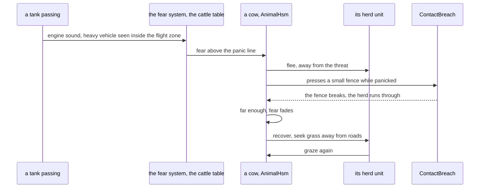
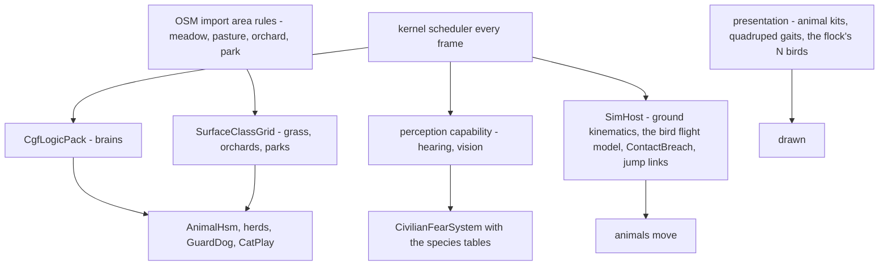
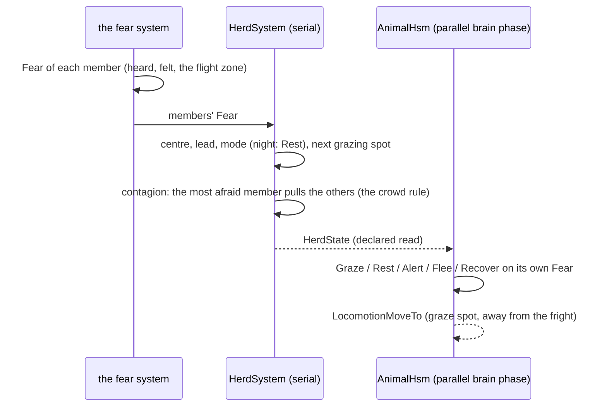
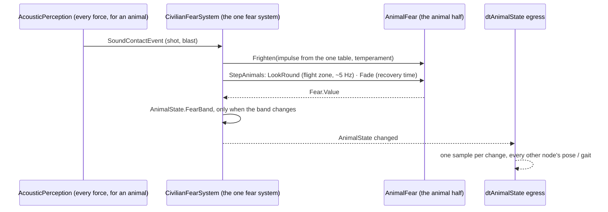
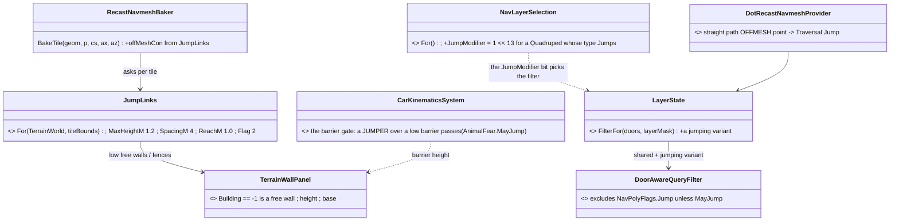
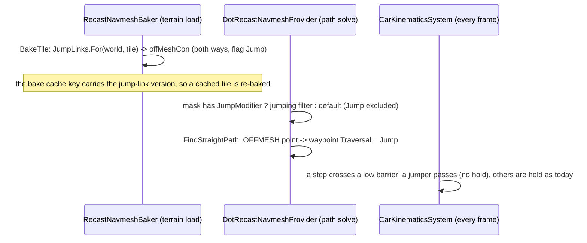
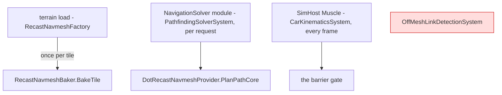
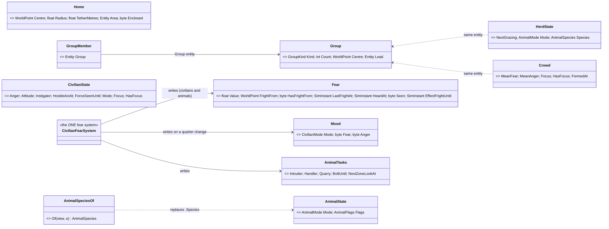
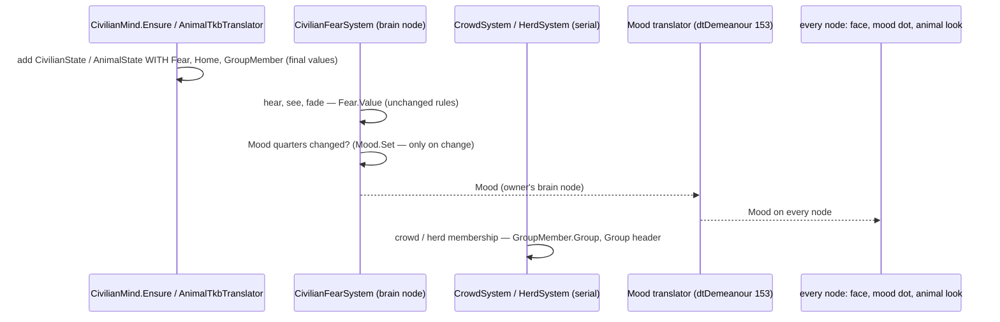

<!--STATUS
state: LIVE
updated: 2026-11-16
build-state: BUILT (backend + ui, `2026-11-16`) · ⭐ §10 shared creature components BUILT (ui `2026-11-19`; as built §10b) · ⭐ §4b AN-20 and §4c AN-21 BUILT (backend `2026-11-17`; as built §9b) — the looks are ui's
current-answer: §4 decisions (with §8's AR rows superseding) · §4a the fixed ids · §5 UML · ⭐ §6 the TASKS per lane and the shared contract (§6.1) · §8 the review
stale-below: nothing
known-rot: none
known-conflict: none — AN-7 amends Breaching B-D1 (a panicked big animal breaks a SMALL fence), approved R-4266
related-designs:
  - ../../DESIGN_Civilians_And_Crowd_Control.md — §10 here moves the civilian's fear, home and crowd membership onto components shared with animals (CE-4628)
  - ../weapons/DESIGN_Bows_And_Crossbows.md — the bow AR-10's mounted archers use, fired from the horse's seats (BW-8, CE-4649)
  - ../../DESIGN_Civilians_And_Crowd_Control.md — OWNS the fear model (`CivilianFearSystem`, §5d), the HSM Routine ⇄ Alarmed ⇄ flee / shelter, the crowd — the animal brain generalises it
  - ../../DESIGN_Vehicle_Breaching.md — OWNS `ContactBreach` and B-D1 (who may break a fence)
  - ../vehicle-tactics/DESIGN_Motorcycle.md — OWNS the firing seat and the Drive / Board possession the riding horse reuses
  - ../vehicle-tactics/DESIGN_Checkpoint_And_Ramming.md — RM-1: a vehicle hurts what it hits — animals included
  - ../../DESIGN_Map_3D_Mode.md — OWNS the shape kits and `MotionTracker` (limb swing by the gait rule) the gaits extend
  - ../../DESIGN_Thermal_And_Acoustic_Sensing.md — OWNS hearing and sound classes (what frightens; every animal sound as a sound source the AI hears, AN-19)
  - ../audio/DESIGN_FPS_Audio.md — OWNS what the operator hears (`SoundSources`, `SoundMixer`, the ambient beds) — the animals' calls, alarms, hooves and wings play through it (AN-19)
  - ../../DESIGN_Terrain_Import_UTM.md — the OSM import whose area rules map woods / water today and would map pasture
-->

# DESIGN — animals: cattle, sheep, horses, dogs, birds, cats

🔒 User, `2026-11-16`: *"How can we integrate some kind of animals into the simulation? … cows or dogs or flock of birds or even individual birds.
And maybe also horses, but these as a mean for transportation. The challenging part … they should respond to what is happening around … whenever
there is something which frightens them … they should of course fly away … big animals, like cows, they can even break through the fence … dogs …
stay guarding … attack … horses … two types … a passenger seat … gaits depending on the speed … cats … all the animals should be destructible."*

## 1. INVENTORY *(measured `2026-11-16`; graph: `search_graph name_pattern=".*(Animal|Flock|Herd|Boid|Fear|Panic|Gait|Horse|Dog|Bird|Graz).*" label=Class` ⇒ `CivilianFear`, `CivilianFearSystem`, `PanicState`, `HumanGait`, `TacticalGait`, `TrafficPanicSystem`, SUMO's `FearField` — no animal, flock or herd class; `docs/` + `.dev/` searched for animal / livestock / dog / horse — no design; index coverage could not be checked through the CLI)*

| exists | where | reused as |
|---|---|---|
| ⭐ a FEAR model: heard shots / heavy weapons / blasts raise fear by class impulse × distance, near misses and hits more, fear decays; ⚠ engines, rotors and footsteps frighten NOBODY ("0 for a sound that is not violence") | `CivilianFearSystem.cs:9-47` | AN-2: the SAME system with a per-species impulse table (an engine frightens a bird, a tank frightens a cow) |
| the civilian HSM: Routine ⇄ Alarmed, panic, flight, shelter; crowds | `CivilianBehavior.cs` (`PanicState`), Civilians §5d–§5f | AN-1's state shape |
| hearing and vision sensors, sound classes | Thermal & Acoustic design, `AcousticPerception` | an animal's senses — and the dog's BARK as a sound others hear |
| melee: `Melee.Strike` (reach, damage, knock-down) | `Melee.cs:41-82` | the dog's bite |
| carriers with seats, *Drive* / *Board*, the firing seat, possession | Motorcycle PF-1, PL-1…PL-3; `OperatorUse.cs` | the riding horse |
| `ContactBreach` — a weak fence broken by a hull (B-D1: a player's hull, the bulldozer, a `RamOrder`) | Breaching §7, `HullBreakGate.cs:21-29` | AN-7 |
| ground classes: the new per-type `SurfaceClassGrid` (forest, scrub, roads; backend CE-4621); OSM area rules map only woods and water | `AreaRules.cs:45, :133` | ⛔ no GRASS / PASTURE class — AN-6 adds it |
| `MotionTracker`: limbs swing by the shared gait rule (walk / run weights) | `MotionTracker.cs:7-12` | AN-10 the quadruped gaits |
| Health, injury states, the dead figure, the vehicle-impact rule (RM-1) | Injury, Visual Effects §7 | every animal is destructible like a person |
| ⛔ a locomotion class for a four-legged ANIMAL, a flight model for a bird, a herd or flock | — | built here |

## 2. The proven pattern *(game and livestock practice — each piece adopted only with a reason, §4)*

| piece | where it comes from | why it fits here |
|---|---|---|
| a per-species state machine: **Idle / Graze / Wander → Alert → Flee → Recover → back** | ambient wildlife in games; animal-behaviour models | the same shape as our civilian HSM — one brain, species as data |
| ⭐ the **flight zone**: an animal flees when a threat comes inside a species distance; inside a closer one it panics | livestock handling (cattle and sheep handling practice) | a measurable rule: distance × threat class |
| **boids** (separation, alignment, cohesion) for herds and flocks | Reynolds, used in every herd and flock simulation | sheep tight, cattle loose, birds in the air |
| ONE flock entity drawn as N birds | crowd / particle practice | 200 starlings must not be 200 brains |
| a territorial guard (patrol a yard, bark, attack an intruder) | game guard dogs | the dog |
| gaits by speed: walk · trot · canter · gallop | horse locomotion | an animation rule only (🔒 user) |

## 3. The species

| species | default | frightened by | when frightened | special |
|---|---|---|---|---|
| **hens** | peck and wander inside their area | people near, vehicles, any shot | run, or a short low flutter | AN-15 |
| **pigs** | root and wander in their pen, lie in mud / shade | shots, blasts, vehicles, people entering the pen | SQUEAL (a sound), bunch together and crowd into the far corner of the pen or into its shed — they cannot breach the pen | AN-17 |
| **goats** | browse, wander, climb onto anything raised (rocks, low walls, a shed roof) | the same | scatter (less cohesive than sheep), leap onto high ground inside the enclosure; in an OPEN area they jump low obstacles and flee | AN-17 |
| **cattle** | graze slowly in a pasture, a loose herd | blasts, gunfire, heavy vehicles (the engine sound), people close | the herd runs AWAY, breaks a weak fence if in its way, stops when far enough, seeks grass away from roads, returns to grazing | big: AN-7 |
| **sheep** | graze in a TIGHT herd, move as one | the same, more easily | flee as one tight mass | cohesion high |
| **herd horses** | as cattle, faster, more skittish | the same | flee fast, far | — |
| **riding / war horse** | stands where left; ridden | only blasts close by (war horse: almost nothing) | bolts with its rider if frightened enough (a riding horse) | seats, gaits, possession (AN-8) |
| **dog** | guards a house / yard; patrols it | ⛔ not frightened (a blast makes it flinch) | — | barks at people near (others HEAR it); ATTACKS one who comes close (AN-5) |
| **birds (flock)** | fly across the terrain; land on a field, rest, take off, fly on | anything: a car, people near, any shot | the whole flock takes off and flies away | one entity (AN-4) |
| **lone bird** | fly / perch | the same | flies off | one entity |
| **cat** *(optional)* | sits on a ground-floor sill / parapet; jumps down, wanders, jumps up to another, moves inside | people close, shots | runs indoors / under cover | jumps (AN-11) |

## 4. Decisions *(✅ APPROVED `2026-11-16` with the user's changes — R-4266)*

🔒 User, `2026-11-16`: *"The dogs guarding a house might be tethered, meaning they cannot go far, even if they bark and attack at close distance. They cannot go farther than their tether. Barrier breaking by panicking animals, yes, for small fences. The horses can also jump. Include the cats, they are nice, cute. The birds, they might be sitting at the trees, and when they are frightened they simply fly away, and after a while they can get back on the trees. This should apply to some orchards or public parks, not to the woods. Otherwise approved."*

| # | question | ⭐ lean | why · blast radius |
|---|---|---|---|
| **AN-1** | one brain or one per species? | ⭐ ONE `AnimalHsm` (Graze / Wander / Rest → Alert → Flee → Recover), the species as TKB data (`AnimalTemperament`: flight zone, panic zone, flee speed and distance, recovery time, herd cohesion, territorial, fearless); plays only where a species truly differs (the guard dog, the riding horse, the cat) | one implementation per concept (ruling 9); a new species is data |
| **AN-2** | fear | ⭐ the EXISTING `CivilianFearSystem` gains a per-species impulse table — engines, rotors, footsteps and SEEN heavy vehicles count for animals; plus the flight-zone rule (a threat class inside the species distance) | ⛔ never a second fear system; civilians unchanged (their table stays) |
| **AN-3** | herds | each animal an entity; the herd a hidden UNIT (the squad pattern: roster, a leader) — members keep boids spacing round the leader (sheep tight, cattle loose); the herd chooses the next grazing spot; neighbour reads DECLARED (the parallel rule) | individual animals can be shot, can break a fence, can die |
| **AN-4** | birds | ⭐ a FLOCK is ONE entity (its position, heading, state, a count, a seed) drawn as N birds by a deterministic boids pattern in the PRESENTATION; a lone bird is its own small entity; both on a light flight model (point mass, banked turns). ⭐ **Birds PERCH ON TREES** — lone trees, ORCHARDS and PUBLIC PARKS, ⛔ never the woods: frightened, they fly away; after a while they come back to perch (the same trees or others nearby) | 🔒 user; 200 birds cost one brain; replay draws the same birds from the seed |
| **AN-5** | dogs | ⭐ `GuardDog`: a dog STAYS CLOSE TO ITS HOUSE by behaviour — a HOME (the house) and a home radius it keeps to without any visible tether; it barks at people near (a SOUND others hear — a sentry wakes up: a tactical gain) and ATTACKS an intruder who comes close (chase + `Melee.Strike`), then returns home; not frightened. ⭐ A TETHER is an OPTION: an anchor and a length it can NEVER exceed (an intruder outside the circle is barked at, never reached). An attacking dog is a hostile act (NonLethal) ⇒ soldiers may shoot it | 🔒 user: *"not all dogs are tethered … stay close to the house … the tether is just an option"* |
| **AN-6** | grass, orchards, parks | ⭐ a **pasture / grass** surface class, and ⭐ **ORCHARD and PARK areas** (OSM `landuse=orchard`, `leisure=park`, + authored) as the birds' perching places beside lone trees in the `SurfaceClassGrid`: from OSM (`landuse=meadow / pasture / grass / farmland`, `natural=grassland`) and an authored Pasture area; recovery seeks the nearest grass AWAY from roads and the threat (an EQS query) | ⛔ today there is no grass class at all |
| **AN-7** | a panicking big animal and a fence | ✅ a PANICKED cattle / horse pressing a SMALL fence (wire, wood, a hedge gap — never a wall) breaks it through `ContactBreach`, its mass as the push; the herd then runs through the gap | ✅ 🔒 user: *"yes, for small fences"* — amends Breaching B-D1 |
| **AN-8** | the riding horse | ⭐ a carrier like the motorcycle: a rider seat (a FIRING seat — he can shoot from the saddle) and an optional second; *Drive* / *Board* for the player; a legged motion model (turns while moving, tighter than a bike, no reverse); a war horse fearless, a riding horse bolts with its rider when the fear is high | reuses the motorcycle's seat and possession work |
| **AN-9** | herd horses | a herd species (AN-3), faster and more skittish than cattle | data |
| **AN-10** | gaits | animation only: `MotionTracker`'s gait rule extended to quadrupeds — walk / trot / canter / gallop by speed bands per species, as leg-phase patterns in the animal shape kits | 🔒 user: *"something for the animation part"* |
| **AN-11** | cats | ⭐ INCLUDED (🔒 user: *"Include the cats, they are nice, cute"*): sill / parapet perches from the building layout, a hop between sill and ground as a short jump link, wander, hop up elsewhere, slip indoors when frightened | 🔒 user: *"more on the funny optional side"* |
| **AN-13** | horses JUMP | ⭐ a horse (herd, riding, war) clears a LOW obstacle — a small fence, a ditch, a low wall up to ~1.2 m — instead of breaking or going round it: a jump link in the route and a jump arc in the motion model; a ridden horse jumps on the rider's route (the player: a jump key) | 🔒 user: *"The horses can also jump"* |
| **AN-14** | the cats' perches | sills and parapets of ground-floor windows from the building layout; a hop between sill and ground (the same jump link as AN-13, a small one) | shares the jump mechanism |
| **AN-15** | hens (domestic poultry) | ⭐ a new species: pecking at the ground and wandering inside their area; frightened ⇒ RUN, or a very LOW, SHORT flutter-flight (a few metres, ~1 m up) where running is blocked; calm ⇒ back to pecking | 🔒 user: *"hens … picking something from the ground … a very low and short flight … or they simply try to run away"* |
| **AN-16** | ⭐ the DOMESTIC ANIMAL AREA | ⭐ a CLOSED POLYLINE the author draws (a scenario area, like the checkpoint's lines) with a species and a count (cattle, horses, sheep, hens …, mixed allowed) and a seed: at scenario start it is POPULATED automatically — N animal entities placed inside by the seed, each with a stable key (`<area>/<n>`, the same identity rule as split-created soldiers) and the area as its HOME. They stay inside by behaviour (fence or not); frightened they may leave (and break a small fence, AN-7); calm again they return to their area. The area is also their grazing ground | 🔒 user: *"some zone which is populated automatically by those domestic animals … they will try to stay inside unless frightened … Defined by polyline, closed one"* · the save stores the AREA; the animals are made from it (and recorded once made) |
| **AN-17** | pigs and goats | ⭐ two more domestic species for the animal area: **pigs** squeal (a sound others hear), bunch and crowd into the far corner or the shed when frightened; **goats** scatter and leap onto raised ground (the jump link, small), and in an open area jump low obstacles and flee | 🔒 user: *"Also add pigs and goats to the domestic animal area … pigs are in some close area that they cannot breach on their own, and the same for goats"* · ⚠ the frightened behaviour is a coordinator lean (the user was unsure) |
| **AN-18** | an ENCLOSED area (a pen, a sty, a goat yard) | ⭐ the domestic animal area (AN-16) gets an option **Enclosed**: its animals NEVER leave it, frightened or not (AN-7's fence breaking does not apply to its boundary); frightened, they flee INSIDE it — to the part farthest from the threat, or into its shelter if it has one. Pigs' and goats' areas default to Enclosed; cattle, horses, sheep and hens default to open | 🔒 user: *"they cannot breach on their own"*; one option instead of per-species rules |
| **AN-19** | ⭐ **ANIMAL SOUNDS — an important part of the scene** | ⭐ every animal is a SOUND SOURCE through the ONE existing sound path — `SoundEmissionSystem` (the AI hears it within its acoustic range) and the presentation's `SoundSources` → `SoundMixer` (the operator hears what the AI hears, FPS Audio AU-4 / AU-5 / AU-10), a new `SoundSourceClass.Animal` with a `SoundFamily` per species. Four kinds: ① **calls at rest** — moo, baa, neigh, bark, cluck, oink, bleat, meow, birdsong — at a seeded random interval per species (a herd is not a choir); ② **alarm calls** when frightened — a bellow, a squeal, a hen's cackle, a whinny, a flock's alarm; ③ **movement** — hooves by gait (walk / trot / gallop louder and faster), a flock's WINGS at take-off, a hen's flutter; ④ the **dog's bark** — loud, far-carrying. ⭐ **A tactical cue**: a bark, a herd's alarm or BIRDS FLUSHING from a tree are heard by soldiers' ears — the classic sign that someone is moving out there; an ambient BIRDSONG bed in parks / orchards while calm that falls SILENT after shooting | 🔒 user: *"the sounds that animals are making. This is the important part of the scene, so please don't forget to include it"* · one sound path for everything (ruling 9); clips are data |
| **AN-12** | destructible, neutral | every animal has Health, injury states, the dead figure; hit by fire, blasts, vehicles (RM-1); a NEUTRAL side — soldiers do not target animals unless attacked (the dog) or ordered | 🔒 user: *"destructible the same way"* |

## 4b. Shootable birds and the duck — AN-20 *(coordinator, `2026-11-17`; ✅ APPROVED `2026-11-17` (R-4289) — moved here from the bow design's BW-14)*

🔒 User, `2026-11-17`: *"Do we have some birds like flying ducks that can be hunted …?"* · *"Does it make sense to shoot at flying ducks? Aren't they
out of reach of a usual bow? It doesn't mean that we cannot shoot them using firearms … the ducks should stay just the relation to the archery might be
confusing."*

📐 Measured: a lone bird (708) is its own entity (5 health, `LocomotionClass.Bird`, `BirdFlightModel` ~25 m above the ground); a flock (707) is ONE
entity drawn as N birds (AN-4) — a flock bird exists only in the drawing; ⛔ there is no duck; ⚠ NOT measured whether a round can hit a lone bird
(its collider / layer — a bird is not an aircraft, so AT1's air fix may not reach it) nor whether a killed bird falls. ✅ a SHOTGUN exists (the anti-drone
man's 12-gauge, 12 pellets over 15 mils, spent past 60 m — `NedTkbCatalog.cs:58-66`, CE-2436 AU-7) — the right weapon for birds.

| # | decision — ⭐ lean | why | rejected — one line |
|---|---|---|---|
| **AN-20a** | a LONE bird is a target any round can hit (bullet, shotgun pellet, arrow) and kill; killed, it falls (the dead-flyer fall) and lies | hunting; the measure above decides how much is new | — |
| **AN-20b** | a FLOCK: a round (or pellet) that passes through the flock's volume has a chance per drawn bird it passes to hit ONE — the flock's count drops by one, a lone DEAD bird is spawned there and falls; the rest flee (the existing fear) | a flock bird must be hittable without a brain each (AN-4) | a brain per flock bird |
| **AN-20c** | a new species **Duck** (~0.5 m, flies a loose V low over water and fields, quacks) — a lone duck and a duck flock type, ids measured free | the bird the user asked for | — |
| **AN-20d** | the scenario **`an-duck-hunt`**: a hunter with the shotgun shoots a lone duck and into a duck flock over a field — a lone duck `health == 0` and lying · the flock's count drops ≥ 1, a dead duck lies · the flock flees | R-4277 | — |
| **AN-20e** | the bird-shooting GAME (scores, rounds) stays the fun pack's (CE-4633) | engine shared, content separate (R-4281) | — |

### 4c. The rabbit, the hunting dog and the hunt — AN-21 *(coordinator, `2026-11-17`; ✅ APPROVED `2026-11-17` (R-4290))*

🔒 User, `2026-11-17`: *"could we include also a rabbit which lives in the woods and when frightened it runs away in zigzag pattern?"*

📐 Measured: the animal brain (`AnimalBehavior`, one HSM for every species) flees by ONE `LocomotionMoveTo` leg straight away from the fright
(`AnimalBehavior.cs:22, 141, 116-117`: flee speed and distance from the type's temperament); the terrain knows FOREST cells
(`TerrainSurfaceType.Forest`, `TerrainWorld.cs:17`); a species is a catalogue row (`AnimalTkbCatalog.cs:30-40`). ⛔ No rabbit or hare; no zigzag.
**The proven pattern:** a hare or rabbit relies on **freezing** (crouched, hard to see) until a threat is close, then **bolts in zigzags** (sharp jinks
every second or so) to break a predator's or hunter's line, toward cover.

| # | decision — ⭐ lean | why | rejected — one line |
|---|---|---|---|
| **AN-21a** | a species **Rabbit** (~0.4 m, quadruped, 3 health, very fast in short bursts ~14 m/s), a lone animal (no herd), ids measured free; it rests and nibbles at **forest edges** (open cells next to `Forest`) and in the wood | the user's ask | a herd of rabbits |
| **AN-21b** | **freeze first**: when frightened but the threat is still far (> its flight distance, ~25 m), it CROUCHES and stays still (lower and harder to see — a smaller visual signature while crouched) instead of walking off | what a rabbit does; it also makes it a hunter's challenge | always running at once |
| **AN-21c** | **the zigzag flee** — ONE new flee STYLE in the ONE animal brain, a parameter of the type (`FleeStyle.Straight` today for every species, `Zigzag` for the rabbit): the flight is a chain of short legs, each turned ±30–50° off the away line, 0.6–1.2 s long, the side alternating with a seeded chance of a double jink (per-entity `SimRng`, deterministic); the chain BENDS toward the nearest forest cell within reach and ends in it | the user's ask; shared by construction (any species can be given the style); the cover gives the run its point | a rabbit-only brain (a second animal brain) |
| **AN-21d** | the scenario **`an-rabbit-bolts`**: a soldier walks toward a rabbit at a forest edge — the rabbit freezes (crouched) until he is near, then bolts: ≥ 4 direction changes ≥ 30° during the run, and it ends inside the wood | R-4277 | — |
| **AN-21e** | the looks (ui): a small rabbit figure (long ears, a white tail), the crouch pose, the hop gait | — | — |
| **AN-21f** | a **hunting dog** — one more DOG PLAY over the one brain (beside `GuardDog`): it follows its handler and RANGES AHEAD of him in sweeps over a search area (a wood edge, a field); a rabbit (or a bird) it comes upon is FLUSHED — the dog is a threat in the animal's fear (a dog within its flight distance); it gives chase a short way, barking, and comes back; ⛔ it never attacks a person | 🔒 user, `2026-11-17`: *"a hunting scenario with dogs who frightens them and the shooters then hunt them"* | a dog with a brain of its own (one brain, plays over it — AN-1) |
| **AN-21g** | **a hunter**: a person type with the shotgun whose rules of engagement are **"animals of the listed species, never people"** — one setting on the existing weapon brain's target choice (AN-12: soldiers do not target animals unless ordered; this is that order, standing) | the shooters of the hunt | a hunter brain (the weapon brain already aims and fires) |
| **AN-21h** | the FUN scenario **`scenarios/fun/hunting/rabbit-hunt`**: two hunters walk a wood edge, two dogs range ahead and flush rabbits, the rabbits zigzag for the wood, the hunters shoot — expect: ≥ 2 rabbits flushed (`AnimalState` Flee), ≥ 3 shotgun shots at rabbits, ≥ 1 rabbit `health == 0`, ⛔ never a shot at a dog or a person; the built game score counts each hunter's bag | the fun pack (R-4281); it also proves AN-21b…g together | — |

## 4a. The fixed ids — for EVERY lane *(measured free on `coordinator`, `backend`, `ui`, `behaviors`, `terrain`, `2026-11-16`)*

📐 TKB types 700–799 are used nowhere (the hundreds: vehicles 100s, people 200s, units 300s, aircraft 400s, weapon systems 600s); DIS life-form
categories ≥ 200 are used nowhere (people are `3.1.*.1–3`); no class named for an animal exists. ⛔ Permanent wire values once built.

| TKB type | name | DIS (Kind · Domain · Country · Category · Sub) | entity class | 3-D family |
|---|---|---|---|---|
| **700** | `Animal_Cattle` | 3 · 1 (land) · 0 · **200** · 1 | `"Cattle"` = `3.1.*.200` | `VisualFamily.Cattle` |
| **701** | `Animal_Sheep` | 3 · 1 · 0 · **201** · 1 | `"Sheep"` = `3.1.*.201` | `VisualFamily.Sheep` |
| **702** | `Animal_HorseHerd` | 3 · 1 · 0 · **202** · 1 | `"Horse"` = `3.1.*.202` | `VisualFamily.Horse` |
| **703** | `Animal_HorseRiding` | 3 · 1 · 0 · **202** · 2 | `"Horse"` | `VisualFamily.Horse` |
| **704** | `Animal_HorseWar` | 3 · 1 · 0 · **202** · 3 | `"Horse"` | `VisualFamily.Horse` |
| **705** | `Animal_Dog` | 3 · 1 · 0 · **203** · 1 | `"Dog"` = `3.1.*.203` | `VisualFamily.Dog` |
| **706** | `Animal_Cat` | 3 · 1 · 0 · **204** · 1 | `"Cat"` = `3.1.*.204` | `VisualFamily.Cat` |
| **709** | `Animal_Hen` | 3 · 1 · 0 · **206** · 1 | `"Poultry"` = `3.1.*.206` | `VisualFamily.Poultry` |
| **710** | `Animal_Pig` | 3 · 1 · 0 · **207** · 1 | `"Pig"` = `3.1.*.207` | `VisualFamily.Pig` |
| **711** | `Animal_Goat` | 3 · 1 · 0 · **208** · 1 | `"Goat"` = `3.1.*.208` | `VisualFamily.Goat` |
| **707** | `Animal_BirdFlock` | 3 · **2 (air)** · 0 · **205** · 2 | `"Bird"` = `3.2.*.205` | `VisualFamily.Bird` (N birds) |
| **708** | `Animal_Bird` | 3 · 2 · 0 · **205** · 1 | `"Bird"` | `VisualFamily.Bird` |

⭐ A parent class **`"Animal"` = `3.1,2.*.200-209`** (the DIS mask's list / range grammar, `DisTypeMask.cs:12`) — what every rule that means "an
animal" asks (AN-12's neutrality, the fear table, the ROE). ⚠ **Kind 3 also matches the existing `"Person"` class (`3`)** — the review must
measure every place that treats a `"Person"` / life form as a MAN (body zones `BodyZones.cs:100`, the census, civilians, targeting) and make an
animal answer "animal" there (the more specific class wins, R-279). Declared by: backend (types, DIS, classes); ui (the families and kits).

⭐ **Added by the review (R-4269), measured free on every lane `2026-11-16`:**

| what | the value |
|---|---|
| the parent classes (AR-19) | **`"LandAnimal"` = `3.1.*.200-209`** · **`"AirAnimal"` = `3.2.*.205`** (replacing the one `"Animal"` mask, which ranked below `"LandPerson"`) |
| the movement classes (AR-1, AR-2) | **`LocomotionClass.Quadruped`** (ground) · **`LocomotionClass.Bird`** (air, NOT an aircraft) — the next free enum values, backend measures them at build |
| the domestic animal area (AR-16) | TKB **712** `AnimalArea` — the area entity holding species, count, seed, Enclosed |
| animal sounds (AR-7) | the sound-type block **7800–7895**: species `s` (the TKB order 700…711), line `l` = **7800 + s·8 + l**; lines 0 call at rest · 1 alarm · 2 the special (bark, squeal, crow) · 3 hooves walk · 4 trot · 5 gallop · 6 wings · 7 flutter (voices use 7400–7591; 78xx used nowhere) |

## 5. UML

```mermaid
classDiagram
  class AnimalTemperament {
    <<new TKB descriptor, per species>>
    FlightZoneM
    PanicZoneM
    FleeSpeed
    FleeDistanceM
    Recovery (SimDuration)
    HerdCohesion
    Fearless
  }
  class FearImpulseTable {
    <<new, per species, beside the civilian one>>
  }
  class CivilianFearSystem {
    <<existing, generalised to an animal fear with its table>>
  }
  class AnimalHsm {
    <<new, one brain: Graze Wander Rest, Alert, Flee, Recover>>
  }
  class GuardDog {
    <<new play: territory or tether, bark, attack>>
  }
  class Tether {
    <<new, unmanaged: anchor, length>>
  }
  class FlockEntity {
    <<new: count, seed, state; drawn as N birds>>
  }
  class BirdFlightModel {
    <<new, point mass, banked turns, perch>>
  }
  class CatPlay {
    <<new play: sill, hop, wander, slip indoors>>
  }
  class JumpLink {
    <<new, a low-obstacle jump in route and motion>>
  }
  class SurfaceClassGrid {
    <<existing backend CE-4621, grows Grass, Orchard, Park>>
  }
  class ContactBreach {
    <<existing, a panicked big animal breaks a small fence>>
  }
  class Melee {
    <<existing, the bite>>
  }
  class CarrierSeats {
    <<existing, the riding horse's rider and firing seat>>
  }
  class MotionTracker {
    <<existing, grows quadruped gaits>>
  }
  class DomesticAnimalArea {
    <<new, a closed polyline: species, count, seed, Enclosed>>
    Populate()
  }
  class Utterance {
    <<existing replicated voice path, grows animal call kinds with their range>>
  }
  class SoundSources {
    <<existing presentation, plays calls by the same closed-form timing>>
  }
  class SharedFear {
    <<new unmanaged component, written by the ONE fear system>>
    Fear
    FrightFrom
  }
  class FlightZone {
    <<new, a proximity rule inside the fear system>>
  }
  class Quadruped {
    <<new LocomotionClass, QuadrupedGait>>
  }
  class HerdEntity {
    <<new, centre, next grazing spot, lead animal>>
  }
  class PanicBreach {
    <<new marker beside the bulldozer and the ram>>
  }
  AnimalHsm ..> AnimalTemperament
  CivilianFearSystem ..> FearImpulseTable
  AnimalHsm ..> CivilianFearSystem : fear
  GuardDog ..> Tether
  GuardDog ..> Melee
  FlockEntity ..> BirdFlightModel
  BirdFlightModel ..> SurfaceClassGrid : orchards, parks, lone trees
  AnimalHsm ..> SurfaceClassGrid : grass to recover to
  PanicBreach ..> ContactBreach : the one breach
  AnimalHsm ..> JumpLink : horses
  CatPlay ..> JumpLink : sill hop
  CarrierSeats .. AnimalHsm : the riding horse
  MotionTracker .. AnimalTemperament : gaits by speed
  DomesticAnimalArea ..> AnimalHsm : populates through macro insertion
  AnimalHsm ..> Utterance : calls, alarms, the bark
  Utterance ..> SoundSources : the operator hears what the AI hears
  CivilianFearSystem --> SharedFear : civilians and animals
  CivilianFearSystem ..> FlightZone : seen threats
  AnimalHsm ..> Quadruped : moves
  HerdEntity o-- AnimalHsm : HerdMember
  AnimalHsm ..> PanicBreach : panicked, small fence
```

*What it shows that prose hid: ONE brain, ONE fear system and ONE sound path serve every species; the domestic animal area only POPULATES and gives a home — the guard dog, the cat and the riding horse are plays over the
same brain, and the two genuinely new mechanisms are the flock entity and the jump link (shared by horses and cats).*

*What it shows: the herd's flight and recovery are driven by the ONE fear value and the flight zone — the fence breaks through the existing breach
rules, nothing animal-specific in the breach.*

*What it shows: animals ride the same modules as people and vehicles — nothing runs on a node that a person's brain or a vehicle does not already
run on.*

## 6. Tasks — per lane, after the review *(coordinator, `2026-11-16`; replaces the first slices, which are in HISTORY)*

🔒 User, `2026-11-16`: *"issue a handoff for the backend lane to implement all the animal stuff. Movements, the behavior … and the UI to implement
their visuals, and they all need to know upfront the TKB and this entity type IDs so they can work independently."*

### 6.1 The shared contract — fixed BEFORE either lane starts *(everything a lane needs from the other)*

| what | fixed value | owner (declares it) | reader |
|---|---|---|---|
| the TKB types, DIS, species classes | §4a: **700–711** (+ **712** the area), DIS `3.1.0.200–208` / `3.2.0.205`, classes `Cattle` `Sheep` `Horse` `Dog` `Cat` `Bird` `Poultry` `Pig` `Goat` | backend | ui keys its families on the CLASS names |
| the parent classes | `LandAnimal` = `3.1.*.200-209` · `AirAnimal` = `3.2.*.205` | backend | both |
| the movement classes | `LocomotionClass.Quadruped` · `LocomotionClass.Bird` | backend | ui (the gait / wing case keys on them) |
| the 3-D families | `VisualFamily.Cattle` `Sheep` `Horse` `Dog` `Cat` `Bird` `Poultry` `Pig` `Goat` | **ui** | — |
| the replicated state the presentation reads | ⭐ **`AnimalState`** (unmanaged, replicated: `Mode` = Calm · Alert · Flee · Recover · Rest, a `Fear` band) · ⭐ **`FlockState`** (unmanaged, replicated: `Count`, `Seed`, `Mode` = Flying · Landed · Perched) · ⭐ **`HerdMember`** (`Herd` link) | backend (layouts and component ids, reported in its first note) | ui reads `AnimalState` (alarm pose, gait), `FlockState` (the N birds) |
| the riding horse's seats | **703 riding**: seat **0** = rider (Driver, a FIRING seat that fires while riding, R-4269) · seat **1** = a second rider (passenger, a firing seat, arc sides and rear) · **704 war**: seat **0** only (the same rider seat) | backend | ui (the ride pose, first person) |
| animal sounds | the block **7800–7895**: `7800 + species·8 + line` (species = TKB order 700…711; lines 0 call · 1 alarm · 2 special · 3 walk · 4 trot · 5 gallop · 6 wings · 7 flutter) | backend registers the TYPES and the closed-form call timing; ui the clips / placeholders and the mixer side | both |
| the animal area | TKB **712** `AnimalArea`: species, count, seed, Enclosed on the area entity | backend (the entity, the populate) | ui (the drawing tool, the properties form) |

⭐ Until the other lane's half lands, each builds against a STAND-IN with these exact names and values, then re-binds (the radar SAM and motorcycle precedent).

### 6.2 backend — the simulation and all the behaviours

| # | task | done when (a rail each, red-proved) |
|---|---|---|
| **AB-1** | the taxonomy: types 700–712, DIS, the species and parent classes, spawned NEUTRAL, a quadruped body profile (AR-19); every animal class resolves to an animal (never Person) | a rail per type; nothing counts an animal as a man (census, collateral, targeting) |
| **AB-2** | ⭐ movement: `Quadruped` + `QuadrupedGait` (AR-1) with the ~40 `Pedestrian` sites audited one by one; `Bird` (not an aircraft) + the bird flight model with landing and perching (AR-2), the hen's flutter as a short hop; SUMO body rows (AR-17); an animal nav layer | a cow turns while moving and is no person to the hit band; radar never sees a bird; cars brake for a cow on the road |
| **AB-3** | ⭐ fear: ONE shared `Fear` component and ONE fear system with per-species tables over civilians AND animals (civilians unchanged), the FLIGHT ZONE proximity rule, animals hear every force; crowds and their incidents civilian-only (AR-3, AR-4, AR-18); `AnimalState` replicated | a tank inside the flight zone frightens a herd silently; a busy road does not panic it for good; every civilian rail unchanged |
| **AB-4** | ⭐ the brain: `AnimalHsm` + `AnimalTemperament` with a species table of numbers (AR-21); herds as `HerdMember` + a herd entity (AR-9); the grazing / perching area layer (OSM meadow / pasture / grass / farmland, orchard, park + authored — AR-15); recovery to grass; night (lie down / roost) | a herd grazes, flees, recovers to grass away from roads, regroups |
| **AB-5** | the species plays: the guard DOG (home radius, optional tether, bark, bite without a long knock-down, the dangerous-animal mark + self-defence — AR-6); CATS (template sills, hop, indoors — AR-12); BIRDS (flock + lone, perch on lone trees / orchards / parks, a felled tree flushes them); HENS, PIGS, GOATS; the RIDING / WAR HORSE (seats §6.1, *Drive* / *Board*, fires while riding, the bolt as a timed override with a HUD reason, no reverse — AR-10) | one rail per species' behaviour; a player rides and fires; a frightened riding horse bolts |
| **AB-6** | jump links baked at low fences, ditches and sills (off-mesh connections — AR-11); horses, goats and cats jump | a horse clears a 1 m fence; a cat reaches a sill |
| **AB-7** | the PANIC-BREACH marker through `ContactBreach` (a big species, a small fence, a break sound — AR-5) | a panicked herd breaks a wire fence and runs through; never a wall |
| **AB-8** | sounds, sim side: animal call kinds on the voice path with their ranges and an animal class (widen the field or free a value — your call), closed-form call timing, the alarm on an `AnimalState` change, hooves and wings as movement sounds, a per-herd throttle (AR-7) | a sentry hears a bark at its range; the operator and the AI hear the same call |
| **AB-9** | the ANIMAL AREA: TKB 712's parameters; POPULATE through macro insertion at run start (transient, derived ids, a populated mark — AR-16); keep inside; Enclosed | animals appear once; a restore or replay never repopulates; an enclosed pen holds its pigs |
| **AB-10** | ⭐ the demo `farm-under-fire`: a pasture area with a herd by a road, a dog at the house, hens, a pig pen, birds in an orchard; a tank passes ⇒ the herd flees through a small fence; shots ⇒ the birds flush and the birdsong stops | the named checks pass, three seeded runs; deterministic at 1 / 4 / 8 threads |

### 6.3 ui — the bodies, the gaits, the drawing, the sound as heard

| # | task | done when |
|---|---|---|
| **AU-1** | ⭐ the MOCKUP first (R-4143): the kits, the gait poses, the flock, the dead animal, the area tool and its form, the 2-D icons (AR-20) | committed as SVG beside the design |
| **AU-2** | the families and kits for every species (§6.1), the 2-D icons and glyphs, the picker thumbnails; a rail that every animal class resolves to its family (never the man) | drawn in 2-D and 3-D; frame rails under `xvfb-run -a` |
| **AU-3** | ⭐ the GAITS: a per-leg phase offset in the kits, walk / trot / canter / gallop by species speed bands (a visual descriptor), the jump's tucked legs, the birds' wingbeat, the hen's flutter (AR-13) | a horse's legs read walk → gallop as its speed rises (a rail on the phases) |
| **AU-4** | the FLOCK: N birds as closed-form offsets (seed, index, sim time, the flock pose) through the keyed ambient-body path, dots in the far band, birds dropped when `FlockState.Count` falls (AR-14) | the same birds after a seek and on a late-joining node |
| **AU-5** | the DEAD animal: lying on its side, no burning (AR-8) | a shot cow lies down, never a burning wreck |
| **AU-6** | the RIDER: the ride pose on a horse, first person in the saddle, firing while riding, the bolt's HUD cue | a live check: ride, fire, be bolted |
| **AU-7** | the ANIMAL AREA tool (the one area-authoring tool) and its properties form (species, count, seed, Enclosed), its drawing | draw a pen, fill it, see it populated at run start |
| **AU-8** | the SOUND as heard: placeholders for 7800–7895, the mixer priority, the existing birdsong bed extended to orchards / parks, calls played at the closed-form times | a live check: the herd's calls, the alarm, the bark, birdsong silenced by shooting |

### 6.3a ui as-built *(CE-4623, `2026-11-16`; ⭐ AS-BUILT folded here — obligation ⑤; the detail is in [`DESIGN_Map_3D_Mode.md` §6al.3](../../DESIGN_Map_3D_Mode.md))*

| §6.3 task | as built — and where it deviates from the table above |
|---|---|
| AU-1 | [`animals-visuals.svg`](animals-visuals.svg) — drawn from the kit's own metres (the species table is shared by `scripts/gen-animals-mockup.py` and `AnimalKits.cs`) |
| AU-2 | families keyed by the §4a DIS ids ahead of the class walk until backend's classes exist (`VisualFamilies.AnimalOfDis`); the 2-D map draws a top-down body outline (`EntityClassShapeLibrary`) — not the man's line; picker glyph sources + PNGs; ⏳ the picker thumbnails need backend's types 700-711 in the TKB |
| AU-3 | `QuadrupedGaits` (per-leg phase offsets, per-species `GaitBands`), the jump tuck, `AnimalPoses` (head by mode, a hen's peck, wings) |
| AU-4 | `FlockBirds` closed form; a flock's radius comes from `InitialCount`, so dropping birds moves none of the others (⚠ the design said "`Count`") |
| AU-5 | the dead animal rolls onto its side over the 0.6 s fall; no burning |
| AU-6 | `BlockFigure.Mounted / MountedAiming`; the horse rider FIRES while riding — `FiringAimed(driverFires: true)`; the motorcycle's driver stays on the bars (LD-9) — the two seats differ on purpose (R-4269 vs PF-4); the bolt cue `PossessionStation.IsBolted` |
| AU-7 | `AnimalAreaOps` / `AnimalAreaDetailsView`; one species per area (a mixed pen = several areas — ⚠ the design's "mixed allowed"); ✅ BOUND (`2026-11-16`) to backend's `Fdp.Toolkit.Animals.AnimalArea` (Species · Enclosed · Count · Seed — the stand-in `AnimalAreaDef`, temporary id 511, and `AnimalAreaOps.AreaType` are deleted; the area is born with `AnimalAreaOps.Default(Cattle)` and the type is `TkbEntityTypes.AnimalArea`); every field the form edits has a home in backend's struct (nothing invented) |
| AU-8 | `AnimalSoundCatalog` 7800-7895 in the Ambient category; calls by the closed-form `CallsMade`; hooves / wings as movers by `LocomotionClass`; ⏳ backend's AB-8 shares the SAME timing rule — until then the operator's side owns the function |

## 8. ⛔ The review — `2026-11-16` *(three independent reviewers: behaviour realism, engine fit, visuals / horses / cats / sound; ✔ = re-measured by the coordinator)* — ✅ ALL APPROVED as leaned, user `2026-11-16` (R-4269); AR-10 CHANGED by the user: the rider FIRES WHILE RIDING

⭐ 41 raw findings merged into 21. The design is NOT buildable as drawn until AR-1…AR-8 are ruled. ⭐ The biggest correction: **what makes an entity
a "person" in this engine is its MOVEMENT CLASS (`VehicleClass.Pedestrian`), not its DIS kind** — the design never chose one.

| # | sev | the defect | evidence | ⭐ lean |
|---|---|---|---|---|
| AR-1 | ⛔ BLOCKER | no movement class for a four-legged animal; Pedestrian makes a cow a PERSON to the hit test, the fire hold, gas, car avoidance and SUMO's crowd discs, and forces the human turn-then-walk gait | ✔ `PhysicsComponents.cs:82-87` (`IsPerson` = Pedestrian), ✔ `RaycastSolverSystem.cs:246`, `HumanGait.cs:22-35`, `TrafficBodies.cs:140-146` | a new `LocomotionClass.Quadruped` (ground) with a `QuadrupedGait` (turns while moving, radius by speed); the ~40 Pedestrian sites audited one by one (injury, stun, ledges apply; the person hit band and fire hold do not); a SUMO body row and a sound default row |
| AR-2 | ⛔ BLOCKER | a flying bird on the rotorcraft class is an AIRCRAFT to radar, the radar warning, air contacts (SAM cueing, sheltering from aircraft), the drone team | ✔ `Locomotion.cs:58-62` | `LocomotionClass.Bird` in the air domain, EXCLUDED from `IsAircraft` like Rope / Parachute, its own small model in the air motion system |
| AR-3 | ⛔ BLOCKER | reusing `CivilianState` pulls animals into crowds, the civilian brain, stress, the riot rules; engines added on every hearing solve would panic every herd near a road | `CrowdSystem.cs:149`, `CivilianFearSystem.cs:31-37, :120-125`, `SoundContactEvent.cs:9-12` | ONE shared fear component written by ONE fear system with a per-species table over civilians AND animals; crowds stay civilian; herd contagion CALLS the crowd's contagion rule; continuous sounds (engines, rotors) add no impulse — they act through the flight zone (AR-4) |
| AR-4 | ⛔ BLOCKER | nothing SEEN frightens anything: a silent man walking up or a tank with its engine off scares no animal; neutral listeners never hear neutral sounds (own-force skip) | `CivilianFearSystem.cs:60-104`, `AcousticPerception.cs:240` | the FLIGHT ZONE as a cheap ground-truth proximity query in the fear system (people and vehicles by class inside the species' distances, by closing speed) — no vision sensor per sheep; animals HEAR every force (an alarm call, a civilian, traffic) |
| AR-5 | ⛔ BLOCKER | an AI animal cannot reach the fence breach (player-possession only), never pushes, and its route goes ROUND the fence | ✔ `HullBreakGate.cs:21-29`, `CarKinematicsSystem.cs:791, :815-817` | a third way in beside the bulldozer's and the ram's marker: a PANIC-BREACH marker (panicked, a big species, a small barrier only), push from mass × flee speed, direct flee steering while panicked — folded into Breaching B-D1 both ways; a break sound of its own |
| AR-6 | ⛔ BLOCKER | the dog and the ROE: a bite flips the dog's force to Hostile FOR GOOD (then shootable anywhere, an enemy man in objective counts), yet the bitten soldier may not shoot it; the bite knocks down indefinitely; herds and flocks (Neutral) VETO air strikes as collateral | ✔ `HostileActs.cs:79-89`, `Armament.cs:208-214`, `ForceLevels.cs:59-64`, `Melee.cs:44-50`, ✔ `HiddenTargetThrow.cs:172-182`, `ObjectiveCensus.cs:24` | animals NEVER change side (spawned Neutral); a "dangerous animal" mark while it attacks ⇒ self-defence covers it; the bite with no or a short knock-down; the census and the collateral check exclude animals (unless a rule asks) |
| AR-7 | ⛔ BLOCKER | the sounds as drawn do not fit: the sound class is 3 bits, all 8 used; the family is a WEAPON family; the operator's audio does NOT read the simulation's sounds, so a random call would differ between AI and operator | ✔ `AcousticPerception.cs:34-41`, ✔ `SignaturesDto.cs:159-170`, `SoundSources.cs:270-305` | calls, alarms and the bark as **voice utterances** (the replicated `Utterance` path people's speech uses), each kind with its own carry and an animal class (a field widened or a value freed — backend's call; the species told by the TYPE); hooves and wings as movement sounds; each call's TIME in closed form from (stable key, seed, sim time) — the same on both sides; the frightened state replicated (the door precedent); an animal sound-id block and a mixer priority; calls throttled per HERD |
| AR-8 | ⛔ BLOCKER | a dead animal is drawn as a BURNING black wreck (only people get the fallen figure) | `EntityBodyLayer3D.cs:356`, `EffectSystems.cs:487-492` | a dead pose (lying on its side, the fall reused), no burning; a hit flock drops birds (its count falls) |
| AR-9 | SHOULD | a herd cannot be a `UnitRoster` (16 members, and it IS the command hierarchy); hundreds of animals each sensing is costly and crowds soldiers' 16-slot memory | `UnitRoster.cs:19-45`, `PerceptionConstants.cs:11` | `HerdMember { Herd }` + a light herd entity (centre, next grazing spot, a lead animal); the first to panic starts the flight; herd-level senses; animals rank LOWEST in soldiers' memory |
| AR-10 | SHOULD | the riding horse: a ridden horse's brain is idle (cannot bolt); no reverse vs a negative throttle; the rider firing while riding vs the motorcycle's driver (stopped only); no class, no nav layer | `Possession.cs:18-21`, `ManualDrive.cs:8-25`, `InteractionComponents.cs:240-246` | fear keeps running on a ridden horse; above the bolt line a TIMED override of the rider's controls with a HUD cue; no reverse; ⭐ the RIDER FIRES WHILE RIDING (🔒 user: *"horse rider can fire while riding (western movie style)"*) — his seat is a firing seat WITHOUT the stopped-only rule (unlike the motorcycle's driver), the moving-shooter spread at the horse's speed; class Quadruped, an animal nav layer. ⏭ LATER (a filed row, not this design): mounted archers — a BOW and ARROWS fired from horseback |
| AR-11 | SHOULD | jump links do not exist in production (Recast skips off-mesh polygons; the detection system is test-only) | `DotRecastNavmeshProvider.cs:289` | a real navigation feature: off-mesh connections BAKED at low fences, ditches and sills — one output shared by horses, goats and cats |
| AR-12 | SHOULD | cats: sills exist only on enterable TEMPLATE buildings; a "parapet" here is the ROOF's low wall | `TerrainBuildings.cs:22-49`, Interiors UI-2 | cats on template buildings only; "parapet" dropped; indoors through doors / open windows |
| AR-13 | SHOULD | gaits: the limb rule animates people only, with two phases | `MotionTracker.cs:141-158`, `ShapeKit.cs:83, :181-197` | a per-leg phase offset in the kits + a quadruped case by per-species stride and speed bands (a visual descriptor); a tucked-legs pose in a jump |
| AR-14 | SHOULD | the flock drawing must not integrate boids (seek / replay / late join differ) | `TrafficAmbientBodies.cs`, `EntityBodyLayer3D.AmbientBody` | each bird a CLOSED-FORM offset (seed, index, sim time, flock pose) through the keyed ambient-body path; dots in the far band |
| AR-15 | SHOULD | grass / orchards / parks in the vehicle-speed grid would change off-road speeds; a dense orchard imports as WOODS | `SurfaceClassGrid.cs:4`, `TerrainWoods.cs:165` | a SEPARATE area layer for grazing and perching; `landuse=orchard` stays an orchard; perching on `LoneTrees.Near`; a felled perch tree flushes its birds |
| AR-16 | SHOULD | the animal area names no tool, type or creation path; repopulation on a restore | `AreaAuthoringArm.cs:15-60`, `MacroInsertion.cs:11-40` | the ONE area-authoring tool with its own TKB type holding species / count / seed / Enclosed; populated through the macro-insertion path (transient, derived ids, never saved twice) on the owning node at run start; a "populated" mark so a restore or replay never repopulates |
| AR-17 | SHOULD | SUMO cars drive through a herd | `TrafficBodies.cs:81, :140-146` | animals sent as bodies (small = discs, cattle / horses = a vehicle footprint); a herd on a road blocks traffic · ⭐ **AS-BUILT `2026-11-18` (CE-3457) — and OUR vehicles yield too:** a driving AI vehicle (never a walker, an animal, a possessed hull or a rammer) slows so it can stop `AnimalYieldGapM` (3 m) short of the first animal in its lane (`CarKinematicsSystem.AnimalYieldSpeed`: √(2 · ½ braking · gap), the spatial grid, an `AnimalState` presence read) and stands; the watchdog does not fail a hull standing for an animal (`FrustrationTicks.YieldingToAnimal`). Most animals flee a vehicle first (measured: even a quiet car frightens cattle off the lane); a FEARLESS one (a war horse) holds it — `ua-animal-horse-blocks-car`. Rail `CarKinematicsSystemTests.CE3457_*` (red-proved). |
| AR-18 | SHOULD | crowds gather round a shot cow (any wounded `Health` attracts) | `CrowdSystem.cs:236-243` | animals EXCLUDED from the crowd's incidents |
| AR-19 | SHOULD | a Kind-3 animal gets a HUMAN body plan; the parent `Animal` mask ranks below `LandPerson`; a missing family falls up to Person (drawn as a man) | `BodyZones.cs:108`, `DisTypeMask.cs:14, :44-54`, `VisualFamily.cs:101-107` | a quadruped body profile; the parent split into `LandAnimal` `3.1.*.200-209` and `AirAnimal` `3.2.*.205`; a rail that every animal class resolves to an animal family |
| AR-20 | SHOULD | no mockup, no 2-D map icons (the map shows a point) | R-4143, `VisualFamily.cs:113-121` | a mockup first (kits, gaits, the flock, the dead animal, the area tool, the icons) |
| AR-21 | SHOULD | not specified enough: no numbers per species (flight / panic distances, speeds, recovery); night; dogs answering dogs; dogs chasing sheep / cats; the hen's flutter model; a bird flock vs air defence | — | a species table with the numbers; night (lie down / roost at dusk, birdsong stops, dogs bark more); a bark chorus; the hen's flutter = a short hop of the bird model |

⭐ **Found sound:** the civilians' "flee away from the fright" shape; the shelter search for pigs; the HSM framework for a separate animal brain; the
fear system is one serial pass; `Melee` crosses nodes; *Drive* / *Board*, the seat eye and the rider pose work for an animal carrier; window sill
data exists on template buildings; the mixer degrades by priority; Kind 3 itself is mostly harmless (no civilian-class collision).

## 9. As-built — backend *(folded per task; `CE-4623`; the morning report is `docs/blueprints/batches/STATUS_Backend_Animals.md`)*

| task | as built | deviates from §5 / §6 because |
|---|---|---|
| **AB-1** taxonomy | `AnimalTkbCatalog` (`Hrot.Core/Tkb`) — the species table AR-21 as ONE `Row[]`; `AnimalTemperamentDto` (`Gen.Animal`); `AnimalTkbTranslator` gives `AnimalState` (+ `FlockState` for a flock, + `Fear`) on every node at spawn; THE question `Animals.IsAnimal` = carries `AnimalState` | `AirAnimal` is `3.2.*.205-209` (a range — the class table refuses two classes on one mask, and `Bird` is exactly `3.2.*.205`) |
| **AB-2** movement | `VehicleClass.Quadruped` (a legged CarKinematics preset — steers while it moves, no reverse) for land animals; `BirdFlightModel` (`LocomotionClass.Bird`, never an aircraft) for birds; the infantry nav layer; SUMO sees an animal as a body at its footprint | no `QuadrupedGait` component on the sim side — gaits by speed are ui's (§6.3) |
| **AB-3** fear | ⭐ the ONE fear system (`CivilianFearSystem`) keeps both: civilians on `CivilianState` (unchanged), animals on `Fear` (id 130 — moved from 500, L-A30) through `AnimalFear` — the same sound-impulse table, the species temperament for the zones and the recovery, and the FLIGHT ZONE look (every person and vehicle in the fight, not aboard, ~5 Hz per animal, staggered; 0 B in the steady state). The band goes to the replicated `AnimalState.FearBand` only when it changes; `AnimalState` and `FlockState` replicate as `dtAnimalState` (189) / `dtFlockState` (190), Brain group, on change | civilians do NOT move onto `Fear` yet (L-A8 — a large blast radius for an overnight run; filed). ⭐ "Approaching" = closing AND heading at it (its track passes within half the flight zone): a car on the road beside the field passes by and leaves the herd only UNEASY — measured in `AnimalFearTests` |

| **AB-4** brain, herds | ⭐ `AnimalHsm` (`Hrot.AI.Behaviors/Brains/AnimalBehavior.cs`) — Graze · Rest · Alert · Flee · Recover · Casualty, its numbers read once from the temperament; started by every animal type (`DefaultBehavior`). ⭐ `HerdSystem` (FDP, SERIAL, before the brains — registered in `CgfLogicPack` after the fear system): the herd's centre and lead, its mode (most afraid member, else REST at night, else calm), the next grazing spot (in its home; after a flight the candidate farthest from the fright), and herd CONTAGION through the crowd's rule (`CrowdRules.ContagionPull` / `Contagion` — extracted, the crowd calls the same two) × 2 × (0.5 + cohesion). The brain reads `HerdState` (declared in `BrainReads`) and writes only its own `AnimalState.Mode`, on change | ⚠ no GRASS: the terrain has no meadow / pasture / orchard / park surface (only Open, Forest, Water, Scrub) — grazing spots are in the home area, away from a recent fright (L-A12). Night is the herd's only (L-A13) |

| **AB-5** species plays | ⭐ the GUARD DOG (`Bark` / `Attack` states of the same `AnimalHsm`): the fear system finds its INTRUDER (the nearest person inside its home + 15 m) on the zone look; it barks (`Guard`, `Calling`) standing between him and its ground, kept inside its home and its chain (`AnimalHome.TetherMetres`); a man close INSIDE its home ⇒ it attacks and BITES (`Melee.Strike`, `MeleeBite`, 8 damage, 0.3 s stagger) marked `Dangerous` — `ThreatDanger.IsNeutral` is false and `ForceLevels.SelfDefence` true while it is. ⭐ BIRDS: a flock / lone bird perches (no wander), flushes (`Flying`) on a fright, lands, perches again. ⭐ The RIDDEN HORSE: past its `BoltFear` the fear system marks it `Bolting` for 6 s (replicated; the `ActionStatus` row says `Bolting`) and the kinematics' MANUAL path takes the rider's controls (`AnimalFear.BoltDrive`: full gallop, wheeling away from the fright, never backing). Cats, hens, pigs, goats: the common brain with their numbers | the cat's sill and the horse's jump wait for AB-6's jump links; perching on TREES (and "a felled tree flushes them") needs a tree / orchard layer — filed with L-A12; the AI does not yet CHOOSE to shoot a biting dog (its danger to a man is 0 — it carries no weapon); self-defence only PERMITS it (L-A16) |

| **AB-7** panic breach | ⭐ the ONE contact rule (`ContactBreach.OnContact`) with its own row `panicked-animal` in `contact-breach.json` (`animal: true`; small max strength 8, a ram at ≥ 2 m/s, speed kept 0.7): a big species that breaks fences (`Breaks`), fleeing in panic (mode Flee, band 3) — `AnimalFear.PanicBreaks` — is let into the kinematics' contact gate beside the possessed hull; the breach, its record and its Broke cue (the break sound) are the vehicle's, unchanged. ⭐ An animal takes ONLY the animal row; no vehicle takes it | the strength line 8 is measured off the material table: wire ≈ 0.1, a wooden fence ≈ 4, sheet ≈ 1 break; a hedge ≈ 30 and a brick wall ≈ 200 hold |

| **AB-8** sounds (sim side) | ⭐ the ONE voice path: `UtteranceKind` gains `AnimalCall` 26 · `AnimalAlarm` 27 · `Bark` 28 (an animal has its `Utterance` from spawn — the brain only writes it). `AnimalCalls.Heard` gives each its range and class to `AcousticPerception`'s shout line (call 300 m, a quiet `Footsteps`-class sound; alarm 600 m and bark 800 m, the new `SoundSourceClass.Animal` = 8), so a sentry hears a bark at its range and the operator hears the same `Utterance`. An `Animal`-class sound frightens ANIMALS (`AnimalFear.AlarmImpulse`), never a civilian. ⭐ The CLOSED-FORM schedule `AnimalCalls.CallDue(index, now, interval, herdSize)`: the k-th call at k·I + jitter(index, k), I stretched by herd size / 3 (the per-herd throttle) — the presentation can play the same calls from the same numbers. The alarm as it bolts (Flee); the bark on every re-aim. Hooves and wings: the movement sound (AB-1) | ranges are per CALL KIND, not per species (`CallRangeM` / `AlarmRangeM` in the temperament are not read yet): the hearing solve can run on a snapshot with no TKB at hand (L-A20) |

| **AB-9** the animal area | ⭐ TKB **712** `AnimalArea` (defaults `Gen.AnimalArea`: species, count 12) — an area drawn with the ONE area tool (its `EditablePolyline`); its `AnimalArea` (136, was 506 — L-A30: species, count, seed, Enclosed) is AUTHORED and saved. ⭐ `AnimalAreaSystem` (`Hrot.Core`, CGF, serial, sim time moving, the area's owner, never in replay) POPULATES it once: count animals (a flock: ONE flock entity of that many birds) by its seed inside the outline, through the ONE creation path in `MacroInsertion`'s shape — TRANSIENT, each GUID derived from the area's GUID and the slot — then marks it `AnimalAreaPopulated` (137, was 507, recorded, never saved: a restore or replay never repopulates). Every animal's `AnimalHome` is the area (centre, reach, Enclosed); the area entity is the HERD of a herding species (its own `HerdState` + `AnimalHome`), and `HerdSystem` links the arriving animals to it BY VALUE (species + home centre — the creating node may hold another handle). An ENCLOSED pen clamps a flight to its edge | populate builds its own request rather than calling `MacroInsertion.Request` (that one asks for a ScenarioMacro instance; this asks for a TKB type) — the SHAPE is shared, the code is ~15 lines, filed to fold into one helper; the area TOOL and its Details form are ui's |
| **AB-10** the demo + what it found | ⭐ `farm-under-fire` on the new terrain `farm`: 8 named checks, three seeds, golden repeats, 1/4/8 threads equal. ⭐ It found four PRODUCT defects no rail had: ① nothing registered `Fear` / `HerdState` / `HerdMember` / `AnimalHome` / `AnimalArea` / `AnimalAreaPopulated` (now: the area in `HrotSharedComponentRegistry`, the rest in `CognitiveComponentRegistry`; run-time ones `NoScenario`) ② a bird had no `NavigationIntent` (the animal translator now gives every animal the navigation contract) ③ the STAMPEDE: a planned flight goes round every fence (infantry navmesh), so a panicked fence-breaker now runs STRAIGHT away from the fright in the kinematics (`AnimalFear.Stampede`) while in panic ④ area animals are NAMED after their area | the stampede replaces a planned flight only while the animal is in panic; its path is kept and resumes |
| **AB-6** jump links | ⭐ as §9a, built: `JumpLinks` (Fdp.Toolkits/Navigation — the kinematics need its height limit) bakes BIDIRECTIONAL off-mesh links at every FREE wall / fence ≤ 1.2 m, `ceil(len/4)` per panel spread evenly, ends at ±(thickness/2 + 1 m), area 63, flag `NavPolyFlags.Jump` = 2, infantry layer only; `DoorAwareQueryFilter` excludes Jump unless `WithJump()`; `NavLayerSelection.JumpModifier` (1 << 13) for a Quadruped whose type `Jumps`; an off-mesh straight-path point ⇒ `TraversalKind.Jump`; the kinematics gate lets a jumper clear a low FREE barrier (`AnimalFear.JumpsOver`) | deviations: ⓐ no bake-format bump — a tile with links adds them to its cache key (only fence tiles re-bake); ⓑ the link ends sit outside the fence's thickness; ⓒ ⏳ the cat's SILL hop is not built (a sill is no navmesh polygon — L-A28) |
| ⭐ **feature scenarios** *(`2026-11-16`, R-4277; `STATUS_Backend_Feature_Scenarios.md`)* | ⭐ a CALM animal and an animal AREA are no contact: `Animals.NotAContact` keeps them out of every man's target memory (`ThreatEvaluationSystem`, **CE-3453**); an ATTACKING animal reads full danger (`ThreatDanger.Of`, **CE-3455**) — so the bitten patrol fires in self-defence (AR-6) | ⛔ found by `ua-animal-village-fight` / `-flock-flush` / `-guard-dog`: on a farm the cows, hens and the two area entities filled the 16 slots and evicted every enemy — nobody fired; the dog read "unarmed". ⏳ open: a firing-seat man (the rider) never engages on his own (**CE-3454**, behaviors); a vehicle never yields to animals — the fear clears the road (**CE-3457**) |

*What it shows that the prose hid: the herd is written ONCE, serially, before the brains; the brains never write each other — the only
cross-entity write (one cow frightening another) happens in the serial herd step.*

*What it shows: an animal's fear has ONE writer (the fear system, on its brain node) and ONE replicated face (the band); nothing per frame crosses the wire.*

## 9a. AB-6 jump links — the design *(backend, `2026-11-16`; build-state: READY-TO-BUILD; INVENTORY: `search_graph name_pattern=".*OffMesh.*" label=Class` ⇒ 6 classes, all fake-navmesh / test-only (`OffMeshLink`, `OffMeshLinkDetectionSystem` unregistered, `FakeNavmeshProvider`); grep `offMeshCon` over the repo ⇒ 0; graph coverage could not be checked through the CLI)*

📐 **Measured:** the real bake (`RecastNavmeshBaker.BakeTile`) sets no `offMeshCon*`; every polygon gets flag 1; the ONE filter (`DoorAwareQueryFilter`, wrapping Detour's default) includes EVERY flag (0xFFFF); `FindStraightPath`'s flags are never read; the kinematics hold any hull or animal at a free wall it cannot breach. `TraversalKind.Jump` already exists (`NavigationComponents.cs:131`).

*What it shows that prose hid: ONE new class (`JumpLinks`); everything else is an existing seam gaining one branch — and the jump flag must be EXCLUDED by default, or every infantry path would start vaulting garden walls.*

*The red box is NOT used: the detection system is unregistered in production and its traversal-ended event has no publisher; the jump is done where the hold happens (the kinematics' barrier gate), so nothing new needs registering.*

| decision | why · what would change it |
|---|---|
| links only at FREE walls / fences (building = −1) of height ≤ 1.2 m, every 4 m, 1 m each side, both ways | AN-13's "a low obstacle up to ~1.2 m"; a ditch has no terrain feature yet (filed) |
| links on the INFANTRY layer only (animals plan there, L-A6) | an animal layer would carry them alone |
| the jump flag EXCLUDED by every filter except a jumper's (`JumpModifier`) | soldiers' paths must not change; ⭐ rail: the same infantry path before and after the bake |
| the kinematics pass a jumper over a low barrier; the arc is the presentation's (ui AU-3 "the jump's tucked legs") | sim height stays on the ground; a jump arc in the sim would need a vertical state no animal has |
| ⏳ the cat's SILL hop is NOT in AB-6 v1 | a sill is no navmesh polygon (a window ledge), so an off-mesh link has no far end; it is a perch for the brain — filed (L-A25) |

## ⛔ HISTORY — the first slices (before the review), replaced by §6 — ⛔ do not quote

## 6. Slices *(each gated by the review §8 before it is built)*

| # | builds | lanes |
|---|---|---|
| AN-S0 | the taxonomy and fixed ids (the entity classes `Animal` → `Cattle`, `Sheep`, `Horse`, `Dog`, `Bird`, `Cat`, DIS kind / category measured free on every lane); `AnimalTemperament`; the per-species fear table + flight zone; the grass class | backend |
| AN-S1 | cattle and sheep herds: graze, flee, recover to grass | behaviors + ui (the kits, gaits) |
| AN-S2 | birds: the flock entity and lone birds, the flight model, the presentation boids | backend + ui |
| AN-S3 | the guard dog | behaviors + ui |
| AN-S4 | horses: herd horses and the riding / war horse (seats, possession, gaits) | backend + ui |
| AN-S5 | the fence breach (if AN-7 is approved) | backend |
| AN-S6 | cats (included) | behaviors + ui |
| AN-S8 | ⭐ sounds — the animal sound class and families, calls / alarms / movement / bark through the one sound path, the birdsong bed | backend (emission, hearing) + ui (the clips, the mixer) — each species' slice brings its own sounds |
| AN-S7 | hens, pigs, goats + the domestic animal area (open or enclosed) (the populate step, the home, the return) | backend (the area, the populate) + behaviors (staying in, the hens) + ui (the area tool, the kits) |

## 9b. As built — backend, birds and the hunt *(AN-20, AN-21, `2026-11-17`; gates in [`STATUS_Backend_Bows_Birds_Outfits.md`](../../blueprints/batches/STATUS_Backend_Bows_Birds_Outfits.md) steps C and D)*

| item | as built | deviation / note |
|---|---|---|
| ⭐ firing at an animal | **R-3101 (approved by the user)**: an EXPLICIT order (Operator / Superior origin, that exact target) lifts the conduct and neutral holds for its target — a person or an animal; never the force cap | before, NO round could be fired at any animal, even by an operator's order (`ForceLevels.ConductPermits`) |
| AN-20a | a bird's collider is its BODY (0.15 m — the 2.5 m was an engine fallback); a frightened lone bird flies 90 m off; killed, it falls and lies | — |
| AN-20b | a round through a flock: P = 1 − (1 − 0.6)^passed per drawn bird passed; a hit consumes the round, count −1, a "Dead Duck" / "Dead Bird" entity falls, the rest flee (R-3105) | — |
| AN-20c | Duck 713, Duck flock 714 (species 12, 13); low flight 8 m; the sound block grew to 7911, then 7927 | ⚠ past §4a's 7895 end |
| AN-21a–c | Rabbit 715: freezes (crouched) until the 12 m PANIC zone, then a ZIGZAG `FleeStyle` of the one brain (legs 30–50°, 0.6–1.2 s, 25 % double jink, bending to the wood within 70 m) | freezes to the panic zone, not the flight distance (R-3106) |
| AN-21f–h | Hunting dog 716 (a play of the one brain, never bites a person); Hunter 214 (`HuntingRulesDto` species list read by `Animals.MayEngage` + a `HunterSop` / `Hunt` reaction — game within 40 m, from where he stands); `an-rabbit-bolts`, `rabbit-hunt` (test-town's North Wood), `an-duck-hunt` (the shotgun-only hunter) | the hunter is a TYPE with a standing rule, never a PersonAttack order (an order walks him up to the game); the bag per hunter is not counted (CE-3468) |
| ⭐ **CE-1958** an animal and a wall *(the user, `2026-11-17`: "pigs stuck in the fence — half the body each side, never gets out")* | ⭐ an animal is traced against walls by its BODY (`HullClearance.HasBody` — the hull's corner trace; `HasHull` stays the vehicle's, for backing out); an AI animal HELD at a wall TURNS ON THE SPOT toward its aim (`HullClearance.TurnInPlace`, 1.5 rad/s, shuffling back what the swinging corner would push in) — it still has no reverse. ⭐ An ENCLOSED area's HOME circle (`AnimalHome.Radius`) is the largest circle INSIDE its outline less 1.5 m of body room (`AnimalAreaSystem.HomeRadius`); an OPEN area keeps its reach (the farthest corner — its home is the animal's ground: 📐 the inner circle shrank the guard dog's yard 7.2 → 2.5 m and it never bit), and a herd member's spot round the herd's is kept in it (`AnimalBehavior.GrazeSpot`) | ⛔ SUPERSEDED: the home radius was the outline's FARTHEST VERTEX (the 12 m square pen: 8.5 m, its walls 6–8 m off) and the member's spot (+ up to 11 m spread) was never clamped ⇒ grazing spots past the pen's wall; the centre-only trace stopped a pig with half its body through. ⚠ A long thin PEN grazes within its narrow width (the trade-off — a polygon test would need the area's outline in the parallel brain phase). ✅ **CE-3471** *(terrain, `2026-11-18`)*: the pig that walked through the pen's wall was NOT moved elsewhere (every other position writer was swept: none moves an owned walker in x / y) — the guard itself let a point that landed EXACTLY on the wall's face through (a T = 0 crossing read as "already inside"); fixed in `HullClearance` (Motion Domains, the corner-trace row) · ⛔ SUPERSEDED: ~~⏳ CE-3471 … the mover is elsewhere, open~~ |

## 10. Shared creature components — civilians and animals *(CE-4628, approved `2026-11-19`)*

🔒 User, `2026-11-19`: *"Isn't it pretty similar to what animals are feeling? Is there any opportunity for unification … to create something that
serves both the civilian and animals?"* · *"yes, hand it to ui"*. ⭐ No logic changes — what each system computes stays; WHERE it is kept moves. The
one fear system (AN-2) already existed; this ends the interim second storage (L-A8, R-4278). Squads (`UnitSubordinate` / `UnitRoster`, the command
chain — AR-9), soldiers' stress, and the two mode enums stay as they are.

| component | on | content | replicated? | from |
|---|---|---|---|---|
| ⭐ **`Fear`** (shared) | every civilian and animal | `Value`, `FrightFrom` + `HasFrightFrom`, `LastFrightAt`, `HeardAt`, `Seen`, `EffectFrightUntil` | no (brain-local) | the union of `CivilianState`'s fear fields and the animal `Fear` |
| ⭐ **`Home`** (shared) | every civilian and animal | `Centre`, `Radius`, `TetherMetres`, `Area`, `Enclosed` | — | `AnimalHome` renamed; replaces `CivilianState.Home` |
| ⭐ **`GroupMember`** (shared) | a crowd or herd member | `Group` (entity) | — | `HerdMember.Herd` + the crowd's int `CrowdId` |
| ⭐ **`Group`** (shared header) | a crowd or herd entity | `Kind` (Herd · Crowd), `Count`, `Centre`, `Lead` | — | the common part of `Crowd` and `HerdState` |
| ⭐ **`Mood`** (shared, NEW) | every civilian and animal | `FearBand` (calm · uneasy · frightened · panic), `AngerBand` | ✅ yes | the animal `FearBand` + CE-2250's civilian mood (built here, not as a second record) |
| `CivilianState` (trimmed) | a civilian | `Anger`, `Attitude`, `Instigator`, `HostileActAt`, `ForceSeenUntil`, `Mode`, `Focus` + `HasFocus` | no | — |
| `AnimalState` (trimmed) | an animal | `Mode`, `Flags` | ✅ | `Species` read from the TKB (a per-type table built once, the `EntityClassTable.Chain` pattern), `FearBand` → `Mood` |
| ⭐ **`AnimalTasks`** (animal-only) | an animal | `Intruder`, `Handler`, `Quarry`, `BoltUntil`, `NextZoneLookAt` | no | the non-fear fields that sat on `Fear` |
| `HerdState` (trimmed) | the herd entity | `NextGrazing`, `Mode`, `Species` (a runtime herd has no TKB type) | — | — |
| `Crowd` (trimmed) | the crowd entity | `MeanFear`, `MeanAnger`, `Focus` + `HasFocus`, `FormedAt` | — | `Id` retires (the entity is the id) |

| ⚠ what the compiler does NOT catch — each a gate | |
|---|---|
| saved scenarios and recordings | `AnimalState` is saved and recorded — old files with animals must still load (a load-time migration of the removed fields) |
| text paths | 📌 measured: `ua-civ-gathering` checks `CivilianState.CrowdId`, `df-civilian-ordered` checks `CivilianState.Fear` (×2); goldens of `war-party`, `rabbit-hunt`, `bw-mounted-archers` carry `Species` / `FearBand` — plus the HTTP debug API's JSON, the inspector / Watch and scripts |
| the wire | `Mood` is a new descriptor; the animal state message changes; the ownership-group mapping for both (R-4295: the wire keeps its own types) |
| parallel read declarations | moved fields change what the per-entity phases read — `HROT_PARALLEL_SIM=1` + `HROT_READ_CHECK=1` + the world guard on every touched system's rails |
| adding the components | `Fear` and `Home` added where `CivilianState` is (`CivilianMind.Ensure`) and where the animal's are (`AnimalTkbTranslator`) — a missing one is a silent runtime default |
| one save policy for `Home` | the civilian's home is brain-local and unsaved today, the animal's saved — choose one and say why |
| goldens | the layout change moves goldens from t = 0 — re-captured, reported as a diff shape |

### 10a. ⭐ The build plan — measured before building *(ui, `2026-11-19`; `build-state: BUILDING`)*

**INVENTORY** *(the handoff's step 1)* — `search_graph name_pattern=".*(Civilian|Animal|Herd|Crowd|Flock).*" label=Class` (48; the index predated the animal
code, re-indexed) + grep: **74 C# files** name a moved type (`CivilianState` 31, `AnimalState` 41, `HerdState` 11, `HerdMember` 10, `AnimalHome` 12, the animal
`Fear` ~10, `Crowd` 6) — ~37 production, the rest rails. Moved civilian fields: `.Fear` 19 files / 63 lines, `FrightFrom` 10/18, `HasFrightFrom` 8/11,
`CrowdId` 3/23, `HeardAt` 5/5, `Home`+`HasHome` 3/5, `LastFrightAt` 1/2, `EffectFrightUntil` 1/2. `AnimalState.Species` readers: 8 production files.
`AnimalState.FearBand`: ONE logic reader (`AnimalFear.PanicBreaks`), no drawing reader. Text paths: `CivilianState.CrowdId` (`ua-civ-contagion`,
`ua-civ-gathering`, `ua-civ-protest`), `CivilianState.HeardAt` (`ua-civ-contagion` ×2), `CivilianState.Fear` (`df-civilian-ordered` ×2); goldens hash
each component by NAME (`"Fear": "b04a…"`), so every civilian / animal golden moves. Graph index coverage could not be checked through the CLI.

| ⚠ correction to §10, measured | the build does |
|---|---|
| ⛔ a NEW replicated `Mood` — but **`Demeanour {Mode, Fear, Anger}` (CE-3265, component 435, `dtDemeanour` 153) IS that record**: replicated, read by the face and the mood dot (CE-1177), and written by NOTHING (its writer was CE-2250) | ⭐ **`Mood` = `Demeanour` renamed** (Roslyn), id 435 and the wire type kept (R-4295), quarters kept. The one fear system writes it for civilians AND animals ⇒ CE-2250 built, no second record. `AnimalState.FearBand` goes; `PanicBreaks` reads `Fear.Value ≥ 0.75` (band 3's own threshold, `AnimalFear.Band`) |
| a recorded component whose FIELDS change refuses an old recording (`SchemaValidator`: size or layout hash — the hash folds field names, types, offsets, ⛔ not the type name) | ⭐ **every reshaped component KEEPS its id** and **the playback SKIPS a component whose recorded layout differs** — the CE-4050 path (`PlaybackSystem.ResolveTable`, a type no assembly declares: skipped, said once), widened from "no type" to "no type OR another layout" (`SchemaValidator` reports instead of refusing). An old recording with animals and civilians loads and plays everything else. 📐 Why not a new id per changed component: the id space is measured near-FULL on every lane (`2026-11-19`: free in 0–499 only 108, 139, 158, 163, 327–329, 459 — of which 108/158 convoy's, 327–329 the aggregate lanes', 459 traffic's) — six burned ids for the same replay loss. New ids only for the two NEW components: `Group` **139**, `AnimalTasks` **163** (`InFormationTag`'s, moved to navigation). Kept: `Fear` 130, `AnimalState` 131, `GroupMember` 133 (was `HerdMember`), `Home` 134, `HerdState` 135, `CivilianState` 399, `Crowd` 400, `Mood` 435 |
| "the civilian's home unsaved, the animal's saved" | ⛔ both are `NoScenario` today (recorded, never saved). ⭐ **`Home` stays `NoScenario`** — rebuilt at run start (a civilian: where he stands at his first tick; an animal: its area / its spawn), recorded so a replay and a seek have it |
| `Fear.FrightFrom` — `Vector3` on the civilian, `WorldPoint` on the animal | ⭐ `WorldPoint` (the animal's); civilian readers convert where they did `Vector3` arithmetic |
| a crowd member's `CrowdId` (int, 0 = none) | ⭐ `GroupMember.Group` (the crowd entity; `Entity.Null` = none) — added WITH `CivilianState` by `CivilianMind`, so it never churns per frame. `CrowdSystem` keeps its vote (a crowd keeps the entity most of its members had); ties go to the OLDER crowd (`FormedAt`, then the entity index) — the int id's tie-break was "the lower id" = the older one. The checks become `GroupMember.Group != null` |

*What it shows that prose could not:* the fear of BOTH kinds sits in one component written by one system, and the one replicated thing about a
creature's mind is `Mood` — the record the face and the dot already read. Species is no longer state at all: a per-type lookup.

| module | registers | runs each frame on | ⚠ |
|---|---|---|---|
| `CivilianFearSystem`, `CrowdSystem`, `HerdSystem` | the civilians' / animals' packs (unchanged) | the brain node | the per-entity phases' read declarations change with the moved fields — rails under `HROT_PARALLEL_SIM=1` + `HROT_READ_CHECK=1` + the world guard |
| the `Demeanour` → `Mood` translator | `SharedTranslatorPack` (unchanged) | every node | the ownership group stays Brain |
| the `AnimalState` translator | unchanged; the wire drops `FearBand` and `Species` | every node | its wire type is its own (R-4295) |

### 10b. ⭐ As built — the shared creature components *(ui worker, `2026-11-19`; ⭐ AS-BUILT folded here, obligation ⑤; the §10a plan above stands except where this says otherwise)*

| as built | detail |
|---|---|
| ✅ the shared file | `FDP/Toolkits/Fdp.Toolkits/Creatures/CreatureComponents.cs`, namespace `Fdp.Toolkit.Creatures`: `Fear` (130), `Home` (134, was `AnimalHome`), `GroupMember` (133, was `HerdMember`; field `Herd` → `Group`), `Group` (**139**, NEW) + `GroupKind`, `Mood` (435, was `Demeanour`) + `Moods` (was `Demeanours`). Renames by Roslyn over stdio (a preview diff read for each); the constants `GlobalComponentIds.Home` / `.GroupMember` / `.Mood` follow. `AnimalTasks` (**163**, NEW) stays in `Fdp.Toolkit.Animals` |
| ⚠ id 139 | the header of `GlobalComponentIds.cs` listed 139 as reserved for agg-behaviors (R-4276); no branch declares it (measured `2026-11-19`) and the plan took it — the header now says so; the lead confirms with agg-behaviors before the merge |
| ✅ `CivilianMind` | `Ensure` / `SetMode` add the WHOLE mind in one call, each part with its final value: `CivilianState`, `Fear` (calm), `Home` (Centre = where he stands, no radius, no tether), `GroupMember` (no group). 📐 A deviation: `Ensure` on a unit that has `CivilianState` but lacks a shared part COMPLETES it (a partial mind is never left to a silent default); a part whose type is not registered on the node is skipped. `HasHome` / `Home` left `CivilianState` — the wander reads `Home.Centre` |
| ✅ `CivilianState` | keeps `Anger, Attitude, Mode, Focus, HasFocus, Instigator, HostileActAt, ForceSeenUntil` (id 399) |
| ✅ one fear system | `CivilianFearSystem` writes `Fear` for both kinds; an animal is told by `AnimalState` (a civilian also has `Fear`), its flight-zone schedule / intruder / handler / quarry / bolt are `AnimalTasks`. `FearBand` is no longer written (Mood is the lead's). `AnimalFear.PanicBandFear = 0.75` is band 3's own edge: `Band` and `PanicBreaks` share it |
| ✅ species | `AnimalSpeciesOf.TryOf(world, e, out s)` / `TryOf(view, db, e, out s)`: the TKB type's `AnimalTemperamentDto.Species`, a per-type table built on the first ask. 📐 The table is **per TKB database instance** (a `ConditionalWeakTable` of `ConcurrentDictionary<long,int>`), not one global array: two databases (a test's, a node's) may give one type id two meanings; a memo of immutable data, so safe from the parallel phases. Readers moved: `MineTriggerSystem`, `BirdFlightModel`, `CivilianFearSystem` (×2), `HerdSystem.LinkToAreas`, `Animals.MayEngage`, `SoundSources` (an animal with no TKB type is skipped) |
| ✅ groups | the herd entity carries `HerdState{NextGrazing, Mode, Species}` + `Group{Kind=Herd, Count, Centre, Lead}` (`AnimalAreaSystem` adds both; `HerdSystem` writes the header; `BrainReads` declares `Group`). A crowd entity carries `Crowd{MeanFear, MeanAnger, Focus, HasFocus, FormedAt}` + `Group{Kind=Crowd, Count, Centre, Lead=Null}`; `CrowdSystem` keeps its vote **per entity**, ties to the older crowd (`FormedAt`, then the entity index), writes a member's `GroupMember.Group` only on a change, and no longer exposes `EntityOf(id)` (the entity is the id) |
| ✅ wire | `EntityAnimalState` keeps `FearBand` (the band, replicated as before — lead) and `Species` (R-4295; written 0, ignored on ingress); `EntityDemeanour` unchanged (`Mood`) |
| ✅ attributes | the CE-4024 fright attributes (`Fear`, `FrightFrom.*`) now write the shared `Fear` (JSON path, binary installer, reader, vocabulary); the binary arm still applies only to a unit that already has `CivilianState` |
| ✅ text paths | `checks.json`: `CivilianState.Fear` → `Fear.Value`, `CivilianState.HeardAt` → `Fear.HeardAt`, `CivilianState.CrowdId != 0` → `GroupMember.Group != "null"` (the dump writes a held entity as `"[i, vN]"`, none as `"null"`); animals: `AnimalState.FearBand >= 3 / 2` → `Fear.Value >= 0.75 / 0.4`, `AnimalState.Species == Cattle` → `TkbIdentity.TkbType == 700`. ⚠ `Fear` is brain-local: those animal rows read where the brains run (the editor tier) until the lead writes `Mood`. `VisibleState.Paths` `Demeanour` → `Mood`. Goldens NOT re-captured (the lead's). The composition snapshots' `Demeanour` row → `Creatures.Mood`; the scripts that read `CivilianState.Fear/HeardAt/CrowdId` merge `Fear` / `GroupMember` back under the old keys |
| ⛔ `AnimalState.FearBand` is NOT removed — §10 / §10a SUPERSEDED here *(lead, measured)* | §10a moved it to `Mood` and had `PanicBreaks` read `Fear.Value ≥ 0.75` "— the same rule". 📐 **It was not:** a capture of the 32 civilian / animal goldens at the base and after the build agreed on every unit's position and health in 26 + 2 scenarios — and differed in the three HERD scenarios after a fright, bisected to the worker's build. The band is the fear system's SNAPSHOT at its pass, while `Fear.Value` is changed later in the frame by the herd's contagion (`HerdSystem` ③), so a live read crossed 0.75 a pass earlier; and the band is REPLICATED while `Fear` is brain-local, so the panic breach (`ContactBreach`) could be read on any node and a live read only on the brain's. ⇒ **the band stays on `AnimalState` (Mode, FearBand, Flags), written where it was, replicated, read by `PanicBreaks` and the animal checks as before**; `Mood` is the face / look record (quarters cannot say 0.75). Two records of fear, each for a different reader — the necessary difference, stated |
| ✅ `Mood` written — CE-2250 built *(lead)* | a civilian's by `CrowdSystem.WriteMoods`, last in its pass (mode, fear, anger in quarters — CE-2250's own call site, §5o); an animal's by the fear system's animal pass (fear; mode None, anger 0). `Moods.Set` compares READ-ONLY before writing — the backend helper took a RW reference first, which bumped the chunk version (the recorder's and the egress' change mark) every frame even when nothing changed. Rails: `CrowdSystemTests.CE4628_ACivilianSeems…`, `AnimalFearTests.CE4628_AnAnimalSeems…`, `SpeechAndDemeanourTests.CE3265_TheMood…` (the version, red-proved); the animal pass's zero-allocation rail now covers the write |
| ✅ the playback skips a component whose layout changed *(lead)* | `SchemaValidator.Validate` returns the changed component ids (events still refuse); `PlaybackSystem.SkipLayoutChanged` / `LayoutChangedTypes`; the entity's component MASK may still come back, its bytes do not. Rail `FlightRecorderTests.CE4628_…` (red-proved: without the skip the old bytes come back) |
| ✅ an authored animal's `Home` | `AnimalTkbTranslator.Inject` gives an animal not populated from an area a home at its spawn point (Radius 0, no tether = no wandering limit, so nothing moves); an area animal's home, set later by the creation request, wins. ⏭ An AUTHORABLE home / tether (a chained dog) is a new feature, not this refactor |
| ⛔ HISTORY | §10 / §10a above name `HerdMember`, `AnimalHome`, `Demeanour`, `CivilianState.CrowdId` — those are the PRE-build names |

