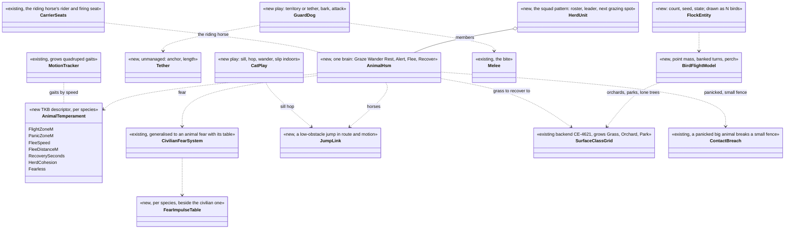
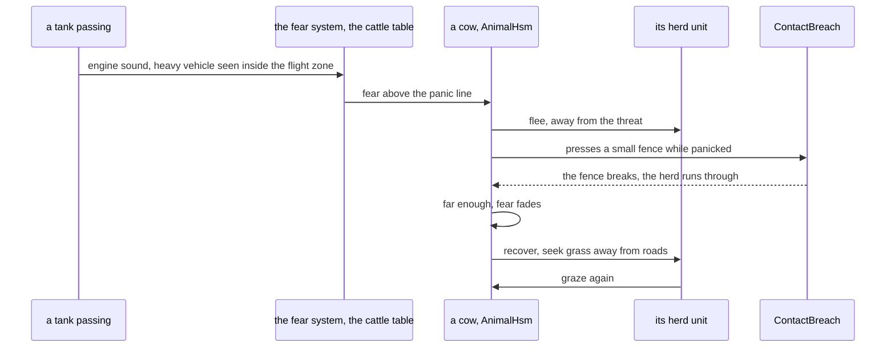
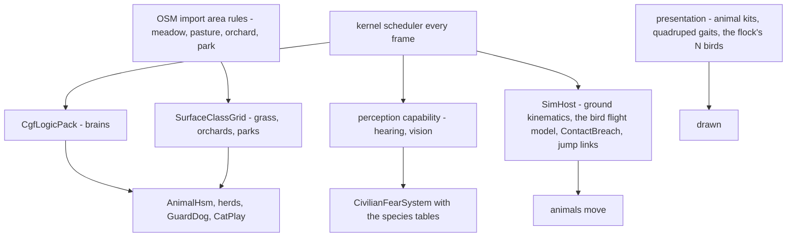

<!--STATUS
state: LIVE
updated: 2026-11-16
build-state: DESIGN — AN-1…AN-14 APPROVED with the user's changes (R-4266); ids fixed (§4a); UML §5; ⏳ the review (§8) before READY-TO-BUILD
current-answer: §1 inventory · §2 the proven pattern · §3 the species · §4 decisions (approved) · §4a the fixed ids · §5 UML · §6 slices
stale-below: nothing
known-rot: none
known-conflict: none — AN-7 amends Breaching B-D1 (a panicked big animal breaks a SMALL fence), approved R-4266
related-designs:
  - ../../DESIGN_Civilians_And_Crowd_Control.md — OWNS the fear model (`CivilianFearSystem`, §5d), the HSM Routine ⇄ Alarmed ⇄ flee / shelter, the crowd — the animal brain generalises it
  - ../../DESIGN_Vehicle_Breaching.md — OWNS `ContactBreach` and B-D1 (who may break a fence)
  - ../vehicle-tactics/DESIGN_Motorcycle.md — OWNS the firing seat and the Drive / Board possession the riding horse reuses
  - ../vehicle-tactics/DESIGN_Checkpoint_And_Ramming.md — RM-1: a vehicle hurts what it hits — animals included
  - ../../DESIGN_Map_3D_Mode.md — OWNS the shape kits and `MotionTracker` (limb swing by the gait rule) the gaits extend
  - ../../DESIGN_Thermal_And_Acoustic_Sensing.md — OWNS hearing and sound classes (what frightens; the dog's bark as a sound)
  - ../../DESIGN_Terrain_Import_UTM.md — the OSM import whose area rules map woods / water today and would map pasture
-->

# DESIGN — animals: cattle, sheep, horses, dogs, birds, cats

🔒 User, `2026-11-16`: *"How can we integrate some kind of animals into the simulation? … cows or dogs or flock of birds or even individual birds.
And maybe also horses, but these as a mean for transportation. The challenging part … they should respond to what is happening around … whenever
there is something which frightens them … they should of course fly away … big animals, like cows, they can even break through the fence … dogs …
stay guarding … attack … horses … two types … a passenger seat … gaits depending on the speed … cats … all the animals should be destructible."*

## 1. INVENTORY *(measured `2026-11-16`; graph: `search_graph name_pattern=".*(Animal|Flock|Herd|Boid|Fear|Panic|Gait|Horse|Dog|Bird|Graz).*" label=Class` ⇒ `CivilianFear`, `CivilianFearSystem`, `PanicState`, `HumanGait`, `TacticalGait`, `TrafficPanicSystem`, SUMO's `FearField` — no animal, flock or herd class; `docs/` + `.dev/` searched for animal / livestock / dog / horse — no design; index coverage could not be checked through the CLI)*

| exists | where | reused as |
|---|---|---|
| ⭐ a FEAR model: heard shots / heavy weapons / blasts raise fear by class impulse × distance, near misses and hits more, fear decays; ⚠ engines, rotors and footsteps frighten NOBODY ("0 for a sound that is not violence") | `CivilianFearSystem.cs:9-47` | AN-2: the SAME system with a per-species impulse table (an engine frightens a bird, a tank frightens a cow) |
| the civilian HSM: Routine ⇄ Alarmed, panic, flight, shelter; crowds | `CivilianBehavior.cs` (`PanicState`), Civilians §5d–§5f | AN-1's state shape |
| hearing and vision sensors, sound classes | Thermal & Acoustic design, `AcousticPerception` | an animal's senses — and the dog's BARK as a sound others hear |
| melee: `Melee.Strike` (reach, damage, knock-down) | `Melee.cs:41-82` | the dog's bite |
| carriers with seats, *Drive* / *Board*, the firing seat, possession | Motorcycle PF-1, PL-1…PL-3; `OperatorUse.cs` | the riding horse |
| `ContactBreach` — a weak fence broken by a hull (B-D1: a player's hull, the bulldozer, a `RamOrder`) | Breaching §7, `HullBreakGate.cs:21-29` | AN-7 |
| ground classes: the new per-type `SurfaceClassGrid` (forest, scrub, roads; backend CE-4621); OSM area rules map only woods and water | `AreaRules.cs:45, :133` | ⛔ no GRASS / PASTURE class — AN-6 adds it |
| `MotionTracker`: limbs swing by the shared gait rule (walk / run weights) | `MotionTracker.cs:7-12` | AN-10 the quadruped gaits |
| Health, injury states, the dead figure, the vehicle-impact rule (RM-1) | Injury, Visual Effects §7 | every animal is destructible like a person |
| ⛔ a locomotion class for a four-legged ANIMAL, a flight model for a bird, a herd or flock | — | built here |

## 2. The proven pattern *(game and livestock practice — each piece adopted only with a reason, §4)*

| piece | where it comes from | why it fits here |
|---|---|---|
| a per-species state machine: **Idle / Graze / Wander → Alert → Flee → Recover → back** | ambient wildlife in games; animal-behaviour models | the same shape as our civilian HSM — one brain, species as data |
| ⭐ the **flight zone**: an animal flees when a threat comes inside a species distance; inside a closer one it panics | livestock handling (cattle and sheep handling practice) | a measurable rule: distance × threat class |
| **boids** (separation, alignment, cohesion) for herds and flocks | Reynolds, used in every herd and flock simulation | sheep tight, cattle loose, birds in the air |
| ONE flock entity drawn as N birds | crowd / particle practice | 200 starlings must not be 200 brains |
| a territorial guard (patrol a yard, bark, attack an intruder) | game guard dogs | the dog |
| gaits by speed: walk · trot · canter · gallop | horse locomotion | an animation rule only (🔒 user) |

## 3. The species

| species | default | frightened by | when frightened | special |
|---|---|---|---|---|
| **cattle** | graze slowly in a pasture, a loose herd | blasts, gunfire, heavy vehicles (the engine sound), people close | the herd runs AWAY, breaks a weak fence if in its way, stops when far enough, seeks grass away from roads, returns to grazing | big: AN-7 |
| **sheep** | graze in a TIGHT herd, move as one | the same, more easily | flee as one tight mass | cohesion high |
| **herd horses** | as cattle, faster, more skittish | the same | flee fast, far | — |
| **riding / war horse** | stands where left; ridden | only blasts close by (war horse: almost nothing) | bolts with its rider if frightened enough (a riding horse) | seats, gaits, possession (AN-8) |
| **dog** | guards a house / yard; patrols it | ⛔ not frightened (a blast makes it flinch) | — | barks at people near (others HEAR it); ATTACKS one who comes close (AN-5) |
| **birds (flock)** | fly across the terrain; land on a field, rest, take off, fly on | anything: a car, people near, any shot | the whole flock takes off and flies away | one entity (AN-4) |
| **lone bird** | fly / perch | the same | flies off | one entity |
| **cat** *(optional)* | sits on a ground-floor sill / parapet; jumps down, wanders, jumps up to another, moves inside | people close, shots | runs indoors / under cover | jumps (AN-11) |

## 4. Decisions *(✅ APPROVED `2026-11-16` with the user's changes — R-4266)*

🔒 User, `2026-11-16`: *"The dogs guarding a house might be tethered, meaning they cannot go far, even if they bark and attack at close distance. They cannot go farther than their tether. Barrier breaking by panicking animals, yes, for small fences. The horses can also jump. Include the cats, they are nice, cute. The birds, they might be sitting at the trees, and when they are frightened they simply fly away, and after a while they can get back on the trees. This should apply to some orchards or public parks, not to the woods. Otherwise approved."*

| # | question | ⭐ lean | why · blast radius |
|---|---|---|---|
| **AN-1** | one brain or one per species? | ⭐ ONE `AnimalHsm` (Graze / Wander / Rest → Alert → Flee → Recover), the species as TKB data (`AnimalTemperament`: flight zone, panic zone, flee speed and distance, recovery time, herd cohesion, territorial, fearless); plays only where a species truly differs (the guard dog, the riding horse, the cat) | one implementation per concept (ruling 9); a new species is data |
| **AN-2** | fear | ⭐ the EXISTING `CivilianFearSystem` gains a per-species impulse table — engines, rotors, footsteps and SEEN heavy vehicles count for animals; plus the flight-zone rule (a threat class inside the species distance) | ⛔ never a second fear system; civilians unchanged (their table stays) |
| **AN-3** | herds | each animal an entity; the herd a hidden UNIT (the squad pattern: roster, a leader) — members keep boids spacing round the leader (sheep tight, cattle loose); the herd chooses the next grazing spot; neighbour reads DECLARED (the parallel rule) | individual animals can be shot, can break a fence, can die |
| **AN-4** | birds | ⭐ a FLOCK is ONE entity (its position, heading, state, a count, a seed) drawn as N birds by a deterministic boids pattern in the PRESENTATION; a lone bird is its own small entity; both on a light flight model (point mass, banked turns). ⭐ **Birds PERCH ON TREES** — lone trees, ORCHARDS and PUBLIC PARKS, ⛔ never the woods: frightened, they fly away; after a while they come back to perch (the same trees or others nearby) | 🔒 user; 200 birds cost one brain; replay draws the same birds from the seed |
| **AN-5** | dogs | ⭐ `GuardDog`: a territory (a yard area) — ⭐ **or a TETHER**: a tethered dog has an anchor point and a tether length and can NEVER go farther than it (its barking and attacking are within the tether only; an intruder outside the circle is barked at, never reached); BARKS at people inside the bark radius — a SOUND others hear (a sentry wakes up: a tactical gain); ATTACKS an intruder inside the attack radius (chase + `Melee.Strike`); not frightened. An attacking dog is a hostile act (NonLethal) ⇒ soldiers may shoot it | the user's guard; and the bark is useful to scenarios |
| **AN-6** | grass, orchards, parks | ⭐ a **pasture / grass** surface class, and ⭐ **ORCHARD and PARK areas** (OSM `landuse=orchard`, `leisure=park`, + authored) as the birds' perching places beside lone trees in the `SurfaceClassGrid`: from OSM (`landuse=meadow / pasture / grass / farmland`, `natural=grassland`) and an authored Pasture area; recovery seeks the nearest grass AWAY from roads and the threat (an EQS query) | ⛔ today there is no grass class at all |
| **AN-7** | a panicking big animal and a fence | ✅ a PANICKED cattle / horse pressing a SMALL fence (wire, wood, a hedge gap — never a wall) breaks it through `ContactBreach`, its mass as the push; the herd then runs through the gap | ✅ 🔒 user: *"yes, for small fences"* — amends Breaching B-D1 |
| **AN-8** | the riding horse | ⭐ a carrier like the motorcycle: a rider seat (a FIRING seat — he can shoot from the saddle) and an optional second; *Drive* / *Board* for the player; a legged motion model (turns while moving, tighter than a bike, no reverse); a war horse fearless, a riding horse bolts with its rider when the fear is high | reuses the motorcycle's seat and possession work |
| **AN-9** | herd horses | a herd species (AN-3), faster and more skittish than cattle | data |
| **AN-10** | gaits | animation only: `MotionTracker`'s gait rule extended to quadrupeds — walk / trot / canter / gallop by speed bands per species, as leg-phase patterns in the animal shape kits | 🔒 user: *"something for the animation part"* |
| **AN-11** | cats | ⭐ INCLUDED (🔒 user: *"Include the cats, they are nice, cute"*): sill / parapet perches from the building layout, a hop between sill and ground as a short jump link, wander, hop up elsewhere, slip indoors when frightened | 🔒 user: *"more on the funny optional side"* |
| **AN-13** | horses JUMP | ⭐ a horse (herd, riding, war) clears a LOW obstacle — a small fence, a ditch, a low wall up to ~1.2 m — instead of breaking or going round it: a jump link in the route and a jump arc in the motion model; a ridden horse jumps on the rider's route (the player: a jump key) | 🔒 user: *"The horses can also jump"* |
| **AN-14** | the cats' perches | sills and parapets of ground-floor windows from the building layout; a hop between sill and ground (the same jump link as AN-13, a small one) | shares the jump mechanism |
| **AN-12** | destructible, neutral | every animal has Health, injury states, the dead figure; hit by fire, blasts, vehicles (RM-1); a NEUTRAL side — soldiers do not target animals unless attacked (the dog) or ordered | 🔒 user: *"destructible the same way"* |

## 4a. The fixed ids — for EVERY lane *(measured free on `coordinator`, `backend`, `ui`, `behaviors`, `terrain`, `2026-11-16`)*

📐 TKB types 700–799 are used nowhere (the hundreds: vehicles 100s, people 200s, units 300s, aircraft 400s, weapon systems 600s); DIS life-form
categories ≥ 200 are used nowhere (people are `3.1.*.1–3`); no class named for an animal exists. ⛔ Permanent wire values once built.

| TKB type | name | DIS (Kind · Domain · Country · Category · Sub) | entity class | 3-D family |
|---|---|---|---|---|
| **700** | `Animal_Cattle` | 3 · 1 (land) · 0 · **200** · 1 | `"Cattle"` = `3.1.*.200` | `VisualFamily.Cattle` |
| **701** | `Animal_Sheep` | 3 · 1 · 0 · **201** · 1 | `"Sheep"` = `3.1.*.201` | `VisualFamily.Sheep` |
| **702** | `Animal_HorseHerd` | 3 · 1 · 0 · **202** · 1 | `"Horse"` = `3.1.*.202` | `VisualFamily.Horse` |
| **703** | `Animal_HorseRiding` | 3 · 1 · 0 · **202** · 2 | `"Horse"` | `VisualFamily.Horse` |
| **704** | `Animal_HorseWar` | 3 · 1 · 0 · **202** · 3 | `"Horse"` | `VisualFamily.Horse` |
| **705** | `Animal_Dog` | 3 · 1 · 0 · **203** · 1 | `"Dog"` = `3.1.*.203` | `VisualFamily.Dog` |
| **706** | `Animal_Cat` | 3 · 1 · 0 · **204** · 1 | `"Cat"` = `3.1.*.204` | `VisualFamily.Cat` |
| **707** | `Animal_BirdFlock` | 3 · **2 (air)** · 0 · **205** · 2 | `"Bird"` = `3.2.*.205` | `VisualFamily.Bird` (N birds) |
| **708** | `Animal_Bird` | 3 · 2 · 0 · **205** · 1 | `"Bird"` | `VisualFamily.Bird` |

⭐ A parent class **`"Animal"` = `3.1,2.*.200-209`** (the DIS mask's list / range grammar, `DisTypeMask.cs:12`) — what every rule that means "an
animal" asks (AN-12's neutrality, the fear table, the ROE). ⚠ **Kind 3 also matches the existing `"Person"` class (`3`)** — the review must
measure every place that treats a `"Person"` / life form as a MAN (body zones `BodyZones.cs:100`, the census, civilians, targeting) and make an
animal answer "animal" there (the more specific class wins, R-279). Declared by: backend (types, DIS, classes); ui (the families and kits).

## 5. UML

*What it shows that prose hid: ONE brain and ONE fear system serve every species — the guard dog, the cat and the riding horse are plays over the
same brain, and the two genuinely new mechanisms are the flock entity and the jump link (shared by horses and cats).*

*What it shows: the herd's flight and recovery are driven by the ONE fear value and the flight zone — the fence breaks through the existing breach
rules, nothing animal-specific in the breach.*

*What it shows: animals ride the same modules as people and vehicles — nothing runs on a node that a person's brain or a vehicle does not already
run on.*

## 6. Slices *(each gated by the review §8 before it is built)*

| # | builds | lanes |
|---|---|---|
| AN-S0 | the taxonomy and fixed ids (the entity classes `Animal` → `Cattle`, `Sheep`, `Horse`, `Dog`, `Bird`, `Cat`, DIS kind / category measured free on every lane); `AnimalTemperament`; the per-species fear table + flight zone; the grass class | backend |
| AN-S1 | cattle and sheep herds: graze, flee, recover to grass | behaviors + ui (the kits, gaits) |
| AN-S2 | birds: the flock entity and lone birds, the flight model, the presentation boids | backend + ui |
| AN-S3 | the guard dog | behaviors + ui |
| AN-S4 | horses: herd horses and the riding / war horse (seats, possession, gaits) | backend + ui |
| AN-S5 | the fence breach (if AN-7 is approved) | backend |
| AN-S6 | cats (included) | behaviors + ui |
