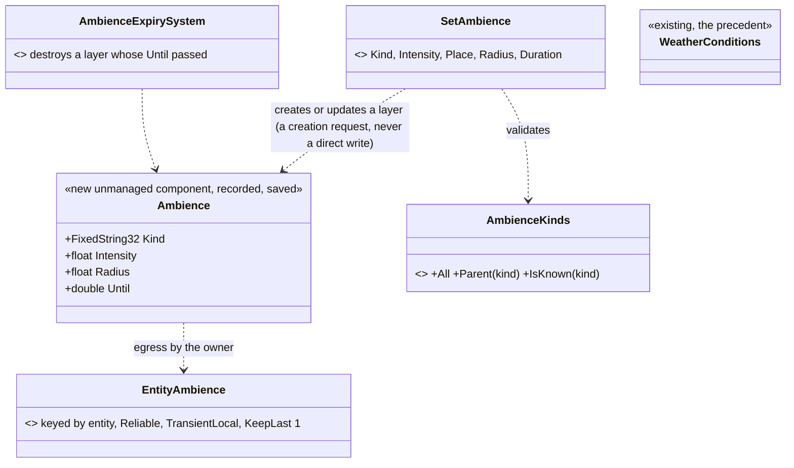
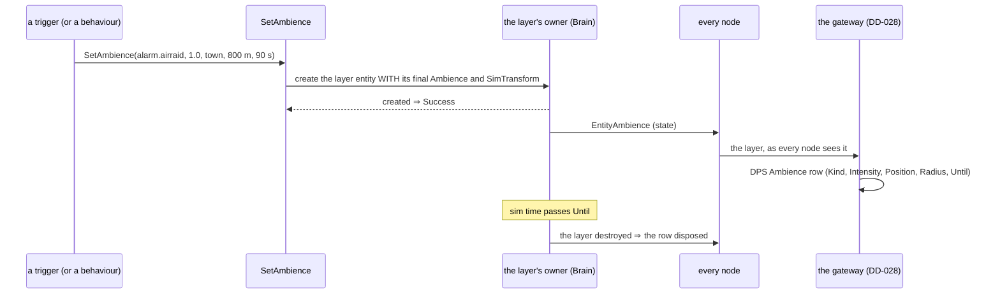

<!--STATUS
state: LIVE
updated: 2026-11-22
build-state: READY-TO-BUILD (CE-11034; R-11014 approved by the user, 2026-11-22: "approved, write the design and reply to Unreal")
current-answer: the whole file — §1 the model, §2 the diagrams, §3 the kinds, §4 decisions, §5 slices
stale-below: nothing
known-rot: none
known-conflict: none
related-designs:
  - docs/designs/audio/DESIGN_FPS_Audio.md — HROT's OWN ambient beds (wind, birds, town, the battle rumble from shots out of earshot, AU-6); this file adds AUTHORED layers any renderer reads; slice A3 there may follow a battle.* layer (§5 slice 3)
  - docs/designs/weather/DESIGN_Weather_And_Time.md — the precedent shape (authored state on positionless / area entities, replicated, a late joiner gets it); weather reaches DPS with this file's gateway half
  - docs/DESIGN_Scenario_Rules.md — SR-93, the ONE action vocabulary: SetAmbience joins it
  - SimNetGateway docs/design/DD-028-Dps-Ambience-And-Weather.md — the DPS half: the Ambience and Weather topics
-->

# Ambience — the battle around the scenario, alarms and sirens, as kinds a renderer plays *(ui, `2026-11-22`; `CE-11034`, R-11014)*

🔒 User, `2026-11-22`: *"If there is some way how to indicate to the Unreal client what kind of ambient sound to play without knowing the exact
name of the sound. We might invent some identifiers or short texts, but not a concrete sample, more like a kind ID."* → *"approved, write the
design and reply to Unreal"*. Asked by the Unreal lane's `NOTE_UnrealIg_To_Hrot_Battle_Ambience.md` (`unreal-ig` `0f2d9b4f1`): a scenario-level
"battle around us", scenario cues (air raid, alarms, evacuation), and weather on the feed.

## 0. INVENTORY (measured `2026-11-22`)

| query | result |
|---|---|
| `scripts/cbm.sh search_graph name_pattern ".*(Weather\|Ambien\|Soundscape\|Cue).*" label Class` | 23 — `EntityWeather` (+ its translators), `WeatherConditions`; `SoundTrack.Cue` (the film's log), `ContactCues`, `ScenarioChecks.CheckCue`, `EntityBodyLayer3D.AmbientBody` — ⛔ none is an authored ambience |
| grep `docs/` for ambience / soundscape / siren / air raid | `DESIGN_FPS_Audio.md` (HROT's own beds, AU-6, clips 7361–7365) · the convoy drafts (prose) — ⛔ no authored ambience design |
| `SoundSources.cs:477-481` | HROT's own beds: Wind, Birds, BattleRumble (from fire out of earshot), Town — clip ids, ⛔ not kinds |
| `SimDescriptors.cs` `EntityWeather` | weather replicates inside HROT (Reliable, TransientLocal, KeepLast 1); the gateway sends none (grep of SimNetGateway `src`: no weather topic) |

## 1. The model

An **ambience layer** is an entity carrying `Ambience { Kind, Intensity, Radius, Until }`: positionless ⇒ heard everywhere (the war around the
scenario); with a `SimTransform` ⇒ heard within `Radius` of it (a town's air-raid siren, a base alarm). `Kind` is a short dotted name from one
list (§3), never a sample: a renderer maps the name to whatever it has, and an unknown name falls back to its parent (`alarm.airraid.preliminary`
→ `alarm.airraid` → `alarm`). Layers are STATE (R-11007): a late joiner hears what is sounding, a replay restores it.

## 2. The diagrams



*What the picture shows that prose hid:* nothing writes `Ambience` but its layer's owner; the action reaches it through the creation path, so a
trigger, a behaviour and the scenario author build the same entity.



```mermaid
graph TD
    subgraph Brain["Brain / the editor alone"]
      ACT[SetAmbience - any trigger, BTree, HSM, director]
      EXP[AmbienceExpirySystem - every frame on the owner; its registering pack is chosen at build (beside the weather's)]
    end
    subgraph Wire["NED"]
      DESC[EntityAmbience descriptor]
    end
    subgraph Readers
      GW[SimNetGateway host - DPS Ambience]
      FPS[HROT FPS audio - may follow battle.* later]
    end
    ACT --> EXP
    EXP --> DESC
    DESC --> GW
    DESC -.-> FPS
```

*Caption:* the dashed edge is NOT built by slice 1 — HROT's own mixer keeps its derived rumble (AU-6) until slice 3.

## 3. The kinds (first values — the Unreal lane may propose more from its pack)

| family | kinds | the Unreal pack's sound (their note §2) |
|---|---|---|
| `battle` (a bed, loops) | `battle.distant` · `battle.city` · `battle.night` · `battle.heavy` (tanks, artillery) · `battle.sniper` · `battle.ambush` · `battle.aftermath` (burning, few shots) | A |
| `event` (a moment) | `event.airstrike` · `event.drone` · `event.rocket` · `event.convoy` · `event.evacuation` · `event.evacuation.city` · `event.nuclear` | B |
| `alarm` | `alarm.airraid` · `alarm.airraid.preliminary` · `alarm.bell` · `alarm.intruder` · `alarm.emergency` (sirens with explosions) | C |
| `naval` | `naval.ship` · `naval.warship` · `naval.underwater` | E (no use today) |

⛔ Not kinds: the listener's own state (inside a tank, wounded — their D) is the client's, from possession and `EntityStatus`; distant shots to
compose a war (their F) are the client's way to play `battle.distant`.

## 4. Decisions

| # | decision | rejected (one line each) |
|---|---|---|
| **AM-1** | a kind is a dotted text name (`FixedString32`) from `AmbienceKinds`, with parent fallback | a numbered enum — every new kind a contract change for every client · free text — no list, drift · sample names — the recordings stay in the client |
| **AM-2** | a layer is an entity with `Ambience` (positionless = everywhere, positioned = within `Radius`) | one global setting on the World Environment — cannot hold a siren at a town; a separate event topic — a late joiner misses a siren already sounding |
| **AM-3** | `SetAmbience` is a stateful `[SharedAiAction]` (SR-93): creates the layer with its final value, or — the same `Kind` at the same `Place` — replaces it; `Intensity 0` removes it; `Duration 0` = until removed | a trigger-only verb — behaviours could not raise an alarm |
| **AM-4** | unknown kinds are ALLOWED at run time (logged once) and refused by the editor's picker | refused at run time — a newer scenario on an older HROT would fail |
| **AM-5** | authored layers are ordinary scenario entities (the editor's add-entity picker, a kind dropdown, an intensity, a radius) | a header field — would need its own save path (SR-71 is moving weather to the header; ambience has no clock or global singleton to justify it) |
| **AM-6** | HROT derives no moments in slice 1 (hostile aircraft near a town ⇒ siren) — a behaviour or a rule calls `SetAmbience` later | derived in the engine now — a rule nobody asked for yet |

## 5. Slices and acceptance (R-4277)

1. **Slice 1 (CE-11034):** `Ambience`, `AmbienceKinds`, `SetAmbience`, `AmbienceExpirySystem`, `EntityAmbience` + its translators; rails:
   create / replace / remove / expire, positionless vs positioned, the descriptor round trip, a late joiner gets the layer, 0 B per steady frame
   for the expiry system, `HROT_PARALLEL_SIM=1 HROT_READ_CHECK=1`; a scenario `ambience-air-raid` (a positionless `battle.distant` from the
   start; a trigger at 30 s raises `alarm.airraid` at the town for 60 s) with `checks.json` expect rows on the layers present at each time.
2. **Slice 2 (ui):** the editor's picker entry and the Details form (kind dropdown from `AmbienceKinds`, intensity, radius, until).
3. **Slice 3 (later):** HROT's FPS audio plays the kinds it has a clip for (`battle.*` lifts the rumble bed).
